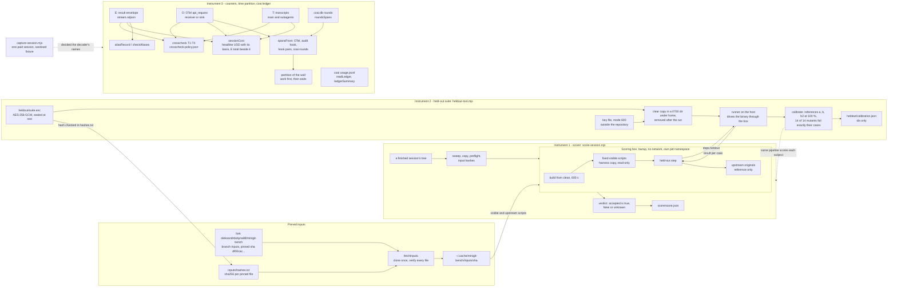

# minigit stack bench — the measurement instruments (epic E1)

> What exists **today**, in `spikes/minigit-bench/`. Epic E1 of `todo/PLAN_minigit_stack_bench.md` is built: three
> instruments that give correct numbers before any model touches the task. No session has been run through them yet,
> and nothing here is a result. What is still missing is in [What it does not do yet](#what-it-does-not-do-yet).
>
> **This repository is public and the sessions it will score have network.** This document, like every file committed
> in clear, names the held-out suite only by shape: its counts (N1 = 29 cases for v1, N2 = 29 for v2, M = 14 mutants)
> and the ids-only calibration result. It never names a case, a reference implementation or a mutant.

## Purpose

The bench compares the same task (build `minigit` from a specification) on two stacks, with and without the family's
process. The original benchmark it descends from failed on correctness, cost and time (a cache billed twice, a test
that passes a wrong parent, a swallowed build error, a test the agent could edit, a crash read as "no tests"). E1
builds the three instruments and proves each on fixtures and on one real capture:

| Instrument | Question it answers | Entry |
|---|---|---|
| **Scorer** with its **held-out suite** | Did the cell's `minigit` do what the SPEC says, measured on a pristine copy by tests the agent never saw, one defect counted once | `score-session.mjs`, `heldout-tool.mjs`, `adjudicate.mjs` |
| **Counters** | What the session cost at published prices, cross-checked three ways, never double-billing a cache and never priced from a fitted rate | libraries (`lib/`), no command |
| **Time partition** and the **coai ledger reader** | Where the wall went, in categories that sum to the wall; what the review models consumed, in tokens | libraries (`lib/`), no command (the rounds reader opens `coai.db`) |

Everything is plain ESM `.mjs` on Node 26 with no dependency and no `package.json`. A value that could not be measured is
`{ known: false, why }` and renders `unknown`, never `0`. CI does not run the spike; the required environment is Linux with
`bwrap` and user namespaces (the series machine, WSL2 Ubuntu).

## How the pieces connect



Solid arrows are data the code moves today. Only the `coai.db` rounds feed the spans; `usage.jsonl` is summarised in tokens and never becomes a span. Dotted arrows are use: calibration scores its subjects through the scorer, and
the one real capture is the evidence the counters' decoder and policy were built on.

## The three instruments

### 1. The scorer — `score-session.mjs`

One command scores one finished session the same way for both arms (`lib/score-pipeline.mjs`). Its steps, in order, each
recorded in `score/score.json`:

1. **sweep** — removes this session's scorer-owned leftovers older than the wall limit (ownership markers live in
   `score/.owned/`, a directory the box never binds); anything unmarked is only reported;
2. **copy** — the session tree to `score/copy` (build output and dependency directories left out), plus per-scoring copies
   of the seeded offline NuGet and npm caches and a scratch HOME and TMPDIR;
3. **preflight** — the box can start;
4. **inputs** — the session's specs against the pinned hashes: a mismatch is recorded as `inputsTampered`, a missing file as
   `inputsAbsent`;
5. **build** from clean, 600 s;
6. **visible** — the harness's fixed `test-v1.sh` (and `test-v2.sh` for a v2 phase), each on its own fresh copy of the built
   tree, with a per-invocation timeout shim (10 s) in front of `minigit`;
7. **heldout** — the sealed suite's runner against the built binary;
8. **upstream** — the original upstream scripts, reported as reference only and never part of the verdict;
9. **verdict** — `accepted` is true only when the build is clean, every visible script is 100 %, the held-out primary is
   100 % and (process arm) the work was delivered. A definite failure is `{ known: true, value: false }`; a missing
   ingredient is `{ known: false, missing }`, never `false`. `delivered` has no source yet, so a process session reads
   `unknown` (see below).

A script counts as 100 % only when its summary says so **and** the script itself ended cleanly: exit 0, no signal, no
timeout. A summary that cannot be read scores every test as failed, never "0 of 0". Which of the fork's scripts are used and
what was changed in them is in `spikes/minigit-bench/inputs/UPSTREAM.md`.

### 2. The held-out suite — `heldout-tool.mjs`, `adjudicate.mjs`

The suite is **sealed at rest and calibrated before any cell**.

- **Sealed.** `heldout/suite.enc` is one deterministic archive (suite, references and mutants together, nothing in clear)
  encrypted with AES-256-GCM. The key is a mode-600 file (`~/.config/minigit-bench/heldout.key` by default), read by the
  scorer itself and **never** from or into an environment variable; a key readable by group or others, or a link, is
  refused. `suite.enc.sha256` and `heldout/manifest.json` (counts, plaintext hash) sit beside it, and the archive's sha256 is
  also a line of `inputs/hashes.txt`.
- **Clear only in a scoring temp directory.** `withClearSuite` decrypts into a fresh 0700 directory under the operator's
  home (never the temp directory, never inside a git worktree), removes it in a `finally`, and `sweep` removes any a crash
  left behind. The suite's case repositories are built by the cell's own `init`, `add` and `commit` under a directory the box
  binds, and are removed once the result is written.
- **Run.** The runner is trusted code on the host (`python3 -I`); it reaches the cell's binary only through the scoring
  box argv it is handed. A case that crashes, times out or finds no command fails; a case whose setup needs a core command
  that failed its own case is `blocked` (reported apart, counted as not passed, never as a second failure).
  `heldoutScore` gives two pre-registered measures: `percent` (cases passed over N, blocked counted as not passed) and
  `defects` (distinct failed SPEC clauses, so one broken command counts once). A result that cannot be read is
  `{ known: false }`.
- **Calibrated.** Against the sealed suite, scored through the same pipeline as a session: three independent reference
  implementations (a, b, b2) score 100 % on the visible and held-out cases in both phases, and each of the M = 14 mutants
  fails **exactly** its pre-registered cases in both phases (14 of 14 exact). The pre-registration is the registry inside
  the archive; an observed set is never copied into it. The ids-only result is `heldout/calibration.json`. Two references
  can share one misreading, and mutants prove sensitivity to the defects chosen, not completeness; the series report says so.
- **Leak check.** `leakcheck` reads literal and six-word-shingle needles from inside the archive and scans every file git
  would commit, the commit messages and every patch of the branch range. A hit names the file and the needle's number, never
  the needle. A paraphrase sharing no six consecutive words is undetectable by design.
- **Adjudication** (`adjudicate.mjs`, per series directory outside git because the packets hold case text). Step 1 sees
  only the SPEC sentence, the case and its captured output, with stack and arm replaced by a random id and runtime names,
  paths, frames and exception names masked (the masking rules are printed with the packets); that step alone can class a
  case as SPEC ambiguity. `reveal` refuses until every packet has a step-1 verdict. Step 2 sees the code and separates
  product from harness defects. `revised` drops every case classed ambiguous in any cell from all cells and writes the
  revised score **beside** the primary one, which is never rewritten.

### 3. The counters, the time partition and the coai ledger reader

Pure over records, except at four I/O edges: `lib/otel-receiver.mjs` (the live receiver), `capture/*` (the capture run, its file
sink and the reading and writing of capture directories), `lib/coai-usage.mjs` (`roundsSpans` opens a copy of `coai.db` read-only through
`node:sqlite`) and the scorer's own files. There is no command that runs the counters on a session yet (a runner is E3).

**Three views of one session** (all from the same CLI, so cross-checks of the reading, not independent billing):

| View | Source | What it supplies |
|---|---|---|
| **E** `envelopeView` | the stream's result envelope | `total_cost_usd`; per-model tokens and `costUSD` from `modelUsage` (it includes subagents; `usage` is main-loop only and is never used for totals) |
| **O** `otelView` | OTel `claude_code.api_request` records, decoded from OTLP/HTTP JSON | per request: model, four token kinds, `cost_usd`, `duration_ms`, `query_source` (mapped to a role by `roleOf`), `request_id`, `agent_id`; plus `tool_result` records |
| **T** `transcriptView` | `projects/<session>.jsonl` and `subagents/agent-*.jsonl`, grouped by `message.id` | final output tokens and the cache-write 5m/1h split, on main and child lines |

The stream (`streamView`) is deduplicated by `message.id` and prices nothing but a labelled estimate: its output tokens are
placeholders.

**`sessionCost`** returns the headline USD with its basis stated, the CLI's own total beside it, per-model tokens and flags.
The headline is a sum over models of the four token kinds priced separately at the dated published table
(`inputs/prices-2026-10-29.json`, which carries a Fable 5.1 row), tokens from `modelUsage` and the 5m/1h split from T; a
model with no message-level split is an interval, not a guess. A killed session without an envelope is priced from O and
flagged `no envelope`; with neither it is `unknown`. A model the table lacks is `unknown`: there is no prefix match and no
default row. `cliRates` entries name the CLI version they were observed on and apply only to it.
`no-fitted-rates.test.mjs` scans for every caller of the earlier spike's fitted pricing (`costFromMessages`,
`summarize`, `parallelism`, `childCosts`, `CostMeter`) and fails if the new spike calls one.

**`crosscheck` T1–T4**, with the verdict each breach carries read from `inputs/crosscheck-policy.json`:

| Check | Compares | Limit | On breach (policy today) |
|---|---|---|---|
| T1 | E against itself: Σ `modelUsage[*].costUSD` against `total_cost_usd` | $0.01 | `stop` |
| T2 | O over all sources against E, per model and token kind; cost | max(0.5 %, 100 tokens); cost 1 % | `otel-incomplete`, the cell is kept |
| T3 | T re-priced as the CLI bills against O's `cost_usd`, joined by `request_id` | 2 % | `investigate` until E3 arms it |
| T4 | T's input and cache tokens against the O records T names | 0.1 % | `investigate` |

T is compared with O and never with E, because E's `modelUsage` carries no `query_source` and cannot be cut down to what T
sees. A check that cannot be made is `unchecked` with its reason, never a pass: an O record whose role is main, subagent or
unknown and that no transcript names (a lost subagent file), two T messages sharing one `request_id`, an O record missing a
token field or `cost_usd`, or no envelope. `loadPolicy` refuses a policy whose T3 fallback would leave nothing to stop the
series.

**`aliasRecord` / `checkAliases`** (decision D12). The alias → exact model id record of one session, checked against the
series baseline: an alias that now resolves to a different id, or an unexpected internal model, is a `stop`; a first use only
extends the baseline; a `model_refusal_fallback` is a `flag`.

**The OTel receiver** (`startReceiver`) listens on `127.0.0.1` only, JSON only, bounded; it keeps every body raw, the decoded
records, and a running `cost_usd` sum (final per request, children included) for a cost watchdog.

**The time partition** (`timeline.mjs`, `spans.mjs`, `classify.mjs`, `categories.mjs`). `partition(wall, spans)` takes every
elementary interval of the wall and gives it the highest-priority category active in it **across all agents**, so a wait counts
only where no agent is working: one child's `sleep 300` cannot erase another child's build. Priority: work
`build_test > model_api > other_tool > hooks`, then waits `coai_gate > consultant > ci_wait > coderabbit_wait > sleep300`,
then `unattributed`. The categories plus `unattributed` sum to the wall to the millisecond; `active` is the sum of the work
categories, never wall minus waits. Nothing is a sum of spans: the inclusive view is a union, agent-seconds are labelled work
volume, and `overlapMatrix` is separate. `classifyTool` is pure string work on the command (no process is run); it splits at
the top level of the quoting and the first matching rule decides. Spans come from OTel (`model_api`, `[ts − duration, ts]`
because a record's time marks the end of the request), the audit hook's tool records, the hook start/response pairs placed by
the runner's arrival stamp, and coai `rounds`. `crossCheckTools` compares tool spans with OTel `tool_result` durations within
max(1 s, 2 %). `mapClock` places the launcher's monotonic clock on the epoch and flags a skew over 1 s.

**The coai ledger reader** (`coai-usage.mjs`). `readLedger` and `ledgerSummary` read `usage.jsonl`: per provider, model,
kind, role and stage, in tokens, with `cached` inside `in` (uncached = in − cached, asserted on every row, so the cache is
never added twice). A subscription CLI reports no money: a null cost is `unknown (subscription)`, mixed ledgers give the known
sum plus "N unknown", and no field of the summary can be added to Claude's dollars. A `usage not captured` row makes its
tokens a lower bound. `roundsSpans` reads the gate rounds from `coai.db` through `node:sqlite`. Its fixtures are
synthetic: no real ledger has been captured yet.

### 4. The detection half (E2.S1)

Pure over records; the writers are `policy-ab-quick`'s hook and process launcher.

- **`lib/egress-hosts.mjs`** — `EGRESS_HOSTS` per arm (bare: the npm and NuGet registries; process: plus `github.com`,
  `api.github.com`, `codeload.github.com`) and `KNOWN_REFUSED`. One list for the egress proxy (E2.S2) and the contamination
  scan's `web` rule. `api.anthropic.com` is in no arm's list: the API leaves through the credential broker (D23).
- **`lib/contamination.mjs`** — `contaminationHits({ calls, mcpResults, ctx })`, nine named rules in `CONTAMINATION_RULES`
  (`foreign-run-ref`, `other-run-id`, `foreign-pr`, `other-stack-template`, `upstream-solutions`, `minigit-elsewhere`,
  `harness-name`, `outside-path`, `web`). A hit is `{ severity, rule, source, where, excerpt }`, at most one per rule per record,
  with a 120-character excerpt in which credentials are masked. An edit or write is judged by its path, never its content; an
  `mcp__` call by its whole input. `outside-path` is `policy-ab-quick/lib/leak.mjs` with `flavour: 'posix'`.
- **`lib/token-scan.mjs`** — `tokenHits(texts, ownSecrets)`: GitHub and Anthropic credential shapes plus the session's own
  secrets (8 characters or more). A hit is `{ source, kind, offset }`, never the text or a prefix of it; `maskTokens` is the
  same scan as a replacement.
- **`lib/canary-plan.mjs`** — `sessionCanaryTargets`: one canary in each existing operator project folder and its `memory/`,
  and one in the partner's `CLAUDE_CONFIG_DIR/projects/`. Planting stays `policy-ab-quick/lib/canaries.mjs` (`plantTargets`,
  manifest first; `unplant` takes extra roots).
- **The audit record** (`policy-ab-quick/hooks/audit.mjs`) now carries `tool_use_id`, `session_id`, `duration_ms` (null when
  absent, never 0) and a Bash call's `run_in_background`; `--out <file>` names the log. `test/audit-contract.test.mjs` feeds
  its records to `spansFrom`.
- **One kill.** `killTree(pid, { kill, log })` in `policy-ab-quick/lib/proc.mjs` reads the pid's descendants from `/proc`
  first, then signals the process group, the pid, and each descendant with its own group (a child that called `setsid`, as the
  CLI's Bash-tool shell does, is in neither), never the caller's own group. `spawnTracked` is the one way to start a child that
  is killed by pid: detached on POSIX and registered, so SIGINT, SIGTERM, SIGHUP and process exit kill the live children
  (exit code 128 + the signal). The launcher, `run-cell.mjs`, `lib/run.mjs` and the capture all end children through it.
  No spike module reaches a shell interpreter: `test/no-shell.test.mjs` scans both spikes (only `spawn`, `spawnSync`,
  `execFile`, `execFileSync` may be imported from `child_process`; a `shell` option must be literally `false`).
- **The ref rules** (`lib/contamination-refs.mjs`): a pull request is the first positional after a `gh pr` verb, option values
  skipped, and a pull URL counts only under the own origin; the fork's `data` branch is found in any ref position (`origin/data`,
  `data:`, `..data`, `?ref=data`, `/tarball/data`, `--branch=data`) and a bare `git fetch` or `--all` / `--mirror` is a low
  reach; another run's ref is found after dots, `=` and `%2F` and as `run/*`, while a relative folder `run/output/` is not a ref.

### 5. The agent box, the egress proxy, the credential broker and the launch (E2.S2)

Spec by Fable (`todo/PLAN_minigit_stack_bench_E2.md`, `## E2.S2`), coded by Sonnet (this story names Opus as its reviewer). One paid session proved the
whole path on 2026-10-30 (see "The bare-session smoke" below).

- **The box** (`lib/sandbox.mjs`, `lib/bwrap.mjs`). `agentBoxArgv` / `agentBoxPrefix` build the `bwrap` argv: the filesystem read-only, the
  shared hide list `hiddenPaths()` (home, `/mnt`, `/run`, `/tmp`, `/var/tmp`) as empty tmpfs, then ONLY an explicit bind list (`box/work`,
  `box/home`, `box/config`, `box/tmp` as `/tmp`, `box/nuget`, `box/npm`, `box/out` read-write; `harness/`, `net/`, the node dir, the
  toolchains and the `claude` file read-only). The session directory itself is never bound: it also holds the instruments. Its own
  network, pid and ipc namespaces; the bare arm puts `/dev/null` over `gh`. There is no `--setenv` and no `--clearenv`: the environment
  travels in the spawn's `env`, so no value is ever on an argv (`--setenv` is in `/proc/<pid>/cmdline`, readable by every user; a test
  shows it). `agentEnv` is a fixed allow-list (`AGENT_ENV_KEYS`), `PATH` is constructed (no `/mnt`), and the credential in it is a
  **dummy**; the real token is not a parameter of anything in the box's path. `sessionLayout` claims `<runs root>/<rid>/` with a
  non-recursive `mkdir` and refuses a socket path over 108 bytes (UTF-8 bytes; 109 refused with `EINVAL` on this kernel).
- **The supervisor** (`harness/box-init.mjs`, node builtins only, copied into `harness/`). Starts a loopback forwarder per
  `<port>:<unix socket>` (proxy 3128, API door 8787, OTel 4318 on the box's own loopback), then runs the command and exits with its
  code (`128 + n` for a signal; the old probe copy mapped every signal to 137). It ignores SIGTERM aimed at itself: the stop signals each
  inner process by its marker.
- **Egress** (`lib/egress.mjs`). A CONNECT proxy on `net/proxy.sock`: only `CONNECT <host>:443` for a host named EXACTLY in
  `EGRESS_HOSTS[arm]` (no suffix, no case folding), `403` otherwise, `405` for any non-CONNECT line (plain HTTP is not proxied), a header
  block over 64 KiB closes the connection; every request is one log line. `api.anthropic.com` is in no list.
- **The broker** (`lib/broker.mjs`, `lib/budget.mjs`). On `net/api.sock`: replaces `Authorization` with the real token (read by the harness
  through `lib/secrets.mjs`), forwards every other request header (an open list: `anthropic-beta` carries the OAuth capability),
  drops `accept-encoding` so the usage parser reads plain SSE, streams the answer back chunk by chunk, follows no redirect (`502`),
  and holds the cell's own budget: a reservation per in-flight request, `429` with an API-shaped `rate_limit_error` when spend plus
  reservations would pass the cap (so a Bash `curl` at the door cannot spend past it), settlement priced from the parsed usage with
  `asTheCliBills`, the reservation as the charge when nothing parsed, a disconnecting client still charged. The cap is **soft** (D-17a):
  a session over 1.1 x the cap is flagged. The ledger line names header NAMES, never a value, a body or the token. `brokerView` is the
  4th cost view and `crosscheck` gains **T5** (`B.spentUsd` = `E.total_cost_usd` within $0.000001; unchecked with an unsettled request,
  because then `B` is the price of a killed session).
- **Launch** (`lib/launch.mjs`, `lib/readback.mjs`, `lib/watchdogs.mjs`, `lib/janitor.mjs`, `lib/session-state.mjs`,
  `lib/session-launch.mjs`). Settings pin effort `high`, allow an explicit list, wire five hook events to the harness copy of the audit
  hook, and carry no `apiKeyHelper` and no `defaultMode` (`FORBIDDEN_SETTINGS`; the read-back refuses them). The init event is read
  back before the first paid turn completes; a mismatch stops the session through `endCell` and the outcome is `void: harness`. The
  outcome of a session is the envelope's (`is_error`, `api_error_status`, `subtype`), never the exit code: a 403 exits 0. Watchdogs
  (pure `watchdogDecision`: wall, cost from the broker then O then the stream meter, stall) tick every 5 s.
- **The stop** (D-14, `endCell`). SIGTERM to every INNER process of the cell (a host pid whose `environ` holds `BENCH_CELL=<cell>`
  exactly, `argv[0]` not `bwrap`), a grace, then `killTree(bwrapPid)`, then the janitor ends any survivor by marker, never by name. A
  signal to the process GROUP is never step 1: under `--new-session` the group holds only the outer `bwrap`, which dies on it and takes
  the inside down by SIGKILL.
- **Cleanup and state** (D-20, D-21, D-21a). A LIFO stack of idempotent disposers runs on every exit path (success, read-back kill,
  watchdog kill, startup failure, throw, abort); a failing disposer does not skip the next and lands in `meta.json.cleanup`. A dir that
  holds nothing paid is removed on a startup failure; any other is kept. `state.json` records the owner as `(pid, start time)`
  (field 22 of `/proc/<pid>/stat`); `retireStale` retires a session only when that exact pair is gone, never by a heartbeat age, ends its
  survivors by marker, unlinks its sockets and deletes nothing.
- **Shared pieces extracted** (no copies): `lib/secrets.mjs` (the capture's mode-600 reader, label-aware; `PAT_FILE_PARTS` for E2.S4),
  `lib/transcripts.mjs`, `hiddenPaths()`, `startReceiver({ socketPath })` (a second listener over the same handler, mode 600, removed on
  `close()`), `lib/disposers.mjs`, `lib/proc-sampler.mjs` (counts of the real token and the dummy in every cmdline and environ, once a
  second; counts only, never a value), `lib/stream-tap.mjs` (every stdout line stamped `{ t, line }`), `lib/session-scan.mjs` (every file
  of a session dir through `tokenHits` with the real token as an own secret).
- **Preflight** (`lib/preflight.mjs`, `lib/host-checks.mjs`, `inputs/stacks.json`). `bwrap` and user namespaces; the TypeScript toolchain
  installed read-only when asked and absent (`npm install --prefix`, `chmod -R a-w`); then the pins (`claude` 2.1.310, node 26.12.1, dotnet
  SDK 10.0.113 and exactly one, `tsc` 7.0.2) probed INSIDE a box with no proxy and no broker; the token file's status.

#### The bare-session smoke (2026-10-30, CLI 2.1.310)

`node spikes/minigit-bench/smoke-session.mjs --out ~/rsd/minigit/smoke/<UTC stamp>`, once, then `sanitise` and `verdicts`. The
fixture is `test/fixtures/real/claude-2.1.310-bare-smoke/`; `SMOKE.md` there is computed (`lib/smoke-verdicts.mjs`), never typed.
Observed: envelope **$0.114845**, the broker's ledger $0.1148446 (equal), O equal, 5 requests through the broker and none refused, wall
17.4 s, outcome `ok`, 14 samples with the real token counted 0 times in any cmdline or environ, 14 refused `CONNECT api.anthropic.com:443`
at the proxy and nothing else, 8 audit records with `duration_ms` on every `PostToolUse` (B-A2 holds), no timestamp on any hook event
(B-H1 holds), every API request `effort: high` including the subagent's. B-K2 is `not exercised` (the session ended by itself).

**Two things the smoke taught that the spec did not predict:**

1. **`token.txt` was empty, not the dummy.** CLI 2.1.310's Bash tool does not hand `CLAUDE_CODE_OAUTH_TOKEN` to its subprocesses:
   `printenv` exited 1 (the model said so). That is stronger than the spec assumed, so B-S3 now reads "`token.txt` holds the dummy or
   nothing" (dated 2026-10-30, with a test that anything else refutes it). It also means this probe shows only that Bash cannot see the
   variable; that the dummy is in the CLI's own environment is shown by the samplers (56 environ hits) and by the effect tests, which
   run `printenv` and read `/proc/*/environ` in the box with a positive control.
2. **B-H1 read the wrong source.** E1's `A-H1` takes hook tool-use ids from the stamp hook's file; the smoke's equivalent is the audit.

#### Facts verified on this machine (E2.S2 tests; dated 2026-10-29/30)

| Fact | Test |
|---|---|
| With `--unshare-net` the box reaches no host loopback listener, no abstract unix socket and no internet address; without it all are reached | `The_agent_box_reaches_no_host_loopback_abstract_socket_or_address` |
| A unix socket bound into the box through a read-only bind of its directory is connectable across the namespace boundary; without the bind it does not exist | `A_bound_unix_socket_crosses_the_namespace_through_a_read_only_bind` |
| The box has no DNS and needs none (clients send the host name to the proxy) | `The_box_has_no_dns_and_that_is_the_point` |
| The proxy lets `api.nuget.org` through and refuses `example.com` and `api.anthropic.com` with 403; plain HTTP gets 405 and `dotnet restore` still succeeds; `npm install` of `typescript@7.0.2` and `dotnet restore` both work through it | `egress-box.test.mjs` (needs the network; skips with its reason) |
| `printenv`, `/proc/*/environ` and a persisted file hold the dummy and never the real token; with the real token placed in the env by hand the same probes find it | `agent-box-token.test.mjs` |
| A direct `POST` at the broker with a zero budget is `429`, and the upstream sees 0 requests | `broker.test.mjs`, `egress-box.test.mjs` |
| No operator home, key or token file, no `/mnt`, no WSL interop, no `gh` (bare), the toolchain read-only; the instruments and the partner are invisible; `harness/` and `net/` are read-only | `agent-box-fs.test.mjs` |
| A SIGTERM to the process group never reaches inside the box; a SIGTERM to the inner host pid is delivered and its exit code comes out through `box-init` and `bwrap`; the CLI signalled mid-request exits itself with 143 and leaves its transcript; **no OTel record followed the SIGTERM** (10 before, 0 after, reproduced 2026-10-30) | `janitor.test.mjs` |
| An abort or a startup failure leaves no listener, no socket and no cell process | `session-launch.test.mjs` |

### Entry points of E2.S2 (the box, the broker, the smoke)

| Command | What it does | Exit codes |
|---|---|---|
| `node spikes/minigit-bench/smoke-session.mjs --out <dir outside every git tree> [--dry-run]` | **spends money** (cap $0.20, wall 5 min, stall 2 min): preflight (installs the TypeScript toolchain when absent), stale-session retirement, one bare session through the box, the proxy and the broker, then `checks.json` (host-side facts that need the real token). The token is read ONLY from `~/.config/minigit-bench/claude-oauth-token` and goes to the broker only. `--dry-run` shows the plan and spends nothing | 0 ok · 3 environment (no token, preflight failed, bad out dir) · 4 usage · 5 the session failed or ended void · 130/143 cancelled |
| `… smoke-session.mjs sanitise --from <dir> --to <fixture dir>` | stages the session into the capture-shaped layout and copies it through the sanitiser, fail-closed | 0 · 5 |
| `… smoke-session.mjs verdicts --fixture <fixture dir>` | computes `SMOKE.md` (the B-* table) from the fixture | 0 · 3 · 5 |

## Entry points

Run from the repository root. `write` goes to stdout; the exit code is the contract. No command takes the held-out key on
argv or in the environment.

| Command | What it does | Exit codes |
|---|---|---|
| `node spikes/minigit-bench/run-tests.mjs [glob…]` | the one way to run the spike's tests: lowered priority, `node --test` with at most `min(8, CPUs − 1)` workers; default glob `test/**/*.test.mjs`. `BENCH_REQUIRE_SANDBOX=1` turns every skip that needs `bwrap`, `python3` or the key into a failure | the child's own exit code (0 all passed); `128 + signal` if it was killed; 1 if it could not start |
| `node spikes/minigit-bench/score-session.mjs --session <dir> --source <dir> --arm process\|bare --stack csharp\|node --phase v1\|v2 --toolchain <dir>… [--nuget-cache <dir>] [--npm-cache <dir>] [--inputs-repo <url\|path>]` | scores one finished session and writes `<session>/score/score.json` | 0 scored (whatever the score) · 3 environment, resumable (no `bwrap`, a toolchain or cache absent, the box cannot start, another scoring in progress, inputs unreachable or not matching `hashes.txt`) · 4 usage or missing `--source` · 5 the scorer itself failed |
| `node spikes/minigit-bench/heldout-tool.mjs keygen [--key-file P]` | writes a new 32-byte key at mode 600; refuses to overwrite | 0 · 1 refused · 4 · 5 |
| `… heldout-tool.mjs seal --src <clear dir> [--key-file P] [--out-dir D] [--hashes F]` | validates the clear suite, seals it, writes `suite.enc`, its hash, `manifest.json` and the `hashes.txt` line | 0 · 1 refused · 3 · 4 · 5 |
| `… heldout-tool.mjs calibrate [--src <clear dir>] [--key-file P] [--out-dir D] [--work-root D] [--inputs-repo U]` | `--src` is the authoring mode (nothing written); without it, decrypts the sealed archive, scores references and mutants through the pipeline, and on success writes `calibration.json` | 0 calibrated · 1 a mismatch · 3 · 4 · 5 |
| `… heldout-tool.mjs leakcheck [--key-file P] [--out-dir D] [--repo D] [--range A..B] [--work-root D]` | scans the repository and a commit range for the suite's needles | 0 clean · 1 a leak · 3 · 4 · 5 |
| `… heldout-tool.mjs counts [--key-file P] [--out-dir D] [--work-root D]` | prints the manifest's counts and checks them against the archive | 0 the archive agrees · 1 stale manifest · 3 · 4 · 5 |
| `… heldout-tool.mjs sweep [--work-root D] [--max-age-hours N]` | removes clear leftovers older than N hours (default 24) | 0 · 1 a removal failed · 4 · 5 |
| `node spikes/minigit-bench/adjudicate.mjs packets --series <dir>` | writes the masked blind packets; prints the masking rules | 0 · 1 refused (packets already exist) · 4 · 5 |
| `… adjudicate.mjs classify --series <dir> --blind <id> --verdict spec-ambiguity\|not-ambiguous --reason <text>` | records a step-1 verdict | 0 · 1 refused (unknown id) · 4 · 5 |
| `… adjudicate.mjs reveal --series <dir>` | after every packet has a verdict, maps blind ids to case, cell, arm, stack and code path | 0 · 1 refused (a verdict is missing) · 4 · 5 |
| `… adjudicate.mjs class --series <dir> --blind <id> --class product\|harness --reason <text>` | records a step-2 class | 0 · 1 refused · 4 · 5 |
| `… adjudicate.mjs revised --series <dir>` | the revised score beside the primary | 0 · 1 refused · 4 · 5 |
| `node spikes/minigit-bench/capture/capture-session.mjs run --out <dir outside every git tree> [--dry-run]` | **spends money** (≤ $1.50): one tiny session on an unrelated task with OTel pointed at a raw file sink. The subscription token (from `claude setup-token`) is read ONLY from `~/.config/minigit-bench/claude-oauth-token` (a regular file of mode 600 in a directory of mode 700); an environment variable has no mode to check, so `CLAUDE_CODE_OAUTH_TOKEN` in the shell is ignored. Prints a start line (the out dir and its `capture.log`) before the wait and a final `capture status:` line | 0 done · 3 environment (no token file, a wrong mode, `claude` missing, bad out dir) · 4 usage · 5 the capture failed |
| `… capture-session.mjs sanitise --from <dir> --to <fixture dir>` | copies the capture through the sanitiser into a sibling staging directory and renames it into place after every write; a leak finding or a failed write leaves nothing in the fixture directory | same |
| `… capture-session.mjs verdicts --fixture <fixture dir>` | computes the assumption table into `CAPTURE.md` and prints the decisions (`join`, `t3OutputSource`, `OTEL_STAMP_MARKS`, `HOOK_TIME_SOURCE`); nothing typed by hand | same |

The counters, the partition and the ledger reader are libraries; their public functions are `sessionCost`, `crosscheck`,
`aliasRecord`, `checkAliases`, `startReceiver`, `spansFrom`, `partition`, `readLedger`, `ledgerSummary` and `roundsSpans`.

## Inputs, and where they live

The specifications and the two visible test scripts are **not in this repository** (decision D18: the upstream files carry no
licence, so they live only inside a public GitHub fork, relying on GitHub's Terms of Service for viewing and forking).

- The fork is `oleksandrdubyna88/minigit-bench`, branch `inputs`, **pinned at commit
  `df00cac8dae3f7bdc64a8cd5a5b7f777fec055c3`** (`PINNED_INPUTS_SHA` in `lib/fetch-inputs.mjs`; a test keeps it equal to the
  value in `inputs/UPSTREAM.md`). The branch holds the four upstream files unchanged under `upstream/`, the two specifications
  again, and the two **fixed** visible scripts the agents and the scorer run.
- This repository holds `inputs/hashes.txt`: the sha256 of six fork files and of `heldout/suite.enc`.
  `fetchInputs` clones the fork once into `~/.cache/minigit-bench/inputs/<sha>/`, outside every repository, checks every file
  against `hashes.txt` (the suite against the spike folder, not the fork) and refuses anything that does not match. A test walks
  the spike and fails if a distinctive upstream line appears in it.
- The three edits to the visible scripts: the build fails loudly (`BUILD FAILED`, `PASSED: 0`, `FAILED: 1`, exit 1); a crash
  counts as failures (`set -e` dropped, the expected test count carried, an unrun test counts as failed); the parent of a commit
  is checked in v2's checkout and reset tests. Each fixed script begins with a header naming the upstream commit, the upstream
  file's hash and the edits.
- Changing a pinned input never edits a file in place: a new commit on the fork's `inputs` branch, then one commit here with
  the hashes, the pinned sha and `inputs/UPSTREAM.md`.
- Other inputs in `inputs/`: `prices-2026-10-29.json` (dated published prices with `cliRates` scoped by CLI version) and
  `crosscheck-policy.json` (the pre-registered stop policy, decided by the capture).

## What the real capture decided

One paid session on an unrelated task (CLI 2.1.310, $0.18, two subagent children on Sonnet and Fable) is kept as a
sanitised replay fixture in `spikes/minigit-bench/test/fixtures/real/claude-2.1.310-capture/`, with
`CAPTURE.md` holding the table below, computed by `capture/verdicts.mjs`. Every parser was written against it; a refuted
assumption became a dated amendment in `todo/PLAN_minigit_stack_bench_E1.md` before the affected code.

| Id | Assumption | Verdict on the capture |
|---|---|---|
| A-E1, A-E2 | `modelUsage` carries every child's model; Σ `costUSD` equals `total_cost_usd` | hold (gap 0) |
| A-S1 | the stream repeats a message per content block with a placeholder output | holds |
| A-T1, A-T2 | transcripts exist for main and every child with the 5m/1h split on every line; their output tokens are final | hold, so `t3OutputSource = transcript` |
| A-J1 | a transcript message and an O record name the same request by `request_id` | holds (7 of 7), so `join = request_id` |
| A-O1 | OTLP/HTTP **JSON** on `/v1/logs`, every attribute name the decoder reads present | holds |
| A-O2 | an `api_request` record's time marks the **end** of the request | holds (7 of 7), so `OTEL_STAMP_MARKS = end` |
| A-O3, A-O4 | O summed over all sources equals E per model and kind; Σ O `cost_usd` equals `total_cost_usd` | hold (gap 0) |
| A-O5 | child requests carry `agent_id` and `parent_agent_id` | **refuted as worded**: `agent_id` on 4 of 4, `parent_agent_id` on 0 of 4 at depth one; `agent_id` alone attributes per child |
| A-H1, A-H2 | hook events carry a `hook_id` and no timestamp; with tool details on, `tool_result` records carry `tool_use_id` and `duration_ms` | hold, so `HOOK_TIME_SOURCE = arrival` (pinned to the verdict in `capture-real.test.mjs`) and hook spans use the runner's arrival stamp |
| A-M1 | model ids are exact and the alias record can be built | holds; the subagent tool is reported as **`Task`** while `--tools Agent` is accepted, so the guard accepts both |
| A-P1 | the CLI bills at published rates, except an observed cache-read rate for that CLI version | holds once re-worded: Sonnet cache reads are billed at the published $0.10 on 2.1.310; the $0.20 belonged to 2.1.289 |

The consequences in the code:

- **`query_source` roles.** Headless `-p` reports main requests as **`sdk`** and child requests as **`agent:*`** (here
  `agent:builtin:general-purpose`), not the documented `main` / `subagent`. `roleOf` maps `sdk` or `main` to main,
  `agent:*` or `subagent` to subagent, anything else to auxiliary, and an absent source to unknown, never auxiliary.
- **Version-scoped `cliRates`.** Each entry names the CLI version it was observed on and applies only to it. A version with no
  entry is billed as published.
- **`Task` is the subagent tool** the init event reports.
- `api_request` also carries `cache_creation_5m_tokens`, `cache_creation_1h_tokens` and `cost_usd_micros`; `duration_ms` is an
  integer there and a string on some other events.
- Headless `-p` needs an explicit allow-list for every tool the prompt uses.
- After the review of the counters, a lost subagent transcript is incompleteness: any unmatched O record whose role is main,
  subagent or unknown makes T3 and T4 `unchecked`, and a killed session whose O has no complete record is `unknown`, never $0.

## Isolation facts that were verified

The scoring box (`lib/bwrap.mjs`, `scoreBoxArgv`) exists because the scorer runs agent-written code as the operator after the
session, possibly while the partner cell still runs. Each fact below has a test in `test/bwrap.test.mjs`, run on the series
machine.

- The whole filesystem is bound **read-only**; the operator's home, `/mnt`, **`/run`**, **`/tmp`** and **`/var/tmp`** are
  replaced by empty tmpfs; only what scoring needs is bound back in afterwards (toolchains read-only; the copy, HOME, TMPDIR
  and the cache copies read-write; the case directory only for the held-out step).
- **`/run/user` is hidden for a reason that was reproduced.** A process inside the box that could reach the user's session bus
  (`/run/user/<uid>/bus`) could ask the systemd user manager to start a unit **outside** the box. The test first shows that,
  with the tmpfs removed, `systemd-run --user` succeeds from inside the box (the control), then that with it in place the bus
  socket is not there. `/tmp` and `/var/tmp` are hidden because they hold the host's build-server sockets.
- **No network** (`--unshare-net`), its own pid namespace (`--unshare-pid --die-with-parent`, so killing the bwrap process
  ends every grandchild and a timed-out child cannot hold a pipe open), a new session, and an environment of a fixed
  allow-list only (`--clearenv`).
- **The harness's test script is read-only over the writable copy.** The tree under test cannot rewrite the script that scores
  it; the held-out step binds the copy itself read-only.
- A box that cannot start, or a spawn that fails, is an **environment** failure (exit 3, resumable), never a session that
  scored badly.
- Not in the box: the suite's key and its clear copy (the runner is host code, and the clear directory is under the hidden
  home); the per-session sandbox for the agent itself is E2.

## What it does not do yet

| Missing | Epic |
|---|---|
| coai in its own box and the stdio↔socket bridge (the agent box is built: `extraRo`, `extraRw` and `agentEnv({ extra })` are the slots; coai's vendor sign-ins are credentials in a box that runs vendor code, to be brokered or scanned in S3's spec) | E2 (S3) |
| The treatment itself: the conventions snapshot branch, the one-source templates, the four template branches, the lint gate | E2 (S4) |
| A flush of the CLI's last OTel batch on a stop: none arrived after a SIGTERM (B-K2), so the broker's ledger, not O, prices a killed session | E3 (the runner) |
| `EGRESS_HOSTS.process` settled with evidence, a broker or scan for the GitHub PAT, `settingsFor('process')`'s coai entries | E2 (S4) |
| A **runner**: blocks, barrier, seeded order, voids, re-runs, resume and the spend ceiling; no command yet runs the counters or the partition on a session | E3 (S1) |
| The **compliance checker** over GitHub, `coai.db` and the stream, and GitHub's intervals (`ci_wait`, `coderabbit_wait` stay generic `wait` until then); a `delivered` verdict, so a process session's `accepted` reads `unknown` | E3 (S2) |
| Pre-registration committed before the first paid session, P0 (no model), the model smoke through the bridge | E3 (S3) |
| The A/A and P1 pilots that decide whether **T3 becomes a stop** (`policy.t3` is `investigate` today; the pre-registered fallback is `fallback-t2` with `t2 = stop`), the day-1 price re-read, the draw | E3 (S4) |
| A **real coai ledger**: the reader's fixtures are synthetic | E3 (S3–S4) |
| The twelve-cell series, the block-1 by-hand read-back, the blind hand classing of failing held-out cases, the ≥ 20-verdict compliance hand check | E4 (S1–S2) |
| `report.mjs` (the per-session, per-stack × arm and pair-ratio tables, the series report beside this file), credential teardown, archive and `retire.mjs`, publishing the suite's case list beside the report, promotion of the plans | E4 (S3) |

Until E3 has run, nothing in `spikes/minigit-bench/` is a measurement of either stack: E1 only shows that the instruments are right.

## Verifying this document

```bash
BENCH_REQUIRE_SANDBOX=1 node spikes/minigit-bench/run-tests.mjs     # 0 failed; read the skips against the list below
node spikes/minigit-bench/heldout-tool.mjs counts                    # needs the key; the archive agrees with the manifest
node spikes/minigit-bench/capture/capture-session.mjs verdicts --fixture spikes/minigit-bench/test/fixtures/real/claude-2.1.310-capture   # regenerates the A-* table
```

The command, not a figure written here, is the current truth. `BENCH_REQUIRE_SANDBOX=1` turns a skip for a missing `bwrap`, `python3`
or held-out key into a failure, so those can never hide behind a skip. It does **not** cover the skips that depend on the host, which are
reported by their reasons and are the only skips a complete run may show:

| Skip | When | What is checked instead |
|---|---|---|
| the coai source checks (`The_rounds_columns_…`, `The_ledger_fields_…`) | there is no sibling `dew_flow_connect_other_ais` checkout beside the repository (or beside the main checkout of a worktree) and no `COAI_SRC` | the reader against its own copied DDL and field list |
| the user runtime directory check (`The_box_cannot_see_the_users_runtime_dir_…`) | the host has no `/run/user/<uid>` | nothing: the box still hides `/run` |
| the user manager escape check (`The_box_cannot_start_a_unit_on_the_hosts_user_manager`) | the host has no working `systemd-run --user` | nothing: with no manager there is nothing to escape to |
| the open-descriptor check of the file sink | no `/proc/self/fdinfo` | the sink's other tests |
| the egress effect tests (`egress-box.test.mjs`) | the host cannot reach `https://api.nuget.org`, or has no `dotnet` / `npm` | the pure proxy tests with a local upstream |
| the Windows interop check (`The_agent_box_has_no_windows_drive_and_no_interop`, the exe half) | `/mnt/c/Windows/System32/whoami.exe` is absent, or prints no user name even outside the box | `/mnt` empty, `WSL_INTEROP` empty, `/run/WSL` absent |
| `The_agent_box_has_no_operator_home_…`, `…bare_box_has_no_gh`, the toolchain and dotnet checks | `/usr/bin/gh`, the TypeScript toolchain or `dotnet` is absent | the other halves of each test |
| the real-token scan of the committed smoke fixture, the preflight test, `The_CLI_stopped_mid_request_…` | no usable token file / no `claude` on PATH | the rest of the fixture tests; the stub-claude launch tests |

## Where to read further

- `todo/PLAN_minigit_stack_bench.md` — the parent plan (§5 inputs and scoring, §8 the harness, §9 accounting, §10 time) and
  the epics E2–E4 that remain.
- `todo/PLAN_minigit_stack_bench_E1.md` — the E1 stories with their test ids and the dated amendments.
- `spikes/minigit-bench/inputs/UPSTREAM.md` — where the inputs come from and the licence decision.
- `spikes/minigit-bench/test/fixtures/real/claude-2.1.310-capture/CAPTURE.md` — the capture's table with observed values.
- `research/scout-calibration/prices.json` — the earlier dated price table the new one descends from.
