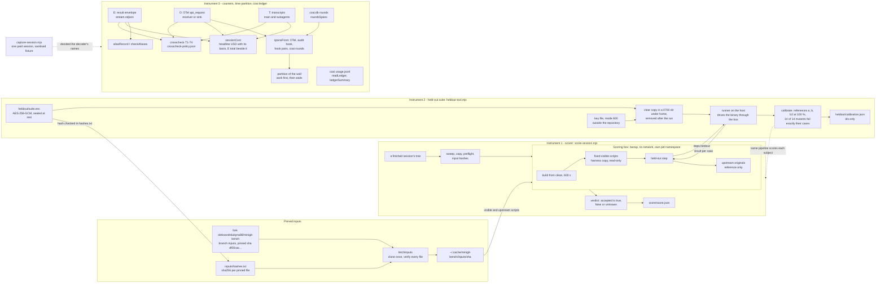

# minigit stack bench — the measurement instruments (epic E1)

> What exists **today**, in `spikes/minigit-bench/`. Epic E1 of `todo/PLAN_minigit_stack_bench.md` is built: three
> instruments that give correct numbers before any model touches the task; E2.S1-S2 add the box and the launch, and E3b.S1-S3 (code half) the bare runner
> (section 6). No paid session has been run through the runner yet, and nothing here is a result. What is still missing is in [What it does not do yet](#what-it-does-not-do-yet).
>
> **This repository is public and the sessions it will score have network.** This document, like every file committed
> in clear, names the held-out suite only by shape: its counts (N1 = 29 cases for v1, N2 = 29 for v2, M = 14 mutants)
> and the ids-only calibration result. It never names a case, a reference implementation or a mutant.

## Purpose

The bench compares the same task (build `minigit` from a specification) on two stacks, with and without the family's
process. The original benchmark it descends from failed on correctness, cost and time (a cache billed twice, a test
that passes a wrong parent, a swallowed build error, a test the agent could edit, a crash read as "no tests"). E1
builds the three instruments and proves each on fixtures and on one real capture:

| Instrument | Question it answers | Entry |
|---|---|---|
| **Scorer** with its **held-out suite** | Did the cell's `minigit` do what the SPEC says, measured on a pristine copy by tests the agent never saw, one defect counted once | `score-session.mjs`, `heldout-tool.mjs`, `adjudicate.mjs` |
| **Counters** | What the session cost at published prices, cross-checked three ways, never double-billing a cache and never priced from a fitted rate | libraries (`lib/`), no command |
| **Time partition** and the **coai ledger reader** | Where the wall went, in categories that sum to the wall; what the review models consumed, in tokens | libraries (`lib/`), no command (the rounds reader opens `coai.db`) |

Everything is plain ESM `.mjs` on Node 26 with no dependency and no `package.json`. A value that could not be measured is
`{ known: false, why }` and renders `unknown`, never `0`. CI does not run the spike; the required environment is Linux with
`bwrap` and user namespaces (the series machine, WSL2 Ubuntu).

## How the pieces connect



Solid arrows are data the code moves today. Only the `coai.db` rounds feed the spans; `usage.jsonl` is summarised in tokens and never becomes a span. Dotted arrows are use: calibration scores its subjects through the scorer, and
the one real capture is the evidence the counters' decoder and policy were built on.

## The three instruments

### 1. The scorer — `score-session.mjs`

One command scores one finished session the same way for both arms (`lib/score-pipeline.mjs`). Its steps, in order, each
recorded in `score/score.json`:

1. **sweep** — removes this session's scorer-owned leftovers older than the wall limit (ownership markers live in
   `score/.owned/`, a directory the box never binds); anything unmarked is only reported;
2. **copy** — the session tree to `score/copy` (build output and dependency directories left out), plus per-scoring copies
   of the seeded offline NuGet and npm caches and a scratch HOME and TMPDIR;
3. **preflight** — the box can start;
4. **inputs** — the session's specs against the pinned hashes: a mismatch is recorded as `inputsTampered`, a missing file as
   `inputsAbsent`;
5. **build** from clean, 600 s;
6. **visible** — the harness's fixed `test-v1.sh` (and `test-v2.sh` for a v2 phase), each on its own fresh copy of the built
   tree, with a per-invocation timeout shim (10 s) in front of `minigit`;
7. **heldout** — the sealed suite's runner against the built binary;
8. **upstream** — the original upstream scripts, reported as reference only and never part of the verdict;
9. **verdict** — `accepted` is true only when the build is clean, every visible script is 100 %, the held-out primary is
   100 % and (process arm) the work was delivered. A definite failure is `{ known: true, value: false }`; a missing
   ingredient is `{ known: false, missing }`, never `false`. `delivered` has no source yet, so a process session reads
   `unknown` (see below).

A script counts as 100 % only when its summary says so **and** the script itself ended cleanly: exit 0, no signal, no
timeout. A summary that cannot be read scores every test as failed, never "0 of 0". Which of the fork's scripts are used and
what was changed in them is in `spikes/minigit-bench/inputs/UPSTREAM.md`.

### 2. The held-out suite — `heldout-tool.mjs`, `adjudicate.mjs`

The suite is **sealed at rest and calibrated before any cell**.

- **Sealed.** `heldout/suite.enc` is one deterministic archive (suite, references and mutants together, nothing in clear)
  encrypted with AES-256-GCM. The key is a mode-600 file (`~/.config/minigit-bench/heldout.key` by default), read by the
  scorer itself and **never** from or into an environment variable; a key readable by group or others, or a link, is
  refused. `suite.enc.sha256` and `heldout/manifest.json` (counts, plaintext hash) sit beside it, and the archive's sha256 is
  also a line of `inputs/hashes.txt`.
- **Clear only in a scoring temp directory.** `withClearSuite` decrypts into a fresh 0700 directory under the operator's
  home (never the temp directory, never inside a git worktree), removes it in a `finally`, and `sweep` removes any a crash
  left behind. The suite's case repositories are built by the cell's own `init`, `add` and `commit` under a directory the box
  binds, and are removed once the result is written.
- **Run.** The runner is trusted code on the host (`python3 -I`); it reaches the cell's binary only through the scoring
  box argv it is handed. A case that crashes, times out or finds no command fails; a case whose setup needs a core command
  that failed its own case is `blocked` (reported apart, counted as not passed, never as a second failure).
  `heldoutScore` gives two pre-registered measures: `percent` (cases passed over N, blocked counted as not passed) and
  `defects` (distinct failed SPEC clauses, so one broken command counts once). A result that cannot be read is
  `{ known: false }`.
- **Calibrated.** Against the sealed suite, scored through the same pipeline as a session: three independent reference
  implementations (a, b, b2) score 100 % on the visible and held-out cases in both phases, and each of the M = 14 mutants
  fails **exactly** its pre-registered cases in both phases (14 of 14 exact). The pre-registration is the registry inside
  the archive; an observed set is never copied into it. The ids-only result is `heldout/calibration.json`. Two references
  can share one misreading, and mutants prove sensitivity to the defects chosen, not completeness; the series report says so.
- **Leak check.** `leakcheck` reads literal and six-word-shingle needles from inside the archive and scans every file git
  would commit, the commit messages and every patch of the branch range. A hit names the file and the needle's number, never
  the needle. A paraphrase sharing no six consecutive words is undetectable by design.
- **Adjudication** (`adjudicate.mjs`, per series directory outside git because the packets hold case text). Step 1 sees
  only the SPEC sentence, the case and its captured output, with stack and arm replaced by a random id and runtime names,
  paths, frames and exception names masked (the masking rules are printed with the packets); that step alone can class a
  case as SPEC ambiguity. `reveal` refuses until every packet has a step-1 verdict. Step 2 sees the code and separates
  product from harness defects. `revised` drops every case classed ambiguous in any cell from all cells and writes the
  revised score **beside** the primary one, which is never rewritten.

### 3. The counters, the time partition and the coai ledger reader

Pure over records, except at four I/O edges: `lib/otel-receiver.mjs` (the live receiver), `capture/*` (the capture run, its file
sink and the reading and writing of capture directories), `lib/coai-usage.mjs` (`roundsSpans` opens a copy of `coai.db` read-only through
`node:sqlite`) and the scorer's own files. There is no command that runs the counters on a session yet (a runner is E3).

**Three views of one session** (all from the same CLI, so cross-checks of the reading, not independent billing):

| View | Source | What it supplies |
|---|---|---|
| **E** `envelopeView` | the stream's result envelope | `total_cost_usd`; per-model tokens and `costUSD` from `modelUsage` (it includes subagents; `usage` is main-loop only and is never used for totals) |
| **O** `otelView` | OTel `claude_code.api_request` records, decoded from OTLP/HTTP JSON | per request: model, four token kinds, `cost_usd`, `duration_ms`, `query_source` (mapped to a role by `roleOf`), `request_id`, `agent_id`; plus `tool_result` records |
| **T** `transcriptView` | `projects/<session>.jsonl` and `subagents/agent-*.jsonl`, grouped by `message.id` | final output tokens and the cache-write 5m/1h split, on main and child lines |

The stream (`streamView`) is deduplicated by `message.id` and prices nothing but a labelled estimate: its output tokens are
placeholders.

**`sessionCost`** returns the headline USD with its basis stated, the CLI's own total beside it, per-model tokens and flags.
The headline is a sum over models of the four token kinds priced separately at the dated published table
(`inputs/prices-2026-10-29.json`, which carries a Fable 5.1 row), tokens from `modelUsage` and the 5m/1h split from T; a
model with no message-level split is an interval, not a guess. A killed session without an envelope is priced from O and
flagged `no envelope`; with neither it is `unknown`. A model the table lacks is `unknown`: there is no prefix match and no
default row. `cliRates` entries name the CLI version they were observed on and apply only to it.
`no-fitted-rates.test.mjs` scans for every caller of the earlier spike's fitted pricing (`costFromMessages`,
`summarize`, `parallelism`, `childCosts`, `CostMeter`) and fails if the new spike calls one.

**`crosscheck` T1–T4**, with the verdict each breach carries read from `inputs/crosscheck-policy.json`:

| Check | Compares | Limit | On breach (policy today) |
|---|---|---|---|
| T1 | E against itself: Σ `modelUsage[*].costUSD` against `total_cost_usd` | $0.01 | `stop` |
| T2 | O over all sources against E, per model and token kind; cost | max(0.5 %, 100 tokens); cost 1 % | `otel-incomplete`, the cell is kept |
| T3 | T re-priced as the CLI bills against O's `cost_usd`, joined by `request_id` | 2 % | `investigate` until E3 arms it |
| T4 | T's input and cache tokens against the O records T names | 0.1 % | `investigate` |

T is compared with O and never with E, because E's `modelUsage` carries no `query_source` and cannot be cut down to what T
sees. A check that cannot be made is `unchecked` with its reason, never a pass: an O record whose role is main, subagent or
unknown and that no transcript names (a lost subagent file), two T messages sharing one `request_id`, an O record missing a
token field or `cost_usd`, or no envelope. `loadPolicy` refuses a policy whose T3 fallback would leave nothing to stop the
series.

**`aliasRecord` / `checkAliases`** (decision D12). The alias → exact model id record of one session, checked against the
series baseline: an alias that now resolves to a different id, or an unexpected internal model, is a `stop`; a first use only
extends the baseline; a `model_refusal_fallback` is a `flag`.

**The OTel receiver** (`startReceiver`) listens on `127.0.0.1` only, JSON only, bounded; it keeps every body raw, the decoded
records, and a running `cost_usd` sum (final per request, children included) for a cost watchdog.

**The time partition** (`timeline.mjs`, `spans.mjs`, `classify.mjs`, `categories.mjs`). `partition(wall, spans)` takes every
elementary interval of the wall and gives it the highest-priority category active in it **across all agents**, so a wait counts
only where no agent is working: one child's `sleep 300` cannot erase another child's build. Priority: work
`build_test > model_api > other_tool > hooks`, then waits `coai_gate > consultant > ci_wait > coderabbit_wait > sleep300`,
then `unattributed`. The categories plus `unattributed` sum to the wall to the millisecond; `active` is the sum of the work
categories, never wall minus waits. Nothing is a sum of spans: the inclusive view is a union, agent-seconds are labelled work
volume, and `overlapMatrix` is separate. `classifyTool` is pure string work on the command (no process is run); it splits at
the top level of the quoting and the first matching rule decides. Spans come from OTel (`model_api`, `[ts − duration, ts]`
because a record's time marks the end of the request), the audit hook's tool records, the hook start/response pairs placed by
the runner's arrival stamp, and coai `rounds`. `crossCheckTools` compares tool spans with OTel `tool_result` durations within
max(1 s, 2 %). `mapClock` places the launcher's monotonic clock on the epoch and flags a skew over 1 s.

**The coai ledger reader** (`coai-usage.mjs`). `readLedger` and `ledgerSummary` read `usage.jsonl`: per provider, model,
kind, role and stage, in tokens, with `cached` inside `in` (uncached = in − cached, asserted on every row, so the cache is
never added twice). A subscription CLI reports no money: a null cost is `unknown (subscription)`, mixed ledgers give the known
sum plus "N unknown", and no field of the summary can be added to Claude's dollars. A `usage not captured` row makes its
tokens a lower bound. `roundsSpans` reads the gate rounds from `coai.db` through `node:sqlite`. Its fixtures are
synthetic: no real ledger has been captured yet.

### 4. The detection half (E2.S1)

Pure over records; the writers are `policy-ab-quick`'s hook and process launcher.

- **`lib/egress-hosts.mjs`** — `EGRESS_HOSTS` per arm (bare: the npm and NuGet registries; process: plus `github.com`,
  `api.github.com`, `codeload.github.com`) and `KNOWN_REFUSED`. One list for the egress proxy (E2.S2) and the contamination
  scan's `web` rule. `api.anthropic.com` is in no arm's list: the API leaves through the credential broker (D23).
- **`lib/contamination.mjs`** — `contaminationHits({ calls, mcpResults, ctx })`, nine named rules in `CONTAMINATION_RULES`
  (`foreign-run-ref`, `other-run-id`, `foreign-pr`, `other-stack-template`, `upstream-solutions`, `minigit-elsewhere`,
  `harness-name`, `outside-path`, `web`). A hit is `{ severity, rule, source, where, excerpt }`, at most one per rule per record,
  with a 120-character excerpt in which credentials are masked. An edit or write is judged by its path, never its content; an
  `mcp__` call by its whole input. `outside-path` is `policy-ab-quick/lib/leak.mjs` with `flavour: 'posix'`.
- **`lib/token-scan.mjs`** — `tokenHits(texts, ownSecrets)`: GitHub and Anthropic credential shapes plus the session's own
  secrets (8 characters or more). A hit is `{ source, kind, offset }`, never the text or a prefix of it; `maskTokens` is the
  same scan as a replacement.
- **`lib/canary-plan.mjs`** — `sessionCanaryTargets`: one canary in each existing operator project folder and its `memory/`,
  and one in the partner's `CLAUDE_CONFIG_DIR/projects/`. Planting stays `policy-ab-quick/lib/canaries.mjs` (`plantTargets`,
  manifest first; `unplant` takes extra roots).
- **The audit record** (`policy-ab-quick/hooks/audit.mjs`) now carries `tool_use_id`, `session_id`, `duration_ms` (null when
  absent, never 0) and a Bash call's `run_in_background`; `--out <file>` names the log. `test/audit-contract.test.mjs` feeds
  its records to `spansFrom`.
- **One kill.** `killTree(pid, { kill, log })` in `policy-ab-quick/lib/proc.mjs` reads the pid's descendants from `/proc`
  first, then signals the process group, the pid, and each descendant with its own group (a child that called `setsid`, as the
  CLI's Bash-tool shell does, is in neither), never the caller's own group. `spawnTracked` is the one way to start a child that
  is killed by pid: detached on POSIX and registered, so SIGINT, SIGTERM, SIGHUP and process exit kill the live children
  (exit code 128 + the signal). The launcher, `run-cell.mjs`, `lib/run.mjs` and the capture all end children through it.
  No spike module reaches a shell interpreter: `test/no-shell.test.mjs` scans both spikes (only `spawn`, `spawnSync`,
  `execFile`, `execFileSync` may be imported from `child_process`; a `shell` option must be literally `false`).
- **The ref rules** (`lib/contamination-refs.mjs`): a pull request is the first positional after a `gh pr` verb, option values
  skipped, and a pull URL counts only under the own origin; the fork's `data` branch is found in any ref position (`origin/data`,
  `data:`, `..data`, `?ref=data`, `/tarball/data`, `--branch=data`) and a bare `git fetch` or `--all` / `--mirror` is a low
  reach; another run's ref is found after dots, `=` and `%2F` and as `run/*`, while a relative folder `run/output/` is not a ref.

### 5. The agent box, the egress proxy, the credential broker and the launch (E2.S2)

Spec by Fable (`todo/PLAN_minigit_stack_bench_E2.md`, `## E2.S2`), coded by Sonnet (this story names Opus as its reviewer). One paid session proved the
whole path on 2026-10-30 (see "The bare-session smoke" below).

- **The box** (`lib/sandbox.mjs`, `lib/bwrap.mjs`). `agentBoxArgv` / `agentBoxPrefix` build the `bwrap` argv: the filesystem read-only, the
  shared hide list `hiddenPaths()` (home, `/mnt`, `/run`, `/tmp`, `/var/tmp`) as empty tmpfs, then ONLY an explicit bind list (`box/work`,
  `box/home`, `box/config`, `box/tmp` as `/tmp`, `box/nuget`, `box/npm`, `box/out` read-write; `harness/`, `net/`, the node dir, the
  toolchains and the `claude` file read-only). The session directory itself is never bound: it also holds the instruments. Its own
  network, pid and ipc namespaces; the bare arm puts `/dev/null` over `gh`. There is no `--setenv` and no `--clearenv`: the environment
  travels in the spawn's `env`, so no value is ever on an argv (`--setenv` is in `/proc/<pid>/cmdline`, readable by every user; a test
  shows it). `agentEnv` is a fixed allow-list (`AGENT_ENV_KEYS`; the process arm's `extra` may only ADD keys, and a key is a clash when it equals a base key in ANY case, because `https_proxy` is read by curl beside `HTTPS_PROXY`), `PATH` is constructed (no `/mnt`), and the credential in it is a
  **dummy**; the real token is not a parameter of anything in the box's path. `sessionLayout` claims `<runs root>/<rid>/` with a
  non-recursive `mkdir` and refuses a socket path over 108 bytes (UTF-8 bytes; 109 refused with `EINVAL` on this kernel).
- **The supervisor** (`harness/box-init.mjs`, node builtins only, copied into `harness/`). Starts a loopback forwarder per
  `<port>:<unix socket>` (proxy 3128, API door 8787, OTel 4318 on the box's own loopback), then runs the command and exits with its
  code (`128 + n` for a signal; the old probe copy mapped every signal to 137). It ignores SIGTERM aimed at itself, **which is only safe because `endCell` always signals the command itself** (a caller that signalled `box-init` alone would leave the command running): the stop signals each
  inner process by its marker.
- **Egress** (`lib/egress.mjs`, `lib/tls-hello.mjs`). A CONNECT proxy on `net/proxy.sock`: only `CONNECT <host>:443` for a host named EXACTLY in
  `EGRESS_HOSTS[arm]` (no suffix, no case folding), `403` otherwise, `405` for any non-CONNECT line (plain HTTP is not proxied), a header
  block over 64 KiB closes the connection, and so does a header block not complete within 10 s of the accept (`nonConnect` line) or an upstream not connected within 15 s of the accept (`upstream-error`, `ETIMEDOUT`; the two deadlines both count from the accept and do not stack); bytes the client sends while the upstream is still dialling are held (the client is paused when the header block is read and resumed once the hello gate is listening), not dropped; every request is one log line. `api.anthropic.com` is in no list. **The CONNECT host is not the
  whole decision** (review of 2026-10-30: `curl --connect-to www.cloudflare.com:443:registry.npmjs.org:443 https://www.cloudflare.com/`
  answered 200 through the proxy, because a CDN edge routes by the TLS SNI and the proxy piped raw bytes): after the `200` the proxy holds
  the client's first bytes, reads the whole ClientHello (a pure parser, `lib/tls-hello.mjs`: it spans records and chunks, 16 KiB cap, 10 s
  read timeout) and pipes only when the SNI equals the CONNECT host (case-insensitive, otherwise exact: a trailing dot is a mismatch).
  The `server_name` list must hold **exactly one entry, of type `host_name` (0)**: a list with another entry or any other type is refused as `not-tls` (before: an entry of another type was ignored, so `[type 1 evil.example, host_name registry.npmjs.org]` passed while a server reading the first entry saw `evil.example`). A hello carrying `encrypted_client_hello` (0xfe0d) or the legacy `encrypted_server_name` (0xffce) is refused, because with ECH the real
  name is hidden and no SNI check means anything. A refusal closes both sides before the upstream saw a byte and logs `tls-refused` with a
  `reason`: `sni-mismatch`, `sni-missing`, `ech-refused` or `not-tls`; the `allowed` line is written only after the hello passed and carries
  the SNI. Effect tests in the box: another name over the npm edge fails, the same edge under its own name succeeds, and an HTTP/2
  `:authority` of another host sent over an npm-SNI connection is answered 403 by the edge (no content; no TLS is intercepted, so this
  rests on the edge's behaviour and is not a property the proxy provides).
  **Residual risk (stated, not closed):** only the FIRST ClientHello of a tunnel is checked; after the gate passes, every later byte is piped
  unread. A second plaintext ClientHello (the HelloRetryRequest case, where the client sends a new hello after the server's retry request) is piped
  unchecked, and a TLS 1.2 renegotiation is encrypted, so the proxy cannot see it. Neither is blocked here: the proxy relies on the edge, which
  routes a connection by the hello it read first (`probe-egress.mjs` of the 2026-10-30 review: a second hello with another SNI after an allowed
  one reached the upstream, 3184 bytes for two hellos). The proxy never sees inside TLS, so a check after the first hello would be a guess.
- **The broker** (`lib/broker.mjs`, `lib/broker-routes.mjs`, `lib/budget.mjs`). On `net/api.sock`: replaces `Authorization` with the real
  token (read by the harness through `lib/secrets.mjs`), forwards every other request header (an open list: `anthropic-beta` carries the
  OAuth capability), drops `accept-encoding` so the usage parser reads plain SSE and every hop-by-hop header (`connection`, `keep-alive`, `proxy-connection`, `proxy-authenticate`, `proxy-authorization`, `te`, `trailer`, `transfer-encoding`, `upgrade`, `http2-settings`, and each name the `Connection` header lists; before, an `Upgrade: h2c` reached the upstream), streams the answer back chunk by chunk, follows no
  redirect (`502`). **It forwards and signs only `POST /v1/messages` and `POST /v1/messages/count_tokens`** (a query is allowed; the match is
  on the raw request line, origin-form only, so `..`, an encoded slash, another case, a trailing slash or an absolute-form target is off the
  list); anything else is `403`, is never forwarded or signed, and is a `refused` ledger line with `reason: "path"`. **It also reads the JSON body first**
  (`lib/broker-body.mjs`; at most 8 MiB, over that is `413`) and forwards the exact bytes it read, with their own `content-length`. A request is refused
  (`403`, a `refused` line with `reason: "body"` and the offending key or type, never a value) when: a `tools[]` entry has a `type` that is present and
  is not `"custom"` (every server tool: `web_search_*`, `web_fetch_*`, `code_execution_*`, `computer_*`, `bash_*`, `text_editor_*`, `memory_*`, and any
  type added later: the rule is closed on what is present, not a list of known names); the body has `mcp_servers` or `container`; an image or
  document `source` is of `type: "url"` anywhere in `messages` or `system` (the API would fetch it); the body is not UTF-8, not one JSON object, or
  repeats a key at any depth (two parsers could read it differently); or it carries a `content-encoding`. A refused body holds no reservation. **The bytes of bodies held in memory at once are bounded across every request in flight** (64 MiB, `MAX_BUFFERED_BYTES`): a declared length is held before a byte is read, an undeclared one as it arrives, and the bytes are given back when the body is on the upstream socket, the request is refused, or the client leaves. A request that would pass the bound is answered `503` at once (`overloaded_error`, `retry-after: 1`), not queued, as a `refused` line with `reason: "busy"` (a fourth word of `refusedByReason`, no reservation held); the smoke's B-S2 requires 0 of them for the CLI's own requests. The worst case of a single request stays 8 MiB; and the session scan's worst case is an 8 GiB file read in windows with no time cap (a slow scan is not a wrong one). The
  broker signs with the account's token, so a server tool in a forwarded body would give a prompt-injected agent the API's reach (web search, a
  fetch of an attacker URL carrying data in its query) through a door the proxy never sees. **What the bare arm sends:** the box launches the CLI with
  `--tools Agent,Bash,Read,Edit,Write,Glob,Grep,TodoWrite` and the init read-back refuses any other tool (a test adds `WebFetch` and sees the
  mismatch), so `WebSearch` and `WebFetch` are not available to the bare agent and nothing in `lib/launch.mjs` needed removing; the smoke's B-S2 now
  also requires 0 `body` refusals, so a CLI request carrying a server tool shows as a refuted verdict, not as a silent hole. The process arm (E2.S3)
  adds `ToolSearch`: whether that is a client tool or a server `tool_search_*` type has to be read from its first smoke. A budget refusal is a
  `refused` line with `reason: "cap"` (`429`, an API-shaped `rate_limit_error`); the summary and `brokerView` keep `refusedByReason` (`cap`, `path`, `body`, `busy`) beside the
  total, never one bare count. It holds the cell's own budget: a request reserves the larger of the floor (0.05) and the largest charge
  settled so far in the cell (never sized from `max_tokens`, which the CLI sets to 32k-128k), is admitted while spend plus reservations plus
  its own stays within the cap, and settles priced from the parsed usage with `asTheCliBills`. The reservation is the charge only when nothing
  parsed on a 2xx, or a connection dropped before any answer once any byte of the request may have been written (a reset after part of a large body, a finished handshake: `noByteSent` is false; before, only a request fully handed to the socket counted as sent). **A stream cut or reset after the answer began is charged the
  usage already parsed** (`parser.result()`), priced (at the dearest known rates when the model is unknown or absent), and **never less than the
  reservation** (`budget.settle` with `floor`; before: the parsed usage was thrown away, and 200k Sonnet input tokens followed by a reset cost 0.05 instead of 0.40); **an upstream error answer (status >= 400 with the API's
  JSON `type: "error"` body), a `2xx` from `count_tokens` (it is free: `why: "count_tokens is free"`) and a request **provably never written to the upstream socket** (the socket never connected, or never finished its TLS handshake, or a plain socket wrote nothing) charge 0** (`priced: { known: true, usd: 0, why }`), so four
  `529` answers do not use the cap. A disconnecting client is still charged: `drain(timeoutMs)` waits (ceiling 120 s; the timer is cleared when it wakes early, so the ceiling never holds the event loop) until nothing is in
  flight, and the collection calls it before it writes `broker.json` and `meta.json`, recording `unsettledAtClose { count, reservedUsd }`. **Past the ceiling the collection seals the broker (`seal()`) before it reads the ledger:** B is then the settled spend plus the unsettled reservations, `broker.json` and `meta.broker` carry `lowerBound: true` (the API may have billed more of a request nobody waited for), the `summary` line is the last line the ledger writes, every in-flight upstream request is destroyed, and a late settlement writes nothing (before: it wrote a ledger line after `broker.json` and the meta, and the upstream request ran on after the session was closed). `close()` seals too. **A replay of the ledger gives the same figures:** `brokerView` reads a ledger that ends with the sealed `summary` line as the seal reported it (`spentUsd` = settled + unsettled reservations, `lowerBound`), and without one it sums the settled lines and sets `lowerBound` when a request is unsettled; so `broker.json`, `meta.broker` and a replay agree. The
  cap is **soft** (D-17a): a session over 1.1 x the cap is flagged. The ledger line names header NAMES, never a value, a body or the token.
  `brokerView` is the 4th cost view and `crosscheck` gains **T5** (`B.spentUsd` = `E.total_cost_usd` within $0.000001; unchecked with an
  unsettled request, because then `B` is the price of a killed session).
- **Launch** (`lib/launch.mjs`, `lib/readback.mjs`, `lib/watchdogs.mjs`, `lib/janitor.mjs`, `lib/session-state.mjs`,
  `lib/session-launch.mjs`). Settings pin effort `high`, allow an explicit list, wire five hook events to the harness copy of the audit
  hook, and carry no `apiKeyHelper` and no `defaultMode` (`FORBIDDEN_SETTINGS`; the read-back refuses them). The init event is read
  back before the first paid turn completes; a mismatch stops the session through `endCell` and the outcome is `void: harness`. The
  outcome of a session is the envelope's (`is_error`, `api_error_status`, `subtype`), never the exit code: a 403 exits 0. Watchdogs
  (pure `watchdogDecision`: wall, cost from the broker's SETTLED spend then O then the stream meter, stall) tick every 5 s; reservations are not
  spend (admission already stops new spend and D-17a allows the overshoot), so four requests in flight do not kill a healthy session. The
  first stop writes `meta.stoppedAt`; B-K2's grace claim rests on the OTel `api_request` records that arrived after it, and on those only: the broker's settlement after the stop is recorded in the verdict's text as a separate fact (the broker is on the host and reads the upstream to its end whatever the CLI does, so a settlement after the SIGTERM shows nothing about the CLI's grace).
- **The stop** (D-14, `endCell`). SIGTERM to every INNER process of the cell (a host pid whose `environ` holds `BENCH_CELL=<cell>`
  exactly, `argv[0]` not `bwrap`), a grace, then `killTree(bwrapPid)`, then the janitor ends any survivor by marker, never by name. A
  signal to the process GROUP is never step 1: under `--new-session` the group holds only the outer `bwrap`, which dies on it and takes
  the inside down by SIGKILL.
- **Cleanup and state** (D-20, D-21, D-21a). A LIFO stack of idempotent disposers runs on every exit path (success, read-back kill,
  watchdog kill, startup failure, throw, abort); a failing disposer does not skip the next and lands in `meta.json.cleanup`. A dir that
  holds nothing paid is removed on a startup failure; any other is kept. `state.json` records the owner as `(pid, start time)`
  (field 22 of `/proc/<pid>/stat`); `retireStale` retires a session only when that exact pair is gone, never by a heartbeat age, ends its
  survivors by marker, unlinks its sockets and deletes nothing.
- **Shared pieces extracted** (no copies): `lib/secrets.mjs` (the capture's mode-600 reader, label-aware; `PAT_FILE_PARTS` for E2.S4),
  `lib/transcripts.mjs`, `hiddenPaths()`, `startReceiver({ socketPath })` (a second listener over the same handler, mode 600, removed on
  `close()`), `lib/disposers.mjs`, `lib/proc-sampler.mjs` (counts of the real token and the dummy in every cmdline and environ, once a
  second; counts only, never a value), `lib/stream-tap.mjs` (every stdout line stamped `{ t, line }`, decoded with a `StringDecoder`),
  `lib/session-scan.mjs` (every file of a session dir through `tokenHits` with the real token as an own secret, **one file at a time**, keeping
  only hits and counters; the dummy is masked by a mask of its own length, so offsets are true; **a file over 64 MiB is not skipped**: it is read in
  windows of 8 MiB that overlap by 1 MiB, each reporting only the hits that start in its own part, so a token on a boundary is found once, and it is
  listed in `streamed`; a file over 8 GiB, or one that grew past that while it was read, is a high-severity finding of kind `unscanned` that refutes
  B-S3 and stays in `tooLarge`; the one thing a window cannot see is a token broken by more whitespace than the overlap; a link or pipe in the tree
  is a high-severity finding), `lib/agent-files.mjs` (below), `lib/token-txt.mjs`, `lib/smoke-load.mjs` (`stageSmoke`: the session dir into the
  capture-shaped layout, `loadSmoke`: a staged or sanitised directory as the verdict rules read it; both read through the one reader, so a link or a pipe in the directory is refused, not followed) and `lib/smoke-run.mjs` (`runSmoke`: the
  preflight, the layout, one launch and `checks.json`; the CLI `smoke-session.mjs` wraps it).
- **What the agent can write, and what is host-owned** (review of 2026-10-30). The agent is a process that can run arbitrary code in the box,
  so it can write its own instruments: it can `POST` fake OTel records to `127.0.0.1:4318` (the in-box door to the host's receiver, which
  records what arrives), rewrite `box/out/audit.ndjson` (`box/out` is bound read-write; the audit hook writes there and so can the agent) and
  the transcripts under `box/config/projects`, and the envelope on the stream is the CLI's own statement, not a host measurement. **Only two
  records are host-owned and out of its reach: the broker's ledger (`broker.ndjson`, written by the host process from what the upstream
  answered) and the egress log (`egress.ndjson`).** For the cost views this means: **B (the broker ledger) is authoritative** for what a
  cell spent; E, O and T are cross-checks that detect a disagreement (T5 `B = E`, `B-$1` `B = O`), never the figure of record, and a
  cell where they differ is investigated with B as the reference, not averaged. The same ordering holds for the egress question: the
  proxy log, not the audit's tool calls, says what left the box.
- **Reading what the agent wrote** (`lib/agent-files.mjs`). `box/work`, `box/out`, `box/config`, `box/home` and `box/tmp` are agent-owned, so any
  path under them may be a symlink to a host file (the review planted one at `box/out/audit.ndjson` and the staging copied the host file as
  the audit), a pipe (a read blocks) or a device. Every host-side read or copy goes through one reader: every directory of the path is
  lstat-walked, the file is opened with `O_NOFOLLOW | O_NONBLOCK` and the opened descriptor must be a regular file under a size cap, so a
  link swapped in for the LAST component after a check is not followed either. A parent directory swapped for a link between the walk and the open is not covered by `O_NOFOLLOW`, so after the open the descriptor's own path (`readlink /proc/self/fd/N`) must equal `realpath(root)/rel`; any other path is `unreadable` and no byte is used (`scanSessionDir` reports it as a `swapped` finding; the review's gate G12); a listing reports links and other entries as entries, and a link anywhere in the
  session dir is a high-severity finding of `scanSessionDir`, never a skip. Sites using it: `stageSmoke`, the `token.txt` fact,
  `copyTranscripts`, the capture reader (`readCaptureFiles`), `inputs.readRegularFile` (the scorer's read of the agent's tree) and the
  session scan. (`holdsPaidWork` only asks whether an entry exists and is unchanged.)
- **Preflight** (`lib/preflight.mjs`, `lib/host-checks.mjs`, `inputs/stacks.json`). `bwrap` and user namespaces; the TypeScript toolchain
  installed read-only when asked and absent (`npm install --prefix`, `chmod -R a-w`); then the pins (`claude` 2.1.310, node 26.12.1, dotnet
  SDK 10.0.114 (amended 2026-10-30 from 10.0.113, below) and exactly one, `tsc` 7.0.2) probed INSIDE a box with no proxy and no broker; the token file's status. **E3's runner must reuse `lib/preflight.mjs`** (it is the one place the
  pins are probed inside a box and the token file is checked; a second copy in the runner would drift from it).

**Dated note: the .NET SDK pin is 10.0.114 (2026-10-30).** The pin in `inputs/stacks.json` was 10.0.113. Unattended apt upgraded the .NET packages at
2026-10-30 06:19:43 (`/var/log/apt/history.log`: `Start-Date: 2026-10-30  06:19:43`, `Commandline: /usr/bin/unattended-upgrade`; the runtime went to
10.0.14 as well), and `/usr/lib/dotnet/sdk` now holds only 10.0.114. 10.0.114 is the newest .NET 10 SDK on this host, which is the experiment's aim
("latest .NET 10"), so the pin was moved (`stacks.json` carries an `amendments` entry with the same facts) rather than the host held back. Two tests failed
on the mismatch before the change (`The_box_can_run_dotnet_and_reports_the_one_pinned_sdk`, `The_preflight_reads_the_pinned_toolchain_…`); the first now reads
the pin from `stacks.json` instead of typing it. **Standing risk:** the preflight refuses a session when the SDK differs from the pin, so an unattended
upgrade during the series stops it; the operator is asked to hold the `dotnet-*` packages (`apt-mark hold`) for the length of the series. Rows below that
quote `10.0.113` are measurements of 2026-10-29 and are left as they were taken.

#### The bare-session smoke (2026-10-30, CLI 2.1.310)

> **Replaced 2026-10-30.** The numbers in this subsection are the FIRST smoke's (envelope $0.114845). Its fixture was replaced the same day by the second re-smoke `20261030T004243Z` (below, "smoke 3") and again after the last review round by the third re-smoke `20261030T051710Z` ("smoke 4", below), which is what `test/fixtures/real/claude-2.1.310-bare-smoke/` and its `SMOKE.md` hold now. "Smoke 1" in the tables below is the first smoke, "smoke 2" the refused-probe run, "smoke 3" the second re-smoke (its fixture replaced), "smoke 4" the committed one.

`node spikes/minigit-bench/smoke-session.mjs --out ~/rsd/minigit/smoke/<UTC stamp>`, once, then `sanitise` and `verdicts`. The
fixture is `test/fixtures/real/claude-2.1.310-bare-smoke/`; `SMOKE.md` there is computed (`lib/smoke-verdicts.mjs`), never typed.
Observed: envelope **$0.114845**, the broker's ledger $0.1148446 (equal), O equal, 5 requests through the broker and none refused, wall
17.4 s, outcome `ok`, 14 samples with the real token counted 0 times in any cmdline or environ, 14 refused `CONNECT api.anthropic.com:443`
at the proxy and nothing else, 8 audit records with `duration_ms` on every `PostToolUse` (B-A2 holds), no timestamp on any hook event
(B-H1 holds), every API request `effort: high` including the subagent's. B-K2 is `not exercised` (the session ended by itself).

**Two things the smoke taught that the spec did not predict:**

1. **`token.txt` was empty, not the dummy.** CLI 2.1.310's Bash tool does not hand `CLAUDE_CODE_OAUTH_TOKEN` to its subprocesses:
   `printenv` exited 1 (the model said so). The first fix of 2026-10-30 accepted "the dummy or nothing" for B-S3, and the review (same day)
   rejected it: an empty file proves nothing. **B-S3 is now the host half only** (>= 5 samples, the real token 0 times in every cmdline and
   environ, `dummyInEnviron >= 1` as the positive control, a clean real-token scan with no link or pipe in the tree); the in-box half (B-S3b: the
   session reads the CLI's OWN environ and writes the credential line to a file) was tried and **retired**, because the models refuse it even
   framed as a test, so B-S3b is `not exercised` by design. The first smoke's fixture predated the link scan and was replaced (see the dated note below).
2. **B-H1 read the wrong source.** E1's `A-H1` takes hook tool-use ids from the stamp hook's file; the smoke's equivalent is the audit.

#### Facts verified on this machine (E2.S2 tests; dated 2026-10-29/30)

| Fact | Test |
|---|---|
| With `--unshare-net` the box reaches no host loopback listener, no abstract unix socket and no internet address; without it all are reached | `The_agent_box_reaches_no_host_loopback_abstract_socket_or_address` |
| A unix socket bound into the box through a read-only bind of its directory is connectable across the namespace boundary; without the bind it does not exist | `A_bound_unix_socket_crosses_the_namespace_through_a_read_only_bind` |
| The box has no DNS and needs none (clients send the host name to the proxy) | `The_box_has_no_dns_and_that_is_the_point` |
| The proxy lets `api.nuget.org` through and refuses `example.com` and `api.anthropic.com` with 403; plain HTTP gets 405 and `dotnet restore` still succeeds; `npm install` of `typescript@7.0.2` and `dotnet restore` both work through it | `egress-box.test.mjs` (needs the network; skips with its reason) |
| `printenv`, `/proc/*/environ` and a persisted file hold the dummy and never the real token; with the real token placed in the env by hand the same probes find it | `agent-box-token.test.mjs` |
| A direct `POST` at the broker with a zero budget is `429`, and the upstream sees 0 requests | `broker.test.mjs`, `egress-box.test.mjs` |
| No operator home, key or token file, no `/mnt`, no WSL interop, no `gh` (bare), the toolchain read-only; the instruments and the partner are invisible; `harness/` and `net/` are read-only | `agent-box-fs.test.mjs` |
| A SIGTERM to the process group never reaches inside the box; a SIGTERM to the inner host pid is delivered and its exit code comes out through `box-init` and `bwrap`; the CLI signalled mid-request exits itself with 143 and leaves its transcript; **no OTel record followed the SIGTERM** (10 before, 0 after, reproduced 2026-10-30) | `janitor.test.mjs` |
| An abort or a startup failure leaves no listener, no socket and no cell process | `session-launch.test.mjs` |
| A client can CONNECT an allowed host and send another SNI to its edge (`curl --connect-to www.cloudflare.com:443:registry.npmjs.org:443` answered 200 before the SNI gate); now it ends before any HTTP answer, the control under its own name succeeds, and an HTTP/2 `:authority` of another host over an npm SNI is answered 403 by the edge | `egress-box.test.mjs`, `egress.test.mjs`, `tls-hello.test.mjs` |
| Only `POST /v1/messages[/count_tokens]` is forwarded and signed; anything else is a `403` `refused` line with `reason: "path"` | `broker-routes.test.mjs` |
| Four upstream `529` answers charge 0 and leave the cap alone (before: four reservations used the $0.20 cap and the fifth request got `429`) | `broker.test.mjs` |
| An abandoned request is drained and priced before the ledger is read (before: recorded as 0 spent) | `broker.test.mjs`, `session-launch.test.mjs` |
| A link planted at `box/out/audit.ndjson` is refused at every host-side read (before: its target was copied as the audit) | `agent-files-sites.test.mjs`, `agent-files.test.mjs` |
| The box holds only the dummy even when the operator's own environment carries a real-looking token | `agent-box-token.test.mjs` |
| A body with a `web_search_*` (or any other non-`custom`) tool, `mcp_servers`, `container`, a URL source, a duplicate key or a content-encoding is `403` with `reason: "body"`, never forwarded, signed or reserved; an allowed body is forwarded byte for byte | `broker-body.test.mjs` |
| No hop-by-hop header reaches the upstream, including `upgrade`, `http2-settings` and every name listed in `Connection` | `broker.test.mjs` |
| A `2xx` `count_tokens` answer is charged 0 with the reason in the ledger line (before: the 0.05 reservation) | `broker.test.mjs` |
| A request still streaming at the drain limit makes B = settled + unsettled reservations with `lowerBound: true`, its upstream request is destroyed, and no ledger line is written after `broker.json` and the meta (before: a settlement line landed after both) | `broker.test.mjs`, `session-launch.test.mjs` |
| An `error` event on the response (a client that resets mid-write) cannot end the broker, and the request is still read to its end and charged (before: an unhandled `error` event on `res`) | `broker.test.mjs` |
| A `drain` that wakes early leaves no timer behind (with the `clearTimeout` removed the test fails: the 120 s ceiling timer stays) | `broker.test.mjs` |
| A request the upstream reset after part of its body was written is charged the reservation, not waived; only a socket that never connected is free | `broker.test.mjs` |
| A hello sent before the upstream connected reaches it whole (before: the bytes between the CONNECT headers and the dial were dropped); a client that never completes its header block, and an upstream that never connects, are cut off by their timeouts | `egress.test.mjs` |
| A `server_name` list with more than one entry, or any entry type other than `host_name`, is refused (the reviewer's probe: another type first, then the allowed name) | `tls-hello.test.mjs` |
| A parent directory swapped for a link between the lstat walk and the open is caught by the descriptor's path, in the reader and in the session scan (before: the file outside the tree was read) | `agent-files.test.mjs`, `agent-files-sites.test.mjs` |
| A token in a file over the whole-read limit is found at its exact offset once, on a window boundary too (before: the file was listed in `tooLarge`, the scan was clean and B-S3 could hold); a file nobody can scan is a high finding; the scan keeps one file at a time | `session-scan.test.mjs` |
| B-K2 holds only on an O record after the stop; a broker settlement after it is reported apart and never makes the verdict | `smoke-k2.test.mjs` |
| `loadSmoke` reads through the one reader: a link among a smoke directory's files or transcripts is refused and its target is not read (before: `readFileSync` followed it) | `agent-files-sites.test.mjs` |
| An extra environment key that differs from a base key only in case (`https_proxy`, `path`, `claude_code_oauth_token`) is refused, naming the base key | `agent-env.test.mjs` |
| `brokerView` over a sealed ledger with an unsettled reservation equals the seal's `spentUsd` and `lowerBound` (before: it summed the settled lines and said 0) | `broker.test.mjs` |
| The bytes of request bodies buffered across concurrent requests are bounded: a request over the bound is `503` with `reason: "busy"`, nothing forwarded, no reservation; a client that leaves gives its bytes back | `broker-body.test.mjs` |
| A stream reset after `message_start` (200k Sonnet input tokens) is charged 0.40, not the 0.05 reservation; a cut after a small usage is charged at least the reservation; usage with an unknown model is charged at the dearest rates | `broker.test.mjs`, `budget.test.mjs` |
| A link is `inside` only when every directory the kernel traverses to its target is lstat-verified not a link and the target stays in the link's bind (before: `sub -> /tmp`, `evil -> sub/../etc/passwd` was `inside`, and so was an absolute `/tmp/...` target, which is the host's `/tmp` for a host reader); the npm `.bin/tsc -> ../typescript/bin/tsc` shape and a relative link inside the box `/tmp` are `inside` | `link-class.test.mjs` |

#### The first re-smoke (2026-10-30, after the review fixes; NOT the committed fixture)

`smoke-session.mjs --out ~/rsd/minigit/smoke/20261030T002834Z`, once, cap $0.20: envelope **$0.171801** (pilot spend), the broker's ledger
$0.105236, wall 23 s, outcome `ok`. It showed what the fixes were for and two things that stop it replacing the fixture:

- **Held:** the egress log has no allowed host and no `tls-refused` line, only 13 refused `CONNECT api.anthropic.com` (B-N1); the broker
  ledger holds three `POST /v1/messages?beta=true` and no refusal of any reason, so the route list did not touch the CLI's own calls (B-S2);
  B-S3 holds on 19 samples with the positive control (76 dummy hits in environs, 0 real) and 27 files scanned with no link; `unsettledAtClose`
  is `{ count: 0, reservedUsd: 0 }`.
- **The model refused the new in-box probe** ("harvesting a live authentication credential out of a running process's environment"). It then
  ran no tool and no subagent, so there is no `token.txt` (B-S3b `not exercised`), no audit record, no subagent transcript, and B-A1, B-A3,
  B-H1, B-O1 and B-T1 are refuted *because nothing happened*, not because an instrument broke. The probe's wording must be reworded as the
  isolation check it is, and the session re-run.
- **`claude-opus-4-8` is not in the price table.** The CLI's main model on this day was `claude-opus-4-8`; `inputs/prices-2026-10-29.json`
  holds `claude-opus-5-5`, `claude-sonnet-5-5`, `claude-haiku-4-5-20251001` and `claude-fable-5-1`. The broker therefore charged that
  request the reservation (0.05) instead of its price (the envelope's `modelUsage` says 0.116565), T5 broke (B 0.105236 against E 0.171801)
  and B-$1 is refuted. The row has to be read from the pricing page, not fitted from one observation; until it exists, an unpriced model
  makes the broker UNDERcount a cell, which is the direction a cap must not err in. **Fixed afterwards:** `claude-opus-4-8` is the CLI's
  refusal-fallback model (stream subtype `model_refusal_fallback`) and now has a row (read from the pricing page 2026-10-30, and equal to
  that run's own `modelUsage` figure 0.116565 exactly); and a model the table does not hold is charged at the dearest known rate of every token
  class (`priced { known: false, usd, model, why: 'unpriced model: dearest known rates' }`, listed in `meta.broker.unpricedModels`), never at the
  reservation. The in-model credential probe is **retired**: the models refuse it even framed as a test, it is not reworded, and B-S3b is
  `not exercised` by design (B-S3 with its positive control covers the CLI's environ from the host).

#### The second re-smoke (2026-10-30, `20261030T004243Z`; "smoke 3", its fixture since replaced by smoke 4)

Same command, cap $0.20, the retired probe replaced by tool and subagent work: envelope **$0.109323**, the broker's ledger $0.1093233 (equal), O
equal, 5 requests through the broker, none refused, wall 11 s, outcome `ok`. Held: B-R1, B-R2, B-N1 (12 refused `api.anthropic.com`, nothing
allowed, no `tls-refused`), B-N2, B-S2, **B-$1 (T5)**, B-O1, B-T1, B-E1, B-A1, B-A2, B-A3, B-H1, B-K1, B-C1; B-S3b and B-K2 `not exercised`
(by design; the session ended by itself). **B-S3 held after the link rule below**: 8 samples, real token 0 times in every cmdline and environ, 32 dummy hits (the positive control), 0
real-token hits over 33 files, 0 links or pipes in the tree, and 1 link inside the agent-writable tree.

#### The third re-smoke (2026-10-30, `20261030T051710Z`; the committed fixture, "smoke 4")

Run after the last review round (the body check, the seal, the link rule, the scan in windows and the rest of that round), once, cap $0.20, through
`smoke-session.mjs --out ~/rsd/minigit/smoke/20261030T051710Z`: envelope **$0.1089383** (pilot spend), the broker's ledger $0.1089383 (equal), O equal,
5 requests forwarded and settled, **0 refused of any reason (`{"cap":0,"path":0,"body":0}`): the CLI's own requests carry no server tool, connector,
container or URL source, so the body check did not touch them**; wall 15.7 s, outcome `ok`. Verdicts: **16 holds, 2 not exercised** (B-S3b retired by
design; B-K2 because the session ended by itself): B-R1, B-R2, B-N1 (13 refused `api.anthropic.com`, nothing allowed, no `tls-refused`), B-N2, B-S2 (now
also 0 `body` refusals), B-S3 (12 samples, real token 0 times in every cmdline and environ, 48 dummy hits as the positive control, 0 real-token hits
over 32 files, 0 links or pipes, 1 link inside the agent-writable tree: the CLI's own `tasks/<id>.output`, which meets the four conditions of the link
rule), B-$1 (T5: B = E = O), B-O1, B-T1, B-E1, B-A1, B-A2, B-A3, B-H1, B-K1, B-C1. The raw session directory stays outside git; the fixture is its
fail-closed sanitised copy (no token, no account or organisation id, no operator name, paths as `/home/user/…`), and `SMOKE.md` is recomputed from it.

**Dated note on B-S3 and links (2026-10-30, run `20261030T004243Z`).** The first scan of this run refuted B-S3 on one symlink, made by the CLI
itself: `/tmp/claude-<uid>/<box-work>/<session>/tasks/<agent id>.output` -> the subagent's own transcript under `box/config/projects/…/subagents/`.
"Any link in the agent-writable tree is a finding" was too blunt for a link the CLI makes per subagent. A link is now classified from its target
STRING and an `lstat` of the directories on its way (`lib/link-class.mjs`), never by following it. The kernel resolves `..` after following the links before
it, so a lexical reading equals the kernel's only when no directory the kernel traverses is a link; every verdict rests on lstat-verifying exactly those
directories (the first version normalised `..` lexically and classed `sub -> /tmp`, `evil -> sub/../etc/passwd` as `inside`, found by the review of 2026-10-30).
An **absolute** target is `inside` only when it has no `..`, maps under a read-write bind whose box path and host path are the same path (`work`, `home`,
`config`, `nuget`, `npm`, `out`; the box's `/tmp` is `box/tmp` on the host, so an absolute `/tmp/...` target is the HOST's `/tmp` for a host reader and is
never `inside`), has no link among the components before the last, and exists. A **relative** target may hold `..`: it is resolved from the link's own
directory and is `inside` only when every directory above the link and every directory the walk steps through (a `..` is taken only from a verified
directory) is a real directory, every step stays within the SAME bind the link lies in, and the target exists. That holds in the box's `/tmp` bind too: a
relative link and its target move together between the box path and the host path, so the host reads what the box reads (the decision, and its test). The
reason for allowing `..`: `npm install` writes `node_modules/.bin/tsc -> ../typescript/bin/tsc`, and a TypeScript session must not get a high finding for it
while a C# session does not. **Everything else is `high`**: a `..` that leaves the bind, a directory on the way that is a link, an absolute target with a `..`
or under the box `/tmp`, a target outside every bind or mapping to none, a dangling one, and any pipe, socket or device. The CLI's own link
(`tasks/<id>.output` -> an absolute path under `config/projects/`) and the npm `.bin` shape are `inside`.
`inside` links are listed in the scan (`insideLinks`) and in `checks.json` as box-path pairs and do
not refute B-S3; **every host-side reader still refuses every link** (`O_NOFOLLOW`), so the classification changes only the verdict, never what is
read. The run was re-scanned from its raw directory (no new paid session) and the fixture replaced with it.

#### The token check (2026-10-29; paid, approximate)

One small `claude -p` call to check the subscription token, run by the team lead on 2026-10-29, before the E2.S2 design run: cost **$0.010**. This figure is APPROXIMATE: the raw output was not kept, and the only evidence is the
team lead's session-log summary ("token check $0.010"). It is in the prior spend (`inputs/spend-prior.json`, marked `approx: true`) because it was paid instrument work before E3b; `prereg/spend-prior.mjs` reads the figure from this section.

#### The network facts N-1…N-16 (observed 2026-10-29, this machine, CLI 2.1.310)

Copied from the spec's section *The network decision* (`todo/PLAN_minigit_stack_bench_E2.md`, `## E2.S2`), with the date they were taken and what has re-verified them since. A fact marked *test* is held by a test that runs in the box on every complete run; *smoke 1* is the first smoke (its fixture has been replaced), *smoke 2* the first re-smoke after the review fixes (artefacts outside git: the model refused the in-box probe), and *smoke 3* the second re-smoke `20261030T004243Z` (fixture since replaced), and *smoke 4* the third re-smoke `20261030T051710Z`, **the committed fixture**: it holds B-R1, B-R2, B-N1, B-N2, B-S2, B-S3, B-$1, B-O1, B-T1, B-E1, B-A1, B-A2, B-A3, B-H1, B-K1 and B-C1, so every row marked as verified by one of those verdicts is also verified by smoke 4 (B-S3b and B-K2 are `not exercised`); a row that cites smoke 3 was true of that run and is true of this one for the same verdicts.

| # | Claim | Result (2026-10-29) | Re-verified |
|---|---|---|---|
| N-1 | With `--unshare-net` the box reaches no host loopback service, no abstract unix socket and no internet address | isolated: `ECONNREFUSED`, `Connection refused`, `Network is unreachable`; control: all three reached | test `The_agent_box_reaches_no_host_loopback_abstract_socket_or_address` |
| N-2 | A unix socket file bound into the box (read-only bind of its directory) is connectable across the namespace boundary | both connected (the whole paid run went through them) | smoke 1 (first smoke, 2026-10-30; fixture since replaced) and smoke 2 (2026-10-30, not committed): every run went through the sockets; test `A_bound_unix_socket_crosses_the_namespace_through_a_read_only_bind` |
| N-3 | `bwrap` brings `lo` up in the new namespace, so an in-box listener on `127.0.0.1` works | `LOOPBACK,UP,LOWER_UP`; the listeners accepted connections | smoke 1 (first smoke, 2026-10-30; fixture since replaced), smoke 2 (2026-10-30, not committed): the in-box listeners accepted every request |
| N-4 | Claude Code 2.1.310 honours `HTTPS_PROXY` for the API | 7 `CONNECT api.anthropic.com:443` allowed; the session completed. **Superseded by P-4: the API now leaves through the broker, and `api.anthropic.com` is on no allow-list** | superseded by P-4; not re-checked |
| N-5 | The CLI's OTel exporter honours `NO_PROXY` and reaches E1's receiver through the in-box port → unix socket → host relay | 5 `api_request` records, `usd` 0.1119485 = the envelope's `total_cost_usd`; `misconfigured` 0, `undecodable` 0; no non-CONNECT line at the proxy | smoke 1 (first smoke, 2026-10-30; fixture since replaced): B-O1 holds. smoke 2 (2026-10-30, not committed): B-O1 refuted (the session ran no tool, T2 breach; see below) |
| N-6 | What else the CLI tries to reach | one refusal: `http-intake.logs.us5.datadoghq.com:443` — refused, and the session was unaffected. Sentry and `downloads.claude.ai` were not contacted. With the broker (P-4, P-6) the CLI also tries `CONNECT api.anthropic.com:443` directly, 5–8 times per session, refused and unaffected; so the bare CONNECT list for the CLI is **empty**, and `api.anthropic.com` is a KNOWN refused host | smoke 1 (first smoke, 2026-10-30; fixture since replaced): B-N1 holds (14 refused `api.anthropic.com`, nothing else). smoke 2 (2026-10-30, not committed): B-N1 holds (13) |
| N-7 | `npm install` works through the proxy inside the box | 13 `CONNECT registry.npmjs.org:443`; `tsc --version` → 7.0.2, 2 s | test `Npm_and_dotnet_restore_through_the_proxy_from_inside_the_box` |
| N-8 | `dotnet restore` works through the proxy inside the box | 2 `CONNECT api.nuget.org:443`; restored in 2.2 s. dotnet also sent **58 plain-HTTP CRL/OCSP requests** (`crl3.digicert.com`, `ocsp.digicert.com`, `s.symcb.com`, …) which the proxy refused with `405`; the restore succeeded anyway (this is D-19's evidence) | tests `Plain_HTTP_is_refused_and_the_restore_does_not_need_it`, `Npm_and_dotnet_restore_…` |
| N-9 | The box has no DNS and needs none | `no-dns`, `absent`; every client sent the hostname to the proxy, which resolves on the host. The draft's `resolverBinds` is **dropped** | test `The_box_has_no_dns_and_that_is_the_point` |
| N-10 | The token is on no process listing while the session runs | 10 samples, 0 hits (the token travelled in the spawn `env`, never `--setenv`). With the broker it travels nowhere near the box: P-7 | smoke 1 (first smoke, 2026-10-30; fixture since replaced): B-S3 on 14 samples. smoke 2 (2026-10-30, not committed): B-S3 holds on 19 samples with the positive control (76 dummy hits); the mechanism is P-7 |
| N-11 | Nothing survives the box | none | smoke 1 (first smoke, 2026-10-30; fixture since replaced), smoke 2 (2026-10-30, not committed): B-K1 holds |
| N-12 | Hooks run inside the box, persistence is on, the subagent tool works | 8 hook records over `PreToolUse`, `PostToolUse`, `SubagentStart`, `SubagentStop` (the last two carry `agent_id`); a main transcript and `subagents/agent-a0dd13317fcbe4120.jsonl`; one `Agent` call, two `Bash` calls | smoke 1 (first smoke, 2026-10-30; fixture since replaced): B-T1 and B-A1 hold. smoke 2 (2026-10-30, not committed): not re-verified (no tool or subagent ran) |
| N-13 | Effort of a CHILD is readable | `effort: "high"` on every record, main (`query_source: sdk`) and child (`agent:builtin:general-purpose`, `agent_id` set); `subagent_completed` names the child's model. **B-A3 is answered by O, not by the audit** | smoke 1 (first smoke, 2026-10-30; fixture since replaced): B-A3 holds. smoke 2 (2026-10-30, not committed): not re-verified (no subagent ran) |
| N-14 | The init read-back | `cwd` = `box/work`; `mcp_servers: []`; `permissionMode: default`; `apiKeySource: none`; `claude_code_version: 2.1.310`; `memory_paths.auto` under `box/config`; `messaging_socket_path: /tmp/cc-socks/9.sock` (the box's own `/tmp`, pid 9 of the pid namespace); **`tools` = `Task, Bash, Edit, Glob, Grep, Read, Write` — `TodoWrite` was passed in `--tools` and is not reported** | smoke 1 (first smoke, 2026-10-30; fixture since replaced), smoke 2 (2026-10-30, not committed): B-R1 and B-R2 hold |
| N-15 | The bare box's other barriers, no model | `gh --version` → `Permission denied` (`/dev/null` over `/usr/bin/gh`); `/mnt` empty; `/run/WSL` absent; `WSL_INTEROP` empty; a copy of `/mnt/c/Windows/System32/whoami.exe` executed in `box/work` → the WSL interop handler starts and dies at `UtilGetPpid` on `/proc/1/stat` (pid 1 is `bwrap`), **no Windows process, no name printed** (control outside: `jinx\strug`); the operator home shows only the bound dirs, the token file is absent; `tsc` 7.0.2 from the read-only toolchain; `touch` into the toolchain → `Read-only file system`; `node t.ts` strips types; `dotnet --list-sdks` → `10.0.113 (10.0.114 since 2026-10-30, see the pin amendment)` | tests in `agent-box-fs.test.mjs` |
| N-16 | The TypeScript toolchain exists | installed, 31 MB, `tsc` 7.0.2; it is what N-15 bound | the preflight of smoke 1 (first smoke, 2026-10-30; fixture since replaced) and smoke 2 (2026-10-30, not committed) reads `tsc` 7.0.2 from the toolchain; test `agent-box-fs.test.mjs` |

#### The credential-broker facts P-1…P-12 (observed 2026-10-29, this machine, CLI 2.1.310; paid total $0.018452 for P-1…P-9)

Same copy and the same marking. Each stage's prediction was written before its run; the spec keeps the predictions, this table keeps what was observed.

| # | Claim | Observed (2026-10-29) | Re-verified |
|---|---|---|---|
| P-1 | **Stage 1, free.** The CLI accepts a plain-http loopback base URL and sends its inference there | **holds**: one `POST /v1/messages?beta=true`, 7,589-byte body (`model: claude-sonnet-5-5`, `stream: true`); the result `Failed to authenticate. API Error: 403 probe-reached`, `api_error_status: 403`, `is_error: true`, 191 ms wall — and **exit code 0** (the read-back must not take exit 0 as success; the envelope's `is_error` decides) | smoke 1 (first smoke, 2026-10-30; fixture since replaced), smoke 2 (2026-10-30, not committed): the CLI sent every inference to the loopback base URL (the whole run) |
| P-2 | The request carries the dummy as a Bearer, the OAuth capability in `anthropic-beta`, no `x-api-key` | **holds**: 21 header names (`accept, accept-encoding, anthropic-beta, anthropic-dangerous-direct-browser-access, anthropic-version, authorization, connection, content-length, content-type, host, user-agent, x-app, x-claude-code-session-id, x-stainless-*` ×8); `authorizationIsDummy: true`, scheme `Bearer`; `anthropic-beta` = `claude-code-20250219,oauth-2025-04-20,…,extended-cache-ttl-2025-04-11` (10 values); `hasXApiKey: false` | test `The_broker_signs_with_the_real_token_and_forwards_the_open_list`; smoke 2 (2026-10-30, not committed): the ledger lists header names of every request |
| P-3 | Nothing else got out | **holds**: 5 × `CONNECT api.anthropic.com:443` refused, 0 allowed, no `HEAD` anywhere; the session was unaffected | smoke 1 (first smoke, 2026-10-30; fixture since replaced), smoke 2 (2026-10-30, not committed): B-N1 holds |
| P-4 | **Stage 2, paid.** The minimal relay: fixed upstream, `Authorization` overwritten, `anthropic-beta` preserved, streaming forwarded | **holds** twice: 1 forwarded `POST /v1/messages?beta=true` with `anthropicBetaForwarded: true`; `200`, `text/event-stream`; result `OK`, `is_error: false`, `num_turns` 1; **$0.00922** and **$0.009232** (below the band: 2 input, 4 output, ~2,295 cache-write-1h tokens on `claude-sonnet-5-5`); 8 refused `CONNECT api.anthropic.com:443` each run, 0 allowed | smoke 1 (first smoke, 2026-10-30; fixture since replaced): B-S2 holds. smoke 2 (2026-10-30, not committed): B-S2 holds (3 requests forwarded, all `POST /v1/messages?beta=true`, none refused) |
| P-5 | The broker's ledger is a 4th cost view that reconciles with the envelope and O | **holds** on the second run: broker `0.009232` = envelope `0.009232` = O `0.009232`, from SSE `message_start` (input side, model) + `message_delta` (output); the first run's ledger was lost to a probe bug (the pricing call was handed the outcome, not the table — fixed, with a catch-all so a pricing failure logs instead of killing the broker), its envelope `0.00922` reprices from the table to exactly `0.00922` | smoke 1 (first smoke, 2026-10-30; fixture since replaced): B-$1 holds (B = E = O). smoke 2 (2026-10-30, not committed): **refuted**: the CLI ran `claude-opus-4-8`, which the price table does not hold, so the broker charged the reservation, not the price (B 0.105236, E 0.171801) |
| P-6 | **The budget boundary, free.** A direct POST at zero remaining budget is refused and the upstream count stays unchanged | **holds**: in-box `http=429` `{"type":"error","error":{"type":"rate_limit_error","message":"broker: the cell's budget (0 USD) is spent"}}`; host `429`; the summary line `upstreamRequests: 0, refused: 2` | test `A_direct_post_from_inside_the_box_at_zero_budget_is_refused_and_the_upstream_count_is_unchanged` |
| P-7 | The real token is in no process's cmdline or environ while a brokered session runs; the box holds only the dummy | **holds**: `realInCmdline 0, realInEnviron 0` on 6 samples; `dummyInEnviron` 4–12; in-box `env-token-sha256` and the one `environ-token-sha256` both equal `dummySha256`, 3 environs carry the variable (the shell, `curl`, `box-init`); P-1's `dummyInCmdline: 1` is the recorder's own `--dummy=` argv on the host, not the box | smoke 1 (first smoke, 2026-10-30; fixture since replaced): B-S3 on 14 samples. smoke 2 (2026-10-30, not committed): 19 samples, real 0 in cmdline and environ, dummy in environ 76; tests `agent-box-token.test.mjs` |
| P-8 | The CLI's own cap still works beside the broker's | not exercised beyond parsing: no stage reached either cap. The watchdog test table covers the broker's; the CLI's is belt beside braces | not re-verified (no run reached either cap) |
| P-9 | Disconnect accounting | **not exercised** by a run (every client read to the end); it is the test *A_client_that_disconnects_is_still_charged* over an injected stub upstream | test `A_client_that_disconnects_is_still_charged` and `Drain_waits_for_a_request_the_client_walked_away_from_…` |
| P-10 | A SIGTERM to the process group does not reach inside a `--new-session` box | **holds**: `bwrap` closed by `SIGTERM` after 10 ms; stderr empty; no cell process left | test `A_group_SIGTERM_never_reaches_inside_the_box` |
| P-11 | A SIGTERM to the inner process's HOST pid is delivered, and its exit code comes out through `box-init` and `bwrap` | **holds**: stderr `got-TERM`; `bwrap` closed with code 3, no signal, after 9 ms. A first run of this probe also signalled the outer `bwrap` (its cmdline carries the inner command, so a cmdline match hit it) and was confounded — hence `inner: true` in `cellProcesses` | test `A_SIGTERM_to_the_inner_pid_is_delivered_and_its_code_comes_out` |
| P-12 | The CLI signalled directly mid-request exits itself within a grace, with its transcript on disk; whether OTel flushes | **holds, and OTel refuted**: exit **code 143** after 751 ms (the CLI's own exit, not a signal death); transcript of 16 lines under `box/config/projects`; OTel records 5 before the SIGTERM (`managed_settings_resolved`, 3 × `plugin_loaded`, `user_prompt`), **0 after**; no cell process left | test `The_CLI_stopped_mid_request_exits_itself_within_the_grace`; B-K2 is not exercised by either smoke (no stop) |

### Entry points of E2.S2 (the box, the broker, the smoke)

| Command | What it does | Exit codes |
|---|---|---|
| `node spikes/minigit-bench/smoke-session.mjs --out <dir outside every git tree> [--dry-run]` | **spends money** (cap $0.20, wall 5 min, stall 2 min): preflight (installs the TypeScript toolchain when absent), stale-session retirement, one bare session through the box, the proxy and the broker, then `checks.json` (host-side facts that need the real token). The token is read ONLY from `~/.config/minigit-bench/claude-oauth-token` and goes to the broker only. `--dry-run` shows the plan and spends nothing | 0 ok · 3 environment (no token, preflight failed, bad out dir) · 4 usage · 5 the session failed or ended void · 130/143 cancelled |
| `… smoke-session.mjs sanitise --from <dir> --to <fixture dir>` | stages the session into the capture-shaped layout and copies it through the sanitiser, fail-closed | 0 · 5 |
| `… smoke-session.mjs verdicts --fixture <fixture dir>` | computes `SMOKE.md` (the B-* table) from the fixture | 0 · 3 · 5 |

### 6. The bare runner, the quiet check and the pre-registration code (E3b)

Spec by Opus (`todo/PLAN_minigit_stack_bench_E3_bare.md`, E3b.S1 to S3), coded by Sonnet on `feat/minigit-bench-e3b`. **Built and tested with a stub CLI; no paid session has been
run through it.** What is still open is listed at the end of this section and in [What it does not do yet](#what-it-does-not-do-yet).

**One command, one pair.** `bare-runner.mjs run --series <dir> --what pair:<k>` runs pair k: C# v1 and TS v1 started in the same tick on their CPU masks, both collected and
scored (the **barrier**), then both v2 from their own v1 trees; every session is classified by how it ENDED, voids are re-run once by the schedule, and every session and the pair
get a record. `--what aa` (two identical bare C# v1 twins on masks 0-5 and 8-13) and `--what pilot-node` (one bare Node v1) are the same machinery over a fixed list, and a fixed list launches and scores only the sessions of ITS OWN KIND (`fixedStep` filters by `ctx.kind`, review N15: the run-map holds the A/A, the pilot, the rehearsal and the data pairs, and `--what aa` must not launch the pilot's session). `--what rehearse-v2` reuses its own session if an earlier attempt left it `planned` (it stopped at the gates), so a rid is not planned per attempt. The run-map is
written tmp + rename after every transition, so a crash resumes from what the files say.

| Piece | File | What it decides |
|---|---|---|
| CLI | `bare-runner.mjs` | `init`, `snapshot`, `seed-commit`, `seed-reveal`, `run`, `resume`, `status`; `--dry-run` on `init` and `run` writes, claims and spends nothing; re-executes itself under `taskset -c 6,7` (an env marker stops a loop), so its broker, receiver, proxy and sampler sit on core 3. `run` and `resume` share one path of small steps (`runCommand`: `parseRun` for the flags and the run-map, the `--inputs-dir` refusal, `pinStep`, `buildFor`, then `dryRun` or `executeRun` = `settleStep` + `driveRun`); each step returns `ok(state)` or `fail(sentence)` and the sentence is the refusal (exit 4). `test/code-shape.test.mjs` keeps every function of the file under 50 lines and at complexity 4 |
| Loop | `lib/bare-series.mjs` | the gates (guard, `retireStale`, preflight, quiet check, spend gate, in that order), launch, classify and charge, the score step, resume (`reconcile`) |
| One phase | `lib/bare-phase.mjs` | layouts claimed, workspaces filled, caches seeded, canaries planted (manifest first) and every started manifest unplanted in a `finally` that opens BEFORE the first planting, so a planting or a plan that throws leaves none (review G2), same-tick start behind `taskset -c <mask> nice -n 19`, the spawn stamped at the seam, `startSkewMs` |
| Plan | `lib/bare-plan.mjs` | `ridOf` (`sha256('<seed>:bare:p<pair>:<stack>:<phase>:a<attempt>')[0:6]`), `maskFor` (0-5 / 8-13, swapped each pair, the seed decides pair 1), `firstStack` (a seeded bit per pair and phase), `promptFor` (reads `inputs/prompts-bare.json`), `bareSessionPlan` ; `over` takes only the test seams (`upstream` on a loopback host, `tickMs`, `sampleMs`, `settleMs`, `graceMs`, `drainMs`) and refuses any other key, naming it and never its value (review G3) |
| Outcome | `lib/bare-outcome.mjs` | the outcome table below, a pure function over records |
| Schedule | `lib/bare-schedule.mjs` | the barrier and the void / re-run table below |
| Money | `lib/spend-gate.mjs`, `lib/ledger.mjs`, `policy-ab-quick/lib/spend.mjs` | two limits through one widened `spendDecision(spent, ceiling, caps, { liveUsd, factor, label })`; the stop-rule figure; the cost of an interrupted session |
| Rehearsal | `lib/rehearsal.mjs`, `lib/stub-cli.mjs`, `lib/stub-upstream.mjs` | `run --what rehearse-v2` (G-14, free; BOTH stacks, review N16: one `rehearsal` session per stack, C# on mask 0-5 and TypeScript on 8-13, each filled from the A/A twin's tree because no Node tree exists before the pilot, so the C# rule drops `bin/ obj/ node_modules/` and the TypeScript rule drops `node_modules/` only and KEEPS the twin's `bin/` and `obj/`; `g14Both` holds only when each stack holds, and `rehearsal-v2.json` carries `stacks.csharp` and `stacks.node`): a v2 workspace filled from the A/A twin's v1 tree, a STUB CLI in the real box behind the real broker (loopback stub upstream, fake token: nothing paid, the token file never read, no canary in the operator's folders, no quiet check, no spend gate, a $0 `rehearsal` ledger line), the real scorer at phase v2; G-14 computed from the workspace (the twin's tree minus the stack's exclusion, byte for byte, plus the pinned v2 inputs), the record (every leaf known or says why) and `score.json` (every step known), written to `<series>/rehearsal-v2.json`; refused without an A/A twin |
| Workspaces | `lib/workspace.mjs` | v1: exactly the pinned inputs. v2: a copy of the v1 tree plus the v2 inputs, leaving out per stack, at any depth, the scorer's `excludedDirs`: C# `bin/ obj/ node_modules/`, TypeScript `node_modules/` only (a Node `bin/` may hold source; the plan's "bin/ obj/ node_modules/ for both" was narrowed, review M10, written into `statement.md`, the analysis contract and G-14 as implemented). Each v2 session record lists what was left out (`workspace`) |
| Evidence scans | `lib/bare-collect.mjs`, `lib/session-scan.mjs` | every file goes through ONE streamed pass of `scanSessionDir` (review C2: the session scan, the canary scan and the real-token scan share the read of each evidence file: stream, transcripts, `box/out`, `box/work`; the canary scan rides on it as an `extra` text scan): whole up to 64 MiB, overlapping windows above it, never skipped; a file no scan can read is a named `unscanned` token hit, not a quiet pass (review G5). `test/bare-collect.test.mjs` counts the reads through the `beforeRead` seam: one per file, whole or in windows |
| Records | `lib/bare-record.mjs`, `lib/bare-records-io.mjs`, `lib/loc.mjs` | the session, cell and pair records; `model_api` is the partition's model category (so a killed session without an envelope keeps its time bounds), the envelope's `duration_api_ms` is descriptive only (review M6); the record's class is the run-map's, so children carry `maxConcurrent` (a child with no reported end is open-ended and counted); T2 `otel incomplete` is a flag (`otel incomplete`) beside `T1 breach`; `spawnStampMs` and `censoredAtUsd` are `not captured` with a reason when there is nothing to state (a completed session is `not cut short`), never a known null; a session with no cost evidence of any kind (no figure and no broker log) is charged 0 AND flagged `cost not captured`, and its ledger line says `costCaptured: false`, so the 0 is never silent (review m6); a rebuilt record never re-classifies a session: a recomputation that disagrees (a hand verdict dated later) is listed in `discrepancies` and flagged `class discrepancy` (review m5) |
| State | `lib/run-map.mjs`, `lib/amendments.mjs`, `lib/alias-store.mjs` | the run-map and its transitions, the dated amendment lines, the D12 baseline |
| Scoring | `lib/score-run.mjs` | `score-session.mjs` as a child under `taskset -c 0-13`, bounded as a whole |
| Caches | `lib/cache-snapshot.mjs`, `lib/packages.mjs`, `inputs/cache-recipe.json`, `inputs/package-flags.json` | the two hashed snapshots and the package list with its flags |
| Guard | `lib/prereg-guard.mjs`, `lib/prereg-consistency.mjs` | the pre-registration guard and `harnessIdentity`; the C# prompt's SDK against the pin |
| Pins | `lib/bare-pins.mjs` | what the disk holds NOW against the run-map (stacks file and its pins, prices file, `quiet.json` and `package-flags.json` hashes, registered snapshots, prereg tag, seed hash, harness identity); records an accepted harness and an accepted input amendment (review N5: a dated `input:<file>:<12 hex>` line, refused once a data session has STARTED, i.e. one whose status is not `planned`: `hasDataSession` in `lib/run-map.mjs`, review MAJOR-1; the loop plans a pair's sessions before its gates run, so a pair that halted there has not started and its instrument lines are still accepted; `lib/bare-limits.mjs` reads a pair as started the same way; run-map `inputsAccepted`, a ledger `accept-input` line, and `run.inputs` in every session record name the thresholds that applied) |
| Lock | `lib/series-lock.mjs` | one runner per series (review N13): `run`, `resume` and `resume --settle-only` hold `<series>/series.lock` for the whole command, created O_EXCL with the owner's pid and start time (field 22 of `/proc/<pid>/stat`, immune to pid reuse); taking the lock is one critical section (review coai-2): every acquirer holds a second O_EXCL file, `series.lock.takeover`, stamped with its own owner, while it reads the lock, removes a stale one (only if the text is still the one it judged) and creates its own, and drops the marker only if it still names it; a contender waits a little for a live holder of the marker, and refuses naming a marker whose owner is gone (a taker killed in the middle: the operator removes that one file; no contender removes another owner's marker). A lock whose owner is gone is taken over inside that section, one whose owner lives refuses the new run naming it (exit 4), an unreadable one is left alone; a dry run and `status` take none. `reconcile` never removes or settles a session directory whose `state.json` names an owner that is alive (exit 3) |
| Quiet | `lib/cpu-sampler.mjs`, `lib/quiet.mjs`, `inputs/quiet.json` | the machine-quiet check, the phase sampler, the spin probe |

**Exit codes.** 0 done | 2 a series stop, or the spend gate | 3 a resumable halt (the machine not quiet for 30 min, the preflight, a scorer environment failure or `scorer-timeout`, or a `void: rate limit` once its phase is settled and charged: review N2, contract section 9; the re-run is planned by the resume, never launched in the window that ran out) |
4 usage or configuration (including every guard refusal) | 5 the runner or the scorer failed | 130 / 143 cancelled by SIGINT / SIGTERM. A cancel DURING a launch records the sessions that ran as interrupted harness voids; a cancel anywhere else (between steps, in a gate, in the quiet wait, while scoring) launches nothing and voids nothing, so no re-run is spent (`runLoop` checks the signal before every step and in the gates, the quiet wait ends at once; review M7).

**The outcome table** (`bareOutcome`, first match wins; a † row is a registered extension of parent 11.1). A class is decided by how the session ended, never by the exit code and never
by a scorer fault.

| # | Evidence | Class | Data? |
|---|---|---|---|
| 1 | `checkAliases` says stop | `stop: alias drift` | no |
| 2 | the real token counted by a sampler or the session scan (its OWN value only: a hit of any other credential shape goes to row 4; review N8) | `stop: security` | no |
| 3 | the final request answered 401 or 403 by the UPSTREAM (a `settled` broker line; never the broker's own 403 for a refused path or body) | `stop: auth` † | no |
| 4 | a high contamination hit, a canary, a token-shape hit in any file of the session directory, or a file no scan could read (a refuted by-hand verdict then reclassifies to `void: harness`, never to anything else) | `void: contaminated` | no |
| 5 | `stopped = readback`, or no settled 2xx broker line with parsed usage | `void: harness` | no |
| 6 | `stopped = cancelled` (the abort reason recorded) or `disposed`, or the state file retired by `retireStale` | `void: harness (interrupted \| disposed)` † | no |
| 6b | an error ending whose final request was the broker's own refusal (`path`, `body`, `busy`, or no reason), answered 403 / 403 / 503 | `void: harness` † (the reason names the refusal) | no |
| 7 | `stopped = cost`, the CLI's `error_max_budget_usd`, or the final failed request a broker refusal with `reason: 'cap'` | `killed: cap`, censored at the stop-rule figure | yes |
| 8 | `rateLimitSignal` AND the session ended in an error | `void: rate limit` | no |
| 9 | the final request was an upstream 5xx / 529, or ended in a transport `error` whatever its status line said (a 200 that then reset mid-stream; review N1), or the envelope's `api_error_status` is 500 or more | `void: upstream` † | no |
| 10 | `stopped = wall` or `stall` | `killed: wall \| stall`, censored | yes |
| 11 | envelope `success`, not an error | `completed` | yes |
| 12 | anything else after the model answered | `crashed: <subtype>` | yes |

The final request is the last to SETTLE (broker line time, tie by `seq`), not the highest `seq`: a concurrent request that opened later can settle earlier (review M5). Row 7 comes before row 8 on purpose: the broker answers its cap refusal with HTTP 429 `rate_limit_error`, which `rateLimitSignal` alone would void and pay for twice (the test
`A_final_cap_refusal_is_a_cap_kill_not_a_rate_limit_void` was watched failing on exactly that reading). Row 7 reads the `reason` field of the broker's refused lines that the E2.S2 review
adds; a refusal without it is `unknown` and never a cap. Flags, never classes: `broker refused k` (cap refusals only, with the summed backoff; review N7), `upstream 429 k`, `model_refusal_fallback`, `over cap`,
`v1 inputs changed`, `start skew` (over 5 s), `foreign load`, `harness core contended`, `started not quiet`, `scored under load`, and the package flags.

**The schedule** (`nextStep`; a void is re-run once, attempt `a2`, fresh rid; re-runs come after the pair's own phases and before the next pair):

| After the v1 phase | Next steps |
|---|---|
| both data | the v2 pair |
| both void | the v1 re-run pair (paired), then v2 for those with data |
| one void (say C#) | TS v2 alone (`ran unpaired`), C# v1 `a2` alone (`ran unpaired`), C# v2 alone (`ran unpaired`) |
| a void `a2` | that cell is `missing` and its v2 never runs |
| one v2 void / both v2 void | that v2 `a2` alone / the v2 re-run pair |

The registered SERIES STOPS (`run-map.stopped`; resume and a new run are refused; `--after-stop` cannot pass them) are `stop: alias drift`, `stop: security`, `stop: auth` (classes), the **second `void: contaminated`** of the series (rule `second void: contaminated`) and,
by ONE generic rule (`seriesStopsOf`, `CHECK_STOP_RULES` in `lib/crosscheck.mjs`, which `bare-runner.mjs`'s `SERIES_STOPS` is built from; review N3), **a breach of any of T1, T2, T3 and T5 whose crosscheck policy is `stop`**: T1 under `t1: stop`, T2 under `t2: stop` (parent section 9's pre-registered fallback
when the A/A cannot establish T's coverage), T3 under `t3: stop` (contract section 11, chosen for the data cells) and T5 under `t5: stop`. The class is how the session ended and stays; the session gets the flag `T<n> breach` and a record; the rule is `T<n> breach`. FAIL CLOSED (review N11): a check of those whose policy is `stop` that could not run for want of evidence (`unchecked`) is a stop too, rule and flag `T<n> unchecked`; not when the session ended with no envelope (its class says how it ended) or when the gap is how it ended (`byEnding`: a request the cut-short session never settled). Under the registered `t2: otel-incomplete` a T2 breach is only the flag `otel incomplete`; one flag per cause, so a T2 breach under `t2: stop` is `T2 breach` and not also `otel incomplete` (review N10). A stop is final for its series: `run` and `resume` are refused on it for good, and the operator fixes the cause and starts a new series (`init`, then an A/A that is GO). The one exception is `resume --settle-only` (review N12): it settles and charges a session a stop left `launching` (reconcile: adopt, or void with its settled spend and unsettled reservations), launches and accepts nothing, needs no harness acceptance (a reader fix after the data sessions must not leave a paid session uncharged) but still every other pin, and reads the real token for the security scan. **Spend across series:** `init` reads the ledger of every earlier series under the runs root and seeds each spend line with its kind kept (`fromSeries` names the series; a line an earlier series carried is a copy and is counted once), so an earlier series' bare spend counts in the $40 and in the $500; a series whose ledger is missing, unreadable or of an unknown kind refuses the `init`.
All of it is implemented in `settleSessions` (review M4, N3).
A `stop:` class halts the series; the session is kept. Every session of the phase is collected, charged and recorded BEFORE the loop acts on a stop (the partner of a stopped session was paid for too; review M8). A series stop is persisted
ONLY when no session of the run-map is still `launching` (review C1): a stopped series refuses resume, so a stop written while a partner is unread would leave that partner paid for, uncharged and unsettleable. Each settled session carries its
stop rules in the run-map (`stopRules`), so the resume that settles the last session finds the stop again and records it then. A session whose
evidence cannot be read (a corrupt stream, say) does not block its partner: it stays `launching`, uncharged, the run exits 5 naming it and the stop that is waiting, and `resume` adopts it once the cause is fixed (review G1); `resume` also rebuilds the record of an
ended void session whose record write a crash cut off. A void session is not scored (there is nothing to score); the barrier waits only for data sessions.

**A hand verdict that arrives after the session ended** (`lib/bare-reclass.mjs`, review N4). `collectSession` applies the dated `refuted` lines known when a session ends; a line dated later (the pair-1 read-back) is applied by `runLoop` at the start of EVERY pass, a run
or a resume, before `nextStep`: a session that is `ran` or `scored`, whose class is not a stop or `void: contaminated` (rows 1 to 4 come first) and not already `void: harness`, becomes `void: harness`, data false, with `reclassified: { from, g, date, evidence, who }` in the run-map; one
`{ event: 'reclassify', rid, from, to, g, verdictDate, evidence, t }` line goes to the ledger (no spend: the session stays charged once); its record is rewritten (`reclassified`, the flag `reclassified by hand`); the run prints it. The schedule then plans the one re-run by its registered
rule. A line names ONE session, so the v2 session of a cell that ran from a refuted v1 is not reclassified with it: the run names it and the operator refutes it by its own line.

**Resume** (`bare-runner.mjs resume`). FIRST a live session owner is looked for (review coai-3): any directory of `s/` (in the map or not) whose `state.json` names an owner alive by pid and start time refuses the resume (exit 3, naming it) before anything is unplanted, retired, removed or settled; a state file nobody can read is `malformed`, not a live owner. Then every canary of the manifests is unplanted, then `retireStale` runs, then each `launching` session is settled by what its directory says: `meta.json`
present means the launch ended (adopted), paid work without it is a `void: harness` charged its settled spend plus unsettled requests at the reservation, nothing paid means planned
again under the same rid, after its claimed directory is REMOVED (review M9: the layout claim is a non-recursive mkdir, so a leftover directory would make the relaunch fail with EEXIST; the directory is removed, not voided,
only when it provably never paid: no stream, no OTel, nothing in `box/out`, and no `forwarding` line in `broker.ndjson`, which `holdsPaidWork` now reads. A phase whose workspace or seed fails after its own claim releases that claim too). Every paid `run` and every `resume` first reads the pins FROM DISK (`lib/bare-pins.mjs`: `currentFromDisk`) and compares them with the run-map (review M2; the first version compared
the map with itself, so no drift could show). A changed pin, stacks file, prices file, registered snapshot hash, prereg tag or seed hash refuses the run naming the field (exit 4); a changed harness identity is accepted only with
`--accept-harness <identity> --amendment <date>` and a valid INSTRUMENT line of `inputs/amendments.md` (`parseAmendments().instrument`: date, `instrument`, `harness:<12 hex>`, a reason; a verdict, input or budget line or prose that merely mentions the identity does not count; review N6), and only while the series holds no STARTED data session (none that left `planned`): the instrument may change after the A/A and before pair 1 (contract section 10; an identity accepted before stays accepted). An accepted identity is written to the run-map (`harnessAccepted`) and as ONE ledger line
`{ event: 'accept-harness', from, to, amendment, t }` (an event line carries no spend and is never summed; accepting the same identity again writes nothing). The guard reads the run-map from disk at every call, so it sees the
acceptance, and `ctx.harnessIdentity` is the identity on disk now; each session's `run.harnessIdentity` is the identity that LAUNCHED it and a rebuilt record keeps it. A series stop is never passed (`--after-stop` refuses it; a stopped series refuses resume and needs a new series); a halt that IS passed is recorded in the run-map (`afterStops: [{ rule, reason, at }]`) and as one `{ event: 'after-stop', rule, reason, t }` ledger line (review m8; the same pass
repeated writes nothing). A session is charged ONCE: `appendChargeOnce` skips a rid the ledger already holds, so a crash between the ledger line and the run-map transition does not double-charge when resume settles the session again.
Every paid run also checks the run-map's caps, bare budget and ceiling against the registered $6 / 60 min / 45 min, $40 and $500 (`lib/bare-limits.mjs`, review m2); the one permitted raise of the $40 is the dated line
`YYYY-MM-DD | budget-raise | pair:<k> | n:<re-runs> | usd:<n x 1.1 x 6> | <reason>` (one line, a pair already started, exactly that amount, effective for the run of that pair only; review N14: `n` equals the re-runs still left for the pair, those already run under the line included, and the line is dated before those re-runs start: `rerunsOwed` in `lib/bare-limits.mjs`, checked for the run of the raised pair). A dry run skips the check (it claims and spends nothing). `main(argv, write, seams)` and `buildRun({ …, seams })` take `{ repo, home }` (and `main` `ownInputs`) for tests only: the operator's token is never read in a test (the reader throws under the test runner, review N18). A PAID `run` or `resume`, and a real (not `--dry-run`) `init`, refuse `--inputs-dir` unless it resolves, links followed, to this repository's own `spikes/minigit-bench/inputs` (one function, `foreignInputsRefusal`; review N17 and the init follow-up: the guard compares the repository's blobs with the tag, so a copy elsewhere could carry other thresholds); a dry run and the seed commands may still read any folder.

**The pre-registration guard** (`preregGuard`, before every launch): the tag `prereg/minigit-bare-<date>` is on origin and peels to the run-map's commit; every registered file at HEAD is its
tagged blob (the plan's S3 table plus `stacks.json`, `prices-2026-10-29.json` and `hashes.txt`, which the run reads and which decide the toolchain, the money and the inputs: review M3), except `amendments.md` (append-only), `seed.txt` (absent at the tag, hashing to `seed.sha256`, required for a data pair) `crosscheck-policy.json` (free only in `t2`, `t3` and
their dated reason), and `quiet.json` and `package-flags.json` (the instrument inputs of contract section 10, free only through a dated line `YYYY-MM-DD | instrument | input:<file>:<12 hex of the new content's sha256> | <reason, G-id>`; a line names ONE content and ONE file, and every other registered file stays frozen: review m4); a paid run also needs `git status --porcelain -- spikes/` empty and the harness identity (sha256 over git TREE ids of `lib`, `harness`, `capture`, `prereg`, the spike's top-level
`*.mjs` and `policy-ab-quick`'s `lib` and `hooks`, never HEAD) to be the pinned or an accepted one. It also refuses when the SDK a C# prompt names ("SDK 10.0.113 is installed") is not the SDK `stacks.json` pins (`lib/prereg-consistency.mjs`; `seed-commit`, the last step before the
tag, runs the same check and draws no seed on a mismatch). **State at review fix B1:** the quoted prompts still name 10.0.113 while the pin is 10.0.114, so the real files FAIL this check until they are re-quoted
from a main commit that holds the parent §4.3 amendment (it waits for PR #118); `statement.md` already says 10.0.114.

**The machine-quiet check** (`inputs/quiet.json`). Before a phase, a 60 s window of 5 s samples must show: host CPU minus the harness's own ticks, mean at most 0.5 CPU and no sample over 1.5;
no foreign `claude -p` / `codex exec` (another user's process counts); `MemAvailable` at least 25 %; no live session of any series under `~/rsd/minigit/*/s/`; and the spin probe median within 1.30 x
the idle median calibrated at `init`. Not quiet: re-checked every 60 s for 30 min, then exit 3 with the verdict (foreign cmdlines through `maskTokens`); every retry is printed through the output callback with its verdict, the time waited and the next check (`waitForQuiet`'s `onRetry`, review G4), so a 30 minute wait is never silent. `--accept-noisy <reason>` starts anyway with
the flag `started not quiet` and is refused for a v2 phase whose v1 was quiet; whether the v1 phase started quiet is kept in the run-map (`pairs[k].v1Quiet`, review m3), so the rule survives a resume. During a phase the sampler appends a line every 5 s to `pairs/p<k>-<phase>-cpu.ndjson` and **flags**, never kills:
`foreign load` (a 60 s mean over 1.0 CPU, or a foreign agent), `harness core contended` (the spin median). The foreign-CPU figure is a lower bound. Which processes are OURS is decided by the cell ids of the live run-map, handed to the sampler by the loop at every phase (review M1; the first version read the map once at start, which holds none of
the sessions planned since, so a phase's own cells counted as foreign load); `createSampler` takes a list or a function and reads it at every sample. The mask is observed on the cell's inner processes
(`Cpus_allowed_list`); a miss is an instrument miss, not a class.

**The cache snapshots** (`bare-runner.mjs snapshot --stack csharp|node`). One snapshot per stack, made once through `inputs/cache-recipe.json` inside an agent box behind the egress proxy with the bare
host list, hashed (`treeHash`: sorted entries, mode without its write bits, content hash; never mtimes), named `cache-<stack>-<hash12>` and made read-only under `~/rsd/minigit/toolchains/`. Every session gets
BOTH copied in (`box/nuget`, `box/home/.dotnet`, `box/npm`), each part re-hashed against the registered value. After a session `packagesOf` lists every npm tarball in the cache index and every NuGet package,
those added over the snapshot, and the flags of `inputs/package-flags.json`.

**The pre-registration files** (`inputs/`, written by scripts in `prereg/`, never typed): `prompts-bare.json`, `prediction.md` and the quote half of `analysis-contract.md` are quoted from parent plan commit
`85c54b7` (an ancestor of origin/main); `heldout-prereg.json` is derived from the manifest, the archive hash and the ids-only calibration with no key read; `spend-prior.json` is read from the capture and
smoke meta files and the two figures of the E2 plan. `seed-commit` writes only the seed's sha256 to `inputs/seed.sha256` (the seed itself, mode 600, outside git); `seed-reveal` writes `inputs/seed.txt` after
the A/A and refuses a seed that does not hash to the committed value. Written by Opus, not by code: `statement.md`, the operationalizations below the marker of `analysis-contract.md`, `checklist.json`. `seed.sha256` is made when the operator runs `seed-commit`.
To re-quote from a later commit of main: `node spikes/minigit-bench/prereg/extract-prompts.mjs --parent-commit <sha>`, `…/extract-prediction.mjs --parent-commit <sha>`, `…/extract-contract.mjs --parent-commit <sha>` (the tests read the commit from the files).

**Snapshots made on this machine (2026-10-30), registered in `inputs/cache-snapshots.json`.** C#: `cache-csharp-0a5733e2d4f1`, 1,025 bytes, tree sha256 `0a5733e2d4f1ee4a791a4ed2de0b88b276417ff383908af4b38a0c62625c49a8`,
made under dotnet SDK 10.0.114 (the recipe pins it: `expectStdout`); its NuGet cache is EMPTY (a .NET 10 console app restores from the SDK's own packs) and its dotnet part holds only the first-run sentinels and the
workload-advertising files. Node: `cache-node-39dbc8f2aaf4`, 40,095,863 bytes, tree sha256 `39dbc8f2aaf4…` (remade 2026-10-30 through the current recipe, which pins `node --version` = v26.12.1 as a step, so its record carries `steps`; TypeScript 7.0.2, `@typescript/typescript-linux-x64` 7.0.2, `@types/node` 26.6.6 resolved at snapshot time, `undici-types` 8.9.0), made under node v26.12.1.
**Reproducibility.** The first C# recipe runs differed in two files: an ASP.NET development certificate generated at random and a build server's shared-memory file. The recipe sets `DOTNET_GENERATE_ASPNET_CERTIFICATE=false` and the
build-server-off keys for ITS steps only (`stacks.csharp.env`, added to the box environment through `agentEnv`'s `extra`); nothing is excluded from the hash, and two runs hash identically. Session boxes keep the defaults. The Node
snapshot is not reproducible (npm's cache index carries timestamps), so a registered hash identifies ONE run and nothing reproduces it: three runs of the same recipe the same day gave `6b2e045ff624` (the first registration, made before the recipe had the node pin step, so its
record had no `steps`; withdrawn), `60cf1606bd68` (a check run, not registered) and `39dbc8f2aaf4` (registered), all with the same four packages and the same size class. What is pinned is the package list and the
versions, not the bytes; the registered hash is what every session's seeded copy is re-hashed against. A snapshot is registered once (`registerSnapshot` never replaces a stack): the replacement was a dated withdrawal
commit, then a new registration (review m7). The directories of the other two runs stay under `~/rsd/minigit/toolchains/` unused.

**Seams of E2's files, after the E2 merge.** Seam 2: `BUILD_SERVERS_OFF` is exported from `sandbox.mjs` and no longer part of `agentEnv`'s base or `AGENT_ENV_KEYS`; the bare box runs with the build servers at their defaults
(`test/build-servers.test.mjs`, including an effect test that a background process ends with the box). Seam 3: a piped tunnel writes one `closed` line `{ host, port, bytesUp, bytesDown }`, `egressSummary` sums them per host in `bytes`,
and the session record's `egress` leaf carries `bytes`, `bytesCaptured` and `cacheGrowthBytes`. `callsOf` lives in `lib/stream-calls.mjs`; the session loader is `loadSessionDir` in `lib/smoke-load.mjs` (one loader, every read through
`lib/agent-files.mjs`, nothing required). Row 7 reads the broker's `reason`: only `cap` makes `killed: cap`; `path`, `body`, `busy` and a missing reason do not.

**Test hygiene: no test reaches the operator's secrets (review N18).** `readSecretFile` (`lib/secrets.mjs`, the one reader of the token and the PAT) THROWS when it runs under the test runner
(`NODE_TEST_CONTEXT`, which `node --test` sets, or `BENCH_UNDER_TEST`, which the fake-home helper sets) and `home` is the real account home (`os.userInfo().homedir`, canonical path, so a link or `/.` does not
get round it). The test is on the home and runs before any file is looked at, so the refusal itself touches no secret. A test whose whole subject is the real token opts in by name with
`allowRealSecretUnderTest(reason)`; today only `test/smoke-real.test.mjs` may (`test/secrets-opt-in.test.mjs` pins the list). Every test file that drives the runner, the series loop, the collector, the phase,
`init` or the rehearsal imports `test/fake-home.mjs` FIRST: it gives the process a `testsToDelete-` HOME, USERPROFILE and XDG_CONFIG_HOME (an empty `.config`), and links in only the public fetched-inputs cache so a
test does not clone it again. `bare-runner.mjs` reads the home at each call (`defaults()`), not when the module loads. Two files keep the real home on purpose, because the real scorer decrypts the held-out suite
under it: `test/bare-e2e.test.mjs` and `test/rehearse-v2-e2e.test.mjs`; they build their own context with a fake token and import neither `main` nor `buildRun`, and `test/fake-home.test.mjs` checks both.

**Not built.** `aa-verdicts` and `report` (E3b.S4 and S5). `--what rehearse-v2` IS built (review m4, below). The prior spend (`inputs/spend-prior.json`) is $0.8263 over eight paid instrument sessions (the token check, $0.010, is approximate), not the plan's about $0.43 (each figure is read from the section its heading names, so a mention of the same words elsewhere is never read; the second re-smoke is $0.109323; review m1). The "token check" session the review named is the section "The token check" above (the team lead supplied its figure and evidence).

## Entry points

Run from the repository root. `write` goes to stdout; the exit code is the contract. No command takes the held-out key on
argv or in the environment.

| Command | What it does | Exit codes |
|---|---|---|
| `node spikes/minigit-bench/run-tests.mjs [glob…]` | the one way to run the spike's tests: lowered priority, `node --test` with at most `min(8, CPUs − 1)` workers; default glob `test/**/*.test.mjs`. `BENCH_REQUIRE_SANDBOX=1` turns every host-conditional skip into a failure | the child's own exit code (0 all passed); `128 + signal` if it was killed; 1 if it could not start |
| `node spikes/minigit-bench/score-session.mjs --session <dir> --source <dir> --arm process\|bare --stack csharp\|node --phase v1\|v2 --toolchain <dir>… [--nuget-cache <dir>] [--npm-cache <dir>] [--inputs-repo <url\|path>]` | scores one finished session and writes `<session>/score/score.json` | 0 scored (whatever the score) · 3 environment, resumable (no `bwrap`, a toolchain or cache absent, the box cannot start, another scoring in progress, inputs unreachable or not matching `hashes.txt`) · 4 usage or missing `--source` · 5 the scorer itself failed |
| `node spikes/minigit-bench/heldout-tool.mjs keygen [--key-file P]` | writes a new 32-byte key at mode 600; refuses to overwrite | 0 · 1 refused · 4 · 5 |
| `… heldout-tool.mjs seal --src <clear dir> [--key-file P] [--out-dir D] [--hashes F]` | validates the clear suite, seals it, writes `suite.enc`, its hash, `manifest.json` and the `hashes.txt` line | 0 · 1 refused · 3 · 4 · 5 |
| `… heldout-tool.mjs calibrate [--src <clear dir>] [--key-file P] [--out-dir D] [--work-root D] [--inputs-repo U]` | `--src` is the authoring mode (nothing written); without it, decrypts the sealed archive, scores references and mutants through the pipeline, and on success writes `calibration.json` | 0 calibrated · 1 a mismatch · 3 · 4 · 5 |
| `… heldout-tool.mjs leakcheck [--key-file P] [--out-dir D] [--repo D] [--range A..B] [--work-root D]` | scans the repository and a commit range for the suite's needles | 0 clean · 1 a leak · 3 · 4 · 5 |
| `… heldout-tool.mjs counts [--key-file P] [--out-dir D] [--work-root D]` | prints the manifest's counts and checks them against the archive | 0 the archive agrees · 1 stale manifest · 3 · 4 · 5 |
| `… heldout-tool.mjs sweep [--work-root D] [--max-age-hours N]` | removes clear leftovers older than N hours (default 24) | 0 · 1 a removal failed · 4 · 5 |
| `node spikes/minigit-bench/adjudicate.mjs packets --series <dir>` | writes the masked blind packets; prints the masking rules | 0 · 1 refused (packets already exist) · 4 · 5 |
| `… adjudicate.mjs classify --series <dir> --blind <id> --verdict spec-ambiguity\|not-ambiguous --reason <text>` | records a step-1 verdict | 0 · 1 refused (unknown id) · 4 · 5 |
| `… adjudicate.mjs reveal --series <dir>` | after every packet has a verdict, maps blind ids to case, cell, arm, stack and code path | 0 · 1 refused (a verdict is missing) · 4 · 5 |
| `… adjudicate.mjs class --series <dir> --blind <id> --class product\|harness --reason <text>` | records a step-2 class | 0 · 1 refused · 4 · 5 |
| `… adjudicate.mjs revised --series <dir>` | the revised score beside the primary | 0 · 1 refused · 4 · 5 |
| `node spikes/minigit-bench/capture/capture-session.mjs run --out <dir outside every git tree> [--dry-run]` | **spends money** (≤ $1.50): one tiny session on an unrelated task with OTel pointed at a raw file sink. The subscription token (from `claude setup-token`) is read ONLY from `~/.config/minigit-bench/claude-oauth-token` (a regular file of mode 600 in a directory of mode 700); an environment variable has no mode to check, so `CLAUDE_CODE_OAUTH_TOKEN` in the shell is ignored. Prints a start line (the out dir and its `capture.log`) before the wait and a final `capture status:` line | 0 done · 3 environment (no token file, a wrong mode, `claude` missing, bad out dir) · 4 usage · 5 the capture failed |
| `… capture-session.mjs sanitise --from <dir> --to <fixture dir>` | copies the capture through the sanitiser into a sibling staging directory and renames it into place after every write; a leak finding or a failed write leaves nothing in the fixture directory | same |
| `… capture-session.mjs verdicts --fixture <fixture dir>` | computes the assumption table into `CAPTURE.md` and prints the decisions (`join`, `t3OutputSource`, `OTEL_STAMP_MARKS`, `HOOK_TIME_SOURCE`); nothing typed by hand | same |
| `node spikes/minigit-bench/bare-runner.mjs init --series-id s-<yyyymmdd>-<4 hex> [--dry-run]` | pins a series: the CLI copy at `~/rsd/minigit/toolchains/claude-<pin>` (mode 0555, sha256), `run-map.json`, the ledger seeded from `inputs/spend-prior.json`, the spin calibration. Needs exactly one `prereg/minigit-bare-*` tag, `inputs/seed.sha256` and `inputs/cache-snapshots.json`. `--dry-run` prints all of it and writes nothing | 0 · 4 configuration |
| `… bare-runner.mjs snapshot --stack csharp\|node [--out D] [--work-root D]` | makes one cache snapshot from `inputs/cache-recipe.json` in an agent box through the proxy (registries only, free); prints the tree hash, size, parts and packages | 0 · 4 · 5 |
| `… bare-runner.mjs seed-commit` / `seed-reveal` | the bare seed as commit-reveal: the hash into `inputs/seed.sha256`, the seed to `~/rsd/minigit/seeds/bare.seed` (mode 600); after the A/A the reveal into `inputs/seed.txt` | 0 · 4 |
| `… bare-runner.mjs run --series <dir> --what aa\|pilot-node\|pair:<1-3> [--dry-run] [--accept-noisy <reason>]` | **spends money** (cap $6 per session; the $40 bare budget and the $500 ceiling are gated before every phase). Drives the loop of section 6. `--dry-run` prints the phase, rids, masks and gate lines and claims, starts and writes nothing | 0 · 2 · 3 · 4 · 5 · 130 · 143 |
| `… bare-runner.mjs resume --series <dir> [--what …] [--accept-harness <identity> --amendment <date>] [--after-stop <rule> --reason <text>]` | reconciles and continues (section 6, "Resume") | as `run` |
| `… bare-runner.mjs status --series <dir>` | prints the harness core (`Cpus_allowed_list`, whether the re-exec marker is set), the stop if any, both spend limits and every session | 0 · 4 |
| `node spikes/minigit-bench/prereg/extract-prompts.mjs\|extract-prediction.mjs\|extract-contract.mjs --parent-commit <sha on origin/main>`, `prereg/heldout-prereg.mjs`, `prereg/spend-prior.mjs` | write the generated pre-registration files in `inputs/` (section 6) | 0 · 4 · 5 |

The counters, the partition and the ledger reader are libraries; their public functions are `sessionCost`, `crosscheck`,
`aliasRecord`, `checkAliases`, `startReceiver`, `spansFrom`, `partition`, `readLedger`, `ledgerSummary` and `roundsSpans`.

## Inputs, and where they live

The specifications and the two visible test scripts are **not in this repository** (decision D18: the upstream files carry no
licence, so they live only inside a public GitHub fork, relying on GitHub's Terms of Service for viewing and forking).

- The fork is `oleksandrdubyna88/minigit-bench`, branch `inputs`, **pinned at commit
  `df00cac8dae3f7bdc64a8cd5a5b7f777fec055c3`** (`PINNED_INPUTS_SHA` in `lib/fetch-inputs.mjs`; a test keeps it equal to the
  value in `inputs/UPSTREAM.md`). The branch holds the four upstream files unchanged under `upstream/`, the two specifications
  again, and the two **fixed** visible scripts the agents and the scorer run.
- This repository holds `inputs/hashes.txt`: the sha256 of six fork files and of `heldout/suite.enc`.
  `fetchInputs` clones the fork once into `~/.cache/minigit-bench/inputs/<sha>/`, outside every repository, checks every file
  against `hashes.txt` (the suite against the spike folder, not the fork) and refuses anything that does not match. A test walks
  the spike and fails if a distinctive upstream line appears in it.
- The three edits to the visible scripts: the build fails loudly (`BUILD FAILED`, `PASSED: 0`, `FAILED: 1`, exit 1); a crash
  counts as failures (`set -e` dropped, the expected test count carried, an unrun test counts as failed); the parent of a commit
  is checked in v2's checkout and reset tests. Each fixed script begins with a header naming the upstream commit, the upstream
  file's hash and the edits.
- Changing a pinned input never edits a file in place: a new commit on the fork's `inputs` branch, then one commit here with
  the hashes, the pinned sha and `inputs/UPSTREAM.md`.
- Other inputs in `inputs/`: `prices-2026-10-29.json` (dated published prices with `cliRates` scoped by CLI version) and
  `crosscheck-policy.json` (the pre-registered stop policy, decided by the capture).

## What the real capture decided

One paid session on an unrelated task (CLI 2.1.310, $0.18, two subagent children on Sonnet and Fable) is kept as a
sanitised replay fixture in `spikes/minigit-bench/test/fixtures/real/claude-2.1.310-capture/`, with
`CAPTURE.md` holding the table below, computed by `capture/verdicts.mjs`. Every parser was written against it; a refuted
assumption became a dated amendment in `todo/PLAN_minigit_stack_bench_E1.md` before the affected code.

| Id | Assumption | Verdict on the capture |
|---|---|---|
| A-E1, A-E2 | `modelUsage` carries every child's model; Σ `costUSD` equals `total_cost_usd` | hold (gap 0) |
| A-S1 | the stream repeats a message per content block with a placeholder output | holds |
| A-T1, A-T2 | transcripts exist for main and every child with the 5m/1h split on every line; their output tokens are final | hold, so `t3OutputSource = transcript` |
| A-J1 | a transcript message and an O record name the same request by `request_id` | holds (7 of 7), so `join = request_id` |
| A-O1 | OTLP/HTTP **JSON** on `/v1/logs`, every attribute name the decoder reads present | holds |
| A-O2 | an `api_request` record's time marks the **end** of the request | holds (7 of 7), so `OTEL_STAMP_MARKS = end` |
| A-O3, A-O4 | O summed over all sources equals E per model and kind; Σ O `cost_usd` equals `total_cost_usd` | hold (gap 0) |
| A-O5 | child requests carry `agent_id` and `parent_agent_id` | **refuted as worded**: `agent_id` on 4 of 4, `parent_agent_id` on 0 of 4 at depth one; `agent_id` alone attributes per child |
| A-H1, A-H2 | hook events carry a `hook_id` and no timestamp; with tool details on, `tool_result` records carry `tool_use_id` and `duration_ms` | hold, so `HOOK_TIME_SOURCE = arrival` (pinned to the verdict in `capture-real.test.mjs`) and hook spans use the runner's arrival stamp |
| A-M1 | model ids are exact and the alias record can be built | holds; the subagent tool is reported as **`Task`** while `--tools Agent` is accepted, so the guard accepts both |
| A-P1 | the CLI bills at published rates, except an observed cache-read rate for that CLI version | holds once re-worded: Sonnet cache reads are billed at the published $0.10 on 2.1.310; the $0.20 belonged to 2.1.289 |

The consequences in the code:

- **`query_source` roles.** Headless `-p` reports main requests as **`sdk`** and child requests as **`agent:*`** (here
  `agent:builtin:general-purpose`), not the documented `main` / `subagent`. `roleOf` maps `sdk` or `main` to main,
  `agent:*` or `subagent` to subagent, anything else to auxiliary, and an absent source to unknown, never auxiliary.
- **Version-scoped `cliRates`.** Each entry names the CLI version it was observed on and applies only to it. A version with no
  entry is billed as published.
- **`Task` is the subagent tool** the init event reports.
- `api_request` also carries `cache_creation_5m_tokens`, `cache_creation_1h_tokens` and `cost_usd_micros`; `duration_ms` is an
  integer there and a string on some other events.
- Headless `-p` needs an explicit allow-list for every tool the prompt uses.
- After the review of the counters, a lost subagent transcript is incompleteness: any unmatched O record whose role is main,
  subagent or unknown makes T3 and T4 `unchecked`, and a killed session whose O has no complete record is `unknown`, never $0.

## Isolation facts that were verified

The scoring box (`lib/bwrap.mjs`, `scoreBoxArgv`) exists because the scorer runs agent-written code as the operator after the
session, possibly while the partner cell still runs. Each fact below has a test in `test/bwrap.test.mjs`, run on the series
machine.

- The whole filesystem is bound **read-only**; the operator's home, `/mnt`, **`/run`**, **`/tmp`** and **`/var/tmp`** are
  replaced by empty tmpfs; only what scoring needs is bound back in afterwards (toolchains read-only; the copy, HOME, TMPDIR
  and the cache copies read-write; the case directory only for the held-out step).
- **`/run/user` is hidden for a reason that was reproduced.** A process inside the box that could reach the user's session bus
  (`/run/user/<uid>/bus`) could ask the systemd user manager to start a unit **outside** the box. The test first shows that,
  with the tmpfs removed, `systemd-run --user` succeeds from inside the box (the control), then that with it in place the bus
  socket is not there. `/tmp` and `/var/tmp` are hidden because they hold the host's build-server sockets.
- **No network** (`--unshare-net`), its own pid namespace (`--unshare-pid --die-with-parent`, so killing the bwrap process
  ends every grandchild and a timed-out child cannot hold a pipe open), a new session, and an environment of a fixed
  allow-list only (`--clearenv`).
- **The harness's test script is read-only over the writable copy.** The tree under test cannot rewrite the script that scores
  it; the held-out step binds the copy itself read-only.
- A box that cannot start, or a spawn that fails, is an **environment** failure (exit 3, resumable), never a session that
  scored badly.
- Not in the box: the suite's key and its clear copy (the runner is host code, and the clear directory is under the hidden
  home); the per-session sandbox for the agent itself is E2.

## What it does not do yet

| Missing | Epic |
|---|---|
| coai in its own box and the stdio↔socket bridge (the agent box is built: `extraRo`, `extraRw` and `agentEnv({ extra })` are the slots; coai's vendor sign-ins are credentials in a box that runs vendor code, to be brokered or scanned in S3's spec) | E2 (S3) |
| The treatment itself: the conventions snapshot branch, the one-source templates, the four template branches, the lint gate | E2 (S4) |
| A flush of the CLI's last OTel batch on a stop: none arrived after a SIGTERM (B-K2), so the broker's ledger, not O, prices a killed session | E3 (the runner) |
| `EGRESS_HOSTS.process` settled with evidence, a broker or scan for the GitHub PAT, `settingsFor('process')`'s coai entries | E2 (S4) |
| The **process arm's** runner: blocks, the arm-lead draw, the process pair; E3b built the BARE one (section 6), stub-tested, never run paid | E3 (S1) |
| The **compliance checker** over GitHub, `coai.db` and the stream, and GitHub's intervals (`ci_wait`, `coderabbit_wait` stay generic `wait` until then); a `delivered` verdict, so a process session's `accepted` reads `unknown` | E3 (S2) |
| The pre-registration's own texts (`statement.md`, the operationalizations of `analysis-contract.md`, `checklist.json`) and its tag; the process scope; P0 (no model), the model smoke through the bridge | E3b.S3 (Opus text, the operator's tag), E3 (S3) |
| The bare A/A, its `aa-verdicts`, the v2 rehearsal, the Node pilot, the three bare pairs and the interim record (`report`) | E3b.S4, S5 |
| The A/A and P1 pilots that decide whether **T3 becomes a stop** (`policy.t3` is `investigate` today; the pre-registered fallback is `fallback-t2` with `t2 = stop`), the day-1 price re-read, the draw | E3 (S4) |
| A **real coai ledger**: the reader's fixtures are synthetic | E3 (S3–S4) |
| The twelve-cell series, the block-1 by-hand read-back, the blind hand classing of failing held-out cases, the ≥ 20-verdict compliance hand check | E4 (S1–S2) |
| `report.mjs` (the per-session, per-stack × arm and pair-ratio tables, the series report beside this file), credential teardown, archive and `retire.mjs`, publishing the suite's case list beside the report, promotion of the plans | E4 (S3) |

Until E3 has run, nothing in `spikes/minigit-bench/` is a measurement of either stack: E1 only shows that the instruments are right.

## Verifying this document

```bash
BENCH_REQUIRE_SANDBOX=1 node spikes/minigit-bench/run-tests.mjs     # 0 failed, 0 skipped
node spikes/minigit-bench/heldout-tool.mjs counts                    # needs the key; the archive agrees with the manifest
node spikes/minigit-bench/capture/capture-session.mjs verdicts --fixture spikes/minigit-bench/test/fixtures/real/claude-2.1.310-capture   # regenerates the A-* table
```

The command, not a figure written here, is the current truth. `BENCH_REQUIRE_SANDBOX=1` turns **every** host-conditional skip into a
failure (one helper, `hostLacks` in `test/helpers.mjs`; a scan fails when a test calls `t.skip` by itself), so a complete run shows 0 skipped.
The host must therefore have what these tests need, and a host that lacks one fails instead of passing quietly:

| What the host needs | Used by |
|---|---|
| `bwrap` and user namespaces; `python3` for the held-out runner; the held-out key | every box test; the held-out tests |
| a sibling `dew_flow_connect_other_ais` checkout (or `COAI_SRC`) | `The_rounds_columns_…`, `The_ledger_fields_…` |
| `/run/user/<uid>` and a working `systemd-run --user` (the inside-the-box half asserts that `systemd-run --user true` FAILS and needs neither; its control needs both) | `The_box_cannot_see_the_users_runtime_dir_…`, `…start_a_unit_on_the_hosts_user_manager`, `…session_bus_or_the_user_manager` |
| `https://api.nuget.org` and the registry reachable, `dotnet`, `npm` | `egress-box.test.mjs` |
| `/mnt/c/Windows/System32/whoami.exe` that prints a user name outside the box | the exe half of `The_agent_box_has_no_windows_drive_and_no_interop` |
| `/usr/bin/gh`, the TypeScript toolchain, `dotnet`, `claude` on PATH, the operator's token file (mode 600) | the fs, preflight, janitor and fixture-scan tests |
| `/proc/self/fdinfo`; the E1.S3 capture fixture | the file-sink descriptor test; the capture tests |

## Where to read further

- `todo/PLAN_minigit_stack_bench.md` — the parent plan (§5 inputs and scoring, §8 the harness, §9 accounting, §10 time) and
  the epics E2–E4 that remain.
- `todo/PLAN_minigit_stack_bench_E1.md` — the E1 stories with their test ids and the dated amendments.
- `todo/PLAN_minigit_stack_bench_E3_bare.md` — the bare-first stories E3b.S1 to S5: the runner, the quiet check, the pre-registration, the A/A and the three bare pairs.
- `spikes/minigit-bench/inputs/UPSTREAM.md` — where the inputs come from and the licence decision.
- `spikes/minigit-bench/test/fixtures/real/claude-2.1.310-capture/CAPTURE.md` — the capture's table with observed values.
- `research/scout-calibration/prices.json` — the earlier dated price table the new one descends from.
