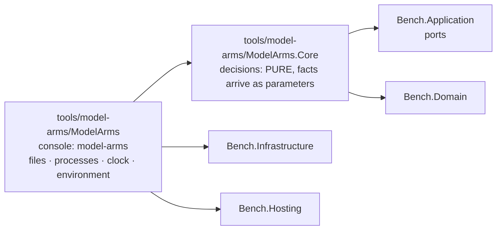

# Module — Model arms: the launcher of the part-6 experiment, in C#

> Status: **E1.S2 built, 2026-10-29 — the two projects, their references and the architecture guard exist; every other section below is an empty heading owned by the story named in it.**
> Plan: [PLAN_model_arms_E1.md](../todo/PLAN_model_arms_E1.md) (stories) under [PLAN_model_arms.md](../todo/PLAN_model_arms.md) (the design). Nothing here launches a model yet.

## Purpose

The owner compares coding pipelines ("arms") of headless Claude Code sessions on one frozen plan in a target repository: three schemes
(C, CR, SRS) times three runs, every arm ending in the product's multi-vendor code gate. The harness that launched those runs was a
set of bash scripts with inline node and the experiment's facts as constants at the top of each script. This module is its port to C#,
a console of its own beside the benchmark, not part of it. It ports the RUN half only (launch, resume, limits, the gate step, the
chain, isolation by file modes, the objective checks); the analysis half is a later plan. Its behaviour is the shell harness's, its
facts live in one refusing experiment file, and it is built so a decision can be tested without starting a process.

## Projects and the guard

| Project | Role | References |
|---|---|---|
| `tools/model-arms/ModelArms.Core` (`ModelArms.Core`) | Every decision of the module: the experiment's facts and their refusals, paths, the arm map, the launch options, the briefs. **Pure by construction** (plan D1): opens no file, starts no process, reads no clock, no environment. | `Bench.Domain`, `Bench.Application`; no packages |
| `tools/model-arms/ModelArms` (assembly `model-arms`) | The only project that touches the world. Today a stub `Program.Main` that answers the configuration exit code so the executable links. | `ModelArms.Core`, `Bench.Infrastructure`, `Bench.Hosting` |

The console also carries two content globs, so no later story edits its project file to ship a file: `tools/model-arms/briefs/*.template.md`
and `tools/model-arms/examples/*.json` are copied beside the binary under `briefs/` and `examples/`. Both folders are empty until their stories.
Both projects are in `dew_flow_benchmark.slnx` under a `/tools/` folder, and `Bench.Tests` references both as ordinary references so their
assemblies are in the test output on purpose, not by accident.

**The guard** is `tests/Bench.Tests/ModelArms/ModelArmsArchitectureTests.cs`; it reuses `ArchitectureTests.Referenced` and `IsRuntime` (widened to `internal`, not copied).

| Test | What it holds |
|---|---|
| `Core_references_only_the_runtime_the_domain_and_the_application_layer` | `ModelArms.Core.dll` references the runtime, `Bench.Domain` and `Bench.Application` only |
| `Core_never_references_infrastructure_or_entity_framework` | the same assembly names no `Bench.Infrastructure`, no `Microsoft.EntityFrameworkCore*`, no `Npgsql*` |
| `Nothing_under_src_or_hosts_references_the_model_arms_module` | no `*.csproj` under `src/` or `hosts/` names `ModelArms` or `model-arms`, and no product assembly (`Bench.*.dll` except the test assembly, `bench.dll`) references `ModelArms.Core` or `model-arms`; both scans also assert they found something |
| `Every_core_decider_is_named_in_the_pure_list` | every public static class of `ModelArms.Core` is named in `PureDeciders`, one marker line per story, and everything named lives in `ModelArms.Core` |

What the guard does not prove: that a Core type is pure inside its body. A list of referenced assemblies cannot see `File.ReadAllText`, because the
runtime is always allowed. The pure list only makes each decider named on purpose, and the first decider's story adds the companion
that asserts the scan still finds something. Until then the fourth test's second half has nothing to scan, and its teeth were shown by planting a
public static class.

Separately, `Bench.Hosting` (the parser, the exit codes, the shutdown signal) is held a leaf by `ArchitectureTests`, beside the Domain, Contracts and Delivered leaves.

## The experiment file (E1.S3)

## Paths and the arm map (E1.S4)

## The launch boundary (E1.S5, E1.S6)

## Briefs (E1.S7)

## The root, trust and the host (E1.S8, E1.S10)

## The command line (E1.S9)

## The first run: init and validate (E1.S11)
