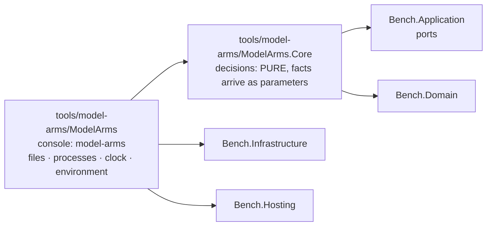
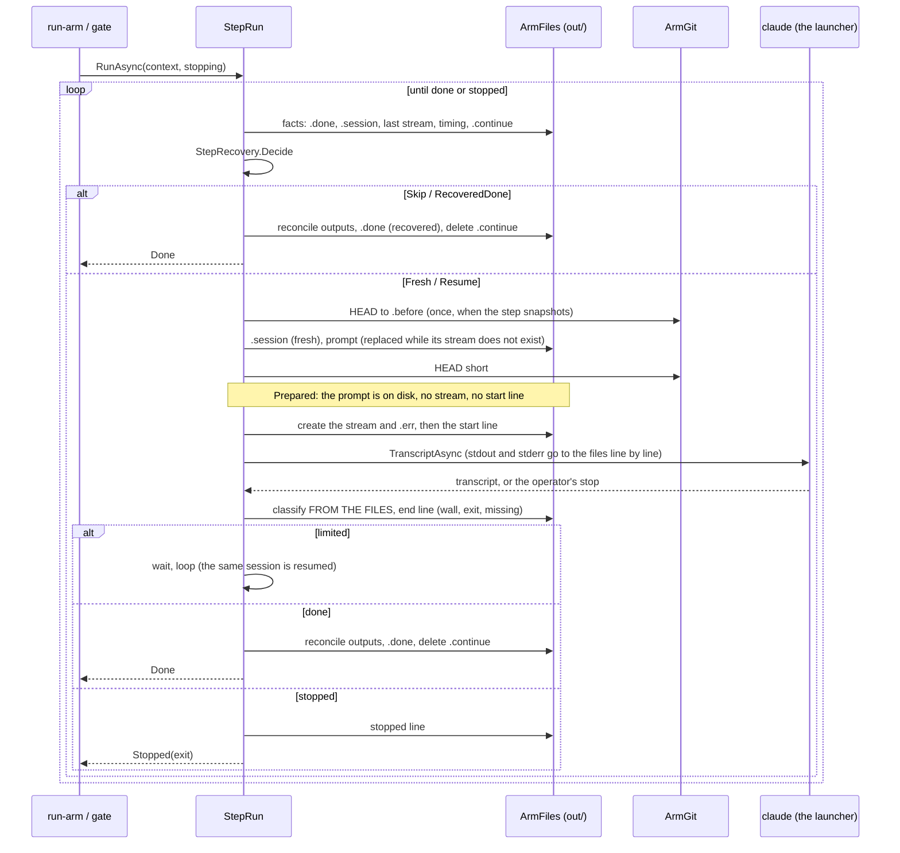
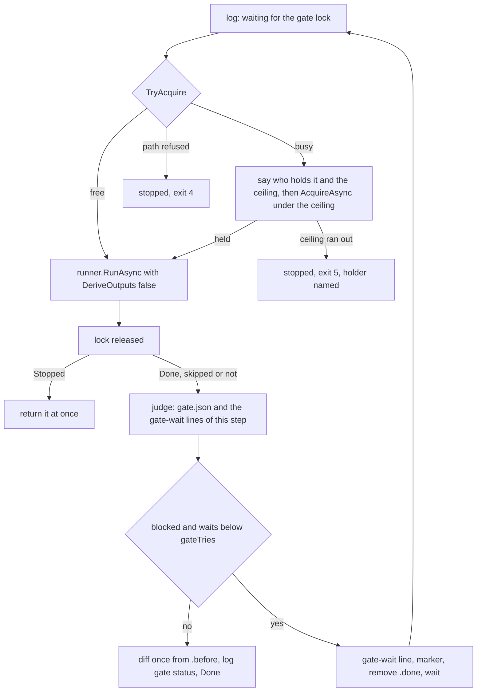
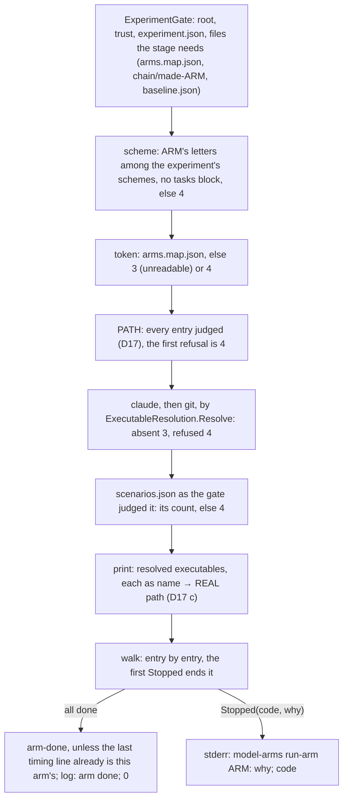
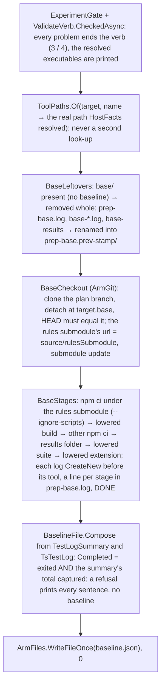
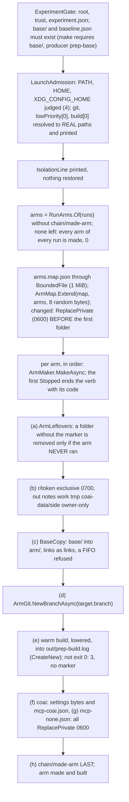
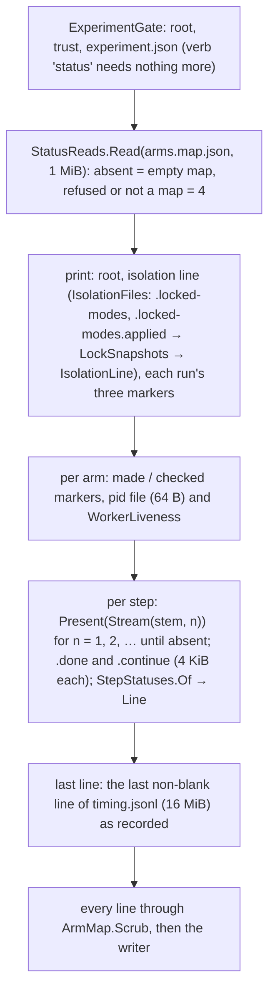
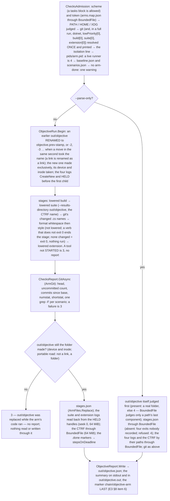
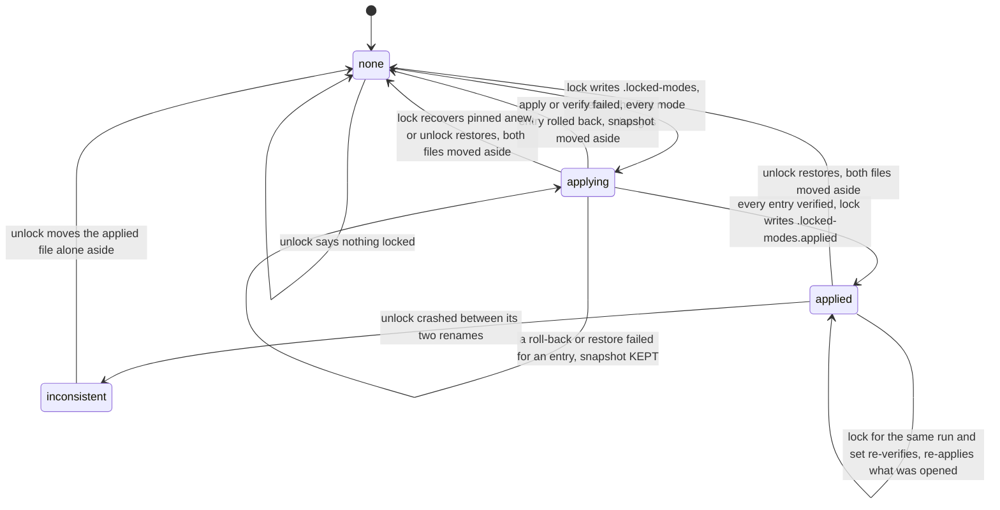

# Module — Model arms: the launcher of the part-6 experiment, in C#

> Status: **E1.S2 built, 2026-10-29 — the two projects, their references and the architecture guard exist; every other section below is an empty heading owned by the story named in it.**
> Plan: [PLAN_model_arms_E1.md](../todo/PLAN_model_arms_E1.md) (stories) under [PLAN_model_arms.md](../todo/PLAN_model_arms.md) (the design). Nothing here launches a model yet.

## Purpose

The owner compares coding pipelines ("arms") of headless Claude Code sessions on one frozen plan in a target repository: three schemes
(C, CR, SRS) times three runs, every arm ending in the product's multi-vendor code gate. The harness that launched those runs was a
set of bash scripts with inline node and the experiment's facts as constants at the top of each script. This module is its port to C#,
a console of its own beside the benchmark, not part of it. It ports the RUN half only (launch, resume, limits, the gate step, the
chain, isolation by file modes, the objective checks); the analysis half is a later plan. Its behaviour is the shell harness's, its
facts live in one refusing experiment file, and it is built so a decision can be tested without starting a process.

## Projects and the guard



| Project | Role | References |
|---|---|---|
| `tools/model-arms/ModelArms.Core` (`ModelArms.Core`) | Every decision of the module: the experiment's facts and their refusals, paths, the arm map, the launch options, the briefs. **Pure by construction** (plan D1): opens no file, starts no process, reads no clock, no environment. | `Bench.Domain`, `Bench.Application`; no packages |
| `tools/model-arms/ModelArms` (assembly `model-arms`) | The only project that touches the world. Today a stub `Program.Main` that answers the configuration exit code so the executable links. | `ModelArms.Core`, `Bench.Infrastructure`, `Bench.Hosting` |

The console also carries two content globs, so no later story edits its project file to ship a file: `tools/model-arms/briefs/*.template.md`
and `tools/model-arms/examples/*.json` are copied beside the binary under `briefs/` and `examples/`. Both folders are empty until their stories.
Both projects are in `dew_flow_benchmark.slnx` under a `/tools/` folder, and `Bench.Tests` references both as ordinary references so their
assemblies are in the test output on purpose, not by accident.

**The guard** is `tests/Bench.Tests/ModelArms/ModelArmsArchitectureTests.cs`; it reuses `ArchitectureTests.Referenced` and `IsRuntime` (widened to `internal`, not copied).

| Test | What it holds |
|---|---|
| `Core_references_only_the_runtime_the_domain_and_the_application_layer` | `ModelArms.Core.dll` references the runtime, `Bench.Domain` and `Bench.Application` only |
| `Core_never_references_infrastructure_or_entity_framework` | the same assembly names no `Bench.Infrastructure`, no `Microsoft.EntityFrameworkCore*`, no `Npgsql*` |
| `Nothing_under_src_or_hosts_references_the_model_arms_module` | no `*.csproj` under `src/` or `hosts/` names `ModelArms` or `model-arms`, and no product assembly (`Bench.*.dll` except the test assembly, `bench.dll`) references `ModelArms.Core` or `model-arms`; both scans also assert they found something |
| `Every_core_decider_is_named_in_the_pure_list` | every public static class of `ModelArms.Core` is named in `PureDeciders`, one marker line per story, and everything named lives in `ModelArms.Core` |

What the guard does not prove: that a Core type is pure inside its body. A list of referenced assemblies cannot see `File.ReadAllText`, because the
runtime is always allowed. The pure list only makes each decider named on purpose. The first decider's story (E1.S3) added the two
companions that keep the scans alive: `CorePublicStaticClasses()` must contain `ExperimentFile` (the public-static-class scan still finds a known
instance; shown red by making the scan's predicate match nothing), and `Referenced("Bench.Tests.dll")` must contain `ModelArms.Core` (the
assembly half's known positive).

Separately, `Bench.Hosting` (the parser, the exit codes, the shutdown signal) is held a leaf by `ArchitectureTests`, beside the Domain, Contracts and Delivered leaves.

## The experiment file (E1.S3)

> Superseded by [*The step contract (E2.S0)*](#the-step-contract-e2s0) where it speaks of step kinds, `rounds` and the schema name; kept as the E1 record (the reading, the path and executable rules and the placeholders are unchanged).

`ExperimentFile.Read(json, location)` turns the text of `experiment.json` into an `Experiment`, or refuses it with every problem of the file in
one answer, one sentence per line (`Outcome<Experiment>`, the reason is the lines joined by `\n`). Core receives the TEXT and an
`ExperimentLocation(Root, Home, EnclosingGitTop, ThisRepository)`; the console reads the file and answers the location's four questions.
The worked example `tools/model-arms/examples/part6.experiment.json` is the one source the tests and the `init` template are derived from (*The first run*, below).

**Reading.** `JsonNode.Parse` with comments skipped (the example carries `//` comments), trailing commas refused and a member written twice
refused at any depth (`AllowDuplicateProperties = false`; it arrives as a `JsonException`, whereas the default would throw `ArgumentException` on later access, outside any catch). A malformed text, or one whose
root is not an object, is a single problem. The walk is `StrictJson`, a reader that records a sentence per problem instead of stopping at the
first; this is why the catalog's `UnmappedMemberHandling.Disallow` is not used (it names one unknown member and quits). A file that leaves any
problem builds no `Experiment`.

| Members | Rule |
|---|---|
| top level, required | `schema` `target` `scenarios` `baseline` `known` `steps` `schemes` `rounds` `limits` `tools` `awake` |
| top level, optional | `tasks` (absent: `TaskLimits.Shell`, 4 / 7 / 4) · `coai` (absent: `CoaiFacts.None`) · `isolation` (absent: `IsolationFacts.None`) |
| `target`, all required | `source` `planBranch` `base` `plan` `branch` `rulesSubmodule` `lowPriority` `build` `suite{command,ctrfFile,namePrefix}` `format{solution,verbs}` `extension{directory,command}` `nodeModules` `testGlobs` |
| `limits` / `tasks` / `tools` / `coai` / `isolation` | six limits / `min` `max` `maxParallel` / `write` `read` `gate` `deny` / `binary` `settings` `side` / `closed` `unlisted`; inside a present object every member is required |

**What is refused, and the sentence it gets.** An unknown member: `target.bulid is not a member this build knows (known: …) — refused rather
than ignored`. A missing one: `target.base is missing`. Then the value rules:

- `schema` is exactly `model-arms/experiment-v1`.
- Absolute (`Path.IsPathFullyQualified`): `target.source`, `coai.binary`, `coai.settings`. Relative, not rooted, no `..` segment: `target.plan`,
  `rulesSubmodule`, `format.solution`, `extension.directory`, each element of `nodeModules` and `testGlobs`, and `scenarios` / `baseline` (names inside the root).
  `target.base` is `CommitSha.Parse`, its reason quoted. Every other text is non-empty.
- Every command (`lowPriority`, `build`, `suite.command`, `extension.command`) is a non-empty array whose first element passes
  `ExecutableRule.Refusal` against `[target.source, <root>]` (D17, the static half): a bare name is fine; a relative path
  (`./x`) is refused because it resolves against the target; an absolute path equal to or under a forbidden root is refused (normalised, ordinal,
  with a trailing separator, so a sibling that shares a prefix is not "under"). A file under the target may only be an ARGUMENT, which is why
  the suite runs as `dotnet <tests>.dll`. The forbidden roots are the target and the experiment root itself (which holds `base`, `r` and
  everything else an arm could write). "Under" is compared ignoring case, so it fails closed on a case-insensitive host, and a name containing
  `:` is a path (`C:x.exe` is drive-relative on Windows), never a bare name. **Symbolic links are not followed by this static rule**: a link
  outside every forbidden root that points inside one passes it. Resolving an executable on a host, following the link to its final target
  and checking that against the same roots is E1.S8's `ExecutableResolution`.
- **A JSON `null` where an object belongs** (`"limits": null`, `steps.code: null`, `target.suite: null`, ...) is refused with
  `<path> must be a JSON object`: an object-valued member is read through one accessor that takes the parent and the member name, so a
  present-but-null member is never mistaken for an absent one. `steps`, `schemes` and `rounds` must not be empty.
- `steps`: keys are step kinds (`code review fix hreview gate split splitFix taskCode`; `steps.lint is not a step kind (…)`), each value
  `{model, minutes > 0, mode ∈ write|read|gate}`. `schemes`: names are letters; each entry is exactly `tasks` or `<file name>:<step kind>`
  (`^[0-9]+[a-z]?-[A-Za-z0-9-]+:[A-Za-z]+$`) whose kind is defined under `steps`. `rounds`: non-empty arrays of arm names whose scheme (`ArmNames.SchemeOf`:
  `SRS2` is `SRS`) is among the schemes: `rounds[0][1] names 'XY2', whose scheme 'XY' is not among the schemes (C, CR, SRS)`.
- `limits.*` and `tasks.*` are whole numbers above zero and `tasks.min <= tasks.max`; `awake` is `auto|windows|wsl|none`; `coai.side` names one folder (no
  separator, no `..`).
- **Placeholders.** An `isolation` entry is `<root>`, starts `<root>/`, starts `~/`, or is absolute; `<root>` expands to `Root` and a leading `~` to
  `Home` (`Path.Combine`), so `Experiment.Isolation` holds paths only. Anything else is refused.
- **The template's placeholder** (`UnfilledValues`, run by `Read` after the walk): a string still equal to `<fill me>`, at ANY path, is refused as `<path> is still the template's <fill me> — replace it`. Each
  field's own rule rejects the placeholder only when it dislikes the text (an absolute path, a sha, a choice); `known`, `steps.*.model`, `tools.*[*]`, `coai.side`, `target.planBranch` and the like would take it. The rule is on the
  reader's one road in, not on the fields; a path an earlier problem already names (a line starting with it, then a space or a colon) is not said twice. `ExampleExperimentTests.Every_value_the_template_leaves_unfilled_is_named_by_the_reader`
  derives the list from the template itself.
- **Placement** (`ExperimentFile.Placement`, added to every `Read` first): a root equal to or under `ThisRepository` is refused (`inside this
  repository`); any non-empty `EnclosingGitTop` is refused (`inside the git checkout`), because the arms' clones would nest in it.

What this does NOT prove: that any path exists or is readable, that an executable resolves on this host, that `scenarios.json` parses, that an arm is named
twice in the rounds, or that a host can set modes (E1.S8 and E1.S10, `validate`). The example's paths are under `/example/` and the tests' location is
`/x/...`, so these tests assume a POSIX path syntax (the suite runs on ubuntu CI and WSL).

## The step contract (E2.S0)

Parent decisions D25 (a step's identity is configuration, its execution kind is closed) and D27 (runs are named); schema `model-arms/experiment-v2`. E1 keyed `steps` by a closed `StepKind` and
picked one template per kind and one notes file per kind; one day later part 7's CHH scheme (two read-only Haiku reviews briefed differently, a fixer briefed with both verdicts, a diff
spanning three steps) could not be said in it. The module ports a harness: the owner changes a scheme between parts, and the runner must not be rebuilt for that. What the runner must KNOW
is closed; everything else is the file's.

**Four kinds, and what each closes.** `StepKind { Session, Review, Gate, TaskCode }`, the file's words `session review gate taskCode`.

| Kind | What the runner does that only the kind can decide |
|---|---|
| `session` | one claude session; nothing else |
| `review` | the last result's JSON block is written to the file its `verdict` output names (derived, required by construction: regenerated or resumable, D21) |
| `gate` | runs under the gate's lock and reads the file its `status` output names; mode is `gate` and only a gate's is |
| `taskCode` | the task pipeline's coder, launched per task in its worktree; carries no bindings, because its notes, snapshot and diff are named per task (`TaskNotes(id)`, `task-<id>.before`, …) |

**A step** is `steps.<id>` — the id is letters and digits, starting with a letter (`StepId.Parse`) — with the members `kind model minutes mode subagents brief outputs notes verdict status snapshot diffFrom`
(required `kind model minutes mode brief`). `StepSpec` carries them: `Brief` is a template stem; `Outputs` are bindings, a brief FIELD name (`[A-Z_]+`, the filler's own `{{NAME}}`) to a path under the
arm folder (`OutputBinding`: relative, forward slashes, under exactly `notes/` or `work/` — the two folders a launch grants, so `Notes/x.md` is refused, not read as the same folder — with no empty, `.` or `..`
segment, no control, format, line-separator or non-ASCII-space character (NUL, a newline, U+200B, U+2028, U+00A0) and no space at either end of a segment; two DESTINATIONS are compared without regard to case, which fails closed); `Notes` names the field `NOTES` stands for (one of the step's own outputs or an EARLIER step's, which the step then appends to — the split fix appends to `SPLIT_NOTES`; absent: `-`);
`Verdict` / `Status` name one of the step's own outputs; `Snapshot` takes `out/<name>.before` before the first attempt; `DiffFrom` names the step id whose `.before` the `out/<name>.diff` is written from
(its own id included). Equality of a `StepSpec` and of `TaskLimits` is by value, `Outputs` included: a record compares a list by reference.

**The sentences** (every one starts with its dotted path, then a space or a colon — `UnfilledValues.Refuse` de-duplicates by that prefix; `StepContractTests` asserts the prefix on every refusal and
`Every_refusal_of_the_step_contract_starts_with_its_dotted_path` holds it in one place):

| member | rule | the sentence |
|---|---|---|
| `schema` | exactly `model-arms/experiment-v2` | v1: `schema is 'model-arms/experiment-v1' — this build reads 'model-arms/experiment-v2': steps are keyed by a step id and carry kind, brief and outputs; the notes files are bindings; rounds moved to runs.<name>.rounds`; any other: `schema is '<x>' — this build reads exactly 'model-arms/experiment-v2'` |
| `rounds` at the top level | known only to be refused | `rounds — moved to runs.<name>.rounds (schema v2)` |
| `steps.<key>` | the key through `StepId.Parse` | `steps.<key>: '<key>' is not a step id — letters and digits, starting with a letter (hA, splitFix)` |
| `kind` | one of the four | `steps.<id>.kind is '<x>' — legal: session, review, gate, taskCode` |
| `mode` | the three, then the pairing | `steps.<id>.mode is '<m>' — a gate step's mode is gate` · `steps.<id>.mode is 'gate' — only a gate step runs in gate mode (this step's kind is <k>)` |
| `subagents`, `snapshot` | `true` or `false`; default `false` | `steps.<id>.subagents must be true or false` |
| `brief` | a stem: `[A-Za-z0-9-]+` | `steps.<id>.brief: '<x>' is not a template stem — letters, digits and dashes, no separator and no '..' (hA-trace names hA-trace.template.md)` |
| `outputs` | each pair through `OutputBinding.Parse`, after refusing a name every brief is filled with (`BriefFields.FixedNames`: the seven facts, `NOTES`, the task fields, `PROBLEMS`); two fields of one step with one path | `steps.<id>.outputs.<F>: <F> is a field every brief is filled with — a binding cannot replace it` (and `tasks.outputs.<F>: …`) · `steps.<id>.outputs.<F>: <F> is not a field name — capitals and underscores, as a template's {{NAME}}` · `steps.<id>.outputs.<F>: '<path>' is not an output path — relative, under notes/ or work/, forward slashes, no '..' (notes/hA.json)` · `steps.<id>.outputs — <A> and <B> both name <path>` |
| `verdict` / `status` | required for `review` / `gate`, one of the step's own outputs; refused on any other kind | `steps.<id>.verdict is missing — a review step names the output its last result's JSON block is written to` · `steps.<id>.status is missing — a gate step names the output it reads status from` · `steps.<id>.verdict is '<X>' — not one of the step's outputs (<list or none>)` · `steps.<id>.verdict — only a review step has a verdict (this step's kind is <k>)` |
| `notes` | a field some step or the tasks block binds, and never one a step binds as its VERDICT (the map-level check; the position check is the scheme's) | `steps.<id>.notes is '<X>' — no step binds it` · `steps.<id>.notes is '<F>' — the verdict of step <r>, which the runner writes; notes are a file the model writes` |
| `diffFrom` | a defined step id (the placement and the snapshot are the scheme's) | `steps.<id>.diffFrom is '<x>' — not a step id defined under steps (<ids>)` |
| a `taskCode` step | `outputs` (non-empty), `notes`, `verdict`, `status`, `snapshot: true`, `diffFrom` | `steps.<id>.<member> — a taskCode step has no bindings: the task pipeline names its notes, snapshot and diff per task (E4)` |
| the map | a field bound by two steps | `steps.<later>.outputs — <F> is already bound by step <earlier>` |
| `schemes.<S>[<i>]` | `tasks`, or `<file name>:<step id>` over a defined id | `schemes.<S>[<i>] is '<text>' — an entry is "tasks" or "<file name>:<step id>", such as "1-code:code"` · `… — step id '<id>' is not defined under steps (defined: <ids>)` |
| a scheme | a name placed twice; `tasks` twice; a `taskCode` step as a plain entry | `schemes.<S> — '<name>' is placed twice` · `schemes.<S> — tasks is placed twice` · `schemes.<S>[<i>] (<name>): a taskCode step runs only inside a tasks entry` |
| a scheme, per position | `notes` not visible; `diffFrom` not placed at or before (inside one tasks entry the block's order, split before split fix before the task coder, decides), or without a snapshot | `schemes.<S>[<i>] (<name>): notes <X> is bound by no step at or before this position (visible: <fields>)` · `schemes.<S>[<i>] (<name>): diffFrom <x> is not placed at or before this position` · `… diffFrom <x> has no snapshot` |
| a scheme, the producers | one path from two producers; one field from a step and the tasks block; in a scheme with a tasks entry, a file the task pipeline writes (`work/tasks.json`, `work/batches.json`, a task's brief `work/t<n>.md` or notes `notes/t<n>-code.md`, the id being `TaskIds.Pattern` (`^t[0-9]+\z`), defined once in Core and the one E4's `tasks.json` checker reads; `work/summary.md` is free — the shapes are read from `ArmPaths.TasksJson`, `BatchesJson`, `TaskBrief`, `TaskNotes` by `ArmPaths.IsPipelineFile`) | `schemes.<S> — <path> is written by two of its producers: <p1> (<F1>) and <p2> (<F2>)` · `schemes.<S> — <F> is bound by step <id> and by the tasks block` · `schemes.<S> — <path> is a file of the task pipeline, which writes it: <p> (<F>) cannot bind it` |
| `tasks` | `min max maxParallel split splitFix taskCode` required, `outputs` optional; the ids checked when the block is present OR a scheme has a `tasks` entry | `tasks.split is '<x>' — not a step id defined under steps (<ids>)` · `tasks.split is '<x>' — its kind is <k>; the split is a session step` (`the split fix is a session step`, `the task coder is a taskCode step`) · `tasks.splitFix is '<x>' — the split fix is a step of its own, not the split` · `tasks.outputs.<F>: <reason>` |
| `runs` | a map, at least one; a name `[A-Za-z0-9-]+` | `runs is empty — it needs at least one member` · `runs.<name> — a run name is letters, digits and dashes: it names the folder chain/<name>/` |
| `runs.<name>.rounds` | non-empty arrays of arm names of defined schemes | `runs.<name>.rounds must be a non-empty array of arrays of arm names` · `runs.<name>.rounds[<i>][<j>] names '<arm>', whose scheme '<s>' is not among the schemes (<names>)` |
| across runs | an arm twice in one run; an arm in two runs; a closed arm that is not an arm of an EARLIER run | `runs.<name>.rounds — arm <A> is named twice` · `runs.<name2> — arm <A> is already in run <name1>` · `runs.<name>.closedArms[<i>] names '<A>', which no run names` · `…, an arm of this run` · `…, an arm of a later run <m>` |

The reader is `StepSection` (one step), `FlowSection` (the map and the schemes), `TaskSection` (the block), `SchemeChecks` (one scheme) and `RunSection` (`runs`), each internal and under 300 lines.
An absent `tasks` block means the shell's names (`TaskLimits.Shell`: 4 / 7 / 4, `split`, `splitFix`, `taskCode`, no outputs). `closed` goes through the same `<root>` / `~` expansion as `isolation`.

**What a brief sees: `SchemePositions`.** `Outputs(scheme, steps, tasks)` is every output the scheme's entries bind, in scheme order, each with its position and its producer (the entry's file name,
`2-hA`; the split's or the split fix's id; `tasks` for the block's own outputs). A tasks entry contributes the split's outputs, then the split fix's, then the block's own — in that order, so the
split fix may append to the split's notes. `Visible(scheme, position, id, …)` is what a brief at that position may use: every output of an EARLIER position, the step's OWN outputs (the gate's
template names its own `{{GATE_JSON}}`, `hfix.template.md` its own `{{NOTES}}`) and, inside a tasks entry, the block's steps up to and including `id` — never the block's own `outputs`, which are for the
steps AFTER it. On the SRS scheme of the example: `Outputs` begins `(0, split, SPLIT_NOTES)`, `(0, tasks, CODE_NOTES)`, `(1, 3-hreview, HREVIEW_NOTES)`, and `Visible(SRS, 1, hreview)` holds `SPLIT_NOTES`,
`CODE_NOTES` and `HREVIEW_NOTES`. `CODE_NOTES` there is the path the shell handed SRS's reviewers although no SRS step wrote it (`run-arm.sh:44`, `t-lib.sh:103-105`) — kept as measured, as an optional
binding. `BriefFields.For(spec, visible, tasks, paths, facts)` fills `PLAN BASE BRANCH SCEN_COUNT DEADLINE KNOWN WORK`, `NOTES` (a task coder's `TaskNotes`, else `-` when the step names none, else the path
of the visible binding it names), one field per visible binding, `TASK TASK_BRIEF TASK_FILES BEFORE` for a `taskCode` step and `PROBLEMS` for the split fix. The reader refuses a binding named like any of these fixed
names (`BriefFields.FixedNames` is the one list the builder spells its fields from and the reader refuses by, for steps and the tasks block alike); should one get through anyway, the facts come last and win. The rehearsal and the runner both ask `Visible`, so they cannot fill by two rules.

**One producer per destination, and bound is not produced.** Among the producers a scheme places, two different producers never bind the same normalised path (compared without regard to case):
`hB.outputs.HB_JSON = notes/hA.json` beside `hA`'s would make CHH's fixer read one verdict twice, and is refused at the READ naming the scheme, both producers, both fields and the path. It is per scheme,
not per map: two steps no scheme places together may write one path. `notes` naming an earlier step's output is appending, not producing. A step placed twice in one scheme is refused by the same rule
whenever it binds anything (not ruled on separately). `StepSpec.ModelWritten` is `Outputs` minus the `verdict`: the verdict is what the runner derives; every other binding — the `tasks` block's `CODE_NOTES`
included — is what the MODEL is briefed to write, which the runner never requires: E2.S4 RECORDS an absent one (the `End` line's `missing`) and logs each visible earlier output whose file does not exist
before a consumer's launch, and the arm goes on, as the shell's did. No exit code is added to D16's table.

**The CHH walk.** From the example to the files it binds: `1-code:code` binds `notes/code.md` (`CODE_NOTES`, also `NOTES`); `2-hA:hA` is a `review` in `read` mode with `snapshot: true`, its verdict `HA_JSON` is
`notes/hA.json`; `3-hB:hB` the same with `HB_JSON` → `notes/hB.json`; `4-hfix:hfix` is a `session` in `write` mode with `diffFrom: hA`, so `out/4-hfix.diff` runs from the snapshot taken before the first review to
HEAD after the fix, and its brief at position 3 sees `CODE_NOTES`, `HA_JSON`, `HB_JSON` and its own `HFIX_NOTES` (`notes/hfix.md`) and none of `REVIEW`, `FIX_NOTES`, `GATE_JSON`; `5-review:review` → `notes/review.json`;
`6-fix:fix` → `notes/fix.md`; `7-gate:gate` → `notes/gate.md` and `notes/gate.json` (`status`). Eight files for CHH (`notes/code.md hA.json hB.json hfix.md review.json fix.md gate.md gate.json`); with
`hreview.md` and `split.md`, which CR and SRS bind, the example binds ten, `CODE_NOTES` once. `ExampleExperimentTests.The_example_binds_every_file_the_shell_wrote` holds the set; a scheme placing `4-hfix` before `2-hA` and `3-hB` is refused by the rehearsal
naming the scheme, the position and both fields (`hfix.template.md at schemes.X[1] (4-hfix): the brief has unfilled fields: {{HA_JSON}} {{HB_JSON}}`). That the two calls write two distinct verdict
CONTENTS is E2.S8's CHH scenario.

**Runs.** `runs` replaces `rounds`: a map of run name → `{ rounds: [[arms]…], closedArms: [arm names], closed: [paths] }`. `chain <run>` runs one and keeps its markers under `chain/<run>/` (E5); `closedArms`
are folders resolved through the arm map at lock time and closed for the run (part 7 closed part 6's nine arms this way); `closed` are more paths, expanded. An arm is in one round of one run;
`run-all` and `run-arm` take arms and need no run.

**Templates.** `BriefTemplates.NameOf(stem)` → `<stem>.template.md`, refusing a stem with a separator or `..`; `Shipped` is the eleven stems `1-code 2-review 3-fix gate hr-review-fix t2-coder x-split x-split-fix
hA-trace hB-tests hfix` — part 6's eight and part 7's three, copied byte for byte from the part-7 harness (`/home/jinx/git/coai-exp2/briefs/`); the sums are in `BriefFillerTests`, typed out once.
`BriefTemplateFiles.Read(stem)` reads the experiment root's `briefs/` first, then the shipped folder, so a root may ADD a template a step names. `BriefRehearsal.Problems` fills every template at every position
of every scheme (a tasks entry is three fills: split, split fix, task coder) and returns every problem at once, `<stem>.template.md at schemes.<S>[<i>] (<name or id>): <the filler's reason>`; a template no
folder holds is said at each position that needs it and names the step: `nowhere.template.md at schemes.C[0] (1-code): step code: no brief template 'nowhere.template.md' in <overrides> or <shipped>`;
`StemsUsed` is the stems the schemes place, which `HostFactsReader` reads.

**Deviations of E2.S0 from its spec** (what shipped differently; the plan's §8 item 47 carries the same list):

1. **The output folder is exact, and case is compared only between destinations.** The spec said `notes` or `work` "exactly" but its clash scenarios used `Notes/Code.md`; the first build compared the folder
   without regard to case, and `Notes/x.md` validated although it is a folder no launch grants on a case-sensitive host (review R1). Decided: the folder is exact; the clash scenarios use a case variant after
   the folder (`notes/Code.md` beside `notes/code.md`); the path theory has three tests (paths, field names, the two-fields clash).
2. **Scheme `X` of the rehearsal scenario uses `hfix2`.** `hfix` has `diffFrom: hA`, which a scheme placing it before `hA` makes the reader refuse; the scenario adds `hfix2` (no `diffFrom`, field `HFIXTWO_NOTES`)
   so the file reads and the rehearsal is what refuses.
3. **`StepSpec` and `TaskLimits` carry `Equals` and `GetHashCode`**: a record compares a list by reference, and a re-read of one file must be equal.
4. **Types the spec did not list:** `TaskSection` (the block's members and its ids), `PlacedStep` and `SchemePositions.Steps` (one iteration of placements for the reader and the rehearsal),
   `BriefFields.FixedNames`, `ArmPaths.IsPipelineFile`, the test helper `BriefExample`. `StepKinds.Parse` became `StepKinds.Choices`.
5. **The not-found template row** of `ValidateVerbTests` is built as review R10 asked: a step whose brief stem exists nowhere (exit 4, the template, the step id and the position named); the old test, which
   tests an unknown field in an override, is renamed to say so.
6. **`HostChecks` detects a gate step by kind**, and the two flow rows (arm named twice, tasks entry without its steps) moved from `validate` to the reader.
7. **Prefix guards are stricter than specified:** `ExampleExperimentTests.Every_value_the_template_leaves_unfilled…` refuses the net's own words for four v2 members, and a `brief` edit is in the prefix
   test's list, so break-it (j) turns both guards red.
8. **Decisions taken in review** (not in the spec): a binding cannot be named like a fact (R4); a `notes` never names a verdict (R3); `tasks.splitFix` is not `tasks.split` (R2); `diffFrom` inside a tasks
   entry follows the block's order (R5); a path segment holds no control or format character and no edge space, and `ExecutableRule.Printable` escapes them (R7); a closed arm is an arm of an earlier run only
   (R8); a `taskCode` step is placed only through a tasks entry (R9); a scheme that runs the task pipeline refuses a binding of its files (R11); a binding refused is kept by name so nothing says it twice (R13).

**What this does NOT prove.** That a path exists, that a model writes any file it is briefed to write (the runner records it, never requires it), that a template reads well to a model, that
`metrics.mjs` or any consumer reads the bindings' files (E2.S8's `PinnedConsumer` and E6's check do), or anything about the task pipeline's per-task paths beyond `TaskNotes(id)` (E4). One gap the
reader leaves: a step placed twice in one scheme is refused only through the destination rule, so only when it binds something. One cause is said once: a binding that was refused is kept by name, and a
`verdict`, `status` or `notes` that names it says nothing more.

## Paths and the arm map (E1.S4)

`RootPaths` and `ArmPaths` (`tools/model-arms/ModelArms.Core/Experiment/ArmPaths.cs`) are the one spelling of every path of an experiment
root and of one arm; nothing else in the module concatenates a path. Every member is a `Path.Combine`; none opens a file or makes a folder
(`make` creates them, a later epic). `ArmPaths(Root, Token)` is built by `RootPaths.Arm(token)`. A name taken from a caller (arm, step, task id,
side, token) must be one path segment: empty, `.`, `..` or containing `/` or `\` throws `ArgumentException`, a programming error because callers
pass names validated upstream. A file name the operator configured goes through `RootPaths.Of`, which refuses by value
(`'<x>' must be a file name inside the experiment root`) a rooted name, a drive prefix or any `..` segment. `n` and `i` are printed invariant.

| `RootPaths` member | Path under the root |
|---|---|
| `ExperimentFile` | `experiment.json` |
| `Briefs` | `briefs` |
| `Base` | `base` |
| `ArmMapFile` | `arms.map.json` |
| `Arms` | `r` |
| `Pids` · `PidFile(arm)` · `PidLog(arm)` | `pids` · `pids/<arm>.pid` · `pids/<arm>.log` |
| `Chain` | `chain` |
| `Made(arm)` | `chain/made-<arm>` |
| `Locked` · `Unlocked` | `chain/locked` · `chain/unlocked` |
| `ObjectiveMarker(arm)` | `chain/objective-<arm>` |
| `ArmsDone` | `chain/arms-done` |
| `Executables` | `chain/executables.txt` |
| `GateLock` · `LockedModes` | `.gate.lock` · `.locked-modes` |
| `LockedModesRestored(stamp)` | `.locked-modes.restored-<UTC stamp>` (where `unlock` moves `.locked-modes` to) |
| `LockLog` · `KeepAwakeLog` | `lock.log` · `keep-awake.log` |
| `Of(relative)` | `<relative>`, refused when it leaves the root |
| `Arm(token)` | an `ArmPaths` |

| `ArmPaths` member | Path under `r/<token>` |
|---|---|
| `Folder` | `r/<token>` itself |
| `CloneFolder` | `arm` |
| `Out` · `Notes` · `Work` · `Tmp` · `Worktrees` | `out` · `notes` · `work` · `tmp` (the CLI's `TMPDIR`) · `wt` |
| `Worktree(id)` | `wt/<id>` |
| `CoaiSettings(side)` | `coai-data/<side>/settings.json` |
| `McpNone` · `McpCoai` | `mcp-none.json` · `mcp-coai.json` |
| `Session(step)` | `out/<step>.session` |
| `Stream(step, n)` · `Stderr(step, n)` · `Prompt(step, n)` | `out/<step>.a<n>.jsonl` · `.a<n>.err` · `.a<n>.prompt.md` |
| `Done(step)` · `Before(step)` · `Diff(step)` | `out/<step>.done` · `.before` · `.diff` |
| `Timing` | `out/timing.jsonl` |
| `ObjectiveFolder` · `Objective` | `out/objective` · `out/objective.json` |
| `TasksPlanLog` | `out/tasks-plan.log` |
| `BatchDone(i)` | `out/batch-<i>.done` |
| `TaskBefore(id)` | `out/task-<id>.before` |
| `CoderHead(id)` · `CoderDiff(id)` | `out/task-<id>-coder.head` · `out/task-<id>-coder.diff` (the shell named these after a model; no path of the module names one) |
| `Picked(id)` · `PickRecord(id)` · `PickLog(id)` | `out/picked-<id>` · `out/pick-<id>.json` · `out/pick-<id>.log` |
| `WorktreeBuildLog(id)` | `out/wt-build-<id>.log` |
| `PrepBuildLog` · `ObjectiveLog` | `out/prep-build.log` (make's warm build) · `out/objective.out` |
| `NotesFile(binding)` | the binding's relative path under the arm folder (`notes/hA.json`, `work/a/b.md`), each segment through `Segment` (E2.S0: the fixed `CodeNotes … GateJson` members are gone, a step's notes files are its bindings) |
| `TaskNotes(id)` | `notes/<id>-code.md` |
| `TasksJson` · `BatchesJson` | `work/tasks.json` · `work/batches.json` |
| `TaskBrief(id)` | `work/<id>.md` |

`ArmPathsTests` holds one hand-written spelling per row and compares the rows with the members the two types really have, so a path added
without a spelling fails the class. The parent plan's section 4.3 missed nine files the shell wrote (`notes/split.md`, `out/tasks-plan.log`,
`out/batch-<i>.done`, `out/task-<id>.before`, `out/pick-<id>.log`, `out/wt-build-<id>.log`, `out/prep-build.log`, `out/objective.out`, `.locked-modes.restored-<stamp>`); they are spelled here. The member for the
clone folder is `CloneFolder`, not `Clone`: C# reserves `Clone` in a record (CS8859).

**The arm map** (`ArmMap`, `arms.map.json`) holds arm name to a random 16-hex token (8 bytes), the folder name of the arm so that no arm can
guess another's. The shell's tokens were 12 hex; `ArmMap.Read` refuses such a map and a run mints its own.

| Operation | Behaviour |
|---|---|
| `Read(json)` | an object of strings; every arm that is wrong is named, one sentence per line: a token that is not 16 lower-case hex, two arms with one token, an arm name not matching letters-then-digits, an arm twice, a value that is not a string; all of them in one read, not only the first |
| `ToJson()` | an indented JSON object of strings in insertion order, `\n` newlines, like the shell's map — not byte-identical (tokens, indent and file name differ) |
| `Extend(existing, arms, eightRandomBytes)` | every existing entry unchanged, then a fresh token for each arm not yet present; a draw that collides with a token already in the map is drawn again. Arms absent from `arms` are kept. A random source that does not give 8 bytes, or collides 64 times in a row, and an `arms` entry that is not an arm name throw (programming errors). The source is a parameter, so the type stays pure; the console passes `RandomNumberGenerator` |
| `TokenOf(arm)` | the token, or a refusal naming the known arms |
| `Leaks(text, ownArm, schemes)` | what the text would reveal to `ownArm`: every arm name of the map (its own too) and every scheme name found as a whole word (not touching an ASCII letter or digit, case-sensitive), and every token other than its own found anywhere. Its own token is allowed: it is the arm's working directory and is in every path field of a brief. Empty means clean |
| `Scrub(line)` | every token of the map replaced by `<token>`. The console's one writer calls this; nothing keeps its own copy |

What the tests do not prove: that the randomness is unpredictable (the tests count; the console supplies the entropy), and that a verb calls
`Leaks` or `Scrub` at the right places (the brief filler and the console writer own that and test it).

## The launch boundary (E1.S5, E1.S6)

**The one launcher, widened.** A step is one headless `claude -p`, started through the benchmark's existing launcher (`CliArgv` builds the
argv, `ProcessRunner` runs it); the module adds no second launcher. E1.S5 widened it, E1.S6 decides what to ask of it.

| Widening (E1.S5) | Where | Claude spelling |
|---|---|---|
| `AgentAskOptions.SessionId` / `ResumeSessionId` (a `Guid`, `Guid.Empty` = none) | `src/Bench.Application/CliAgent.cs` | `--session-id <guid "D">` / `--resume <guid "D">`, right after the model; both asked together are refused |
| `AgentAskOptions.PermissionMode` (`NotAsked`, `Default`, `AcceptEdits`, `Plan`) | same | `--permission-mode default\|acceptEdits\|plan`; refused beside a read-only sandbox, which already spells `plan` |
| `AgentAskOptions.PermittedTools` | same | `--allowedTools <name> <name> …`, each name its own token — the PERMISSION list with patterns (`Bash(git *)`), not `--tools` (`AllowedTools`, the built-in set) |
| `AgentAsk.ErrorOutput` (an `AgentOutputSink`, `None` by default) and `ProcessRunner`'s `stderrLine` | `CliAgent.cs`, `src/Bench.Infrastructure/Process/ProcessRunner.cs` | stderr is handed to the sink line by line while the process runs (the runner's file writer is E2); the whole stderr is still returned |

Codex, gemini and agy refuse the session id, the session to resume, the permission mode and the permission allow-list by name
(`CliArgv.Unsupported`); the first three widenings are claude's alone. `ErrorOutput` is not refused by any CLI: `CliAgentRuntime` hands the sink to
`ProcessRunner` for every runtime, because stderr is the process's, not a flag's. The existing argv suites run unedited.

**`StepLaunch`** (`tools/model-arms/ModelArms.Core/Launch/StepLaunch.cs`, pure) turns a step's mode, the tool lists, the arm's paths and the
session into an `AgentAskOptions` and a whole `AgentAsk`. `StepSession` is a closed pair: `Fresh(id)` becomes `SessionId`, `Resume(id)`
becomes `ResumeSessionId` (plan D9), so a launch is never both. Whatever the mode: `JsonEvents` (`--output-format stream-json --verbose`),
`McpServersOff` (`--strict-mcp-config`) and `AddDirectories = [Notes, Work]` (`--add-dir` twice). Per mode:

| Mode | `--permission-mode` | `--allowedTools` | `--disallowedTools` | `--mcp-config` |
|---|---|---|---|---|
| `Write` | `acceptEdits` | `tools.write` | `tools.deny` | `mcp-none.json` |
| `Read` | `default` | `tools.read` | `Edit Write NotebookEdit` then `tools.deny` | `mcp-none.json` |
| `Gate` | `acceptEdits` | `tools.write` then `tools.gate` | `tools.deny` | `mcp-coai.json` |

These are the flags of the shell harness's `run-arm.sh` (`:86-89`, `:106-108`); the lists keep the configured order. `Ask` is
`CliClaude`, the executable the console resolved, the prompt (it rides stdin), the working directory, the model of the step and the wall the
caller computed (the wall arithmetic and the sinks are E2's: `Output` and `ErrorOutput` stay `None`, and the runner sets them with `with`).
Nothing here resolves `claude`, starts a process or reads a clock.

**`ArmChildEnvironment`** (`…/Experiment/ArmChildEnvironment.cs`, pure; plan D19) is the environment an arm's claude runs under, passed as
`AgentEnvironment.Only(...)` so the launcher REPLACES the harness's own rather than merging into it:
(its secret rule is `SecretShaped.IsSecretShaped` — the union of the shared `IsSecretName` and the wider lists `TargetEnvironment` had held since E3 §8 item 49 (b), moved to one predicate both classes ask, with the `CLAUDE_*` / `ANTHROPIC_*` exception alone: E4.S0, see *The secret-shaped names and the git floor (E4.S0)*)

- the parent's variables as the shell harness handed them on (`HOME`, `PATH`, the locale, claude's configuration), **minus**
  `BENCH_*` and `ConnectionStrings__*` (ordinal, ignoring case), every name `CoaiEnvironment.IsHarnessVariable` accepts (`BENCH_*`, `COAI_*`),
  every name `CoaiEnvironment.IsSecretName` accepts (`*_KEY`, `*_TOKEN`, `*_SECRET`, `*_PASSWORD`, the creds key) **unless it starts
  `CLAUDE_` or `ANTHROPIC_`**, and `SUBAGENT_MODEL_GUARD` and `CLAUDE_CODE_DISABLE_BACKGROUND_TASKS` whatever their value;
- **plus** `TMPDIR = <arm>/tmp` (`ArmPaths.Tmp`), replacing any spelling of it in the parent. Nothing else is added, and the result's
  comparer is ordinal.

`StepLaunch.Ask` adds exactly one thing more, because only a launch knows it: `PWD` is the request's working directory, and the runner's
`OLDPWD` is dropped. The shell ran `(cd "$DIR" && … claude …)`, so its child saw its own folder as `PWD` and the experiment's start folder
nowhere; a process started with a working directory does not update the variable, so without this the child would inherit the runner's `PWD`
and `OLDPWD`. This is the single named exception to "nothing else is added".

Why the exception for `CLAUDE_*` / `ANTHROPIC_*`: claude logs in through `CLAUDE_CODE_OAUTH_TOKEN` or `ANTHROPIC_API_KEY`, both secret-named,
so the unqualified secret rule would launch nine arms that cannot authenticate (E1 stories §8 item 1; parent D19 as corrected). Why no scout
flag: the arms run under the operator's hooks and settings exactly as part 6 measured them; a flag the shell never set would change what the
experiment compares. Why one `TMPDIR` per arm, shared by the parallel tasks of a batch: part 6 ran them that way without a collision, and a
per-task folder would be a condition no run has measured. The default `/tmp/claude-<uid>` is replaced because it would show every arm's name.

**Known differences from the shell's child, all deliberate.** The C# child is not byte-for-byte the shell's environment: (1) `COAI_*` is
stripped (the shell passed the operator's); (2) every non-claude secret-named variable is stripped (`GITHUB_TOKEN`, `DB_PASSWORD`, a vendor
`*_API_KEY`); (3) `TPL_*` is not passed (the shell exported them for its own template filling, `research/local-model-coding/harness/t-lib.sh:14`, `:62`,
`:106`; the module fills briefs in-process, so a child has no use for them); and `PWD` is matched to the shell's (above). Items (1) and (2) have one owner: the E2 gate step decides how a provider's key
reaches the coai server — through the `env` of `mcp-coai.json`, not through the child's own environment — so nothing here needs them.

**What this does NOT prove.** That claude authenticates with what is left, that it accepts the argv or its flag order (the tests compare
the multiset of flag groups, not the shell's order), or that any process starts: `StepLaunchTests` and `ArmChildEnvironmentTests` read the
values these functions return and the argv `CliArgv` builds from them. A variable named like a secret that is not claude's (a vendor key the
operator exported for another tool) is stripped; an arm that needs one must be given it by another road, which is a decision for a later epic.

### The delegation policy (E2.S0)

**What the code does.** No step starts a subagent unless its spec says so. `StepLaunch.SubagentTools` is `["Agent", "Task"]`, the tool that starts a subagent under both names the CLI has used. `StepLaunch.Options(spec, …)`
applies the mode as above and THEN `Delegation`: unless `spec.Subagents`, `DisallowedTools` is `[Agent, Task, <the mode's deny list>]` and `PermittedTools` is the mode's list without `Agent` and `Task` (ordinal) — so
the policy holds whatever the file's `tools` lists say (the example's `tools.write` keeps `Agent`, as the shell's did; the policy strips it at launch, and `"subagents": true` on a step gives it back). A fresh launch and a
resumed one go through the same `Options`, so a resume is never wider than the launch it continues. With `subagents: true` the policy adds nothing and removes nothing. The incident behind it is the shell's part 6: a Haiku review
step's cost was mostly Opus and Sonnet subagents, and the shell's own repair covered read steps only (`run-arm.sh:90-92`), while the example's Haiku steps are write mode with `Agent` permitted. `StepLaunchTests` pins the argv (`No_step_starts_a_subagent_unless_its_spec_says_so`,
`A_resume_is_never_wider_than_the_launch_it_continues`); the example says `"subagents": false` eleven times.

**What that proves, and what it does not.** The tests prove PRESENCE: the argv carries `--disallowedTools Agent Task …` and no `Agent` in `--allowedTools`. Whether the CLI honours a deny list — on a fresh launch and, the
open question, on a `--resume` of a session that HAD the tool — is the receiver's decision, so it was measured once (`common.security`: a control at a boundary you do not own is a request until you have seen the answer).

**The measurement** (claude 2.1.310, this host, 2026-10-30, by Fable before the spec; `claude -p --model haiku --output-format stream-json --verbose --strict-mcp-config --mcp-config '{"mcpServers":{}}' --permission-mode default`,
a prompt asking the model to start a subagent that replies `PONG`, else to answer `NOAGENT`):

| run | launch | the `init` line's `tools` | `Agent` tool_use events | subagent messages (`parent_tool_use_id` set) | result | `modelUsage` |
|---|---|---|---|---|---|---|
| A | fresh, `--allowedTools Read --disallowedTools Agent Task` | no `Agent`, no `Task` | none | none | `NOAGENT` | haiku only |
| B | `--resume` of A, the same deny | no `Agent`, no `Task` | none | none | `NOAGENT` | haiku only |
| C | fresh, `--allowedTools Read Agent Task` (the positive control) | `Agent` present | two | a Sonnet subagent answered `PONG` | `PONG` | haiku + sonnet |
| D | `--resume` of C with `--allowedTools Read --disallowedTools Agent Task` | no `Agent` | ONE — the model still emitted it, and the CLI refused it: `tool_use_error: No such tool available: Agent. Agent is disabled for this session, in subagents as well as here.` | none | `NOAGENT` | haiku + **`claude-sonnet-5-5`, 5 output tokens, $0.0758** (haiku $0.0074) — although no subagent ran |

Read as: the default deny holds on this CLI build on a fresh launch (A) and on a resumed one (B, D) — on D the session's earlier tool inventory did not survive the resume, and a call the model emitted from memory was
refused by the CLI itself. **The anomaly of D is the caveat for every cost metric**: a resumed haiku attempt carried a sonnet line in `modelUsage` with no subagent — an internal CLI call on resume, whose purpose this
measurement did not establish.

**Three decisions** (E2 stories §8 item 43, for the analysis plan): (1) a delegation check — E6's consumer check, the analysis plan's cost split (M3) — reads TOOL EVENTS (`tool_use` named `Agent` or `Task`, present in D as a
refused call) and SUBAGENT MESSAGES (a line whose `parent_tool_use_id` is non-null), **never `modelUsage` alone**; (2) `modelUsage`'s per-model cost is still the cost, so the analysis reports it beside the delegation
facts and never infers one from the other; (3) M3 re-runs A–D on the measurement CLI version and records the version beside the result, because a later build may change what a resume keeps. Out of bounds here: a
per-step model guard for the subagents a step IS allowed to start, `--agents`, and any change to `CliArgv` or `AgentAskOptions`.

## Briefs (E1.S7)

> Superseded by [*The step contract (E2.S0)*](#the-step-contract-e2s0) where it speaks of a template per step kind and a fixed field set per kind; kept as the E1 record. The filler below is unchanged.

A brief is a template with `{{NAME}}` placeholders, filled once per step from facts the module already holds. The eleven templates are the shell
harness's files, copied byte for byte (`tools/model-arms/briefs/*.template.md`, shipped beside the binary under `briefs/` by the console's content
glob); `The_eleven_shipped_templates_are_the_shells_byte_for_byte` holds their SHA-256 values, typed out once in the test, so an edited copy fails there.
A step names its template by a stem (`"brief": "hA-trace"`), so a template is no longer one per kind: where each shipped template is used in the example, and what a brief at that position sees,
is the placement table below (`NOTES` per the step's `notes` binding; the fields are `SchemePositions.Visible`'s).

| Template | Used by (example) | `NOTES` is | Fields beyond the facts and the visible bindings |
|---|---|---|---|
| `1-code` | `code` | `notes/code.md` | none |
| `2-review` | `review` | `-` (the review writes `notes/review.json`, the `REVIEW` field) | none |
| `3-fix` | `fix` | `notes/fix.md` | none |
| `hr-review-fix` | `hreview` | `notes/hreview.md` | none |
| `gate` | `gate` | `notes/gate.md` | none (`GATE_JSON` is its own status output) |
| `x-split` | `split` | `notes/split.md` | none |
| `x-split-fix` | `splitFix` | `notes/split.md` (appended to) | `PROBLEMS` |
| `t2-coder` | `taskCode` | `notes/<task>-code.md` | `TASK`, `TASK_BRIEF`, `TASK_FILES`, `BEFORE` |
| `hA-trace` | `hA` | `-` | none (`CODE_NOTES` earlier) |
| `hB-tests` | `hB` | `-` | none |
| `hfix` | `hfix` | `notes/hfix.md` | none (`HA_JSON`, `HB_JSON`, `CODE_NOTES` earlier) |

`BriefTemplates.NameOf(stem)` is the one spelling of the file names and refuses a stem with a separator or `..`; `Shipped` is the eleven stems. `BriefFields.For(spec, visible, tasks, paths, facts)` gives the seven
facts (`PLAN BASE BRANCH SCEN_COUNT DEADLINE KNOWN WORK`; `SCEN_COUNT` is printed invariant), `NOTES`, one field per visible binding, and the task or the problems for the steps that carry them. A field a
template does not use is never an error: the shell passed every path to every template, and so does this.

**`BriefFiller.Fill(template, fields, guard, templateName = "")`** replaces every placeholder whose name is a field, in one pass (a value is never expanded again), and refuses in this order:

1. a placeholder left without a field: `the brief has unfilled fields: {{A}} {{B}}` (each name once, in order of appearance);
2. a template that itself holds an arm name, a scheme name or another arm's token (an experiment root's override is the operator's text):
   `the template '<name>' would carry 'CR' into a brief — …`;
3. a substituted value in which `ArmMap.Leaks` finds one of those: `the field NOTES would carry 'C1' into a brief — no brief names an arm, a scheme or another
   arm's token (D15)`. The arm's OWN token is allowed: it is in every path field, and the arm's working directory shows it anyway (plan E1 section 8, item 2).
   A value that begins with `guard.Root` is checked without that exact prefix, so a native Windows root such as `C:\exp` does not make its drive letter a scheme named `C`;
4. a result that still holds a placeholder, which only a value can have carried: `the filled brief still holds {{PLAN}} — …`.

A field the template never uses is not checked. `ArmMap.Leaks` matches an arm name and a scheme of several letters as a whole word in any case ("as c1 did", "the srs arm");
a one-letter scheme only in its own case, so the `/mnt/c/` of a WSL path is not a leak.

`BriefTemplateFiles(shipped, overrides).Read(stem)` (console, `ModelArms.Adapters`) takes a template stem, never a file name, and resolves `BriefTemplates.NameOf` inside, so no
operator text can reach outside the two folders. It returns the experiment root's own copy when it exists, else the shipped one, else
`no brief template '<name>' in <overrides> or <shipped>`. The text is read as strict UTF-8; an override that exists but cannot be read (permissions, invalid UTF-8) is a refusal naming it,
never a fall back to the shipped file. A root `.gitattributes` line marks the templates `-text`, so a checkout never converts the bytes the SHA-256 values pin.

What this does NOT prove: that a brief reads well to a model; that the deadline string has the format the launcher prints (E2.S4 owns it); that the resume notice,
the prompt file or its path are right (E2); or that a template edited in an experiment root still carries every field it needs: such a copy is checked by `Fill`
at run time, not here.

## The root, trust and the host (E1.S8, E1.S10)

The first half (E1.S8): the root's requirements, its trust, executables on a host, and the two data files beside `experiment.json`. Five pure
deciders in `ModelArms.Core.Experiment`, one console adapter, `ModelArms.Adapters.RootFacts`. E1.S10 adds `HostChecks` and the `validate` verb
(the second half, below); the gate (E1.S9), `validate` (E1.S10) and `prep-base` (E3.S2) call the first half.

**`RootRequirements`** (D18, parent §4.12) is the table of which files of the root each verb needs, in the order they are checked. The names come
from `RootPaths` (one spelling of the layout); the scenarios and baseline names are the configured ones. `FirstUnmet(requirements, root, exists)` is the
first requirement the host does not meet, as a sentence naming the path and the verb that writes the file, or the empty string.

| Verb | Requirements, in order (`!` = must NOT exist) |
|---|---|
| `init` | `!` the root |
| `version`, `help` | none (an unknown verb also none: the command line refuses it first) |
| `validate` | root, `experiment.json`, scenarios |
| `prep-base` | root, `experiment.json`, scenarios, `!` baseline |
| `make`, `chain` | root, `experiment.json`, scenarios, baseline |
| `run-arm`, `run-all`, `checks` | the same, `arms.map.json`, then `chain/made-<arm>` for each arm given |
| `status`, `lock`, `unlock`, `gate-lock` | root, `experiment.json` |

`chain` requires what `make` requires (its first action is making every unmade arm), and `lock`, `unlock`, `gate-lock` require the root and `experiment.json`
(deviations 3 of the stories document). Producers: root, `experiment.json`, scenarios are written by `init`; the baseline by `prep-base`; `arms.map.json` and the
`made-` markers by `make`.

**`RootTrust.Decide(road, currentUid, files, root)`** (D17 a; the `bool posix` became `TrustRoad` in E3.S0 — `Kernel` judges owner and mode as described here, `Portable` the mode alone, see *The platform roads (E3.S0)*) judges facts the console read. On Windows (`NotPerformed`) the answer is `NotPerformed` with the line
`the ownership and mode check of <root> was not performed — POSIX only (D17)`: a check that was not performed is not a check that passed. On POSIX each file whose owner is not the
current user, and each whose mode has a group-write or other-write bit, is a problem of its own naming the path (the mode as three octal digits, with the
`chmod go-w` to run); none is `Trusted`. The caller passes the root folder, `experiment.json` and `scenarios.json`. A trust path that is itself a symbolic link is refused by
`RootFacts.ReadFacts` before any fact is read (`<path> is a symbolic link to '<target>' — the trust check judges the file itself, not a link that can be re-pointed`): the last segment may not
be a link, an ancestor may (`~/git` to `/mnt/d/git` is every WSL home), and a trailing separator is trimmed first because `readlink("link/")` follows the link and reports none.

**`ExecutableResolution.Resolve`** (D17 b) turns a command's executable into the path to run, and the path it returns is the REAL path: the one the kernel opens, every link and every `..` applied in the
kernel's own order. The harness launches and prints that path (not the one written), because judging the real path and launching the written one would leave the link between check and launch for an arm to
re-point. A bare name is searched in the PATH directories (on Windows also with `.exe`, empty entries skipped); a PATH candidate that is a dangling link or a loop is skipped and the search moves on, as `execvp`
does; a name found nowhere is `<name> is not on PATH on this host`. A spelled absolute path must exist and be executable, and one the kernel cannot resolve is refused naming the operating system's reason; a relative path
is refused; the verbatim and device prefixes (`\\?\`, `\\.\`, `\??\`, `//?/`, `//./`, `/??/`) are refused as a spelling on every platform, and so is a NUL character: in an executable (the first case of the textual rule), in every text of the experiment file (refused once in the reader, naming the field; every sentence that echoes input writes a NUL as the two characters `\0`, `ExecutableRule.Printable`), and in a forbidden root, which `PathScope` answers as "under" (fail closed) and `Resolve` refuses before it asks the kernel about the root. `Path.GetFullPath` throws on a NUL, so a NUL is a refusal and never a thrown exception. Both the executable as written and as it really is are judged against both the roots as written and
the roots as they really are (`{written, real} x {roots, real roots}`): a link inside the target that points out of it is refused by its spelling, and a root spelled through a link is compared by where it
really is. A root that does not exist yet (the root `init` is about to make) is resolved through its nearest existing ancestor with the remaining segments appended. The forbidden roots are
`ExecutableRule.ForbiddenRoots(target.source, root)`, compared ignoring case.

**`ScenariosFile.Read`** reads `scenarios.json` (`[{"id","kind","name"}]`, kind `cs` or `node`) with the same strict walk as the experiment file: unknown and missing members named, a repeated id named,
an empty list refused, every problem in one answer. **`BaselineFile`** (D24) is `{"schema":"model-arms/baseline-v1","base","measuredAt","host","mcpFailed","tsFailed","suiteTotal","extensionTotal","note"}`
(the shell's failure keys kept: `mcpFailed` is the main suite's, `tsFailed` the extension's). `Compose` refuses, all problems at once and one sentence each: a run that did not complete (`absent is not zero`);
a completed run that exited non-zero and named no failing test (`the <which> suite exited <code> and named no failing test`); a total of zero (`counted 0 tests`); more failures than tests
(`named <n> failing tests of <total>`); a blank host and a negative total. A completed run that exited 0 with failures named is NOT refused: the exit code is the runner's opinion, the names are the measurement.
The instant is written in UTC ending in `Z`. `Read` refuses unknown members, another schema, a missing member (the note may be empty, not absent), a sha that is not 40 hex and an instant that is not UTC.

**`RootFacts`** (console) reads what the deciders judge: `GitTopOf(path)` (nearest ancestor-or-self holding `.git`, a path that does not exist yet included, asked of the kernel's real path first and of the spelling second), `ThisRepository(baseDirectory)` (nearest ancestor holding
`dew_flow_benchmark.slnx`), `RealPathOf` (the kernel's answer, below), `IsExecutableFile` (the real path resolves, exists and, off Windows, has any execute bit; false, never an exception, for a dangling link, a loop or a
folder), `CurrentUid` (`geteuid(2)` through libc, no process: the number `id -u` prints) and `FileFacts` (the owner, the mode, the kind, the device, the inode and the change time, read by ONE `statx(2)` call
with `AT_SYMLINK_NOFOLLOW` on ONE absolute, separator-trimmed path, so all of them are facts of one inode — a `..` after a symbolic link climbs from the link's target in the kernel's order but from the link's folder in .NET's,
and the two used to read two different files; a trust path that is a link, or holds a NUL, is refused). **No process is started for a fact.** The first version asked `id` and `stat` by name, and a bare name handed to `Process.Start`
is resolved by the runtime beside the binary, in the CURRENT DIRECTORY, then along PATH: a marker-writing `./stat` and `./id` in the target ran, and a clean PATH with the working directory at the target root answered `valid`
while `./git` ran four times (the E1.S10 review, measured). `KernelFacts` (console) is the one P/Invoke file: `struct statx` is defined once for every architecture (`include/uapi/linux/stat.h`: 256 bytes, explicitly padded),
the offsets the module reads are that contract (mask @0, uid @20, mode @28, inode @32, ctime {sec @96, nsec @104}, device major @136, minor @140), probed on this host (x86_64, glibc 2.43, kernel 6.18) against `lstat(2)` and
`stat -c '%u %f %Hd %Ld %i %.9Z'` — field for field equal, the ctime finer than the tool's (the tool prints microseconds: the module's ctime had been 1000× coarser than the kernel's). The request is `STATX_BASIC_STATS`, and the
answer's mask must carry type, mode, owner, inode and ctime, else the file is unread naming what the file system did not report. `FileIdentity.Device` is `major << 32 | minor`, a comparison key and not `makedev`'s encoding.
A libc without `statx` (glibc < 2.28, musl < 1.1.24) is unread by `KernelFacts` — which no longer refuses a platform it is not asked on (E3.S0, the owner's ledger 2.1 overturned this story's decision 4): **macOS and FreeBSD RUN**, on the portable road
(*The platform roads (E3.S0)*, below), which says what it did not verify in one printed line. The old `stat -f` text reader was deleted rather than re-pointed at `/usr/bin/stat`, and a probed `lstat` layout (144 bytes, 64-bit inode:
plain `lstat` on arm64, `lstat$INODE64` on x86_64) is the follow-up of E3 §8 item 25 — not written blind. `RawMode` decodes the type bits (`0xF000`; `0xA000` is a link) and the permission bits (`0xFFF`) of the integer. `Present(path)` is the lstat-level question "is there a directory entry by this name": a dangling
link is there; `ENOENT` and `ENOTDIR` — the two errno POSIX defines as "no such entry along the path", read by `Present` alone, the only place the module reads an errno number — are "nothing there"; any other answer (a folder the user may not search) is
a failure carrying the operating system's words.
`RealPathOf` asks the kernel and never re-implements it: libc `realpath(3)` on Linux, macOS and FreeBSD; on Windows a handle opened on the path with backup semantics (so folders open too) and
`GetFinalPathNameByHandleW`, with the `\\?\` prefix stripped. A platform not on that list is refused (`no real-path resolver is probed for this platform`), not given another platform's answer. A failure carries the
operating system's own words and no decision is taken on an errno number or a message. The module reads links nowhere else (`ModelArmsArchitectureTests.The_module_reads_links_only_through_RootFacts_RealPathOf`):
.NET's own link resolution joins a link's text with its folder and collapses `..` as text, so for `home/c/claude -> sub/../bin/claude` with `sub` linked to `<target>/x` it answers `home/c/bin/claude` where the kernel runs
`<target>/bin/claude` (measured on Linux, 2026-10-29). The scouts' path audit in `src` has the same textual join (it runs nothing and reports; it is named here, not changed).

What the tests do NOT prove: that a link is still what it was when it was checked (the real path is returned and launched, which closes the gap between check and launch for the executable, not for a folder an arm
re-links later); that a file outside the forbidden roots is safe to run; ownership on a file system that reports no Unix owner; any of the facts on Windows, where the trust check is declared not performed and links
need a privilege (those tests skip, saying why). The live trust and owner tests run on Linux only (they read `/proc`); the real-link tests skip where links cannot be made.
Stated gaps, not checks:
- **Hard links and bind mounts.** A hard link is a second NAME for the same file, and a path check sees only names; a bind mount likewise shows one tree under two paths. The only check is to compare device and
  inode of the resolved file with every file under both roots: a full walk of a checkout per executable, racing against arms that write, and blind to a link made after the check. It is not done, and no link-count
  warning is added. The premise "making that link means an arm writing outside its own arm" holds only for a link made DURING the experiment: a hard link that ALREADY exists (the operator's, `cp -l`, a package
  store's, a tool that installs its builtins as links) lets an in-place write to the file under the target change the executable outside it, and D17 does not see that.
- **The kernel's `..` rule.** A textual check cannot see that `..` is applied to the folder a link points to; only the kernel's answer can, which is why the real path is asked of the kernel and `ExecutableRule` stays a textual first line.
- **`argv[0]`-sensitive programs.** The real path is what is launched, so a program that behaves by the name it was started under (a multi-call binary) runs under its real name. `claude`, `npm`, `dotnet`, `node` and `git` do not.
- **Names looked up by the programs the harness starts.** The configured executable is resolved and refused by this module; a name that a started program looks up itself is not. A shebang interpreter
  (`#!/usr/bin/env node`) and every child process find their programs through the inherited `PATH`, and an entry of it under a forbidden root, or an empty or relative entry, is refused only when the CONFIGURED name
  happens to be found there (observed: `#!/usr/bin/env mynode` ran the target's `mynode`). Closing it means handing the children a sanitised `PATH`, which is the launch story's decision (E1.S10 notes), not this one's.
- **Windows app-execution aliases** (`python.exe` under `WindowsApps`) cannot be opened as a file; they are refused with the operating system's message, not resolved.
- **Not observed on this host:** the Windows paths, including the 8.3 short-name test (`An_8_3_short_name_spelling_of_the_target_is_refused`, which skips here). They are written to the handle-based design and go red then green on the operator's Windows run.

### The host: `HostChecks`, `validate` and the checks `prep-base` runs first (E1.S10, D16, D17 c, D18, D23)

`validate` reads the HOST and says, in one answer, everything that stops the experiment running on it; the experiment file itself was read by the gate, so every member the file
refuses is already named there (`target.bulid`, `colour`, a missing `limits` in one answer, exit 4). Three pieces, the first two pure:

- **`HostChecks`** (Core) — `NeededExecutables(experiment, host)` (`git`, `claude`, `dotnet`, the first word of `lowPriority`, `build`, `suite.command` and `extension.command`, `pwsh.exe` when `awake` is `wsl` or
  is `auto` on a WSL host, the coai binary when a scheme places a `gate`-kind step; each once, in that order) and `Decide(experiment, facts)`, one `HostProblem(text, environment)` per finding, all at once. `HostKinds.From`
  names the machine: Windows; else WSL when `WSL_DISTRO_NAME` is set or `/proc/version` mentions Microsoft (ignoring case); else other POSIX.
- **`BriefRehearsal`** (Core) — fills every template the schemes use, at every position of every scheme (E2.S0), through `BriefFiller` and its leak guard (E1.S7 review, R4): the arms are the ones the runs name (an `<scheme>1` for a scheme no run
  uses), each with a token minted here, the facts are the experiment's own plan, base, branch and KNOWN, and each brief is filled for the first arm of its scheme. A KNOWN or an override template that would be
  refused at a step's launch (`C#`, `(C)`: a scheme name in free text) is refused now, naming the template, the position and the field: `1-code.template.md at schemes.C[0] (1-code): the field KNOWN would carry 'C' into a brief — … (D15)`.
- **`HostFactsReader`** and **`SourceFacts`** (console) read what `Decide` judges: the host kind, each needed executable through `ExecutableResolution.Resolve` against the PATH of the **environment map the verb was
  handed** (never the process's) and `ExecutableRule.ForbiddenRoots(target.source, root)`, the entries of that PATH, `scenarios.json`, the brief templates (the root's `briefs` folder first, the shipped one second) and
  what git says about the source: `rev-parse --git-dir`, then `rev-parse --verify --quiet` for `refs/heads/<planBranch>`, `<base>^{commit}` and `<base>:<plan>` (the plan is asked only of a commit that exists). D23 names
  `cat-file -e`, but that exits 128 for a missing object where `GitCommand.AskAsync` takes only exit 1 as "no"; `rev-parse --verify --quiet` asks the same question with 1 as the answer.

| Finding (exit) | Sentence |
|---|---|
| an executable the host lacks (3) | `claude is not on PATH on this host` (the three the harness always needs name themselves), or `<role> <path> does not exist` for a spelled path with no directory entry (`coai.binary /x/coai-mcp does not exist`, `target.suite.command[0] /opt/no-such-dir/tool does not exist`) |
| an executable the configuration names and D17 refuses (4) | `… is really '<real>', which is under '<root>' … (D17)`; `the real path of '<p>' cannot be resolved: <OS reason> — refused rather than assumed safe (D17)` for a spelled path that EXISTS (a dangling link, a loop, a folder the user may not search); `<p> is not an executable file …`; a link into the target on PATH is the operator's configuration, not an unready host |
| the source was not asked (3) | `the source was not checked: git is absent` · `…: git is refused` · `…: PATH is refused` · `…: HOME is refused` (a refused PATH is named before a refused HOME, and both before git's own state) |
| `HOME` or `XDG_CONFIG_HOME` under a root (4) | `HOME '<p>' is under '<root>' — git reads its global config from there … (D17)`, or `is really '<real>'`, `is a relative path`, `cannot be resolved` |
| git could not answer (3) | `git could not answer about target.source: <first line of git's stderr>` — `fatal: detected dubious ownership …` is the operator adding `safe.directory` to THEIR config |
| the source (4) | `target.source <p> does not exist` · `… is not a git repository` · `the plan branch <b> does not exist in <p>` · `the base commit <sha> is not in <p>` · `the plan <plan> does not exist at <sha>` |
| `scenarios.json` (4) | the reader's own sentences, one per line: `holds no scenario`, `lists the id 'S1' 2 times` |
| coai | `a scheme has a gate step and coai is not configured` (4; a gate step is one of kind `gate`) · `coai.settings <p> does not exist` (4); the binary is one of the needed executables, so a missing one is `coai.binary <p> does not exist` at 3 |
| the host (4) | `isolation by file modes is POSIX only — remove "isolation" on Windows` · `awake "wsl" needs a Wsl host; this host is OtherPosix` |
| the flow | none since E2.S0: a tasks entry without its steps and an arm named twice are the reader's refusals now (*The step contract*), so they stop at the gate, not at `validate` |
| the PATH (4) | `PATH holds an empty entry …` · `PATH entry 'bin' is a relative path …` · `PATH entry '<e>' is under '<root>' …` · `PATH entry '<e>' is really '<real>', which is under '<root>' …` · `PATH entry '<e>' cannot be resolved: <why> — refused rather than assumed safe`, each ending `(D17)` |
| a template (4) | `<stem>.template.md at schemes.<S>[<i>] (<name>): <the filler's refusal>` · `no brief template '<name>' in <overrides> or <shipped>` |

**The exit code** is 4 when any finding is not an environment one, else 3 (D16), and it is decided on the TYPE of the answer — `ExecutableAnswer` is `Found(real)`, `Absent(reason)` (the host lacks it: 3) or `Refused(reason)` (the configuration names what the harness will not run: 4) — never on a word in a sentence. The success line is `model-arms validate: <root> is valid on this host (<HostKind>)`, exit 0. The resolved executables are printed first, to
standard output, each as `  <name> → <real path>`: the path the harness will launch (D17 c), never the configured name. Findings go to standard error under `model-arms validate: <n> problem(s):`.
**`prep-base`** runs the same checks and prints them the same way (`ValidateVerb.CheckedAsync`); with none it goes on to measure the base (*The target's tools and prep-base*, E3.S2; until E3.S2 it said `validated; the baseline measurement is not built yet` and exited 4). A root that already
has a `baseline.json` never reaches it: the gate refuses (`baseline.json already exists`). `npm` is resolved with the role `target.nodeModules` whenever `nodeModules` names a folder (E3 §8 item 7).

**The PATH (E1.S8 re-review, R5).** A real path for the configured executable is only as safe as the PATH its children inherit: a shebang interpreter (`#!/usr/bin/env node`) and `dotnet` starting `git` look their names up
there. `ExecutableResolution.PathEntryRefusal` refuses an empty entry, a relative one, one under a forbidden root as written, one that really is under one, and one whose existing component the kernel cannot resolve. The real path of an
entry or a root is the kernel's answer climbed over ABSENT components only (`Climb`): a component that does not exist is passed over to the ancestor above, one that exists and cannot be resolved (a dangling link, a loop, a
folder the user may not search) refuses — because the answer above it is not where it will lead once an arm makes something there (`home/link -> <target>/notyet`). A forbidden root that cannot be resolved the same way refuses
every executable and every entry (fail closed, as a NUL root does). `validate` refuses the PATH it was given; it does not rewrite it — the children's filtered PATH at launch is E2's.

**The source's git facts.** Nothing the module starts is looked up by name: every launch names an absolute path the module resolved and judged, under an environment it built, from a working directory it chose
(`ModelArmsArchitectureTests.The_module_launches_nothing_by_a_bare_name`, which scans `tools/model-arms` for `GitCommand.`, the shared launcher given a literal name, `Process.Start(` and a `ProcessStartInfo` built in place; a theory per shape and a companion prove the pattern still matches each, and the fixture's own bare `git`). At this story that is ONE launch — git, by the real path `Resolve` found, under the
verb's environment minus every `GIT_*` name (`GitEnvironment`: a parent's `GIT_DIR`, `GIT_WORK_TREE`, `GIT_CEILING_DIRECTORIES`, `GIT_CONFIG_*`, `GIT_EXEC_PATH`, `GIT_SSH*`… would redirect the question or name a program), with the
source as its working directory — and only while a git was found and PATH is clean, because git looks its own helpers up in PATH. Four questions, each its own launch: is the source the top of a checkout (`rev-parse
--show-toplevel` equal, by real path, to the source: a plain folder INSIDE a checkout answers `--git-dir` with success, measured), and does it hold the plan branch, the base commit and the plan at that commit
(`rev-parse --verify --quiet`, exit 1 is the "no"). A source with no `.git` in it or any ancestor is not a repository and git is not asked (exit 128 means both "not a repository" and "dubious ownership"); the three
later questions are independent, and the plan is asked of a base that exists. **What `rev-parse` runs:** it is a builtin that reads the config and the object database and runs no configured program — no hook, no
`core.fsmonitor` (consulted on an index refresh), no `core.sshCommand` or credential helper (transport), no diff or filter driver, no pager, no editor; `alias.rev-parse` never shadows a builtin. No flag is passed to switch
any of it off: `ValidateVerbTests.A_target_config_that_names_programs_is_read_but_none_of_them_runs` is the observation (a marker shim under every key git 2.53 runs a program from, none ran), and replacing the first question by
`git status --porcelain` makes it go red with `core.fsmonitor` run — the proof it looks. The git that answers is the host's, trusted as the system is; the target's `.git/config` is READ.
**The operator's own global config.** Git reads its global config from `HOME` (`.gitconfig`) and `XDG_CONFIG_HOME` (`git/config`), and the environment passes both as the verb's map holds them — that is where `safe.directory`
lives, and the operator's own config is theirs as `experiment.json` is. A global config can also name a program, a file git appends its trace events to (observed: git appended `trace2` events to a file the target chose) or
`safe.directory=*`, so a `HOME` or `XDG_CONFIG_HOME` that an arm could write to is the same hole as a PATH entry. `validate` refuses (exit 4, naming the variable and D17) a variable whose value is relative, is under
a forbidden root as written or by its kernel real path (the same `Climb` as a PATH entry), or has an existing component the kernel cannot resolve; an unset or empty variable is fine, and while either is refused the source is
not asked (`the source was not checked: HOME is refused`; a refused PATH is named first). `ValidateVerbTests.A_home_the_target_could_write_is_refused_and_git_is_not_asked_there` puts the `trace2` config under the target's
`h/` and `x/` and sees no trace file. Not covered: `GIT_CONFIG_GLOBAL` and the other `GIT_*` names are removed by `GitEnvironment`, not refused; Windows' `USERPROFILE` is not looked at.

**`scenarios.json` is read here, not by the gate** (E1.S9: the gate judges it in step 6 and keeps the facts it judged it by, `ExperimentInput.JudgedScenarios`). The reader reads it at the path those facts name (the normalised path
the gate judged), then stats it again with the gate's own helper (`ExperimentGate.StillTheSame`, now internal) and refuses with exit 4 when `RootTrust.Changes` is not empty
(`scenarios.json changed between its trust check and its read (inode, ctime) — refused (D17)`). A verb that was handed no judged facts refuses (exit 3) rather than read the file unjudged.

**Deviations from the story's text**, each because the code's contract differs:
1. An executable that D17 refuses is exit 4; the story says every failed `Path` is the environment. A link into the target on PATH is a wrong configuration, and the story's own test (`suite.command[0]` under the target → 4
   naming D17) expects it. The first version decided that on a substring of the reason (`(D17)`), which made an absent spelled file exit 4 and the same file present without `x` exit 3; the review replaced it with the typed
   `ExecutableAnswer`, and the exit is decided on the type.
2. `HostFacts` carries `Source` (a `SourceAnswer`: Missing, Asked, NotAsked, Unanswered — in place of the story's five booleans, so a git that could not answer is never a "no"), `PathRefusals` and `Templates`, all `required`;
   and `HostFactsReader.ReadAsync(ExperimentInput, GateSeams)` returns a `Passage<HostFacts>` — the swap of `scenarios.json` is a stop with its own exit code, not a fact. `ValidateVerb.RunAsync` has an internal overload taking
   the gate's seams, so a test can stand where the race is. `NeededExecutables` returns `NeededExecutable(role, name)` so an absent one is named by the field that asked for it.
3. `ExperimentRoot.WithTargetAsync` writes the coai settings where the example names them (`<temp>/example/vault/connectOtherAis/wsl-ubuntu/settings.json`), not `coai/settings.json`.
4. Two Core types beyond the story's list: `BriefRehearsal` (R4), and `Scheme.KindsUsed` / `SchemeEntry.Tasks.Kinds` (one reading of which step kinds a scheme runs, used by `Decide` and the rehearsal) — both replaced by `SchemePositions.Steps` in E2.S0.

What the tests do NOT prove:
- **That the fabricated executables run.** The fixture's `claude`, `dotnet`, `node`, `npm` and `pwsh.exe` are empty files: only their resolution is exercised; its `git` is a link to the host's, and it is the only program launched.
  The git that answers is the host's, trusted as the kernel is; the target's `.git/config` is read, and that no program runs from it is observed for the keys `A_target_config_that_names_programs_is_read_but_none_of_them_runs`
  lists (the keys of git 2.53 known to name one), not for a key git learns later.
- **The window between `Resolve` and the launch.** Whoever can write ABOVE the roots can re-point the real path of the git that was found (the gate's own residual, E1.S9); a hard link is not seen at all (E1.S8).
- **File systems and platforms.** `statx` was read on this host's ext4 and the scratch tmpfs; a file system that omits a basic field is refused, not observed. macOS and FreeBSD take the portable road (E3.S0, *The platform roads*; unobserved on a real Mac) and Windows is
  `NotPerformed`; the shim and link scenarios skip on Windows. `EACCES` on `Present` off Linux — or on a Linux without a working `statx` — reads as absent. The product's own bare `git` launches in `src` (`GitHistory`,
  `ScoutTrees`) are the benchmark's flows over the operator's clones, named and left; the structural test covers `tools/model-arms` only.
- **The PATH beyond one validation.** The check sees the PATH of the map at the moment of `validate`; nothing keeps it so, and the children get the inherited PATH at launch until E2 filters it. A dangling link or a link made
  after the check is not seen, a hard link not at all (see the first-half gaps), and an entry that does not exist is judged by its nearest existing ancestor, so an entry outside the roots that an arm later creates is not seen.
- **The rehearsal's stand-ins.** Fields only a run knows (a task's files, the deadline, a split's problem list) are filled with names-free stand-ins, so a name those carry later is not found here. The arms are the runs' arms
  with minted tokens, not the `arms.map.json` of `make`.
- **A gate-side race.** `scenarios.json` is stat-ed again after the read, with the facts the gate judged it by: a swap in the window between that first stat and the read is seen, a swap after the second stat is not, and an
  inode number reused by a file system is narrowed by the ctime but not closed. The re-stat is a POSIX check; on Windows the trust check is declared not performed and so is this one.
- **Windows.** The fixture's modes, links and executables are POSIX; the host-kind and `Decide` cases that name Windows run on fabricated facts on every platform, but nothing here has run on a Windows host.
- **The unrefused.** A configured `claude` or `dotnet` that exists and is executable is not run, versioned or logged in; a coai binary that exists is not started; `isolation` is not applied.

## The command line (E1.S9)

`model-arms <verb> [positional words] [--flags]`. The line is read in two halves (D20) so the shared flag parser stays flags-only: `ModelArmsCommandLine.Split(args)` (Core, pure)
takes the verb and exactly its positional words by a per-verb table, and `Bench.Cli.CommandLine.Parse` reads the rest unchanged.

| Verb | Words | Verb | Words |
|---|---|---|---|
| `init` | `<root>` | `run-arm`, `checks` | `<arm>` |
| `run-all` | `<arm>...` (one or more) | `gate-lock` | `status` or `hold` |
| `validate`, `prep-base`, `make`, `lock`, `unlock`, `chain`, `status`, `version`, `help` | none | | |

Each verb names the flags it takes, and any other `--name` is refused naming them (`'--experimnt' is not a flag of validate — validate takes the flags --experiment`), so a misspelt `--experiment` cannot be dropped
while the root falls back to the environment: `--experiment` for every verb that reads an experiment, `--seconds` for `gate-lock`, `--parse-only` for `checks`, none for `init`, `version` and `help`.
`run-all` also allows `--seconds`: no spec names a flag for it yet (E4.S3 specifies the verb), and the command line's first scenario passes one; the later epics' flags (E4.S1 `lock`, E4.S4 `prep-base`/`make` (`status` is E3.S4, built), E4.S5
`chain`) are added to the table by the story that specifies them.

No arguments is `help`. A first word that is not a verb is refused naming every verb. The words are the consecutive tokens after the verb that do not start with `--`; a count outside the
verb's shape, or a word outside `status|hold`, is refused (`<verb> takes <shape>: model-arms <usage>`). After the words a `--flag` may be followed by ONE bare token, its value (the shared
parser's own rule); any other bare token is refused (`'<x>' is not a flag or a value`). `VerbLine.Rest` is the verb and the flag tokens.

**`Program`** (console) maps what happened to the exit codes of D16: `0` the verb did its work; `3` a fault nobody expected (`model-arms <verb>: unexpected <Type>: <message>`) or a host that could not
say; `4` a line that does not split, a flag the verb cannot read (`CommandLineException`), a verb whose story is not built yet (`model-arms <verb>: not built yet — story <id> of todo/PLAN_model_arms.md`);
`5` a stop the operator asked for (Ctrl+C, SIGTERM), after which the same command resumes. `Dispatch` has one `"verb" =>` arm per line, and
`ModelArmsProgramTests.Every_verb_the_command_line_accepts_has_a_dispatch_arm` reads the source and holds the arms equal to `ModelArmsCommandLine.Verbs`. `version` and `help` need no root.
Which story replaces which `NotBuilt` arm: `init` E1.S11, `validate` E1.S10, `prep-base` E3.S2 (built), `make` E3.S3, `status` E3.S4 (built), `lock` and `unlock` E4.S1, `run-arm` E2.S7, `run-all` E4.S3, `chain` E4.S5,
`checks` E5.S2, `gate-lock` E2.S6.

**`ExperimentGate.RunAsync(input, verb)`** is the one road in for every verb that reads an experiment (a later story replaces a `NotBuilt` arm with `ExperimentGate.RunAsync(input, SomeVerb.RunAsync)`).
Each step refuses what the one before did not, and a refusal ends the walk:

1. The root: `--experiment`, else `MODEL_ARMS_EXPERIMENT` (the map the verb was given, never the process's own); none is exit 4. It is made absolute and its trailing separator trimmed ONCE.
2. `RootRequirements.ToRead`: the root and `experiment.json` exist (exit 4, naming `init`).
3. Trust (D17 a) of the root and `experiment.json`. On Windows the `NotPerformed` line is printed to the error writer and the walk goes on. Elsewhere `RootFacts.ReadFacts` is asked for the NORMALISED
   paths and its answer is judged: a kernel read that fails is exit 3 with its reason (the host could not say); a refusal (a symbolic link, a NUL, a root that is not a folder, a file that is not a regular
   file — `is a FIFO, not a regular file` — a wrong owner, a group- or other-writable mode) is exit 4 with every problem printed. When one path is unread and another refused, the exit stays 3 and both are
   printed, the unread lines first. `FileFacts.Path` is the path whose owner, mode and inode were read; the ONE `statx` call also reads the device, the inode and the change time with nanoseconds, and
   `FileFacts.Identity` carries them with the kind of file from the type bits.
4. `experiment.json` is read from that judged path, never from the operator's spelling again (a file that cannot be read is exit 3; the read observes the stop token), then stat-ed AGAIN: a device, inode,
   type, owner, mode or change time (`ctime`) that differs from what was judged is exit 4 (`experiment.json changed between its trust check and its read — refused (D17)`, naming the facts that differ; `RootTrust.Changes`). It then goes through `ExperimentFile.Read` with the home directory (`HOME`, else
   `USERPROFILE`), the git checkout enclosing the root and this binary's repository. A refusal prints `experiment.json is refused:` and each problem indented (exit 4).
5. `RootRequirements.For(verb, arms, scenarios, baseline)` with the arms the verb was given (`run-arm`, `run-all`, `checks`) and none otherwise: the first file missing names the verb that writes it (exit 4).
6. Trust of `scenarios.json` when the root has one, as in 3.
7. The verb, with `ExperimentInput(input, RootPaths(root), experiment)`.

`RootFacts.ReadFacts` (with an expected `FileKind`: the gate asks for a directory and regular files) is `FileFacts` with the cause kept (`FactsRead.Read`, `.Refused`, `.Unread`): the gate needs the difference between a file the operator must fix (4) and a host that could not be
asked (3), and `FileFacts` is now its two-state view. The gate and its seams are synchronous: there is no process to wait for.

**The residual race (D17).** A file read by path cannot be tied to the `stat` before it. Before the second look, 18 of 1500 gate passes read a link's target swapped in with an `mv -T` loop between the first
`stat` and the read (measured by the E1.S9 review). The second `stat` refuses a swap that is still visible after the read; its change time also refuses a swap and a swap back
(`ln -f experiment.json .keep; mv -T link experiment.json; mv -T .keep experiment.json`), which leaves the same inode under the name and passed 101 of 1500 passes with device and inode alone. It does not close:
inode numbers can be reused on some file systems (the ctime narrows that but does not close it); a swap AFTER the second `stat`; and anything above the root — whoever can write the root (only the operator, by D17)
or ANY ANCESTOR of it can swap the root or an ancestor, because ancestors are not judged. The gate reads `experiment.json` only; `scenarios.json` is judged by the gate and read by the verb (E1.S10), which must
look at it again after reading it, with the same `RootTrust.Changes`.

What the tests do NOT prove: the race itself (the swap test stands inside the window through `GateSeams.AfterRead`, deterministically; no test races a real writer against the gate); the trust steps on Windows
(declared not performed, never run); the ctime on a file system that keeps none or keeps seconds only (the comparison then only narrows less); that `FactsRead.Unread` is produced by a real kernel read that fails (the seam test feeds it, and the unreadable `experiment.json` stands in for the real host); macOS and FreeBSD (the trust check is refused there as unprobed, and the platform test is written, not observed on this host); that the process-level `Main` maps Ctrl+C to exit 5 (the seam under it is tested with a token cancelled by hand, `ShutdownSignal` has its own
tests); that a verb reads `scenarios.json` from the path the gate judged (the gate judges `RootPaths.Of(scenarios)` and passes the root on; the verb that reads the file, E1.S10, reads that same path and is the
next reader of it).

## The first run: init and validate (E1.S11)

The order of a first run, each step refusing what the one before did not leave (D18): **`init <root>`** → the operator fills `experiment.json` and `scenarios.json` → **`validate`** → **`prep-base`** (the baseline, E3.S2). `init` is the only verb that does not go through `ExperimentGate`: there is no experiment to read and the root it is asked about does not exist yet.

**The worked example and the template (D24, D18).** `tools/model-arms/examples/part6.experiment.json` is the part-6 run's values with `/example/...` paths and `//` comments. It travels beside the binary
(`examples/`, a content glob in the console's project file, so the unit is the one file) and is the ONE source of two things: `ExampleExperimentTests.The_shipped_part6_example_validates_over_a_fixture_root_once_its_paths_exist`
creates the paths it names on a fixture root and `validate` accepts it (exit 0), and `ExperimentTemplate.From(exampleText)` (Core, pure) derives the template `init` writes. The template is the example read with
`Utf8JsonReader` (comments allowed) and written with `Utf8JsonWriter` (indented, `\n`, unescaped `<` and `>`): property names, structure, array lengths and comments are kept, every string value becomes `<fill me>`
EXCEPT the direct values of the top-level members `schema`, `scenarios` and `baseline` (a fixed schema name and two file names), and every number becomes `0`. The two cannot drift: a member added to the example is in the
template, and `ExampleExperimentTests.The_init_template_is_the_example_with_its_values_blanked` reads both back and compares every path, kind and array length, every string and every number, and that each comment of
the example occurs in the template.

**Comments.** JSON has no comments; the example's `//` lines are written back as `/* … */` (the writer's one comment form, plan deviation 7), and the experiment reader skips both. The writer puts a comment right
after the value written before it, which would hang the comment about `target` under `schema`'s value, ahead of the comma; the template holds a comment back and writes it behind the property name that follows it
(`"target":` then `/* The repository the arms work on: … */` then `{`), pinned by `A_comment_sits_after_the_name_of_the_member_it_describes_not_after_the_value_before_it`. A comment with no name after it
(before a closing bracket) stays where it was.

**`init <root>`** takes exactly one word and no flag (`ModelArmsCommandLine`). The root is made absolute and its trailing separator trimmed, then, in this order, each refusal ending the walk:

1. **The root is there** — exit 4, `RootRequirements.For("init", …)` through `FirstUnmet`: `<root> already exists — init creates a new root and never writes into an existing one`. "There" is the directory entry by that name
   (`RootFacts.Host.Present`, the kernel's `statx` without following a link), so a root that is a symbolic link — live or dangling — exists and is refused; `File.Exists`/`Directory.Exists` would call a dangling link absent
   and `init` would then fail trying to make it. A kernel that cannot say is exit 3.
2. **The parent does not exist** — exit 4, `<parent> does not exist — init creates one folder, not a path`. "Exists" is the directory entry (`RootFacts.Host.Present`), so a dangling-link parent passes here and is named in step 4.
3. **Placement** — exit 4, `ExperimentFile.Placement` (the same two rules the gate applies to every `experiment.json`): `the experiment root <root> is inside this repository (<repo>) — a root lives outside every checkout`
   and/or `… is inside the git checkout <top> — the arms' clones would nest in it`. `RootFacts.GitTopOf` answers for a root that does not exist yet, and asks of where the root REALLY is: the kernel's real path of its nearest existing ancestor with the absent segments appended
   (`ExecutableResolution.RealPathClimbing`), the spelling second. A root spelled `L/b/exp` with `L` a link into a checkout has no checkout above its text; the gate asks the same question the same way, so `validate` refuses such a root too.
4. **The parent is a symbolic link** — exit 4, `<parent> is a symbolic link to '<target>' — the trust check judges the file itself, not a link that can be re-pointed; put the real file here or pass its real path (D17)` (the
   sentence is `RootFacts.ReadFacts`'s, asked with the expected kind `Directory`; a parent that is another kind of file is refused the same way, a read the host could not make is exit 3). Only the PARENT is
   judged: an ancestor above it may be a link, as the gate allows (a WSL home usually is). Off Windows only: there the verb prints `the symbolic-link and owner-only checks were not performed — POSIX only (D17)`.
5. **The shipped example cannot be read** — exit 3, before anything is made.

Then it makes the root EXCLUSIVELY: `mkdir(2)` through `KernelFacts.MakeFolder` (a P/Invoke with `SetLastError`, mode `0700`), which answers `EEXIST` for anything at the name — a folder another process made since step 1 is exit 4
(`<root> already exists …`) and is left exactly as it was (`Directory.CreateDirectory` would adopt it silently and keep its mode, a `0777` folder staying `0777`); any other errno is exit 3 with the operating system's words. Since E3.S0 the
`mkdir` is libc's on every POSIX host and a failure is classified by `Present` (an entry is there: exit 4; none: exit 3 with the words of the failure), not by `EEXIST`'s number; on Windows there are no modes and the runtime makes the folder. The root is then judged again with `ReadFacts` (a link swapped in since step 1 is refused before a file goes through it), and
its mode is SET (`File.SetUnixFileMode` 0700): the mode given to `mkdir` is narrowed by the umask, so a umask that takes the owner's bits (`0277`) would leave a folder `init` cannot fill. `briefs/` is made and set the same way, and
`experiment.json` (the template) and `scenarios.json` (`[]` and a newline) are written with `FileMode.CreateNew`, their mode set to 0600 on the open handle before the first byte. An existing file or a link at the name is an error and never
written through. A host that will not do any of it is exit 3 (`cannot create <path>: <reason>`), adding `init stopped part-way: remove <root> and run init again` when a part-made root is left behind; `init` removes nothing itself.
A stop signal is honoured once, before anything is made (a root half-made by a stop would be refused as existing by the same command run again).
On success: exit 0 and one line on standard output,

```
created <root>: experiment.json (a template — replace every <fill me>), scenarios.json (empty), briefs/ (template overrides by name). Next: model-arms validate --experiment <root>
```

The modes are what make the next step pass: the gate's trust check (D17 a) wants the root and its files owned by the operator and not group- or other-writable, and `0700`/`0600` are that under any umask, because they are set and not only asked for
(`InitVerbTests.Init_makes_the_root_and_its_files_owner_only_under_this_processs_umask` reads the real modes back under the test process's umask, and
`ModelArmsScenarioTests.Init_through_the_binary_makes_the_modes_owner_only_under_a_umask_that_would_leave_the_owner_nothing` runs the binary in a shell that set `umask 0277` first — the child's own umask, so no state of the test process is touched; `Init_then_validate_over_a_filled_experiment_reaches_the_host_checks_not_a_trust_refusal` fills the root with
the fixture's `experiment.json` and `scenarios.json` and `validate` exits 0).

**The walk, as it runs** (by hand, once, on this host: `model-arms init /tmp/ma-try && model-arms validate --experiment /tmp/ma-try`). `validate` on the template exits 4: every member is present (no line says `is missing`;
`ExampleExperimentTests.A_template_is_read_back_by_the_experiment_reader_with_its_comments_and_every_required_member` holds that in Core), and every value is unfilled, so the gate prints the reader's problems, 259 of
them on the shipped example as of E2.S0's schema v2 (one per unfilled value or refusal; a free text or a list element no other rule rejects gets `<path> is still the template's <fill me> — replace it`), one per line:

```
model-arms validate: experiment.json is refused:
  steps.code.minutes is 0 — it must be greater than zero
  steps.code.mode is '<fill me>' — legal: write, read, gate
  …
  steps.code.brief: '<fill me>' is not a template stem — letters, digits and dashes, no separator and no '..' (hA-trace names hA-trace.template.md)
  steps.code.outputs.CODE_NOTES: '<fill me>' is not an output path — relative, under notes/ or work/, forward slashes, no '..' (notes/hA.json)
  schemes.C[0] is '<fill me>' — an entry is "tasks" or "<file name>:<step id>", such as "1-code:code"
  …
  target.source is '<fill me>' — it must be an absolute path
  target.base is '<fill me>': a commit sha is 40 hexadecimal characters, got 9 — abbreviations are ambiguous and are refused
  runs.part6.rounds[0][0]: '<fill me>' is not an arm name — letters then a number, such as C1 or SRS2
  …
  limits.waitSeconds is 0 — it must be greater than zero
  …
  coai.binary is '<fill me>' — it must be an absolute path
  isolation.closed[0] is '<fill me>' — it must be <root>, start with <root>/ or ~/, or be an absolute path
  awake is '<fill me>' — legal: auto, windows, wsl, none
```

The operator replaces every `<fill me>` and every `0` (the example beside the binary shows what a filled file looks like), writes the scenarios (`[{"id","kind","name"}]`, kind `cs` or `node`; an empty list is refused:
`scenarios.json holds no scenario`), and runs `validate` again. Once the file is valid the refusals are the host's, quoted in the table of *The host* above (exit 3 for a CLI the host lacks, 4 for the rest); a pass prints the
resolved executables and `model-arms validate: <root> is valid on this host (<HostKind>)`, exit 0. `prep-base` then runs the same checks and goes on to the clone and the two suites (E3.S2). A verb that needs a file the first run has not made yet names it and the verb that writes it (`<root> does not exist — `model-arms init <root>` creates it`, `<path> is missing — `model-arms <verb>` writes it`).

Every refusal of `init`, as the binary prints it (all lines start `model-arms init: `; the exit is the right-hand column):

| Situation | Line | Exit |
|---|---|---|
| the root exists, as a folder, a file or a link (live or dangling), including one made after the check | `<root> already exists — init creates a new root and never writes into an existing one` | 4 |
| the parent is missing | `<parent> does not exist — init creates one folder, not a path` | 4 |
| inside a git checkout / inside this repository | `the experiment root <root> is inside the git checkout <top> — the arms' clones would nest in it` · `… is inside this repository (<repo>) — a root lives outside every checkout` | 4 |
| the parent is a symbolic link, live or dangling | `<parent> is a symbolic link to '<target>' — the trust check judges the file itself, …` | 4 |
| an empty name · a NUL character | `the root is an empty name — pass the folder to create` · `the root '<root>' holds a NUL character` | 4 |
| no word, or two (the command line) | `init takes exactly one argument, the root folder: model-arms init <root>` (no `init:` prefix) | 4 |
| the host will not make it (an errno other than `EEXIST`, a platform whose `mkdir` is not probed) | `cannot create <path>: <reason>` (+ `— init stopped part-way: remove <root> and run init again`) · `the shipped example <file> cannot be read: <reason>` | 3 |

**Deviations from the story's text**, each because the code's contract differs:
1. The story's `InitVerb.RunAsync` checks "the root exists" with the module's table; the verb asks the kernel for the directory entry (`RootFacts.Host.Present`) rather than `File.Exists || Directory.Exists`, which is what
   the gate's own step 2 uses: a dangling link at the root would pass the latter and `CreateDirectory` would fail on it.
2. The story's list has no link check; the review of E1.S10 bound one: a parent folder that is a symbolic link is refused (exit 4), the root is judged again after it is made, and the files are created exclusively.
   The gate itself does not judge ancestors, so the check covers the parent only. The fix round after the E1.S11 review added: the root is made by an exclusive `mkdir(2)` and its mode set explicitly (the story's
   `Directory.CreateDirectory(root, mode)` adopts an existing folder and is narrowed by the umask); the parent's existence is the directory entry, not `Directory.Exists`; `GitTopOf` is asked of the kernel's real path; and
   `ExperimentFile.Read` refuses any string still equal to `<fill me>` (`UnfilledValues`), which the story did not name.
3. `ExperimentGate.Home` is `internal` (was `private`) so `init` builds the same `ExperimentLocation` as the gate; `ScenariosFile.FileName` is `public const` (was `private`) so the file's name is spelt once.
4. The comments are placed behind the name they describe (above), a change to the writer's own placement that the story's text ("comments kept") does not mention.
5. `InitVerbTests.Init_refuses_a_root_inside_a_git_checkout` makes its checkout in a `TempFolder` (a `testsToDelete-…` folder holding a `.git` folder: `GitTopOf` asks for existence only) and not with `TempGitRepo`, whose
   `bench-src-<guid>` folder carries no leftover prefix.
6. One test beyond the story's six: the scenario `ModelArmsScenarioTests.Init_through_the_binary_makes_a_root_that_validate_reads_and_refuses_until_it_is_filled` (the binary as a process, init then validate then init
   again), because a new flow ships with its scenario (common.scenario-tests) and the catalogue row now names it.

What the tests do NOT prove:
- **The window between the parent's judgement and the `mkdir`.** The parent is judged (not a link), then the root is made through the path, and `mkdir` follows every link ABOVE the root. Whoever can write an ancestor of the
  parent (the grandparent or higher) can swap the parent for a link in that window and redirect where the root is made; the second judgement then sees a real folder at the redirected place and passes. This is the gate's own ancestor
  residual (it does not judge ancestors either), no test stands in the window, and `init` makes no claim beyond the parent. Name only the operator's own folders as the parent.
- **A race for one root.** Off Windows, two `init` processes racing for one name cannot both make it: `mkdir` is exclusive and the loser is exit 4 (on Windows the runtime makes the folder and one made at the name between the check and the creation is adopted silently; Windows already declares the link and mode checks not performed) (`Init_never_adopts_a_folder_that_appears_at_the_root_after_the_existence_check` puts the folder in
  by a seam and `The_kernels_mkdir_…` reads the three answers from the real call). The second `ReadFacts` after the creation is not tested — no seam stands between the creation and it. Removing that second judgement turns no test red.
- **An ancestor that is a link.** Only the parent folder is judged; a link above it is accepted, as the gate accepts it.
- **The modes on a file system without POSIX modes** (a Windows drive mounted into WSL, `/mnt/c`): the test reads the modes on this host's `tmpfs`/ext4 back; on a mount that ignores `chmod`, `init` asks for 0700/0600 and
  the next `validate` reports what the file system says (an untrusted mode, exit 4), not `init`.
- **Windows.** The modes and links are POSIX; there the verb prints that the checks were not performed and the tests skip. Nothing here has run on a Windows host.
- **A umask in this process.** The in-process modes test runs under the test process's umask; the `0277` case runs the binary as a child, so a umask that takes the owner's bits is observed through a shell, not through the in-process path.
- **A comment that holds `*/`.** The writer refuses such a comment; the shipped example has none, and the template of an example that had one would throw. The example is a file that ships, tested on every run.
- **That a filled template is a GOOD experiment.** `init` followed by the fixture's values validates; whether an operator's values are right is `validate`'s and the pilot's.

## The result envelope and the step's end (E2.S1)

Two pure types in `ModelArms.Core` answer one question — how did this attempt end? — and every later decision (done or not, wait or stop, resume or recover) is a function of the answer. The runner reads the attempt's stream and its `.err`
and hands the TEXT in; neither type opens a file.

**`ClaudeResultEnvelope.LastOf(stream)`** (`Launch/ClaudeResultEnvelope.cs`) reads the LAST line of a `stream-json` stream that is a JSON object whose `type` is the string `result`, wherever the key sits. The recorded 429 line has `"type":"result"` 20th of 25 keys,
at character 1264 of 1418, so a reader that looks at the start of a line (`StartsWith("{\"type\":\"result\"")`, the shape `grep '"type":"result"'` suggests) never sees it. The reading rules:

- The stream is split on `\n`, one trailing `\r` dropped per line, lines numbered from 1. A line that is blank, or whose first non-space character is not `{`, is skipped without parsing. Every other line is parsed with `AllowDuplicateProperties` and `AllowTrailingCommas`
  (the same options as `ProbeJson`, for the same reason: a duplicated key in a real stream must skip a line and never fault the step). The WHOLE reading of a line — parse, the `type` check and every field — is inside one guard that catches `JsonException`
  (malformed), `ArgumentException` (a RAW lone surrogate cannot be transcoded to UTF-8) and `InvalidOperationException` (an ESCAPED lone surrogate in a key or in a `type` value makes `TryGetProperty` and `ValueEquals` throw, and so does any wrong-kind `Get…`); a line that raises one is
  skipped. The walk starts at the END of the stream, so the first result object met is the last one. A bad LAST line does not hide the real last result — but see *A cut last line* below: one that was probably a result puts it in doubt.
- No `GetString`, `GetBoolean` or `GetInt64` is called before the element's kind was checked (the wrong-kind call throws `InvalidOperationException`, not `JsonException` — the product's lesson). One more reader hole, found by a row of
  `An_odd_field_in_a_result_object_reads_as_its_safe_default_and_nothing_throws`: a well-formed JSON string that holds a lone surrogate escape (`"\ud800"`) makes `GetString` throw too, so a string is read through one helper that falls back to decoding the string itself (`Launch/JsonStringText.cs`: every escape as a JSON parser reads it, a well-formed pair kept, a lone half written as U+FFFD; the words in it still count). The first version fell back to the escaped raw JSON text; the E2.S5 review showed that turned a valid verdict beside such an escape into an `unparsed` (E2 §8 item 53).
- `IsError` is false only when `is_error` is the JSON literal `false` or is absent; ANY other value (`true`, the string `"true"`, `1`, `null`, an object) reads as an error — the safe side of the incident's direction, which was a false "done" (the shell took any truthy value as an error; the
  story's text said "only the literal `true`" and is changed, deviation 6). `ApiErrorStatus` is `Number(n)` for an integral JSON number or a string of 1 to 18 ASCII digits, else `Unavailable` with a reason that names the field — absent, `null`, a fraction, an empty or
  non-digit string, a boolean each read as unavailable, never as 0 and never as a throw. `ApiError`, `Result` and `Subtype` are the strings or `""`; `Errors` is the string items of `errors`. `Subtype` is kept and decides nothing: a real 429 prints `"subtype":"success"` beside `"is_error":true`.
- Failure (`no line of the stream is a result object`) is a value, never a throw.

**The envelope carries no cost, on purpose.** A resumed attempt's result carries the SESSION's cumulative `total_cost_usd` and `modelUsage` (measured on the part-6 attempts, 2026-10; this story does not re-measure it), never the attempt's own. So the cost of a step that was
resumed is the LAST attempt's number per session — never the sum of its attempts' results. The type does not read either field, so no caller can add two of them by mistake; whoever reads cost later (E2.S2's timing line, E4's report) takes it from the last result of the last attempt of each session.

**A cut last line (R7 of the fix round).** If the LAST non-blank line of the stream does not parse (or cannot be read) and holds the text `"type":"result"` (or the same with a space after the colon), it was probably a result that was cut off — and it may have been the failing, last word. `LastOf`
then returns the earlier result it found with `FollowedByUnreadResult` set, and the classifier does not call an earlier SUCCESS finished: the end is `Interrupted` and the step resumes. An earlier limit or error stands (nothing that follows can turn it into a success). Only the last non-blank line is asked.
A cut BEFORE the text `"type":"result"` (the recorded 429 line has it at character 1264 of 1418) leaves nothing that says the line was a result and cannot be told from noise — a stated limit, not a pass.

**`StepClassifier.Classify(lastResult, stderr, attempt)`** (`Steps/StepClassifier.cs`) decides in this order, the first match winning. `<text>` is the result when it is 200 characters or fewer, else its first 200 followed by `…` (the cut never lands inside a surrogate pair);
`an error result with no text` when the result is empty or whitespace.

| order | when | answer | the exact reason |
|---|---|---|---|
| 1 | the launch was refused (`!attempt.Started`) | `NotStarted` | `attempt.NotStartedReason`, untouched |
| 2a | a last result whose captured `ApiErrorStatus` is 429 or 529 — WHATEVER `is_error` says | `Limited` | `api_error_status 429 — <text>` (or `529`) |
| 2b | … or an error (`IsError`) and `LimitWords.FirstIn(ApiError)` is not empty | `Limited` | `api_error '<the api_error field>' — <text>` |
| 2c | … or an error and `LimitWords.FirstIn(Result + "\n" + string.Join("\n", Errors))` is not empty | `Limited` | `the words '<match>' in the result — <text>` ("the result" covers the `errors` items) |
| 3 | a last result and `IsError`, none of the above | `Errored` | `<text>` |
| 4a | a last result that is not an error, and the stream's last line was a result line that could not be read (`FollowedByUnreadResult`) | `Interrupted` | `the last line of the stream is a result line that could not be read — an earlier success is not trusted` |
| 4b | a last result that is not an error | `Finished` | — (also when the wall then killed the tree or the operator stopped it: a session that printed its own end has ended; the words are never read from a success) |
| 5 | no result, and `LimitWords.FirstIn` over the last `StderrTailCharacters` (4000) characters of stderr is not empty | `Limited` | `the words '<match>' on stderr` |
| 6 | no result, `WallKilled` | `HardDeadline` | — |
| 7 | no result, `StoppedByOperator` | `Interrupted` | `stopped by the operator` |
| 8 | otherwise | `Interrupted` | `no result line and no limit — the process ended without saying how` |

Stderr is read ONLY when there is no result (the shell's rule, `run-arm.sh:60-62`): a success result with limit words on stderr is `Finished`, an error result with them is decided by its own fields. The classifier reads its three inputs and nothing else — in particular no
`rate_limit_event` line and no field of the synthetic assistant line that carries `api_error_status` 429 at ITS top level: those are facts for the record, not inputs (D6). `Word` is the spelling `.done` and the end line use: `finished`, `hard-deadline`, `limited`, `errored`,
`interrupted`, `not-started`; only `Finished` and `HardDeadline` are done (`IsDone`).

**The words.** `LimitWords.FirstIn` (`Steps/LimitWords.cs`) is the shell's `RX` (`run-arm.sh:56`) character for character, as a .NET regex, `IgnoreCase | CultureInvariant`, match timeout 1000 ms. The timeout is NOT caught and it CAN fire: a pathological text (measured by the review: `hit your ` repeated 20,000 times, 180 KB) throws `RegexMatchTimeoutException` after about a second, while a real result or a 4000-character tail never comes near it. The exception reaches the
step runner — loud, and the step is never marked done — rather than becoming a silent `Errored` or a limit. The words are searched only when `api_error` names no limit (a structured field decides before the words, so a pathological text cannot turn a limit that `api_error` names into an exception; `An_api_error_that_names_a_limit_decides_before_the_words_are_searched`), and once; the text searched is unchanged:

```
usage.?limit|spend limit|session limit|rate.?limit|hit your (\w+ )*limit|limit reached|limit will reset|resets? at|overloaded|\b529\b|\b429\b|too many requests
```

It returns the matched text in its original case. .NET's leftmost-match rule decides which alternative is reported when several could: in `You've hit your individual spend limit …` the match is `hit your individual spend limit` (it starts at character 7, `spend limit` at 23); in
`API Error: 529 Overloaded` it is `529`. The one documented difference from node: `\w` and `\b` are Unicode in .NET and ASCII in node — a superset, so nothing the shell matched is missed. It is this module's own list (D6), not `ReviewerAccountOut` (which refuses a plain 429 on
purpose).

**The incident (2026-10-28).** The part-6 experiment's repair script (`repair-limit-2026-10-28.sh:2-5`, kept as the record) says it plainly: at about 21:45 UTC the session limit was reached (`You've hit your individual spend limit … your session limit resets 1:20am
(Europe/Paris)`, `api_error_status` 429), `run-arm.sh`'s limit detector missed that wording, and every step after it was marked done in seconds — nine of them. The fix it names is this type's order: the structured fields (`api_error_status`, `api_error`) decide first,
the words are the fallback, and an error result is never "done". The recorded review attempt (`2-review.a1.jsonl`) shows the other half: it printed THREE result lines — a success ("I'm waiting for the full MCP suite…"), then two limit results — and that day's `timing.jsonl`
line recorded `"result":true,"limited":false` (E2 document §2). A reader of the first result sees a finished step; `The_2026_10_28_review_attempt_is_limited_by_its_last_result_never_finished_by_its_first` holds both halves.

**Why `ReviewerAccountOut` and `ClaudeEnvelope` are not reused** (reuse-first, each weighed): `ReviewerAccountOut` refuses a plain 429 on purpose (a reviewer's 429 is a transient the product retries, not an account that is out); `ClaudeEnvelope` reads the FIRST recognisable object of
a `json` output — the opposite of what a stream needs — and widening either would change a reader its callers depend on; `ProbeJson` is `internal` to the domain. So this reader is its own, and the product's lessons (`GetString` on the wrong kind throws `InvalidOperationException`)
are applied in it, with the product's envelope lines as fixtures.

**The fixtures** (`tests/Bench.Tests/Fixtures/model-arms/`, read through `ModelArmsFixtures`). A line that carried an arm's token is committed with the token replaced by `0123456789ab` (the same length, the JSON still valid); no committed file holds the token.

| file | source | sha256 (verbatim lines) |
|---|---|---|
| `result-429-usage-limit-reached.jsonl` | the part-6 first arm's `3-fix.a1.jsonl:8`, byte for byte | `895d7980445470e7ad4588cbdea7a0b7878b47582544b58b82d008c59df52a52` |
| `stream-2026-10-28-review-three-results.jsonl` | `2-review.a1.jsonl:310`, `:317`, `:323` (token replaced in line 1 only) | line 2 `20d59284b73beaba53c2127b6dba5e18738813edace799f290a7b8c522551dd8`, line 3 `3087925f6188b168051cda9f95d59d14160b7e5f2c3262524bf870fec715d494` |
| `stream-2026-10-28-fix-limited-head.jsonl` | one synthetic `init` line (the recorded one is 7.4 KB of the operator's machine), then `3-fix.a1.jsonl:6`, `:7`, `:8` byte for byte | line 2 `1ce54cee01e1ad8e934fbb02d38409e4b31b1d8ea1a5a87eed295b1f8e61c03e`, line 3 `5a2a200b22b52aadb7f8658eeb5e33ca6ad9e472cc024836e66a463213677395`, line 4 as above |
| `err-2026-10-28-untrusted-workspace.txt` | the one line of `3-fix.a1.err`, token replaced | — |
| `result-429-monthly-spend-limit.jsonl`, `result-429-string-status.jsonl`, `result-400-model-unsupported.jsonl` | the product's `AClaudeReasonInItsEnvelopeTests.cs` at `80b829ef`, lines 23, 87 and 27, verbatim | — |
| `result-success.jsonl`, `stream-no-result.jsonl` | synthetic (the second is the first's first two lines); `__CWD__` is the fake CLI's own substitution | — |

**What these do NOT prove.** That claude 2.1.x still prints these shapes (the lines are a record, not a contract); anything about a stream's non-result lines (the reader skips them); that claude prints a result before the wall kills it; what a real 529 looks like (the 529 line is the
429 line with another status, and says so); that the words list is complete (it is the shell's list: an account-out message in other words is an `Errored` until the list learns it); and the cumulative-cost fact above, which this story records and does not re-measure.

**Deviations from the story's text**, each because the code's contract or a row that failed first said so:
1. `LimitWords` is its own file (`Steps/LimitWords.cs`): the story lists `StepClassifier.cs (StepClassifier, LimitWords — two files, not one …)` and then counts seventeen files with one; the stated reason (two responsibilities, each short) wins, so the commits carry eighteen paths.
2. `LastOf` walks the stream from its end and returns the first result object it meets, instead of walking forward and keeping the last — the same answer (the LAST result), without keeping and disposing every earlier document.
3. A string holding a lone surrogate escape is decoded with the lone half as U+FFFD (above; first read as its raw JSON text, changed by the E2.S5 fix round, E2 §8 item 53): the story's "nothing throws" covers `GetString` on the wrong kind; this is the same exception from the right kind. The row that found it is `An_odd_field_…`'s last.
4. `Head` never cuts a surrogate pair in two: a lone surrogate in a reason would make the line writers of E2.S2 throw. Found by `A_head_never_cuts_a_surrogate_pair_in_two`, red against the story's exact `text[..200]`.
5. One row and one test beyond the story's 27, for 3 and 4; and `An_odd_field_…` asserts `LineNumber == 1` on every row, because its last row (all defaults) would otherwise pass against the stub.
6. **A deviation from the spec's text, decided by the work's owner after the Opus review (R6, safe side — E2 §8 item 48).** The story said "`IsError` is true only for the JSON literal `true`"; the shell took any truthy `is_error` as an error, and the incident's direction was a false "done". So
   (a) a captured `api_error_status` 429 or 529 is `Limited` whatever `is_error` says (before: only an error could be a limit); (b) an `is_error` that is present and not the literal `false` reads as an error. The story's scenario row `{"type":"result","is_error":"true",…}` → `IsError == false` now reads `true`.
7. **A deviation from the spec's text (R7, same decision).** A cut last result line is not skipped silently: it flags the earlier result (above). The story's scenario `Every_shape_that_is_not_a_result_object_is_skipped_and_nothing_throws` asserted, for the truncated shape, that `LastOf(Success + "\n" + shape)` is the success at line 1 and
   nothing else; it still is, and now also asserts the flag (true for the truncated shape and for the unreadable result line, false for every other shape). `C5` gains one member: `ClaudeResultEnvelope.FollowedByUnreadResult` (an `init` property, no constructor change — like `AttemptFacts.Started`).
8. R1: the guard catches three exceptions where the story named one (`JsonException`); R4: `Status` is split into `StatusOf`, `StatusOfNumber` and the absent case to keep every method at complexity 4 or less; R3: `.gitattributes` has `tests/Bench.Tests/Fixtures/model-arms/** -text`, held by
   `The_fixtures_are_exempt_from_line_ending_conversion_because_their_bytes_are_pinned`; R2: a comment and this document, no code (the words are computed once in the classifier).

### Evidence (E2.S1)

What the runner printed, kept here because a commit message cannot be amended (force-push is blocked). Source runs: 2026-10-30 on this host (WSL, .NET SDK 10.0.114), `Release`, through `low-priority.mjs`.

**The fixtures (spec step 1).** The five hashes recomputed on the files as committed: `result-429-usage-limit-reached.jsonl` `895d7980…52`; the review stream's line 2 `20d59284…1dd8` and line 3 `3087925f…d494`; the fix stream's line 2 `1ce54cee…c03e` and line 3 `5a2a200b…7395` (line 4 equals the first file's hash). All equal
the plan's. The arm token (read from the experiment's map file, never typed) occurs 0 times in every committed fixture and in `tests/Bench.Tests/ModelArms/`; `0123456789ab` occurs once in the review stream and once in the err file.

**The reds of step 3 — the 27 scenarios against the stubs** (66 test cases, every theory row counted, all failing on an assertion; none threw, none was a compile error; the first message of each method):

| scenario | first red |
|---|---|
| `A_result_whose_type_key_comes_last_is_still_read` | Expected value to be 1, but found 0 (difference of -1). |
| `A_stream_without_a_result_reads_as_none` | Expected boolean to be True because a stream with no result line has no result to read, but found False. |
| `An_odd_field_in_a_result_object_reads_as_its_safe_default_and_nothing_throws` | Expected value to be 1 because the object is the stream's one line, but found 0 (difference of -1). |
| `Api_error_status_reads_as_a_number_and_as_a_string` | Expected collection to contain only items matching wasCaptured because the product's 2.1.284 envelope carries the status as a number, and its string form is read as one, bu… |
| `Every_shape_that_is_not_a_result_object_is_skipped_and_nothing_throws` | Expected before to be 2, but found 0 (difference of -2). |
| `Subtype_success_on_an_error_result_is_ignored` | Expected both.Select(envelope => envelope.IsError) to contain only items matching isError because subtype "success" sits beside is_error true on a real 429, but {False, Fal… |
| `The_last_result_line_is_read_whatever_lines_precede_it` | Expected value to be 3 because the third line is the last result; the first is a success that came before the limit, but found 0 (difference of -3). |
| `A_529_overload_is_limited` | Expected End(line) to be Limited { Reason = "api_error_status 529 — API Error: 529 Overloaded" }, but found Interrupted { Why = "stub — not classified yet" }. |
| `A_killed_tree_is_the_hard_deadline` | Expected end to be HardDeadline { }, but found Interrupted { Why = "stub — not classified yet" }. |
| `A_launch_the_executable_refused_is_not_started` | Expected end to be NotStarted { Reason = "the executable /x/bin/claude does not exist" }, but found Interrupted { Why = "stub — not classified yet" }. |
| `A_monthly_spend_limit_429_is_limited` | Expected end to be Limited { Reason = "api_error_status 429 — You've hit your monthly spend limit. Switch to another model to continue." }, but found Interrupted { Why = "s… |
| `A_result_printed_before_the_wall_killed_the_tree_is_finished` | Expected End(Read("result-success.jsonl"), string.Empty, Killed) to be Finished { }, but found Interrupted { Why = "stub — not classified yet" }. |
| `A_stop_by_the_operator_without_a_result_is_interrupted` | Expected End(NoResult, string.Empty, Stopped) to be Interrupted { Why = "stopped by the operator" }, but found Interrupted { Why = "stub — not classified yet" }. |
| `A_string_429_is_limited` | Expected End(line) to be Limited { Reason = "api_error_status 429 — You've hit your monthly spend limit." }, but found Interrupted { Why = "stub — not classified yet" }. |
| `A_success_result_is_finished` | Expected end to be Finished { }, but found Interrupted { Why = "stub — not classified yet" }. |
| `A_success_result_is_finished_whatever_stderr_says` | Expected End(Read("result-success.jsonl"), "Claude AI usage limit reached") to be Finished { }, but found Interrupted { Why = "stub — not classified yet" }. |
| `An_error_result_that_is_not_a_limit_is_errored_never_finished` | Expected end to be Errored { Text = "API Error: 400 Claude Code 2.1.258 does not support this model; version 2.1.280 or newer is required. Run 'claude update', or update th… |
| `An_errored_ends_text_is_the_results_first_200_characters_or_says_there_is_none` | Expected End(ErrorResult(new string('a', 300))) to be Errored { Text = "aaaaaaaaaaaaaaaaaaaaaaaaaaaaaaaaaaaaaaaaaaaaaaaaaaaaaaaaaaaaaaaaaaaaaaaaaaaaaaaaaaaaaaaaaaaaaaaaaaaa… |
| `Every_end_has_its_word_and_only_finished_and_hard_deadline_are_done` | Expected end.Word to be "finished" with a length of 8, but "" has a length of 0, differs near "" (index 0). |
| `Every_word_of_the_shells_limit_pattern_is_a_limit_and_a_plain_error_is_not` | Expected string to be "limit reached" with a length of 13 because the matched text, in its original case, but "" has a length of 0, differs near "" (index 0). |
| `Limit_words_on_stderr_without_a_result_are_limited` | Expected End(NoResult, "Claude AI usage limit reached. Your limit will reset at 1am (Europe/Paris).\n") to be Limited { Reason = "the words 'usage limit' on stderr" }, but … |
| `No_result_and_no_limit_is_interrupted` | Expected end to be Interrupted { Why = "no result line and no limit — the process ended without saying how" }, but found Interrupted { Why = "stub — not classified yet" }. |
| `The_2026_10_28_line_is_limited_by_its_structured_fields_whatever_the_words_say` | Expected verbatim to be Limited { Reason = "api_error_status 429 — You've hit your individual spend limit · run /usage-credits to ask your admin for a higher limit · your s… |
| `The_2026_10_28_review_attempt_is_limited_by_its_last_result_never_finished_by_its_first` | Expected end to be Limited { Reason = "api_error_status 429 — You've hit your individual spend limit · run /usage-credits to ask your admin for a higher limit · your sessio… |
| `The_limited_fix_stream_is_read_from_its_result_line_and_never_from_the_rate_limit_event` | Expected value to be 4, but found 0 (difference of -4). |
| `The_real_untrusted_workspace_warning_on_stderr_is_not_a_limit` | Expected End(NoResult, Untrusted) to be Interrupted { Why = "no result line and no limit — the process ended without saying how" }, but found Interrupted { Why = "stub — no… |
| `The_stderr_tail_is_the_last_4000_characters` | Expected End(NoResult, "rate limit\n"+ new string('x', 4000)) to be Interrupted { Why = "no result line and no limit — the process ended without saying how" } because the w… |

**The break-its of step 5, each planted in the finished code, built, observed red, restored (`git diff` empty).** (a) first result instead of last: `Expected value to be 3 because the third line is the last result; the first is a success that came before the limit, but found 1.` and `…Limited {…}, but found Finished { }` for the review attempt.
(b) words before the structured fields: `The_2026_10_28_line_is_limited_by_its_structured_fields_…` and six more red, e.g. `…Limited { Reason = api_error_status 429 — … }, but found Limited { Reason = the words 'hit your monthly spend limit' in the resu…`. (c) a number-only status: `Expected collection to contain only items matching wasCaptured … but {False} do(es) not match`
and `A_string_429_is_limited` found the words' reason. (d) any `is_error` finished: `An_error_result_that_is_not_a_limit_is_errored_never_finished` found `Finished { IsDone = True }` (33 red in all). (e) stderr read despite a result: `Expected … Finished { }, but found Limited { Reason = the words 'usage limit' on stderr }` (the only red).
(f) the whole stderr: `The_stderr_tail_is_the_last_4000_characters` (the only red). (g) a prefix reader: `expected success, got failure: no line of the stream is a result object` (nine red). (h) the `rate_limit_event` read as a limit: `The_limited_fix_stream_…` red at its first assertion (`Expected boolean to be True, but found False`: `LastOf` of the result-less
text is no longer a failure). (i) `GetString` unguarded: `Did not expect any exception, but found System.InvalidOperationException: The requested operation requires an element of type 'String', but the target element has type 'Number'.` (j) `"is_error":"true"` read as true: obsolete after the fix round (R6 makes it an error).

The fix round's own break-its: (k) the flag never set: `A_last_line_cut_inside_a_result_flags_…` (`Expected … FollowedByUnreadResult to be True because the cut line holds the marker, but found False`), `A_success_followed_by_a_cut_result_line_…` (`Expected … Interrupted {…} because the earlier success is not the last word, but found Finished`) and the shape theory.
(l) a status limit only for an error: `A_captured_429_or_529_is_limited_whatever_is_error_says` (`Expected … Limited { Reason = api_error_status 429 — … }` for `is_error` false; 1 red). (m) `IsError` only for the literal `true`: ten red, e.g. `Expected boolean to be True because only the literal false, or no is_error at all, reads as success …, but found False.`
(n) `ArgumentException` not caught: `A_raw_lone_surrogate_in_a_line_never_throws_…`: `Did not expect any exception, but found System.ArgumentException: Cannot transcode invalid UTF-16 string to UTF-8 JSON text.` (o) `InvalidOperationException` not caught: the two escaped-surrogate rows: `Did not expect any exception, but found System.InvalidOperationException: Cannot read incomplete UTF-16 JSON text as string with missing low surrogate.`
(p) the `.gitattributes` line removed: `The_fixtures_are_exempt_from_line_ending_conversion_…` red. (q) a flagged success finished: the cut-line scenario red.

**The fix round's reds** (the commit before the fix, 18 of 88 test cases of the two classes, all assertions): the escaped-surrogate rows threw `InvalidOperationException` out of `LastOf`, the raw one `ArgumentException`; `"is_error":"true"` and its kin read as success; a captured 429 beside `is_error` false read as `Finished`; a success followed by a cut result line read as `Finished`; `.gitattributes` had no line for the fixtures.

**The runs.** Round 1 (`57341a4`): `ClaudeResultEnvelopeTests`, `StepEndTests` and `ModelArmsArchitectureTests` 83 of 83; namespace `Bench.Tests.ModelArms` 547 total, 544 passed, 3 skipped; whole suite 3611 total, 3025 passed, 572 failed, 14 skipped. Fix round: the three classes 103 of 103; the namespace 567 total, 564 passed, 3 skipped, 0 failed; whole suite 3631 total,
3045 passed, 572 failed, 14 skipped. Both whole-suite runs: every failure is in the main-branch list of failures taken on this host (the Postgres and Docker tests cannot run here) and none is new; one test of that list passed (`ProcessRunnerCancellationTests.External_cancellation_kills_the_child_it_was_waiting_on`). `dotnet format --verify-no-changes` exits 0; the build has 0 errors and one warning,
`ASPIRE010` from the AppHost's Aspire targets, which this change does not touch; `plan-lifecycle.mjs` is clean.

## Timing, budget and recovery (E2.S2)

Eight pure deciders in `ModelArms.Core.Steps` (and two ports in `ModelArms.Core.Ports`) hold what a step leaves on disk and what the next entry does with it: the **timing lines**, the **`.done` marker**, the gate's **`.continue` marker**, the **budget**
arithmetic, the **resume notice**, the **transcript path**, **`StepRecovery.Decide`** and **`StepOutputs.Reconcile`**. None opens a file: the runner (E2.S4) reads the facts and hands them in. The formats are the shell's
(`coai-exp2/run-arm.sh` of the part-6 experiment), kept byte-compatible so `metrics.mjs` reads a line this build wrote (D5); the divergences are named.

**The formats.** One JSON dialect for the three files (`LineJson` writes, `JsonRow` reads): compact, keys in the order below, the relaxed encoder (`+01:00` stays `+01:00`, an em dash stays an em dash — the default encoder would escape both), a lone surrogate written
as U+FFFD, instants UTC as `yyyy-MM-ddTHH:mm:ssZ`, an uncaptured number as JSON `null` (*absent is not zero*).

| line | keys, in order |
|---|---|
| `start` | `kind, arm, step, attempt, how, session, model, start_utc, budget_s, deadline, head, stream` |
| `end` | `kind, arm, step, attempt, end_utc, wall_s, exit, result, limited, head, end`, then `recovered:true` only when recovered, then `missing:[…]` only when non-empty (E2 §8 item 41) |
| `arm-done` | `kind, arm, done_utc` |
| `stopped` | `kind, arm, step, exit, why, at_utc` |
| `gate-wait` | `kind, arm, step, after, wait, why, at_utc` — one DECIDED blocked round of a gate step (`after` the attempt that was blocked, `wait` 1-based); spends no budget (E2 §8 item 44) |
| `.done` | `attempts, exit, stream, end`, then `recovered:true` when recovered — the shell's three keys first (`review_json` and the repair script read `stream`) |
| `.continue` | `after, why` — "attempt `after` FINISHED; continue its session" |

*Reading.* `TimingLines.Read` returns one line per non-empty line of text. A line that is not a JSON object, whose `kind` is unknown, or one of whose REQUIRED fields (`kind, arm, step, attempt, start_utc / end_utc / at_utc / done_utc, budget_s`; `after`, `wait` for a gate-wait) is missing or of
the wrong kind, is `Other(raw)` — kept, never dropped, never a throw. A missing `limited`, `recovered`, `result` or `end` reads `false` / `""`; a missing `missing` reads `[]`; a missing or `null` `wall_s` / `exit` reads `CapturedCount.Unavailable("the file does not carry it")` — that fixed reason is
what makes `Read(Write(x))` equal `x`. A field that is present and of the wrong kind (`"wait":"1"`, `"limited":"yes"`) makes the line `Other` rather than guessing. `DoneMarkers.Read` takes the shell's marker (no `end` → `State = ""`) and the previous generation's
recovered marker (`"attempts":"recovered"`, read as `Attempts = 0, Recovered = true`, no exit); a non-object, a torn file or any other `attempts` is refused, naming it. `ContinueMarkers.Read` wants `after` a positive whole number and `why` text or absent (→ `""`) and refuses
anything else naming `after`, `why` or the shape; a torn file is a value, not a throw.

**Budget.** `UsedSeconds(timing, step)` = Σ `wall_s` over the `end` lines of `step` that are not `limited` and whose wall was captured (a start with no end, a gate-wait, a captured-nothing wall spend nothing — the part-5 shell guessed from the stream's mtime; this build does not).
`RemainingSeconds` = `max(minutes · 60 − used, floor)` (`run-arm.sh:84`). The recorded 2026-10-28 attempt (a 429, recorded `"wall_s":888,"limited":false` by the day's detector) is 888 used and the resume's 1512 = 2400 − 888 — the day's arithmetic, kept as evidence in
`The_remaining_budget_excludes_limited_attempts_and_floors_at_the_minimum`. `Wall(r, g)` = `r + g` seconds (D8). **`Deadline(start, r, local)`** = `HH:mm UTC (HH:mm ±hh:mm)` of `start + r`: the UTC clock, then the local clock with the zone's offset AT THAT INSTANT
(`+01:00`, `-04:00`, `+00:00`) — the shell printed `%Z` (`CET`), .NET has no portable abbreviation and a zone's id differs by host, so the offset is the one spelling every host writes the same (E2 §8 item 32; the minutes are the shell's). The clock, never the date. A deadline
that crosses the DST switch carries the offset of the deadline, not of the start (`2026-10-25T00:30Z` + 1800 s in Paris is `01:00 UTC (02:00 +01:00)`). `ResumeNotice.For(base, deadline)` is the part-6 shell's four lines, `$BASE` and `$deadline` substituted, ending with a newline.

**Transcripts.** `ClaudeHome(env)` = `CLAUDE_CONFIG_DIR` when non-empty, else `<HOME>/.claude`, else `""`. `PathOf(home, cwd, id)` = `<home>/projects/<slug>/<id:D>.jsonl`, `slug` = `cwd` with every UTF-16 unit outside `[A-Za-z0-9]` replaced by `-`; `""` when `home` is empty (neither `HOME` nor `CLAUDE_CONFIG_DIR`: never a relative path — the adapter reads `""` as "no transcript" and starts the step fresh, the safe side; claude itself may fall back to the passwd home — assumed, not measured). **A slug longer than 200** is cut to its first 200 and `-` + `abs(h)` in base 36 is appended, `h` being the 31-multiplier hash (`h = (h<<5) - h + charCode | 0`) of the ORIGINAL path over its UTF-16 units — **read from the claude 2.1.310 binary (its function `FH`), not measured with a real session**; the tests' expected values are computed with node from the same JS (the one-liner is in the test's doc), rows at 200 and 201 characters. Measured on this host:
`/home/jinx/git/dew_flow_conventions` is the folder `-home-jinx-git-dew-flow-conventions`; recorded: the C1 arm's clone is `-home-jinx-git-coai-exp2-r-<token>-arm`. A character outside the basic plane is two dashes (claude is JavaScript) — read, not measured; so is `CLAUDE_CONFIG_DIR` relocating
the projects folder. `ISessionTranscripts.Exists(cwd, id)` and `IGateLock` (`TryAcquire`, `AcquireAsync`) are declared in `Ports/`; their adapters are E2.S4 and E2.S6.

**The recovery table — `StepRecovery.Decide(step, facts, spec, limits)`, first match wins.** `remaining` = `RemainingSeconds(spec.Minutes, timing, step, limits.MinimumRemainingSeconds)` for both launches.

| facts | entry |
|---|---|
| `Continue` is Ok, `After == LastAttempt` and `LastAttempt > 0` — **whatever `DoneMarker` says** | `Resume(session, LastAttempt + 1, remaining)` when `Session` reads and `TranscriptExists`; else `Fresh(LastAttempt + 1, remaining)`. The gate asked for this completed session to go on (E2.S7); a `.done` beside it is a gate that died between its two writes. A marker naming another attempt is STALE and decides nothing |
| `DoneMarker` | `Skip` |
| `LastAttempt > 0` and `LastEnd is Finished` | `RecoveredDone(Finished, LastAttempt)` — never resumed (the previous generation's arm C) |
| `LastAttempt > 0` and the `End` line of that attempt has `State == "hard-deadline"` | `RecoveredDone(HardDeadline, LastAttempt)` — the runner died between the end line and `.done`; the stream read back alone cannot see the wall |
| `Session` failed, or `!TranscriptExists` | `Fresh(LastAttempt + 1, remaining)` |
| otherwise | `Resume(session, LastAttempt + 1, remaining)` — an error result of any kind, a limit, an interruption |

`LastAttempt > 0` in the first row only shows beside a `.done` (with nothing to continue the other rows already launch fresh); `A_continue_marker_that_cannot_be_read_decides_nothing` asserts it there.

**The outputs table — `StepOutputs.Reconcile(spec, facts)`** over the step's BINDINGS, never a kind table (D21, D25). `Of(spec)`: `Verdict` when `spec.Verdict` is bound, `StepDiff` when `spec.DiffFrom` is set, and for a `taskCode` step `CoderHead`, `CoderDiff` (its bindings are refused by the reader).
`missing` = `Of(spec)` minus `Present`, in that order.

| missing | input it needs | when the input is absent |
|---|---|---|
| nothing | — | `Complete` |
| `Verdict` | the final result is **Finished by the classifier** (`StepClassifier.Classify(result, "", Ran)`) and its text is not blank | `Resumable("the review's final stream has no result text — no verdict to read; the step stays resumable")` |
| `StepDiff` | `BeforeExists` — the `.before` of the step `diffFrom` names | `Resumable("<diffFrom>.before is missing — the step's diff has no base; the step stays resumable")` |
| `CoderHead`, `CoderDiff` | `TaskBeforeExists` | `Resumable("the task's .before is missing — …")` |
| every input present | — | `Regenerate(missing)` — by the one function the first run used |

The FIRST missing output whose input is absent answers. A `HardDeadline` review with no result is resumable, not done with a hole (D21 over D8 for this one case, §8 item 3).

**What this does NOT prove.** That the runner reads these facts correctly from disk (E2.S4's restart matrix does) or writes the regenerated bytes equal to the first run's; that `metrics.mjs` reads a line this build wrote (E5's compatibility test, through the pinned consumer); that claude honours `--resume` after a limit
(the pilot); anything about the transcript path beyond the slug rule above.

**Deviations from the story's text**, each because the landed contract or a row that failed first said so:
1. `StepOutputs` is over `StepSpec` (`Of(spec)`, `NeedsBefore(spec)`, `Reconcile(spec, facts)`, `DerivedOutput.Verdict`), as C12's table says — the story's body still said `kind` and `ReviewJson`. Two scenario names follow the parent's §7 (`…no_verdict_file…`, `…regenerated_from_the_named_snapshot`) and the two continue-marker scenarios
   use the parent's names (`A_continue_marker_naming_the_last_attempt_resumes_that_finished_session_whatever_done_says`, `A_stale_continue_marker_decides_nothing`) where the story's table carried older ones; the story's `A_continue_marker_without_a_transcript_starts_the_step_fresh` keeps its name.
2. **E2 §8 item 51 (E2.S5 as built — the shared `Extract` predicate; the E2.S4 follow-up is item 52):** `Reconcile`'s check of the verdict's input uses the classifier's predicate, as `ReviewAnswer.Extract` does, so a captured 429/529 whose `is_error` says false, and an earlier success followed by a cut result line, are NOT regenerable. Scenario
   `A_result_the_classifier_does_not_call_finished_is_no_verdict_to_regenerate_from`; red first against the story's predicate (`not IsError`, non-blank), `Expected type to be Resumable … but found Regenerate.`
3. `A_complete_step_needs_nothing` is a theory over steps of the worked example (a binding-free `code` and `splitFix`, a verdict, a snapshot-and-diff, a task coder), because the story's "over every `StepKind`" cannot be expressed over a kind when the outputs follow from the bindings; the plant is on the binding-free step.
4. Beyond the story: `JsonRow` / `LineJson` (shared reader and writer, two files); `TimingLines.NotRecorded`; `DoneMarkers.Read` accepts the previous generation's `"attempts":"recovered"`; a sixth deadline row (the DST crossing); a lone-surrogate scenario; a scenario that a line which is not an object, has no known kind or lacks a required field is kept as `Other`; the `Regenerate` answer compares its list by value.
5. The story says the resume notice is "the shell's four lines" and cites `run-arm.sh:93-97` of the research copy (three lines); the part-6 shell (`coai-exp2/run-arm.sh:98-101`) has four, and is the text used.
6. E2 §8 item 50 (E2.S3's follow-up, owned here), CLOSED at the fix round: `FakeCliByCallTests.A_launch_with_a_session_id_leaves_the_transcript_claude_would_when_asked` asserts `PathOf(<home>/.claude, <the cwd handed to RunAsync>, g)` is the file the fake left (and the `CLAUDE_CONFIG_DIR` case through `PathOf`); `SeenCwd` stays in the other tests with a note that it hides the symlinked-cwd gap. `The_transcript_path_replaces_every_character_outside_letters_and_digits_with_a_dash` keeps the slug rule measured on this host.
7. Fix round (the Opus review of `4eb879c`): R3 the long-path rule above; R4 `PathOf` is `""` without a home; R5 the 16 part-5 fill-script start lines (`"how":"script"`, no `budget_s`, `session` or `deadline`) stay `Other` — a NAMED, tested exception (`The_part_5_fill_script_start_lines_are_kept_as_other_with_their_bytes`); **an analysis must not count a fill script's start through `TimingLines.Read`**; R6 each wall is clamped to [0, `int.MaxValue`] before `UsedSeconds` sums it (a negative wall counts as 0, a huge one never overflows). Reds: R3 "differ at index 220", R4 the relative path returned, R6 `System.OverflowException`; R5 is a characterisation and passes on the reader as written.

### Evidence (E2.S2)

Source runs: 2026-10-30 on this host (WSL, .NET SDK 10.0.114), `Release`, through `low-priority.mjs`; the MTP executable, never `dotnet test`. `timing-arm-C.jsonl` is a byte copy of `research/local-model-coding/data/arms/C/timing.jsonl` (`cmp` silent). The two 2026-10-28 lines are copied from the arm's
`timing.jsonl` with the arm's token replaced by `0123456789ab`.

**The reds against the stubs** (commit `6aa0d7c`; 71 test cases of the five classes, 47 failed, every one on an assertion; none threw, none was a compile error; `A_complete_step_needs_nothing` passes on the stub by design): `A_done_marker_skips` — *Expected type to be StepEntry+Skip … but found StepEntry+Fresh.*;
`A_last_stream_that_finished_without_a_marker_…` — *Expected entry to be StepEntry+RecoveredDone*; `A_last_stream_whose_result_is_an_error_resumes` (3 rows) — *Expected entry to be StepEntry+Resume*; `A_session_without_a_transcript_…` — *Expected Decide(…) to be StepEntry+Fresh*;
`The_remaining_budget_…` — *Expected StepBudget.UsedSeconds(timing, Step) to be 600 … but found 0*; `Timing_of_a_real_arm_reads_back_every_line` — *Expected lines to contain 8 item(s), but found 0*; the three continue-marker scenarios as above; the writer rows — *Expected TimingLines.Write(line) to be "{\"kind\":…" … but "" has a length of 0*;
the deadline rows — *Expected StepBudget.Deadline(…) to be "22:12 UTC (23:12 +01:00)" … but "" has a length of 0*; the resume notice and the transcript paths likewise; `ArmPathsTests` — *Expected actual to be "/e/r/abc/out/4-gate.continue" … but "/e/r/abc" has a length of 8*; the StepOutputs scenarios — *Expected type to be Resumable … but found Complete*, *Expected StepOutputs.Of(Step("review")) to be equal to {Verdict}, but found empty collection*.

**The break-its**, each planted in the finished code, built, observed red, restored (`git diff` empty): (a) the plant of `A_complete_step_needs_nothing` — `Of` answers `[StepDiff]` for the step `code`: *Expected type to be Complete … but found Resumable.* (and `A_steps_derived_outputs_…`: *Expected StepOutputs.Of(Step("code")) to be empty, but found … StepDiff*);
(b) a marker honoured whatever attempt it names: `A_stale_continue_marker_decides_nothing` (2 rows) *Expected … to be StepEntry+RecoveredDone*; (c) the `LastAttempt > 0` guard removed: `A_continue_marker_that_cannot_be_read_decides_nothing` *Expected type to be Skip because the same marker beside a .done is still no order, but found Resume*; (d) no marker row at all (the table as first
written): the two `…whatever_done_says` rows and `A_continue_marker_without_a_transcript_…` red; (e) limited attempts spending budget: `The_remaining_budget_…` *Expected … UsedSeconds … to be 600 … but found 1488 (difference of 888)*; (f) the end line of ANY attempt saying `hard-deadline`: `A_last_attempt_whose_end_line_says_hard_deadline_…` *Expected type to be Resume because an end line of an EARLIER attempt says nothing about the last one, but found RecoveredDone*; (g) the surrogate not replaced: the scenario red on the escape the serializer writes instead; (h) `GetString`'s guard removed: `System.InvalidOperationException : Cannot read incomplete UTF-16 JSON text as string with missing low surrogate.`; (i) the deadline's offset taken at the START instant: the DST row red, *differ at index 12*;
(j) item 51's predicate reverted to the story's: *Expected type to be Resumable … but found Regenerate.*

**The runs** (at `72e801d`, before the fix round): `StepRecoveryTests` 15, `StepOutputsTests` 14, `TimingLineTests` 25; namespace `Bench.Tests.ModelArms` 622 total, 619 passed, 3 skipped; whole suite 3686 total, 3100 passed, 572 failed, 14 skipped.
**After the fix round** (the merge of `feat/model-arms-e2`, then R1, R3–R6, citations): namespace `Bench.Tests.ModelArms` 689 total, 686 passed, 3 skipped, 0 failed; whole suite 3762 total, 3176 passed, 572 failed, 14 skipped — every one of the 572 is in the main-branch list of failures taken on this host (the Postgres and Docker tests cannot run here), none is new.
Build 0 errors, one `ASPIRE010` from the AppHost's Aspire targets, which this story does not touch; `dotnet format --verify-no-changes` clean; `plan-lifecycle.mjs` clean. Fix-round break-its (planted, seen red, restored): the slug's dash changed → `FakeCliByCallTests` red (*Expected SessionTranscripts.PathOf(…) to be … names the file the fake left, but they differ*); the hash taken over the slug instead of the original path →
the long-path rows red (*differ at index 221*); the wall clamp removed → `System.OverflowException`.

## The launcher's follow-ups (E2.S3)

Three changes to shared test and launcher code, made before the step runner (E2.S4) is built on them. None adds a script field beyond the two named, and every
existing script and every existing caller behaves as before.

**The fake CLI replays a file per call (`stdoutByCall`).** `tests/FakeCli`'s `Script.StdoutForCall(n)` reads `stdoutByCall.<n>`, `n` being the call number the fake's own
log gave the launch (per model, 1-based). It is chosen before every other replay (`stdoutByPrompt`, `stdoutByPromptContaining`, `stdoutFile`); a call with no entry falls
through to them exactly as before. One test scripts a step's attempts in order — a limited attempt, then its resume — without hashing prompts.

**The fake leaves the transcript claude would (`transcripts: true`).** With the flag set, a launch whose argv carries `--session-id <guid>` or `--resume <guid>` creates, before
it answers, the EMPTY file `<home>/projects/<slug>/<guid:D>.jsonl`, `home` being `CLAUDE_CONFIG_DIR` when set and non-empty, else `$HOME/.claude` — read from the environment,
never from the platform's idea of the user's home, so a test that gives the fake no home cannot reach the developer's own `~/.claude`; with neither variable set the fake prints
`fake-cli: transcripts: neither CLAUDE_CONFIG_DIR nor HOME is set; no transcript left` on stderr and writes nothing — and `slug` the working directory with every character outside
`[A-Za-z0-9]` replaced by `-`. An existing file is not truncated. **The fake accepts no more than claude does**: `--resume <guid>` for a session with no transcript exits 1 with claude's own
sentence on stderr, `No conversation found with session ID: <guid>`, so a runner that resumes a session it never started goes red against the fake as it would live; and the other half — measured on claude 2.1.310, 2026-10-30 — `--session-id <guid>` for an id whose transcript already exists exits 1 with `Error: Session ID <guid> is already in use.` and writes nothing,
so a runner that starts a session it already started, instead of resuming it, goes red the same way; and a launch the fake refuses for another reason (`refuseArgvContaining`) leaves no transcript. Why: through `run-arm` the runner's session probe is the real `ClaudeSessionTranscripts`,
and a fake that leaves no transcript makes every re-entry `Fresh` with a new id, so no `--resume` could ever be asserted (E2 plan §8 item 36). The slug rule is written a second time
on purpose — the fake references nothing of the module — and `SessionTranscripts.PathOf` (E2.S2) is the module's own spelling of the same path; until it lands the tests spell the path
a third time, in the test, and the comparison with `PathOf` is for the integration to add.

**`ProcessRunner` observes both readers (E1 §8 item 15, R1).** The shared core observes BOTH reader tasks on every path out of the wait — completed, timed out, the caller's
cancellation, a sink's fault — through one private helper, `BothAsync`, which is `Task.WhenAll` over (stdout, stderr). Consequences:

| Situation | Before | Now |
|---|---|---|
| a stdout sink throws while a stderr sink is inside a call | the launch threw at once; the stderr sink then ran on, after the launch had returned | the launch throws after the stderr reader has ended |
| both sinks throw | the stderr fault was never observed (raised by the finalizer later); its pump's catch could cancel an already disposed budget | the stdout reader's fault is thrown (argument order, with its own stack), the stderr's is observed and dropped |
| the caller cancels | the caller's `OperationCanceledException` at once, readers running on | an `OperationCanceledException` carrying the CALLER'S token — the same form on every cancelled path, the wait's own cancellation (or the sink fault it outranked) as its inner exception |

**The bound after the kill (`ProcessRunner.DrainAfterKill`, 10 s).** A reader ends when every holder of the pipe's write end has closed it; a descendant that escaped the tree kill (a new
session, a double fork — `(setsid sleep 40 &)`) holds it for as long as it lives, and an unbounded wait would hold a cancelled or timed-out launch that long (measured: 12.3 s for a
`sleep 12.3`; base code 1.1 s). The wait for the readers AFTER the kill — the wall's and the caller's cancellation, the two paths that kill — is therefore bounded by the one constant.
Past it the launch answers as the path does: the caller's cancellation, or `TimedOut`, or a reader's fault that is already there. A `TimedOut` past the bound carries what each reader had read SO FAR
(the pump keeps its text where the launch can read it, buffered or line by line), and says that it is partial: `ProcessAttempt.TimedOut.ReadersAbandoned` is true, and `Describe` adds that what the child
printed after the bound is missing — an empty text with the flag set means "nothing arrived yet", never "printed nothing" (absent is not zero). The abandoned readers are not cancelled; they end when the
descendant lets go, and a continuation observes their faults and then disposes the wait's budget (so an abandoned pump whose catch cancels the budget never meets a disposed source). A completed child's wait is not
bounded: its readers end with its pipes, as before. **This is a deviation from E2.S3's spec item 1** ("awaited to their end on every path"), decided at the fix round (E2 §8 item 49): the
spec's wait had no ceiling (`common.reliability`).

The wait, the wall, the tree kill and the two result shapes are unchanged; `PumpAsync`, `Reader`, `Utf8`, `Merge` and `Kill` are untouched.

What the tests pin: `FakeCliByCallTests` (the by-call replay and its fallback; the transcript under `HOME`, under `CLAUDE_CONFIG_DIR`, for `--resume` of an existing session, never truncated, none
without the flag, without a session argument, for a refused launch, or with neither `HOME` nor `CLAUDE_CONFIG_DIR` — and then the real home is not reached for; a resume of an unknown session, and a `--session-id` already in use, refused with
claude's sentences); `ProcessRunnerStderrSinkTests` (`A_launch_never_returns_while_a_sink_is_still_running`, `A_cancelled_launch_ends_both_readers_before_it_throws_the_callers_cancellation`,
`A_cancellation_the_caller_asked_for_outranks_the_sinks_fault`, `A_plainly_cancelled_launch_throws_the_callers_own_token`, and `When_both_sinks_throw_the_stdout_readers_fault_surfaces_and_the_other_is_observed`,
finalizer-driven: it waits for the killed child's pipes to close before collecting); `ProcessRunnerDrainTests` (a cancelled and a timed-out launch over a `setsid` descendant that outlives the bound return within
bound + margin — each takes about ten seconds, the price of the bound; the timed-out one keeps the lines read before the bound and is marked `ReadersAbandoned`, one whose pipes closed is not; and
`An_abandoned_readers_fault_is_observed_and_the_budget_outlives_it` watches the continuation from the outside — the descendant writes a line at 14 s, the abandoned stdout sink throws on it, and after the
finalizers no unobserved fault and no first-chance `ObjectDisposedException` out of the pump may have been seen; it takes about sixteen seconds).

What they do not prove: Windows (a job object is how an escaped descendant would be held there); that the fake's transcript path is the module's own
(the other fake-CLI tests read the cwd the fake saw, which hides a symbolic-linked temp folder; E2 §8 item 50 is closed by E2.S2: the first transcript test asserts `PathOf` over the cwd handed to the launcher); the encoding half of E1.S5's criterion 4 (UTF-8 only when a sink is given) — on Linux the default is already UTF-8, so only a Windows run could see it go wrong; that a real
claude puts its transcript where the fake does on a host nobody measured; the byte reader (`StreamAsync`) beyond what the shared core does for it.


## The step runner (E2.S4)

`StepRunner` (`Adapters/StepRunner.cs`, over `StepRun`, `StepAttempt`, `StepLog`) runs ONE step of ONE arm end to end: `RunAsync(StepContext, stopping)` returns `Done(End, Skipped, Recovered)` or `Stopped(ExitCode, Why)`; `Recover(StepContext)` is the same decision without a launch (the gate step asks it, E2.S7). The context is C8 in C12's shape: the arm, its paths, the scheme and the position of the step's entry, the experiment, the two RESOLVED executables (`ClaudeExecutable`, `GitExecutable`), the clone as the working directory, the parent's environment, the briefs, the leak guard, the facts a brief states, `DeriveOutputs`.
The files it touches go through `ArmFiles`; its git is `ArmGit`; the files it derives are `DerivedOutputs`'; whether claude left a transcript is `ClaudeSessionTranscripts`. Nothing else writes the arm's `out/` folder.



**The exits of a step** (D16; the shell's `exit 2` is 5 and its `exit 3` is 3 — a step never exits the verb itself):

| the step | `.done` | the end line's `end` | the last timing line | outcome |
|---|---|---|---|---|
| `Finished` / `HardDeadline`, outputs complete or regenerated | written, `end` = the state | the state | the end line | `Done` |
| done, but the review's VERDICT input is missing (no result — cut by its wall — or a result with no text) | not written | the state | `stopped`, 5, the reason | `Stopped(5)`; **the next entry LAUNCHES**: the session is resumed as the next attempt at the floor budget (`Fresh` when claude left no transcript) — `StepRun.Decide` asks recovery's table again over facts in which that attempt did not finish (§8 item 3) |
| done, but the `.before` a diff needs is missing, or git cannot make the diff | not written | the state | `stopped`, 5, the reason | `Stopped(5)`, PERMANENT: a relaunch cures neither, so every entry stops again until the operator acts |
| `Limited`, waits left | — | `limited` | the end line; the wait follows | loops, `waitSeconds` |
| `Limited`, `limits.tries` waits spent | — | `limited` | `stopped`, 3, `still limited after N waits` | `Stopped(3)` |
| `Errored` / `Interrupted` | — | the state | `stopped`, 5 | `Stopped(5)` |
| `NotStarted` (no executable, argv refused) | — | `not-started` | `stopped`, 3, the reason | `Stopped(3)` |
| the brief refused (unfilled field, leak, no template) — before the start line | — | — | `stopped`, 4 | `Stopped(4)` |
| the operator's stop, during an attempt or a wait | — | the classified state | `stopped`, 5, `stopped by the operator — run the same command again to resume` | `Stopped(5)` |
| HEAD cannot be read for `.before` (nothing launched) | — | — | `stopped`, 5 | `Stopped(5)` |

**The log.** Every line is `<utc yyyy-MM-ddTHH:mm:ssZ> [<arm>] <text>`, passed through `ArmMap.Scrub` before it is written: a token never reaches it (the attempt's line names the stream's path, so the test sees `<token>` in its place). It is the verb's output — `pids/<arm>.log` once detached (D13); there is no `run.log` (E1 §8 item 1). The lines are those of the story: `already done — skipped`, `had finished before its runner died — marked done, not resumed`, `continuing its finished session as the gate asked after attempt N (why)`, `<step>.continue could not be read (…) — ignored`, `attempt N (fresh|resume, session id, budget Ns) → stream`, `LIMITED (reason) — waiting Ns, then resuming the same session (wait k)`, `done without writing FIELD (path)`, `FIELD (path) was not written by step X — the brief names a file that does not exist`, `attempt N was prepared by an earlier run and never launched — its prompt is rewritten`, `done (word)`, and every stop.

**The step's git (D17 d, E2 §8 item 25).** `ArmGit` is built ONCE per run from `context.GitExecutable` — the REAL path `run-arm` resolved, never a name, so no file in the clone or on `PATH` is looked up in its place — with the arm's clone as its working directory and `GitEnvironment.Of(context.ParentEnvironment)`: the verb's environment minus every `GIT_*`. A parent's `GIT_DIR`, `GIT_WORK_TREE`, `GIT_CEILING_DIRECTORIES`, `GIT_CONFIG_*`, `GIT_EXTERNAL_DIFF` or `GIT_PAGER` would redirect the question or name a program; `HOME` and `PATH` pass as judged. The arm's claude keeps its `GIT_*` untouched (D19): the harness's git and the agent's git are two processes with two environments, on purpose.
The launch is the shared launcher's replacing overload (60 s). **The clone is written by the model under test**, so its own `.git/config` and `.gitattributes` are the model's: every question starts `-c core.fsmonitor=false`, and the diff is `-c diff.external= diff --no-ext-diff --no-textconv <from> HEAD` — observed (a `diff.external` and a `textconv` driver planted in a clone, each pointing at a marker shim: the marker stays empty and `.diff` is the plain patch; without the flags the shim runs and its output is the `.diff`). **Residual:** git still READS the clone's config. Checked and closed: `diff.external`, `diff.<driver>.command`, `diff.<driver>.textconv`, `core.fsmonitor`, and the program a partial clone's promisor remote names (`remote.origin.uploadpack`) that a lazy fetch of a blob the model deleted would run (`GIT_NO_LAZY_FETCH=1` is in the environment ArmGit hands git — the variable, not `--no-lazy-fetch`, which older gits refuse; planted on git 2.53: without it the program ran, with it the diff fails and the step stops, exit 5 — and `GIT_ALLOW_PROTOCOL=` is set beside it (E3 §8 item 51; it replaced the `-c protocol.allow=never` pin of item 49 (e), which a `protocol.<name>.allow=always` the clone writes overrode — measured)); a pager is not started for a piped stdout; a commit-to-commit diff of the clone's own files runs no clean/smudge filter (observed, the host's git). **Corrected 2026-10-30 by E3.S2's review (E3 §8 item 40):** the diff DID run a program when the clone holds a SUBMODULE — under `diff.submodule=diff` git spawns `git diff` in it and runs a `diff.<driver>.command` of its config past `--no-ext-diff` (planted on git 2.53, sentinel written), and run-arm's git ran it under `GitEnvironment.Of(parent)`, which kept `GITHUB_TOKEN`. Fixed forward in `ArmGit`: `--submodule=short` on the diff, `-c core.hooksPath=` on every question (`status` runs `post-index-change`, `checkout -b` `post-checkout`), filter drivers neutralised, and the environment reduced inside the class (no secret-named variable, no agent socket) whatever a caller hands it. Not checked: any other key that can name a program on a path the questions do not take, or a key a later git adds. The shim scenario's argv lines carry the flags. Nothing in `ArmGit` names the module's bare-name git helper: `The_module_launches_nothing_by_a_bare_name` is red the moment it does (observed, below), and `The_steps_git_is_in_the_scanned_tree_…` proves the scan can see the file. `diff` takes its base from a file, so the base must be a hex commit id — a file's text is never an option for git.
`HEAD short` that git cannot give is `""` in the start and end line and one log line; `HEAD` for `.before` that git cannot give stops the step (exit 5) before any launch — a snapshot with no commit is no snapshot; a failed diff is the resumable stop.

**What the runner writes, and when.** `.session` before the launch (`Replace`, one file rewritten when a fresh id replaces a lost transcript's); the prompt through `WritePrompt`, which REPLACES a prompt whose stream does not exist and throws when the stream does; the stream and `.err` are created new and filled line by line as claude prints them; `.before`, `.done`, the verdict file and `.diff` are written once (staged beside, renamed; an existing file is the runtime's `IOException`, and the staged file is removed). Attempts are counted by NAME: the number of an attempt is reserved by its STREAM.
Classification reads the files back — the same bytes recovery will read (D6) — so a run that dies after the launch and a re-entry decide alike. A done attempt's model-written outputs that are absent are logged and recorded in the end line's `missing`, never required.

**The restart matrix** is the story's table; each row is a test: done and no marker → skip; marker after N with `.done` left → resume, `.done` removed first; died between the prompt and the stream → resume as attempt N+1 again, the prompt rewritten, one launch, one start line; stale marker → the ordinary rows; finished stream without `.done` → recovered, `.done` written, marker removed; a lost transcript → fresh with a new id.

**Deviations** (E2 §8 item 56): (1) the start line is written AFTER the stream exists, not before (item 55 — `metrics.mjs` counts two start lines for one stream twice, and cannot be made to read one: it keeps no per-attempt dedupe); `Prepared` is therefore the prompt on disk with no stream and no start line; (2) the restart test and its name changed with it; (3) HEAD for `.before` stops the step; (4) the arm's token in the bench is a valid 16-hex token, minted by `ArmMap.Extend`, because `ArmMap.Read` refuses `tok…`; (5) the bench's temp root carries `testsToDelete-modelarms-`; (6) a stream with no start line is possible only in the window between the two creations and recovery reads it as an interrupted attempt; (7) `StepAttempt` and `StepRun` and `StepLog` split the flow for the complexity limit.

**The break-its** (planted, built, seen red, restored; `git diff` empty): the session file written after the launch — `The_session_file_is_written_before_the_launch`; `ArmGit` given the parent's environment without `GitEnvironment.Of` — `An_ambient_GIT_DIR_…` (the clone's HEAD expected, the other repository's found) and the shim test; the prompt through `WriteOnce` — `System.IO.IOException : The file '…/4-gate.a2.prompt.md' already exists.` (`LinkOrCopyFile`, on .NET 10.0.114 / Linux) in the restart scenario and the prompt's rewrite test; `ArmGit`'s head through the bare-name helper — `The_module_launches_nothing_by_a_bare_name`: `Expected collection to be empty … but found … {"ArmGit.cs"}`; the start line before the stream — the restart scenario (`Expected … Count(start => start.Attempt == 2) to be 0 … but found 1`) and the pinned consumer (`{1, 2, 2} contains 1 item(s) too many`); a failed derivation not turned into a stop — `A_diff_git_cannot_make_stops_the_step_resumable_…`; a verdict failure turned into success — `A_review_whose_last_result_is_a_limit_…`.

**The runs** (2026-10-30, WSL, .NET SDK 10.0.114, `Release`, through `low-priority.mjs`): the four new classes and the architecture tests, 58 cases, 58 passed in 12.5 s (`StepRunnerTests` alone under 60 s); namespace `Bench.Tests.ModelArms` 732 total, 729 passed, 3 skipped; whole suite 3805 total, 3219 passed, 572 failed, 14 skipped — every one of the 572 is in the main-branch list of failures taken on this host (Postgres and Docker tests), none is new. Build 0 errors, the one `ASPIRE010`; `dotnet format --verify-no-changes` clean; `plan-lifecycle.mjs` clean. The reds against the stubs: 42 cases, 42 failed on an assertion, none on a compile error or an exception.

**The fix round** (the Opus review of `80c8cf6`; E2 §8 item 56): a review with no readable verdict (cut by its wall, or finished with no text) stops resumable and the NEXT entry launches — see the exit table; the diff and every git question are hardened against the clone's own config; the operator's stop is a `stopped` line wherever it lands. Reds first, each an assertion: the second entry of the cut review (`Expected type to be Done … not Stopped … no verdict to read`) and of the blank review; the planted `diff.external` and `textconv` (`Expected … marker … to be empty … but found "ext"` / `"conv"`); a pre-cancelled run and a cancel during the diff (`Expected object to be <null> … but found System.OperationCanceledException`). Break-its, planted in the finished code, seen red, restored: the override of recovery's decision removed (the two review scenarios); `--no-ext-diff` and `-c diff.external=` removed (the external plant, and the shim scenario's argv); `--no-textconv` removed (the textconv plant); the cancellation filter made false (both stop scenarios). Runs: namespace `Bench.Tests.ModelArms` 737 total, 734 passed, 3 skipped; whole suite 3810 total, 3224 passed, 572 failed, 14 skipped — all 572 in the main-branch list, none new; build 0 errors; `dotnet format` and `plan-lifecycle.mjs` clean.

**What this does NOT prove.** That the pinned consumers read a runner's restart cleanly in one window: a runner that dies after the stream is created and before the start line leaves a stream with NO start line — `metrics6.mjs` counts it as an attempt (`s.attempts++` before `if (!last) continue`) and `metrics.mjs`'s transcript window for an interrupted attempt before the gap runs to `Date.now()` (the later messages are counted twice); a reader dedupe is E6's. That a relaunched verdictless attempt is cheap: each such entry costs one PAID attempt (the log says `<step>: attempt N finished without a verdict — resuming it`), so `run-arm` and `run-all` (E2.S8, E4) must not repeat an exit 5 by themselves. That a real claude behaves as the recorded streams do (the fake replays them), that a limit lifts after `waitSeconds`, or that its transcript is where the fake leaves it on another host (E2.S3's follow-ups); two runners over one arm's folder (one process per arm); a power cut inside a staged write; the gate's lock and loop (E2.S7); the task steps (E4); that `metrics.mjs` reads every line this build writes (E5's compatibility test reads all four readers — `PinnedConsumer` here covers the attempts of one step).

## The review's answer (E2.S5)

One pure type, `ReviewAnswer` (`Steps/ReviewAnswer.cs`), gives the TEXT of a review step's verdict file: `Extract(Outcome<ClaudeResultEnvelope> lastResult) : Outcome<string>` (C10; `review_json`, `run-arm.sh:132-140`). The runner (E2.S4's `DerivedOutputs`) hands it `ClaudeResultEnvelope.LastOf` of the review's FINAL attempt and writes
the text to the output the step's `verdict` binding names — `notes/review.json` for the Opus review, `notes/hA.json` and `notes/hB.json` for CHH's two Haiku reviews (D25). This type knows none of those names and writes nothing: nothing in it assumes one `review.json`.

**When there is an answer.** Only from a result that `StepClassifier` calls finished. `Extract` asks the classifier the same question the runner asked about the attempt (`Classify(lastResult, "", AttemptFacts.Ran)`; stderr and the launcher's facts matter only when there is no result, and then the answer is a failure anyway), so a verdict file is
never written from a result the step did not finish on. What it gives for each `StepEnd` kind:

| the attempt ended as | what `Extract` gives | why |
|---|---|---|
| `Finished` | the answer below | the last result is a success the stream's last word agrees with |
| `Limited` — a captured 429 or 529 (whatever `is_error` says), an error with limit words | Failure | a limit is not a review that found nothing (the 2026-10-28 incident: the repair script's finding, `repair-limit-2026-10-28.sh:27-29`) |
| `Errored` | Failure | an error result is never a review |
| `Interrupted` — no result, or the stream's last line is a result line that could not be read (`FollowedByUnreadResult`) | Failure | no result; or an earlier success the cut last line may have overturned |
| `HardDeadline` — no result, the wall killed the tree | Failure | there is nothing to read |
| `NotStarted` — no stream | Failure | the launch was refused; `LastOf("")` is a failure |

The Failure's reason is one sentence, `the review's last result is an error or absent — no review.json is written` (the story's text; for a CHH step the file is `hA.json` or `hB.json` and the runner's own line says which). A Failure writes NO file. It goes to E2.S4's `DerivedOutputs`, which must turn it into the `Resumable` stop (exit 5, with the reason) and never skip it silently (E2 §8 item 52; E2.S2's `Reconcile` uses the same classifier predicate, so a step with such a result is named resumable before `Extract` is asked). Nothing in this type enforces that: it is E2.S4's test.
The verdict comes from the LAST result only: a stream of three results (the recorded 2026-10-28 review: a success, then two 429s) has the 429 for its last, so there is no verdict — the success before it is not read. And the other way round, an earlier result that holds a verdict does not leak into the last result's `unparsed`.

**The answer.** The shell's span — from the FIRST `{` to the LAST `}` of the result text (`/\{[\s\S]*\}/`, greedy; no regex here, `IndexOf` and `LastIndexOf`, so a megabyte costs two linear scans) — byte for byte, when that span parses as a JSON object
(`JsonDocument.Parse`: comments, trailing commas and single quotes refused; a name defined twice at ANY depth refused; the reader's depth limit applies). Otherwise `{"verdict":"unparsed","raw":<the whole text as a JSON string>}`: the shell wrote an invalid span as it was and a reader that then crashed on it is worse than an honest
`unparsed` (E2 §8 item 7). The raw text is written readable (`JavaScriptEncoder.UnsafeRelaxedJsonEscaping`: an apostrophe, an angle bracket and a letter outside ASCII stay as they are; a character outside the basic plane is a surrogate-pair escape) and is NEVER cut, however long. Nothing in `Extract` throws: the parse guard catches
`JsonException` (malformed, too deep, a duplicated name) and `ArgumentException` (a RAW lone surrogate cannot be transcoded); a lone surrogate can reach the text two ways, and each is U+FFFD in the answer. An ESCAPED one (`\ud83d`, a model cutting an emoji in two) is decoded by `ClaudeResultEnvelope`'s reader, not here (R2 below); a RAW one, which only a hand-built envelope can carry, is written by the JSON writer as U+FFFD (pinned by `A_lone_surrogate_in_the_result_never_throws`; a scrub of our own was written first, the break-it showed it changed nothing, and it was deleted). So the raw text is cut and changed in no other way: a result that holds a lone half reads, in `raw` and in a span, as the text with that half replaced.

**The attacks, and what the spec decides** (`The_span_rule_decides_every_attack_and_never_throws`, one row each; the result text in the first column):

| the result text | the answer | decided by |
|---|---|---|
| prose, the object, prose with no braces | the object | the span |
| `{"a":1} and {"b":2}`; two objects on two lines | `unparsed` | the greedy span is both objects and a text between them — not JSON (the story's fourth scenario). A reviewer that prints two objects gets `unparsed`, with both in `raw` |
| the object in a ```` ```json ```` fence | the object | the span starts at the first `{`, so the fence is outside it |
| the same fence, then prose with braces (`See {the notes}.`); braces in prose BEFORE the object (`I wrote {braces} here: {…}`) | `unparsed` | the span reaches the prose's brace and is not JSON. The fail-safe reading: nothing is searched for "the right object" |
| braces and an escaped quote inside strings (`{"note":"} and {", …}`) | the object | the span is the whole text and parses |
| an unbalanced `{`; an extra `}`; `} then {`; a lone `{` | `unparsed` | no span, or a span that does not parse |
| `[{"verdict":"ready"}]` | `{"verdict":"ready"}` | the shell's span, kept: the brackets are not part of it. A known surprise, pinned so a change is a decision |
| `[{"id":"R1"},{"id":"R2"}]` | `unparsed` | the span `{"id":"R1"},{"id":"R2"}` is not one object |
| `{}`; an object whose string holds a lone surrogate ESCAPE (`"\ud800"`) | the span | a JSON object; the escape is well-formed JSON (no verdict is required — the schema is the fixer's) |
| a comment, a trailing comma, single quotes | `unparsed` | refused by the reader (the story: "comments refused") |
| a name defined twice, at the top or nested | `unparsed` | **deviation 2** |
| an empty result; white space only | `unparsed` with `raw` `""` / the white space | no span. E2.S2's `StepOutputs` already calls a result with no text resumable before `Extract` is asked, so an empty `raw` is reached only by a caller that asks anyway |
| about a megabyte: prose then the object; one object; no braces at all; 500 000 `{` then 500 000 `}`; 500 000 `{}` pairs | the object / the object / `unparsed` / `unparsed` / `unparsed` | the same rules (`A_result_of_a_megabyte_…`); the nested one is `unparsed` by the reader's depth limit, with ALL of its text in `raw` |

**Deviations from the story's text** (each decided where the story was silent or looser; the fail-safe reading, as the instruction for this story says):
1. **A result is read for a verdict only when the classifier calls it finished.** The story's rule is "no result, or an `IsError` result → Failure". The classifier's rules were widened after the story was written (E2.S1's fix round, E2 §8 item 48): a captured 429 or 529 is a limit even when `is_error` is false or absent, and an earlier success is not trusted when the stream's last line was a
   result line that could not be read. Read by the story's rule alone, both would be written as a review (`unparsed`, or worse a verdict from the earlier result) — the very defect the story exists to prevent. Asking the classifier keeps one decision in one place (reuse-first). Four rows of `A_review_is_read_only_from_a_result_the_classifier_calls_finished` and `An_envelope_followed_by_an_unread_result_…` are red without it.
2. **A name defined twice anywhere in the span makes the whole answer `unparsed`.** The story says "parses as a JSON object" and is silent on duplicates, which `JsonDocument` accepts by default (and `JSON.parse` resolves by keeping the LAST — so `{"verdict":"ready","verdict":"fix-then-ready"}` would read as one verdict here and another there). A verdict with no single reading is not read at all; the `raw` keeps
   both. The cost is that a duplicate deep in a finding loses the whole review's structure to `unparsed`, but never its text. Rows: `a name defined twice …` (two).
3. **The raw text is written readable, not in the serializer's default escaping.** The story's example shows `I'm waiting …` with a plain apostrophe; the default encoder writes `I'm`. Same JSON, readable by a person and by a fixer's prompt.
4. **Five scenarios beyond the story's four** (the story is thin on attacks; they are written in its style — Given / When / Then, red against the stub — before the code): only the last result decides; a review is read only from a finished result (every `StepEnd` kind, eight rows and a test for the two kinds with no result); the attacks on the span (23 rows); a megabyte; a lone surrogate (and a hand-built envelope with `FollowedByUnreadResult`).

5. **R2 of the fix round — a change to E2.S1's reader (E2 §8 item 53).** The Opus review's probe — the result `{"verdict":"ready","findings":[]} trailing \ud83d` through `LastOf` — came back `unparsed` with a double-escaped `raw`, because `ClaudeResultEnvelope.StringOf` read a string holding an escaped lone surrogate as its escaped raw text. It now decodes the string as a JSON parser does (`Launch/JsonStringText.cs`: every escape; a well-formed pair kept; a lone half
   U+FFFD), so the verdict is returned. Red first: 11 failures by assertion (the new `A_string_with_an_escaped_lone_surrogate_…` theory, the new `An_escaped_lone_surrogate_in_the_result_text_does_not_turn_a_valid_verdict_into_unparsed`, and E2.S1's own `An_odd_field_…` row for `"\ud800"`, which pinned the raw fallback `\\ud800` and now expects `\uFFFD`). Break-its: a lone half kept as it is — 11 red; a pair never joined — 2 red;
   `StringOf` back to the raw fallback — 11 red.

**What this does NOT prove.** What a real review model prints — the span rule is the shell's, and a reviewer that writes two objects or prose with braces after its verdict gets `unparsed` (measured on the recorded texts only: the `:310` prose and the synthetic success). That the file is written (E2.S4's `DerivedOutputs`) or that its path is the bound output's. That anything downstream reads an `unparsed` verdict: the part-6/7 pinned table scripts (`make-tables6.mjs:39-40`, `make-tables7.mjs:95,109` on the research branch) read `findings` and THROW on an `unparsed` verdict or on an object with no `findings`, as they did on the shell's own output — an arm whose review is `unparsed` needs a person before its table is built. Anything about the verdict's schema (`findings`, `severity`): the fixer and the analysis read that.
**The runs** (2026-10-30 on this host, WSL, .NET SDK 10.0.114, `Release`, through `low-priority.mjs`). Round 1, red against the stub `Success("")`: `ReviewAnswerTests` 41 of 41 failed, every one by assertion (none by exception or compile error — the first draft of the helper threw `JsonReaderException` on the stub's empty text and was changed to assert the answer's first characters); green 41 of 41. Fix round (R2), red before the code: 11 of 82 failed by assertion
across `ReviewAnswerTests` and `ClaudeResultEnvelopeTests`; green after. Final: `ReviewAnswerTests` 42 of 42, `ClaudeResultEnvelopeTests` 40 of 40, `StepEndTests` 58 of 58, `ModelArmsArchitectureTests` 15 of 15; the namespace `Bench.Tests.ModelArms` 619 total, 616 passed, 3 skipped, 0 failed; the whole suite 3683 total, 3097 passed, 572 failed, 14 skipped — the 572 are exactly the main-branch list of failures taken on this host
(the Postgres and Docker tests cannot run here), none new; one test of that list (`ProcessRunnerCancellationTests.External_cancellation_kills_the_child_it_was_waiting_on`) passed. `dotnet format --verify-no-changes` exits 0; the build has 0 errors and the one `ASPIRE010` warning from the AppHost's Aspire targets, which this change does not touch; `plan-lifecycle.mjs` is clean.
**The break-its** (each: change one production line, build, watch the named tests go red, restore with `git checkout`, `git diff` empty): the duplicate-name refusal removed — 2 rows red; the classifier gate removed (every `Ok` is read) — 8 red (five rows of the end table, the hand-built flag, the error result, the three-result stream); the JSON check of the span removed — 14 red (the story's fourth scenario, eleven attack rows, the megabyte, the lone surrogate); the span ending at the FIRST `}` — 9 red; the default encoder — 2 red (the apostrophe, the readable text); `ArgumentException` left uncaught — 1 red (the lone surrogate). A seventh, the scrub of lone surrogates of our own, stayed GREEN when removed — it was inert and is deleted.

That a megabyte is fast on a slow machine: the test asserts the answer, not a time (there is no regex and no recursion of ours in the path; the reader's own depth limit stops the nested case). That the JSON writer's U+FFFD for a lone surrogate holds in a runtime other than the .NET 10.0.114 this was run on.

## The gate lock and the MCP configs (E2.S6)

Four pieces, read by the gate step (E2.S7) and by `make` (E4.S4): the lock one gate step at a time takes (`FileGateLock`, `gate-lock`), what `gate.json` said (`GateStatus`), and the two MCP configuration files (`McpConfig`). The gate lock is
`<root>/.gate.lock`; **D11's lock (`.isolation.lock`, held by `lock` and `unlock`) is a different lock** with different holders and is not touched here.

### The lock (`Adapters/FileGateLock.cs`, D10)

**The atomic operation it rests on** (common.reliability): the kernel's own open-with-no-sharing. `TryAcquire(path)` opens the file `OpenOrCreate`, `ReadWrite`, `FileShare.None`, through .NET — **never through `flock(1)`**: nothing the module starts is looked up
by name (the bare-name scan of `ModelArmsArchitectureTests` sees no launch here), and a lock against a non-.NET holder is out of bounds (parent §9). On Linux the runtime takes `flock(LOCK_EX | LOCK_NB)` on the descriptor; a conflict surfaces as an `IOException`
**of exactly that type** whose `HResult` is the raw errno (`EWOULDBLOCK`, 11 on Linux) — observed on .NET 10.0.14; a missing folder, a refused permission and every other IO fault are NOT conflicts and fly. On Windows the share mode is enforced by the file system and the exception carries
`ERROR_SHARING_VIOLATION` or `ERROR_LOCK_VIOLATION` (`0x80070020`, `0x80070021`; from the Win32 documentation, **not observed — nothing here ran on Windows**). Since E3.S0 the conflict code off Windows is MEASURED at construction (`LockProbe`, *The platform roads*), not tabled; the two Windows literals stay a table, and no platform is refused for want of a number. A conflict is `null`; the stream is the held lock and `Dispose` releases it. The file is created once and never deleted: one empty
file per root.

**What the path may be (D17, review R1).** `.gate.lock` is a regular file of the root's own, or absent. `FileGateLock.Take(path, create, note)` is the one road in (`TryAcquire`, `AcquireAsync` and the verb all go through it): it reads the path WITHOUT following a link, with the module's `statx` reader (`RootFacts.ReadFacts`, `FileKind.Regular`, the reader that judges `experiment.json`), and refuses a link — live or dangling — a folder, a FIFO, a device or any other kind with a sentence naming the path, what it is and D17 (`… is a FIFO, not a regular file — refused (D17)`). A missing file is made with `FileMode.CreateNew` (`O_CREAT | O_EXCL`: never follows a link, fails on one planted in the window; the created stream IS the held lock, so there is no reopen), an existing one is opened with `FileMode.Open` (never created through a link), and **after the open the inode the handle really holds (`statx` on the descriptor, `AT_EMPTY_PATH`) is compared, device and inode, with what the path now names**; a mismatch is refused. The answer is a value (`GateLockAnswer`: `Held`, `Busy`, `Absent`, `Refused`, `Unread`); the port-shaped members throw `GateLockRefusedException` for the last two, because the port has no other way to say them. **`status` creates nothing** (a root with no lock file is `free`). *The residual swap window:* between the check and the open, and after the comparison, a process that can write the root can still swap the file; the comparison closes the swap visible at the instant it is made. Only the operator can write the root (D17), and a link in a PARENT folder of the root is D17's root check's. Seen red before the fix: a dangling link made `status` CREATE a file outside the root, a link to an existing file made `hold` lock the outside file, a link to a folder or a folder ended as `unexpected UnauthorizedAccessException` (exit 3), and a FIFO and a link to `/dev/null` were accepted as the lock.

`AcquireAsync(path, ct)` loops `ct.ThrowIfCancellationRequested()`, `TryAcquire`, `Task.Delay(poll, clock, ct)`. The token is looked at before every try, so a waiter told to stop **never takes the lock** (`A_cancelled_token_acquires_nothing_even_when_the_lock_is_free`); a poll of zero is
refused (a retry loop has a pause). **Every wait has a ceiling — the caller's**: the lock cannot know how long a gate step may queue, so the token carries it (the verb gives one, 15 minutes; the gate step gives its own).

**When the holder dies — and why there is no heartbeat and no fencing.** The lock belongs to the open file description, not to a record anybody wrote. On **Linux** the kernel closes a dead process's descriptors, so a holder that exits, crashes or is killed frees the lock at the same
instant: observed with `SIGKILL` on this host (the holder killed, the next try succeeded; `A_holder_that_is_killed_frees_the_lock_and_a_waiter_gets_it` runs it through the console and the shared launcher's tree kill). There is nothing stale to expire and nothing to fence. On **Windows** the system
closes the handle when the process ends, which frees the share mode the same way — documented, **not observed**. **When the holder does NOT die (review R2): the wedged holder.** A holder that is stopped or hung (measured with `SIGSTOP`; `A_holder_that_is_stopped_keeps_the_lock_and_status_names_it_until_it_is_killed`) keeps the lock until something kills it; the kernel has no reason to free it, and every waiter is bounded only by its own ceiling or token — the lock has none to give. The caller that waits must carry a ceiling and say so to the operator: that is an **obligation of E2.S7** (E2 §8 item 57). To make a wedge findable, a holder writes the sidecar **`.gate.lock.holder`** (never into the locked file) after it holds the lock — JSON `{"pid", "start_ticks", "since_utc"}`, written to `.gate.lock.holder.tmp` and renamed over, so a reader never sees half a note — and removes it BEFORE it releases (or the next holder's note could be the one deleted). `gate-lock status` prints `held by pid N since <utc>` only when the note names a live process whose **kernel start time** is the one the note recorded, else `held (holder unknown)`. **The start time is `starttime`, field 22 of `/proc/<pid>/stat`, in clock ticks since boot (review N1):** an integer every reader sees the same. The first version compared two `Process.StartTime` readings at whole-second precision, and one pid's start time drifts by a millisecond or two between readings — a live holder that started near a second boundary read as `holder unknown` (2 of 9 runs of the gate-lock classes; 1 of 30 status reads). The stat line's command name (field 2) can hold spaces and `)`, so the fields are counted after the LAST `)`. Off Linux the kernel's tick is not there; since E3.S0 the note also carries `start_unix` (`Process.StartTime`, whole UTC seconds) and a holder is believed on the other POSIX hosts by that second within 2 s (*The platform roads*); Windows names no holder, as before. A killed holder leaves a stale note: it never makes a free lock look held (`free` is the kernel's answer), and the next holder overwrites it. The note is informational — a write that fails does not fail the lock. **The note is read as a stranger's file (review N2):** opened non-blocking and close-on-exec through `KernelFacts.ReadSmall`, its kind judged from the DESCRIPTOR's facts (a regular file; a FIFO, a device or a folder is refused before a byte is read), opened with `O_NOFOLLOW` (a link fails at the open with `ELOOP`: nothing outside the root is opened — measured by the review: without the flag a note that was a link to an outside FIFO with a blocked writer released that writer), the path required to still name the same inode (device and inode, as the lock's own check, for a swap after the open), and never read past 4 KiB — a bigger file, a FIFO, a link or text that is not a note is `holder unknown` at once, never an exception and never a wait. Before this, `File.ReadAllText` followed a FIFO swapped in after a type check and hung `status` for 1300 s (ignoring SIGTERM), and a 200 MB note cost 1 GB of memory (1.2–3 GB gave an `OutOfMemoryException`, exit 3); E2.S7's gate step calls `WhoHolds`, so it would have inherited both. The open flags (`O_NOCTTY`, `O_NONBLOCK`, `O_NOFOLLOW`, `O_CLOEXEC`) are the values probed on this host (x86-64 Linux); aarch64's `O_NOFOLLOW` differs (`0100000`), so the kernel road is Linux x86-64's alone (E3.S0: elsewhere the note is read through `BoundedFile`'s portable road). **The kernel lock is the truth, never the sidecar.** Growth: two small files per root, overwritten.

**Which file systems honour the lock — measured, not assumed (review R4).** On .NET 10.0.14 inside the WSL VM the lock was honoured on ext4, on tmpfs and on the 9p mount of the Windows drive (`/mnt/c`): an in-process double open on each (this host, again in the fix round), and — measured by the Opus review — a `flock(1)` pair and two `hold` processes through a link to `/mnt/c` all serialised. **A Windows process does not see a lock taken inside the VM** on the same file. **(Superseded by E3.S0: the honour check, below, observes it at every acquisition.) NFS and CIFS were not probed.** A file system that does not support `flock` makes the runtime ignore the lock silently (its source: "the only error we care about is EWOULDBLOCK"), so two holders could both be told they hold it; nothing here detects that. Other residuals: the lock is advisory on Linux (only a process that asks respects it).

**The switch that turns the lock off** (the story's instruction: confirm the name and quote the source). Construction **refuses** a runtime with file locking switched off — *"file locking is disabled in this runtime — the gate lock would be inert"* (exit 3 in the verb). Checked: the names
`System.IO.DisableFileLocking` (the `AppContext` switch, also a `runtimeconfig.json` property) and `DOTNET_SYSTEM_IO_DISABLEFILELOCKING` (the variable) are in `System.Private.CoreLib.dll` 10.0.14 on this host (`strings`), and in the runtime's source, `SafeFileHandle.Unix.cs` of dotnet/runtime `main`, read
2026-10-30 through a page fetch: `AppContextConfigHelper.GetBooleanConfig("System.IO.DisableFileLocking", "DOTNET_SYSTEM_IO_DISABLEFILELOCKING", …)`, `if (DisableFileLocking) return false;` in `CanLockTheFile`, and the comment *"Lock the file if requested via FileShare. This is only advisory locking. FileShare.None
implies an exclusive lock on the file and all other modes use a shared lock."* **The Microsoft documentation page for `FileShare` does not mention the switch** (checked: that one page; other documentation pages were not searched). So the rule the refusal uses is the one MEASURED on 10.0.14 (Linux), by a probe that opens the same file twice in one process:
the variable decides when it reads as a boolean (`1`, `true`, `TRUE` off; `0`, `false` on), any other value (`yes`, empty) leaves the decision to the switch, and neither set means locking is on — **a variable set to `0` beats a switch set to true, and a variable `1` beats a switch set to false**.
`File_locking_switched_off_in_the_runtime_is_refused_as_the_runtime_reads_it` pins those thirteen rows. Not observed: Windows (the switch is read in the Unix file code; the refusal there is stricter than needed, as the story asked).

**An inherited handle (D10's warning; review R7).** The runtime opens the descriptor close-on-exec; `FileShare.Inheritable` is never passed — it makes the runtime take `LOCK_SH` instead (a break-it: the lock then conflicts with nobody, five tests red). Two tests watch it. `A_child_launched_while_the_lock_is_held_does_not_keep_it` shows release by `Dispose` with a child alive (the fake CLI in `hang` mode) — but **it cannot see the flag**: measured, with the flag cleared by `fcntl` and a child alive, the lock was free after `Dispose`, because the runtime unlocks explicitly on release. **`A_holder_killed_while_its_child_lives_frees_the_lock_and_the_child_holds_no_descriptor_of_it` does:** a test-only helper project (`tests/GateHolder`, `gate-holder`, launched from its own output folder like the fake CLI — no hidden mode in production code) takes the lock through `FileGateLock`, starts `/usr/bin/sleep 40` by its absolute path and waits; the test kills the HOLDER by pid (the launcher's tree kill would take the child too) and reads the child's `/proc/<pid>/fd` and the status line. With close-on-exec cleared by `fcntl` the child keeps a descriptor of `.gate.lock` and the test is red (planted and seen).

### The verb (`Verbs/GateLock.cs`)

`model-arms gate-lock status` looks and creates nothing: `model-arms gate-lock: free` (also for a root with no lock file) or `model-arms gate-lock: held by pid N since <utc>` / `model-arms gate-lock: held (holder unknown)`, exit 0; a lock path that is not a regular file is refused with the D17 sentence, exit 4; a host read that failed is exit 3. `gate-lock hold --seconds N` waits for the lock (at most 15 minutes; then, in its own words, `the lock was not free within … s — `gate-lock status` says who has it`, exit 3 (true since the sidecar) — a distinct message, never a cancellation, and the
operator's stop during the wait stays a stop, 5), prints `model-arms gate-lock: held <path>` and flushes, keeps the lock N seconds, **releases it, then** prints `model-arms gate-lock: released`, exit 0; a stop while holding releases through the `using` and travels up as every verb's stop (5). `N` is
1 to 86400: absent or outside → exit 4, `gate-lock hold takes --seconds N, from 1 to 86400` (the upper bound is added: `Task.Delay` itself refuses about 49 days, and a longer hold is no probe). The verb arrives through `ExperimentGate`, so the root is trusted before anything is taken. The dispatch arm is
`"gate-lock" => ExperimentGate.RunAsync(input, GateLockVerb.RunAsync)`.

### `GateStatus` (`Launch/GateStatus.cs`, C9)

**Changed by E2.S7's round four (E2 §8 item 60): the rule below, "not JSON reads as `missing`", is replaced.** `Read` has a fourth answer, `Unjudgeable(reason)`, for text that is PRESENT and is no status — empty or blank, not a JSON object, a `status` that is not text, a word outside `GateStatus.Words` (the gate brief's six: `in_progress`, `proceed`, `good_enough`, `rounds_spent`, `call_human`, `blocked`, matched exactly) — and `missing` is kept for no file and for an object that says no status (`{}`, `"status": null`). The gate step stops on it, resumable (the gate step's section). A trailing comma is still tolerated (the port is lenient), so a blocked object with one is judged blocked. Rows of `GateStatusTests` that changed: the theory that pinned `missing` for `not json`, `[]`, `{"status":3}`, `""` and a truncated object now pins Unjudgeable (and is joined by blank text, `"status":""`, `Blocked`, `done`); `{}` and `{"status":null}` stay `missing` in their own theory; the lone-surrogate STATUS row (`{"status":"\ud83d"}`) moved from `missing` to Unjudgeable; new rows: every brief word read as itself, the trailing comma.

`Read(Outcome<string>)` over the text of `gate.json` (`run-arm.sh:153`, `:156`): no file, text that is not a JSON object or has no string `status` → `("missing", "")`; else `(status, why)` with `why` `""` when it is not a string. It reuses `JsonRow` (E2.S2), so a model's lone surrogate (an emoji cut in two) in either
member is not text and nothing throws. `WaitAgain(reading, waitsSoFar, gateTries)` = blocked and fewer waits spent than allowed (`:154`). **`WaitsSoFar(timing, step)`** counts the `GateWait` lines of that step in the parsed `timing.jsonl` — the durable count a restart reads back (E2 §8 item 44); a start
line, a line of another step and a line the reader kept as `Other` are not waits.

### `McpConfig` (`Launch/McpConfig.cs`, E1 §8 item 16 decided)

`None()` is `{"mcpServers":{}}`; `Coai(coai, paths, harnessEnvironment)` is the shell's object (`after6.sh:34`) indented one space as `JSON.stringify(…, null, 1)` does (`type: stdio`, `command`, `args: []`, `env: {COAI_DATA_DIR: <paths.CoaiData>, COAI_DATA_SIDE: <side>}`), printable text — ASCII, accented letters, `< & >` — kept as it is. **The relaxed encoder is not `JSON.stringify` for everything (review R8):** it escapes characters outside the BMP (an emoji becomes a surrogate-pair escape), DEL, C1 controls, U+2028/U+2029, U+FEFF and unassigned code points (all observed on 10.0.14), which `JSON.stringify` writes raw, and writes a lone surrogate as U+FFFD. So the PARSED value equals the input for every well-formed string and the bytes equal the shell's only for printable BMP text; a **lone surrogate in the command, the side, the data folder or the key is refused** (`ArgumentException` naming the field), because the replacement would be a different command or key. **Neither text ends in a newline**
(the shell's `echo` and `console.log` added one; the writer, `make`, adds it). **When the harness's own environment holds a non-empty `COAI_CREDS_KEY`, that one variable is added to `env`** — and nothing else of the harness's environment is. A configuration with no binary is a caller's bug (`ArgumentException`), as is a lone surrogate.

*Why this and nothing wider.* The coai server reads its one vault key from its layered configuration, the copied settings file first and its own environment over it (`KeyVault.cs:35`, `:76-95`); under the shell claude inherited the harness's whole environment and handed it on, so an exported key reached the server;
under D19 the arm's claude never sees `COAI_*` or a secret-named variable, so the key must travel in the one place the server's environment is written — this file's `env` — and never by widening the arm's environment. Providers that sign in through their own CLI homes (codex, agy, vibe in part 6) need nothing. Rejected:
forwarding every `*_KEY` (a provider list nobody wrote down), and `${VAR}` expansion (claude expands from its own environment, which D19 stripped).

*The consequence, stated.* An exported key is written into `r/<token>/mcp-coai.json`: `make` (E4.S4) writes it with mode `0600` — the same exposure as the copied settings file the panel already writes the key into (`after6.sh:32`) — and the experiment's published record must never carry it (E5.S5 excludes
`mcp-coai.json` and `coai-data/`). The key's value is never logged or printed: it exists only in the returned text.

**What this guarantees, exactly (E2 §8 item 34): the config REQUESTS the delivery.** `McpConfigTests` prove that the text carries the key as a member of the coai server's `env` (and cannot be made to add or replace another member by a key with quotes in it), and that `ArmChildEnvironment.Of` never lets `COAI_CREDS_KEY` into the arm's own environment.
Whether claude hands a stdio server the `env` member of its config is claude's behaviour; no test here starts claude. **The proof is milestone M2's key check (E3.S5)**: the real `claude` over a generated `mcp-coai.json`, `providers` asked, the key absent from the copied settings file so the `env` member is the only road, and
the fallback named if the key does not arrive (the copied settings file — the shell's own road, `after6.sh:32`).

### Tests

| Class | Tests | What each holds |
|---|---|---|
| `FileGateLockTests` (32 incl. rows) | `A_second_process_holding_the_lock_makes_the_first_wait` | a child `gate-lock hold --seconds 4` holds; `TryAcquire` is `null`; `AcquireAsync` returns more than 3 s after the child printed `held`; the child printed `released` and exited 0; the returned handle makes another child's `status` say `held` |
| | `Cancellation_while_waiting_releases_nothing_and_surfaces_as_cancelled`, `A_cancelled_token_acquires_nothing_even_when_the_lock_is_free` | the cancelled waiter throws; the holder is untouched; a cancelled token takes nothing from a free lock |
| | `A_child_launched_while_the_lock_is_held_does_not_keep_it`, `A_holder_that_is_killed_frees_the_lock_and_a_waiter_gets_it` | release with a live child; the killed holder |
| | `Status_says_free_and_held_in_process`, `Gate_lock_hold_needs_its_seconds` (4 rows), `A_stop_while_holding_…`, `A_stop_while_waiting_…`, `A_hold_that_cannot_get_the_lock_within_its_ceiling_…` | the verb's lines, exits and the stop-versus-ceiling distinction |
| | `File_locking_switched_off_in_the_runtime_is_refused_as_the_runtime_reads_it` (17 rows, among them `" 1"`, `"1 "`, `" 0"`, `"0 "`: the runtime does not trim), `A_runtime_with_locking_off_…`, `A_poll_of_zero_…` | the refusal rule and its construction |
| `GateLockPathTests` (10) | `A_lock_path_that_is_not_a_regular_file_is_refused_…` (6 rows: a link to a file outside, a dangling link, a link to a folder, a folder, a FIFO, a link to `/dev/null`) | `status` and `hold` both exit 4 with a sentence naming the path, the kind and D17; nothing outside is created or changed |
| | `Status_on_a_root_with_no_lock_file_…`, `A_link_planted_between_the_check_and_the_open_…`, `A_different_file_swapped_in_after_the_open_…`, `A_link_planted_where_the_file_was_absent_…` | status creates nothing; the comparison after the open catches a link and another inode; the exclusive create does not follow a planted link |
| `GateLockHolderTests` (21 incl. rows) | the start time is field 22 read after the last `)` (9 rows); a note that names the live pid and the kernel's ticks is believed (and 300 reads in a row all name it); a note far bigger than a note is `unknown`; a 200 MB note allocates under 256 KiB in the reader; a FIFO, a link to a FIFO and a folder as the note return at once; a link to an outside FIFO with a blocked writer is not opened and the writer stays blocked; the sidecar named and removed; a stale or untrue sidecar prints `holder unknown`; a sidecar that is a link or not JSON is not believed; a SIGSTOPped holder keeps the lock and is named; a killed holder whose child lives frees the lock and the child holds no descriptor of it | |
| `GateStatusTests` (10) | the story's two plus the no-file, the not-text reason and the lone-surrogate rows | |
| `McpConfigTests` (9) | the story's three plus a key with quotes, a path with `"`, `<&>` and accents, an emoji, a lone surrogate in the command and in the key, and the gate-less refusal | |
| `ArmPathsTests` | `CoaiData` → `/e/r/abc/coai-data` | |
| `ModelArmsArchitectureTests` | `GateStatus` and `McpConfig` named in the pure list | |

The two-process tests start the console's apphost (`ExperimentRoot.ConsoleBinary`, through `ModelArmsBinary`) and the test-only `gate-holder` — real processes, never a double of the subject — and kill and wait for every child they start (`await using`, and a kill of the sleeping child by pid). Temp folders are `testsToDelete-modelarms-…` (`TempFolder`).

**Break-its**, each planted in the finished code, observed red, restored byte for byte (the plant script copies the file and restores the copy, never `git checkout`, so uncommitted work survives) with `git diff` empty. Round one: `GateStatus.Read` with an unguarded `GetString()` — `{"status":3}` red as `InvalidOperationException … requires an element of type 'String'`, `[]` likewise; the key never yielded — the named McpConfig test red (`Expected env.ToJsonString() to be …`); `Indented = false` — the shape test red; `ArmChildEnvironment`'s strip of `COAI_*` and secret names removed — the named test red (`Expected ArmChildEnvironment.Of(harness, Paths).Keys {"COAI_CREDS_KEY", "HOME", "TMPDIR"} to not have any items matching …`); `FileShare.ReadWrite` — five red (`Expected gateLock.TryAcquire(…) to be <null> … but found System.IO.FileStream`); `FileShare.None | Inheritable` — the same five; `ThrowIfCancellationRequested` removed — the cancelled-token test red; the `when (!Stopping.IsCancellationRequested)` of the ceiling's catch removed — `A_stop_while_waiting_…` red. Fix round: the path check skipped — 4 red (the folder, the link to a folder, the dangling link, status creating the file); the comparison after the open removed — the two swap tests red (`Expected type to be GateLockAnswer+Refused … but found GateLockAnswer+Held`); `CreateNew` replaced by `OpenOrCreate` — `A_link_planted_where_the_file_was_absent_…` red (`Expected File.Exists(outside) to be False … but found True`: a file was created through the link); status with `create: true` — red; close-on-exec cleared by `fcntl` after the open — `A_holder_killed_while_its_child_lives_…` red (the child's `/proc/<pid>/fd` lists the lock file); the sidecar not removed on release — red; the holder note believed without the liveness check — both unknown-holder rows red; the sidecar not written — the holder tests red at their first assertion; the lone-surrogate check removed — both rows red; the variable read with `Trim()` — the four whitespace rows red. Round three: the oversize refusal removed — the 10 MB-of-blanks note believed, red; `IndexOf(')')` for the first `)` — two stat rows red; the start ticks not compared — the live-pid-other-start row red; the path not consulted (a link followed) — the link-as-note test red; the open without `O_NONBLOCK` — the FIFO test red after its 5 s (a FIFO open waits for a writer). Round four: the open without `O_NOFOLLOW` — `A_note_that_is_a_link_to_an_outside_FIFO_…` red (`Expected writer.IsCompleted to be False … but found True`: the blocked writer was released). The huge-note test was red on the old reader as written: 840 MB allocated for a 200 MB note.

### Not proven (said, not hidden)

The lock on Windows and macOS (no code of the story ran there; the Windows conflict codes are documentation, and since E3.S0 the conflict code elsewhere is measured at construction, neither tabled nor refused; the POSIX path facts do not exist on Windows, so the path check is not performed there); NFS and CIFS (a file system without `flock` makes the runtime ignore the lock; since E3.S0 the honour check refuses the gate lock there at acquisition — never observed on such a file system, only on the units that stand in for one); a non-.NET holder; a swap of `.gate.lock` that is made after the comparison; a link in a parent folder of the root (D17's root check); that a gate step prints its wait (E2.S7's obligation); that claude hands the coai server the `env` member of `mcp-coai.json` (M2, E3.S5); and the verb on CI's Linux runner — it ran only on this WSL host.

### Deviations from the story (also E2 §8 item 57)

1. `ModelArmsBinary` runs the console's **apphost** (`ExperimentRoot.ConsoleBinary`, as the scenario tests do) through the shared launcher, not `dotnet model-arms.dll` located through the bin folder: it reuses what exists and is an absolute path. It adds the child handling (line sink with arrival instants, kill and reap) and starts the test-only `gate-holder` the same way.
2. `A_second_process_holding_the_lock_makes_the_first_wait` asserts the wait by the instants (acquired more than 3 s after `held`; `released` printed; exit 0), not by `acquiredAt >= releasedAt`: the lock is freed BEFORE `released` is printed, so that comparison is a race.
3. The disable-locking switch was checked and the rule differs from the story's sentence. The names `System.IO.DisableFileLocking` and `DOTNET_SYSTEM_IO_DISABLEFILELOCKING` are in `System.Private.CoreLib.dll` 10.0.14 and in dotnet/runtime `SafeFileHandle.Unix.cs`; the Microsoft `FileShare` page does not mention them (only that page was checked). Measured on 10.0.14: a variable that reads as a boolean (`1`/`true`/`0`/`false`, any case, untrimmed) decides, even against the switch; any other value leaves it to the switch. The refusal is `FileGateLock.Create` (an `Outcome`) and the constructor, by that rule; the conflict code is an explicit Linux/Windows mapping that fails closed elsewhere (Windows codes from documentation, not observed).
4. `hold` got a 15-minute wait ceiling (exit 3, its own words; the operator's stop stays a stop, 5) and `--seconds` an upper bound of 86400 — added by common.reliability and the clamp rule; the story had neither.
5. Scenarios beyond the story's nine: a cancelled token on a free lock; the killed holder; `status` in process; a stop while holding, a stop while waiting, the ceiling; the refusal table (17 rows); the poll of zero; `GateStatus` no-file, not-text and lone-surrogate rows; `McpConfig` hostile key, odd path, emoji, lone surrogate, gate-less refusal; and the review round's (items 8–10).
6. `WorkerLiveness` (listed under *Uses*) is used only by `status`'s check of the holder's note (is that pid alive); the lock itself needs no pid — the kernel is the liveness.
7. The story's inherited-descriptor scenario cannot see close-on-exec (measured: with the flag cleared and a child alive, the lock is still free after `Dispose`, because the runtime unlocks on release). A second test, `A_holder_killed_while_its_child_lives_frees_the_lock_and_the_child_holds_no_descriptor_of_it`, with a test-only helper project (`tests/GateHolder`), kills a holder whose child lives and is red with the flag cleared (review R7). Nothing is "argued, not tested" any more.
8. `McpConfig` texts carry no trailing newline (`make` adds it); `Coai` with no binary, and any lone surrogate in the command, side, data folder or key, throws `ArgumentException` naming the field. The relaxed encoder is not `JSON.stringify` for characters outside printable BMP text (review R8; the module doc says what it escapes).
9. **The lock path is checked (review R1, D17).** `FileGateLock.Take` reads `.gate.lock` without following a link, refuses a link, folder, FIFO or device (verb exit 4, the sentence names path, kind and D17), creates a missing file with `FileMode.CreateNew` and compares the open handle's device and inode with the path after the open; `status` creates nothing. **Not the review's wording:** the created file is not reopened — `CreateNew` with `FileShare.None` already holds the lock on the file it made, so a reopen would only add a window.
10. **The holder's sidecar (review R2) changes the story's `status` line.** A holder writes `.gate.lock.holder` (pid, process start, since) after it has the lock and removes it before it releases; `status` prints `held by pid N since <utc>` for a live holder and `held (holder unknown)` otherwise (the story printed `held`). The note records the kernel's `starttime` (field 22 of `/proc/<pid>/stat`, an integer — two `Process.StartTime` readings drift and made a live holder read as unknown) and is read through `KernelFacts.ReadSmall` (non-blocking, descriptor-judged, at most 4 KiB), so a FIFO, a link or a huge note is `holder unknown` at once; off Linux the holder is believed by its start second (E3.S0), and on Windows none is named. The wedged-holder residual and the file systems measured (ext4, tmpfs, 9p honoured; a Windows process does not see the lock; NFS and CIFS not probed) are in the module doc and the adapter's header.

## The gate step (E2.S7)

`GateStep` (`Adapters/GateStep.cs`: `GatePoint`, `GateProbe`, `GateStep`, and the per-call `GateRun` it builds) is `run-arm.sh:144-162` kept whole — lock, step, unlock, read the status, blocked → wait, loop — and rewritten by E2 §8 item 44: **the status is judged on EVERY entry, and the wait count is DURABLE.**
`RunAsync(context, stopping)` returns the runner's `StepOutcome`. It reads no `.done`, keeps no count of its own and never calls `StepRunner.Recover`: it asks the runner to RUN, and the runner's recovery is the one rule.



**The order of a blocked round, and why.** (1) the `gate-wait` line (`TimingLine.GateWait`: arm, step, `after` = the last attempt, `wait` = the round, `why`, time); (2) the `.continue` marker `{"after":N,"why":"gate blocked: …"}`, replaced in place; (3) the `.done` is removed; (4) the wait. A try is spent when it is DECIDED, so a death between (1) and (2) costs one try and never an extra round; the marker is written BEFORE `.done` goes, because a finished stream without `.done` AND without a marker is read by the runner as "died after finishing" and marked done again
(the swap break-it below). The marker is the intent; the runner resumes the SAME session because the marker names the last attempt — never because `.done` is gone.
**Why a timing line and not a field of the marker:** the runner deletes the marker when the step is done, so a count kept there would read zero on the entry after a gate that finished still blocked. `timing.jsonl` is append-only, is read by the runner already and survives the step; `metrics.mjs` filters `start` and `end` and passes an unknown kind.

| a gate killed at | what the files hold | the next entry |
|---|---|---|
| before `StatusRead` | the runner's `.done`, no marker, no new line | judges again from `gate.json` |
| `StatusRead` → `WaitRecorded` | the same | the same |
| `WaitRecorded` → `ContinueWritten` | one line more, `.done`, no marker | the runner skips; the judgement COUNTS the line (a spent try) and decides from the CURRENT status |
| `ContinueWritten` → `DoneRemoved` | marker and `.done` | the runner removes `.done` (E2.S4 step 1) and resumes |
| after `DoneRemoved` | the marker alone | honoured: the session is resumed |

A gate that finished still blocked (its tries spent) is NOT revived by a restart: the count is read back, and `waits == gateTries` ends it (`gate status blocked — after N waits, finished as the shell did`). To revive it, raise `limits.gateTries` in the experiment file (re-read at every entry, D4) and run the arm again; the next entry waits once more. Deliberate, and in the log.

**The wait for the lock has a ceiling** (E2 §8 item 57, common.reliability). The gate takes the lock with `TryAcquire` first; when another process holds it, the gate prints `<step>: the gate lock is held by pid N since <utc> — waiting at most <ceiling> for it (…)` (`FileGateLock.WhoHolds`: `by pid N since <utc>`, or `(holder unknown)`) and waits through `AcquireAsync` under a linked token that carries the ceiling. The ceiling is OURS: it is told apart from the operator's stop by the stop token's state (never by the exception's type). When it runs out the step stops resumable — exit 5, a `stopped` line whose reason holds the holder's description — and the lock is never broken; the operator's stop is `stopped by the operator` (5). A path the lock refuses (a link, a folder, a FIFO: `GateLockRefusedException`) is exit 4. `GateStep.DefaultLockCeiling` is six hours: a gate step runs up to its own `minutes` under the lock (150 in the worked example) and a few arms queue behind it. It is a constructor parameter, not an experiment-file limit (deviation 1); the verb that builds the gate (E2.S8) passes the value it wants.
An exit 5 from the runner is returned at once, never repeated inside the loop: a relaunch costs one paid attempt (E2 §8 item 56), so the NEXT entry decides.

**The model's file and text are a stranger's** (D17; E2.S7 review R1). `notes/gate.json` is read by `GateStatusFile`, not by `ArmFiles.ReadText` (which has no size limit, follows links and blocks on a FIFO — measured: a FIFO hung the arm, the open being synchronous so neither the ceiling nor the stop token reached it; a link was followed outside `notes/`; a 20 MB `why` was copied whole into every `gate-wait` line). Since E3.S0 it goes through `BoundedFile` (C16), which owns both roads: on Linux x86-64 `KernelFacts.ReadSmall` (`O_NONBLOCK | O_NOFOLLOW | O_NOCTTY | O_CLOEXEC`, the descriptor judged a regular file and compared with the path) with the named bound **`GateStatusFile.LimitBytes` = 64 KiB**; elsewhere through a bounded fallback (one bounded-read helper, `Portable`; a link is refused from the file's own attributes, a folder or device is not a regular file, at most limit + 1 bytes are read, shared with a writer). Three answers: absent (the model wrote none: the shell's `missing`, the gate finishes), text, or **refused** — a link, a FIFO, a folder, a file past the limit. **A refused file is not `missing`, and neither is text that is there and cannot be judged (round four):** finishing a gate whose answer could not be read would let a blocked gate pass, so the step stops resumable (exit 5, `the gate's status cannot be judged — <reason>; fix it and run me again (removing it finishes the gate as missing)`; for text that was read the sentence also quotes `it begins: <the first 200 printable characters>`) with no round recorded; the next entry judges again, so it stops until the operator acts, as it does for a missing `.before`. **What the bytes may be (re-check R6):** UTF-8 text. A leading UTF-8 byte order mark is taken off before decoding on BOTH roads, by one helper — kept, it is U+FEFF in front of `{`, the JSON does not parse and a BLOCKED gate would read as `missing` and pass (the shell's `require()` and the first build's `StreamReader` both dropped it). A UTF-16 byte order mark and any NUL byte (UTF-16 without a mark, a file zero-padded by a crashed write) are refused with the reason named, never decoded to garbage and read as missing; CRLF is JSON whitespace. Text that decodes but is not a JSON object with an allowed `status` is UNJUDGEABLE, not `missing` (below). The `why` that is WRITTEN DOWN (the `gate-wait` line and the marker, which every later entry reads) is clamped to **2048 characters**, never cut inside a surrogate pair; in a log line `why` and `status` go through `ExecutableRule.Printable` and a 300-character clamp (a newline in a reason would otherwise split the line).

### Tests (`GateStepTests` 21 cases and `GateStepInputTests` 28 cases over `StepBench`; `GateStepKit` holds the recording, refusing and busy locks, the probes and the writers of `gate.json`)

| Test | What it holds |
|---|---|
| `A_blocked_status_removes_done_waits_and_resumes_up_to_the_tries` | blocked twice then proceed: 3 calls of one session, 2 waits of 1800 s, each wait finding `.done` absent, the marker present naming the calls so far, and the `gate-wait` line already written |
| `A_gate_killed_after_done_and_before_its_round_was_recorded_or_ordered_is_judged_again_on_restart` (4 rows) | `(StatusRead, 1)`, `(StatusRead, 2)`, `(WaitRecorded, 1)`, `(WaitRecorded, 2)`: the files after the death, then a second gate over a new runner — calls, waits, lines, the skip when the tries are already spent |
| `A_gate_finished_still_blocked_after_its_tries_is_not_revived_by_a_restart_unless_the_tries_are_raised` | gate 1: 3 calls; gate 2 over the same bench: nothing new; `gateTries` raised in the file: one more wait and call |
| `A_runner_killed_between_the_continue_marker_and_the_resume_resumes_on_the_next_entry` (2 rows) | `ContinueWritten` and `DoneRemoved`: the marker is on disk, `.done` is there or not, and gate 2 resumes the session (call 2 `--resume`, `attempts` 2, lock events `acquire, launch, release`) |
| `A_finished_gate_removes_its_continue_marker_and_a_stale_one_is_ignored` | the finished gate leaves no marker; a marker for an attempt that has started orders nothing |
| `The_lock_is_released_during_the_wait` | `acquire, launch, release, wait, acquire, launch, release, wait, acquire, launch, release`, always on `<root>/.gate.lock` |
| `The_before_snapshot_is_taken_before_the_first_attempt_and_the_diff_only_from_a_finished_step` | a limited attempt's wait sees no `.diff`; `.before` is HEAD before call 1; a reviewer step through the runner alike |
| `Still_blocked_after_every_wait_finishes_the_step_with_its_status`, `A_gate_step_that_is_done_regenerates_a_missing_diff_and_launches_nothing`, `A_blocked_round_leaves_no_diff_behind` | the shell's fall-through; the finalization writes a missing diff; no diff inside a round |
| `A_gate_that_wrote_no_status_is_judged_missing_…`, `A_stopped_step_is_returned_at_once_…`, `A_stop_during_a_blocked_round_…`, `A_finished_gate_whose_before_snapshot_is_gone_stops_resumable_…` | added: no status file, no wait; exit 5 is not repeated; the operator's stop leaves the marker and a `stopped` line; a missing `.before` is the resumable stop and no diff |
| `A_lock_path_the_lock_refuses_…`, `A_lock_held_by_another_process_is_waited_for_at_most_the_ceiling_…`, `A_stop_while_waiting_for_the_lock_…` | added: exit 4; the REAL `FileGateLock` held by the test-only `gate-holder` process, a 400 ms ceiling, the line naming the holder before the wait and the `stopped` line naming it after; the operator's stop is not the ceiling |
| `GateStepInputTests` (fix round; the re-check's cases are the last seven below) | `A_gate_json_that_is_a_FIFO_…` (bounded by a 10 s backstop: it returns at once), `…a_link_is_not_followed_…`, `…bigger_than_the_limit_…` (5 MB: refused, `timing.jsonl` under 16 KiB), `A_why_longer_than_the_clamp_…` (marker and line at most 2048 characters, no half emoji), `The_bounded_read_that_off_Linux_x64_takes_over_…` (the fallback called directly: link, folder, exactly the limit, past it, absent), `A_lock_ceiling_the_timer_cannot_hold_…` (refused at construction, the largest accepted), `The_holder_a_busy_gate_names_is_the_one_the_lock_it_was_given_describes`; re-check R8: `A_status_that_is_there_and_cannot_be_judged_stops_resumable_…` (11 rows: a Markdown fence, text after the object, two objects, a `//` comment, a byte order mark twice, white space before the mark, an over-long encoded quote, an invalid byte inside the word, `Blocked`, an unknown word, an empty file — each exit 5 with the reason, `it begins:` and no `gate-wait` line), `An_object_with_no_status_finishes_the_gate_as_missing` (2), `A_blocked_object_with_a_trailing_comma_is_still_judged_blocked`; re-check R6: `A_blocked_status_is_read_as_blocked_whatever_wraps_it` (a UTF-8 byte order mark, CRLF), `A_proceed_status_behind_a_byte_order_mark_…`, `A_status_that_is_not_UTF_8_text_is_refused_by_name_…` (UTF-16 both orders, a trailing NUL), `The_portable_read_takes_a_byte_order_mark_off_and_refuses_…` |

**Break-its** (planted in the finished code from a copy, built, seen red, the copy restored — `git diff` empty): the marker written AFTER `.done` is removed — `(DoneRemoved)` `Expected File.Exists(…continue) to be True because the intent is written before the .done that contradicts it is removed`, and with that early assertion taken out `Expected calls to contain 2 item(s), but found 1` (gate 2 recovers the finished stream as done); the old step 1 (a skipped step is returned without judging) — `(StatusRead, 1)` `Expected collection to contain 2 item(s) because a gate that was blocked is judged again…, but found 1`, plus the not-revived test and the diff regeneration; a LOCAL waits count — `(WaitRecorded, 2)` `… contain 2 item(s) …, but found 3` and the not-revived test `… contain 3 item(s) … but found 5`; the lock wait without its ceiling — `Expected string "stopped by the operator — …" to contain "held by pid"` (the backstop token of the test ended the unbounded wait after 20 s); the runner deriving the diff inside the loop — `A_blocked_round_leaves_no_diff_behind`: `Expected File.Exists(…4-gate.diff) to be False because the diff belongs to a finished gate, not to a round`; the marker written BEFORE the round's line — both `(WaitRecorded)` rows `Expected File.Exists(…continue) to be False because no marker was written yet`; the lock refusal not caught — the exit 4 test fails with the exception.

**Deviations from the story** (the same seven, numbered alike, are E2 §8 item 58). (1) The lock's ceiling is the constructor's `lockCeiling` (default six hours), not a key of `limits`: a new key would change the experiment file's schema and E1's readers for a number E2.S8 knows how to choose; it must be positive and at most `GateStep.MaxLockCeiling` (`uint.MaxValue - 1` ms, about 49.7 days — what `CancelAfter` can hold; refused when the gate is built, review R2). (2) The constructor takes the clock and the map too (`GateStep(runner, gateLock, clock, wait, log, map, lockCeiling, probe)`): the gate writes its own `gate-wait` and `stopped` lines. (3) The lock is taken with `TryAcquire` first and `AcquireAsync` only when it is busy, so the "who holds it" line is never printed for a free lock; the holder is described by the lock the gate was given (`IGateLock.Describe`, which `FileGateLock` answers from the holder's note), not by a static call (review R4). (4) The ceiling scenario holds the lock with the test-only `gate-holder` process, not a `gate-lock hold` child: the verb needs a valid experiment root and the bench's root is not one; both take `.gate.lock` through `FileGateLock` and write the same note. (5) Scenarios beyond the story's ten rows — the first round's six (no status file, exit 5 not repeated, the operator's stop in a blocked round, a missing `.before`, the lock's refusal, the ceiling, the stop while waiting) and the fix round's seven in `GateStepInputTests` — and `StepBench` got `RereadExperiment`. (6) The model's file and text are read and written as a stranger's: `gate.json` through a bounded no-follow road with a 64 KiB limit, a refused file a resumable stop and not `missing`, the persisted `why` clamped to 2048 characters, the log's to 300 through `Printable` (the section above; review R1). (7) Two small things: the red-phase stub passed `DeriveOutputs = false` to the runner, because with the runner's default the diff scenarios were already green against it; and `GateRun` builds its own `ArmGit` for the finalization, as `StepRun` does — the context holds no shared one.

### Not proven (said, not hidden)

A real gate model writing `gate.json` (the test writes it — the fake cannot) and a real 30-minute round (the pilot); the lock's wait on Windows (the holder helper is Linux's, so the ceiling scenario skips there); the bounded read of `gate.json` off Linux x86-64 — since E3.S0 it is `BoundedFile`'s portable road, which answers a FIFO by a 5 s ceiling, not by its kind (before it, a FIFO at `gate.json` on macOS or aarch64 waited for a writer; the limit and the link check hold); a link in a PARENT folder of `notes/`; a `.done` with no stream at all (`after` would be 0, the marker unreadable and ignored — the rounds are still bounded by `gateTries`); a gate killed at a point no `GatePoint` names.

**The runs** (2026-10-30, WSL, .NET SDK 10.0.114, `Release`, through `low-priority.mjs`): the new classes and their neighbours (`GateStepTests`, `GateStepInputTests`, `GateStatusTests`, `StepRunnerTests`, `StepRestartTests`, `ModelArmsArchitectureTests`), 113 cases, 113 passed; namespace `Bench.Tests.ModelArms` 880 total, 877 passed, 3 skipped; whole suite 3953 total, 3367 passed, 572 failed, 14 skipped — every one of the 572 is in the main-branch list of failures taken on this host (Postgres and Docker tests), none is new. Build 0 errors, the one `ASPIRE010`; `dotnet format --verify-no-changes` clean. The reds against the one-run stub: 21 of 21 cases by an assertion (the kill rows: `Expected a <System.IO.IOException> to be thrown, but no exception was thrown.`; the blocked rounds: `Expected bench.Fake.Calls() to contain 3 item(s), but found 1`; the lock events, the ceiling, the stop lines and the diff scenarios by their own assertions); the exit 4 case was added after the code and its break-it is an escaping exception. **The fix round** (the Opus review of `e92724d`): seven `GateStepInputTests` cases, each red by an assertion against stubs before the code (the FIFO test, bounded by a 10 s backstop, reported `the gate reads gate.json without waiting`; the link and the 5 MB file ended `Done` where a stop was expected; the marker's why was 12063 characters against 2062; the busy lock's holder read `(holder unknown)` against the double's words; the ceiling above 49.7 days was accepted). Break-its seen red: the clamp removed (the marker assertion above), the holder asked of the static `FileGateLock.WhoHolds` (`…to contain "held by the double, pid 4242, since never"`), the maximum check removed (`Expected a <ArgumentOutOfRangeException> to be thrown`). The architecture scan `The_module_reads_links_only_through_RootFacts_RealPathOf` caught a first draft that read a link's target in `GateStatusFile`; the check now reads the file's own attributes. **Round three** (the re-check of `3a2fe0d`): a blocked status behind a UTF-8 byte order mark was judged `missing` and passed — red first (`Expected bench.GateWaits() to contain 1 item(s) because a blocked status behind a UTF-8 byte order mark is a blocked gate, never a missing one, but found 0`; the proceed row ended `gate status missing`; UTF-16 and NUL ended `Done` where a stop was expected); the CRLF row was green at once (regression). **Round four** (E2 §8 item 60): 21 cases red by assertion before the code (the nine `GateStatusTests` rows and the lone-surrogate status row: `Expected boolean to be True because '…' is there and says nothing the gate can act on`; the eleven step rows ended `Done` where `Stopped(5)` was expected); `{}`, `{"status":null}`, the trailing comma and the six brief words were green at once (regression rows). Not red-first: the fallback's folder and exact-limit rows pass against the stub's behaviour by construction and are read as regression rows.

## run-arm (E2.S8)
`run-arm <arm> --experiment <root>` (`Verbs/RunArm.cs`, `RunArmAdmission.cs`, `RunArmWalk.cs`; E2.S8) runs ONE arm of ANY scheme without a `tasks` block: C, CR and the part-7 CHH. It walks the scheme's entries over the step contract (C12) — a gate step through `GateStep`, every
other step through `StepRunner` — and knows four kinds of step and nothing about C, CR or CHH by name. A scheme with a `tasks` block (SRS) is refused until E4 (exit 4, `story E4.S3`). Exit 0 the arm is done; 3 the host or the account (a CLI that is not there, a limit still on after the
waits); 4 a wrong configuration; 5 a step stopped and the same command resumes it.



**One value, printed and launched** (D17 c, d): the two REAL paths admission resolves are the paths printed in `resolved executables:` and the paths every `StepContext` carries as `ClaudeExecutable` and `GitExecutable`; nothing in the verb is launched by a bare name, and the lines are written
before the first launch. A link is printed as what it resolves to (the fixture's `claude` is a link to the fake's apphost, so the line names the apphost). The PATH is judged BEFORE the executables are looked up in it: git and claude look their own helpers up in that PATH for hours, so a PATH entry
that is under the target or the root, relative, empty or unresolvable is exit 4 with `ExecutableResolution.PathEntryRefusal`'s sentence, and nothing is printed or launched. The order inside admission is this document's: PATH first, then `HOME` and `XDG_CONFIG_HOME` (git reads its global config there and a claude its `settings.json` and hooks; the same helper `validate` uses, `ConfigFolders`), then `claude`, then `git`, then the scenarios.

**The walk** (`RunArmWalk`). One `StepRunner` and one `GateStep` are built over the SAME clock, the SAME log writer (the verb's output) and the SAME `ArmMap` (E2 §8 item 58: the gate writes its own `gate-wait` and `stopped` lines and scrubs its own log through them; a gate built with another clock
stamps another time, and one built with another map prints the token). The gate lock is the root's own file lock (`FileGateLock.Create(TimeProvider.System, 2 s)`, a host that cannot lock is exit 3). The wait of a limit and of a blocked gate round is `Task.Delay(span, stopping)`: bounded by the experiment's
`limits`, cancellable by the operator's stop. The first `Stopped` ends the walk; nothing after it launches. At the end `arm-done` is appended **unless this arm already has one after the timing's last `start` or `gate-wait` line** — nothing has run since — so a finished arm run again adds nothing (the shell appended one per run) and a `stopped` line left after an `arm-done` does not earn a second one (fix round, review R2). A rerun of a finished arm still takes the gate lock (the gate judges every entry); an operator's stop while it waits for a lock somebody else holds returns exit 5 and, when the gate step is done and `gate.json` asks for no more rounds, writes no `stopped` line (`GateRun.IsFinal`, which also requires this arm's `arm-done` by `TimingLines.IsArmDone` — the rule `run-arm` writes it by — so a stop during the gate's finalization diff, before the arm is done, still writes its `stopped` line: D16, the last line says what happened; last-round review R6, `A_stop_during_the_gates_finalization_diff_is_a_stopped_line_because_the_arm_is_not_yet_done`, red `Expected type to be …Stopped … but found …End`).

**An exit 5 is never repeated by this verb** (E2 §8 item 56). A relaunch of an attempt that ended without a verdict costs one paid attempt; the verb returns the stop and the operator, or E4's `run-all`, decides. The scenario `An_exit_5_is_never_repeated_by_run_arm_itself` pins one call for one
interrupted step; planting a retry in the walk turns it and the interruption theory red.

**The gate lock's ceiling is a total time, and this is the choice for `run-arm` (E2 §8 items 59 and 61).** The gate step waits for the lock under a ceiling that is the TOTAL it may wait. Under several arms at once each holder keeps the lock for its gate step's wall, the grace it is killed after, AND the usage-limit waits the
runner spends inside the gate step while still holding it AND the floor each resumed attempt is given after a limit even when the wall is spent (`StepRecovery`: `max(minutes × 60 − used, minimumRemainingSeconds)`); the last arm of a round of N waits up to (N − 1) such spans, and a shorter ceiling stops it with exit 5 behind gates that are all alive (a relaunch costs a paid attempt). `GateLockCeiling.For(arms, gateMinutes, killGraceSeconds, limitTries, limitWaitSeconds, minimumRemainingSeconds, maximum)` (Core, pure)
is that number: `max(1, arms − 1) × (gateMinutes × 60 + killGraceSeconds + limitTries × (limitWaitSeconds + minimumRemainingSeconds))` seconds, never under 60 s, never over the timer's maximum (`GateStep.MaxLockCeiling`), in `long` with each factor clamped first. `arms` is `GateLockCeiling.QueueOf(experiment.Runs, arm, armsInMap)`: the size of the largest round of the
run that names the arm (the arms of an earlier run and the closed arms of this one are not queued behind it), and only when no run names the arm every arm of `arms.map.json`, which `run-arm` says in one log line before the first launch (`C4 is in no run — the gate lock's wait is sized from the N arms of arms.map.json, closed arms of earlier runs included`).
The worked example (C1 in the round of three of `part6`, a 150-minute gate, a 600 s grace, 40 × 900 s of limit waits, 40 × 300 s of resume floors) is 2 × (9 000 + 600 + 36 000 + 12 000) = 115 200 s = 32 h, where the gate's default is 6 h; the busy-lock scenario (a 1-minute fixture gate) prints `waiting at most 1622 min`.
(The first choice of this round counted wall plus grace over every arm of the map; the coai code gate over E2 found that it expired behind healthy gates — it left out the limit waits and resume floors under the lock and counted closed arms. This is the fix, within item 58 (1), "a number E2.S8 knows how to choose", and item 59's "at least (arms − 1) × the gate step's minutes".) **What remains is a wedged holder, which only a heartbeat
(E4) tells from a slow one** — in the example a wedged gate holder keeps the next arm of its round waiting about 32 h before exit 5 (about 7 days in the 12-arm map fallback), until E4's heartbeat lands: the holder is alive (`IGateLock.Describe` names a live pid) and its stream grows. The heartbeat is NOT built; until then a wedged holder is told apart only when the ceiling runs out. E4's `run-all` sizes its own the same way from the round it starts, or builds the heartbeat. The ceiling is what the gate prints in `waiting at most <ceiling> for it` when it must queue.

**What the arm leaves** (a C arm after a clean run; `<arm>` is `r/<token>/`, the clone is `<arm>/arm`): `out/<step>.session`, `out/<step>.a<N>.prompt.md` / `.jsonl` / `.err`, `out/<step>.done`, the derived `notes/review.json` (a review's verdict, from its last result), `out/4-gate.before` and `out/4-gate.diff`
(the gate's snapshot and the one diff written when the gate finished), and `out/timing.jsonl` ending in the arm's one `arm-done` line:

```
out:   1-code.done 1-code.session 2-review.done 2-review.session 3-fix.done 3-fix.session 4-gate.before 4-gate.diff 4-gate.done 4-gate.session   (+ the .a1.jsonl/.err/.prompt.md of each)
notes: review.json   = {"verdict":"ready","findings":[]}
```

**By hand, once** (2026-10-30; the script is the one the M1 record below came from — a scratch root, the fake as `claude`, the binary by its path):
`env PATH=<root-bin> HOME=<home> FAKE_CLI_HOME=<fake-home> ./tools/model-arms/ModelArms/bin/Release/net10.0/model-arms run-arm C1 --experiment <root>` printed

```
resolved executables:
  claude → <repo>/tests/FakeCli/bin/Release/net10.0/fake-cli
  git → /usr/bin/git
2026-10-30T12:53:53Z [C1] 1-code attempt 1 (fresh, session 9cdffa0f-…, budget 300s) → <root>/r/<token>/out/1-code.a1.jsonl
```

### M1: a fake arm of each scheme, a limit waited out, an interruption resumed, read by the pinned `metrics.mjs` (2026-10-30)

Each scheme's arm (C1, CR1, CHH1) was run on a scratch root with the fake's script `{stdoutFile: result-success.jsonl, stdoutByCall: {<n>: result-429-usage-limit-reached.jsonl, <m>: stream-no-result.jsonl}}` and `limits.waitSeconds` 1: the first run waits the limit out (resuming the same session)
and is cut mid-step (exit 5, no `.done`, the session kept); the second run resumes the cut step with ONE call and finishes the arm; a third run of C1 launched nothing and left one `arm-done`. The timing of the interrupted step, as written (C1, `3-fix`):

```
start 3-fix a1 fresh        end 3-fix a1 end=interrupted result=False
stopped 3-fix exit=5        (3-fix INTERRUPTED (no result line and no limit — the process ended without saying how) — run me again to resume it)
start 3-fix a2 resume       end 3-fix a2 end=finished result=True          … arm-done
```

The pinned `research/local-model-coding/harness/metrics.mjs` (copied with its one root line rewritten, the arm's `timing.jsonl` linked where it looks; the pinned file is never edited) exited 0 for every scheme and named every step, the cut step as two attempts (the first `complete=False`, `cost=None`, the second
`complete=True`), the limited step as two attempts too (the 429 result is a result: `complete=True`, `cost=0`, then the resumed attempt):

| arm | calls (first run, all) | steps in `report` (attempts each) | derived files |
|---|---|---|---|
| C1 (limit on call 2, cut call 4) | 4, 6 | `1-code`(1) `2-review`(2: api_error, completed) `3-fix`(2: interrupted, completed) `4-gate`(1) | `notes/review.json`, `out/4-gate.before`, `out/4-gate.diff` |
| CR1 (limit on call 2, cut call 4) | 4, 7 | `1-code`(1) `2-hreview`(2) `3-review`(2: interrupted, completed) `4-fix`(1) `5-gate`(1) | `out/2-hreview.before` / `.diff`, `notes/review.json`, the gate's pair |
| CHH1 (limit on call 2, cut call 5) | 5, 9 | `1-code`(1) `2-hA`(2) `3-hB`(1) `4-hfix`(2: interrupted, completed) `5-review`(1) `6-fix`(1) `7-gate`(1) | `notes/hA.json`, `notes/hB.json`, `notes/review.json`, `out/2-hA.before`, `out/4-hfix.diff` (from `2-hA.before`), the gate's pair |

**M1 proves the shape, not the cost figures.** The recorded success has no `total_cost_usd`, so every `cost` above is `None` and the arm total is NaN. The pinned `metrics.mjs` (`:140`, `:144`) sums each attempt's `total_cost_usd` and `modelUsage` with no per-session dedupe, and a resumed attempt's result carries the SESSION's cumulative cost, so a resumed step is counted twice on a real run; the consumers must take the last result per session (E2 §8 item 62, owner E6).

(The fake commits nothing, so every diff is empty; the CHH theory commits a file in the clone between the two runs and shows the diff spans it.)

### Tests (`RunArmSchemeTests` 25 cases — 23 methods, the interruption theory's three rows and the config-folder theory's two counted — and `GateLockCeilingTests` 10; `RunArmKit` holds the helpers; `ExperimentRoot.MakeArmAsync` makes the arm)

The twelve of the story (the theory counted once), each seen red on an assertion against the `NotBuilt` stub, and eight added: `Scheme_C_runs_its_four_steps_in_order_against_the_fake`, `Scheme_CR_inserts_the_fresh_review_and_fix`, `Scheme_CHH_runs_two_read_only_reviews_to_two_verdict_files_a_fix_that_reads_both_and_a_diff_from_the_first_snapshot`
(two replays with distinct verdicts, `notes/hA.json` and `notes/hB.json` each from its own call), `An_unknown_arm_is_refused_with_exit_4`, `A_finished_arm_run_again_launches_nothing_and_writes_one_arm_done`, `An_srs_arm_is_refused_until_the_task_pipeline_exists`,
`Run_arm_prints_the_resolved_claude_and_git_before_the_first_launch`, `A_limited_step_inside_an_arm_waits_and_the_arm_still_finishes`, `Run_arm_launches_the_git_it_resolved_and_never_the_process_git`,
`The_opus_review_and_the_haiku_review_are_launched_without_the_agent_tool_fresh_and_resumed`, `A_sequential_arm_leaves_the_files_the_example_binds_and_the_consumers_read_them`, the interruption theory
`An_arm_interrupted_mid_step_is_resumed_by_the_next_run_arm_and_completes_for_every_sequential_scheme` (C / `2-review` / call 2, CR / `2-hreview` / call 2, CHH / `4-hfix` / call 4); added: a refused PATH entry (4), a `HOME` under the root and an `XDG_CONFIG_HOME` under the target (4, fix round R1), and a missing `claude` (3) before any launch, a finished arm stopped at a busy gate lock and a `stopped` line after `arm-done` (one `arm-done`, fix round R2), `An_exit_5_is_never_repeated_by_run_arm_itself`,
`The_gate_and_the_runner_share_one_clock_one_log_and_one_map` (a pre-written blocked `gate.json` naming the token; a fixed clock; the wait the verb was given), `The_gate_lock_ceiling_is_the_one_sized_from_the_queue_and_not_the_default_six_hours` (a busy-lock double, three arms made, the operator's stop
once `waiting at most 1622 min` is printed; a fourth arm made but named by no run is not queued behind C1's round), the fallback scenario for an arm in no run (the log line, 811 min), and the pure `GateLockCeilingTests`. `PinnedConsumer` (E2.S4's minimal helper) gained `MetricsAsync(root, arm, ct)` and `Listed(arm)` (C1 → `C`, CR1 → `CR1`, CHH1 → `CH1`); it was extended, not duplicated.

**Break-its** (planted in the finished code from a copy, built, seen red, the copy restored): `Delegation` removed from `StepLaunch` — `Expected call.Group("--disallowedTools").Take(2) to be equal to {"Agent","Task"} because 1-code fresh starts no subagent unless its spec says so, but {"Read(//…/.claude/**)", …} differs at index 0`;
an exit 5 repeated once by the walk — `Expected fake.Calls() to contain a single item because a relaunch of a verdictless attempt costs one paid attempt` and the interruption theory `Expected first.Code to be 5` (the repeat resumed the step and the arm finished); the gate built with `TimeProvider.System` —
`Expected … to represent the same point in time as <2026-10-28 21:32:38 +0h> … but <2026-10-30 12:49:17 +0h> does not`; with `ArmMap.Empty` — `Did not expect output … to contain "00000000000000a1" because no token reaches the log, whichever step wrote the line`; with a null writer — `Expected output … to contain "the gate was blocked"`;
the runner given no transcripts (re-enters `Fresh`) — `Expected at to be greater than or equal to 0 because call 3's argv should carry --resume` (3 rows); the default six-hour ceiling — `Expected output … to contain "waiting at most 22 min"`; the ceiling formula over `arms` instead of `arms − 1` — `Expected 8h, but found 10h and 40m`
(and two more rows); git launched as the bare name `git` — `Expected collection to contain at least 3 item(s) because the git shim should have recorded the arm's git runs … but found 0` (the shim, not the process's git, is what the PATH holds); the printed `claude` line a name and not the real path, `arm-done` written whenever the walk finishes
(`Expected root.ArmDones("C1") to contain a single item`), the `tasks` refusal and the PATH refusal removed — each red on its own scenario. The first run of the git-bare break-it was an exception, not an assertion (`FileNotFoundException` on the marker the shim never wrote); the scenario now asserts the missing runs.

**Fix round (the Opus review of `8c0017f`), red first, then the break-its.** R1: the two config-folder scenarios failed `Expected run.Code to be 4 because resolved executables: …` before the fix and fail the same way with the refusal removed from `RunArmAdmission.FirstRefusal`. R2: `A_finished_arm_whose_rerun_is_stopped_at_the_busy_gate_lock_keeps_exactly_one_arm_done` failed `Expected type to be …ArmDone because the arm stays done … but found …Stopped` before the fix and with `IsFinal` removed from the gate's stop; `A_stopped_line_after_arm_done_does_not_earn_the_arm_a_second_arm_done` fails `Expected root.ArmDones("C1") to contain a single item` with the old last-line dedupe. R4 (the interruption theory also asserts the resumed call's two tool groups equal the first call's and its prompt IS the resume notice) was green at once — the code was right — and goes red on all three rows when the resume sends the brief again (`Expected calls[call].Prompt to start with "This session was interrupted …`).

### Deviations from the story (also E2 §8 item 61)

(1) **`claude → …` is the REAL path.** The story's scenario text reads `claude → <temp>/bin/claude`; the fixture's `claude` is a link to the fake's apphost and D17 c prints the path the kernel opens, so the line names the apphost and the test resolves the link itself. (2) **The shim scenario's environment line is exactly
`GIT_NO_LAZY_FETCH=1`**, not "no line starting `GIT_`" (E2 §8 item 56, R5: the harness's own variable); and the arm's PATH is the fixture's `bin` alone, so the shim names `env` and `grep` by their paths. (3) **`ScenariosAsync` of `HostFactsReader` is `internal`** and `run-arm` reads `scenarios.json` through it (the gate's judged facts and the second `stat`),
not through a second read of the file named in the story: one road in. (4) **Admission order**: PATH, `HOME` and `XDG_CONFIG_HOME`, `claude`, `git`, then the scenarios (the story lists resolution first). (5) **The lock** is `FileGateLock.Create(TimeProvider.System, 2 s)` — the landed factory, not a constructor — and a host that cannot lock is exit 3.
(6) **A seam for tests**: `RunArmSeams(Clock, Wait, Lock)`, internal like `GateSeams`, so a test hands the verb a fixed clock, a recording wait and a busy lock; production passes `RunArmSeams.Real`. (7) **Scenarios beyond the twelve**: the PATH refusal, the missing `claude`, the exit 5 not repeated, the shared clock, log and map, the ceiling, and `GateLockCeilingTests`.
(8) (fix round, review R1, D26 c) `HOME` and `XDG_CONFIG_HOME` are judged by `run-arm` too — after the PATH entries and before the executables are looked up, by `ConfigFolders.Refusals`, the one helper `validate` shares (moved out of `HostFactsReader`): the first refusal is exit 4 with its sentence, nothing printed, nothing launched. Probed before the fix: `HOME=<target>/h` with a `.gitconfig` naming trace2 targets made the harness's own git append trace events to files the target chose. D26 (c) outranks the story's PATH-only text.

### Not proven (said, not hidden)

A real claude (the fake replays recorded streams and leaves an empty transcript — that `--resume` after a limit or a cut behaves as the shell observed is the pilot, parent build order step 6); the gate lock against a second arm under `run-all` (the lock's own tests and the busy-lock double here; the ceiling's
sizing is a number, not a measured queue); a wedged holder told from a healthy one (no heartbeat); `make` (the fixture makes the arm: the map, the marker, the baseline, the clone, the two MCP configs); Windows (the scenarios skip: links and POSIX paths); that the other three readers of the arm's files (E6) read what this
verb writes — only `metrics.mjs` is run.

## The platform roads (E3.S0)

Story E3.S0 (the parent's ledger 2.1: the owner overturned E1.S10's decision 4 — *"macOS and FreeBSD are fine [untested]; do not forbid their use"*). **A check the host can perform is performed; a check it cannot is named in one printed line per verb; nothing is refused for want of a reader;
nothing passes as done that was not done.** Windows keeps every behaviour it has. Three ways to run were weighed: a kernel `lstat` layout written from headers (decision 4's refused road: an offset nobody probed reads a WRONG owner or mode without an error — it is the follow-up of
E3 §8 item 25, with a self-verifying probe, not this story); `/usr/bin/stat -f` by absolute path (a second reader of a text nobody observed, and a launch inside the trust check); **the runtime's own portable facts — chosen**: `FileInfo.Attributes`, `File.GetUnixFileMode`, `Length` and
`LastWriteTimeUtc` are code the runtime ships and tests on those hosts, so they give a TRUE answer for what they cover, and they cannot answer the owner, the inode, the device, the change time or whether a file is a FIFO — exactly the list the printed line names.

**C18 — the table** (`ModelArms.Core.Experiment.PlatformRoads.Of(PlatformFacts)`, pure; `PlatformFactsReader` in the adapters reports this host: `OperatingSystem.Is*`, the process architecture, `StatxIsAvailable` and `RuntimeInformation.OSDescription`):

| Host | Trust | Bounded | Holder | LibcMkdir | The line names (NotVerified) |
|---|---|---|---|---|---|
| Linux x86-64, `statx` | Kernel | Kernel | ProcTicks | yes | — (empty) |
| Linux, another architecture, `statx` | Kernel | Portable | ProcTicks | yes | the bounded clause |
| Linux without `statx` | Portable | Portable | ProcTicks | yes | the owner, the kind of file, the inode and change time, the held lock file against its path, the bounded clause |
| macOS; FreeBSD; any other POSIX | Portable | Portable | ProcessStartTime | yes | the same four, the bounded clause, and *a lock holder's start is believed within 2 s of its note* |
| Windows | NotPerformed | Portable | None | no | — (Windows prints its own *not performed* lines where it does today) |

`StatxIsAvailable` is one `statx` of `/` that throws neither `EntryPointNotFoundException` nor `DllNotFoundException` AND returns 0: a `-1` (`ENOSYS` under a seccomp filter, an old kernel) is unavailable too, its words kept in the platform description for the line. Every row is explicit, with no
catch-all (`common.platform-limits`): a POSIX host not named takes the portable roads and its description is in the line. The portable bounded ceiling is one constant, `PlatformRoads.BoundedCeilingSeconds` (5), which `BoundedFile` waits by and the line prints.

**The ten decisions** (the parent's D10, D17 (a) and D26 (a) as amended):
1. *The trust facts.* `RootFacts.ReadFacts(path, road)`: Kernel → `KernelFacts.Read` (`statx`, unchanged); Portable → `PortableFacts.Read`: a link by its `ReparsePoint` attribute (`Kind = Link`, `Mode = None`, nothing read through it — and `RootFacts` refuses it naming the target), a folder `Directory`, anything else
   `Unknown` (a regular file, a FIFO and a device are not told apart), the mode by `File.GetUnixFileMode` read AFTER the link judgement, `OwnerUid = null`, the identity empty, a `FileWitness(Length, WriteTicks)`, `Source = Portable`; an absent entry or a denied folder is `Unread` with its words (exit 3), never a throw.
   `FileFacts` carries an optional owner (`null` is "not captured"; the Windows `-1` sentinel is gone).
2. *The judgement.* `RootTrust.Decide(TrustRoad, uid, files, root)`: NotPerformed → the line, as today; Kernel → owner and mode; Portable → the mode alone (`go-w` → exit 4 naming the file, the octal mode and `chmod go-w`). `FactsRead.MustBe`: on a portable fact an untold kind satisfies "a regular file" and never "a directory".
3. *The re-read comparison.* `RootTrust.Changes` compares by source: Kernel the six facts as before; Portable `kind`, `mode`, `length`, `mtime`; two sources differ in `source` alone — never a silent `0 == 0` over an identity nobody captured.
4. *The effective uid* — `geteuid` through libc, unchanged, unused by the judgement on the portable road.
5. *`Present`* — `statx` where `StatxIsAvailable`, `Path.Exists` elsewhere (a dangling link is there; `EACCES` reads as absent — a stated gap, not a check).
6. *The exclusive root* — libc `mkdir(path, 0700)` on every POSIX host (a path and a mode, no struct); a failure is classified by `Present` — an entry is there → `AlreadyThere` (exit 4), none → `Failed` with the words of the `mkdir` failure (exit 3): a STATE, not an errno number. `init` prints the road's line first, judges the folders on the road's facts, and Windows makes the folder by the runtime as before.
7. *The gate lock's conflict code is a MEASUREMENT* off Windows: `LockProbe.Measure(Path.GetTempPath())` holds `.model-arms-lock-probe-<8 hex bytes>` with `FileShare.None`, a second open must throw an `IOException` of exactly that type (its `HResult` is the code: 11 on Linux, observed), the holder is released and a THIRD open must succeed (the
   control: an `EIO` or a descriptor limit is never taken for the conflict); a second open that succeeds is *inert* (no gate lock is attempted). `Decide(Exception? secondOpen, Exception? released)` is the pure half. **The held file is verified honoured** after the path check: a second open must throw the measured code, else both streams are released and the answer is `Unread` *not honoured on this file system*
   (a file system without `flock`: NFS, CIFS?) — closing D10's residual at one open per acquisition. On the portable road the held file's inode is NOT compared (the line says so); the path's kind is judged again.
8. *The holder's note* — `start_ticks` (Linux) and `start_unix` (every platform), believed on `ProcTicks` by equal ticks, on `ProcessStartTime` when the pid is alive and `|StartTime − start_unix| ≤ 2 s`, on `None` never; read through `BoundedFile` on every road.
9. *The bounded no-follow read* — `BoundedFile.Read(path, limit, road)` (C16; `GateStatusFile` and the holder note delegate): a link is refused by the path's attributes, an absent path is `Absent`; Kernel → `KernelFacts.ReadSmall`; Portable → the runtime's open-and-read on a background thread under the 5 s ceiling (a FIFO with no writer or a silent one is told by the ceiling:
   `Refused … was not read within 5 s`, the thread left to end when its open returns); a folder is refused; the `FileAttributes.Device` test is gone (the runtime never sets it on Unix — an inert measure).
10. *`GateLockPath.Of(path, road)`* — Windows `Unjudged`; elsewhere through `RootFacts.ReadFacts(path, FileKind.Regular, road)`: a link and a folder are refused on the portable road, a FIFO is not told (the line).

**The one line.** `ExperimentGate` prints `road.Line` to the error writer ONCE, between step 2 (`Present`) and step 3 (the trust judgement), when it is not empty — before any refusal it qualifies; `init` prints it first. No adapter prints it. The road reaches the verbs through `GateSeams.Road` (default: this host's, computed once per process) and
`InitVerb.RunAsync(input, makeRoot, road)`; the adapters take the road as a parameter (`FileGateLock(clock, poll, road)`, `GateLockPath.Of(path, road)`, `GateStatusFile.Read(path, road)`), a test hands the Mac's. The defaults that read the current road (`FileGateLock(clock, poll)`, `GateStatusFile.Read(path)`, `GateHolderNote.Describe(path)`) exist for the E2 callers, unedited.

**Residuals, said.** The link judgement and the mode are two calls on the portable road — a link made between them has its TARGET's mode read; a swap that keeps the length and the write time is invisible to the witness (named in the line, by design). On the portable bounded road the link check precedes the open, so a link swapped in between is followed
(the runtime has no no-follow open); a device file is read as its bytes up to the limit or refused past it; a thread blocked in a FIFO's open stays until a writer arrives or the process ends (it is a background thread). `File.GetUnixFileMode` reads the file the link judgement saw only if nothing was swapped in the window.

### Tests (E3.S0)

`PlatformRoadsTests` (the table, per host; no host refused), `RootTrustTests` (the portable judgement, `Changes` by source), `FactsReadTests`, `PortableFactsTests`, `BoundedFileTests` (both roads; the FIFO ceiling), `LockProbeTests`, `FileGateLockTests` (the honour check; the conflict code is measured), `GateLockHolderTests` (`Believe`, the note's two members), `GateLockPathTests`
(the portable road), `KernelFactsTests` (mkdir classified by presence), `InitVerbTests` (the line first), `ModelArmsProgramTests` (the gate on the portable road: the line once, the mode judged, the witness compared, a swap the witness cannot see named as unverified). On this Linux host the non-Linux roads are reached by handing the Mac's `PlatformRoad` to the gate, to `init` and to the lock
through their seams (`PlatformKit.MacRoad`), and by calling the portable readers directly; the pure-list marker is split into `// E3.S0` … `// E3.S5`.

### Not proven (said, not hidden)

Any road COMPOSED on a real macOS or FreeBSD host — the units run here on Linux and the Mac's road is handed in through seams (**E3 §8 item 25**); `Process.StartTime` on macOS and FreeBSD; libc `geteuid` and `mkdir` on them (POSIX, no layout — not observed); `flock` on APFS, UFS and ZFS (the probe and the honour check observe it at the first run there — that IS the proof, when it runs);
that `File.GetUnixFileMode` reads the file the link judgement saw; `EACCES` on `Present` reading as absent off Linux; **the probe folder is `Path.GetTempPath()`**, so a `TMPDIR` on a file system without `flock` makes the probe find locking inert and the gate lock REFUSED (it fails closed, exit 3, naming the folder — the operator points `TMPDIR` elsewhere); **`LockProbe`'s `EMFILE` residual is narrowed to a window** (E3 §8 item 49 (d), (h)): while the first handle is held, a DIFFERENT new file is created and deleted BEFORE and AFTER the second open (`LockProbe.IndependentOpen`; `Decide(secondOpen, released, independent, independentAfter)`), both must succeed, and a host where either fails is `Failure("the probe could not open a second file while holding the first (<words>) — descriptors exhausted?; no gate lock is attempted")`, never a measured code (a control that fails before ends the probe there; a control whose create failed deletes nothing). What stays open: a descriptor shortage that BEGINS after the first control and ENDS before the control after the second open (another thread of the process closing a descriptor in between) — the second open then fails with `EMFILE`, both controls and the released third open succeed, and the error reads as the conflict; each control takes and frees one descriptor, as the second open does, so a shortage that is steady is seen by every one of them; the root files the gate reads are bounded at 1 MiB (`ExperimentGate.RootFileLimitBytes`) and read through `BoundedFile` on the road, so a FIFO as `experiment.json` or `scenarios.json` is refused within the ceiling on the portable road (exit 3) and at the trust check on the kernel road (exit 4); a thread left behind by the ceiling until its open returns; a swap that keeps the length and the write time. Linux x86-64 behaves as before, by test.

## The objective readers and the report (E3.S1)

Story E3.S1: the pure half of the parent's §4.9 — what `checks` (E3.S5) will make of the logs, the CTRF report and the diff its tools leave behind, and the one file the part-6/7 judges read, `objective.json`, **in the shell's shape** (`objective-checks.sh:27-67`). Nothing here reads a file or starts a process: the caller gathers the facts and hands them in. All of it is in `ModelArms.Core.Checks`: five public static classes, the records they read and write, and two internal helpers:

| Type | What it holds | The shell's lines |
|---|---|---|
| `TestLogSummary.Read(log, namePrefix) → MtpSummary(Total, Succeeded, Skipped, Failed)` | the three counts of the MTP summary (`total: N`, `succeeded: N`, `skipped: N`, the first match ANYWHERE in the log) and every `failed <name>` record, in log order, the prefix taken off once | `:33-34`, `:56` |
| `TsTestLog.Read(log) → NodeTestLog(Tests, Failed, Passed)` | the FIRST `ℹ tests N`, the names printed `✖ <name> (<digit>` at a line start (each once, first-seen order), the names printed `✔ <name> (<digit>` after any blanks (a set) | `:35-36`, `:58` |
| `CtrfScenarios.Tests(ctrf)`, `.Passing(scenario, tests, node)` | `results.tests[]` as `CtrfTest(Name, Status)`, or the reason the text is not a CTRF report; per scenario `passed` · `failed` · `absent` · the distinct statuses joined by `+` | `:38-47` |
| `DiffStats.Rows(numstat)`, `.Split(rows)` | the numstat rows (a binary file's `-` is 0) and `ChangedLines(Tests, Src, Docs)` by the shell's three rules, verbatim | `:51`, `:62-63` |
| `ObjectiveReport.Write(facts)`, `.Summary(facts)` | `objective.json` and the one-line summary | `:53-67` |
| `ObjectiveFacts`, `StageExits` | the records the caller fills in (C13) | — |
| `JsLog`, `ObjectiveJson` (internal) | the JavaScript-faithful reading of a log; the writer | — |

**What the report is.** The members of the shell's object in the shell's order — `arm`, `head`, `commits`, `uncommittedFiles`, `build`, `format`, `mcp {exit, total, passed, skipped, failedNew, failedBaseline}`, `ts {exit, total, failedNew}`, `scenarios {<id>: {name, present, passing}}` (in `scenarios.json` order), `scenariosPresentCount`, `scenariosPassingCount`,
`diff {shortstat, changedLines {tests, src, docs}, files}` — then the one additive member, **`stepsOnDeadline`** (D8: the steps whose `.done` says `hard-deadline`; always written, `[]` says none), last. Text: two-space indent, `\n` line ends, no trailing newline. `failedNew` and `failedBaseline` keep the log's order; `mcp.failedNew` filters `Baseline.McpFailed`, `ts.failedNew` filters `Baseline.TsFailed`.
`Summary` is the shell's line: `{"arm","build","format","mcpNewFailures","tsNewFailures","scenarios":"<present>/<count> present, <passing> passing","stat"}`, compact.

**Absent is not zero (E3 §8 item 10).** A total the log does not carry is `CapturedCount.Unavailable` and is written `null` — the shell's `NaN`. An exit that was not recorded (a tool killed at its wall, a re-read of logs nobody ran) is written `null` and makes `build` / `format` `false`: nothing passes for want of a number. `commits` is `null` when git did not say. The shell's `PARSE_ONLY` set every exit to 0 and so claimed a build passed;
this cannot.

**Settled once, in `JsLog`, instead of at every pattern.** The shell's readers are JavaScript regexes. A pattern here is `RegexOptions.ECMAScript | Multiline`, so `\d`, `\w` and `\b` are ASCII as in JavaScript. Two things .NET's engine does differently are fixed in one place: (1) a LINE ends at `\n`, `\r`, U+2028 or U+2029 in JavaScript and only at `\n` in .NET — a runner's progress line ending in `\r` would hide
the record after it — so a log is read after `JsLog.Lines` has made every terminator a `\n` (a capture never holds a terminator in either engine, so no name changes); (2) JavaScript's `\s` includes the Unicode spaces (a no-break space, U+FEFF) and .NET's `ECMAScript` `\s` does not, so `\S` and the leading blanks of the `✔` pattern are spelled out (`JsLog.NonBlank`, `JsLog.Blank`). The leading `\s*` of the `✔` pattern
(which in JavaScript may run over blank lines) is read per line: the same names are captured.

**A scenario name is a literal, matched as a whole word** (E3 §8 item 13): `\b` + `Regex.Escape(name)` + `\b`, ECMAScript — `Foo` is in `Ns.Foo(x: 1)` and not in `FooBar`; `A.B` is not in `AxB`; a space or a `+` in a name is a space and a plus. The shell built an unescaped `RegExp`; the two agree for every identifier. `\b` keeps its JavaScript meaning, so a name that ENDS in a non-word character (`…)`) is found only before a word character —
the shell's own behaviour, kept. A `node` scenario is read from the extension's log, never from the CTRF.

**A CTRF that is not one is a refusal with a reason** (E3 §8 item 14): not valid JSON (cut short), not an object, no `results` object, no `results.tests` array, a test without a string `name` and `status`, or one whose name or status is a well-formed JSON string holding an ESCAPED lone surrogate (`"\ud800"`, which `GetString` refuses by throwing — the report is model-written, so it is caught per test and refused with its index). The shell's `JSON.parse` crashed and wrote no report. `ObjectiveReport` reads such a report (and a CTRF the caller could not read — `Ctrf` is `Outcome<string>`) as NO tests, so every `cs` scenario is `absent`; saying why is `checks`' line (E3.S5), which
calls `CtrfScenarios.Tests` itself.

**The writer escapes, and a string is a value.** `Utf8JsonWriter` with the relaxed encoder `McpConfig` uses: an arm names files, tests and scenarios, and one holding a quote or `"},"x":{"` cannot end its own string or add a member. The residual is `McpConfig`'s, said there: the PARSED value equals the input for every well-formed string, and the BYTES equal `JSON.stringify`'s for printable BMP text; a character outside the BMP (an emoji), DEL and a C1 control are written as escapes where
`JSON.stringify` writes them raw. **A lone surrogate:** the CTRF reader REFUSES one (above) and a log decoded as UTF-8 cannot hold one; the WRITER does not refuse it — `Utf8JsonWriter` with the relaxed encoder quietly writes U+FFFD in its place (`McpConfig` refuses before writing; this writer does not), so a name that reached it with one would be written changed. None of the readers here produces one, and `scenarios.json` and the baseline are read by readers of their own.

**What is NOT read here.** A file or git (S5 gathers the facts: the logs through `BoundedFile`, the numstat through `ArmGit`); `stages.json` (S5); the analysis half's readers (E6). The facts' `Present` is keyed by scenario id; an id with no entry reads as not present. The shortstat is trimmed, as the shell's `git()` trimmed it.

### The proof: the shell's own reader, run as the oracle

`ObjectiveReportTests.The_report_of_a_real_arm_round_trips_the_shells_shape` runs the shell's reader (`Fixtures/model-arms/objective/objective-checks-reader.mjs`: the heredoc of `objective-checks.sh`, lines 27-67, VERBATIM; the pinned file's sha256 is the parent's §2, `7e18ae7d…92ea`, and the extract's own, `285d0113…d42b`, is asserted by the test) over a world the test builds (`ObjectiveBench` in `ShellObjectiveReader.cs`): a temporary git
repository laid out as the coai target (`src_mcp/tests/ATests.cs`, `src_vs_code/src/test/a.test.ts`, a source file, a document, a binary, a tool; a base commit, then two), the root's `baseline.json` (`BaselineFile.Write`; its failures overlap the logs') and `scenarios.json` (seven scenarios: passed, failed, mixed, absent, and a `node` scenario each of passed, failed, absent), and an arm's `out/objective/` holding the three recorded fixtures under the shell's
names. The reader runs as the shell ran it — `node - <O> <E> C1 <base> 0 0 1 0 0` with the script on stdin (the extract is named `.mjs`, but the script is CommonJS: `require`, which an `.mjs` file would refuse), node by its resolved path, cwd the repository, a PATH holding only the host's git. The port's `Write` over the same inputs — the facts gathered by the test with the real git, as `checks` will — **equals the oracle's text byte for byte** with
`,\n  "stepsOnDeadline": []` inserted before the final `\n}`; `Summary` equals the oracle's stdout line. The part-6/7 judges (`judge-abs.sh`, `judge-coai.sh`, the coai-findings judge) read only `objective.json`, so this round trip stands for them (D28).

**Fixtures** (`Fixtures/model-arms/objective/`, `-text`, recorded bytes): `mtp.log` and `node.log` are real lines of part-6 C1's `mcp-tests.log` and `ts-tests.log` (the arm's token replaced by `0123456789ab`) with what C1's run did not have WRITTEN in, and the tests say so: two `failed CoaiMcp.Tests.<Class>.<Method> (12ms)` records in the shape of the real `skipped` records (the summary lines are C1's: `failed: 0` beside two failed records is the fixture's, and the shell never
reads that line); two `✖` lines in the node runner's shape, one printed twice (with a `✖ failing tests:` line and an `AssertionError …` line after the second, as the runner prints a failure), and three `✔` lines with leading spaces (C1's log has none; the shell's pattern allows them). `ctrf.json` is C1's CTRF envelope — twelve of its tests (their file paths token-replaced) and four written for the scenarios (passed, failed, and a mixed pair); its `summary` is recomputed for the sixteen tests, its envelope's `extra` is dropped, and the twelve real tests lost their per-test `start`, `stop` and `extra` and the two hash entries of their `suite` array (`name` and `status`, which the readers use, are C1's). `objective-part6-C1.json` is C1's `out/objective.json`, copied as it is: no token in it
(checked), its sha256 asserted by the shape test.

### Tests (E3.S1)

`ObjectiveParsersTests` (10) and `ObjectiveReportTests` (6); `ShellObjectiveReader.cs` holds the kit (`ObjectiveBench` the oracle world, `ObjectiveFactsKit` the facts' defaults and the report's readers). The pure list names `TestLogSummary`, `TsTestLog`, `CtrfScenarios`, `DiffStats` and `ObjectiveReport` under `// E3.S1`.

| Test | What it holds |
|---|---|
| `The_mtp_summary_reads_total_succeeded_skipped_and_every_failed_name` | 13894 / 13777 / 117; the two failed names without the prefix, in log order |
| `The_node_log_reads_passed_failed_and_the_count` | the FIRST `ℹ tests` (6540, not 4); each failed name once; a `✔` line that starts with spaces is passed |
| `Ctrf_decides_passed_failed_absent_and_mixed_per_scenario` | `passed`, `failed`, `absent`, `passed+failed`; a node scenario from the node log |
| `New_failures_exclude_the_baseline` | `failedNew` / `failedBaseline` of the report, both suites |
| `Changed_lines_split_into_tests_src_and_docs` | 12 / 6 / 3, five files in order, the binary row 0 |
| `A_total_the_log_does_not_carry_is_unavailable_never_zero` | the three counts and the node count not captured; the report writes `null` |
| `A_scenario_name_is_a_whole_word_and_never_a_pattern` | `Foo` against `Ns.FooBar` (a FAILED test, so a wrong match would read `passed+failed`) and `Ns.Foo(x: 1)`; `Bar` against `Ns.FooBar` (the leading boundary); `A.B` / `AxB`; a space; a `+` |
| `A_ctrf_that_is_not_a_ctrf_object_is_refused_with_its_reason` | `[]`, `{}`, `{"results":{}}`, a test without a status, a cut-short object, a test name and a status that are escaped lone surrogates: each a Failure naming why (the lone surrogate used to THROW `InvalidOperationException` — found by review, red first); an empty `tests` array is a report; the scenario then reads `absent` |
| `A_changed_line_count_beyond_int_is_kept_and_the_sums_never_throw` | a numstat count of 3 000 000 000 is read as it is, and the sums of two such rows do not throw (counts are `long`; E3 §8 item 28) |
| `A_line_ends_where_javascript_ends_it` | a lone `\r`, U+2028 and U+2029 end a line as they do in the shell's engine (the same four patterns, run in node, give the same names) |
| `The_report_of_a_real_arm_round_trips_the_shells_shape` | the oracle, byte for byte |
| `The_shape_is_the_part6_arms_every_member_in_its_order` | the member paths (name, nesting, order, JSON kind; the scenario map's entries read once) equal part 6's C1 report's, plus `stepsOnDeadline` last |
| `Steps_that_ended_on_a_deadline_are_listed_under_stepsOnDeadline` | `"stepsOnDeadline": [\n    "3-fix"\n  ]\n}`; an empty list is `[]` |
| `The_summary_line_is_the_shells` | equals the oracle's stdout line |
| `Arm_written_strings_are_escaped_and_parse_back_exactly` | scenario names, ids, numstat paths, log-derived names and a step stem holding `"`, `\`, a newline, a tab, U+0001, `ё`, an emoji and `"},"x":{"`: the text parses, its member paths equal the shape test's, every string reads back equal |
| `Unknown_exits_are_null_and_never_pass` | every exit unknown → `build` and `format` `false`, `mcp.exit` / `ts.exit` / `commits` `null`; the same facts with exits of 0 pass |

**Red first**, against stubs of the C13 signatures (every return the stub's: `Unavailable` counts, `Success([])`, `"absent"`, zeros, `"{}"`, `""`): all fifteen red on an ASSERTION — e.g. `Expected log.Tests.WasCaptured to be True, but found False.`; `Expected value to be 12, but found 0`; `Expected PassingOf("Foo", …) to be "passed" … but "absent"`; `Expected … Strings(report, "mcp", "failedNew") to be equal to {"A"}, but found empty collection`; the oracle test `Expected string to be the same string … differ at index 1` (the stub's `{}`). Two rows were green against that stub for
their first half (the stub already said "not captured"): their named stub, `Number(0)`, is the sixth break-it below.

**Break-its**, each planted in the finished code (the plant script copies the file and restores the copy; `git diff` empty afterwards), observed red, restored: (1) `TsTestLog` takes the LAST `ℹ tests` → `The_node_log_reads_passed_failed_and_the_count`: `Expected log.Tests.Value to be 6540L … but found 4L`, and the oracle test red (`"total": 4`); (2) `Regex.Escape` removed → `A_scenario_name_is_a_whole_word_and_never_a_pattern`: `Expected PassingOf("A.B", …) to be "absent" … but "passed"`;
(3) `Unavailable` written as 0 (and an unknown exit passing) → `A_total_the_log_does_not_carry_is_unavailable_never_zero`: `Expected … Value(parsed, "mcp", "total") to be "null" … but "0"`, and `Unknown_exits_are_null_and_never_pass`: `Expected … Value(report, "build") to be "false" … but "true"`; (4) indent 1 → the oracle test: `differ on line 2 and column 2 (index 3)`, `"{\n "arm"`; (5) strings written raw → `Arm_written_strings_are_escaped_and_parse_back_exactly`: `JsonReaderException : 'u' is invalid after a value`
(and the oracle test red); (6) every failure new (the baseline ignored) → `New_failures_exclude_the_baseline`: `… to be equal to {"A"}, but {"A", "B"} contains 1 item(s) too many`; (7) the readers' no-match answer `Number(0)` → `A_total_the_log_does_not_carry_is_unavailable_never_zero`: `Expected boolean to be False, but found True`.

**The review round (E3.S1)**, each behaviour fix red first: (1) a CTRF test whose name or status is an escaped lone surrogate (`{"results":{"tests":[{"name":"\ud800","status":"passed"}]}}`) made `CtrfScenarios.Tests` THROW `InvalidOperationException : Cannot read incomplete UTF-16 JSON text as string with missing low surrogate` (only `JsonException` was caught) — two new rows of `A_ctrf_that_is_not_a_ctrf_object_is_refused_with_its_reason` (and the report reading them as no tests) were red with that exception, green once `One` catches it per test and refuses with `results.tests[i] has a name or status that is not well-formed text (a lone surrogate)`; (2) the whole-word test is stronger (`Ns.FooBar` failed, `Bar` against it): planted without the leading `\b` → `Expected PassingOf("Bar") to be "absent" … but "failed"`; without the trailing `\b` → `Expected PassingOf("Foo") … passed+failed`; (3) `A_changed_line_count_beyond_int_is_kept_and_the_sums_never_throw` was red with `Expected value to be 3000000000L … but found 0L` (a count too big for `int` read as 0, and the `int` sums could throw); `NumstatRow` and `ChangedLines` are `long` now. The three writers' copies of the stream-and-writer helper are one `JsonText.Write` (E3 §8 item 27 (d)); their tests stayed green unedited.

**One run against the real record, not kept as a test** (it read `/home/jinx/git/coai-exp2`, outside this repository): the three parsers over all twelve part-6 arms' own `mcp-tests.log`, `ts-tests.log` and CTRF (up to 11.7 MB) agree with each arm's recorded `objective.json` on every count, every failed list and every one of the 43 scenarios' `passing` (names with spaces, `—`, `…` and parentheses among them).

### Not proven (said, not hidden)

That the shell's patterns match every line another version of the test runners prints (the readers port the shell's patterns, not the runners' grammars); that the facts `checks` will gather (E3.S5) are the facts the test gathers; the report where the shell's own code is wrong for the input — a scenario name holding a pattern character (matched as a literal here, E3 §8 item 13), an id that JavaScript would re-order because it reads as an array index (`"10"` before `"2"`; ids here keep `scenarios.json`'s
order), a lone surrogate; **the shell's `num(/total: (\d+)/)` reads the FIRST match anywhere in the log, copied exactly as the spec requires** — a failing test whose message prints `total: 5` BEFORE the summary sets `mcp.total` (`succeeded:` and `skipped:` likewise; E3.S5 names it in its threat and residual text); `changedLines` on a target whose layout is not the coai target's (the three rules are the shell's, so another target's `src` reads 0 — a configurable split is the analysis plan's question, E3 §8 item 12); the bytes of a report whose strings hold a character outside printable BMP text (parsed equal, not byte equal). A one-run proof against the twelve recorded arms is a statement, not a test.

### Deviations from the story (also E3 §8 items 27–29; items 4 above and the `long` counts are the review's)

1. Two internal helpers beside the story's six files — `JsLog.cs` (the JavaScript-faithful line and blank rules, `Count`) and `ObjectiveJson.cs` (the writer) — and two internal records in `ObjectiveReport.cs` (`ObjectiveReading`, `ScenarioRow`), so each file stays small and no pattern repeats the settlement; the public surface is C13 exactly.
2. The oracle runs the extract as `node -` with the script on stdin, not as a file argument: the story names the extract `objective-checks-reader.mjs`, but its body is the shell's CommonJS (`require`), which a file with that extension would refuse; stdin is also exactly how the shell ran it. The oracle's world has seven scenarios (the story's: two `cs`, one `node`) so every outcome of `passing` is in the byte comparison.
3. `PinnedConsumer.NodePath` exposes the resolved `node` the helper already held, for the oracle kit; the module's `PinnedConsumer` is otherwise unchanged. `A_line_ends_where_javascript_ends_it` is one test beyond the story's fourteen; the story's *Done when* counts thirteen for its fourteen rows.
4. `JsonText.Write(JsonWriterOptions, Action<Utf8JsonWriter>)` (internal, `ModelArms.Core`) is the one stream-writer-decode helper; `McpConfig`, `ExperimentTemplate` and `ArmMap` (E1/E2 files) and `ObjectiveJson` use it, their output byte for byte as before.

## The target's tools and prep-base (E3.S2)

`prep-base --experiment <root>` (`Verbs/PrepBase.cs`, `Verbs/BaseStages.cs`, E3.S2) measures the target at `target.base`, before any arm touched it, and writes `baseline.json` once. It replaces the shell's `prep-base.sh` (**sha256 `7f424e4963d74d9ab73171e135b4781f141d9b962926aa6da5a2bd81f75db227`**, 1671 bytes, read 2026-10-30 and not pinned by the parent's §2) and it is the first verb of the module that **crosses the trust boundary**: it launches four of the target's executables — `git`, the node that runs the target's lowering wrapper, `dotnet` (or whatever the suite's first word is) and `npm`. Exit 0 the baseline is written; 3 the host or the target could not be measured (a tool not started, a base that does not build, a suite that did not run to completion, git that cannot answer); 4 a wrong configuration (validate's findings, or `target.rulesSubmodule` that is not a submodule of the target at `base`); 5 the operator's stop.



**One launch.** `TargetArgv` (Core, pure) builds a `ToolCommand` — label, executable, argument list, folder, wall; `TargetTools` (adapter) runs it through `ProcessRunner`'s replacing overload with the 9 parameters. A *lowered* command (build, suite, extension) is `node <lowPriority[1], absolute against the clone> <the REAL path of the command's first word> <its arguments>` — the wrapper is the target's own script and an arm can edit it, which is why the real `node` runs it and the resolved `dotnet` is handed in (E3 §8 item 11); the suite gets exactly the shell's two options, `--results-directory <root>/base-results --report-xunit-ctrf-filename <suite.ctrfFile>` (a name the experiment reader now refuses unless it is one file name); `npm ci` is not lowered, in the folder of each `node_modules` entry, `--ignore-scripts` only under `rulesSubmodule`. The walls are constants (`TargetWalls`: clone 30 min, npm 30, build 60, suite 180, format 30, extension 60, git 60 s; E3 §8 item 10): a tool killed at its wall has **no exit code** — `ToolRun.Exit` is `Unavailable`, never a zero, and the stage line says `rc=killed`. The environment is `TargetEnvironment.Of(parent)`: this repository's variables (`BENCH_*`, `COAI_*`, `ConnectionStrings__*`), **every** secret-named variable (no `CLAUDE_*` / `ANTHROPIC_*` exception — the target's code has no login to keep, and an arm wrote that code), every `GIT_*` and the two scout flags are stripped, nothing is added, `PATH`, `HOME`, `TMPDIR`, `DOTNET_*` and `NUGET_*` pass; git runs under `GitEnvironment.Of` of that, through `ArmGit` (`-c core.fsmonitor=false` on every question, `GIT_NO_LAZY_FETCH=1`). The baseline and every arm's checks run under the same rule, so they compare.

**The files of the root** (`RootPaths`, one spelling each): `prep-base.log` (a line per stage in the shell's shape — `npm ci rc=0 s=12`, `build rc=0 s=65 head=8b1eef7`, `mcp tests rc=2 s=410`, `ts tests rc=1 s=33`, `DONE`; `rc=killed` and `rc=not-started` stand where an exit code is not captured), `base-build.log`, `base-npm-<n>.log` (one per `npm ci`, numbered across both phases, the rules submodule's first), `base-test.log`, `base-ts-test.log`, `base-results/`, `baseline.json`. Every log is made with `FileMode.CreateNew` before its tool starts and read back through the SAME handle (`ToolLog.ReadBack`, 64 MiB: a bigger log is not read and the suite counts as not completed), so no second open of the path can meet a file swapped in since; the results folder is made by an exclusive `mkdir`; `baseline.json` is staged and renamed (`ArmFiles.WriteFileOnce`, the static twin of `WriteOnce`). **A retry** (plan gate F1): a `base/` that is there while the gate has refused a baseline is a crashed run's and is removed whole (`Directory.Delete(recursive)` removes a link inside as a link and never enters it — tested with a link to a file and to a folder outside the root); the last attempt's logs and results folder are RENAMED into `prep-base.prev-<utc stamp>/` (`20261030T101500Z`, made exclusively, the logs kept as evidence), a link as a link — a link to a folder is renamed by `Directory.Move`, which the runtime reports as a folder and moves as the link it is — and the verb says so in one line. A second move in the same second finds the folder and stops with exit 3 naming it.

**What a baseline is made of** (D24, *absent is not zero*): `SuiteRun(Completed, Exit, Failed, Total)` for each suite, `Completed` being *the tool exited and its log carries the total* — the MTP summary's `total:` for the main suite (`TestLogSummary`, the prefix `suite.namePrefix` taken off the names), the first `ℹ tests` for the extension (`TsTestLog`). `BaselineFile.Compose` refuses a run that did not complete, an exit code with no failing name, a zero total and more failures than tests; every sentence is printed with `no baseline is written`, exit 3, and no `baseline.json` exists. `host` is `<machine> (<HostKind>)`, `measuredAt` the verb's clock. A suite that exits non-zero **naming its failures is the measurement**, not an error.

### The trust boundary — D26 (a)–(f), adapter by adapter

| | `TargetTools` (and `ToolLog`, `BaseLeftovers`, `BaseCheckout`) | `ArmGit` (widened) |
|---|---|---|
| (a) facts from the kernel | `prep-base` judges no trust path itself (the gate does: root, `experiment.json`, `scenarios.json`); the leftovers are found by `KernelFacts.Present` (`statx`, a dangling link is present) and the road's gap is the module's (`Path.Exists` on a host without `statx`, said by E3.S0's line) | no path is judged; the folder it runs in is the verb's |
| (b) real path, built environment, chosen cwd | every command carries the real executable from `ToolPaths`; the environment is `TargetEnvironment.Of`; each cwd is named by `TargetArgv` (the clone, the extension's folder, the folder of each `node_modules`) — `PrepBaseTests.Every_target_tool_is_launched_by_its_resolved_path_under_a_built_environment`, `TargetArgvTests`, and the structural scan `The_module_launches_nothing_by_a_bare_name` with `TargetTools.cs` in its tree | the real git path, `GitEnvironment.Of`, `GIT_NO_LAZY_FETCH=1`, the folder; every question `-c core.fsmonitor=false`, every diff `-c diff.external= --no-ext-diff --no-textconv` (`ArmGitWideningTests`, observed by a recording shim) |
| (c) `HOME` / `XDG_CONFIG_HOME` / PATH | judged by validate's checks inside `prep-base` (`HostChecks.Decide`'s `PathRefusals` and `EnvironmentRefusals`, exit 4) — the same rule `LaunchAdmission` now gives `run-arm`, `make` and `checks` (`FirstRefusal`, `Resolve`; `run-arm`'s admission calls it, its tests unedited) | the same environment |
| (d) `<fill me>` | refused by the experiment reader before any verb (unchanged) | — |
| (e) exclusive creation | the logs, the results folder, `prep-base.prev-<stamp>` and `baseline.json` are created exclusively or staged and renamed; nothing is written through a link | — |
| (f) re-read after the trust check | the gate's (unchanged); `prep-base` reads neither `experiment.json` nor `scenarios.json` again | — |

**The threat, said.** `prep-base` runs the target's code — `npm ci`'s lifecycle scripts (except under the rules submodule), the build, both suites — with the operator's rights, at a commit the operator chose, as the shell did: the baseline is *measured*, never *authenticated*, and a target that wanted to lie about its own baseline could (E3 §8 item 17). What the harness guarantees is about ITS executables (resolved, D17), ITS files (exclusive or renamed) and what it reads (the logs, through the handle that made them). **Residuals:** **the arm's own claude session strips the same names through the same predicate** (`SecretShaped.IsSecretShaped`, E4.S0, D19 ledger 2.2 — it handed the model under test `PGPASSWORD`, `DATABASE_URL`, `*_PAT`, `*_CREDENTIALS`, `npm_config_*:_authToken` and the like until then), with the `CLAUDE_*` / `ANTHROPIC_*` exception alone; the residuals that remain there (Vertex/Bedrock logins, `SSH_AUTH_SOCK` and inherited `GIT_*`) are stated under *The secret-shaped names and the git floor (E4.S0)*; the launcher keeps every output line in memory (E3 §8 item 18 — a tool that prints gigabytes grows the harness until its wall); `TargetEnvironment` strips by NAME — `HOME` passes, and so does a secret under an innocent name (`KEEP_ME=hunter2`); the names the shared suffix list missed (`PGPASSWORD`, `DATABASE_URL`, `*_PAT`, `*_APIKEY`, `*_CREDENTIALS`, `*_CREDENTIAL`, `*_AUTH`, `*_AUTHTOKEN`, `*_AUTH_TOKEN`, every `npm_config_*` holding `_auth`) are stripped by the module's one list, `SecretShaped` (the class's own list since the code gate, E3 §8 item 49 (b); moved there and shared with the arm's session by E4.S0) — the class doc points there and keeps the residual; `SSH_AUTH_SOCK` is stripped; the base clone shares hard-linked objects with the operator's checkout (E3 §8 item 22; git's default for a path, as the shell's) — the operator's own code, and each arm later gets a byte copy; `protocol.file.allow=always` is given to the one `submodule update` of the one path, whose url the verb has just set to a folder of the operator's own; **What git is kept from running** (E3 §8 item 40; measured on git 2.53.0 with planted programs, observed again by `ArmGitWideningTests` on every run): every question starts `-c core.fsmonitor=false -c core.hooksPath=` and runs under `GitEnvironment.Of(TargetEnvironment.Of(parent))` built inside `ArmGit`; every filter driver git would read in any scope is neutralised through `GIT_CONFIG_COUNT`/`KEY_n`/`VALUE_n` (not `-c`: a driver named `a=b` slips past `-c`) except for `clone`, `checkout --detach` and `submodule update`, which write the base's worktree (an LFS target's smudge must run there); `status` carries `--ignore-submodules=dirty` (an uncommitted edit inside a submodule is not counted — a deviation from `objective-checks.sh:13`) and every diff `--submodule=short`. Residuals: a key a later git adds; a program the arm's code left running between the enumeration and the question; one more launch per question (an `include.path` to a FIFO hangs it until the budget kills it — fail closed); `smudge=` neutralised but unobserved here (E4's `worktree add` must observe it); **an LFS target's `checkout --detach` under `GIT_ALLOW_PROTOCOL=` was NOT observed** — git-lfs is not installed on this host, so whether its smudge (which fetches through its own client, not a git transport) still runs and succeeds under the allow-list is unmeasured (E3 §8 item 49 (i)); **a git floor is enforced since E4.S0** (D23, `GitFloor`: 2.45.0, or 2.39.4 / 2.40.2 / 2.41.1 / 2.42.2 / 2.43.4 / 2.44.1 on their maintenance lines, at `validate` and at every verb's admission — see *The secret-shaped names and the git floor (E4.S0)*) — `GIT_ALLOW_PROTOCOL` (git 2.6.1) and the `GIT_CONFIG_COUNT` filter neutralisation (2.31) are implied by it; it is a NUMBER read from `--version`, not an observation: a vendor build carrying the number without the fix would pass (parent §9). the wrapper's script is the target's.

**What stays unproved.** That a real `dotnet` / `npm` print what the shims print (the pilot, M2, is the first real run — and the first run of `prep-base` against the coai target is the owner's); that the baseline of a target whose suites are flaky is stable (one run measures one run); Windows (the shims are POSIX, the tests skip); macOS and FreeBSD run it on the portable road E3.S0 says, unobserved.

### Tests (E3.S2)

`PrepBaseTests` (18, with the numbered archive folders of §8 item 49 (c)), `TargetEnvironmentTests` (5 methods, 41 cases, with the secret-shaped names of item 49 (b)), `TargetArgvTests` (4 methods, 8 cases), `ArmGitWideningTests` (28 cases: the questions, then hooks, filters in three plants and two questions, a submodule's config and diff driver, the environment, the recurse pin and the transport allow-list of items 49 (e) and 51 — a lazy fetch from a promisor remote, four per-protocol plants, a recursing checkout), `ValidateVerbTests.Npm_is_needed_when_node_modules_are_configured`, `ExperimentFileTests.A_ctrf_file_name_with_a_separator_or_a_climbing_segment_is_refused` (6 cases), the `ArmPathsTests` rows of the seven new members. `TargetBench.cs` is the kit: a rules repository holding `tools/low-priority.mjs` (it records its argv, folder and environment names, then starts its argument), a target whose `.agents/conventions` is that repository as a submodule, the plan and `src_vs_code` at `base`, `git` / `dotnet` / `npm` shims in the experiment's PATH folder that record `$0`, argv, cwd and the environment's NAMES into one file and print canned MTP and node-runner lines (`Say("suite.sleep", "30")` makes the suite outlive a wall), and `node` as a link to the host's; the PATH is that folder then `/usr/bin:/bin`, because git's own shell scripts (`git submodule`) need their coreutils.

| Test | What it holds |
|---|---|
| `Baseline_json_carries_the_base_the_host_the_failures_and_the_totals_of_both_suites` | `base` = `target.base`, the host, `mcpFailed ["ATests.Fails"]`, `tsFailed ["b"]`, totals 12 and 2, `measuredAt` the clock |
| `A_suite_that_did_not_run_to_completion_refuses_the_baseline_instead_of_writing_an_empty_list` | no summary; killed at a 1 s wall (`rc=killed`); the extension with no summary; the extension exiting 1 naming nothing → 3, no `baseline.json`, the sentence names the suite |
| `Prep_base_requires_validate_and_an_absent_baseline` | a baseline → 4; an unfilled template → 4; a validate problem (a base the source lacks) → 4 with nothing cloned and no tool launched |
| `Every_target_tool_is_launched_by_its_resolved_path_under_a_built_environment` | every shim's `$0` is the path printed; the three wrapper calls' first argument is `<base>/.agents/conventions/tools/low-priority.mjs`, the next the resolved `dotnet` / `npm`; no stripped name and no `GIT_*` anywhere, `KEEP_ME`, `PATH`, `HOME` kept; the harness's git sees `GIT_NO_LAZY_FETCH` alone |
| `The_base_is_the_configured_commit_and_its_rules_submodule_comes_from_the_local_source` | the plan branch one commit ahead: `base/` is at `base`; the wrapper script is present; the submodule's url is `<source>/.agents/conventions` |
| `A_base_that_does_not_build_writes_no_baseline_and_exits_3` | no suite call, `prep-base.log` ends `build rc=1 …`, the sentence names the log |
| `A_failed_attempts_logs_are_moved_aside_and_the_retry_writes_fresh_ones` | the first attempt's bytes in `prep-base.prev-20261030T123015Z/`, the retry's in the root |
| `A_leftover_that_is_a_link_is_moved_as_a_link_and_never_followed` | a link to a folder, a link to a file, a dangling link: renamed as links, the outside sentinel untouched, the new files real |
| `A_half_made_base_is_redone_whole` | `stale.txt` gone; a link to a file, a link to a folder and a dangling link inside are removed and the operator's files are untouched |
| `Npm_ci_runs_in_every_node_modules_folder_and_ignores_scripts_only_under_the_rules_submodule` | the rules submodule's `ci … --ignore-scripts` before the build, the extension's `ci` after it |
| `A_tool_that_cannot_be_started_is_exit_3_naming_it_and_nothing_after_it_runs` | `rc=not-started`, no suite, no log for the tool that did not start |
| `A_rules_submodule_that_is_not_one_is_a_wrong_configuration_naming_it_and_the_base` | exit 4, nothing launched but git |
| `A_stop_the_operator_asks_for_ends_the_verb_resumable_and_writes_no_baseline` | the stop token during the suite → `OperationCanceledException` (Main's exit 5), no baseline |

**Red first.** Against a stub that validates and returns 0 writing nothing: `Expected File.Exists(bench.BaselineFile) to be True because a baseline exists only from two suites that completed, but found False.`; `Expected File.Exists(stale) to be False because a half-made base is removed whole …`; `Expected value to be 3, but found 0` (the build and the unstartable tool); `Expected installs to contain 2 item(s), but found 0`; `Expected calls.Where(call => call.Tool == tool) not to be empty`. Against a stub that writes an empty-list baseline: `Expected File.Exists(bench.BaselineFile) to be False because a baseline with an empty failure list would claim the suite passed (absent is not zero), but found True.` (all four rows). Against a stub that clones before validating: `Expected bench.Recorded().Where(call => call.Arguments.Contains("clone")) to be empty because nothing is cloned for a root validate refused`. Against a stub that clones without the detach: `Expected (TargetBench.GitAsync(bench.BaseFolder, "rev-parse", "HEAD")).Trim() to be the same string because the base is the configured commit, not the branch's head`. `TargetEnvironmentTests` against the identity (`Expected child.Keys to be a collection with 6 item(s) … but {… "BENCH_DB", … "GIT_DIR" …}`), `TargetArgvTests` against the name-keeping argv (`Expected build.Arguments to be equal to {…, "/real/dotnet", …} … differs at index 1`), the path rows against `""`, the `ctrfFile` theory against the unchecked reader (`Expected boolean to be True because the edited file must be refused`), the npm test against the unchanged `HostChecks` (`Expected value to be 3 … but found 0`).

**Break-its**, each planted in the finished code (`git checkout` of the file afterwards; `git diff` empty), observed red, restored: (1) `TargetArgv` keeps the command's own first word → `Every_target_tool_is_launched_by_its_resolved_path_under_a_built_environment`: `Expected wrapped.Select(call => call.Arguments[0]) to contain only items matching … because the wrapper is handed the resolved executable, not its name, but {"dotnet", "dotnet", "npm"} do(es) not match`, and `TargetArgvTests`: `differs at index 1`; (2) `TargetEnvironment` keeps `GIT_*` → the same test: `Expected call.EnvironmentNames {…, "GIT_DIR", …} …` (the parent's `GIT_DIR` reached the build), and `TargetEnvironmentTests`: `… "GIT_DIR", "git_work_tree", "GIT_CONFIG_COUNT"`; (3) the extension's `SuiteRun` composed as completed before the extension did → the theory's two extension rows: `Expected File.Exists(bench.BaselineFile) to be False because a baseline with an empty failure list would claim the suite passed (absent is not zero), but found True.`, and the baseline test `Expected baseline.TsFailed to be equal to {"b"}, but found empty collection`; (4) `Directory.Delete` replaced by a walk that deletes what a link points at → `A_half_made_base_is_redone_whole`: `Expected File.Exists(kept) to be True because a link inside is removed, never followed: the file it pointed at is the operator's, but found False.` (the outside file went); (5) `ArmGit`'s diffs without `-c core.fsmonitor=false -c diff.external=` → `Every_question_is_started_hardened …`: `Expected asked to contain only items matching line.StartsWith("-c core.fsmonitor=false ") because every question the class asks is hardened`.

### Deviations from the story (also E3 §8 items 33–39; 39 is the review's, with the stdin residual: a target tool inherits the harness's stdin)

1. The two existing tests that asserted the guard this story removes — `ValidateVerbTests.Prep_base_is_refused_before_validate_passes_and_when_a_baseline_exists` (its last block) and `ModelArmsScenarioTests.Prep_base_through_the_binary_…_until_E4_S4` (renamed) — assert the new behaviour (exit 4, `target.rulesSubmodule … is not a submodule`, the clone made); the story says `ValidateVerbTests` runs unedited. `RunArmSchemeTests` ran unedited and green.
2. `TargetWalls` joins the pure list under `// E3.S2` (a public static class of Core). The leftovers are found BY NAME from `RootPaths` (`prep-base.log`, `base-build.log`, `base-npm-<n>.log` from 1 until absent and at least the configuration's count, `base-test.log`, `base-ts-test.log`, `base-results`), not by the glob `base-*.log`: the root is never listed (the spirit of D11), so a stray `base-foo.log` — or the shell's own `base-npm.log` — stays where it is.
3. The logs are read back through the handle that made them, not by a second open through `BoundedFile`; `baseline.json` ends with a newline.
4. `ArmGit` carries every question of C14, though `prep-base` asks six; the rest are proven in `ArmGitWideningTests` (a class beyond the story's) so S3 and S5 read a proven class. `ChangedCsAsync` reads NUL-separated names, `CountSinceAsync` answers `long`, `UncommittedCountAsync` `int`.
5. Extractions beyond the story's file list, each so a second copy never exists (`common.reuse-first`): `ExclusiveFolder` (from `Init`'s private root maker; on a road without libc `mkdir` a check then a create, best effort), `ArmFiles.WriteFileOnce`, `Passage.Stopped.Print`, `ArmChildEnvironment.IsThisRepositorys` / `IsScoutFlag` (internal), `ExecutableResolution.PathEntries` (Core; `HostFactsReader` and `LaunchAdmission` call it), `ToolPaths.Of` / `Missing`, `PrepBaseSeams` (the clock and a wall that replaces the suite's, for tests), `ToolLog` and `LogLines`.
6. `TargetArgv.Format` hands a file name that starts with `-` as `./name`; a `lowPriority` of one word has no wrapper words (the command follows the node). The scratch target's PATH is its shim folder then `/usr/bin:/bin`; the story's "six stripped names" list holds five stripped and `KEEP_ME` kept.

## make (E3.S3)

`make --experiment <root>` (`Verbs/Make.cs`, `Adapters/ArmMaker.cs`, `Adapters/ArmLeftovers.cs`, `Adapters/BaseCopy.cs`, E3.S3) makes the arms of the experiment's runs: each is a byte copy of `base/`, on the one branch, warm-built, with its two MCP files and the coai settings, and `chain/made-<arm>` is the LAST thing written. It replaces `after6.sh:26-37` and extends the arm map — never re-mints it (D4). It crosses the trust boundary twice: it launches the target's tools (`git`, the node that runs the target's lowering wrapper, the build) and it **deletes a folder**, so a wrong guard destroys a finished arm. Exit 0 every arm is made; 3 the host or the target could not do it (a tool absent or not started, a base that will not copy or build, git that cannot answer, a folder that cannot be removed); 4 a wrong configuration or a doubt that touches nothing; 5 the operator's stop (the same command resumes: a half-made arm has no marker and is redone whole).



**The deletion's guard — the heart of the story** (`ArmLeftovers`, consult on 3.3). A folder `r/<token>` with no `chain/made-<arm>` is a crashed `make`'s — or an arm that RAN and lost its marker, which is days of model work. It is removed whole **only on positive evidence that the arm never ran**; every doubt exits 4 and touches nothing:

| what the folder or its timing is | verdict |
|---|---|
| nothing at the name | made new |
| `r/<token>` is a link (a live one, a dangling one) | 4, *is a link — it is neither removed nor entered*; the outside folder is untouched |
| `r/<token>` is a file | 4, *is not a folder — it is not removed* |
| `out` is a link (live or dangling), a file or anything that is not a real folder | 4, *cannot tell whether `<arm>` ran (out is not a real folder …)* — the evidence may be behind the link |
| `out` is absent and `arm`, `notes`, `work`, `tmp` are absent too (a make killed between `mkdir r/<token>` and `mkdir out`) | removed whole, said |
| `out` is absent but any of them is there | 4, *cannot tell … out is missing but `<name>` is there* |
| `out/timing.jsonl` absent, over a real `out` | removed whole, said |
| every line reads (`TimingLines.Read`, no `Other`) and every line is a `stopped` line (a runner that stopped at its admission, before any attempt), or the file is empty | removed whole, said |
| a `start`, `end`, `gate-wait` or `arm-done` line — each is written only once an attempt ran | 4, *`<arm>` has run (its timing has lines) but has no made marker — restore chain/made-`<arm>` or move its folder away; make never remakes an arm that ran* |
| refused by the bounded road (a link, a FIFO, a folder, past 1 MiB), not UTF-8, or a line that does not read (an unknown kind, a `start` with a field gone) | 4, *cannot tell whether `<arm>` ran (`<why>`) — move its folder away by hand* |

*The rule the table keeps: no evidence is not evidence.* A half-made arm of this `ArmMaker` always has a real `out` (made before the copy), so requiring one loses nothing; the first reading of the story (timing absent or no `start`) deleted a whole arm when `out` was a dangling link or absent, or when the timing held only `end`, `gate-wait` or `arm-done` lines — the review of 2026-10-30 found it (E3 §8 item 43 (j)).

The removal is `Directory.Delete(recursive)`, which unlinks a link inside the tree as a link and never descends through it (observed on this runtime: `MakeVerbTests` plants a link to an outside folder, a nested folder holding a link to an outside file and a dangling link, and compares every outside byte and listing). `ArmMaker` itself refuses an arm that HAS its marker (4), so `chain`'s `Make(arm)` (E5.S4) cannot reach the deletion by asking for a made arm; the verb's own filter is not the only guard.

**`BaseCopy`** replaces `cp -a` (no new executable, nothing looked up by name; E3 §8 items 16 and 22). Folders are made one by one by libc `mkdir` (an existing name is never adopted), given the source's mode and modification time once their children are in (a folder at `0550` is writable only while it is filled); files are copied byte for byte with mode and modification time — the warm build that follows is incremental on those times; **links are copied as links**, their text kept, never followed, a link to a folder never entered; a FIFO, a socket or a device stops the copy naming its path under `base/`. The kind of each entry comes from the kernel (`statx`, no follow) where the host has a reader; on the portable road (macOS, FreeBSD — E3.S0) a FIFO is not told from a file, so each file is opened once on a background thread under the road's ceiling first, and an open that does not return is a FIFO. It lists with `DirectoryInfo.EnumerateFileSystemInfos` — the live instance the by-name scan of `status` still finds (E3 §8 item 32).

**The files.** `mcp-none.json` is `McpConfig.None() + "\n"`; `mcp-coai.json` is `McpConfig.Coai(coai, paths, <the harness's environment>) + "\n"` and the settings file's bytes are copied as they are (read through `BoundedFile`, 1 MiB; a link is refused, 4) to `coai-data/<side>/settings.json`. **All three — and the arm map — are created at `0600` FROM their creation** (`ArmFiles.ReplacePrivate`: `FileStreamOptions.UnixCreateMode` on the staged file, then the rename; `ArmFilesTests` looks at the staged file's mode at the seam between the write and the rename — a create-then-chmod leaves `0644` there with the key already in it). `0600` keeps the vault key from OTHER users. **The arm's own code runs as the same user and can read the file** — as the shell's could, and the coai server it launches needs the key; secrecy from the arm would need another identity, which this module does not have. Whether claude hands the stdio server the `env` member is M2's key check (E3.S5), not this story's.

### The trust boundary — D26 (a)–(f), `ArmMaker` and `BaseCopy`

| | `ArmMaker` / `ArmLeftovers` / `MakeVerb` | `BaseCopy` |
|---|---|---|
| (a) facts from the kernel | presence by `KernelFacts.Present` (`statx`, a dangling link is present; a kernel that cannot say is 3, never "absent"), the arm folder's kind by its own attributes, the timing by `BoundedFile` (`O_NOFOLLOW`, `O_NONBLOCK`, descriptor judged, 1 MiB); the road's gap is E3.S0's printed line | the kind of every entry from `statx` (`AT_SYMLINK_NOFOLLOW`): a link, a FIFO, a socket, a device are told by their kind; on the portable road by an open under a ceiling |
| (b) real path, built environment, chosen cwd | `git`, the node and the build go by the real paths `LaunchAdmission` resolved and the verb printed (`ToolPaths`), the build under `TargetEnvironment.Of` (no secret, no `GIT_*`, no agent socket), `ArmGit` under its own reduced environment — `MakeVerbTests.Every_tool_of_make_is_launched_by_its_resolved_path_under_a_built_environment`; each cwd is the arm's clone | launches nothing |
| (c) `HOME` / `XDG_CONFIG_HOME` / PATH | judged by `LaunchAdmission.FirstRefusal` BEFORE anything is printed, resolved or made (4): no map, no `r/`, no launch | — |
| (d) `<fill me>` | the experiment reader's (unchanged) | — |
| (e) exclusive creation | `r/<token>` by exclusive `mkdir`; `out/prep-build.log` `CreateNew`; the MCP files, the settings copy and the map staged `CreateNew` at `0600` and renamed; the marker by `WriteFileOnce` (an existing file or link at its name refused); nothing is written through a link | every folder by exclusive `mkdir` (the destination too: an existing one is refused), every file `CreateNew`, every link made new |
| (f) re-read after the trust check | the gate's; `make` reads neither `experiment.json` nor `scenarios.json` again | — |

**The threat, said.** The warm build runs the target's code — at the base commit, the operator's own, with the operator's rights, as the shell's did (E3 §8 item 17). What `make` guarantees is about ITS executables (resolved, printed, launched by their real paths), ITS files (exclusive or renamed; the secrets private from their creation) and the one thing it deletes (an arm that never ran, or nothing). **Residuals:** a half-made arm holding a folder at mode `0555` (a copy of one the base had) cannot be removed by an unprivileged delete: exit 3, left as it is — move it away by hand; a ROOTED link in `base/` that leads into `base/` or into the experiment root — each as named AND as its real path (`RootFacts.RealPathOf`), so a root reached through a linked parent is covered; the link's text is compared lexically, never followed — is REFUSED (an arm that wrote through it would write into the shared base — `BaseCopyTests`, `MakeVerbTests.An_absolute_link_in_the_base_…`), but a rooted link elsewhere (a system folder, the operator's checkout) is copied as it is, as `cp -a` did, and so is a relative link whose text climbs out of the clone; on the portable road a CHARACTER DEVICE is not told from a file (a copied `/dev/zero` is copied as its bytes, the copy itself under no ceiling); a link's own modification time is not kept; the base is read while idle — a tree somebody writes during the copy is not supported.

**What stays unproved.** That a real build leaves what the shim leaves (M2's pilot is the first real run); that claude delivers `mcp-coai.json`'s `env` to the server (M2's key check); Windows (the shims, links and modes are POSIX — the tests skip, saying why; `BaseCopy` and the arm map take the Windows branches unobserved); the portable road on macOS and FreeBSD (`BaseCopyTests` hands in the road on this host).

### Tests (E3.S3)

`MakeVerbTests` (20 methods, 35 cases — the story's thirteen; the maker-level marker guard; the timing theory's six rows (a link, a FIFO, 2 MiB, `{not json`, bytes that are not UTF-8, a `start` with a field gone); the no-proof theory's seven (`out` a dangling link, a link to a folder, a file, absent over work; a timing of only `end`, `gate-wait` or `arm-done` lines); the killed-before-anything-ran theory's three (they ARE redone); an arm folder that is a file; a folder the delete cannot remove (3); a settings link (4); an absolute link in the base; and the environment theory's three), `BaseCopyTests` (8 methods, 10 cases: the story's three, dot-files and dot-folders, the portable road's FIFO, an existing destination, a rooted link into the base or the root refused (3 rows) and one elsewhere still copied), `ArmFilesTests` (1), `RunArmsTests` (2), the `make` and `chain` rows of `RootRequirementsTests`, and `ModelArmsArchitectureTests` (`RunArms` in the pure list; the link scan names `BaseCopy.cs` as its second sanctioned site and asserts it FINDS it). `ShimFilesTests` (2): every shell script the suite starts is written by `ShimFiles` and proved startable first — a script started the moment it is written can fail with *Text file busy* while another thread forks (E3 §8 item 42 (h)). `MakeKit` is the kit: a `TargetBench` whose `prep-base` has RUN, so `base/` is the real built checkout `make` copies.

| Test | What it holds |
|---|---|
| `An_arm_is_a_copy_of_the_base_on_the_one_branch_with_its_mcp_files_and_coai_settings` | the clone is on `target.branch` at `base`; its tree equals `base/`'s (bytes, modes, links) but for what a branch moves; `mcp-none.json`, `mcp-coai.json` parse to the generators' text; the settings are byte-equal; the marker; the build shim's line in `out/prep-build.log` |
| `A_crashed_make_is_redone_whole` | `arm/half.txt` gone, the clone complete, the marker present, the removal said |
| `The_map_is_extended_for_new_arms_and_existing_tokens_are_kept` | `{C1: t1}` + C2 → `{C1: t1, C2: new}` in that order; a second `make` says every arm is made and leaves the bytes |
| `Mcp_coai_json_carrying_a_key_is_mode_0600` | the key is in `mcp-coai.json`, which, the settings copy and the map are `0600`; the key is in no output line |
| `An_arm_that_has_run_is_never_remade_without_its_marker` | a `start` line → 4 naming C1; every file of the folder unchanged |
| `An_arm_whose_timing_cannot_be_read_is_never_removed` | a link, a FIFO (a 20 s wall, released), 2 MiB, `{not json` → 4 *cannot tell*, the work file and the timing as they were |
| `Removing_a_half_made_arm_follows_no_link_and_refuses_an_arm_folder_that_is_a_link` | three planted links, outside sentinels' bytes and listing unchanged; then `r/<token>` a link to an outside folder → 4, the folder unchanged |
| `An_arm_that_has_its_marker_is_never_touched_even_when_ArmMaker_is_asked_for_it_directly` | the unit `chain` calls refuses a made arm and removes nothing |
| `A_failed_warm_build_exits_3_and_leaves_no_marker` | the build shim exits 2 → 3; no marker; the sentence names C1 and `out/prep-build.log`, no token |
| `Every_tool_of_make_is_launched_by_its_resolved_path_under_a_built_environment` | `$0` of the build is the printed path, the node that runs the wrapper is the printed one (`argv0`), the wrapper is the clone's own script handed the resolved `dotnet`; no secret and no `GIT_*` reaches any child; every git call starts `-c core.fsmonitor=false` |
| `A_PATH_HOME_or_XDG_CONFIG_HOME_under_a_forbidden_root_is_refused_before_anything_is_made` | 4 for each; no map, no `r/`, nothing launched |
| `Make_never_prints_a_token` | the removal's line and a refusal that names `r/<token>/out/timing.jsonl` carry `<token>` |
| `Make_prints_the_isolation_state_and_restores_nothing` | `.locked-modes` alone → the D11 line; its bytes and name unchanged, no `.restored-*` |
| `A_made_arm_reads_back_by_status` | `make` then `status` → `made yes`, every step `not started`, exit 0 (the parent's Done-when) |
| `BaseCopyTests`, `ArmFilesTests` | links as links with outside sentinels; modes and times (a `0550` folder); dot-files; a FIFO refused naming `run/p` within the wall, and by the portable road's open ceiling; an existing destination refused; the staged file's mode at the seam, a wider file replaced, a failing rename's text lacking the bytes and no staged file left |

**Red first.** Against a stub verb that returns 0: `Expected File.Exists(kit.Layout.ArmMapFile) to be True because make mints the arm map before its first folder`; `Expected File.Exists(half) to be False because a folder with no marker … is removed whole`; `Expected map.Entries.Select(entry => entry.Key) to be equal to {"C1", "C2"}, but {"C1"} contains 1 item(s) less`; `Expected run.Code to be 4 … but found 0` (the has-run row, the four unreadable-timing rows, the three environment rows); `Expected File.Exists(… "to-file") to be False because the old links are gone`; `Expected run.Code to be 3 … but found 0` (the failed build); `Expected printed.Keys {empty} to contain {"git", "node", "dotnet"}`; `Expected run.Output "" to contain "a lock was interrupted …"`; the status row's `Expected status.Output … to contain "arm C1 (scheme C): made yes …"`. Against `BaseCopy` and `ReplacePrivate` stubs: `Expected value to be 4L … but found 0L`, `Expected type to be Outcome<long>.Fail but found Ok` (the FIFO), and, for a create-then-chmod `ReplacePrivate`, `Expected seen to be UnixFileMode.UserWrite|UserRead … but found OtherRead|GroupRead|UserWrite|UserRead` (the default umask's `0644`, observed while the staged file already held the secret).

**Break-its**, each planted in the finished code, seen red, restored (`git diff` empty): (1) a link copied by `File.Copy` → `BaseCopyTests.Links_are_copied_as_links_and_never_followed`: `Expected string to be "../outside.txt" because a link's text is kept as it is, not resolved, but found <null>`, and the arm-copy row's tree comparison; (2) `ArmMap.Extend` over every arm from an empty map → `The_map_is_extended_…`: `Expected map.TokenOf("C1").Ok() to be the same string because an arm that has a token keeps it — a re-minted token would orphan its folder`; (3) the marker before the build → `A_failed_warm_build_…`: `Expected File.Exists(… made) to be False because an arm whose warm build failed is not made`; (4) the timing check removed (every marker-less folder "never ran") → `An_arm_that_has_run_…` and the four unreadable-timing rows: `Expected run.Code to be 4 … but found 0`; (5) a refused timing read as no timing → the link, FIFO and 2 MiB rows red; an unparsable line ignored → the `{not json` row red; (6) a delete that enumerates and deletes what links name → `Removing_a_half_made_arm_…`: `Expected File.Exists(sentinel) to be True because removing a folder never descends through a link … but found False`; the link check removed → `Expected linked.Code to be 4 … but found 0`; (7) the marker guard of `ArmMaker` removed → the maker-level row: the folder's finished work is gone (`Expected collection to be equal to {"arm|dir|…", "arm/finished-work.txt|file|…"}`); (8) `ReplacePrivate` without its create mode (the umask) → `Mcp_coai_json_carrying_a_key_is_mode_0600`: `Expected the enum to be UnixFileMode.UserWrite|UserRead … but found OtherRead|GroupRead|UserWrite|UserRead`; create-then-chmod → the seam row alone; (9) a FIFO told as a file → `A_fifo_in_the_base_is_refused_naming_it`: the 10 s wall fires; (10) `ArmMap.Scrub` removed from `ArmMaker` → `Make_never_prints_a_token`: `Expected kit.Tokens to contain only items matching Not(… Contains(token)) … but {"0000000000000031"} do(es) not match`; (11) the target's tools under the unreduced environment → `Expected call.EnvironmentNames {…} not to contain …` (the parent's secrets reached the build); (12) the admission judged against no forbidden root → the three environment rows `Expected run.Code to be 4 … but found 0`. The review's round (each plant seen red, restored): `out`'s kind not judged → the three `out` rows; only a `start` counted as having run → the `end`, `gate-wait` and `arm-done` rows; an absent `out` trusted → `out-absent-with-work`; the rooted-link guard removed → the three `BaseCopyTests` rows and `An_absolute_link_in_the_base_…`; the settings file read by `File.ReadAllBytes` → the settings-link row; the file-or-folder check removed → the arm-folder-is-a-file row; a failed delete swallowed → the 0555 row; the decoder made lenient → the not-UTF-8 row; unreadable lines ignored → the `{not json` and `start`-with-a-field-gone rows.

### Deviations from the story (also E3 §8 items 41–43)

1. `ArmLeftovers` (the judgement and the removal) is a file beyond the story's list: the guard is one unit, and `ArmMaker` stays small. `ArmFiles.ReplacePrivate` also takes bytes (the settings are copied, not re-encoded) and a seam; `Replace` and `ReplacePrivate` share one staging routine, which now removes its staged file when the write or the rename fails.
2. The architecture test that reads links only through `RootFacts` names `BaseCopy.cs` as its second sanctioned site (it reads a link's TEXT, never resolves one), with a companion asserting `BaseCopy.cs` does not name `ResolveLinkTarget`.
3. The review's fix (E3 §8 item 43 (j), (k)): the delete guard needs a real `out` and a timing of nothing but `stopped` lines; a rooted link into the base or the experiment root is refused.
4. Decisions where the story is silent: the settings file is read through `BoundedFile`, so a link there is refused (4) rather than followed; folders `make` creates are owner-only `0700`, and a folder that was there (`r/`, `chain/`) keeps its mode — a mode change is `lock`'s and `unlock`'s alone; `ArmMaker` refuses an arm that has its marker (4); an arm no run names is not made.

## status (E3.S4)

`status --experiment <root>` (`Verbs/Status.cs`, `Verbs/ArmReport.cs`, E3.S4) says where every arm stands and changes nothing. It prints, in this order — the root; `isolation: <IsolationLine>`; one line per run of the experiment (`run part6: locked yes, unlocked no, arms done no`, from `chain/<run>/locked|unlocked|arms-done`); then every arm: the arms of the map in its order, then the arms of the runs that the map lacks (`arm C2 (scheme C): not made`). A mapped arm prints `arm C1 (scheme C): made yes, checked no, runner pid 4312 alive`, one line per step of its scheme (`  1-code: done (finished)`; a `tasks` entry is `  tasks: listed when the task pipeline lands (E4)` until E4.S3), and `  last line: <the arm's last timing line>`. Exit 0 once printed; **4 when `arms.map.json` is refused** — by the road (a link, a FIFO, a file past 1 MiB) or as a map. A root with no map yet is every arm `not made` and exit 0: before `make` that is the answer.



**By name, and no way to list.** `StatusReads(Read, Present)` is the verb's only door to the file system: `Read` is `BoundedFile.Read(path, limit, PlatformFactsReader.CurrentRoad)` (C16) and `Present` is `KernelFacts.Present`; the record has **no member that lists a folder**, so nothing holding it can. Attempts are counted by probing `ArmPaths.Stream(stem, n)` until one is absent. That is the whole of F0: the isolation leaves `r/`, `pids/` and `chain/` at mode 300 (traversable, never listable) and a verb that listed one would fail in the one state it is wanted — the part-6 harness's one break was an operator's glob over `pids/*.log`. The live test closes those three folders and each arm's `out/` at mode 300 and compares the output with the open run's byte for byte; a structural pair scans `Status.cs`, `ArmReport.cs` and `IsolationFiles.cs` for `Enumerate`, `GetFiles`, `GetDirectories`, `GetFileSystemEntries`, `DirectoryInfo` and `FileSystemInfo`, and the same scan still FINDS the one live listing of the adapters (`ArmFiles`' staged-file sweep) so it cannot pass by matching nothing.

**One step, one line** (`ModelArms.Core.Steps.StepStatuses`, pure; the first row that holds):

| row | evidence | state | line |
|---|---|---|---|
| 1 | a marker the road or the reader refused | `Unreadable(reason)` | `unreadable — <reason>` |
| 2 | `.continue` present and its `after` is the last attempt (the number of streams) | `Continuing(after, why)` | `continuing — blocked after attempt N: <why, 120 characters>` |
| 3 | `.done` present | `Done(end or "not recorded", attempts)` | `done (finished)` · `done — ended on its deadline` |
| 4 | the step's last `end` line, when it is for the last attempt: `limited` / any other state | `Limited(attempt, the why of a LATER stopped line of the step, else "")` / `Resumable(state, attempt)` | `limited at attempt N — <why>` · `resumable — <state> at attempt N` |
| 5 | a stream and no end line of its own | `Resumable("interrupted (no end line)", last attempt)` | `resumable — interrupted (no end line) at attempt N` |
| 6 | nothing | `NotStarted` | `not started` |

A `.continue` for an older attempt than the last stream is stale and decides nothing (D7 — the rule `StepRecovery` enters a step by). A marker that is a link, a FIFO or past 4 KiB is **unreadable, never done**: a step whose marker nobody can trust must not pass as finished. A `why` (and a pid file's text, cut at 20) is **scrubbed first** — `StepStatuses.Line` is handed the `ArmMap.Scrub` function, which stays outside Core's reads — then cut at 120 characters (`ExecutableRule.Cut`, the one copy, which the gate step's log uses too; never inside a surrogate pair), a cut marked `…`, and printed escaped (`ExecutableRule.Printable`). The order is load-bearing: `Scrub` replaces only a WHOLE token, so a text cut first would leave the first characters of a token cut in the middle (a model-written `gate.json` why, or a refusal naming `r/<token>/…`). An arm-map refusal and a presence the kernel could not answer are printed through `Printable` too. A **deadline is visible apart from a finish** (E2 §8 item 32, F1/F4): `done — ended on its deadline` is a different line from `done (finished)`, and the last timing line is printed **as recorded** — the runner's own text, its `"deadline":"23:12 UTC (00:12 +01:00)"` and its key order untouched, never parsed and written again.

**The isolation snapshot is read, never restored** (D11, E3 §8 item 2). `IsolationFiles.State(root, read)` reads `.locked-modes` and `.locked-modes.applied` by name (1 MiB) and `LockSnapshots.State(Read<string>, Read<string>)` decides: neither — *no isolation snapshot*; the snapshot alone — `Applying(run, since)`, *a lock was interrupted — run `lock <run>` or `unlock`*; both with one run and digest — `Applied(run, verifiedAt)`, *isolation applied for <run> since <utc>*; anything else — `Inconsistent(reason)`: a file refused or not parsing, an applied file with no snapshot, two files of different runs or digests. `status` prints that one line, as `make` and `checks` will (E3.S3, E3.S5 — `IsolationFiles.State` takes the read function, so each verb passes its own seam), and **no verb but `lock` and `unlock` ever restores a mode**. `RootPaths` gained `LockedModesApplied` and `RunMarker(run, RunStage)`; E5.S1 and E5.S4 write the files and remove the root-level `Locked`/`Unlocked`/`ArmsDone` (§8 item 2, answered by the owner on 2026-10-30: a fix that satisfies the plan as written, not a change).

**No token, nothing created.** Every line goes through `ArmMap.Scrub` in one place; a refusal that names `r/<token>/out/…` prints `r/<token>/out/…`. The test greps the output for every token of the map. The verb creates and writes no file and no folder: the root's whole tree (names, kinds, modes, bytes) is equal before and after, and an arm without `out/` still has none.

### Tests (E3.S4)

`StatusVerbTests` (the story's twelve — its by-name row split into three methods, the names asked, the live mode-300 run and the scan — and the console's dispatch, the arm map refused or absent, a scheme the experiment lacks and a task entry, and the review round's: a token inside a cut text, a refused timing, an escaped map key), `StepStatusTests` (the table as a theory over every row, every state of the closed set produced, every line, the surrogate cut), `LockSnapshotTests` (17 file pairs, the two states' times, the lines, an escaped run name, the path spellings) over `StatusKit` (the example's root, the arms by hand, a held and an exited process from the fake CLI). `BoundedFileTests` and `GateStatusTests` run unedited. Break-its, planted in the finished code, seen red, restored: `done` for every `.done` — the deadline line; `File.ReadAllText` for the markers — the hang past the test's 10 s wall on the FIFO; an enumeration of `out/` to count attempts — `UnauthorizedAccessException` at mode 300, the scan, and the recorded names; `ArmMap.Scrub` removed — *no line holds a token of the map*; a re-spelt last line; a cut before the scrub — a part of a token printed; a banned listing planted in `IsolationFiles.cs` — the scan; `ArmFiles.Prepare` in the arm report — the tree changed; the run arms dropped — `not made`; the stale `.continue` guard removed; the digest comparison removed.

### Not proven (said, not hidden)

A root a real `lock` isolated — E5.S1 writes the two files; here they are written by hand to D11's shape, and the member `verifiedAt` is this story's choice (§8 item 2). The Portable bounded road on macOS and FreeBSD (`BoundedFileTests` hands it in; the live mode-300 test runs on Linux). A pid file's process being the arm's: `status` says a process with that pid is alive, and a recycled pid reads *alive* (the same limit as the gate lock's holder note, which also asks the start time — a pid file carries none). A `timing.jsonl` that is refused is not an absent one: the arm's last line says so, and every step no marker decided is `unreadable — timing.jsonl: <why>` (a step the markers decide — done, continuing, unreadable — keeps its line). The task pipeline's steps (E4.S3), cost (E3 touches none), the gate lock's holder (`gate-lock status` says it).


## checks, M2 and the key check (E3.S5)

`checks <arm> [--parse-only] --experiment <root>` (`Verbs/Checks.cs`, `Verbs/ChecksAdmission.cs`, `Verbs/ChecksReport.cs`, `Adapters/ObjectiveRun.cs`, `Adapters/ObjectiveFolder.cs`, `Core/Checks/StageRecord.cs`, `Core/Checks/DeadlineSteps.cs`, E3.S5) is the objective report of one made arm, from the target's own tools. It replaces the shell's `objective-checks.sh` (the reader's half is E3.S1's `ObjectiveReport`, proven byte for byte by the shell's own reader). It runs the ARM's model-written code — its build, its tests, its npm scripts — and then READS what that code could have written, so it is the second verb (after `prep-base`) that crosses the trust boundary, and the first that reads files the code under test wrote. Exit 0 the report is written (a failing build or suite is a RESULT, not a failure of the verb); 3 the host or the target could not be measured (a tool that did not start, git that cannot answer, the objective folder replaced while the arm's code ran, a file that cannot be written); 4 a wrong configuration or a refused file (a PATH, `HOME` or `XDG_CONFIG_HOME` under a forbidden root, a map, baseline or stage record that does not read, a runner that is alive); 5 the operator's stop (Program's mapping; the same command redoes it).



**The stages, the shell's order, whatever the one before did.** `TargetArgv` builds each `ToolCommand` (E3.S2); `TargetTools` runs it under `TargetEnvironment` by the real path the verb printed. The format stage asks git (`ArmGit.ChangedCsAsync`, NUL-separated: a file `a b.cs` is ONE argument) which `.cs` files were added or modified since `base` and runs `dotnet format <sln> <verb> --verify-no-changes --no-restore --include <files…>` for each verb in turn, ending at the first that does not exit 0 (the shell's `&&`); none changed is exit 0, nothing run (the shell's pass). A tool killed at its wall (`TargetWalls`; a test hands in a shorter suite wall through `ChecksSeams`) has `"exit": null` in `stages.json` and `objective.json` — never a zero — and makes `build` / `format` `false`. `stages.json` is `{"build":{"exit":0,"seconds":65,"killed":false},"suite":…,"format":…,"extension":…}` (`StageRecord`, pure). `--parse-only` is the shell's `PARSE_ONLY` made honest: no stage runs, the exits are `stages.json`'s, and an arm that has none reads as four exits nobody recorded (`null`), where the shell wrote zeros and claimed a build passed (E3 §8 item 10).

**The files** (`ArmPaths`, one spelling each): `out/objective/{build.log, mcp-tests.log, format.log, ts-tests.log, <suite.ctrfFile>, stages.json}`, `out/objective.json` (the shell's members in its order, then `stepsOnDeadline`), `out/objective.out` (the one-line summary), `out/objective.prev-<utc stamp>/` (the earlier folder, kept), and `chain/objective-<arm>` (the marker, empty, written LAST — a marker always means a report; a stopped or failed run writes none). The summary line is also the last line on stdout. Every line the verb prints goes through `ArmMap.Scrub`.

### The trust boundary — D26 (a)–(f), adapter by adapter

| | `ObjectiveRun` / `ObjectiveFolder` / `ChecksReport` (and `TargetTools`, `ToolLog`) | `ArmGit` (as widened by E3.S2 and its review) |
|---|---|---|
| (a) facts from the kernel | the objective folder's identity is `RootFacts.ReadFacts(path, Directory, road)` — `statx` with no follow on the Kernel road (device and inode), the runtime's attributes on the Portable one (a link or a file is refused; another real folder is NOT told — there is no inode, and the road's printed line says so), the attributes directly on Windows; `out/objective` and its earlier copy are found by `KernelFacts.Present` | no path is judged; the folder it runs in is the arm's clone |
| (b) real path, built environment, chosen cwd | `git`, `dotnet`, `lowPriority[0]`, `build[0]`, `suite[0]`, `extension[0]` come from `LaunchAdmission.Resolve` once, are printed (`resolved executables:`) and are the only paths launched; the environment is `TargetEnvironment.Of` (no secret-named variable, no `GIT_*`, no agent socket); each cwd is named by `TargetArgv` — `ChecksVerbTests.Checks_runs_build_suite_format_and_extension_in_order_by_their_resolved_paths` and `Every_target_tool_of_checks_is_launched_under_a_built_environment`, and the structural scan `The_module_launches_nothing_by_a_bare_name` with these files in its tree | the real git path, `GitEnvironment.Of(TargetEnvironment.Of(parent))` built inside the class, `GIT_NO_LAZY_FETCH=1`; `ChecksVerbTests.Every_git_of_checks_is_the_resolved_one_hardened_with_no_GIT_or_secret_variable` |
| (c) `HOME` / `XDG_CONFIG_HOME` / PATH | `LaunchAdmission.FirstRefusal` before anything is looked up or started (exit 4) — `A_PATH_HOME_or_XDG_CONFIG_HOME_under_a_forbidden_root_is_refused_before_anything_runs` | the same environment |
| (d) `<fill me>` | refused by the experiment reader before any verb (unchanged) | — |
| (e) exclusive creation | `out/objective` by `ExclusiveFolder` (libc `mkdir`, 0700); the four logs `CreateNew` before the first child and held; `stages.json`, `objective.json`, `objective.out` and the marker staged and renamed over their names (`ArmFiles.Replace`: a link planted at a name is replaced, never written through) | — |
| (f) re-read after the trust check | the objective folder is looked at AGAIN after every child has ended (step 7); the gate's own re-read of `experiment.json` and `scenarios.json` is unchanged | — |

**What git is kept from running** (E3 §8 item 40, closed by measurement). `core.hooksPath=` (empty) stops the clone's own hooks and an arm-written hooks path; every filter driver git would read is neutralised through `GIT_CONFIG_COUNT`/`KEY_n`/`VALUE_n` (`clean`, `smudge`, `process` empty, `required` false) for every question `checks` asks; `-c core.fsmonitor=false`, `GIT_NO_LAZY_FETCH=1`, `-c submodule.recurse=false` and `GIT_ALLOW_PROTOCOL=` (set, empty) in the environment of every question but `clone` and `submodule update` (E3 §8 item 51: git's allow-list variable overrides every `protocol.*` key of every scope, since git 2.6.1; `-c protocol.allow=never` did not — a per-protocol key has priority — and is gone), `-c diff.external= --no-ext-diff --no-textconv --submodule=short` on every diff, `--ignore-submodules=dirty` on `status`. The proof is `ArmGitWideningTests` (planted programs writing a sentinel, observed on the host's git) and, for `checks`, the recording git shim of `Every_git_of_checks_is_the_resolved_one_hardened_…`. **The submodule corner is the count's deviation from `objective-checks.sh:13`:** an uncommitted edit INSIDE a submodule's worktree is not a line of `uncommittedFiles` (a changed submodule commit still is).

**The threat, said.** The arm's code runs with the operator's rights — that IS the measurement, and the shell did the same; in the chain it runs after `unlock` (parent §4.7). **The report is not authenticated against that code.** With the operator's rights it can rewrite `objective.json` after `checks` ends, and the CTRF is its suite's own output by nature. What the harness guarantees is about ITS executables (resolved, printed, launched by the real path under a built environment), ITS files (created exclusively, or staged and renamed over their name) and the model's files it READS (bounded, no link followed, no FIFO waited on). The exclusive logs, the held-stream read-back and the folder's identity check stop the harness from FOLLOWING or CONSUMING a substitution while it measures — a log the arm's code unlinks and forges is not what the report reads (`A_log_the_arms_code_unlinks_and_forges_is_not_what_the_report_reads`); a folder it swaps for a link or another folder ends the verb with 3 and nothing is read or written through the name (`An_objective_folder_swapped_for_a_link_is_refused_and_nothing_is_written_through_it`) — they are not a claim that the numbers are true. A log the code opens and APPENDS to (no unlink) is what the log holds; authenticity needs an isolation boundary, a residual named here (E3 §8 item 17). **Residuals:** (1) the launcher keeps every output line in memory (item 18 — a tool that prints gigabytes grows the harness until its wall; the shared launcher is not widened here); (2) `total:`, `succeeded:` and `skipped:` are the FIRST match anywhere in the suite's log, so a failing test whose message prints `total: 5` before the summary sets `mcp.total` — the shell's rule, copied exactly (item 27 e); (3) an uncommitted edit inside a submodule's worktree is not counted (item 40); (4) a program the arm's code left running (setsid, nohup — outside the killed tree) keeps its rights after the verb ends and can act between the identity check and the reads and writes that follow it (`stages.json`, the CTRF, the markers), and a link in a PARENT folder (`r/<token>`, `out`) is not looked at by the bounded road; (5) on the portable road a swap of `out/objective` for ANOTHER real folder is not told.

### Tests (E3.S5)

`ChecksVerbTests` (32 cases over `ChecksKit` — the scratch target of `TargetBench` plus one made arm: a real clone of the target at `base` with one commit of three files, the real git and node, recording `dotnet` / `npm` shims whose `build.hook`, `suite.hook` and `ext.hook` play the arm's own code), `StageRecordTests` (4 methods, 10 cases), `DeadlineStepsTests` (2), `ToolLogTests` (2: a log that grows past the limit after its length was checked is refused, not read whole), `Checks`' scaffold validated on a probe root, the `ArmPathsTests` rows of the six new members, `ModelArmsProgramTests.A_verb_not_built_yet_…` (now `chain` → E5.S4), `ModelArmsArchitectureTests.Every_core_decider_is_named_in_the_pure_list` (`StageRecord`, `DeadlineSteps` under `// E3.S5`), and `M2PilotScaffold` (explicit: never run by the suite).

| Test | What it holds |
|---|---|
| `Checks_runs_build_suite_format_and_extension_in_order_by_their_resolved_paths` | the shims' log in the shell's order; each `$0` the printed real path; the wrapper the clone's own script with the resolved `dotnet` / `npm` next; the suite's two options; the format files as separate arguments; the report's members; the summary on stdout and in `objective.out`; one warning for a missing `arm-done` |
| `Every_target_tool_of_checks_is_launched_under_a_built_environment` | no secret name, no `SSH_AUTH_SOCK`, no `GIT_*` in any target tool's environment; `KEEP_ME`, `PATH`, `HOME` kept |
| `Parse_only_rebuilds_the_report_from_logs_already_there` | no stage runs; `objective.json` byte-equal; with `stages.json` deleted `"build": false`, `"mcp": {"exit": null` |
| `Parse_only_refuses_an_objective_folder_that_is_a_link_or_not_a_folder` | (a link to a folder holding forged logs; a plain file) planted after a full run → 4 naming `out/objective` and `--parse-only`; the earlier report is not rewritten |
| `Format_runs_only_over_the_cs_files_changed_since_base_and_passes_when_none_changed` | none changed: no format call, `"format": true`; an added `a b.cs`: ONE argument, two verbs |
| `A_failed_build_is_recorded_and_the_report_is_still_written` | `"build": false`, the suite and the extension still ran, exit 0 |
| `A_link_planted_where_a_log_will_be_written_is_never_followed` | the build shim's `ln -s` over `mcp-tests.log` and `stages.json`: the outside files unchanged, the log a regular file holding the suite's output, the record a regular file |
| `A_log_the_arms_code_unlinks_and_forges_is_not_what_the_report_reads` | the suite prints total 12, then unlinks its log and writes a forgery (total 99, a failure) → the report says 12 and no failure |
| `An_objective_folder_swapped_for_a_link_is_refused_and_nothing_is_written_through_it` | (a link to a fixture folder; another real folder) → 3 *replaced … no report*; the fixture's listing and bytes unchanged; no report, no marker |
| `A_link_at_the_objective_folders_name_is_moved_aside_as_a_link_and_never_followed` | a link planted before the run is renamed as the link it is; nothing is written through it |
| `A_ctrf_that_is_a_link_a_fifo_or_too_big_reads_as_no_tests_and_says_why` | (a link, a FIFO, 64 MiB + 1) → every `cs` scenario `absent`, a line names the file, exit 0 within the wall |
| `An_earlier_objective_folder_is_kept_aside_not_overwritten` | two runs → `out/objective.prev-<stamp>/build.log` holds the first run's text |
| `Objective_folders_moved_aside_within_one_second_each_get_their_own_numbered_folder_in_order` | four runs on one clock instant → `objective.prev-<stamp>`, `-2`, `-3`, each holding its run's `build.log`; the verb names the folder used (E3 §8 item 49 (c)) |
| `Checks_refuses_an_arm_whose_runner_is_alive` | `pids/C1.pid` a live process → 4, nothing launched, not even git |
| `The_objective_marker_is_written_after_objective_json_and_not_on_a_stop` | a stop during the suite → `OperationCanceledException` (Main's 5), no report, no marker; a normal run: at the moment the report is on disk the marker is not (`ChecksSeams.AfterReport`), then it is, written no earlier |
| `Every_git_of_checks_is_the_resolved_one_hardened_with_no_GIT_or_secret_variable` | every git call: the printed path, `-c core.fsmonitor=false -c core.hooksPath=` first, the diffs' three guards and `--submodule=short`, `status --ignore-submodules=dirty`, `grep -e`, `GIT_NO_LAZY_FETCH` and only `GIT_CONFIG_*` besides (a planted filter driver exercises it), no secret, no agent socket |
| `A_tool_killed_at_its_wall_is_recorded_with_a_null_exit` | a 1 s suite wall, the shim sleeps 30 s → `"suite":{"exit":null,…,"killed":true}`, `"mcp": {"exit": null`, the extension still ran |
| `Steps_that_ended_on_their_deadline_reach_the_report` | `2-review.done` `hard-deadline` → `"stepsOnDeadline": ["2-review"]`; an arm with `arm-done` is not warned |
| `A_scheme_with_a_tasks_block_is_checked_like_any_other` | `SRS1` → 0 (run-arm refuses it until E4) |
| `A_baseline_that_cannot_be_read_ends_the_verb_with_4_before_anything_runs` | a link; not JSON → 4, no tool launched |
| `A_PATH_HOME_or_XDG_CONFIG_HOME_under_a_forbidden_root_is_refused_before_anything_runs` | each → 4, nothing launched |
| `Checks_prints_the_isolation_state_and_restores_nothing` | `.locked-modes` alone → *a lock was interrupted — run `lock part7` or `unlock`*, the file unchanged, no `.restored-*` |
| `Checks_never_prints_a_token` | every line, and `objective.out`, free of every token of the map; a CTRF-refusal line proves the scrub has something to scrub |

**Red first.** Against a stub verb that returns 0 and does nothing: 25 of the 25 cases then written were red — `Expected File.Exists(kit.Paths.Objective) to be True because the report is written, but found False.`; `Expected value to be 4, but found 0` (the runner, the baseline, PATH/HOME/XDG); `Expected run.Output "" to contain "a lock was interrupted …"`; `Expected kit.ToolCalls not to be empty`; `Expected git to contain at least 6 item(s) … but found 0`; the stop test waited its two minutes for a suite that never started (`Expected kit.Bench.Recorded() {empty} to have an item matching IsSuite(call)`). Against stubs of the pure types: `StageRecordTests` (`Expected string to be "{"build":{"exit":0,"seconds":65,…` of 19 characters, `Expected string "stub" to contain "'build'"`) and `DeadlineStepsTests` (`Expected listed to be equal to {"1-code", "4-fix"} … but found empty collection`). `ModelArmsArchitectureTests.Every_core_decider_is_named_in_the_pure_list` was red until the two types were named (`… but found at least one item {"ModelArms.Core.Checks.DeadlineSteps"}`).

**Break-its**, each planted in the finished code (`git checkout` of the file afterwards; `git diff` empty), observed red, restored: (1) the marker written BEFORE the report → `The_objective_marker_is_written_after_objective_json_and_not_on_a_stop`: `Expected seen to be equal to {(True, False)}` — the marker was already there when the report was; (2) the logs opened lazily at their stage with `FileMode.Create` (the plant deleted each exclusive log and re-created it by name) → `A_link_planted_where_a_log_will_be_written_is_never_followed`: `Expected File.ReadAllText(first) to be … because a log the harness writes is never opened through a link the arm's code planted, but they differ at index 0` (the suite's output was written through the planted link into the operator's file); (3) the CTRF read by `File.ReadAllText` → `A_ctrf_that_is_a_link_a_fifo_or_too_big_…(kind: "a fifo")`: the 60 s wall fired (`Expected (Task.WhenAny(running, Task.Delay(Wall …))) to refer to … UnwrapPromise but found … DelayPromiseWithCancellation {Status=RanToCompletion}`), and the link case: `Expected … "passing" to be "absent" … but "passed" differs` (the link was followed); (4) `--parse-only` with zero exits for an absent `stages.json` (`StageRecord.Unrecorded` as `Number(0)`) → `Parse_only_rebuilds_the_report_from_logs_already_there`: `Expected boolean to be False because an exit nobody recorded is not a pass — the shell's PARSE_ONLY wrote zeros and claimed one, but found True`; (5) the suite's log read by its PATH instead of the held handle → `A_log_the_arms_code_unlinks_and_forges_…`: `Expected value to be 12 because the report reads the suite's output from the handle … but found 99 (difference of 87)`; (6) the identity check removed → `An_objective_folder_swapped_…` (both rows): `Expected run.Code to be 3 … but found 0`; (7) the earlier folder not moved aside (an existing one adopted) → `A_link_at_the_objective_folders_name_…`: `Expected run.Code to be 0 … appeared while it was being made — it is not adopted; run again — no report`.

**Not proven (said, not hidden).** That a real `dotnet`, `npm` or test runner prints and writes what the shims do — the attended pilot, M2, is the first real run of `checks` over real tools (the scratch target's suite, CTRF and node output were run once by hand on this host while the scaffold was written, with no verb of the module in between: three xunit tests, a CTRF naming them, a node spec reporter printing `✔ … (` and `ℹ tests 2`, a clean `git status`); that the report is TRUE (above); Windows (POSIX shims, links, FIFOs — the tests skip); that the portable road's folder check tells anything but a link or a file (observed on the Linux road only); macOS and FreeBSD run it on the portable road E3.S0 says, unobserved; a tool that prints gigabytes (item 18).

### Deviations from the story (also E3 §8 items 44–48; 48 is the review round)

1. `ChecksSeams(Clock, SuiteWall, AfterReport)`: the story's `(TimeProvider Clock, TargetWalls Walls)` cannot be — `TargetWalls` is a static class (C14) — so the seam is `PrepBaseSeams`'s shape (the clock and a wall that REPLACES the suite's), plus a call made when the report is on disk and the marker is not yet (a test sees the marker LAST without comparing two timestamps a coarse clock can make equal).
2. The folder's identity is checked after git has answered and BEFORE `stages.json` is written (the story's step 5 puts `stages.json` at the end of the stages and step 7 says nothing is written through a replaced folder; the two are ordered so both hold). Git's facts are taken after the stages (the story's order; the shell took `uncommitted` before the build, so a build that leaves an untracked file now counts).
3. `ArmChoices.Of(input, verb, allowTasks)` is `run-arm`'s `Choose` extracted (it calls it; its tests ran unedited); `RunnerPid.Parse` is `status`'s pid reading extracted; `BaseLeftovers.Rename` is internal now (the one rename of a file, a link or a folder); `OutcomeChain` chains an `Outcome<T>`'s steps as `PassageSteps` does a `Passage`'s. A `pids/<arm>.pid` that is a link, a FIFO, past 64 bytes or holds no pid is exit 4 (whether the runner is alive cannot be told) — the story names only a live process.
4. `TargetBench` gains `build.hook`, `suite.hook` and `ext.hook` (shell text a shim runs after it printed); `ExperimentRoot` is unchanged. `Program.cs` also corrects the four E5 verbs' story ids (`lock`/`unlock` E5.S1, `run-all` E5.S3, `chain` E5.S4), which the story owns.

## M2 — the attended pilot (by hand; the main session)

The scaffold is code: `M2PilotScaffold.Writes_the_scratch_target_and_root_for_the_pilot` (`Explicit = true`; `--explicit only` runs it). From the worktree, the Release build in place, Docker not needed; `PATH` holds a `bin` folder whose `claude` links to `tests/FakeCli`'s apphost, plus the host's `git`, `node`, `npm`, `dotnet`; `FAKE_CLI_HOME` set; nothing under the root or the target on PATH.

1. `./tests/Bench.Tests/bin/Release/net10.0/Bench.Tests --explicit only --filter-method "*Writes_the_scratch_target_and_root_for_the_pilot"` → prints `<target>` and `<root>` (`/tmp/testsToDelete-m2-target-<id>`, `/tmp/testsToDelete-m2-root-<id>`; the root is NOT created), the `target.base`, the `coai.binary` and `coai.settings` it chose, the two files to copy (`<target>/.git/m2-pilot/experiment.json`, `scenarios.json`) and their text. Before it prints, the scaffold runs `validate` over a throwaway root (`testsToDelete-m2-probe-<id>`, removed at once) with the same two files: a pair `validate` would refuse fails the scaffold, not the pilot's step 2. The target is a real tiny .NET solution (an xunit v3 project, three tests), an `src_vs_code` whose `npm test` is `node --test`, the rules repository as the submodule `.agents/conventions` holding a wrapper. The experiment is the worked example with this target's paths and ONE run holding `C1`; **every kept scheme has a gate step, so the file carries `coai`**: `binary` an absolute executable outside the target and the root — `M2_COAI_BINARY` when set (a PATH, never a key), else the FakeCli apphost as a stand-in that the fake pilot never starts (the gate step's MCP config only names it) —, `settings` `M2_COAI_SETTINGS` when set, else a key-free `{}` the scaffold writes beside `experiment.json`, and `side` `wsl-ubuntu`; no `isolation`; `awake: none`. Only the KEY is the owner's.
2. `model-arms init <root>`; copy the two files into it (`experiment.json`, `scenarios.json`); `validate` → 0, the resolved executables printed.
3. `prep-base` → 0; `baseline.json` read back. 4. `make` → 0, every arm of every run made — **waits for E3.S3**, which builds `make` in parallel; until it lands the pilot stops here. 5. `status` → every arm `made yes`, every step `not started`. 6. `run-arm C1` (the fake as `claude`; `FAKE_CLI_HOME`'s script is the owner's) → 0, `arm-done`. 7. `checks C1` → 0; `status` shows `checked yes`. 8. `checks C1 --parse-only` → the same `objective.json`, byte for byte.

**The log** (to be written here by the main session): the date, the commit, every command with its exit, the printed lines (`<root>`, `<target>`, `<token>` substituted), `objective.out`'s line, each verb's wall time. Then `rm -rf` of the two named `testsToDelete-m2-…` paths, and the log says so.

**Run 2026-10-31 16:55Z at `a504cfe`** (the main session; WSL, git 2.53.0, node v26.12.1, dotnet 10.0.114). Every verb was started under `env -i` with only `PATH` (the `bin` folder, node's, dotnet's, `/usr/bin`, `/bin`), `HOME`, `LANG=C.UTF-8` and `FAKE_CLI_HOME` — so no secret-shaped variable reached the arm (E3 §8 item 50's workaround). The fake's script: `{"transcripts": true, "stdoutFile": <Fixtures/model-arms/result-success.jsonl>}` (M1's, without a limit or a cut).

| # | command | exit | wall | printed (abridged) |
|---|---|---|---|---|
| 1 | the scaffold | 0 (passed) | 0.2 s | `<target>` `/tmp/testsToDelete-m2-target-f0f7a802`, `<root>` `…-root-f0f7a802`, `target.base` `34e9ee6…`, `coai.binary` the FakeCli apphost, `coai.settings` the key-free `{}` |
| 2 | `init <root>`, the two files copied | 0 | 0.1 s | `created <root>: experiment.json (a template …), scenarios.json (empty), briefs/` |
| 2 | `validate` | 0 | 0.3 s | git, claude (→ the fake), dotnet, node, npm and `coai.binary` resolved; `<root> is valid on this host (Wsl)` |
| 3 | `prep-base` | 0 | 7.1 s | `baseline written …: base 34e9ee6…, the main suite 3 tests with 0 failing, the extension 2 tests with 0 failing` |
| 4 | `make` | 0 | 4.7 s | `no isolation snapshot`; `arm C1 made and built` |
| 5 | `status` | 0 | 0.2 s | `arm C1 (scheme C): made yes, checked no, runner none recorded`; `1-code` … `4-gate` `not started` |
| 6 | `run-arm C1` | 0 | 0.7 s | four fresh attempts, each `done (finished)`; the notes the fake never writes named (`1-code done without writing CODE_NOTES …`, the briefs' *names a file that does not exist*); `4-gate: gate lock taken`, `gate status missing`; `arm done` |
| 7 | `checks C1` | 0 | 3.2 s | `{"arm":"C1","build":true,"format":true,"mcpNewFailures":0,"tsNewFailures":0,"scenarios":"3/3 present, 3 passing","stat":""}` |
| 7 | `status` | 0 | 0.2 s | `made yes, checked yes`; every step `done (finished)`; last line `{"kind":"arm-done","arm":"C1",…}` |
| 8 | `checks C1` again, `objective.json` kept | 0 | 3.4 s | `the earlier out/objective is kept as <root>/r/<token>/out/objective.prev-20261031T165545Z`; the same line |
| 8 | `checks C1 --parse-only` | 0 | 0.4 s | the same line; only git resolved |

**`objective.json`** after (8)'s full run and after `--parse-only`: byte-identical (`cmp`), 891 bytes, sha256 `426e692f505c8df6…`. The first `--parse-only` was compared against nothing (the operator's script looked for the file under the arm's name, not `r/<token>/out/`), hence the second full run. Neither `objective.json` nor `objective.out` holds the token. `stat` is empty because the fake commits nothing. **Then** `rm -rf /tmp/testsToDelete-m2-root-f0f7a802 /tmp/testsToDelete-m2-target-f0f7a802` (and an earlier scaffold's `…-target-0247320e`, from a second scaffold run made to read its header); none is left.

## M2's key check (the owner, by hand, once; parent §6 step 3, E2 §8 item 34)

**Why by hand:** it needs the real `claude` (a paid call), the real coai server and the owner's vault key; no test holds the key, and no agent runs it.

1. **A FRESH root from the same scaffold files** (`make` never touches a made arm, so the pilot's arms keep their key-free MCP files; a fresh root writes them afresh). `model-arms init <key-root>`; copy the two scaffold files into it; set `coai.binary` in its `experiment.json` to the real `coai-mcp` and `coai.settings` to a COPY of the panel's settings file with `COAI_CREDS_KEY` removed (`grep -c COAI_CREDS_KEY <copy>` → 0); `validate`; `prep-base`. Then, in the OWNER's shell: `export COAI_CREDS_KEY=…`, then `model-arms make` (it writes the key into `mcp-coai.json`'s `env`). Check `stat -c %a <arm>/mcp-coai.json` → `600` and `grep -c COAI_CREDS_KEY <arm>/coai-data/<side>/settings.json` → 0. Never `cat` the file.
2. From `<arm>/arm`: `env -u COAI_CREDS_KEY claude -p "call mcp__coai__providers and print its answer verbatim" --mcp-config <arm>/mcp-coai.json --strict-mcp-config --allowedTools mcp__coai__providers > m2-with.txt`. **The `env -u` is load-bearing:** without it claude passes its own inherited key to the server, and the answer could not tell which road carried it (E3 §8 item 4).
3. A copy of `mcp-coai.json` without the `COAI_CREDS_KEY` member (`mcp-coai-nokey.json`, mode 600) → the same command → `m2-without.txt`.
4. **Observed:** the key arrived when (2)'s vault field is NOT `no COAI_CREDS_KEY configured — keyless vendors still work on their own auth` (`KeyVault.cs:100`, `PanelService.cs:268` at `80b829ef`) — `N vendor key(s) loaded`, or the vault's own refusal of a key it received — AND (3)'s IS that sentence.
5. **The log:** `claude --version`, the date, the two vault fields side by side (only those fields: the answer names keys, never values, `PanelService.cs:272-273`, and nothing else is quoted), the conclusion. Never the key, never a token.
6. **If the key does not arrive:** the copied settings file is the delivery (the shell's road, `after6.sh:32`; the panel writes the key into it, `make` copies it at `0600`); `McpConfig`'s `env` member stays and is marked *a request, unverified* in this document and in its doc comment; D19 is never widened; the deviation is recorded in E3 §8 and in the parent's §11.
7. Remove the fresh root (it holds the key) and the settings copy at once; the log says so.

*Not yet run.* The key check needs `make` (E3.S3) and the owner's key: neither is available to this story.

## The secret-shaped names and the git floor (E4.S0)

**Purpose.** Two exposures E3 left, closed in a pull request of their own before any story that launches a process (parent ledger 2.2 and 2.3; E3 §8 items 50 and 51). (1) The arm's own claude session — the one process that runs arbitrary commands by design — was stripped by the shared `CoaiEnvironment.IsSecretName` alone, while the target's tools were stripped by a wider list of `TargetEnvironment`'s own: the model under test saw `PGPASSWORD`, `DATABASE_URL`, `*_PAT`, `*_CREDENTIALS` and npm auth tokens whenever the operator's shell held them. (2) Every git guard is an environment variable an older git ignores in silence (`GIT_NO_LAZY_FETCH`, `GIT_ALLOW_PROTOCOL`, `GIT_CONFIG_COUNT`), and no git floor was enforced.

**The decision.**

- **One predicate, moved.** `SecretShaped.IsSecretShaped(name)` (`ModelArms.Core/Experiment/SecretShaped.cs`, pure) = `CoaiEnvironment.IsSecretName` OR one of `WholeNames` (`PGPASSWORD`, `DATABASE_URL`, `DOCKER_AUTH_CONFIG`) OR an ending of `Endings` (the seventeen: `_PAT`, `_APIKEY`, `_API_KEY`, `_CREDENTIALS`, `_CREDENTIAL`, `_AUTH`, `_AUTHTOKEN`, `_AUTH_TOKEN`, `_AUTH_IDENT`, `_PWD`, `_PASSWD`, `_PASS`, `_PASSPHRASE`, `_SECRETS`, `_KEYS`, `_CONNECTION_STRING`, `_CONNECTIONSTRING`) OR an `npm_config_*` whose name holds `_auth` — whatever the case. The lists are `TargetEnvironment`'s own, moved verbatim (no name added or dropped); `TargetEnvironment` deletes them and asks the predicate instead of `IsSecretName || its own`, so the decision is written once. `CoaiEnvironment.IsSecretName` is not touched (three consumers).
- **The exception stays, now over the union.** `ArmChildEnvironment` strips `SecretShaped.IsSecretShaped(name)` unless the name starts `CLAUDE_` or `ANTHROPIC_`. Names only the union catches pass under the same exception (`CLAUDE_X_PAT`, `ANTHROPIC_CREDENTIALS`) — the module cannot tell a login name from a secret one, by D19's design.
- **Residuals, said.** `GOOGLE_APPLICATION_CREDENTIALS` (the `_CREDENTIALS` ending), `AWS_SECRET_ACCESS_KEY` and `AWS_SESSION_TOKEN` (`*_KEY`, `*_TOKEN`) are stripped — arms that log in through Vertex or Bedrock are not supported (D19, parent §9). `SSH_AUTH_SOCK` and every inherited `GIT_*` pass into the arm's session — not secret-shaped, the owner's open question (parent §9; no test pins them); until it is answered, start the arms from a shell without an ssh agent. A secret under an innocent name passes, as in every rule by name.
- **The git floor, from a NUMBER.** `GitVersion.Parse` / `GitFloor.Admit` (`ModelArms.Core/Experiment/GitFloor.cs`, pure): the text is trimmed of spaces, CR and LF, must start `git version ` (ordinal), the word after it is split on `.`, the first three pieces must be ASCII digits (Major, Minor, Patch), everything after the third piece is the suffix, kept as text; a suffix whose first piece starts `rc` (any case) is a pre-release and is refused whatever its number. A control or format character anywhere in the version word (a NUL, an ESC, a newline) makes it unparseable — the suffix is echoed in sentences and must not reach a terminal — and the suffix of a release-candidate refusal goes through `Printable` and is cut at 200 characters. Admitted: Major > 2, or Major = 2 and Minor ≥ 45, or Major = 2 and Minor on a patched line with Patch at or above `39→4`, `40→2`, `41→1`, `42→2`, `43→4`, `44→1`. `GitFloor.Sentence` = *2.45.0, or 2.39.4 / 2.40.2 / 2.41.1 / 2.42.2 / 2.43.4 / 2.44.1 on its own maintenance line*.

| text after `git version ` | reads as | floor |
|---|---|---|
| `2.45.0`, `2.53.0`, `3.0.0` | as written | admitted |
| `2.39.5 (Apple Git-154)` | 2.39.5, the rest after the space ignored | admitted (2.39 line, ≥ 2.39.4) |
| `2.45.1.windows.1`, `2.46.0.GIT`, `2.46.0.12.gabcdef0` | 2.45.1 / 2.46.0, the suffix tolerated | admitted |
| `2.44.1`, `2.44.2`, `2.43.4`, `2.42.2`, `2.41.1`, `2.40.2`, `2.39.4`, `2.44.1\r\n`, `  git version 2.44.1  ` | as written (trimmed) | admitted |
| `2.44.0`, `2.44.0\r\n`, `2.43.3`, `2.42.1`, `2.41.0`, `2.40.1`, `2.39.3`, `2.38.5`, `2.31.0`, `1.9.0` | as written | refused: *git <v> is below the floor — <Sentence> (D23: GIT_NO_LAZY_FETCH is read from these; an older git ignores the harness's guards in silence) — install a newer git* |
| `2.45.0.rc1`, `2.46.0.rc0`, `2.46.0.RC2` | a pre-release | refused: *is a release candidate, not a release* |
| ``, `git version`, `git version two`, `git version 2.45` (two numbers), `git version 2.45.0-rc0` (the third piece is not digits), `v2.45.0`, `fatal: not a git repository`, a NUL inside a number, a NUL or an ESC anywhere in the word (`2.45.0.windows.1\0`, `2.45.0.\u001b[31mred`) | unparseable | refused: ``\`git --version\` printed "<text>" — not a version this harness can read`` (the text through `ExecutableRule.Printable`, cut at 200 characters; *nothing* for the empty text) |

- **Where `--version` is asked.** ONE reader, `ArmGit.VersionAsync`: the resolved REAL path, the six pins, the sealed environment (`GitEnvironment.Of(TargetEnvironment.Of(parent))` built inside the class, `GIT_NO_LAZY_FETCH=1`, `GIT_ALLOW_PROTOCOL=`), the 60 s wall, ONE launch (no filter enumeration: the question opens no repository), and the **experiment root as the working directory for every verb** — it exists for every verb once the gate let it in, it is the operator's own, and `--version` reads no repository there. The first line of stdout is cut and THEN trimmed, in one statement. Who asks: `validate` (and so `prep-base`), through `HostFactsReader`, under the SAME guard as the source (not while PATH or a config folder is refused, only of a git the resolution FOUND) and BEFORE the source, which is asked only of a git whose version was read and passes — `SourceFacts` is never constructed for a refused git; and `make`, `run-arm` and `checks` (`--parse-only` included: git is resolved for it too and the report's git facts are asked of it) through `LaunchAdmission.FloorAsync`, right after the resolution and before anything else — in `run-arm` before `scenarios.json` is counted and before the gate lock, in `make` before the first printed line, in `checks` before `resolved executables:`.
- **Exits.** Below the floor, a release candidate or unparseable: 3, every refusal prefixed *git at <real path>: * (the refusal names the git it is about; `validate` names the path the resolution found). A git that does not start, exits non-zero or times out on `--version`: 3, *git at <real path>: `git --version` could not be read: <ArmGit's reason>*. In `validate` each is a `HostProblem(…, Environment: true)` among the others (`HostFacts.Version`: `GitVersionAnswer.Read` / `Unanswered` / `NotAsked`, closed, beside `SourceAnswer`); in the three admissions a stop prefixed `model-arms <verb>: `.
- **The portable road.** The floor is a fact about an executable and takes no road: the Mac's seams (`PlatformKit.MacSeams`, moved from `ModelArmsProgramTests`) are handed to the gate and the floor still refuses.

### The trust boundary — D26 (a)–(f), `LaunchAdmission.FloorAsync` and `HostFactsReader`'s `Version`

(a) **No path is judged** by the floor: the resolution (`Resolve`, D17) already refused a PATH entry, a configuration folder or an executable under a forbidden root; the floor reads only what the resolved git prints. (b) **The real path, `ArmGit`'s environment, the experiment root as cwd**: one launch of the resolved git, pinned, sealed, no secret-named variable, no `GIT_*` of the parent's, `--version` runs no configured program (`A_target_config_that_names_programs_is_read_but_none_of_them_runs` unedited and green; its shim markers stay empty). (c) **The same guard as the source** at `validate`: not asked while PATH or `HOME` / `XDG_CONFIG_HOME` is refused (git looks its helpers up in PATH and reads its global config there), and the three admissions ask after the same judgement. (d)–(f) as the source's and `ArmGit`'s: no file is written or read, no output is kept but the first line (cut and trimmed, then 200 characters of it in a sentence), the wall is the 60 s of every question.

### Tests (E4.S0)

13 new test methods (117 new cases): `SecretShapedTests` 2 methods (44 cases), `ArmChildEnvironmentTests` +2 (23 cases now), `GitFloorTests` 2 (37 cases), `GitFloorAdmissionTests` +3 (the floor at `validate`, the portable road, the six-road check — moved out of `ValidateVerbTests`, which would pass 800 lines otherwise; the two scenarios-file swap tests moved to `ValidateScenariosFileTests`, now 774 lines), `RunArmSchemeTests` +1, `MakeVerbTests` +1, `ChecksVerbTests` +1, `ArmGitWideningTests` +1; edited, not new: `StepRunnerTests.Every_launch_carries_the_arms_environment_and_no_scout_flag` (`PGPASSWORD` planted in the bench's parent map), two `ValidateVerbTests`, `ChecksVerbTests.Every_git_of_checks_…` and two more `ChecksVerbTests` (deviation 4), `ModelArmsArchitectureTests` (the four markers; `SecretShaped` and `GitFloor` under `// E4.S0`); `TargetEnvironmentTests` unedited and green (67 cases) over the moved lists. Kit: `Sentinel.cs` (the recording shim moved from `ArmGitWideningTests`, with a `CWD` line and `PGPASSWORD` among the recorded names), `ExperimentRoot.ReplaceGit` (deletes the `bin/git` link FIRST — no test writes through it), `TargetBench`'s `git.version` canned answer, `PlatformKit.MacSeams`.

| Test | What it holds |
|---|---|
| `SecretShapedTests.The_predicate_is_the_shared_list_or_the_targets_own_rules_whatever_the_case` | rows derived from `WholeNames` and `Endings` plus `MY_KEY`, `MY_TOKEN`, `MY_SECRET`, `MY_PASSWORD`, `COAI_CREDS_KEY`, `GITHUB_PAT`, two npm auth names; each as given, lower and mixed case → true |
| `SecretShapedTests.A_name_that_only_looks_like_one_of_them_is_not_secret_shaped` | `npm_config_cache`, `NODE_PATH`, `PWD`, `BYPASS`, `PASS`, `KEYS`, `AUTHOR`, `OAUTH_ENABLED`, `HTTP_PROXY`, `KEEP_ME`… → false |
| `ArmChildEnvironmentTests.A_secret_shaped_name_never_reaches_the_arms_session` | the parent's sixteen names (twelve that `IsSecretName` misses, four it strips), each as given, lower and mixed → `HOME` and `TMPDIR` only |
| `ArmChildEnvironmentTests.Claudes_own_names_pass_even_when_secret_shaped` | `CLAUDE_CODE_OAUTH_TOKEN`, `ANTHROPIC_API_KEY`, `ANTHROPIC_AUTH_TOKEN`, `CLAUDE_X_PAT`, `ANTHROPIC_CREDENTIALS` present with their values; a scout flag absent (green on the code before E4.S0: its red is B2) |
| `StepRunnerTests.Every_launch_carries_the_arms_environment_and_no_scout_flag` | the wiring: `PGPASSWORD` in the bench's parent map, absent from the fake's logged environment names |
| `GitFloorTests.The_floor_admits_2_45_and_the_patched_maintenance_lines_and_refuses_the_rest` | 9 admitted lines, 7 suffix/format rows (incl. `  git version 2.44.1  `), 10 below (incl. `2.44.0\r\n`), 4 release candidates (one with a 300-character suffix: named by at most 200) |
| `GitFloorTests.An_unparseable_version_is_refused_naming_the_text_read` | thirteen texts incl. NUL and ESC inside a number or the suffix (also on a release-candidate suffix) and a 1 000-character line → a failure naming the text (NUL as `\0`, ESC as `\u001B`, at most 200 characters) and never the word *floor* |
| `ArmGitWideningTests.The_version_question_is_pinned_sealed_and_reads_no_repository` | the host's first line; ONE recorded call, the six pins and `--version`, the folder as cwd, `GIT_ALLOW_PROTOCOL=` and `GIT_NO_LAZY_FETCH=1`, no `GIT_DIR`, no `PGPASSWORD=` (planted in the parent map; the shim records the name) |
| `GitFloorAdmissionTests.A_git_below_the_floor_is_refused_at_validate_and_at_run_arm_admission` | six rows `2.44.0`→3, `2.44.1`→0, `2.45.0`→0, `2.39.5 (Apple Git-154)`→0, `2.39.3`→3, `nonsense`→3 over a shim that answers `--version` and logs every other call: the marker absent for a refused git; the version and the sentence named; *git at <path>: …* and *the source was not checked: git's version is refused* |
| `GitFloorAdmissionTests.On_the_portable_road_the_floor_is_checked_too` | validate through the gate with the Mac's seams over a git printing `2.44.0` → 3, the sentence, and the *NOT verified* line first and once |
| `GitFloorAdmissionTests.Every_admission_asks_git_its_version_exactly_once_from_the_experiment_root_and_a_refused_git_runs_nothing_else` | six roads (`validate`, `prep-base`, `make`, `run-arm`, `checks`, `checks --parse-only`): a refused git → exit 3 and EXACTLY one recorded block (the six pins then `--version`, the experiment root as cwd); an admitted `2.44.1` → that call first, a repository question second, and exactly ONE `--version` block in the whole recording |
| `RunArmSchemeTests.A_git_below_the_floor_is_refused_at_validate_and_at_run_arm_admission` | `2.44.0`→3, `2.44.1`→0, `not a version`→3, no `validate` ever ran on the root: for 3 the fake's calls empty, the marker and the timing absent, the version and the floor named |
| `MakeVerbTests.Make_and_checks_refuse_a_git_below_the_floor_before_any_repository_operation` | `2.44.0` → 3, *git at <shim path>: …*, one recorded call (`--version`, the shim's path, the root as cwd), no arm map, no arm folder, no `resolved executables:`; `2.44.1` → 0 |
| `ChecksVerbTests.Make_and_checks_refuse_a_git_below_the_floor_before_any_repository_operation` | `2.43.3` → 3 for `checks` AND `checks --parse-only`; the recorded git calls exactly two `--version`, no `dotnet`, no `out/objective`, nothing printed |

**Red first.** Against stubs with the final signatures. `SecretShaped.IsSecretShaped => CoaiEnvironment.IsSecretName(name)`: 21 of 44 red — `Expected SecretShaped.IsSecretShaped(spelling) to be True because IsSecretShaped("PGPASSWORD") is a secret-shaped name, whatever its case, but found False.`; `=> true`: 16 of 44 red — `Expected SecretShaped.IsSecretShaped(name) to be False because IsSecretShaped("NODE_PATH") only looks like a secret: … but found True.` `GitVersion.Parse` returning `Ok(99.0.0)` on failure and `Admit => Parse`: 22 of 37 red — `Expected type to be Bench.Domain.Outcome`1+Fail[[ModelArms.Core.Experiment.GitVersion …]] because Admit("git version 2.42.1") is refused (below), but found Bench.Domain.Outcome`1+Ok[[…]]` (and the same for the `rc` rows and every unparseable text). Against TODAY'S `ArmChildEnvironment`: 12 of 23 red, the twelve rows `IsSecretName` misses — `Expected child.Keys to be equal to {"HOME", "TMPDIR"} because DB_PWD is secret-shaped (SecretShaped.IsSecretShaped): the arm's session is the one process that runs arbitrary commands by design, but {"HOME", "DB_PWD", "TMPDIR"} contains 1 item(s) too many.`; `StepRunnerTests.Every_launch_…`: `Expected call.EnvironmentNames {"FAKE_CLI_HOME", "HOME", "PATH", "PGPASSWORD", "PWD", "TMPDIR"} to not contain {"BENCH_DB", "PGPASSWORD", "SUBAGENT_MODEL_GUARD", "CLAUDE_CODE_DISABLE_BACKGROUND_TASKS", "OLDPWD"}, but found {"PGPASSWORD"}.` `Claudes_own_names_pass_…` was green, as the spec says. A `VersionAsync` through the plain enumerating `AskAsync`: `Expected var call = Sentinel.Blocks(marker) to contain a single item because one launch: the question opens no repository, so no filter driver is enumerated first, but found { {…config --name-only -z --get-regexp ^filter\.…}, {…--version} }`. The verb tests, against a `GitFloor.Admit` that admits whatever it is given (the named stub: the floor off, every verb on today's behaviour): 10 red in `ValidateVerbTests` (rows `2.44.0`, `2.39.3`, `nonsense`; all six roads; the portable road), 2 in `RunArmSchemeTests`, 1 in `MakeVerbTests`, 1 in `ChecksVerbTests` — `Expected code to be 3 because …` (validate rows), `Expected refused.Code to be 3 because validate: git 2.44.0 is below the floor, but found 0 (difference of -3).` (the same for `run-arm`, `checks`, `make`, `checks --parse-only`; `prep-base`: `… but found 4.`), `Expected run.Code to be 3 because …` (`run-arm`, `make`), `Expected full.Code to be 3 because …` (`checks`), `Expected code to be 3 because trust check on macOS 15: NOT verified — …` (the portable road).

**Break-its**, each planted in the finished code, observed red, restored (the planted file byte-equal to its copy taken before the plant; green again after the last): **B1** `IsSecretNotClaudes` back to `CoaiEnvironment.IsSecretName(name) && …` → `A_secret_shaped_name_never_reaches_the_arms_session` 12 red (the message above) AND `Every_launch_carries_the_arms_environment_and_no_scout_flag` (`… but found {"PGPASSWORD"}`) — both layers. **B2** the `CLAUDE_*` / `ANTHROPIC_*` clause made vacuous (`prefix.Length == 0` — deleting it would leave an unused field) → `Claudes_own_names_pass_even_when_secret_shaped`: `Expected child to contain value "oauth-value" at key "CLAUDE_CODE_OAUTH_TOKEN" because CLAUDE_CODE_OAUTH_TOKEN starts CLAUDE_ or ANTHROPIC_: claude's login travels in such names, but the key was not found.` and `Home_path_locale_and_claudes_own_variables_pass_through_untouched`. **B3** `"_PAT"` removed from `SecretShaped.Endings` → `TargetEnvironmentTests.A_secret_shaped_name_the_shared_suffix_list_misses_…` (`GITHUB_PAT`, `AZURE_DEVOPS_PAT`, `my_pat`: `Expected dictionary {["GITHUB_PAT"] = "hunter2", …} not to contain key …`) and `SecretShapedTests.The_predicate_…(name: "GITHUB_PAT")` (the fixed row; the derived `X_PAT` row disappears with the ending). **B4** `[44] = 1` → `[44] = 0` → `GitFloorTests.The_floor_admits_…(printed: "2.44.0", verdict: "below")` (`Expected type to be …Outcome`1+Fail[[…GitVersion…]] because Admit("git version 2.44.0") is refused (below), but found …Ok`) and `ValidateVerbTests` (8 red: the `2.44.0` row, `Expected refused.Code to be 3 …, but found 0` on the roads). **B5** `FlooredAsync` deleted from `RunArmAdmission.AdmitAsync` → `RunArmSchemeTests.A_git_below_the_floor_…` (`2.44.0` and `not a version`: `Expected run.Code to be 3 because …`) while `GitFloorTests` stays green; `ValidateVerbTests` has ONE red too — the `run-arm` row of the six-road theory (`Expected refused.Code to be 3 because run-arm: git 2.44.0 is below the floor, but found 0`), more than the spec predicted (deviation 5). **B6** `Admit` returning `Ok(99.0.0)` when `Parse` fails → `GitFloorTests.An_unparseable_…` 10 red (`Expected type to be …Fail… because Admit(git version two) is not a text this harness can read, but found …Ok`), `ValidateVerbTests` row `nonsense` (the source is still not asked, so the exit stays 3 and the red is the missing sentence: `Expected error "model-arms validate: 1 problem(s): …" to contain "not a version this harness can read"`) and `RunArmSchemeTests` row `not a version` (`Expected run.Code to be 3 …`). **B7** `HostFactsReader` asking `SourceFacts` whatever `Version` says → `ValidateVerbTests` 5 red: rows `2.44.0`, `2.39.3`, `nonsense` — `Expected File.Exists(root.MarkerFile("git")) to be False because no source question was asked of a refused git: the shim logs every call but --version, but found True.` — and the six-road rows `validate` and `prep-base` — `Expected var only = refused.Blocks to contain a single item because validate: exactly one git call for a refused git — the version, but found { … }`. **B8** (the version read from the RESOLVED path under the built environment) is covered structurally, no plant: `The_module_launches_nothing_by_a_bare_name` (the architecture scan, with `VersionAsync` present) and the widening test's `GIT_DIR` absence are the control.

**Found by the NUL row, not by the spec.** `int.TryParse(…, NumberStyles.None, …)` IGNORES trailing NUL characters (`"2\0"` parses as 2), so a grammar built on it admitted `git version 2\0.45.0` and `git version 2.45\0.0.windows.1`. `GitVersion.Parse` therefore checks that every one of the first three pieces is non-empty ASCII digits (`char.IsAsciiDigit`) before it parses; the two rows are in `An_unparseable_version_is_refused_naming_the_text_read`.

### Not proven (said, not hidden)

- **A vendor build with the number and without the fix** passes: the floor reads a NUMBER from `--version`, not an observation of the guards (parent §9). The pilot below observes the guards on two real versions; it does not observe a distribution's patches.
- **Windows**: the shims, the recording and the `$PWD` of the `CWD` line are POSIX; the tests skip. **macOS**: the portable road is the seam handed to the gate, not a Mac.
- **A git below 2.39.4 or on a line not listed** is refused by the arithmetic, not by an observation of that git; a git the table does not name above 2.45.0 is admitted by the same arithmetic.
- **`SSH_AUTH_SOCK` and inherited `GIT_*` in the arm's session** (the owner's open question, parent §9) and a secret under an innocent name.
- **Vertex/Bedrock logins** are unsupported (D19, parent §9): their variables are stripped.

### The real-git pilot (spec, by hand — a story step, not a CI test)

**Not run.** Building git 2.39.4 and 2.45.0 from source (zlib 1.3.1 built static into the prefix, `CFLAGS="-g -O2 -std=gnu17"` for GCC 15) was not authorised in the session that built this story. The story's commands (`E4 §5`, E4.S0 *The real-git pilot*) stay as written; nothing is logged here for the versions, the tarball sums, the per-class `passed/failed/skipped` or the trace2 version set. The suite ran on the host's git 2.53.0 only (above the floor). The pilot is owed before E4.S0 is merged (parent DoD: *its pilot logged*), and a red there that shows a guard not holding on an admitted version means D23's table is wrong — stop, log, and raise a ledger entry (spec item 11).

### Deviations from the story

1. **`GitVersion.Parse` checks ASCII digits itself** (above): the spec's `NumberStyles.None` admits trailing NULs. The spec's NUL row (*`git version 2.45.0.windows.1` with a NUL inside*) read literally is a legal suffix; the rows put the NUL inside a number.
2. **The unparseable sentence names the text, not the path** (`` `git --version` printed "<text>" — not a version this harness can read ``): `GitFloor.Admit` knows only the text. The could-not-start sentence names the path.
3. **`NotAsked` wording** (the spec gives none for the version): `git's version was not checked: <PATH is refused | HOME is refused | git is refused | git is absent>`; the source's `NotAsked` reason when the version blocks it is `…git's version is below the floor` or `…git's version could not be read` (unparseable or unanswered).
4. **Two more existing `ChecksVerbTests` edited** — `Checks_refuses_an_arm_whose_runner_is_alive` and `A_pid_file_that_holds_no_pid_is_refused_…`: they asserted that nothing at all was launched; the floor's `--version` precedes the runner check by the spec's order, so they now assert that the only recorded call is that one (the spec lists one edited `ChecksVerbTests` test).
5. **B5 also turns the six-road theory's `run-arm` row red in `ValidateVerbTests`** (the spec predicted the class green): the theory holds the stronger proof, so it stays.
6. **`TargetEnvironmentTests` has 67 cases**, not 41 (theory rows counted); unedited and green.
7. **`ArmGitWideningTests`' private `Sentinel` (the sentinel file's path) is renamed `SentinelFile`** — it clashed with the new static class `Sentinel`.
8. **The break-it B2 plant** made the clause vacuous instead of deleting it: a deleted clause leaves `ClaudesOwnPrefixes` unused, and the build is warnings-as-errors.
9. **Review round (Opus), applied in a second commit.** (1) A control or format character anywhere in the version word is refused (a NUL admitted in the suffix, an ESC reaching a terminal through the release-candidate sentence); that sentence now names the suffix through `Printable` cut at 200. (2) Every refusal names the git: *git at <real path>: …* (`LaunchAdmission.FloorAsync`, and `HostChecks` for `validate`). (3) The grammar rows `  git version 2.44.1  ` (admitted) and `git version 2.44.0\r\n` (refused) were added; `GitFloorTests`' first theory now takes the whole text. (4) The six-road theory asserts exactly one `--version` block in the whole recording of an admitted road. (5) The theory moved to `GitFloorAdmissionTests`, with the floor theory and the portable-road test (test names unchanged); `ValidateVerbTests` is 774 lines. (6) Doctrine: `GitVersion`'s parse helpers return the module's `Outcome` / a `Try`-style `bool` instead of `GitVersion?` / `int?`, `Holds` is a switch of two small methods, `HostFactsReader.Admitted` is `ReasonSourceIsNotAsked` — it asks `GitFloor.Admit` once, and its one sentence for a refused version is now *git's version is refused* (the finding line says whether below the floor, a release candidate or not git's text; the spec's *below the floor* was wrong for the last two), and the `(ExecutableAnswer.Found)` cast is a helper (`RealGit`) that cannot throw. (7) The line-1699 text no longer says the class's own list. Red first, seen on the commit above: `GitFloorTests` 4 (the NUL and ESC rows, the 300-character suffix), `ValidateVerbTests` 3 (`git at <path>:`), `RunArmSchemeTests` 2, `MakeVerbTests` 1, `ChecksVerbTests` 1; green after; each fix reverted to red once (the control-character check: 3 red; the suffix cut: 1; the path prefix in `FloorAsync`: 4; in `HostChecks`: 3; the *refused* wording: 2).
10. **The build prints one warning** (`ASPIRE010`, `hosts/AppHost`), present before this change; the module's projects build with none.

## The task plan (E4.S1)

## The task worktrees and the pick-back (E4.S2)

## run-arm for the task pipeline (E4.S3)

## Isolation, lock and unlock, the runner's lock (E5.S1)

**What is built.** Only `lock <run>` and `unlock [--force]` ever change a mode or restore a snapshot (D11). `lock` closes the run's folders in a crash-safe order and **observes** that it worked before it says so; `unlock` restores them. Under both stands one rule that the earlier design lacked: every `run-arm` holds `.isolation.lock` **shared** for its life and the two verbs take it **exclusive**, so a runner cannot start between `unlock`'s last liveness probe and its restore, and a restore cannot start beside a runner. Each runner also holds its own `pids/<arm>.lock` for its life and writes its own pid, so every verb can tell from a lock — not a pid — whether an arm runs (D13, `RunnerLiveness`). Neither verb writes a chain marker (D11); the chain (E5.S4) does, after they return.

| piece | where | what it is |
|---|---|---|
| the plan | `ModelArms.Core/Isolation/IsolationPlan.cs` (`IsolationPlans`, pure) | the shell's order (`lock.sh:12-14`) with the run's set between: `isolation.closed`, the run's `closedArms` resolved through the map (an arm the map lacks is REFUSED, never skipped), the run's `closed`, then `isolation.unlisted`; paths normalised; the first problem ends it, naming its configuration entry (`isolation.unlisted[3]`): a path named twice, an entry inside a closed one (a child of a 000 folder cannot have its mode set, so `unlock` could not restore the pair either), a closed entry that is or contains the root, the home, `target.source` or an arm of this run. A child of an UNLISTED entry is fine. No entry at all is *no isolation configured* (a run with closures and no block IS locked, §8 item 33). The digest is SHA-256 of `<kind>\t<path>\t<source>\n` per entry, `source` being the configuration entry that named the path (`isolation.closed[0]`). |
| the two files | `SnapshotFiles`, `LockSnapshots` (Core) | `.locked-modes` = `{"run","digest","since","modes":[{"path","kind","mode","source"[,"dev","ino"]}]}\n` (mode = `stat -c %a`'s spelling; `source` = what authorised the entry, covered by the digest; `dev`/`ino` on the kernel road only); `.locked-modes.applied` = `{"run","digest","verifiedAt"}\n`. Written by `ArtifactCommit.Stage` (stage, flush, create-new rename). ONE reader, two writers: `LockSnapshots.State` (E3.S4, for `status`/`make`/`checks`) reads the header, `LockSnapshots.Saved` the modes too. |
| the decisions | `LockDecision`, `UnlockDecision`, `RestoreJudgement` (Core, pure theories) | D11's table as values; the per-entry judgement at `unlock`. |
| the adapters | `PosixFolderIsolation` (kernel road), `RuntimeFolderIsolation` (every other POSIX road), `NoIsolation` (Windows), chosen by the platform road alone (`FolderIsolations.For`) | the file system's side, mechanical; the VERB decides. |
| the verbs | `Verbs/Lock.cs`, `Unlock.cs`, `SnapshotAside.cs` (the one aside helper), `IsolationLocking.cs` (the exclusive take, the map, the bound) | `LockVerb.LockAsync` / `UnlockVerb.UnlockAsync` are what E5.S4 calls (C22). |
| the runner | `Verbs/RunnerLiveness.cs`, `RunArmAdmission.cs` | C21; the admission order below. |

### The snapshot's states and who moves between them



`applying` is the only partial state and it belongs to `lock`: the next `lock` restores it (whichever run wrote it) and applies afresh, `unlock` restores it, and `chain` refuses it. `applied` over another run or another closed set is refused by `lock` (4, *unlock first*). `inconsistent` (a file refused or not parsing, an applied file with no snapshot, two files of two runs or digests) is **never read as none by a writer**: `lock` refuses it (4, no mode touched); `unlock` restores from a `.locked-modes` that parses and moves what is there aside, renames an applied file that stands alone with no mode call, and refuses (4) a `.locked-modes` it cannot use — the operator restores by hand.

### How `lock` runs (every step is a test)

1. The run's plan (`PlanOf`; 4 for an unknown run — *there is no run X — the runs are part6, part7* — or a plan that cannot be made); no entry at all, or Windows, is exit 0 *no isolation configured — nothing to lock*. `<root>/pids` is made BY NAME when the plan names it (`RootFolders.Pids`, 0700, only when this call made it).
2. `root` is refused before anything (3).
3. The exclusive `.isolation.lock` (`FileGateLock.Take`, non-blocking, polled every 250 ms): busy with a runner alive is 4 at once (*held shared by a running arm (C1 is alive: pid N)*); busy with another `lock`/`unlock` is waited for up to 60 s (3, naming the holder from its note), the operator's stop is 5.
4. Both files read; `LockDecision`: *Fresh* · *Recover* (an interrupted lock of ANY run: its modes restored **pinned anew in this process** — the killed lock's descriptors died with it — each judged by `RestoreJudgement`; only when no entry failed and none is the operator's is the old snapshot moved aside and the lock made afresh, else the snapshot is kept and the verb ends at 3) · *AlreadyLocked* (re-verified by trying every entry; an entry found open is re-pinned — its device and inode must be the saved ones — and its locked mode set again through the descriptor, under the standing snapshot, never a new one) · *RefuseOtherSet* · *RefuseInconsistent*.
5. Fresh: pin every entry (`O_PATH`) → snapshot written → apply (each mode through its descriptor) → verify EVERY entry → applied file written. An apply or verify failure rolls back through the HELD descriptors and moves the snapshot aside **only when every entry was restored**; a roll-back that fails for any entry keeps `.locked-modes` (3).

### `unlock`, and `--force`

Under the same exclusive lock, then the liveness probe of every arm of the map (so *no arm is alive* holds for the whole restore, not for the instant of the probe): the first alive arm is 4 (*refused — C1 is alive (…); unlock once no arm is alive, or --force*). Then each entry of the snapshot, in reverse, is pinned anew and judged: outside the bound (the root, under the root, under `<home>/.claude`, a path today's `experiment.json` names, or a path the SNAPSHOT recorded with its authorising `source` — believed only when the snapshot's own entries spell the digest it records, so a lock stays unlockable after its block was removed and a path added by hand is not restored — a forged `.locked-modes` must not steer this user's `chmod`) → **failed**, with the hand command (unless the entry already stands at its saved mode: counted); gone → *skipped, not found by this name — if it was renamed, it may still stand at 0 elsewhere* (and the line says where the record of what was locked is kept: the real `.locked-modes.restored-<utc>` name); a link now or another kind → skipped; another device/inode (kernel road) → skipped, *replaced since the lock*; at the saved mode → counted, no call (a harmless retry, SAID: *restored 8 of 8 (6 already at their saved mode)*); at the locked mode → restored; at anything else → the operator's own change, **left as it is and reported *unresolved*** (exit 0). Nothing failed → both files moved aside (`.restored-<utc>`, a second cycle in one second gets `-2`…`-9`); anything failed → the applied file is moved aside, **`.locked-modes` is KEPT** (the state reads `applying`), exit 3, and the retry restores the originals. The same rule holds on all three paths that restore (unlock, lock's recovery, lock's own roll-back).

`--force` keeps D11's meaning: it skips BOTH the exclusive take and the liveness probe, restores, and prints one loud line first, on stderr and in `lock.log`: `WARNING: --force skipped the isolation lock and the liveness check — an arm may still be running and lose its isolation mid-run; this race is your choice`. A `.locked-modes` that does not parse is refused (4) whatever the flag says.

### The two roads

**Kernel road** (`PosixFolderIsolation`; Linux x86-64 with `statx`, i.e. `PlatformRoad { Trust: Kernel, Bounded: Kernel }`). Each entry is pinned with `open(O_PATH | O_NOFOLLOW | O_CLOEXEC)`; the kind, the 12 permission bits, the device and the inode are read from the **descriptor** (`statx` with `AT_EMPTY_PATH`, `KernelFacts.ReadOpen`); `RealPath.Of` must equal the path (the ancestors); every mode is set through the descriptor by `chmod("/proc/self/fd/<fd>")` — measured S1-1: `fchmod` is `EBADF` on an `O_PATH` descriptor, `chmod` of the magic link works at 300 and at 000 (the road systemd's `fchmod_opath` takes). So no path is resolved a second time between the check and the change: a link planted at the leaf afterwards changes nothing it points at. The verification is the observation (`common.security`): after the apply every entry is tried by its path as an arm would — a folder is opened for listing (`EACCES` expected; no name is ever enumerated), a closed folder is probed for traversal (`faccessat`), a closed file is opened — and a descriptor that comes back is a sentence per entry (*is still listable / readable / traversable by this user*). Root, `CAP_DAC_OVERRIDE` and a file system that ignores modes (a Windows drive under WSL: measured, M-8 — `chmod 300` is silently ignored there) all show as such a sentence, and the modes are restored first.

**Runtime road** (`RuntimeFolderIsolation`; macOS, FreeBSD, Linux arm64, a Linux without `statx` — ledger 2.1: no verb of this epic exits 3 on a POSIX host for want of a kernel reader). No P/Invoke: the kind by the file's link attribute (`BoundedFile.IsLink`) then `Directory.Exists` / `File.Exists`, the ancestors by `RealPath.Of`, modes read by `File.GetUnixFileMode` and set by `File.SetUnixFileMode` BY PATH, the snapshot carries no `dev`/`ino`, and the verification is the attempt: a folder must refuse to be enumerated (`UnauthorizedAccessException` from the runtime's `opendir`), a closed folder must refuse the status of a child, a closed file must refuse to be opened. ONE line on stdout before the first mode call says what is not verified: `isolation on <platform>: modes are set by path — a link planted between the check and the chmod is followed; a replaced entry is not told apart at unlock; a FIFO or a device reads as a file (ledger 2.1)`. It refuses only an actual inability to apply, verify or recover. **Windows** has `NoIsolation`: exit 0, *isolation by file modes is POSIX only*.

### The runner (D13): admission order, identity, the warning

`RunArmAdmission`, after the arm's name is known and before anything else — the map, PATH, git — is read: (a) `<root>/pids` made by name (a link there is 4, a file 4); (b) the **shared** `.isolation.lock` under a 2 s ceiling (the ceiling is 4 — *the isolation is being changed (.isolation.lock is held by pid N since …) — start the arm once lock or unlock has returned*; the operator's stop is 5); (c) `pids/<arm>.lock` — always the real `FileGateLock`, never `RunArmSeams.Lock` (the gate lock's seam) — under the same ceiling (4, *another runner holds … by pid N since …*); (d) `pids/<arm>.pid` = the runner's own pid and a newline, staged beside and renamed over by name (`ArmFiles.ReplaceFile`, never `WriteFileOnce`, whose failure path lists the folder); (e) `Place` (the map); (f) the isolation warning. Both handles ride in `ArmPlan`; `RunArmVerb.RunAsync` disposes them after the walk, and **every refusal after (b) releases both before the stop is returned** (a stop with a lock still held would block the operator's retry for the life of a process about to exit). The pid file is kept at the end (`status` prints *pid N gone*; `checks` refuses only a live one; a reused pid reads alive there — the safe direction).

`RunnerLiveness.Of(root, arm)` takes `pids/<arm>.lock` with `create: false, note: false` (it creates nothing, writes no note, and releases a lock it gets): *busy* is `Alive` (its `Holder` is `pid N` when the pid file's pid is **believed**, else why not); *refused* is 4, *unread* is 3; a lock that is free or whose file is absent lets the pid file decide, so an unlinked or replaced lock file does not read a live runner as gone. **The belief** (Linux): `/proc/<pid>/cmdline` read as bytes, split on NUL — believed when some word is `run-arm` followed by the arm and preceded by a word whose file NAME is `model-arms`, `model-arms.dll` or `model-arms.exe` (measured M-6: `argv[0]` is the exec'd spelling — a path, a link's name, or `dotnet` with the dll). On the other roads the lock decides and `PortableLine` says once that a pid reused after a reboot can read as a runner's.

**The warning, never a refusal** (the coordinator's ruling 3). Under its hold, after `Place`, the runner reads the isolation state and its run's plan (an arm no run names, or a run whose plan is empty, prints nothing; a plan that cannot be made says so once). When the state is not `Applied` for that run and that digest it writes ONE line to stderr and runs on: `model-arms run-arm C1: run part6 has an isolation block and its isolation is not applied (no isolation snapshot) — the arms can list each other's sessions; run `model-arms lock part6``. The refusal of the unattended path is the chain's marker reconciliation (E5.S4). `ExperimentRoot.MakeArmAsync(arm, fake, keepIsolation: false)` removes the example's `isolation` block by default so the line never enters the scheme tests' stderr; `IsolationKit` keeps it.

### The trust boundary — D26 (a)–(f), adapter by adapter

| | `PosixFolderIsolation` | `RuntimeFolderIsolation` | `RunnerLiveness` (+ `RootFolders`, the shared take) |
|---|---|---|---|
| (a) the path | each entry pinned `O_PATH \| O_NOFOLLOW`, its kind from the descriptor (`statx`), the ancestors by `RealPath.Of`; a link, a FIFO, a device, a wrong kind, `ENOENT` refused naming the entry | the file's link attribute and `Directory.Exists`/`File.Exists`, the ancestors by `RealPath.Of`; the rest is DECLARED in its printed line | the lock's path judged by `GateLockPath` through `FileGateLock` (a link or a folder refused); the pid file by `BoundedFile` (64 bytes, no link followed); the command line from `/proc` named by pid; `RootFolders.Pids` made by `mkdir` (exclusive) and judged after (a link or a file refused) |
| (b) launches | none | none | none |
| (c) HOME and PATH | a closed `$HOME` is refused by the plan (`neverClosed`); no tool is looked up | same | not applicable |
| (d) the environment | not applicable (nothing is started) | not applicable | not applicable |
| (e) results read | the snapshot's own bytes through `BoundedFile` (1 MiB, UTF-8) | same | the pid file and `/proc/<pid>/cmdline` (64 KiB), never believed without the command line |
| (f) identity | the snapshot records device and inode; `unlock` compares them and skips a replaced entry | **not performed**, and said (the line: *a replaced entry is not told apart at unlock*) | the lock, not the pid, decides; the pid is believed only by its command line |

**Residuals, in the class docs (the parent's §9 class — an access constraint, not a boundary against a process with this user's rights):** a root at 300 still lets this user create, rename and unlink by NAME under it (`experiment.json` and `.locked-modes` included), so a forged snapshot can steer `unlock` only within the bound and only onto entries at their saved or locked mode; an unlinked `pids/<arm>.lock` lets a second runner of a live arm start (liveness still says `Alive`); an inode reused by a new object after a deletion reads as the same entry; an ancestor swapped between `RealPath.Of` and the open is followed; a power loss between the snapshot's rename and the journal commit is the file system's ordering (no directory `fsync`); a `chmod` by any same-user process beside the module; on the runtime road a link planted between the check and the chmod is followed; `unlock --force` is the operator's choice (the race is said, loudly).

### Tests (E5.S1)

`IsolationPlanTests` (12 methods, 59 cases: the plan's order and refusals, the digest, restore order, `LockDecision`/`UnlockDecision` over every state, the round trip through the one reader, the per-entry judgement as a theory, the bound), `PosixFolderIsolationTests` (22 methods, 30 cases, the kernel road, live over `IsolationKit`: the snapshot durable before the first mode, a lock killed half-way in this process **and by a real `SIGKILL` in another** — `tests/LockCrasher` kills itself after the second chmod, a new process recovers to the exact original modes, a second time over a link and a re-made folder the recovery skips them and the lock refuses with 4 — the re-verification of an applied snapshot, the verification refusing a listable folder, the roll-back and restore that fail half-way and keep the snapshot, the operator's own mode surviving, two cycles in one second, root refused, a link planted after the check, the exclusive lock waited for and refused, a runner's shared hold seen in `/proc/locks` and `unlock` refused at once, the race closed), `IsolationRestoreTests` (11 methods, 11 cases: split out of `PosixFolderIsolationTests` by the review — unlock after the block was removed, a path added by hand, a forged entry reached through a link, a snapshot with no device and inode, a failed move aside, the skipped/unresolved/failed restores, two cycles in one second; `IsolationSupport` holds what the classes share), `RuntimeFolderIsolationTests` (5 methods, 8 cases, the runtime road through `PlatformKit.MacRoad` on this host), `IsolationRecoveryTests` (5 methods, 36 cases: no other verb changes a mode — 8 verbs × 4 states, the scan of the sites that may, `unlock` refused beside a live arm, `lock` then `run-arm` leaves the experiment locked, the runner's one warning), `RunnerIdentityTests` (10 methods, 12 cases: the runner's own pid and lock for its life, a second runner refused before any step, every refusal after the locks releasing them, a non-runner's pid not believed, an unlinked lock file, the portable road's line, a probe that creates nothing, the 2 s wait, `pids/` made by name), `FileGateLockTests` (+2: the shared take beside shared takes and an exclusive one, a shared take that is not honoured), and edits to `LockSnapshotTests` (`Applied` carries the digest), `ArmPathsTests`, `ModelArmsCommandLineTests` (`lock <run>`, `unlock [--force]`), `StatusVerbTests` (the scan list grows by the new files) and `ModelArmsArchitectureTests` (the four E5 markers, the six pure deciders). The ModelArms suite went from 1431 to 1588 cases with the story and to 1600 with the review round (0 failed; 4 skipped: the three before, and the opt-in Windows-drive row). The live classes are Linux only; the kernel-road rows skip on another road with the road's line.

**Every closed folder is opened again** by `TempFolder`'s dispose before it deletes (common.test-leftovers): the run left nothing behind and the test HOME is the kit's own, never `~/.claude`. **The effect in `/proc/locks`**, not only the share mode that was sent: a runner holds a `FLOCK ADVISORY READ` line for its pid (the runner of the proof held four `FLOCK` lines, among them `1: FLOCK  ADVISORY  READ 1016454 00:4b:9005614 0 EOF` (the shared `.isolation.lock`) and `25: FLOCK  ADVISORY  WRITE 1016454 00:4b:9005488 0 EOF` (`pids/C1.lock`, exclusive); the test selects the READ one by the runner's pid).

### Red first

Every test was run against code in which the thing it proves was absent or wrong (the verbs answering *not built yet*, a liveness answering *gone* for every arm, a shared take answering *unread*, the HEAD admission with no locks) and failed on an ASSERTION: the pure classes against stubs that return the wrong value (`IsolationPlanTests` 46 of 55 cases red then — *Expected type to be UnlockStep+Restore, but found UnlockStep+Nothing*, *Expected IsolationRestoreOrder.Of(…) to be equal to {"c", "b", "a"}, but {"a", "b", "c"} differs at index 0*, *Expected "" … a length of 64*; `LockSnapshotTests` 1 — the `Applied` digest; `ArmPathsTests` 1 — *Expected actual to be "<root>/pids/C1.lock" with a length of … but "" has a length of 0*; `ModelArmsCommandLineTests` 7 — *Expected ModelArmsCommandLine.Split(args).Reason() "lock takes no positional argument: model-arms lock" to contain "lock takes exactly one argument, the run: model-arms lock <run>"*); the live classes against verbs that answer *not built yet* and the HEAD admission (`PosixFolderIsolationTests` 35 of 36 red — *Expected locked.Code to be 0 because … stderr: model-arms lock: not built yet, but found 4*, *Expected a <TestCrash> to be thrown, but no exception was thrown*; `RuntimeFolderIsolationTests` 7 of 7; `IsolationRecoveryTests` 3 of 36 — the 32 `No_verb_but_lock_and_unlock_…` rows and the scan are green on today's code, as the story says, so their proof is break-its 20; `RunnerIdentityTests` 12 of 12 — *Expected type to be RunnerState+Alive, but found RunnerState+Gone* (a liveness that answers *gone* for every arm), *Expected pids/C1.pid …* (the HEAD admission writes no pid), *Expected type to be GateLockAnswer+Held … but found Absent*; `FileGateLockTests` 2 — *Expected type to be GateLockAnswer+Held, but found GateLockAnswer+Unread* for a shared take that is not built). Two tests were found green under their own break-it on the first pass and were strengthened: `A_link_planted_after_the_check_…` now reads the modes while the lock still stands (a roll-back by path had put the link target's mode back before the test looked), and `A_second_runner_…` records git's version call (the first shim printed none, so the floor stopped the second runner before the lock could).

### Break-its (each planted in the finished code, the named test watched red, then restored — `git diff` of the file empty)

| # | planted | test watched red | the real symptom |
|---|---|---|---|
| 1 | the snapshot written after the apply (`Lock.cs`) | `The_snapshot_is_durable_before_the_first_mode_changes` (+ 1 more) | `Expected existed to be True because .locked-modes must exist before the first mode changes, but found False.` |
| 2 | `Verify` probing the first unlisted folder only (`PosixFolderIsolation.cs`) | `Verification_refuses_when_the_user_can_still_list_it` | `Expected run.Code to be 3 because stdout: model-arms lock part6: locked — closed 1, unlisted 7, verified at 2026-10-31T10:00:00Z stderr: , but found 0 (difference of -3).` |
| 3 | the mode set by `File.SetUnixFileMode(path)` instead of the pinned descriptor (`PosixFolderIsolation.cs`) | `A_link_planted_after_the_check_never_has_its_target_closed` | `Expected movedWhenPidsWasLocked to be UnixFileMode.UserExecute\|UserWrite {value: 192} because the pinned folder — now at pids-moved — is the one that was locked, but found UnixFileMode.OtherExecute\|OtherRead\|GroupExecute\|GroupR…` |
| 4 | the digest comparison dropped from `LockDecision` (`IsolationDecisions.cs`) | `A_lock_for_another_run_or_closed_set_over_an_applied_snapshot_is_refused_asking_for_unlock` | `Expected set.Code to be 4 because stdout: stderr: model-arms lock part6: already locked for part6 since 2026-10-31T10:00:00Z, but <temp>/example/root/chain/part6 is still listable by this user — re-applied and still not verifie…` |
| 5 | `unlock`'s liveness probe dropped (`Unlock.cs`) | `Unlock_is_refused_while_an_arm_of_the_map_is_alive_unless_forced` | `Expected refused.Code to be 4 because model-arms unlock: unlocked — restored 8 of 8 , but found 0 (difference of -4).` |
| 6 | the runner's locks taken after `Equip` and the git floor (`RunArmAdmission.cs`) | `A_second_runner_of_the_same_arm_refuses_with_exit_4_naming_the_holder_before_any_step` | `Expected root.Markers() to be empty because the lock is taken before anything is read or run: no git ran, but found at least one item {"git-second"}.` |
| 7 | the command-line check dropped (`RunnerLiveness.cs`) | `A_live_pid_whose_command_line_is_not_this_arms_runner_reads_as_gone` | `Did not expect a value because pid 977301 is alive but it is the fake, not a runner of C1 — a stub believing any live pid answers 977301, but found 977301.` |
| 8 | the exclusive lock dropped (`IsolationLocking.cs`) | `Lock_and_unlock_run_under_an_exclusive_file_lock` | `Expected refused.Code to be 3 because stdout: model-arms lock part6: locked — closed 1, unlisted 7, verified at 2026-10-31T22:04:35Z stderr: , but found 0 (difference of -3).` |
| 9 | `RunnerLiveness` probing with `create: true` (`RunnerLiveness.cs`) | `RunnerLiveness_creates_nothing_and_releases_a_lock_it_gets` | `Expected File.Exists(layout.RunnerLock("C1")) to be False because no lock file is created by a probe, but found True.` |
| 10 | `Inconsistent` decided as `Fresh` (`IsolationDecisions.cs`) | `An_inconsistent_snapshot_is_never_read_as_none_by_a_writer` (+ 1 more) | `Expected lockRun.Error "model-arms lock part6: .locked-modes appeared while the lock was being made — nothing was overwritten: The file '<temp>/example/root/.locked-modes' already exists. " to contain "inconsistent".` |
| 11 | recovery restoring through a dead descriptor, `-1` (`PosixFolderIsolation.cs`) | `A_lock_killed_in_another_process_is_recovered_by_a_new_process_without_its_descriptors` | `Expected retry.Code to be 0 because model-arms lock part6: a lock was interrupted (snapshot of part6 since 2026-10-31T21:59:21Z) — restored 6 of 8 — <temp>/example/root: No such file or directory (the mode is set through /proc/…` |
| 12 | `RestoreJudgement` answering `Restore` whatever the current mode (`RestoreJudgement.cs`) | `A_restored_entry_is_judged_by_its_kind_identity_and_mode_against_the_record` (+ 1 more) | `Expected type to be ModelArms.Core.Isolation.EntryVerdict+AlreadyRestored because already at its saved mode, but found ModelArms.Core.Isolation.EntryVerdict+Restore.` |
| 13 | `AlreadyLocked` answering 0 without `Verify` (`Lock.cs`) | `A_lock_on_an_applied_snapshot_of_the_same_run_and_set_re_verifies_and_re_applies_what_was_opened` | `Expected kit.Events to be equal to {"verify"}, but found empty collection.` |
| 14 | the runner's isolation warning dropped (`RunArmAdmission.cs`) | `A_runner_warns_once_when_its_runs_isolation_is_not_applied_and_still_runs` | `Expected collection to contain a single item, but the collection is empty.` |
| 15 | the adapter chosen from the plan: `NoIsolation` once the block is gone (`Unlock.cs`) | `Unlock_restores_a_standing_snapshot_after_the_block_was_removed` | `Expected first.Code to be 3 because stdout: stderr: model-arms unlock: a snapshot stands on a host without isolation by file modes (isolation applied for part6 since 2026-10-31T10:00:00Z) — nothing here can restore it , but fou…` |
| 16 | the roll-back moving `.locked-modes` aside whatever its report (`Lock.cs`) | `A_roll_back_that_fails_keeps_the_snapshot_and_the_retry_restores_the_originals` | `Expected run.Error "model-arms lock part6: the lock could not be verified — <temp>/example/root/pids is still listable by this user — the modes were restored (running as root, or a file system that ignores modes, such as a Wind…` |
| 17 | the runner's shared hold dropped (`RunArmAdmission.cs`) | `A_runner_holds_the_isolation_lock_shared_and_a_writer_is_refused_at_once_naming_it` | `Expected type to be ModelArms.Adapters.GateLockAnswer+Busy because a runner holds .isolation.lock shared for its life, but found ModelArms.Adapters.GateLockAnswer+Held.` |
| 18 | the shared hold not binding the runner — its refusal ignored (`RunArmAdmission.cs`; see deviation 16) | `No_runner_starts_between_the_last_liveness_probe_and_the_restore` | `Expected kit.Exited to be 4 because the runner started exactly after the last probe: unlock holds .isolation.lock exclusive, so its admission is refused, but found 0 (difference of -4).` |
| 19 | the runtime road refusing with the platform's name (`RuntimeFolderIsolation.cs`) | `On_a_road_without_the_kernel_reader_lock_and_unlock_run_by_path_and_say_what_is_not_verified` | `Expected locked.Code to be 0 because model-arms lock part6: isolation on macOS 15: modes are set by path — a link planted between the check and the chmod is followed; a replaced entry is not told apart at unlock; a FIFO or a de…` |
| 20 | `SetUnixFileMode(root.Pids, 0755)` planted at `Status.cs`'s entry | `No_verb_but_lock_and_unlock_changes_a_mode_or_restores_a_snapshot` (+ 1 more) | `Expected File.GetUnixFileMode(kit.Pids) to be UnixFileMode.UserExecute\|UserWrite {value: 192} because status must not change a mode, but found UnixFileMode.OtherExecute\|OtherRead\|GroupExecute\|GroupRead\|UserExecute\|UserWrite\|Use…` |
| 21 | the handles disposed only in `RunAsync`'s `finally` (`RunArmAdmission.cs`) | `Every_refusal_after_the_locks_releases_them_so_the_next_runner_can_take_them_at_once` | `Expected type to be ModelArms.Adapters.GateLockAnswer+Held because a refusal after the locks must release them at once, not at process exit, but found ModelArms.Adapters.GateLockAnswer+Busy.` |
| 22 | an absent lock file read as `Gone` without the pid (`RunnerLiveness.cs`) | `A_runner_whose_lock_file_was_unlinked_is_still_alive_by_its_believed_pid` | `Expected RunnerLiveness.Of(kit.Layout, "C1") to be ModelArms.Verbs.RunnerState+Alive { BelievedPid = 964028, Holder = "pid 964028 — its lock file is gone or replaced (unlinked since it started); believed by its command line" },…` |
| 23 | `Directory.CreateDirectory(root.Pids)` alone (`RootFolders.cs`) | `The_runner_makes_pids_by_name_and_refuses_a_link_there` | `Expected File.GetUnixFileMode(layout.Pids) to be UnixFileMode.UserExecute\|UserWrite\|UserRead {value: 448}, but found UnixFileMode.OtherExecute\|OtherRead\|GroupExecute\|GroupRead\|UserExecute\|UserWrite\|UserRead {value: 493}.` |

Every plant was restored (`git diff` of the file empty) before the next. Four were re-planted after the first pass: 3 and 6 (the tests were green under the plant, and were strengthened — see Red first), 7, 8 and 14 (the plant did not compile).

### Not proven (said, not hidden)

Root or `CAP_DAC_OVERRIDE` (refused before anything, never observed; the verification's refusal is observed with a stand-in); a real Windows-drive member of the set (M-8 is the probe; the live row is opt-in through `MODEL_ARMS_DRVFS_SCRATCH` and was NOT run here); macOS and FreeBSD themselves (the runtime road is observed on Linux through the seam); the share mode on Windows (documented, not observed); a same-user `chmod` beside the module; a power loss between the snapshot's rename and the journal; a pid reused by a process whose argv happens to read `… model-arms run-arm C1` (believed — the lock decides everything but a missing lock file); an inode reused after a deletion; `PosixFolderIsolation` on a kernel without `/proc` (every chmod is `ENOENT`, exit 3 naming `/proc/self/fd`, not observed); `run-all` and `chain` in the "no other verb changes a mode" theory (they are *not built yet*; their rows join when built).

### Deviations from the story

1. **`NodeIdentity`, not `FileIdentity`** (the spec's `FileIdentity(ulong Device, ulong Inode)`): `ModelArms.Core.Experiment.FileIdentity` is the trust check's (kind and change time too, and a `chmod` changes the change time).
2. **`IsolationEntry` carries `Source`** (the configuration entry that named it, default empty, not in the digest) so the adapter's refusal can say `named by isolation.unlisted[3]`; **`IFolderIsolation` gains `IsRoot`** (the hands' `IsRoot` has to be asked of the adapter the verb holds); **`RootFolders.Pids` answers a `Passage<string>`** (exit 3 for a host failure, 4 for a link or a file — an `Outcome` cannot carry the code).
3. **`RootFolders.Pids` sets 0700 only on a folder it MADE.** `Init.MakeSubfolder`'s unconditional `SetUnixFileMode` would have turned a `pids/` at 300 back to 700 on every runner's admission — the very isolation the verb stands under.
4. **Counts of "restored k of n" include a harmless retry** (an entry already at its saved mode), as the spec says of `unlock` — and since the review round the line SAYS it: an interrupted lock of which only two entries had been changed recovers as *restored 8 of 8 (6 already at their saved mode)* in BOTH tests (the spec's text said 2 of 8 for the cross-process one, 8 of 8 for the in-process one, for the same state).
5. **Out-of-bound entry at its saved mode is a harmless retry**, not a failure: the spec's own live test has the operator `chmod 755` the entry the bound refused and expects the next `unlock` to count it (*restored 8 of 8*), while the pure row says *outside the bound → Fail before every other verdict*. The pure row holds for any entry that is not already at its saved mode; the entry the operator restored by hand is counted and no call is made.
6. **`LockSnapshots.State` reads the header and the modes' `path` and `mode`, not their `kind`**; `Saved` reads the kind too. A good header over corrupt modes (not a list, a mode that is not octal, a path with a NUL or not fully qualified) is `inconsistent`, never `applied`, to `status` and to the runner's warning (review R7); the E3 reader's fixtures — `modes` without a `kind` — stay `applying`, and `LockDecision` refuses them where a writer needs the kind.
7. **A pin does not use `O_DIRECTORY`**: the kind is judged from the descriptor (`statx`), so a link where a folder is needed reads *is a symbolic link* instead of `ENOTDIR`.
8. **The runtime road reads a link by `BoundedFile.IsLink`** (the file's own attributes), not `LinkTarget`: `The_module_reads_links_only_through_RootFacts_RealPathOf` allows two sites for that word, and the story names neither.
9. **`RunnerLiveness` shows the first three words of a command line with a path as its file name** (`gate-holder C1.lock fake-cli`), not the first 60 characters of the paths: a long absolute path would have cut the very word the belief compares.
10. **The sentence for a missing entry at `unlock`** names no archive in the pure judgement (it cannot know the stamp); the verb adds *the record of what was locked is kept in .locked-modes.restored-<real stamp>* after the move, so the literal `<utc>` never reaches the output (review R7).
11. **The isolation warning for a plan that cannot be made** (an arm of the run's `closedArms` the map lacks) is one extra stderr line, as the spec says; `RunArmSchemeTests` — whose CHH arms are in `part7` — is unedited and green because none asserts an empty stderr.
12. **`No_verb_but_lock_and_unlock_…` asserts an exit code in {0, 3, 4}**, not 3 or 4: `status` only reads, prints and returns 0.
13. **`Without_an_isolation_block_…` removes part 7's closures too** before it asks `unlock`, because *no isolation configured — nothing to unlock* is said only when no run could have closed anything (question 9), and the worked example's part 7 closes nine arms.
14. **`A_runner_warns_…` expects `(no isolation snapshot)`** — `IsolationLine.Of` (unchanged, E3's) — where the spec wrote `(no isolation applied)`; and `locked for part7 …` is `isolation applied for part7 since …`.
15. **`ModelArms.csproj` grants `InternalsVisibleTo` to `lock-crasher`** so the helper can run `LockVerb` with the test hands; no production code carries a hidden mode.
16. **Break-it 18 is planted as the shared hold not binding the runner** (a ceiling on the take that proceeds anyway) — the spec's *taken after Place* would in this admission order only move the refusal after git; the race test needs a runner that goes on to call the fake.
17. **A `RunArm.cs` / `RunnerPid.cs` documentation repair** (§8 item 32): E4/E5 ids from before the re-split.

### The review round (coai code gate G1–G2, Opus review R1–R7)

- **G1** `PosixFolderIsolationTests` was 803 lines: the restore tests moved to `IsolationRestoreTests`, the shared helpers to `IsolationSupport` (632 and 243 lines).
- **G2 — restore authorisation no longer depends on today's configuration.** Each saved entry records the configuration entry that authorised it (`source`), covered by the digest; `unlock` and the recovery of an interrupted lock add the snapshot's recorded paths to the bound when the snapshot's own entries spell the digest it records. A lock with a folder outside the root and `~/.claude` (the example's `old-experiment`) is unlocked after the block is removed; a path added to the file by hand changes the digest it spells, so none of the file's sources is believed and it is refused (the entries inside the root and `~/.claude` are still restored). The residual is the same-user class: a process that can rewrite `.locked-modes` can rewrite the applied file and recompute the digest.
- **R1 — part 7 closes the shell's whole set.** `runs.part7.closed` of the example (and so of the `init` template) is `after7.sh:40-42`'s `EXTRA_CLOSED`: `judge-abs`, `judge-coai`, `mut6`, `coai-findings.json`, `metrics6.json`, `judge-abs.log`, `judge-coai.out`, `mut6.log`, `chain.log`, `chain/part6`, `PROTOCOL.md` and the part-6 worktree (`/example/lmc-part6`), pinned by `Part_7_of_the_example_closes_everything_the_shell_closed_…`, which PARSES `EXTRA_CLOSED` out of the checked-in `research/local-model-coding/harness/part6/after7.sh` (sha256 `12199719…`) and maps it one to one — a missing file or variable fails the test. One mapping is deliberate: the shell closed `chain/`, but there the next run's markers lived in `chain7/`; here they live in `chain/part7/`, so the port closes `chain/part6`. `lock` still REFUSES an entry that does not exist, so every file above must exist when part 7 is locked (the shell's `stat` failed the same way, after half the chmods).
  **Two residuals the shell shared, said:** (1) `<root>/arms.map.json` is readable BY ITS FIXED NAME under a 300 root — every token, so a sibling's `r/<token>` and its session folder; (2) `/proc/<pid>/cwd` of a sibling runner shows its token. The example's `tools.deny` carries `Read(//example/root/arms.map.json)`: `tools.deny` is handed to the CLI as written, so no `<root>` placeholder can stand in it and `init` (which blanks every value) cannot write it — so **`validate` WARNS once (exit unchanged — a refusal would change validate's contract and break existing experiments) when `tools.deny` lacks `Read(/<this root>/arms.map.json)`** (`HostChecks.Warnings`), naming the entry and the residual it leaves. It denies the Read tool, not `Bash(cat *)`, which the write and read tool sets allow. `Read(//proc/**)` was already denied, with the same limit (`Bash(ls *)`). Neither is closed; each is one sentence where the operator reads.
- **R2** a `lock` over an applied snapshot prints the not-verified line before it re-applies; the line now says *a replaced entry is not told apart when restoring or re-applying (unlock, a recovery, a lock over an applied snapshot)*. **R3** `LockSnapshots.Saved` and `State` refuse a path with a NUL or one that is not fully qualified. **R4** on the kernel road a snapshot entry with no device and inode (made on the runtime road) that would be restored is refused with the hand command; a path outside the bound reached through a link is refused (Fail), not skipped. **R5** a move aside that failed says *could not be moved aside* (`unlock`'s failure line, the roll-back); a snapshot write the host could not make is 3 *could not be written*, only a file that really appeared is 4 *appeared*. **R6** `TakeExclusiveAsync` is a loop over `Waiting.Next()`; both restore loops go through `RestoreTally`; `Aside`, `Alive`, `Written`, `PidWritten`, `ReApplyOne` answer an `Outcome`/`Passage` instead of null-for-success. **R7** see deviations 4, 6 and 10.
- **Red-green-red:** each behaviour's test was run red on the code before it, green after, and red again with the fix reversed (digest source, recorded bound, forged path, not-verified line before re-apply, NUL and relative paths, identity-less snapshot, bound before link, write failure told from appearance, move-aside report, strict state, harmless-retry words, real archive name, the example's part-7 set and deny entry). The ModelArms suite is 1600 cases, 0 failed, 4 skipped; the build has no new warning.

### Growth this story adds (for §9)

`.isolation.lock.holder` (the exclusive holder's note) and `pids/<arm>.lock.holder` (the runner's), each under 200 bytes, removed by their holders; `lock.log`, one line per `lock`/`unlock`; the `.restored-<utc>[-n]` pairs; the shared holds of `.isolation.lock` are open descriptors, not files; `<name>.staging-<32 hex>` beside a snapshot write interrupted by a death (never read).

## Keep-awake (E5.S2)

## run-all and the detached arms (E5.S3)

## chain (E5.S4)
