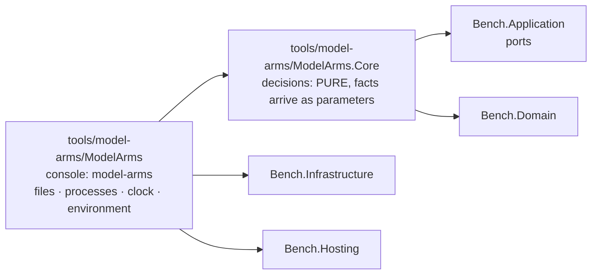

# Module — Model arms: the launcher of the part-6 experiment, in C#

> Status: **E1.S2 built, 2026-10-29 — the two projects, their references and the architecture guard exist; every other section below is an empty heading owned by the story named in it.**
> Plan: [PLAN_model_arms_E1.md](../todo/PLAN_model_arms_E1.md) (stories) under [PLAN_model_arms.md](../todo/PLAN_model_arms.md) (the design). Nothing here launches a model yet.

## Purpose

The owner compares coding pipelines ("arms") of headless Claude Code sessions on one frozen plan in a target repository: three schemes
(C, CR, SRS) times three runs, every arm ending in the product's multi-vendor code gate. The harness that launched those runs was a
set of bash scripts with inline node and the experiment's facts as constants at the top of each script. This module is its port to C#,
a console of its own beside the benchmark, not part of it. It ports the RUN half only (launch, resume, limits, the gate step, the
chain, isolation by file modes, the objective checks); the analysis half is a later plan. Its behaviour is the shell harness's, its
facts live in one refusing experiment file, and it is built so a decision can be tested without starting a process.

## Projects and the guard

| Project | Role | References |
|---|---|---|
| `tools/model-arms/ModelArms.Core` (`ModelArms.Core`) | Every decision of the module: the experiment's facts and their refusals, paths, the arm map, the launch options, the briefs. **Pure by construction** (plan D1): opens no file, starts no process, reads no clock, no environment. | `Bench.Domain`, `Bench.Application`; no packages |
| `tools/model-arms/ModelArms` (assembly `model-arms`) | The only project that touches the world. Today a stub `Program.Main` that answers the configuration exit code so the executable links. | `ModelArms.Core`, `Bench.Infrastructure`, `Bench.Hosting` |

The console also carries two content globs, so no later story edits its project file to ship a file: `tools/model-arms/briefs/*.template.md`
and `tools/model-arms/examples/*.json` are copied beside the binary under `briefs/` and `examples/`. Both folders are empty until their stories.
Both projects are in `dew_flow_benchmark.slnx` under a `/tools/` folder, and `Bench.Tests` references both as ordinary references so their
assemblies are in the test output on purpose, not by accident.

**The guard** is `tests/Bench.Tests/ModelArms/ModelArmsArchitectureTests.cs`; it reuses `ArchitectureTests.Referenced` and `IsRuntime` (widened to `internal`, not copied).

| Test | What it holds |
|---|---|
| `Core_references_only_the_runtime_the_domain_and_the_application_layer` | `ModelArms.Core.dll` references the runtime, `Bench.Domain` and `Bench.Application` only |
| `Core_never_references_infrastructure_or_entity_framework` | the same assembly names no `Bench.Infrastructure`, no `Microsoft.EntityFrameworkCore*`, no `Npgsql*` |
| `Nothing_under_src_or_hosts_references_the_model_arms_module` | no `*.csproj` under `src/` or `hosts/` names `ModelArms` or `model-arms`, and no product assembly (`Bench.*.dll` except the test assembly, `bench.dll`) references `ModelArms.Core` or `model-arms`; both scans also assert they found something |
| `Every_core_decider_is_named_in_the_pure_list` | every public static class of `ModelArms.Core` is named in `PureDeciders`, one marker line per story, and everything named lives in `ModelArms.Core` |

What the guard does not prove: that a Core type is pure inside its body. A list of referenced assemblies cannot see `File.ReadAllText`, because the
runtime is always allowed. The pure list only makes each decider named on purpose. The first decider's story (E1.S3) added the two
companions that keep the scans alive: `CorePublicStaticClasses()` must contain `ExperimentFile` (the public-static-class scan still finds a known
instance; shown red by making the scan's predicate match nothing), and `Referenced("Bench.Tests.dll")` must contain `ModelArms.Core` (the
assembly half's known positive).

Separately, `Bench.Hosting` (the parser, the exit codes, the shutdown signal) is held a leaf by `ArchitectureTests`, beside the Domain, Contracts and Delivered leaves.

## The experiment file (E1.S3)

`ExperimentFile.Read(json, location)` turns the text of `experiment.json` into an `Experiment`, or refuses it with every problem of the file in
one answer, one sentence per line (`Outcome<Experiment>`, the reason is the lines joined by `\n`). Core receives the TEXT and an
`ExperimentLocation(Root, Home, EnclosingGitTop, ThisRepository)`; the console reads the file and answers the location's four questions.
The worked example `tools/model-arms/examples/part6.experiment.json` is the one source the tests and, later, the `init` template are derived from.

**Reading.** `JsonNode.Parse` with comments skipped (the example carries `//` comments), trailing commas refused and a member written twice
refused at any depth (`AllowDuplicateProperties = false`; it arrives as a `JsonException`, whereas the default would throw `ArgumentException` on later access, outside any catch). A malformed text, or one whose
root is not an object, is a single problem. The walk is `StrictJson`, a reader that records a sentence per problem instead of stopping at the
first; this is why the catalog's `UnmappedMemberHandling.Disallow` is not used (it names one unknown member and quits). A file that leaves any
problem builds no `Experiment`.

| Members | Rule |
|---|---|
| top level, required | `schema` `target` `scenarios` `baseline` `known` `steps` `schemes` `rounds` `limits` `tools` `awake` |
| top level, optional | `tasks` (absent: `TaskLimits.Shell`, 4 / 7 / 4) · `coai` (absent: `CoaiFacts.None`) · `isolation` (absent: `IsolationFacts.None`) |
| `target`, all required | `source` `planBranch` `base` `plan` `branch` `rulesSubmodule` `lowPriority` `build` `suite{command,ctrfFile,namePrefix}` `format{solution,verbs}` `extension{directory,command}` `nodeModules` `testGlobs` |
| `limits` / `tasks` / `tools` / `coai` / `isolation` | six limits / `min` `max` `maxParallel` / `write` `read` `gate` `deny` / `binary` `settings` `side` / `closed` `unlisted`; inside a present object every member is required |

**What is refused, and the sentence it gets.** An unknown member: `target.bulid is not a member this build knows (known: …) — refused rather
than ignored`. A missing one: `target.base is missing`. Then the value rules:

- `schema` is exactly `model-arms/experiment-v1`.
- Absolute (`Path.IsPathFullyQualified`): `target.source`, `coai.binary`, `coai.settings`. Relative, not rooted, no `..` segment: `target.plan`,
  `rulesSubmodule`, `format.solution`, `extension.directory`, each element of `nodeModules` and `testGlobs`, and `scenarios` / `baseline` (names inside the root).
  `target.base` is `CommitSha.Parse`, its reason quoted. Every other text is non-empty.
- Every command (`lowPriority`, `build`, `suite.command`, `extension.command`) is a non-empty array whose first element passes
  `ExecutableRule.Refusal` against `[target.source, <root>]` (D17, the static half): a bare name is fine; a relative path
  (`./x`) is refused because it resolves against the target; an absolute path equal to or under a forbidden root is refused (normalised, ordinal,
  with a trailing separator, so a sibling that shares a prefix is not "under"). A file under the target may only be an ARGUMENT, which is why
  the suite runs as `dotnet <tests>.dll`. The forbidden roots are the target and the experiment root itself (which holds `base`, `r` and
  everything else an arm could write). "Under" is compared ignoring case, so it fails closed on a case-insensitive host, and a name containing
  `:` is a path (`C:x.exe` is drive-relative on Windows), never a bare name. **Symbolic links are not followed by this static rule**: a link
  outside every forbidden root that points inside one passes it. Resolving an executable on a host, following the link to its final target
  and checking that against the same roots is E1.S8's `ExecutableResolution`.
- **A JSON `null` where an object belongs** (`"limits": null`, `steps.code: null`, `target.suite: null`, ...) is refused with
  `<path> must be a JSON object`: an object-valued member is read through one accessor that takes the parent and the member name, so a
  present-but-null member is never mistaken for an absent one. `steps`, `schemes` and `rounds` must not be empty.
- `steps`: keys are step kinds (`code review fix hreview gate split splitFix taskCode`; `steps.lint is not a step kind (…)`), each value
  `{model, minutes > 0, mode ∈ write|read|gate}`. `schemes`: names are letters; each entry is exactly `tasks` or `<file name>:<step kind>`
  (`^[0-9]+[a-z]?-[A-Za-z0-9-]+:[A-Za-z]+$`) whose kind is defined under `steps`. `rounds`: non-empty arrays of arm names whose scheme (`ArmNames.SchemeOf`:
  `SRS2` is `SRS`) is among the schemes: `rounds[0][1] names 'XY2', whose scheme 'XY' is not among the schemes (C, CR, SRS)`.
- `limits.*` and `tasks.*` are whole numbers above zero and `tasks.min <= tasks.max`; `awake` is `auto|windows|wsl|none`; `coai.side` names one folder (no
  separator, no `..`).
- **Placeholders.** An `isolation` entry is `<root>`, starts `<root>/`, starts `~/`, or is absolute; `<root>` expands to `Root` and a leading `~` to
  `Home` (`Path.Combine`), so `Experiment.Isolation` holds paths only. Anything else is refused.
- **Placement** (`ExperimentFile.Placement`, added to every `Read` first): a root equal to or under `ThisRepository` is refused (`inside this
  repository`); any non-empty `EnclosingGitTop` is refused (`inside the git checkout`), because the arms' clones would nest in it.

What this does NOT prove: that any path exists or is readable, that an executable resolves on this host, that `scenarios.json` parses, that an arm is named
twice in the rounds, or that a host can set modes (E1.S8 and E1.S10, `validate`). The example's paths are under `/example/` and the tests' location is
`/x/...`, so these tests assume a POSIX path syntax (the suite runs on ubuntu CI and WSL).

## Paths and the arm map (E1.S4)

`RootPaths` and `ArmPaths` (`tools/model-arms/ModelArms.Core/Experiment/ArmPaths.cs`) are the one spelling of every path of an experiment
root and of one arm; nothing else in the module concatenates a path. Every member is a `Path.Combine`; none opens a file or makes a folder
(`make` creates them, a later epic). `ArmPaths(Root, Token)` is built by `RootPaths.Arm(token)`. A name taken from a caller (arm, step, task id,
side, token) must be one path segment: empty, `.`, `..` or containing `/` or `\` throws `ArgumentException`, a programming error because callers
pass names validated upstream. A file name the operator configured goes through `RootPaths.Of`, which refuses by value
(`'<x>' must be a file name inside the experiment root`) a rooted name, a drive prefix or any `..` segment. `n` and `i` are printed invariant.

| `RootPaths` member | Path under the root |
|---|---|
| `ExperimentFile` | `experiment.json` |
| `Briefs` | `briefs` |
| `Base` | `base` |
| `ArmMapFile` | `arms.map.json` |
| `Arms` | `r` |
| `Pids` · `PidFile(arm)` · `PidLog(arm)` | `pids` · `pids/<arm>.pid` · `pids/<arm>.log` |
| `Chain` | `chain` |
| `Made(arm)` | `chain/made-<arm>` |
| `Locked` · `Unlocked` | `chain/locked` · `chain/unlocked` |
| `ObjectiveMarker(arm)` | `chain/objective-<arm>` |
| `ArmsDone` | `chain/arms-done` |
| `Executables` | `chain/executables.txt` |
| `GateLock` · `LockedModes` | `.gate.lock` · `.locked-modes` |
| `LockedModesRestored(stamp)` | `.locked-modes.restored-<UTC stamp>` (where `unlock` moves `.locked-modes` to) |
| `LockLog` · `KeepAwakeLog` | `lock.log` · `keep-awake.log` |
| `Of(relative)` | `<relative>`, refused when it leaves the root |
| `Arm(token)` | an `ArmPaths` |

| `ArmPaths` member | Path under `r/<token>` |
|---|---|
| `Folder` | `r/<token>` itself |
| `CloneFolder` | `arm` |
| `Out` · `Notes` · `Work` · `Tmp` · `Worktrees` | `out` · `notes` · `work` · `tmp` (the CLI's `TMPDIR`) · `wt` |
| `Worktree(id)` | `wt/<id>` |
| `CoaiSettings(side)` | `coai-data/<side>/settings.json` |
| `McpNone` · `McpCoai` | `mcp-none.json` · `mcp-coai.json` |
| `Session(step)` | `out/<step>.session` |
| `Stream(step, n)` · `Stderr(step, n)` · `Prompt(step, n)` | `out/<step>.a<n>.jsonl` · `.a<n>.err` · `.a<n>.prompt.md` |
| `Done(step)` · `Before(step)` · `Diff(step)` | `out/<step>.done` · `.before` · `.diff` |
| `Timing` | `out/timing.jsonl` |
| `ObjectiveFolder` · `Objective` | `out/objective` · `out/objective.json` |
| `TasksPlanLog` | `out/tasks-plan.log` |
| `BatchDone(i)` | `out/batch-<i>.done` |
| `TaskBefore(id)` | `out/task-<id>.before` |
| `CoderHead(id)` · `CoderDiff(id)` | `out/task-<id>-coder.head` · `out/task-<id>-coder.diff` (the shell named these after a model; no path of the module names one) |
| `Picked(id)` · `PickRecord(id)` · `PickLog(id)` | `out/picked-<id>` · `out/pick-<id>.json` · `out/pick-<id>.log` |
| `WorktreeBuildLog(id)` | `out/wt-build-<id>.log` |
| `PrepBuildLog` · `ObjectiveLog` | `out/prep-build.log` (make's warm build) · `out/objective.out` |
| `CodeNotes` · `HReviewNotes` · `FixNotes` · `GateNotes` · `SplitNotes` | `notes/code.md` · `hreview.md` · `fix.md` · `gate.md` · `split.md` |
| `ReviewJson` · `GateJson` | `notes/review.json` · `notes/gate.json` |
| `TaskNotes(id)` | `notes/<id>-code.md` |
| `TasksJson` · `BatchesJson` | `work/tasks.json` · `work/batches.json` |
| `TaskBrief(id)` | `work/<id>.md` |

`ArmPathsTests` holds one hand-written spelling per row and compares the rows with the members the two types really have, so a path added
without a spelling fails the class. The parent plan's section 4.3 missed nine files the shell wrote (`notes/split.md`, `out/tasks-plan.log`,
`out/batch-<i>.done`, `out/task-<id>.before`, `out/pick-<id>.log`, `out/wt-build-<id>.log`, `out/prep-build.log`, `out/objective.out`, `.locked-modes.restored-<stamp>`); they are spelled here. The member for the
clone folder is `CloneFolder`, not `Clone`: C# reserves `Clone` in a record (CS8859).

**The arm map** (`ArmMap`, `arms.map.json`) holds arm name to a random 16-hex token (8 bytes), the folder name of the arm so that no arm can
guess another's. The shell's tokens were 12 hex; `ArmMap.Read` refuses such a map and a run mints its own.

| Operation | Behaviour |
|---|---|
| `Read(json)` | an object of strings; every arm that is wrong is named, one sentence per line: a token that is not 16 lower-case hex, two arms with one token, an arm name not matching letters-then-digits, an arm twice, a value that is not a string; all of them in one read, not only the first |
| `ToJson()` | an indented JSON object of strings in insertion order, `\n` newlines, like the shell's map — not byte-identical (tokens, indent and file name differ) |
| `Extend(existing, arms, eightRandomBytes)` | every existing entry unchanged, then a fresh token for each arm not yet present; a draw that collides with a token already in the map is drawn again. Arms absent from `arms` are kept. A random source that does not give 8 bytes, or collides 64 times in a row, and an `arms` entry that is not an arm name throw (programming errors). The source is a parameter, so the type stays pure; the console passes `RandomNumberGenerator` |
| `TokenOf(arm)` | the token, or a refusal naming the known arms |
| `Leaks(text, ownArm, schemes)` | what the text would reveal to `ownArm`: every arm name of the map (its own too) and every scheme name found as a whole word (not touching an ASCII letter or digit, case-sensitive), and every token other than its own found anywhere. Its own token is allowed: it is the arm's working directory and is in every path field of a brief. Empty means clean |
| `Scrub(line)` | every token of the map replaced by `<token>`. The console's one writer calls this; nothing keeps its own copy |

What the tests do not prove: that the randomness is unpredictable (the tests count; the console supplies the entropy), and that a verb calls
`Leaks` or `Scrub` at the right places (the brief filler and the console writer own that and test it).

## The launch boundary (E1.S5, E1.S6)

## Briefs (E1.S7)

A brief is a template with `{{NAME}}` placeholders, filled once per step from facts the module already holds. The eight templates are the part-6
harness's files, copied byte for byte (`tools/model-arms/briefs/*.template.md`, shipped beside the binary under `briefs/` by the console's content
glob); `The_eight_shipped_templates_are_the_shells_byte_for_byte` holds their SHA-256 values, typed out once in the test, so an edited copy fails there.

| Step kind | Template | `NOTES` is | Extra fields |
|---|---|---|---|
| Code | `1-code.template.md` | `notes/code.md` | none |
| Review | `2-review.template.md` | `-` (the shell passed a dash; the review step writes `notes/review.json`, the `REVIEW` field) | none |
| Fix | `3-fix.template.md` | `notes/fix.md` | none |
| HReview | `hr-review-fix.template.md` | `notes/hreview.md` | none |
| Gate | `gate.template.md` | `notes/gate.md` | none |
| Split | `x-split.template.md` | `notes/split.md` | none |
| SplitFix | `x-split-fix.template.md` | `notes/split.md` | `PROBLEMS` |
| TaskCode | `t2-coder.template.md` | `notes/<task>-code.md` | `TASK`, `TASK_BRIEF`, `TASK_FILES`, `BEFORE` |

`BriefTemplates.NameOf(kind)` is the one spelling of the file names; `All` is derived from the kinds. `BriefFields.For(kind, paths, facts)` gives every kind the same
thirteen fields (`PLAN BASE BRANCH SCEN_COUNT DEADLINE KNOWN REVIEW CODE_NOTES HREVIEW_NOTES FIX_NOTES WORK GATE_JSON NOTES`; the path ones are `ArmPaths` members,
`SCEN_COUNT` is printed invariant) and adds the task or the problems for the kinds above. `HREVIEW_NOTES` and `BEFORE` appear in no template; they are provided as
the shell provided them, and a field a template does not use is never an error.

**`BriefFiller.Fill(template, fields, guard)`** replaces every placeholder whose name is a field, in one pass, then refuses in this order:

1. a placeholder left without a field: `the brief has unfilled fields: {{A}} {{B}}` (each name once, in order of appearance);
2. a substituted value in which `ArmMap.Leaks` finds an arm name, a scheme name or another arm's token: `the field NOTES would carry 'C1' into a brief — no brief
   names an arm, a scheme or another arm's token (D15)`. The arm's OWN token is allowed: it is in every path field, and the arm's working directory shows it anyway
   (plan E1 section 8, item 2). A field the template never uses is not checked.

`BriefTemplateFiles(shipped, overrides).Read(name)` (console, `ModelArms.Adapters`) returns the experiment root's own copy by name when it exists, else the shipped one,
else `no brief template '<name>' in <overrides> or <shipped>`; UTF-8.

What this does NOT prove: that a brief reads well to a model; that the deadline string has the format the launcher prints (E2.S4 owns it); that the resume notice,
the prompt file or its path are right (E2); or that a template edited in an experiment root still carries every field it needs: such a copy is checked by `Fill`
at run time, not here.

## The root, trust and the host (E1.S8, E1.S10)

## The command line (E1.S9)

## The first run: init and validate (E1.S11)
