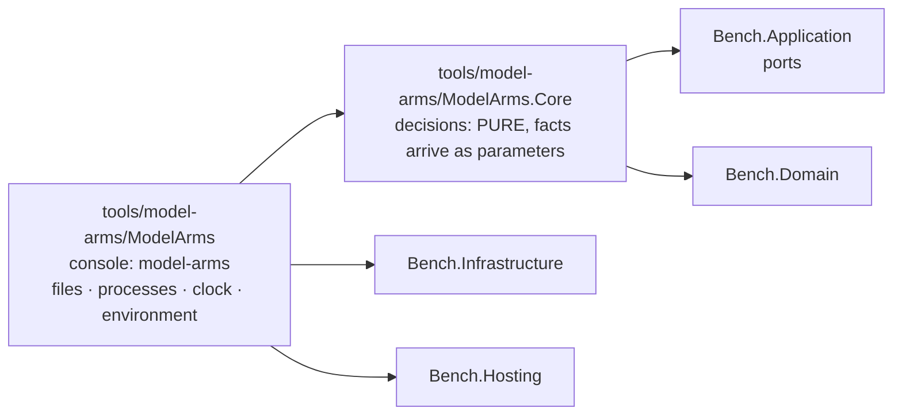

# Module — Model arms: the launcher of the part-6 experiment, in C#

> Status: **E1.S2 built, 2026-10-29 — the two projects, their references and the architecture guard exist; every other section below is an empty heading owned by the story named in it.**
> Plan: [PLAN_model_arms_E1.md](../todo/PLAN_model_arms_E1.md) (stories) under [PLAN_model_arms.md](../todo/PLAN_model_arms.md) (the design). Nothing here launches a model yet.

## Purpose

The owner compares coding pipelines ("arms") of headless Claude Code sessions on one frozen plan in a target repository: three schemes
(C, CR, SRS) times three runs, every arm ending in the product's multi-vendor code gate. The harness that launched those runs was a
set of bash scripts with inline node and the experiment's facts as constants at the top of each script. This module is its port to C#,
a console of its own beside the benchmark, not part of it. It ports the RUN half only (launch, resume, limits, the gate step, the
chain, isolation by file modes, the objective checks); the analysis half is a later plan. Its behaviour is the shell harness's, its
facts live in one refusing experiment file, and it is built so a decision can be tested without starting a process.

## Projects and the guard

| Project | Role | References |
|---|---|---|
| `tools/model-arms/ModelArms.Core` (`ModelArms.Core`) | Every decision of the module: the experiment's facts and their refusals, paths, the arm map, the launch options, the briefs. **Pure by construction** (plan D1): opens no file, starts no process, reads no clock, no environment. | `Bench.Domain`, `Bench.Application`; no packages |
| `tools/model-arms/ModelArms` (assembly `model-arms`) | The only project that touches the world. Today a stub `Program.Main` that answers the configuration exit code so the executable links. | `ModelArms.Core`, `Bench.Infrastructure`, `Bench.Hosting` |

The console also carries two content globs, so no later story edits its project file to ship a file: `tools/model-arms/briefs/*.template.md`
and `tools/model-arms/examples/*.json` are copied beside the binary under `briefs/` and `examples/`. Both folders are empty until their stories.
Both projects are in `dew_flow_benchmark.slnx` under a `/tools/` folder, and `Bench.Tests` references both as ordinary references so their
assemblies are in the test output on purpose, not by accident.

**The guard** is `tests/Bench.Tests/ModelArms/ModelArmsArchitectureTests.cs`; it reuses `ArchitectureTests.Referenced` and `IsRuntime` (widened to `internal`, not copied).

| Test | What it holds |
|---|---|
| `Core_references_only_the_runtime_the_domain_and_the_application_layer` | `ModelArms.Core.dll` references the runtime, `Bench.Domain` and `Bench.Application` only |
| `Core_never_references_infrastructure_or_entity_framework` | the same assembly names no `Bench.Infrastructure`, no `Microsoft.EntityFrameworkCore*`, no `Npgsql*` |
| `Nothing_under_src_or_hosts_references_the_model_arms_module` | no `*.csproj` under `src/` or `hosts/` names `ModelArms` or `model-arms`, and no product assembly (`Bench.*.dll` except the test assembly, `bench.dll`) references `ModelArms.Core` or `model-arms`; both scans also assert they found something |
| `Every_core_decider_is_named_in_the_pure_list` | every public static class of `ModelArms.Core` is named in `PureDeciders`, one marker line per story, and everything named lives in `ModelArms.Core` |

What the guard does not prove: that a Core type is pure inside its body. A list of referenced assemblies cannot see `File.ReadAllText`, because the
runtime is always allowed. The pure list only makes each decider named on purpose. The first decider's story (E1.S3) added the two
companions that keep the scans alive: `CorePublicStaticClasses()` must contain `ExperimentFile` (the public-static-class scan still finds a known
instance; shown red by making the scan's predicate match nothing), and `Referenced("Bench.Tests.dll")` must contain `ModelArms.Core` (the
assembly half's known positive).

Separately, `Bench.Hosting` (the parser, the exit codes, the shutdown signal) is held a leaf by `ArchitectureTests`, beside the Domain, Contracts and Delivered leaves.

## The experiment file (E1.S3)

`ExperimentFile.Read(json, location)` turns the text of `experiment.json` into an `Experiment`, or refuses it with every problem of the file in
one answer, one sentence per line (`Outcome<Experiment>`, the reason is the lines joined by `\n`). Core receives the TEXT and an
`ExperimentLocation(Root, Home, EnclosingGitTop, ThisRepository)`; the console reads the file and answers the location's four questions.
The worked example `tools/model-arms/examples/part6.experiment.json` is the one source the tests and, later, the `init` template are derived from.

**Reading.** `JsonNode.Parse` with comments skipped (the example carries `//` comments), trailing commas refused and a member written twice
refused at any depth (`AllowDuplicateProperties = false`; it arrives as a `JsonException`, whereas the default would throw `ArgumentException` on later access, outside any catch). A malformed text, or one whose
root is not an object, is a single problem. The walk is `StrictJson`, a reader that records a sentence per problem instead of stopping at the
first; this is why the catalog's `UnmappedMemberHandling.Disallow` is not used (it names one unknown member and quits). A file that leaves any
problem builds no `Experiment`.

| Members | Rule |
|---|---|
| top level, required | `schema` `target` `scenarios` `baseline` `known` `steps` `schemes` `rounds` `limits` `tools` `awake` |
| top level, optional | `tasks` (absent: `TaskLimits.Shell`, 4 / 7 / 4) · `coai` (absent: `CoaiFacts.None`) · `isolation` (absent: `IsolationFacts.None`) |
| `target`, all required | `source` `planBranch` `base` `plan` `branch` `rulesSubmodule` `lowPriority` `build` `suite{command,ctrfFile,namePrefix}` `format{solution,verbs}` `extension{directory,command}` `nodeModules` `testGlobs` |
| `limits` / `tasks` / `tools` / `coai` / `isolation` | six limits / `min` `max` `maxParallel` / `write` `read` `gate` `deny` / `binary` `settings` `side` / `closed` `unlisted`; inside a present object every member is required |

**What is refused, and the sentence it gets.** An unknown member: `target.bulid is not a member this build knows (known: …) — refused rather
than ignored`. A missing one: `target.base is missing`. Then the value rules:

- `schema` is exactly `model-arms/experiment-v1`.
- Absolute (`Path.IsPathFullyQualified`): `target.source`, `coai.binary`, `coai.settings`. Relative, not rooted, no `..` segment: `target.plan`,
  `rulesSubmodule`, `format.solution`, `extension.directory`, each element of `nodeModules` and `testGlobs`, and `scenarios` / `baseline` (names inside the root).
  `target.base` is `CommitSha.Parse`, its reason quoted. Every other text is non-empty.
- Every command (`lowPriority`, `build`, `suite.command`, `extension.command`) is a non-empty array whose first element passes
  `ExecutableRule.Refusal` against `[target.source, <root>]` (D17, the static half): a bare name is fine; a relative path
  (`./x`) is refused because it resolves against the target; an absolute path equal to or under a forbidden root is refused (normalised, ordinal,
  with a trailing separator, so a sibling that shares a prefix is not "under"). A file under the target may only be an ARGUMENT, which is why
  the suite runs as `dotnet <tests>.dll`. The forbidden roots are the target and the experiment root itself (which holds `base`, `r` and
  everything else an arm could write). "Under" is compared ignoring case, so it fails closed on a case-insensitive host, and a name containing
  `:` is a path (`C:x.exe` is drive-relative on Windows), never a bare name. **Symbolic links are not followed by this static rule**: a link
  outside every forbidden root that points inside one passes it. Resolving an executable on a host, following the link to its final target
  and checking that against the same roots is E1.S8's `ExecutableResolution`.
- **A JSON `null` where an object belongs** (`"limits": null`, `steps.code: null`, `target.suite: null`, ...) is refused with
  `<path> must be a JSON object`: an object-valued member is read through one accessor that takes the parent and the member name, so a
  present-but-null member is never mistaken for an absent one. `steps`, `schemes` and `rounds` must not be empty.
- `steps`: keys are step kinds (`code review fix hreview gate split splitFix taskCode`; `steps.lint is not a step kind (…)`), each value
  `{model, minutes > 0, mode ∈ write|read|gate}`. `schemes`: names are letters; each entry is exactly `tasks` or `<file name>:<step kind>`
  (`^[0-9]+[a-z]?-[A-Za-z0-9-]+:[A-Za-z]+$`) whose kind is defined under `steps`. `rounds`: non-empty arrays of arm names whose scheme (`ArmNames.SchemeOf`:
  `SRS2` is `SRS`) is among the schemes: `rounds[0][1] names 'XY2', whose scheme 'XY' is not among the schemes (C, CR, SRS)`.
- `limits.*` and `tasks.*` are whole numbers above zero and `tasks.min <= tasks.max`; `awake` is `auto|windows|wsl|none`; `coai.side` names one folder (no
  separator, no `..`).
- **Placeholders.** An `isolation` entry is `<root>`, starts `<root>/`, starts `~/`, or is absolute; `<root>` expands to `Root` and a leading `~` to
  `Home` (`Path.Combine`), so `Experiment.Isolation` holds paths only. Anything else is refused.
- **Placement** (`ExperimentFile.Placement`, added to every `Read` first): a root equal to or under `ThisRepository` is refused (`inside this
  repository`); any non-empty `EnclosingGitTop` is refused (`inside the git checkout`), because the arms' clones would nest in it.

What this does NOT prove: that any path exists or is readable, that an executable resolves on this host, that `scenarios.json` parses, that an arm is named
twice in the rounds, or that a host can set modes (E1.S8 and E1.S10, `validate`). The example's paths are under `/example/` and the tests' location is
`/x/...`, so these tests assume a POSIX path syntax (the suite runs on ubuntu CI and WSL).

## Paths and the arm map (E1.S4)

`RootPaths` and `ArmPaths` (`tools/model-arms/ModelArms.Core/Experiment/ArmPaths.cs`) are the one spelling of every path of an experiment
root and of one arm; nothing else in the module concatenates a path. Every member is a `Path.Combine`; none opens a file or makes a folder
(`make` creates them, a later epic). `ArmPaths(Root, Token)` is built by `RootPaths.Arm(token)`. A name taken from a caller (arm, step, task id,
side, token) must be one path segment: empty, `.`, `..` or containing `/` or `\` throws `ArgumentException`, a programming error because callers
pass names validated upstream. A file name the operator configured goes through `RootPaths.Of`, which refuses by value
(`'<x>' must be a file name inside the experiment root`) a rooted name, a drive prefix or any `..` segment. `n` and `i` are printed invariant.

| `RootPaths` member | Path under the root |
|---|---|
| `ExperimentFile` | `experiment.json` |
| `Briefs` | `briefs` |
| `Base` | `base` |
| `ArmMapFile` | `arms.map.json` |
| `Arms` | `r` |
| `Pids` · `PidFile(arm)` · `PidLog(arm)` | `pids` · `pids/<arm>.pid` · `pids/<arm>.log` |
| `Chain` | `chain` |
| `Made(arm)` | `chain/made-<arm>` |
| `Locked` · `Unlocked` | `chain/locked` · `chain/unlocked` |
| `ObjectiveMarker(arm)` | `chain/objective-<arm>` |
| `ArmsDone` | `chain/arms-done` |
| `Executables` | `chain/executables.txt` |
| `GateLock` · `LockedModes` | `.gate.lock` · `.locked-modes` |
| `LockedModesRestored(stamp)` | `.locked-modes.restored-<UTC stamp>` (where `unlock` moves `.locked-modes` to) |
| `LockLog` · `KeepAwakeLog` | `lock.log` · `keep-awake.log` |
| `Of(relative)` | `<relative>`, refused when it leaves the root |
| `Arm(token)` | an `ArmPaths` |

| `ArmPaths` member | Path under `r/<token>` |
|---|---|
| `Folder` | `r/<token>` itself |
| `CloneFolder` | `arm` |
| `Out` · `Notes` · `Work` · `Tmp` · `Worktrees` | `out` · `notes` · `work` · `tmp` (the CLI's `TMPDIR`) · `wt` |
| `Worktree(id)` | `wt/<id>` |
| `CoaiSettings(side)` | `coai-data/<side>/settings.json` |
| `McpNone` · `McpCoai` | `mcp-none.json` · `mcp-coai.json` |
| `Session(step)` | `out/<step>.session` |
| `Stream(step, n)` · `Stderr(step, n)` · `Prompt(step, n)` | `out/<step>.a<n>.jsonl` · `.a<n>.err` · `.a<n>.prompt.md` |
| `Done(step)` · `Before(step)` · `Diff(step)` | `out/<step>.done` · `.before` · `.diff` |
| `Timing` | `out/timing.jsonl` |
| `ObjectiveFolder` · `Objective` | `out/objective` · `out/objective.json` |
| `TasksPlanLog` | `out/tasks-plan.log` |
| `BatchDone(i)` | `out/batch-<i>.done` |
| `TaskBefore(id)` | `out/task-<id>.before` |
| `CoderHead(id)` · `CoderDiff(id)` | `out/task-<id>-coder.head` · `out/task-<id>-coder.diff` (the shell named these after a model; no path of the module names one) |
| `Picked(id)` · `PickRecord(id)` · `PickLog(id)` | `out/picked-<id>` · `out/pick-<id>.json` · `out/pick-<id>.log` |
| `WorktreeBuildLog(id)` | `out/wt-build-<id>.log` |
| `PrepBuildLog` · `ObjectiveLog` | `out/prep-build.log` (make's warm build) · `out/objective.out` |
| `CodeNotes` · `HReviewNotes` · `FixNotes` · `GateNotes` · `SplitNotes` | `notes/code.md` · `hreview.md` · `fix.md` · `gate.md` · `split.md` |
| `ReviewJson` · `GateJson` | `notes/review.json` · `notes/gate.json` |
| `TaskNotes(id)` | `notes/<id>-code.md` |
| `TasksJson` · `BatchesJson` | `work/tasks.json` · `work/batches.json` |
| `TaskBrief(id)` | `work/<id>.md` |

`ArmPathsTests` holds one hand-written spelling per row and compares the rows with the members the two types really have, so a path added
without a spelling fails the class. The parent plan's section 4.3 missed nine files the shell wrote (`notes/split.md`, `out/tasks-plan.log`,
`out/batch-<i>.done`, `out/task-<id>.before`, `out/pick-<id>.log`, `out/wt-build-<id>.log`, `out/prep-build.log`, `out/objective.out`, `.locked-modes.restored-<stamp>`); they are spelled here. The member for the
clone folder is `CloneFolder`, not `Clone`: C# reserves `Clone` in a record (CS8859).

**The arm map** (`ArmMap`, `arms.map.json`) holds arm name to a random 16-hex token (8 bytes), the folder name of the arm so that no arm can
guess another's. The shell's tokens were 12 hex; `ArmMap.Read` refuses such a map and a run mints its own.

| Operation | Behaviour |
|---|---|
| `Read(json)` | an object of strings; every arm that is wrong is named, one sentence per line: a token that is not 16 lower-case hex, two arms with one token, an arm name not matching letters-then-digits, an arm twice, a value that is not a string; all of them in one read, not only the first |
| `ToJson()` | an indented JSON object of strings in insertion order, `\n` newlines, like the shell's map — not byte-identical (tokens, indent and file name differ) |
| `Extend(existing, arms, eightRandomBytes)` | every existing entry unchanged, then a fresh token for each arm not yet present; a draw that collides with a token already in the map is drawn again. Arms absent from `arms` are kept. A random source that does not give 8 bytes, or collides 64 times in a row, and an `arms` entry that is not an arm name throw (programming errors). The source is a parameter, so the type stays pure; the console passes `RandomNumberGenerator` |
| `TokenOf(arm)` | the token, or a refusal naming the known arms |
| `Leaks(text, ownArm, schemes)` | what the text would reveal to `ownArm`: every arm name of the map (its own too) and every scheme name found as a whole word (not touching an ASCII letter or digit, case-sensitive), and every token other than its own found anywhere. Its own token is allowed: it is the arm's working directory and is in every path field of a brief. Empty means clean |
| `Scrub(line)` | every token of the map replaced by `<token>`. The console's one writer calls this; nothing keeps its own copy |

What the tests do not prove: that the randomness is unpredictable (the tests count; the console supplies the entropy), and that a verb calls
`Leaks` or `Scrub` at the right places (the brief filler and the console writer own that and test it).

## The launch boundary (E1.S5, E1.S6)

**The one launcher, widened.** A step is one headless `claude -p`, started through the benchmark's existing launcher (`CliArgv` builds the
argv, `ProcessRunner` runs it); the module adds no second launcher. E1.S5 widened it, E1.S6 decides what to ask of it.

| Widening (E1.S5) | Where | Claude spelling |
|---|---|---|
| `AgentAskOptions.SessionId` / `ResumeSessionId` (a `Guid`, `Guid.Empty` = none) | `src/Bench.Application/CliAgent.cs` | `--session-id <guid "D">` / `--resume <guid "D">`, right after the model; both asked together are refused |
| `AgentAskOptions.PermissionMode` (`NotAsked`, `Default`, `AcceptEdits`, `Plan`) | same | `--permission-mode default\|acceptEdits\|plan`; refused beside a read-only sandbox, which already spells `plan` |
| `AgentAskOptions.PermittedTools` | same | `--allowedTools <name> <name> …`, each name its own token — the PERMISSION list with patterns (`Bash(git *)`), not `--tools` (`AllowedTools`, the built-in set) |
| `AgentAsk.ErrorOutput` (an `AgentOutputSink`, `None` by default) and `ProcessRunner`'s `stderrLine` | `CliAgent.cs`, `src/Bench.Infrastructure/Process/ProcessRunner.cs` | stderr is handed to the sink line by line while the process runs (the runner's file writer is E2); the whole stderr is still returned |

Codex, gemini and agy refuse the session id, the session to resume, the permission mode and the permission allow-list by name
(`CliArgv.Unsupported`); the first three widenings are claude's alone. `ErrorOutput` is not refused by any CLI: `CliAgentRuntime` hands the sink to
`ProcessRunner` for every runtime, because stderr is the process's, not a flag's. The existing argv suites run unedited.

**`StepLaunch`** (`tools/model-arms/ModelArms.Core/Launch/StepLaunch.cs`, pure) turns a step's mode, the tool lists, the arm's paths and the
session into an `AgentAskOptions` and a whole `AgentAsk`. `StepSession` is a closed pair: `Fresh(id)` becomes `SessionId`, `Resume(id)`
becomes `ResumeSessionId` (plan D9), so a launch is never both. Whatever the mode: `JsonEvents` (`--output-format stream-json --verbose`),
`McpServersOff` (`--strict-mcp-config`) and `AddDirectories = [Notes, Work]` (`--add-dir` twice). Per mode:

| Mode | `--permission-mode` | `--allowedTools` | `--disallowedTools` | `--mcp-config` |
|---|---|---|---|---|
| `Write` | `acceptEdits` | `tools.write` | `tools.deny` | `mcp-none.json` |
| `Read` | `default` | `tools.read` | `Edit Write NotebookEdit` then `tools.deny` | `mcp-none.json` |
| `Gate` | `acceptEdits` | `tools.write` then `tools.gate` | `tools.deny` | `mcp-coai.json` |

These are the flags of the shell harness's `run-arm.sh` (`:86-89`, `:106-108`); the lists keep the configured order. `Ask` is
`CliClaude`, the executable the console resolved, the prompt (it rides stdin), the working directory, the model of the step and the wall the
caller computed (the wall arithmetic and the sinks are E2's: `Output` and `ErrorOutput` stay `None`, and the runner sets them with `with`).
Nothing here resolves `claude`, starts a process or reads a clock.

**`ArmChildEnvironment`** (`…/Experiment/ArmChildEnvironment.cs`, pure; plan D19) is the environment an arm's claude runs under, passed as
`AgentEnvironment.Only(...)` so the launcher REPLACES the harness's own rather than merging into it:

- the parent's variables as the shell harness handed them on (`HOME`, `PATH`, the locale, claude's configuration), **minus**
  `BENCH_*` and `ConnectionStrings__*` (ordinal, ignoring case), every name `CoaiEnvironment.IsHarnessVariable` accepts (`BENCH_*`, `COAI_*`),
  every name `CoaiEnvironment.IsSecretName` accepts (`*_KEY`, `*_TOKEN`, `*_SECRET`, `*_PASSWORD`, the creds key) **unless it starts
  `CLAUDE_` or `ANTHROPIC_`**, and `SUBAGENT_MODEL_GUARD` and `CLAUDE_CODE_DISABLE_BACKGROUND_TASKS` whatever their value;
- **plus** `TMPDIR = <arm>/tmp` (`ArmPaths.Tmp`), replacing any spelling of it in the parent. Nothing else is added, and the result's
  comparer is ordinal.

`StepLaunch.Ask` adds exactly one thing more, because only a launch knows it: `PWD` is the request's working directory, and the runner's
`OLDPWD` is dropped. The shell ran `(cd "$DIR" && … claude …)`, so its child saw its own folder as `PWD` and the experiment's start folder
nowhere; a process started with a working directory does not update the variable, so without this the child would inherit the runner's `PWD`
and `OLDPWD`. This is the single named exception to "nothing else is added".

Why the exception for `CLAUDE_*` / `ANTHROPIC_*`: claude logs in through `CLAUDE_CODE_OAUTH_TOKEN` or `ANTHROPIC_API_KEY`, both secret-named,
so the unqualified secret rule would launch nine arms that cannot authenticate (E1 stories §8 item 1; parent D19 as corrected). Why no scout
flag: the arms run under the operator's hooks and settings exactly as part 6 measured them; a flag the shell never set would change what the
experiment compares. Why one `TMPDIR` per arm, shared by the parallel tasks of a batch: part 6 ran them that way without a collision, and a
per-task folder would be a condition no run has measured. The default `/tmp/claude-<uid>` is replaced because it would show every arm's name.

**Known differences from the shell's child, all deliberate.** The C# child is not byte-for-byte the shell's environment: (1) `COAI_*` is
stripped (the shell passed the operator's); (2) every non-claude secret-named variable is stripped (`GITHUB_TOKEN`, `DB_PASSWORD`, a vendor
`*_API_KEY`); (3) `TPL_*` is not passed (the shell exported them for its own template filling, `research/local-model-coding/harness/t-lib.sh:14`, `:62`,
`:106`; the module fills briefs in-process, so a child has no use for them); and `PWD` is matched to the shell's (above). Items (1) and (2) have one owner: the E2 gate step decides how a provider's key
reaches the coai server — through the `env` of `mcp-coai.json`, not through the child's own environment — so nothing here needs them.

**What this does NOT prove.** That claude authenticates with what is left, that it accepts the argv or its flag order (the tests compare
the multiset of flag groups, not the shell's order), or that any process starts: `StepLaunchTests` and `ArmChildEnvironmentTests` read the
values these functions return and the argv `CliArgv` builds from them. A variable named like a secret that is not claude's (a vendor key the
operator exported for another tool) is stripped; an arm that needs one must be given it by another road, which is a decision for a later epic.

## Briefs (E1.S7)

A brief is a template with `{{NAME}}` placeholders, filled once per step from facts the module already holds. The eight templates are the part-6
harness's files, copied byte for byte (`tools/model-arms/briefs/*.template.md`, shipped beside the binary under `briefs/` by the console's content
glob); `The_eight_shipped_templates_are_the_shells_byte_for_byte` holds their SHA-256 values, typed out once in the test, so an edited copy fails there.

| Step kind | Template | `NOTES` is | Extra fields |
|---|---|---|---|
| Code | `1-code.template.md` | `notes/code.md` | none |
| Review | `2-review.template.md` | `-` (the shell passed a dash; the review step writes `notes/review.json`, the `REVIEW` field) | none |
| Fix | `3-fix.template.md` | `notes/fix.md` | none |
| HReview | `hr-review-fix.template.md` | `notes/hreview.md` | none |
| Gate | `gate.template.md` | `notes/gate.md` | none |
| Split | `x-split.template.md` | `notes/split.md` | none |
| SplitFix | `x-split-fix.template.md` | `notes/split.md` | `PROBLEMS` |
| TaskCode | `t2-coder.template.md` | `notes/<task>-code.md` | `TASK`, `TASK_BRIEF`, `TASK_FILES`, `BEFORE` |

`BriefTemplates.NameOf(kind)` is the one spelling of the file names; `All` is derived from the kinds. `BriefFields.For(kind, paths, facts)` gives every kind the same
thirteen fields (`PLAN BASE BRANCH SCEN_COUNT DEADLINE KNOWN REVIEW CODE_NOTES HREVIEW_NOTES FIX_NOTES WORK GATE_JSON NOTES`; the path ones are `ArmPaths` members,
`SCEN_COUNT` is printed invariant) and adds the task or the problems for the kinds above. `HREVIEW_NOTES` and `BEFORE` appear in no template; they are provided as
the shell provided them, and a field a template does not use is never an error.

**`BriefFiller.Fill(template, fields, guard, templateName = "")`** replaces every placeholder whose name is a field, in one pass (a value is never expanded again), and refuses in this order:

1. a placeholder left without a field: `the brief has unfilled fields: {{A}} {{B}}` (each name once, in order of appearance);
2. a template that itself holds an arm name, a scheme name or another arm's token (an experiment root's override is the operator's text):
   `the template '<name>' would carry 'CR' into a brief — …`;
3. a substituted value in which `ArmMap.Leaks` finds one of those: `the field NOTES would carry 'C1' into a brief — no brief names an arm, a scheme or another
   arm's token (D15)`. The arm's OWN token is allowed: it is in every path field, and the arm's working directory shows it anyway (plan E1 section 8, item 2).
   A value that begins with `guard.Root` is checked without that exact prefix, so a native Windows root such as `C:\exp` does not make its drive letter a scheme named `C`;
4. a result that still holds a placeholder, which only a value can have carried: `the filled brief still holds {{PLAN}} — …`.

A field the template never uses is not checked. `ArmMap.Leaks` matches an arm name and a scheme of several letters as a whole word in any case ("as c1 did", "the srs arm");
a one-letter scheme only in its own case, so the `/mnt/c/` of a WSL path is not a leak.

`BriefTemplateFiles(shipped, overrides).Read(kind)` (console, `ModelArms.Adapters`) takes a step kind, never a file name, and resolves `BriefTemplates.NameOf` inside, so no
operator text can reach outside the two folders. It returns the experiment root's own copy when it exists, else the shipped one, else
`no brief template '<name>' in <overrides> or <shipped>`. The text is read as strict UTF-8; an override that exists but cannot be read (permissions, invalid UTF-8) is a refusal naming it,
never a fall back to the shipped file. A root `.gitattributes` line marks the templates `-text`, so a checkout never converts the bytes the SHA-256 values pin.

What this does NOT prove: that a brief reads well to a model; that the deadline string has the format the launcher prints (E2.S4 owns it); that the resume notice,
the prompt file or its path are right (E2); or that a template edited in an experiment root still carries every field it needs: such a copy is checked by `Fill`
at run time, not here.

## The root, trust and the host (E1.S8, E1.S10)

The first half (E1.S8): the root's requirements, its trust, executables on a host, and the two data files beside `experiment.json`. Five pure
deciders in `ModelArms.Core.Experiment`, one console adapter, `ModelArms.Adapters.RootFacts`. E1.S10 adds `HostChecks` and the `validate` verb
(the second half, below); the gate (E1.S9), `validate` (E1.S10) and `prep-base` (E4.S4) call the first half.

**`RootRequirements`** (D18, parent §4.12) is the table of which files of the root each verb needs, in the order they are checked. The names come
from `RootPaths` (one spelling of the layout); the scenarios and baseline names are the configured ones. `FirstUnmet(requirements, root, exists)` is the
first requirement the host does not meet, as a sentence naming the path and the verb that writes the file, or the empty string.

| Verb | Requirements, in order (`!` = must NOT exist) |
|---|---|
| `init` | `!` the root |
| `version`, `help` | none (an unknown verb also none: the command line refuses it first) |
| `validate` | root, `experiment.json`, scenarios |
| `prep-base` | root, `experiment.json`, scenarios, `!` baseline |
| `make`, `chain` | root, `experiment.json`, scenarios, baseline |
| `run-arm`, `run-all`, `checks` | the same, `arms.map.json`, then `chain/made-<arm>` for each arm given |
| `status`, `lock`, `unlock`, `gate-lock` | root, `experiment.json` |

`chain` requires what `make` requires (its first action is making every unmade arm), and `lock`, `unlock`, `gate-lock` require the root and `experiment.json`
(deviations 3 of the stories document). Producers: root, `experiment.json`, scenarios are written by `init`; the baseline by `prep-base`; `arms.map.json` and the
`made-` markers by `make`.

**`RootTrust.Decide(posix, currentUid, files, root)`** (D17 a) judges facts the console read. Off POSIX the answer is `NotPerformed` with the line
`the ownership and mode check of <root> was not performed — POSIX only (D17)`: a check that was not performed is not a check that passed. On POSIX each file whose owner is not the
current user, and each whose mode has a group-write or other-write bit, is a problem of its own naming the path (the mode as three octal digits, with the
`chmod go-w` to run); none is `Trusted`. The caller passes the root folder, `experiment.json` and `scenarios.json`. A trust path that is itself a symbolic link is refused by
`RootFacts.FileFactsAsync` before any fact is read (`<path> is a symbolic link to '<target>' — the trust check judges the file itself, not a link that can be re-pointed`): the last segment may not
be a link, an ancestor may (`~/git` to `/mnt/d/git` is every WSL home), and a trailing separator is trimmed first because `readlink("link/")` follows the link and reports none.

**`ExecutableResolution.Resolve`** (D17 b) turns a command's executable into the path to run, and the path it returns is the REAL path: the one the kernel opens, every link and every `..` applied in the
kernel's own order. The harness launches and prints that path (not the one written), because judging the real path and launching the written one would leave the link between check and launch for an arm to
re-point. A bare name is searched in the PATH directories (on Windows also with `.exe`, empty entries skipped); a PATH candidate that is a dangling link or a loop is skipped and the search moves on, as `execvp`
does; a name found nowhere is `<name> is not on PATH on this host`. A spelled absolute path must exist and be executable, and one the kernel cannot resolve is refused naming the operating system's reason; a relative path
is refused; the verbatim and device prefixes (`\\?\`, `\\.\`, `\??\`, `//?/`, `//./`, `/??/`) are refused as a spelling on every platform, and so is a NUL character: in an executable (the first case of the textual rule), in every text of the experiment file (refused once in the reader, naming the field; every sentence that echoes input writes a NUL as the two characters `\0`, `ExecutableRule.Printable`), and in a forbidden root, which `PathScope` answers as "under" (fail closed) and `Resolve` refuses before it asks the kernel about the root. `Path.GetFullPath` throws on a NUL, so a NUL is a refusal and never a thrown exception. Both the executable as written and as it really is are judged against both the roots as written and
the roots as they really are (`{written, real} x {roots, real roots}`): a link inside the target that points out of it is refused by its spelling, and a root spelled through a link is compared by where it
really is. A root that does not exist yet (the root `init` is about to make) is resolved through its nearest existing ancestor with the remaining segments appended. The forbidden roots are
`ExecutableRule.ForbiddenRoots(target.source, root)`, compared ignoring case.

**`ScenariosFile.Read`** reads `scenarios.json` (`[{"id","kind","name"}]`, kind `cs` or `node`) with the same strict walk as the experiment file: unknown and missing members named, a repeated id named,
an empty list refused, every problem in one answer. **`BaselineFile`** (D24) is `{"schema":"model-arms/baseline-v1","base","measuredAt","host","mcpFailed","tsFailed","suiteTotal","extensionTotal","note"}`
(the shell's failure keys kept: `mcpFailed` is the main suite's, `tsFailed` the extension's). `Compose` refuses, all problems at once and one sentence each: a run that did not complete (`absent is not zero`);
a completed run that exited non-zero and named no failing test (`the <which> suite exited <code> and named no failing test`); a total of zero (`counted 0 tests`); more failures than tests
(`named <n> failing tests of <total>`); a blank host and a negative total. A completed run that exited 0 with failures named is NOT refused: the exit code is the runner's opinion, the names are the measurement.
The instant is written in UTC ending in `Z`. `Read` refuses unknown members, another schema, a missing member (the note may be empty, not absent), a sha that is not 40 hex and an instant that is not UTC.

**`RootFacts`** (console) reads what the deciders judge: `GitTopOf(path)` (nearest ancestor-or-self holding `.git`, a path that does not exist yet included), `ThisRepository(baseDirectory)` (nearest ancestor holding
`dew_flow_benchmark.slnx`), `RealPathOf` (the kernel's answer, below), `IsExecutableFile` (the real path resolves, exists and, off Windows, has any execute bit; false, never an exception, for a dangling link, a loop or a
folder), `CurrentUidAsync` (`id -u`) and `FileFactsAsync` (owner and the raw mode (GNU `stat -c '%u %f'`, BSD `%u %p`, run under `LC_ALL=C`) from ONE `stat` call on ONE absolute, separator-trimmed path; the file type is decided on the type BITS of the raw mode (`0xA000` is a link), never on a word `stat` translates, so all three are facts of one inode — a `..` after a symbolic link climbs from the link's target in the kernel's order but from the link's folder in .NET's, and the two used to read two different files; macOS `stat -f`; a trust path that is a link, or holds a NUL, is refused).
`RealPathOf` asks the kernel and never re-implements it: libc `realpath(3)` on Linux, macOS and FreeBSD; on Windows a handle opened on the path with backup semantics (so folders open too) and
`GetFinalPathNameByHandleW`, with the `\\?\` prefix stripped. A platform not on that list is refused (`no real-path resolver is probed for this platform`), not given another platform's answer. A failure carries the
operating system's own words and no decision is taken on an errno number or a message. The module reads links nowhere else (`ModelArmsArchitectureTests.The_module_reads_links_only_through_RootFacts_RealPathOf`):
.NET's own link resolution joins a link's text with its folder and collapses `..` as text, so for `home/c/claude -> sub/../bin/claude` with `sub` linked to `<target>/x` it answers `home/c/bin/claude` where the kernel runs
`<target>/bin/claude` (measured on Linux, 2026-10-29). The scouts' path audit in `src` has the same textual join (it runs nothing and reports; it is named here, not changed).

What the tests do NOT prove: that a link is still what it was when it was checked (the real path is returned and launched, which closes the gap between check and launch for the executable, not for a folder an arm
re-links later); that a file outside the forbidden roots is safe to run; ownership on a file system that reports no Unix owner; any of the facts on Windows, where the trust check is declared not performed and links
need a privilege (those tests skip, saying why). The live trust and owner tests run on Linux only (they read `/proc`); the real-link tests skip where links cannot be made.
Stated gaps, not checks:
- **Hard links and bind mounts.** A hard link is a second NAME for the same file, and a path check sees only names; a bind mount likewise shows one tree under two paths. The only check is to compare device and
  inode of the resolved file with every file under both roots: a full walk of a checkout per executable, racing against arms that write, and blind to a link made after the check. It is not done, and no link-count
  warning is added. The premise "making that link means an arm writing outside its own arm" holds only for a link made DURING the experiment: a hard link that ALREADY exists (the operator's, `cp -l`, a package
  store's, a tool that installs its builtins as links) lets an in-place write to the file under the target change the executable outside it, and D17 does not see that.
- **The kernel's `..` rule.** A textual check cannot see that `..` is applied to the folder a link points to; only the kernel's answer can, which is why the real path is asked of the kernel and `ExecutableRule` stays a textual first line.
- **`argv[0]`-sensitive programs.** The real path is what is launched, so a program that behaves by the name it was started under (a multi-call binary) runs under its real name. `claude`, `npm`, `dotnet`, `node` and `git` do not.
- **Names looked up by the programs the harness starts.** The configured executable is resolved and refused by this module; a name that a started program looks up itself is not. A shebang interpreter
  (`#!/usr/bin/env node`) and every child process find their programs through the inherited `PATH`, and an entry of it under a forbidden root, or an empty or relative entry, is refused only when the CONFIGURED name
  happens to be found there (observed: `#!/usr/bin/env mynode` ran the target's `mynode`). Closing it means handing the children a sanitised `PATH`, which is the launch story's decision (E1.S10 notes), not this one's.
- **Windows app-execution aliases** (`python.exe` under `WindowsApps`) cannot be opened as a file; they are refused with the operating system's message, not resolved.
- **Not observed on this host:** the Windows paths, including the 8.3 short-name test (`An_8_3_short_name_spelling_of_the_target_is_refused`, which skips here). They are written to the handle-based design and go red then green on the operator's Windows run.

### The host: `HostChecks`, `validate` and `prep-base`'s guard (E1.S10, D16, D17 c, D18, D23)

`validate` reads the HOST and says, in one answer, everything that stops the experiment running on it; the experiment file itself was read by the gate, so every member the file
refuses is already named there (`target.bulid`, `colour`, a missing `limits` in one answer, exit 4). Three pieces, the first two pure:

- **`HostChecks`** (Core) — `NeededExecutables(experiment, host)` (`git`, `claude`, `dotnet`, the first word of `lowPriority`, `build`, `suite.command` and `extension.command`, `pwsh.exe` when `awake` is `wsl` or
  is `auto` on a WSL host, the coai binary when a scheme has a gate step; each once, in that order) and `Decide(experiment, facts)`, one `HostProblem(text, environment)` per finding, all at once. `HostKinds.From`
  names the machine: Windows; else WSL when `WSL_DISTRO_NAME` is set or `/proc/version` mentions Microsoft (ignoring case); else other POSIX.
- **`BriefRehearsal`** (Core) — fills every template the schemes use once through `BriefFiller` and its leak guard (E1.S7 review, R4): the arms are the ones the rounds name (an `<scheme>1` for a scheme no round
  uses), each with a token minted here, the facts are the experiment's own plan, base, branch and KNOWN, and the brief is filled for the first arm of each scheme. A KNOWN or an override template that would be
  refused at a step's launch (`C#`, `(C)`: a scheme name in free text) is refused now, naming the template and the field: `1-code.template.md: the field KNOWN would carry 'C' into a brief — … (D15)`.
- **`HostFactsReader`** and **`SourceFacts`** (console) read what `Decide` judges: the host kind, each needed executable through `ExecutableResolution.Resolve` against the PATH of the **environment map the verb was
  handed** (never the process's) and `ExecutableRule.ForbiddenRoots(target.source, root)`, the entries of that PATH, `scenarios.json`, the brief templates (the root's `briefs` folder first, the shipped one second) and
  what git says about the source: `rev-parse --git-dir`, then `rev-parse --verify --quiet` for `refs/heads/<planBranch>`, `<base>^{commit}` and `<base>:<plan>` (the plan is asked only of a commit that exists). D23 names
  `cat-file -e`, but that exits 128 for a missing object where `GitCommand.AskAsync` takes only exit 1 as "no"; `rev-parse --verify --quiet` asks the same question with 1 as the answer.

| Finding (exit) | Sentence |
|---|---|
| an executable the host lacks (3) | `claude is not on PATH on this host`, or `<path> does not exist or is not executable` |
| an executable D17 refuses (4) | `… is really '<real>', which is under '<root>' … (D17)`; a link into the target on PATH is the operator's configuration, not an unready host |
| the source (4) | `target.source 
 does not exist` · `… is not a git repository` · `the plan branch <b> does not exist in 
` · `the base commit <sha> is not in 
` · `the plan <plan> does not exist at <sha>` |
| `scenarios.json` (4) | the reader's own sentences, one per line: `holds no scenario`, `lists the id 'S1' 2 times` |
| coai (4) | `a scheme has a gate step and coai is not configured` · `coai.binary 
 does not exist` · `coai.settings 
 does not exist` (the binary is said once when its resolution already refused it) |
| the host (4) | `isolation by file modes is POSIX only — remove "isolation" on Windows` · `awake "wsl" needs a Wsl host; this host is OtherPosix` |
| the flow (4) | `scheme SRS has a tasks entry, and steps does not define splitFix` · `arm C1 is named twice in rounds` |
| the PATH (4) | `PATH holds an empty entry …` · `PATH entry 'bin' is a relative path …` · `PATH entry '<e>' is under '<root>' …` · `PATH entry '<e>' is really '<real>', which is under '<root>' …`, each ending `(D17)` |
| a template (4) | `<template>: <the filler's refusal>` · `no brief template '<name>' in <overrides> or <shipped>` |

**The exit code** is 4 when any finding is not an environment one, else 3 (D16). The success line is `model-arms validate: <root> is valid on this host (<HostKind>)`, exit 0. The resolved executables are printed first, to
standard output, each as `  <name> → <real path>`: the path the harness will launch (D17 c), never the configured name. Findings go to standard error under `model-arms validate: <n> problem(s):`.
**`prep-base`** runs the same checks and prints them the same way; with none it says `validated; the baseline measurement is not built yet — story E4.S4 of todo/PLAN_model_arms.md` and exits 4. A root that already
has a `baseline.json` never reaches it: the gate refuses (`baseline.json already exists`).

**The PATH (E1.S8 re-review, R5).** A real path for the configured executable is only as safe as the PATH its children inherit: a shebang interpreter (`#!/usr/bin/env node`) and `dotnet` starting `git` look their names up
there. `ExecutableResolution.PathEntryRefusal` refuses an empty entry, a relative one, one under a forbidden root as written and one that really is under one (the kernel's answer for the entry, or for its nearest existing
ancestor when it does not exist; the roots are compared as written and as they really are). `validate` refuses the PATH it was given; it does not rewrite it — the children's filtered PATH at launch is E2's.

**`scenarios.json` is read here, not by the gate** (E1.S9: the gate judges it in step 6 and keeps the facts it judged it by, `ExperimentInput.JudgedScenarios`). The reader reads it through `RootPaths.Of(…)` (the path the gate
judged), then stats it again with the gate's own helper (`ExperimentGate.StillTheSame`, now internal) and refuses with exit 4 when `RootTrust.Changes` is not empty
(`scenarios.json changed between its trust check and its read (inode, ctime) — refused (D17)`). A verb that was handed no judged facts refuses (exit 3) rather than read the file unjudged.

**Deviations from the story's text**, each because the code's contract differs:
1. An executable that D17 refuses (every such sentence says `(D17)`) is `Environment: false`, exit 4; the story says every failed `Path` is the environment. A link into the target on PATH is a wrong configuration, and
   the story's own test (`suite.command[0]` under the target → 4 naming D17) expects it. The distinction is a substring of the reason (`(D17)`), pinned by a test; a typed refusal in `Outcome` would be the clean fix.
2. `HostFacts` carries two more members, `PathRefusals` and `Templates` (init, defaulting to nothing read), and `HostFactsReader.ReadAsync(ExperimentInput, GateSeams)` returns a `Passage<HostFacts>` — the swap of
   `scenarios.json` is a stop with its own exit code, not a fact. `ValidateVerb.RunAsync` has an internal overload taking the gate's seams, so a test can stand where the race is.
3. `ExperimentRoot.WithTargetAsync` writes the coai settings where the example names them (`<temp>/example/vault/connectOtherAis/wsl-ubuntu/settings.json`), not `coai/settings.json`.
4. Two Core types beyond the story's list: `BriefRehearsal` (R4), and `Scheme.KindsUsed` / `SchemeEntry.Tasks.Kinds` (one reading of which step kinds a scheme runs, used by `Decide` and the rehearsal).

What the tests do NOT prove:
- **That the fabricated executables run.** The fixture's `git`, `claude`, `dotnet`, `node`, `npm` and `pwsh.exe` are empty files: only their resolution is exercised. The source's facts are read with the real `git` of the
  PROCESS's PATH (the shared launcher does that), not with the `git` that was resolved — the two can differ. A source git refuses (not owned by the user: exit 128) reads as "no" and `Decide` says "not a git repository" or
  "not in", which can be a worse sentence than the cause. A source that is a plain folder inside another checkout passes `rev-parse --git-dir`; the plan-branch question then decides.
- **The PATH beyond one validation.** The check sees the PATH of the map at the moment of `validate`; nothing keeps it so, and the children get the inherited PATH at launch until E2 filters it. A dangling link or a link made
  after the check is not seen, a hard link not at all (see the first-half gaps), and an entry that does not exist is judged by its nearest existing ancestor, so an entry outside the roots that an arm later creates is not seen.
- **The rehearsal's stand-ins.** Fields only a run knows (a task's files, the deadline, a split's problem list) are filled with names-free stand-ins, so a name those carry later is not found here. The arms are the rounds' arms
  with minted tokens, not the `arms.map.json` of `make`.
- **A gate-side race.** `scenarios.json` is stat-ed again after the read, with the facts the gate judged it by: a swap in the window between that first stat and the read is seen, a swap after the second stat is not, and an
  inode number reused by a file system is narrowed by the ctime but not closed. The re-stat is a POSIX check; on Windows the trust check is declared not performed and so is this one.
- **Windows.** The fixture's modes, links and executables are POSIX; the host-kind and `Decide` cases that name Windows run on fabricated facts on every platform, but nothing here has run on a Windows host.
- **The unrefused.** A configured `claude` or `dotnet` that exists and is executable is not run, versioned or logged in; a coai binary that exists is not started; `isolation` is not applied.

## The command line (E1.S9)

`model-arms <verb> [positional words] [--flags]`. The line is read in two halves (D20) so the shared flag parser stays flags-only: `ModelArmsCommandLine.Split(args)` (Core, pure)
takes the verb and exactly its positional words by a per-verb table, and `Bench.Cli.CommandLine.Parse` reads the rest unchanged.

| Verb | Words | Verb | Words |
|---|---|---|---|
| `init` | `<root>` | `run-arm`, `checks` | `<arm>` |
| `run-all` | `<arm>...` (one or more) | `gate-lock` | `status` or `hold` |
| `validate`, `prep-base`, `make`, `lock`, `unlock`, `chain`, `status`, `version`, `help` | none | | |

Each verb names the flags it takes, and any other `--name` is refused naming them (`'--experimnt' is not a flag of validate — validate takes the flags --experiment`), so a misspelt `--experiment` cannot be dropped
while the root falls back to the environment: `--experiment` for every verb that reads an experiment, `--seconds` for `gate-lock`, `--parse-only` for `checks`, none for `init`, `version` and `help`.
`run-all` also allows `--seconds`: no spec names a flag for it yet (E4.S3 specifies the verb), and the command line's first scenario passes one; the later epics' flags (E4.S1 `lock`, E4.S4 `prep-base`/`make`/`status`, E4.S5
`chain`) are added to the table by the story that specifies them.

No arguments is `help`. A first word that is not a verb is refused naming every verb. The words are the consecutive tokens after the verb that do not start with `--`; a count outside the
verb's shape, or a word outside `status|hold`, is refused (`<verb> takes <shape>: model-arms <usage>`). After the words a `--flag` may be followed by ONE bare token, its value (the shared
parser's own rule); any other bare token is refused (`'<x>' is not a flag or a value`). `VerbLine.Rest` is the verb and the flag tokens.

**`Program`** (console) maps what happened to the exit codes of D16: `0` the verb did its work; `3` a fault nobody expected (`model-arms <verb>: unexpected <Type>: <message>`) or a host that could not
say; `4` a line that does not split, a flag the verb cannot read (`CommandLineException`), a verb whose story is not built yet (`model-arms <verb>: not built yet — story <id> of todo/PLAN_model_arms.md`);
`5` a stop the operator asked for (Ctrl+C, SIGTERM), after which the same command resumes. `Dispatch` has one `"verb" =>` arm per line, and
`ModelArmsProgramTests.Every_verb_the_command_line_accepts_has_a_dispatch_arm` reads the source and holds the arms equal to `ModelArmsCommandLine.Verbs`. `version` and `help` need no root.
Which story replaces which `NotBuilt` arm: `init` E1.S11, `validate` E1.S10, `prep-base` and `make` and `status` E4.S4, `lock` and `unlock` E4.S1, `run-arm` E2.S7, `run-all` E4.S3, `chain` E4.S5,
`checks` E5.S2, `gate-lock` E2.S6.

**`ExperimentGate.RunAsync(input, verb)`** is the one road in for every verb that reads an experiment (a later story replaces a `NotBuilt` arm with `ExperimentGate.RunAsync(input, SomeVerb.RunAsync)`).
Each step refuses what the one before did not, and a refusal ends the walk:

1. The root: `--experiment`, else `MODEL_ARMS_EXPERIMENT` (the map the verb was given, never the process's own); none is exit 4. It is made absolute and its trailing separator trimmed ONCE.
2. `RootRequirements.ToRead`: the root and `experiment.json` exist (exit 4, naming `init`).
3. Trust (D17 a) of the root and `experiment.json`. On Windows the `NotPerformed` line is printed to the error writer and the walk goes on. Elsewhere `RootFacts.ReadFactsAsync` is asked for the NORMALISED
   paths and its answer is judged: a `stat` or `id` that fails is exit 3 with its reason (the host could not say); a refusal (a symbolic link, a NUL, a root that is not a folder, a file that is not a regular
   file — `is a FIFO, not a regular file` — a wrong owner, a group- or other-writable mode) is exit 4 with every problem printed. When one path is unread and another refused, the exit stays 3 and both are
   printed, the unread lines first. `FileFacts.Path` is the path whose owner, mode and inode were read; the ONE `stat` call also reads the device, the inode and the change time with nanoseconds (GNU `%d %i %.9Z`, BSD `%d %i %Fc`), and
   `FileFacts.Identity` carries them with the kind of file from the type bits.
4. `experiment.json` is read from that judged path, never from the operator's spelling again (a file that cannot be read is exit 3; the read observes the stop token), then stat-ed AGAIN: a device, inode,
   type, owner, mode or change time (`ctime`) that differs from what was judged is exit 4 (`experiment.json changed between its trust check and its read — refused (D17)`, naming the facts that differ; `RootTrust.Changes`). It then goes through `ExperimentFile.Read` with the home directory (`HOME`, else
   `USERPROFILE`), the git checkout enclosing the root and this binary's repository. A refusal prints `experiment.json is refused:` and each problem indented (exit 4).
5. `RootRequirements.For(verb, arms, scenarios, baseline)` with the arms the verb was given (`run-arm`, `run-all`, `checks`) and none otherwise: the first file missing names the verb that writes it (exit 4).
6. Trust of `scenarios.json` when the root has one, as in 3.
7. The verb, with `ExperimentInput(input, RootPaths(root), experiment)`.

`RootFacts.ReadFactsAsync` (with an expected `FileKind`: the gate asks for a directory and regular files) is `FileFactsAsync` with the cause kept (`FactsRead.Read`, `.Refused`, `.Unread`): the gate needs the difference between a file the operator must fix (4) and a host that could not be
asked (3), and `FileFactsAsync` is now its two-state view.

**The residual race (D17).** A file read by path cannot be tied to the `stat` before it. Before the second look, 18 of 1500 gate passes read a link's target swapped in with an `mv -T` loop between the first
`stat` and the read (measured by the E1.S9 review). The second `stat` refuses a swap that is still visible after the read; its change time also refuses a swap and a swap back
(`ln -f experiment.json .keep; mv -T link experiment.json; mv -T .keep experiment.json`), which leaves the same inode under the name and passed 101 of 1500 passes with device and inode alone. It does not close:
inode numbers can be reused on some file systems (the ctime narrows that but does not close it); a swap AFTER the second `stat`; and anything above the root — whoever can write the root (only the operator, by D17)
or ANY ANCESTOR of it can swap the root or an ancestor, because ancestors are not judged. The gate reads `experiment.json` only; `scenarios.json` is judged by the gate and read by the verb (E1.S10), which must
look at it again after reading it, with the same `RootTrust.Changes`.

What the tests do NOT prove: the race itself (the swap test stands inside the window through `GateSeams.AfterRead`, deterministically; no test races a real writer against the gate); the trust steps on Windows
(declared not performed, never run); the ctime on a file system that keeps none or keeps seconds only (the comparison then only narrows less); that `FactsRead.Unread` is produced by a real `stat` that fails (the seam test feeds it, and the unreadable `experiment.json` stands in for the real host); BSD and macOS `stat`
(the parser is tested over raw BSD lines, never run on a BSD); that the process-level `Main` maps Ctrl+C to exit 5 (the seam under it is tested with a token cancelled by hand, `ShutdownSignal` has its own
tests); that a verb reads `scenarios.json` from the path the gate judged (the gate judges `RootPaths.Of(scenarios)` and passes the root on; the verb that reads the file, E1.S10, reads that same path and is the
next reader of it).

## The first run: init and validate (E1.S11)
