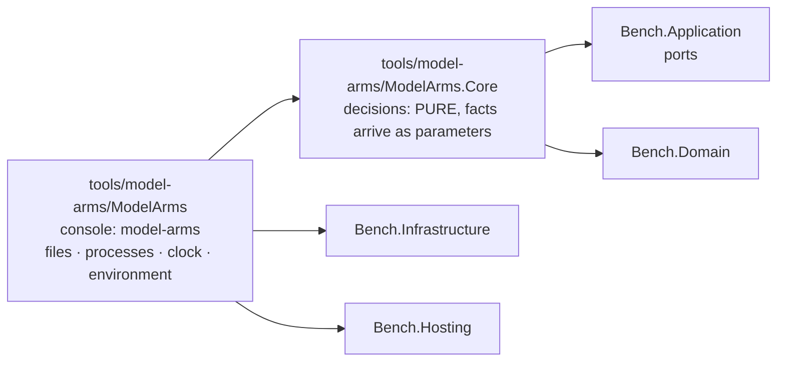

# Module — Model arms: the launcher of the part-6 experiment, in C#

> Status: **E1.S2 built, 2026-10-29 — the two projects, their references and the architecture guard exist; every other section below is an empty heading owned by the story named in it.**
> Plan: [PLAN_model_arms_E1.md](../todo/PLAN_model_arms_E1.md) (stories) under [PLAN_model_arms.md](../todo/PLAN_model_arms.md) (the design). Nothing here launches a model yet.

## Purpose

The owner compares coding pipelines ("arms") of headless Claude Code sessions on one frozen plan in a target repository: three schemes
(C, CR, SRS) times three runs, every arm ending in the product's multi-vendor code gate. The harness that launched those runs was a
set of bash scripts with inline node and the experiment's facts as constants at the top of each script. This module is its port to C#,
a console of its own beside the benchmark, not part of it. It ports the RUN half only (launch, resume, limits, the gate step, the
chain, isolation by file modes, the objective checks); the analysis half is a later plan. Its behaviour is the shell harness's, its
facts live in one refusing experiment file, and it is built so a decision can be tested without starting a process.

## Projects and the guard

| Project | Role | References |
|---|---|---|
| `tools/model-arms/ModelArms.Core` (`ModelArms.Core`) | Every decision of the module: the experiment's facts and their refusals, paths, the arm map, the launch options, the briefs. **Pure by construction** (plan D1): opens no file, starts no process, reads no clock, no environment. | `Bench.Domain`, `Bench.Application`; no packages |
| `tools/model-arms/ModelArms` (assembly `model-arms`) | The only project that touches the world. Today a stub `Program.Main` that answers the configuration exit code so the executable links. | `ModelArms.Core`, `Bench.Infrastructure`, `Bench.Hosting` |

The console also carries two content globs, so no later story edits its project file to ship a file: `tools/model-arms/briefs/*.template.md`
and `tools/model-arms/examples/*.json` are copied beside the binary under `briefs/` and `examples/`. Both folders are empty until their stories.
Both projects are in `dew_flow_benchmark.slnx` under a `/tools/` folder, and `Bench.Tests` references both as ordinary references so their
assemblies are in the test output on purpose, not by accident.

**The guard** is `tests/Bench.Tests/ModelArms/ModelArmsArchitectureTests.cs`; it reuses `ArchitectureTests.Referenced` and `IsRuntime` (widened to `internal`, not copied).

| Test | What it holds |
|---|---|
| `Core_references_only_the_runtime_the_domain_and_the_application_layer` | `ModelArms.Core.dll` references the runtime, `Bench.Domain` and `Bench.Application` only |
| `Core_never_references_infrastructure_or_entity_framework` | the same assembly names no `Bench.Infrastructure`, no `Microsoft.EntityFrameworkCore*`, no `Npgsql*` |
| `Nothing_under_src_or_hosts_references_the_model_arms_module` | no `*.csproj` under `src/` or `hosts/` names `ModelArms` or `model-arms`, and no product assembly (`Bench.*.dll` except the test assembly, `bench.dll`) references `ModelArms.Core` or `model-arms`; both scans also assert they found something |
| `Every_core_decider_is_named_in_the_pure_list` | every public static class of `ModelArms.Core` is named in `PureDeciders`, one marker line per story, and everything named lives in `ModelArms.Core` |

What the guard does not prove: that a Core type is pure inside its body. A list of referenced assemblies cannot see `File.ReadAllText`, because the
runtime is always allowed. The pure list only makes each decider named on purpose, and the first decider's story adds the companion
that asserts the scan still finds something. Until then the fourth test's second half has nothing to scan, and its teeth were shown by planting a
public static class.

Separately, `Bench.Hosting` (the parser, the exit codes, the shutdown signal) is held a leaf by `ArchitectureTests`, beside the Domain, Contracts and Delivered leaves.

## The experiment file (E1.S3)

## Paths and the arm map (E1.S4)

`RootPaths` and `ArmPaths` (`tools/model-arms/ModelArms.Core/Experiment/ArmPaths.cs`) are the one spelling of every path of an experiment
root and of one arm; nothing else in the module concatenates a path. Every member is a `Path.Combine`; none opens a file or makes a folder
(`make` creates them, a later epic). `ArmPaths(Root, Token)` is built by `RootPaths.Arm(token)`. A name taken from a caller (arm, step, task id,
side, token) must be one path segment: empty, `.`, `..` or containing `/` or `\` throws `ArgumentException`, a programming error because callers
pass names validated upstream. A file name the operator configured goes through `RootPaths.Of`, which refuses by value
(`'<x>' must be a file name inside the experiment root`) a rooted name, a drive prefix or any `..` segment. `n` and `i` are printed invariant.

| `RootPaths` member | Path under the root |
|---|---|
| `ExperimentFile` | `experiment.json` |
| `Briefs` | `briefs` |
| `Base` | `base` |
| `ArmMapFile` | `arms.map.json` |
| `Arms` | `r` |
| `Pids` · `PidFile(arm)` · `PidLog(arm)` | `pids` · `pids/<arm>.pid` · `pids/<arm>.log` |
| `Chain` | `chain` |
| `Made(arm)` | `chain/made-<arm>` |
| `Locked` · `Unlocked` | `chain/locked` · `chain/unlocked` |
| `ObjectiveMarker(arm)` | `chain/objective-<arm>` |
| `ArmsDone` | `chain/arms-done` |
| `Executables` | `chain/executables.txt` |
| `GateLock` · `LockedModes` | `.gate.lock` · `.locked-modes` |
| `LockLog` · `KeepAwakeLog` | `lock.log` · `keep-awake.log` |
| `Of(relative)` | `<relative>`, refused when it leaves the root |
| `Arm(token)` | an `ArmPaths` |

| `ArmPaths` member | Path under `r/<token>` |
|---|---|
| `Folder` | `r/<token>` itself |
| `CloneFolder` | `arm` |
| `Out` · `Notes` · `Work` · `Tmp` · `Worktrees` | `out` · `notes` · `work` · `tmp` (the CLI's `TMPDIR`) · `wt` |
| `Worktree(id)` | `wt/<id>` |
| `CoaiSettings(side)` | `coai-data/<side>/settings.json` |
| `McpNone` · `McpCoai` | `mcp-none.json` · `mcp-coai.json` |
| `Session(step)` | `out/<step>.session` |
| `Stream(step, n)` · `Stderr(step, n)` · `Prompt(step, n)` | `out/<step>.a<n>.jsonl` · `.a<n>.err` · `.a<n>.prompt.md` |
| `Done(step)` · `Before(step)` · `Diff(step)` | `out/<step>.done` · `.before` · `.diff` |
| `Timing` | `out/timing.jsonl` |
| `ObjectiveFolder` · `Objective` | `out/objective` · `out/objective.json` |
| `TasksPlanLog` | `out/tasks-plan.log` |
| `BatchDone(i)` | `out/batch-<i>.done` |
| `TaskBefore(id)` | `out/task-<id>.before` |
| `CoderHead(id)` · `CoderDiff(id)` | `out/task-<id>-coder.head` · `out/task-<id>-coder.diff` (the shell named these after a model; no path of the module names one) |
| `Picked(id)` · `PickRecord(id)` · `PickLog(id)` | `out/picked-<id>` · `out/pick-<id>.json` · `out/pick-<id>.log` |
| `WorktreeBuildLog(id)` | `out/wt-build-<id>.log` |
| `CodeNotes` · `HReviewNotes` · `FixNotes` · `GateNotes` · `SplitNotes` | `notes/code.md` · `hreview.md` · `fix.md` · `gate.md` · `split.md` |
| `ReviewJson` · `GateJson` | `notes/review.json` · `notes/gate.json` |
| `TaskNotes(id)` | `notes/<id>-code.md` |
| `TasksJson` · `BatchesJson` | `work/tasks.json` · `work/batches.json` |
| `TaskBrief(id)` | `work/<id>.md` |

`ArmPathsTests` holds one hand-written spelling per row and compares the rows with the members the two types really have, so a path added
without a spelling fails the class. The parent plan's section 4.3 missed six files the shell wrote (`notes/split.md`, `out/tasks-plan.log`,
`out/batch-<i>.done`, `out/task-<id>.before`, `out/pick-<id>.log`, `out/wt-build-<id>.log`); they are spelled here. The member for the
clone folder is `CloneFolder`, not `Clone`: C# reserves `Clone` in a record (CS8859).

**The arm map** (`ArmMap`, `arms.map.json`) holds arm name to a random 16-hex token (8 bytes), the folder name of the arm so that no arm can
guess another's. The shell's tokens were 12 hex; `ArmMap.Read` refuses such a map and a run mints its own.

| Operation | Behaviour |
|---|---|
| `Read(json)` | an object of strings; every arm that is wrong is named, one sentence per line: a token that is not 16 lower-case hex, two arms with one token, an arm name not matching letters-then-digits, an arm twice, a value that is not a string |
| `ToJson()` | indented, `\n` newlines, insertion order: the shell's shape |
| `Extend(existing, arms, eightRandomBytes)` | every existing entry unchanged, then a fresh token for each arm not yet present; a draw that collides with a token already in the map is drawn again. Arms absent from `arms` are kept. A random source that does not give 8 bytes, or collides 64 times in a row, and an `arms` entry that is not an arm name throw (programming errors). The source is a parameter, so the type stays pure; the console passes `RandomNumberGenerator` |
| `TokenOf(arm)` | the token, or a refusal naming the known arms |
| `Leaks(text, ownArm, schemes)` | what the text would reveal to `ownArm`: every arm name of the map (its own too) and every scheme name found as a whole word (not touching an ASCII letter or digit, case-sensitive), and every token other than its own found anywhere. Its own token is allowed: it is the arm's working directory and is in every path field of a brief. Empty means clean |
| `Scrub(line)` | every token of the map replaced by `<token>`. The console's one writer calls this; nothing keeps its own copy |

What the tests do not prove: that the randomness is unpredictable (the tests count; the console supplies the entropy), and that a verb calls
`Leaks` or `Scrub` at the right places (the brief filler and the console writer own that and test it).

## The launch boundary (E1.S5, E1.S6)

## Briefs (E1.S7)

## The root, trust and the host (E1.S8, E1.S10)

## The command line (E1.S9)

## The first run: init and validate (E1.S11)
