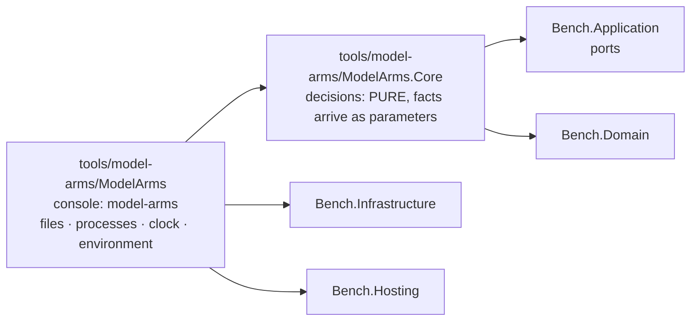

# Module — Model arms: the launcher of the part-6 experiment, in C#

> Status: **E1.S2 built, 2026-10-29 — the two projects, their references and the architecture guard exist; every other section below is an empty heading owned by the story named in it.**
> Plan: [PLAN_model_arms_E1.md](../todo/PLAN_model_arms_E1.md) (stories) under [PLAN_model_arms.md](../todo/PLAN_model_arms.md) (the design). Nothing here launches a model yet.

## Purpose

The owner compares coding pipelines ("arms") of headless Claude Code sessions on one frozen plan in a target repository: three schemes
(C, CR, SRS) times three runs, every arm ending in the product's multi-vendor code gate. The harness that launched those runs was a
set of bash scripts with inline node and the experiment's facts as constants at the top of each script. This module is its port to C#,
a console of its own beside the benchmark, not part of it. It ports the RUN half only (launch, resume, limits, the gate step, the
chain, isolation by file modes, the objective checks); the analysis half is a later plan. Its behaviour is the shell harness's, its
facts live in one refusing experiment file, and it is built so a decision can be tested without starting a process.

## Projects and the guard

| Project | Role | References |
|---|---|---|
| `tools/model-arms/ModelArms.Core` (`ModelArms.Core`) | Every decision of the module: the experiment's facts and their refusals, paths, the arm map, the launch options, the briefs. **Pure by construction** (plan D1): opens no file, starts no process, reads no clock, no environment. | `Bench.Domain`, `Bench.Application`; no packages |
| `tools/model-arms/ModelArms` (assembly `model-arms`) | The only project that touches the world. Today a stub `Program.Main` that answers the configuration exit code so the executable links. | `ModelArms.Core`, `Bench.Infrastructure`, `Bench.Hosting` |

The console also carries two content globs, so no later story edits its project file to ship a file: `tools/model-arms/briefs/*.template.md`
and `tools/model-arms/examples/*.json` are copied beside the binary under `briefs/` and `examples/`. Both folders are empty until their stories.
Both projects are in `dew_flow_benchmark.slnx` under a `/tools/` folder, and `Bench.Tests` references both as ordinary references so their
assemblies are in the test output on purpose, not by accident.

**The guard** is `tests/Bench.Tests/ModelArms/ModelArmsArchitectureTests.cs`; it reuses `ArchitectureTests.Referenced` and `IsRuntime` (widened to `internal`, not copied).

| Test | What it holds |
|---|---|
| `Core_references_only_the_runtime_the_domain_and_the_application_layer` | `ModelArms.Core.dll` references the runtime, `Bench.Domain` and `Bench.Application` only |
| `Core_never_references_infrastructure_or_entity_framework` | the same assembly names no `Bench.Infrastructure`, no `Microsoft.EntityFrameworkCore*`, no `Npgsql*` |
| `Nothing_under_src_or_hosts_references_the_model_arms_module` | no `*.csproj` under `src/` or `hosts/` names `ModelArms` or `model-arms`, and no product assembly (`Bench.*.dll` except the test assembly, `bench.dll`) references `ModelArms.Core` or `model-arms`; both scans also assert they found something |
| `Every_core_decider_is_named_in_the_pure_list` | every public static class of `ModelArms.Core` is named in `PureDeciders`, one marker line per story, and everything named lives in `ModelArms.Core` |

What the guard does not prove: that a Core type is pure inside its body. A list of referenced assemblies cannot see `File.ReadAllText`, because the
runtime is always allowed. The pure list only makes each decider named on purpose, and the first decider's story adds the companion
that asserts the scan still finds something. Until then the fourth test's second half has nothing to scan, and its teeth were shown by planting a
public static class.

Separately, `Bench.Hosting` (the parser, the exit codes, the shutdown signal) is held a leaf by `ArchitectureTests`, beside the Domain, Contracts and Delivered leaves.

## The experiment file (E1.S3)

`ExperimentFile.Read(json, location)` turns the text of `experiment.json` into an `Experiment`, or refuses it with every problem of the file in
one answer, one sentence per line (`Outcome<Experiment>`, the reason is the lines joined by `\n`). Core receives the TEXT and an
`ExperimentLocation(Root, Home, EnclosingGitTop, ThisRepository)`; the console reads the file and answers the location's four questions.
The worked example `tools/model-arms/examples/part6.experiment.json` is the one source the tests and, later, the `init` template are derived from.

**Reading.** `JsonNode.Parse` with comments skipped (the example carries `//` comments), trailing commas refused and a member written twice
refused (`AllowDuplicateProperties = false`: otherwise the parse throws `ArgumentException` on first access). A malformed text, or one whose
root is not an object, is a single problem. The walk is `StrictJson`, a reader that records a sentence per problem instead of stopping at the
first; this is why the catalog's `UnmappedMemberHandling.Disallow` is not used (it names one unknown member and quits). A file that leaves any
problem builds no `Experiment`.

| Members | Rule |
|---|---|
| top level, required | `schema` `target` `scenarios` `baseline` `known` `steps` `schemes` `rounds` `limits` `tools` `awake` |
| top level, optional | `tasks` (absent: `TaskLimits.Shell`, 4 / 7 / 4) · `coai` (absent: `CoaiFacts.None`) · `isolation` (absent: `IsolationFacts.None`) |
| `target`, all required | `source` `planBranch` `base` `plan` `branch` `rulesSubmodule` `lowPriority` `build` `suite{command,ctrfFile,namePrefix}` `format{solution,verbs}` `extension{directory,command}` `nodeModules` `testGlobs` |
| `limits` / `tasks` / `tools` / `coai` / `isolation` | six limits / `min` `max` `maxParallel` / `write` `read` `gate` `deny` / `binary` `settings` `side` / `closed` `unlisted`; inside a present object every member is required |

**What is refused, and the sentence it gets.** An unknown member: `target.bulid is not a member this build knows (known: …) — refused rather
than ignored`. A missing one: `target.base is missing`. Then the value rules:

- `schema` is exactly `model-arms/experiment-v1`.
- Absolute (`Path.IsPathFullyQualified`): `target.source`, `coai.binary`, `coai.settings`. Relative, not rooted, no `..` segment: `target.plan`,
  `rulesSubmodule`, `format.solution`, `extension.directory`, each element of `nodeModules` and `testGlobs`, and `scenarios` / `baseline` (names inside the root).
  `target.base` is `CommitSha.Parse`, its reason quoted. Every other text is non-empty.
- Every command (`lowPriority`, `build`, `suite.command`, `extension.command`) is a non-empty array whose first element passes
  `ExecutableRule.Refusal` against `[target.source, <root>/base, <root>/r]` (D17, the static half): a bare name is fine; a relative path
  (`./x`) is refused because it resolves against the target; an absolute path equal to or under a forbidden root is refused (normalised, ordinal,
  with a trailing separator, so a sibling that shares a prefix is not "under"). A file under the target may only be an ARGUMENT, which is why
  the suite runs as `dotnet <tests>.dll`. Resolving an executable on a host is E1.S8's, not this file's.
- `steps`: keys are step kinds (`code review fix hreview gate split splitFix taskCode`; `steps.lint is not a step kind (…)`), each value
  `{model, minutes > 0, mode ∈ write|read|gate}`. `schemes`: names are letters; each entry is exactly `tasks` or `<file name>:<step kind>`
  (`^[0-9]+[a-z]?-[A-Za-z0-9-]+:[A-Za-z]+$`) whose kind is defined under `steps`. `rounds`: non-empty arrays of arm names whose scheme (`ArmNames.SchemeOf`:
  `SRS2` is `SRS`) is among the schemes: `rounds[0][1] names 'XY2', whose scheme 'XY' is not among the schemes (C, CR, SRS)`.
- `limits.*` and `tasks.*` are whole numbers above zero and `tasks.min <= tasks.max`; `awake` is `auto|windows|wsl|none`; `coai.side` names one folder (no
  separator, no `..`).
- **Placeholders.** An `isolation` entry is `<root>`, starts `<root>/`, starts `~/`, or is absolute; `<root>` expands to `Root` and a leading `~` to
  `Home` (`Path.Combine`), so `Experiment.Isolation` holds paths only. Anything else is refused.
- **Placement** (`ExperimentFile.Placement`, added to every `Read` first): a root equal to or under `ThisRepository` is refused (`inside this
  repository`); any non-empty `EnclosingGitTop` is refused (`inside the git checkout`), because the arms' clones would nest in it.

What this does NOT prove: that any path exists or is readable, that an executable resolves on this host, that `scenarios.json` parses, that an arm is named
twice in the rounds, or that a host can set modes (E1.S8 and E1.S10, `validate`). The example's paths are under `/example/` and the tests' location is
`/x/...`, so these tests assume a POSIX path syntax (the suite runs on ubuntu CI and WSL).

## Paths and the arm map (E1.S4)

## The launch boundary (E1.S5, E1.S6)

## Briefs (E1.S7)

## The root, trust and the host (E1.S8, E1.S10)

## The command line (E1.S9)

## The first run: init and validate (E1.S11)
