# Module — Scouts: does a Sonnet team find what an Opus team finds, how fast, at what price

> Status: **E1 built, 2026-10-12 — S1, S2 and S3: the context end to end offline; nothing paid has run.**
> S1: the domain, the stream reader, the read-back with its path audit, the pure deciders, the store with its spend ledger, the four live
> fixtures. S2: the two launcher options and the streaming output sink, the history-free trees and their grant guard, `CliScoutRunner`,
> `ScoutCampaign` with the entry step's recovery, and the verbs `tasks`, `run`, `resume`, `rerun`, `sweep`, `prune`, `alias-check` —
> exercised only against `tests/FakeCli`. S3: the analysis (claim pooling, the not-measured rule, the clustered bootstrap, `Decide()`),
> the run's KIND (preliminary / decision), the assessor and the hand-check draw, the verbs `status`, `score`, `assess`, `report`, the scenario
> test and [module_tests.md](module_tests.md). The read API and the Scouts tab moved to E3 S8 (plan decision D8). **E2 S4 built, 2026-10-13:**
> private tasks (D10) — the classification, the campaign key, the HMAC commitments, the ONE public projection every writer takes, a second
> migration, and the staged-blob hygiene scan with its opt-in hooks (see *Private tasks* below). **E2 S5 built, 2026-10-13:** the confined
> launch — `--setting-sources ""`, the pinned plugin directory, the pinned settings file (its hash the settings pin) — and `bench scouts
> access-check`, the first PAID verb to run for real (see *The confined launch* below). **E2 S6 built, 2026-10-13:** money before the first
> paid call — the pilot run kind under its bounds, caps and walls from `schedule.json` only on a measuring run, an overshoot settled at its
> real total and counted, `bench scouts schedule` deriving E3's caps and walls from the pilot (see *Money before the first paid call* below).
> **E2 S7 built, 2026-10-13:** the D10 selection — merge styles, P verified per style against the mirror, the draw seeded by the campaign
> string, main/reserve/pilot roles and the pilot's own files (see *The selection* below). **E2 S8's code built, 2026-10-13:** a model
> fallback stops the cell (`ModelRefusalFallback`, the live refused stream as fixture), the prompts state the run's purpose
> (`scout-prompts-v2`), `bench scouts sizing` (see *The sizing* below), private labels to four digits; the live pilot itself is not run yet.
> **E2 code round, 2026-10-13:** eight accepted review findings fixed before the pilot — the access check's verdict rule (EVERY agent must
> deny a target), the hygiene scan reading binary blobs by their bytes and every blob off ONE `git cat-file --batch`, `tasks` refusing a private
> candidate by label and code and refusing colliding output paths, `cells.jsonl` refusing a cell with no task, every check launch announced and
> timed on the console, the walls named (see *The code round* under *Tests*).
> The design record is [PLAN_scout_model_calibration.md](../todo/PLAN_scout_model_calibration.md) (still open in `todo/`: E2 S8's live
> pilot and evidence commits, and E3). This file
> describes what is built; a sentence here about something that does not run is a bug in the file.

## Purpose

The shared rule puts every subagent on Opus. The operator wants the read-only **scouts** — code explorers, Explore, lookup agents —
on Sonnet, launched ⌈1.5·N⌉ where N Opus scouts would run, and chose to MEASURE first (plan §1, decisions D1–D6). This section
measures, per team size W1/W2/W3, the share of the files that mattered each team found (recall), its wrong claims per 10, its time
and its cost. It is shaped like the gate and the probes: its own context, store tables and verbs — and, in E3 S8, a read API and a tab.

Three things the module exists to make impossible:

- **a cell scored on a team that did something else** — another model, another prompt, a web call, a call by the main session —
  which is why every cell is read back (§3.5), not a sample;
- **a broken boundary measured as recall** — a child reading the future from a directory the user settings grant — which is why the
  path audit STOPS the campaign instead of voiding the cell (§3.2);
- **money that a crash makes disappear** — which is why every attempt carries its own reservation, the launch boundary is durable,
  and doubt is charged (§3.10).

## The measurement tuple

```
task        = id, repo, P, S, kind, statement, G, removals, tree hash, PRIVACY, language   ScoutTask (frozen; leak-checked; a private task's id is its label)
            + for a private task: the HMAC commitments of statement and G                  ScoutTaskCommitments (under the campaign key, S4)
arm         = A1 B1 A2 B2 A3 B3 C3 + A3-explore B3-explore                             ScoutArms (the one table)
repeat      = 1..n, repeats OUTERMOST                                                  ScoutSchedule
slot/pos    = one block per (repeat, task); arms in a seeded permutation inside it      ScoutSchedule (StableHash, not Random)
generation  = 1, then max + 1 per re-run — appended, never reset                       ScoutCellLifecycle.NextGeneration
attempt     = the claim's attempt number, each with its own reservation row             ScoutAttempt
pins        = CLI version, plugin hash, resolved opus/sonnet ids, PINNED settings hash  ScoutPins (frozen on the run; S5: the hash of the pinned plugin folder and of pinned-settings.json)
build       = ProductPin of the CLI binary, read at CLAIM time                          ScoutCell.Pin
```

## Diagram

```mermaid
flowchart TB
    subgraph dom["Bench.Domain — pure"]
        reader["ClaudeSubagents (Probes/) — stream-json grouped by parent_tool_use_id<br/>SubagentTranscript · ChildTrace · AgentResult · ResultEnvelope"]
        output["ScoutOutput — KEY FILES · CLAIMS parsers<br/>ScoutClaimRates — pooled rates"]
        readback["ScoutReadBack — §3.5 void reasons<br/>PathAudit + TreePaths + LinkTargets port — §3.2 fail-stop"]
        deciders["LeakCheck · RecallMatcher · ScoutTokens + ScoutCost (2 %) · ScoutScrubber"]
        plan["ScoutArms · ScoutSchedule · ScoutTask · ScoutPins · ScoutRun + ScoutArmBudget"]
        cells["ScoutCell + ScoutCellLifecycle (Claimable + ProductPin) · ScoutGenerations"]
        money["SpendLedger · ScoutAttempt + ScoutAttemptLifecycle (launching mark, Recover)"]
        s2dom["S2: ScoutPrompts · ScoutCellReading + ScoutPinDrift · ScoutCutoffs · ScoutCandidates + ScoutGroundTruth · ScoutFiles · ScoutAliasCheck"]
        analysis["S3: ScoutAnalysis — per task, per arm, the workloads<br/>ScoutBootstrap + SeededDraws — clustered by repository<br/>ScoutDecisions.Decide — the bounds against D5"]
        judging["S3: ScoutAssessment — rubric, schema, blinding, the answer<br/>ScoutHandcheck — the seeded draw and its file · ScoutRunKind"]
        privacy["S4: ScoutTaskPrivacy · ScoutCommitment (scout-commit-v1) + ScoutCommitter<br/>ScoutPublication — THE public projection · ScoutClaimDigest"]
        selection["S7: ScoutMergeStyle + ScoutBaseRef + ScoutParentFacts · ScoutParentCheck — P per merge style<br/>ScoutSelectionDraw + ScoutDraw + ScoutTaskRole — the D10 order, seeded by the campaign string"]
        limits["S6: ScoutRunKind.Pilot · ScoutRunLimits — the pilot's bounds, caps from schedule.json only<br/>ScoutOvershoots — settled above the cap, never clipped · ScoutArmBudgets.FromPilot + ScoutScheduleFile"]
        confine["S5: ScoutPinnedSettings — the two keys, canonical · ScoutPluginRegistry — the user-scope install<br/>ScoutAccessCheck — prompts, the judge, the conclusion · ScoutAccessReport — the summary"]
    end
    subgraph app["Bench.Application.Scouts — ports and use cases"]
        store["IScoutStore"]
        reads["IScoutReads — no write verb"]
        runner["IScoutRunner"]
        trees["IScoutTrees"]
        s2ports["IScoutCheckpoints · IScoutStreams · IScoutPinReader · ScoutLaunch + ScoutLaunchFiles (S5)"]
        campaign["ScoutCampaign — one cell at a time<br/>ScoutRecoveryStep — sweep + recovery"]
        s3app["S3: ScoutSettledOutputs — scored cells re-read from their streams<br/>ScoutScoring · ScoutAssessCampaign + ScoutClaimAssessor<br/>IScoutVerdicts · IScoutAssessmentFiles"]
        report["S3: ScoutReport — ONE pure report → Bench.Contracts ScoutRunReportDto"]
        records["S4: ScoutRecordFiles — cells.jsonl and the RESULTS skeleton, pure"]
    end
    subgraph infra["Bench.Infrastructure"]
        pg["PostgresScoutStore + ScoutLedgerStatements<br/>PostgresScoutReads · PostgresScoutVerdicts (S3)"]
        links["Scouts/FileSystemLinkTargets — junctions and symlinks by final target"]
        tables[("scout_runs · scout_tasks · scout_cells · scout_records · scout_attempts · scout_claims")]
        codex["codex exec -s read-only (FindingAssessor.OptionsFor) — assess"]
        pub["PostgresGatePublicationSource — the export walk + PublicationGuard"]
        cli["Scouts/CliScoutRunner → CliAgentRuntime → ProcessRunner (line sink)"]
        tree["Scouts/ScoutTrees (git archive from GitCheckoutProvider's bare mirror)<br/>ClaudeGrants + ScoutGrantGuard · ScoutRoots · ScoutHistory"]
        art["Scouts/ScoutArtifacts — stream.ndjson as it arrives, ArtifactCommit for the rest"]
        pins["Scouts/ScoutPinReader — ProductPinReader + plugin cache + settings"]
        key["S4: Scouts/ScoutCampaignKey — FileHashKeyFile at a path outside every checkout, root and grant<br/>Scouts/ScoutWithheld — a private refusal's detail under .scout-trees/<br/>Persistence/ScoutRowPublication — the export walk's projected copies"]
        launchfiles["S5: Scouts/ScoutPluginDirectory — the cache + the registry → one version folder<br/>ScoutArtifacts.PinnedSettings — scouts/pinned-settings.json, written once<br/>Scouts/ScoutAccessPlanting — the tree, the sibling, the mirror-root canary, the junction"]
    end
    subgraph host["hosts/Cli"]
        verbs["bench scouts tasks · run · resume · rerun · sweep · prune · alias-check"]
        s3verbs["S3: bench scouts status · score · assess · report"]
        s4verbs["S4: bench scouts key init · hygiene — and .githooks/ (opt-in)<br/>ScoutsFault — a scouts verb's unhandled exception withheld"]
        s5verbs["S5: bench scouts access-check (LIVE) · ScoutsInputs.LaunchContextAsync — the pinned files for a launch outside a run"]
        s6verbs["S6: bench scouts schedule — E3's caps and walls from the pilot"]
    end

    reader --> readback
    reader --> deciders
    output --> deciders
    plan --> cells
    cells --> store
    money --> store
    store --> pg
    reads --> pg
    pg --> tables
    tables --> pub
    links -. "LinkTargets port" .-> readback
    verbs --> campaign
    campaign --> runner
    campaign --> store
    runner --> cli
    cli --> tree
    cli --> art
    cli --> s2dom
    campaign --> pins
    art -. "IScoutStreams" .-> campaign
    s3verbs --> s3app
    s3verbs --> report
    s3app --> analysis
    s3app --> judging
    report --> analysis
    report --> reads
    s3app --> pg
    s3app --> codex
    codex --> tree
    art -. "IScoutStreams · IScoutAssessmentFiles" .-> s3app
    privacy --> plan
    report --> privacy
    records --> privacy
    pub --> privacy
    s4verbs --> key
    key --> privacy
    pins --> launchfiles
    cli --> launchfiles
    launchfiles --> confine
    s5verbs --> launchfiles
    s5verbs --> confine
    verbs --> selection
    selection --> privacy
    tree --> selection
    verbs --> limits
    s6verbs --> limits
    limits --> money
    s3verbs --> limits
```



## Core entities, and the rule each one carries

| entity | file | the rule |
|---|---|---|
| `ScoutArm` · `ScoutArms` · `ScoutWorkload` · `ScoutModel` · `ScoutAgent` · `ScoutFocus` | `src/Bench.Domain/Scouts/ScoutArm.cs` | The one arm table: A = Opus N, B = Sonnet ⌈1.5·N⌉, C3 = Sonnet 3, and the W3 Explore replication (A3-explore, B3-explore). Focus areas F1..F5, a team of N takes the first N. The model is an ALIAS here; the id behind it is a pin |
| `ScoutRepository` (S3, D10) | `ScoutRepository.cs` | What a task's repository may be: an `owner/name` slug (cloned through the trees' url template, `https://github.com/{0}.git`) or a repository url used AS IT IS — https://, ssh://, git@, file:// — which is how a private repository is mirrored read-only from the operator's local clone (`file:////wsl.localhost/Ubuntu/home/<user>/git/<repo>`). Anything else is refused naming the value and the legal forms. Read by `ScoutTask.Frozen` and by `ScoutTreeSettings.UrlOf`, so the two cannot disagree. Anonymising a private task's committed records (D10) is E2's |
| `ScoutTask` · `ScoutTaskId` · `LeakCheck` | `ScoutTask.cs`, `LeakCheck.cs` | `Frozen` is the only door: a repository `ScoutRepository` accepts (S1 accepted only a public slug; D10 widened it), ≤ 3 sentences, a non-empty G of repository-relative paths, a SHA-256 tree hash — and the leak check: a ground-truth basename (substring), a stem or an identifier the diff added (whole word, ignoring case) refuses the statement naming the token; tokens shorter than 3 are not checked. **S4:** `Privacy`, `Language`, `Commitments`; a PRIVATE task's id must be a label (`p` + 2–4 digits — four since E2 S8: the screened private pool holds about 1 080 admissible candidates, each candidate's id its label) and it must name a language; its leak refusal names the label and the token COUNT only (`Leaks` is exposed for the caller to write the tokens where nothing public reads) |
| `ScoutTaskPrivacy` · `ScoutTaskPrivacies` · `ScoutTaskCommitments` (S4) | `ScoutTaskPrivacy.cs` | Public / private, the words on the wire, the label and language shapes, and the two commitments a private task carries in public |
| `ScoutCommitment` · `ScoutCommitter` · `ScoutClaimDigest` (S4) | `ScoutCommitment.cs` | See *Private tasks* below |
| `ScoutPublication` (S4) | `ScoutPublication.cs` | THE public projection — see *Private tasks* below |
| `ScoutPins` | `ScoutPins.cs` | CLI version, plugin cache hash, resolved opus and sonnet ids, settings hash — frozen on the run; `Continue` refuses naming every pin that moved, both values. **S5:** the plugin hash is taken over the ONE pinned version folder (claude's `.in_use/<pid>` markers and `.orphaned_at` skipped — a session starting is not a plugin change), the settings hash over `pinned-settings.json`, not the user settings |
| `ScoutPinnedSettings` (S5) | `ScoutPinnedSettings.cs` | The pinned settings file: `Project` copies ONLY `effortLevel` and `modelSettings` out of the user settings (comments and trailing commas tolerated there) into a canonical text (indented, LF, a trailing newline — the same settings hash the same); `Verify` refuses a file carrying any other key BY NAME (the launch loads every key the file names — a `permissions` block would hand the grant back, a `hooks` block would run code); `Drift` names each key whose value the user settings no longer agree with, both values |
| `ScoutPluginRegistry` (S5) | `ScoutPluginRegistry.cs` | `installed_plugins.json` read for one fact: the USER-scope install path of `feature-dev@claude-plugins-official` — the folder a session loads in every project. Fourteen version folders sat under the cache on 2026-10-13; a local-scope entry is bound to one project path. No user-scope entry, no entry at all, not JSON → a refusal naming it |
| `ScoutAccessCheck` · `AccessTarget` · `AccessFinding` · `AccessVerdict` · `AccessConclusion` · `ScoutAccessReport` (S5) | `ScoutAccessCheck.cs`, `ScoutAccessReport.cs` | See *The confined launch* below |
| `ScoutRun` · `ScoutRunProgress` | `ScoutRun.cs` | No status column (open/finished read off the cells); seed, repeats, arms, task order, and the `SpendLedger` on the run row |
| `ScoutSchedule` · `ScheduledCell` | `ScoutSchedule.cs` | Repeats outermost, tasks in a seeded order, the arms of each task in a seeded permutation of their own (a slot = one task in one repeat); the Explore arms only on the named replication tasks. Ordered by `StableHash` of the seed and the cell's identity — reproducible on any machine and runtime, which `Random`'s sequence is not documented to be |
| `ScoutCell` · `ScoutCellLifecycle` · `ScoutGenerations` · `ScoutSettlement` · `ScoutCellFacts` | `ScoutCell.cs` | Composes `Claimable` + `ProductPin` exactly as `ProbeCell`; outcome `Scored` / `Void` / `Stopped` / `Aborted` must agree with its reason; a void cell re-runs as generation max + 1; the report reads the highest SETTLED generation. Facts are captured-or-not, never a zero for "absent" |
| `ScoutReason` · `ScoutReasons` | `ScoutReason.cs` | The ONE allow-listed "why" a row carries (stored by name): 11 void reasons, 6 stop reasons (S8 added `ModelRefusalFallback`), `SpendLimit`, `Abandoned`. No sentence reaches the database |
| `ClaudeSubagents` · `SubagentTranscript` (+ `TokenUsage`, `ChildTrace`, `AgentResult`, `ResultEnvelope`, …) | `src/Bench.Domain/Probes/ClaudeSubagents.cs`, `SubagentTranscript.cs` | Beside `ClaudeStream`, through the same `ProbeJson`. Per Agent call: `subagent_type`, `model`, the prompt and its SHA-256, the call's timestamp; the result's `resolvedModel`, `totalDurationMs`, status, final-iteration usage and report text (a STRING result — a failed call — reads as an error with every field absent); the child's `message.model`s, its usage summed DEDUPLICATED by message id (the last event of an id wins), its tool calls with their fate (`Denied` / `Errored` / `Returned` / `NotCaptured`) and result text. The envelope: `duration_ms`, `total_cost_usd` (decimal), the main session's `usage`, `modelUsage`, `subagent_stats`. Team time = first Agent `tool_use` → last Agent `tool_result`. **E2 S8:** `Fallbacks` — every `system/model_refusal_fallback` event (`ModelFallback`: the `parent_tool_use_id` — empty for the main session —, original and fallback model, the refusal category), the one place the event is parsed (`ScoutAccessCheck.ModelFallbacks` reads it from here) |
| `ScoutOutput` · `ScoutKeyFiles` · `ScoutClaims` · `ScoutClaimRates` | `ScoutOutput.cs`, `ScoutClaimRates.cs` | Blocks found by header (markdown decoration stripped); bullets and backticks stripped; the first 10 lines read, the rest counted as `Extra`; a line that is not one path (KEY FILES) or not `path[:line] — statement` (CLAIMS; em dash, en dash or spaced hyphen) counted `Unparseable`; no CLAIMS block = `Silent`; a cited line outside 1..1 000 000 is unparseable. Rates are POOLED (Σ wrong ÷ Σ assessed × 10) and absent when nothing was assessed |
| `ScoutReadBack` · `ReadBackExpectation` · `ReadBackVerdict` | `ScoutReadBack.cs` | Exactly N calls; each `input.model` = the arm's alias, `subagent_type` = the arm's agent, the prompts = the frozen ones as a MULTISET of SHA-256s; every result present and not an error; every child's `resolvedModel` present and = the arm's resolved id, every `message.model` too; child tools only Read/Glob/Grep/LS; the main session calls only `Agent`; `subagent_stats.completed = N`. A stop outranks a void |
| `PathAudit` · `TreePaths` · `LinkTargets` | `PathAudit.cs`, `TreePaths.cs` | Each child Read/Glob/Grep/LS target resolved against the session's cwd (an omitted Grep/Glob root = the cwd; a glob judged by its non-wildcard head; an absolute pattern stands alone; `..` folded, one above the drive = unresolvable = outside), then through the `LinkTargets` port (junction/symlink → final target; the ROOT too). Inside: fine — but an inside Glob whose listing resolves outside is `ListedOutside` (STOP). Outside: denied or errored → recorded; an explicitly empty success ("No files found" / "No matches found") → recorded apart from a denial; any other content → STOP; no result → STOP (never a safe read). Pure: own path arithmetic, not `Path.GetFullPath`, so a Windows stream reads the same on a Linux runner |
| `RecallMatcher` | `RecallMatcher.cs` | Normalises an entry (backticks, `:42`, `:42-50`, `#L42`, `\`, `./`, the tree's absolute root) and resolves it against the tree's file list: exact (ignoring case), else a UNIQUE whole-segment suffix (a bare basename included); an ambiguous suffix matches nothing; without the file list only an exact path can match |
| `ScoutTokens` · `ScoutCost` · `PriceTable` · `ModelPrice` · `CostCheck` | `ScoutCost.cs` | See *Tokens, as measured* below. Cost = tokens × the price table per exact model id (input, output, cache read, cache write 5 m / 1 h); the check compares main + scout teams + internal calls with `total_cost_usd`: within 2 % `Agrees`, else `Disagrees` (a STOP, `CostMismatch`), no reported cost `Unchecked` |
| `SpendLedger` · `ScoutAttempt` · `ScoutAttemptLifecycle` · `ScoutRecovery` · `ScoutReservation` | `SpendLedger.cs`, `ScoutAttempt.cs` | See *The ledger* below |
| `ScoutScrubber` · `ScrubDenyList` | `ScoutScrubber.cs` | Composes the gate's `FailureRedaction` (urls, machine paths, private names, hosts) and adds e-mail addresses; the deny-list is read at run time from a local file (never committed); a file that is NAMED (`--deny-list` or `BENCH_SCOUT_DENYLIST`) and does not load refuses the verb (4) — a silently empty list would publish the names it exists to hide. `Leftovers` is the hygiene check a committed record or fixture is held to: a home path (`\Users\x`, `/home/x`, `AppData`), an e-mail, a deny-list entry — named by rule, never by value |
| `ScoutRecord` | `ScoutRecord.cs` | The per-scout row: ordinal, focus, asked and resolved model, prompt hash, duration, tokens (`OutputSeparable`), cost, KEY FILES (repository-relative), claim counts — never text |
| `IScoutStore` · `IScoutReads` · `IScoutRunner` · `IScoutTrees` · `ScoutTree` · `ScoutAttemptResult` | `src/Bench.Application/Scouts/ScoutPorts.cs` | The ports. `IScoutReads` has no write verb (an architecture assertion). S2 widened them: `ScoutAttemptResult.Stopped` (a stop BEFORE the launch — a changed tree), `IScoutTrees.BuildAsync` (what `tasks` freezes the hash from), `ScoutTreeRefusal.HashChanged`, `IScoutCheckpoints` + `ScoutCheckpoint`, `IScoutStreams` (recovery's read of a stream), `IScoutPinReader` + `ScoutLocalPins` |
| `ScoutArmBudget` · `ScoutArmBudgets` (S2, S6) | `ScoutArmBudget.cs` | Each arm's `--max-budget-usd` cap and wall, FROZEN on the run (`ScoutRun.Budgets`, stored as two arrays parallel to `Arms`); a cell is never launched under a default cap (`BudgetOf` refuses). The reservation is the cap × 1.2. On a PILOT the CLI's `--cap-usd` for every arm, `--arm-caps A1=1.5,..` per arm, `--cell-timeout-minutes 20` (or `--cell-timeout-seconds`) as the wall (`For`); on a preliminary or decision run `schedule.json` only (`FromSchedule`, an arm it lacks refused by name). `FromPilot` (S6): per arm the largest settled cell's `total_cost_usd` × 1.5 rounded UP to the cent and the slowest cell's session × 2 rounded up to the second — every settled cell whose cost and session were captured counts, a void one too; an arm with none is refused by name |
| `ScoutRunLimits` · `ScoutOvershoot` · `ScoutOvershoots` · `ScoutScheduleFile` (S6) | `ScoutRunLimits.cs` | See *Money before the first paid call* below |
| `ScoutPrompts` · `ScoutCellPrompts` (S2, S8) | `ScoutPrompts.cs` | The frozen prompts, a pure function of the statement, the focus area and the arm (version `scout-prompts-v2` since E2 S8 — see *The cell prompts, v2* below): one focus prompt per scout (the purpose, the statement, F1..F5, the KEY FILES / CLAIMS contract) and the DRIVER (the purpose, then: launch exactly N Agent calls in one message, the arm's agent type and model alias, each prompt as it is between markers, read nothing, reply DONE). The read-back compares the calls with their SHA-256s |
| `ScoutCellReading` · `ScoutCellContext` · `ScoutCellVerdict` · `ScoutPinDrift` (S2, S8) | `ScoutCellReading.cs` | A stream read into a settlement, in precedence order: the path audit's STOP; a moved pin → STOP — `ModelRefusalFallback` when the main session or ANY child fell back to another model after a safeguard refusal (E2 S8, `ScoutPinDrift.FellBack`), else `PinMoved` for a moved alias (the main session's `init.model` ≠ the run's opus id, or a child's `resolvedModel` ≠ the run's id for the alias its call named); aborted:spend (a quota marker on stderr or in the result's text, a `result` subtype naming the budget, a subagent refused for budget); the cost check — a gap over 2 % OR tokens that cannot be priced → STOP `CostMismatch`; the read-back's voids; else scored. Only a scored cell carries recall (the union of its scouts' KEY FILES against G through the matcher). One `ScoutRecord` per call whose prompt is a frozen one |
| `ScoutCutoffs` · `ModelCutoff` (S2) | `ScoutCutoffs.cs` | `cutoffs.json`: per resolved id, the published cut-off, its https source, the date read. `LaterOf(opus, sonnet)` refuses an id that is missing, listed twice (ambiguous) or listed with no cut-off (unpublished) — the selection stops, nothing is guessed |
| `ScoutCandidates` · `ScoutCandidate` · `ScoutCandidateFacts` · `ScoutGroundTruth` (S2, S7) | `ScoutCandidates.cs` | Admission: P's commit date strictly AFTER the later cut-off, P verified per merge style (S7, below), 3–15 files of G, not docs-only — every exclusion with its reason. (The pilot is no longer excluded by id: under D10 it is drawn from repositories 9 and 10, so it cannot overlap the main tasks.) G = the changed files that existed at P (read with their modes from `git ls-tree -r P`) minus submodule GITLINKS (mode 160000 — not a tree file a scout can name; S3, §3.1 as amended 2026-10-12), lockfiles, generated files, changelogs, version manifests, `PLAN_*`/`RESULTS_*` documents and the PR's own plan. An ADDED identifier = an identifier on the diff's `+` lines that occurs nowhere in the tree at P. S7: a candidate carries its `MergeStyle`, its PR `Number` (zero for a local commit), a rebase-merged PR's `BaseRef` (oid + source), and its draw `Key` — `repo#number` for a PR, `repo@fixsha` for a local commit; `ScoutCandidateFacts` carries the fix's lineage (`ScoutParentFacts`: the parents, the ancestor answer) |
| `ScoutMergeStyle` · `ScoutMergeStyles` · `ScoutBaseRef` · `ScoutParentFacts` · `ScoutParentCheck` (S7) | `ScoutCandidates.cs`, `ScoutParentCheck.cs` | See *The selection* below — P verified per merge style, a mismatch a reason CODE by id |
| `ScoutSelectionDraw` · `ScoutDraw` · `ScoutDrawnTask` · `ScoutRepositoryRank` · `ScoutTaskRole` (S7) | `ScoutDraw.cs` | See *The selection* below — the D10 order, seeded by the campaign string |
| `ScoutRepository.ShortName` (S7) | `ScoutRepository.cs` | The short repository name the draw hashes: for `owner/name` the `name`; for a url its last path segment, a trailing `.git` dropped (`file:////wsl.localhost/…/git/repo` → `repo`, `git@github.com:o/n.git` → `n`) |
| `ScoutFiles` (S2, S4, S7) | `ScoutFiles.cs` | The operator files, read and written in one place: candidates (S4: `"private": true`, `"language"`; S7: `"mergeStyle"`, `"number"`, `"baseRefOid"` + `"baseRefSource"`, `"label"` standing in for a private `"id"`; a private candidate's refusals name no value; a shape that does not match its style — a PR without a number, a local commit with one, a rebase without a base — is refused by name), `tasks.json` (each public task with its added identifiers, so the leak check runs again on the way in; a private task as label, privacy, language, kind, \|G\|, tree hash and its commitments — through `ScoutPublication.TaskJson`; S7: every entry carries its `role` — main, reserve, pilot — and the file carries the `campaign` string, which IS the draw's seed; the int `seed` is gone; `Tasks`/`Resolve` answer the tasks that RUN — a reserve is verified but never planned), `tasks.private.json` (the private tasks whole, with their roles; `Resolve` joins the two under the committer and refuses a mismatch by label, a private entry with no detail, and a detail the public file does not name), the price table (`--prices`: source, date read, per-model USD per Mtok) |
| `ScoutAliasCheck` · `AliasVerdict` (S2) | `ScoutAliasCheck.cs` | §3.14: the tiny two-scout driver (one `sonnet`, one `opus` code explorer listing a one-file directory, $1 cap) and the comparison: `Same`, `Moved` (alias, recorded id, new id), `NotMeasured` (a scout with no `resolvedModel`) |
| `ScoutRunKind` (S3, S6) | `ScoutRunKind.cs` | D7: `Preliminary` or `Decision`, and since S6 `Pilot`, FROZEN on the run (`scout_runs.Kind`, by name — no migration). `bench scouts run --kind`, PRELIMINARY by default — a run can never claim a verdict it was not planned to give; a pilot's verdict is `preliminary` too (`ScoutDecisions` decides only a DECISION run) |
| `ScoutCellFacts.TeamTokens` · `TeamUsd` · `CapturedTokens` (S3) | `ScoutCell.cs` | The scout TEAM's tokens (each team's exact output, the main session and internal calls excluded) and their cost (`CellCost.ScoutsUsd`), computed at settlement; not captured when the stream cannot be attributed or priced — never a zero |
| `ScoutCallReport` · `ScoutCellReading.Reports` (S3) | `ScoutCellReading.cs` | Each scout's report by ordinal, the frozen prompts matched once each — extracted from the record builder so `score`, `assess` and the hand-check read the SAME scout as the same ordinal the records do |
| `ScoutClaimVerdict` · `ScoutClaimKey` · `ScoutAssessedClaim` (S3) | `ScoutClaimVerdicts.cs` | Wrong / right / unresolved, keyed by (cell, scout ordinal, place among its parseable claims). The tally is wrong ÷ DECIDED — unresolved stays out of the denominator, so an assessor that cannot decide never dilutes a team's wrong claims |
| `ScoutAssessment` · `ScoutBlindClaim` · `ScoutClaimToAssess` (S3) | `ScoutAssessment.cs` | §3.7's OWN rubric (`scout-assess-v1`, its SHA-256 on every verdict) and schema; a cell's claims read off its stream; fresh shuffled blinded ids (`BlindedId.Mint`); batches of 24; an answer read strictly (an id unknown, named twice or answered with another word stays unassessed); what is stored — the statement's hash and a repository-relative path, never the text |
| `ScoutHandcheck` · `HandcheckPair` · `HandcheckClaim` · `ScoutHandcheckPrivacy` (S3, S4) | `ScoutHandcheck.cs` | §3.7/D9: each (output, G file) pair read by the matcher over the tree; a draw of N found + N not-found pairs + N claim verdicts ordered by `StableHash(seed, item)`; a Markdown file with one `agree` / `disagree` box pair and a note line per item, naming no arm. S4: a private task's item shows its label and the commitment of its G file or its claim; `PrivateCompanion` is the local-only plaintext under the same item numbers |
| `ScoutAnalysis` · `ScoutCellEvidence` · `ScoutTaskArm` · `ScoutArmSummary` (S3) | `ScoutAnalysis.cs` | §3.6 — see *The analysis* below |
| `ScoutBootstrap` · `TaskDelta` · `ScoutInterval` · `BootstrapSettings` · `SeededDraws` (S3) | `ScoutBootstrap.cs`, `src/Bench.Domain/SeededDraws.cs` | §3.8 — see *The decision* below |
| `ScoutDecisions` · `ScoutWorkloadReading` · `ScoutDecision` (S3) | `ScoutDecisions.cs` | `Decide()` — see *The decision* below |
| `ScoutSizing` · `ScoutSizingSample` · `ScoutSizingSettings` · `ScoutSizingRow` · `ScoutSizingResult` · `ScoutSizingReport` (S8) | `ScoutSizing.cs`, `ScoutSizingReport.cs` | §3.8's sizing — see *The sizing* below. `ScoutAnalysis.IsDeciding` (the deciding-pair predicate) became public for it |

## Tokens, as measured (a deviation from the plan's assumption)

The plan (§2, §3.6) assumed per-scout tokens are the child's messages' usage deduplicated by message id. Measured on the live
fixture, that is exact for **input and cache tokens** — the Sonnet child alone equals `modelUsage[sonnet]` and the Opus child plus
the main session equal `modelUsage[opus]`, to the token — and **wrong for output tokens**: every assistant event of a message that
called a tool carries the usage as of the message's START, so its `output_tokens` is a placeholder (Sonnet child: 16 + 22 streamed,
118 billed; Opus child: 35 streamed, 1 442 billed). The exact sources are the envelope's: `modelUsage` per model and `usage` for
the main session alone. So `ScoutTokens.Attribute`:

- a TEAM's output on model m = `modelUsage[m].output` − (the main session's output when it is on m too) — exact;
- one scout's output is exact only when it is the only scout on its model (`OutputSeparable`); two scouts on one model share a
  total the stream cannot split, and their per-scout cost is *not captured*, never guessed;
- a model in `modelUsage` that is neither the main session's nor a scout's (the CLI's own Haiku call in every probe) is priced as
  "internal", with its cache creation at the 5-minute rate (the split is not printed per model).

`ClaudeSubagentsTests.Streamed_output_tokens_are_placeholders_and_the_team_output_comes_from_the_envelope` pins this. Recall and
wrong claims (the deciding metrics) are unaffected; per-scout cost and tokens (reported, D6) are exact per team, per scout only when
separable.

## The ledger (§3.10)

Carried on `scout_runs` as `CeilingUsd`, `ReservedUsd`, `SettledUsd`, `UnknownUsd` (`numeric(18,6)`), moved only by guarded
updates in `ScoutLedgerStatements`, each in one transaction with the attempt row it concerns:

| step | statement | refused when |
|---|---|---|
| reserve | the cell must be Claimed by this owner; `UPDATE scout_runs SET Reserved += x WHERE Reserved + Settled + Unknown + x ≤ Ceiling`; insert the attempt (unique per cell + claim attempt) | the reservation does not fit → `ScoutReservation.DoesNotFit(free, asked)`, a VALUE (S2's exit 3); a stranger or a second reservation for the same attempt → `Refused`, the ledger move rolled back |
| mark launching | `UPDATE scout_attempts SET State = Launching WHERE State = Reserved` — BEFORE the CLI is invoked | not Reserved |
| settle | `… WHERE State = Launching` → Settled, then Reserved −= r, Settled += actual | not Launching (so exactly once) |
| charge unknown | `… WHERE State = Launching` → ChargedUnknown, then Reserved −= r, Unknown += r — the WHOLE reservation, never released after | not Launching |
| release | `… WHERE State = Reserved` → Released, then Reserved −= r | anything else — a launching mark means it may have spent |

A reservation is the cap plus 20 % (`SpendLedger.ReservationFor`). Postgres re-evaluates the reserve's WHERE on the row a concurrent
writer just committed, so two reservations cannot both fit one headroom (tested with two racing stores). Recovery's decision per
attempt is pure (`ScoutAttemptLifecycle.Recover`): no launching mark → release; launching with a surviving `result` → settle from its
`total_cost_usd`; launching without → charge unknown; terminal → untouched. The ledger identity is `SpentUsd = Σ settled + Σ unknown`.
The sweep moves no money: it hands a dead owner's cell back (owner-checked, three attempts abandon), and the open attempt of that
cell is recovery's (S2).

## The store — six tables, one migration, no existing table touched

`20261012140639_ScoutTables`: `scout_runs` (pins, seed, repeats, arms and task ids as `text[]`, the ledger), `scout_tasks` (one row
per run × task; unique (run, task)), `scout_cells` (lineage, generation, slot, position, the claim, the CLI pin, outcome, reason, the
captured facts; unique (run, task, arm, repeat, generation); indexed for the claim in schedule order and for the sweep),
`scout_records` (one per scout of a settled cell; unique (cell, ordinal)), `scout_attempts` (reservation, state, settled cost;
unique (cell, number)). The claim is the probe store's guarded UPDATE (one cell at a time, in schedule order), the sweep its
owner-checked one, a re-run an append guarded by the unique index. Every enum is stored by name. S2 added two columns to `scout_runs`
in the SAME migration (regenerated under its original id, as the plan's "one migration per context" asks): `ArmCapsUsd numeric[]` and
`ArmWallSeconds integer[]`, parallel to `Arms` — the frozen budgets. **S3** regenerated it again under the same id (`dotnet ef migrations
add` over the pre-scout snapshot, renamed back; the diff against S2's is purely additive): `scout_runs.Kind` (the run kind, by name), the
team's tokens and cost on `scout_cells` (`TeamTokensCaptured`, `TeamInputTokens` … `TeamCacheWrite1hTokens`, `TeamUsdCaptured`, `TeamUsd`), and
a sixth table, **`scout_claims`** — one row per assessed claim: (cell, ordinal, index) UNIQUE, the repository-relative path, the cited line,
the statement's SHA-256, the verdict by name, the assessor's model, the rubric's SHA-256, when. The unique index is what makes `assess`
idempotent under a race: `PostgresScoutVerdicts.StoreVerdictsAsync` skips a claim that has a verdict, and a unique violation between its read
and its write is read again, never an overwrite. Recall is rescored only on a settled, SCORED cell (a guarded UPDATE).

**Publication.** The five tables joined the gate's publication walk (`PostgresGatePublicationSource.ScoutEntities`), so
`bench gate export --public` carries them under the same `PublicationGuard`; the claim owner never reaches a public row.
`ScoutEntitiesGuardTests` holds every text column to a `Type.Property` allow-list; the ONE sentence stored by design is the task
statement (committed to `tasks.json` anyway, leak-checked). A path planted in a scout row is refused naming table, column and row
(`ScoutPublicationTests`).

**The SECOND migration (S4, a recorded deviation from E1's one-migration rule, which cannot hold once E1 is merged):**
`20261013123339_ScoutTaskPrivacy` adds `Privacy` (by name, default `Public` — every task frozen before it was public), `Language`,
`StatementCommitment` and `GroundTruthCommitment` to `scout_tasks`, and `Campaign` to `scout_runs` (the seed string the commitments are
bound to, carried from `tasks.json` so `assess` and the hand-check commit under it — the fifth column the plan did not name). The walk now
reads the private tasks and their cells FIRST and hands the guard projected COPIES of their rows (`ScoutRowPublication`): a private task's
repository becomes its label, its shas, statement, G and removals empty, its scouts' KEY FILES and its claims' paths empty, its commitments
published in their place — so the export needs no key, and the database is never edited by an export.

## One cell, end to end (S2)

The campaign (`ScoutCampaign`, `src/Bench.Application/Scouts/ScoutCampaign.cs`) runs ONE cell at a time in schedule order. Per step:

1. **Pins before the claim** (§3.4): `ScoutPinReader` reads the CLI binary's `ProductPin` (its version text's first token is the CLI-version
   pin), the plugin hash (S5: SHA-256 over every file's path and bytes under the ONE pinned version folder — the cache `--plugin-cache`
   resolved through the registry `--plugin-registry` by `ScoutPluginDirectory`; a cache that is itself a plugin folder, a test's, is taken as it
   is) and the settings hash (S5: over `<artefact root>/scouts/pinned-settings.json`, which must be there and hold only its two keys — the file
   the user settings `--claude-settings` were projected into once); `ScoutPins.Continue` against the frozen pins —
   a move stops the run, nothing claimed. The resolved model ids cannot be read before a claim without a paid call, so they are checked on
   every cell AFTER it ran, off its own stream (`ScoutPinDrift`).
2. **Claim** the next pending cell under the binary's pin; **reserve** its arm's cap × 1.2 against the ceiling — one that does not fit stops
   the run (exit 3) naming what was free and what was asked; nothing is launched.
3. **The runner** (`CliScoutRunner`, `src/Bench.Infrastructure/Scouts/`): prepares the tree (a tree that no longer hashes to its frozen
   hash → `Stopped(PinMoved)`: the reservation released, the cell settled stopped, the run stopped), the empty MCP config, the prompts and
   an argv the CLI has flags for; opens the attempt's stream file; marks the attempt **launching** (durable, BEFORE the CLI starts);
   launches; writes every stdout line to `stream.ndjson` and flushes it the moment it is read; commits stderr, `argv.json` (argv + the
   child environment's NAMES), the prompt and the stream's seal (`stream.sha256`) — a refused commit THROWS, and the next entry settles
   the money from the stream; reads the stream (`ScoutCellReading`).
4. **Settle**: the attempt's money first — `total_cost_usd` when the result reached the stream, else an unknown charge of the WHOLE
   reservation; released only when nothing launched — then the cell with its per-scout records. A STOPPED or ABORTED cell stops the
   campaign (exit 3).

### The launch (§3.4, widened by S5)

```
claude -p --model opus --output-format stream-json --verbose --tools Task Read Glob Grep --strict-mcp-config
       --mcp-config <artefact root>/scouts/empty-mcp.json --forward-subagent-text --max-budget-usd <arm cap>
       --no-session-persistence --setting-sources "" --settings <artefact root>/scouts/pinned-settings.json
       --plugin-dir <the pinned feature-dev version folder>      (driver on stdin, cwd = the task's tree, the probes' minimal environment)
```

Spelled once by `ScoutLaunch.Options` (`src/Bench.Application/Scouts/ScoutLaunch.cs`) over four options S2 added to `AgentAskOptions` —
`ForwardSubagentText`, `MaxBudgetUsd` (invariant culture; a negative cap refused), `McpConfigFile`, `NoSessionPersistence` — and three S5
added: `SettingSources` (an `AgentSettingSources`, where `None` is a REQUEST spelled `--setting-sources ""`, an empty argument — the flag
absent loads every source), `SettingsFile` (`--settings`), `PluginDirectories` (`--plugin-dir`, repeatable, placed last); claude only, and
`CliArgv.For` refuses each BY NAME for codex, agy and gemini. The three files are a `ScoutLaunchFiles`. Never `--restricted` (it removes
the plugin agent under test). The child environment is `ProbeChildEnvironment`'s allow-list and nothing more in production; a TEST adds
`FAKE_CLI_HOME` through `CliScoutSettings.TestChildVariables`.

**The line sink.** `ProcessRunner.RunAsync(…, stdoutLine, …)` (and `AgentAsk.Output` through `ICliAgentTranscripts`) hands each stdout
line to a sink AS IT ARRIVES and still returns the whole stdout; the wall and the whole-tree kill on timeout and on external
cancellation are unchanged; a sink that THROWS kills the child and its exception reaches the caller. A streamed launch reads and writes
its pipes as UTF-8 regardless of the console's code page — the stream carries the frozen prompts back, and the OEM code page decoded
`—` as `ΓÇö` (found red by `ScoutLaunchProcessTests`). The buffered launch keeps the platform default every earlier caller was measured
under.

### The trees and the grant guard (§3.2, §3.11, §3.13)

`ScoutTrees` builds `<trees root>/<task id>`: `git archive --format=zip P` from the bare mirror `GitCheckoutProvider.EnsureMirrorAsync`
keeps (widened: the mirror alone, no worktree), extracted in a staging folder (a ZIP, so a symlink lands as a plain file; with
`-c core.autocrlf=false -c core.eol=lf` on the invocation, because a ZIP archive otherwise applies the machine's autocrlf — found red by
the submodule test); each submodule
archived at the sha P pins, from its own mirror (url from P's `.gitmodules`); the PR's own plan removed and recorded; `git init` + ONE
commit with author, committer and date fixed through the environment (`--no-verify`, per-invocation `-c` flags only — no git config is
written); then renamed into place, and a marker written under `<trees root>/.scout-trees/`. The **tree hash** is SHA-256 over every
file's path and its bytes' SHA-256 (`.git` excluded) — stable on any machine, and so is the commit. A tree found again is re-checked (one
commit, no other ref, its own settings granting nothing outside it) and re-hashed before every cell.

The **grant guard** (`ClaudeGrants` + `ScoutGrantGuard`, run by `ScoutRoots.CheckAsync` before any verb that builds or launches): the
trees root and the mirror root must not overlap any directory the Claude user settings grant (`permissions.additionalDirectories`,
`~` and relative paths resolved as from a tree — `..` IS the trees root) — exit 4 naming both paths; a tree whose OWN project settings
grant a directory outside it is refused. The trees root defaults to `<checkout root>/scout-trees`, outside every repository; one inside a
checkout must be git-ignored there and nothing under it tracked (`ScoutRoots.IgnoredAsync` / `TrackedAsync`); this repository's
`.gitignore` carries `scout-trees/`, and `ScoutTreesTests` holds it to that.

### The checkpoints and recovery (§3.10)

`IScoutCheckpoints` is passed, in order, at: `BeforeLaunchingMark` · `AfterLaunchingMark` · `AfterFirstOutputLine` · `AfterResultLine` ·
`AfterArtifactCommit` (the runner) · `BeforeSettlement` (the campaign). Production passes nothing there; a test throws to play a crash.
The **entry step** (`ScoutRecoveryStep`, run by every claiming verb and by `sweep`): the owner-checked sweep, then every attempt still
Reserved or Launching whose cell no LIVE owner holds at that attempt number is decided by `ScoutAttemptLifecycle.Recover` with the cost
of the `result` that survived in its stream on disk (`ScoutArtifacts.SurvivingCost`) and moved by the store's guarded UPDATE — so it
settles exactly once, whoever recovers it. Measured by `ScoutsCrashTests`, one crash per boundary:

| crash at | the attempt becomes |
|---|---|
| before the launching mark | released — it provably never started |
| after the mark (the CLI never invoked) · after the first line | charged its whole reservation as unknown cost, never released after |
| after the result line · after the artefact commit · before settlement | settled once, from the stream's `total_cost_usd` |

### The verbs and their exit codes

| verb | what it does |
|---|---|
| `bench scouts tasks --candidates … --cutoffs … --opus-id … --sonnet-id … --campaign <seed string> --out tasks.json` (S2, S7) | the cut-offs first (4 on a missing, unpublished or ambiguous id), each candidate read off its mirror (P's date, G, the fix's lineage) — serially, each announced as it starts (`reading [i/n] <id> …`), admitted after the later cut-off with P verified per merge style (a mismatch `excluded <id> — parent-check:<code>`), the D10 draw seeded by `--campaign` (printed: the eligible repositories in their order and the ones left out with their counts, one `selected <role> <repository> → <id>` line per drawn task, the `drawn` tally, a `short` line when fewer than 8 main or 2 pilot repositories were eligible), each drawn tree BUILT (reserves included — they are pre-registered) and its hash frozen, every statement leak-checked — any leak refuses the whole selection (4) with nothing written; a PRIVATE candidate's refusal names its label and the harness's code only (`the statement leaks the answer` / `refused at the freeze`), the full reason, the statement and the tokens going to its withheld file (code round). Writes `--out` (main + reserve, each with its role) and `pilot-tasks.json` beside it (the pilot; empty when none) — the four output paths (`--out`, `pilot-` beside it, `--private-tasks-file`, `pilot-` beside that) are resolved FIRST, links followed and by the platform's case rule, and two naming one file are refused (4) by flag before a mirror is read (code round). `--pilot`, `--seed` and `--per-repository` are gone |
| `bench scouts run --tasks-file … --opus-id … --sonnet-id … --ceiling-usd … --prices … [--kind pilot\|preliminary\|decision] [--arms] [--repeats] [--seed] [--replication-tasks]` + a pilot's `--cap-usd … [--arm-caps] [--cell-timeout-minutes]` or a measuring run's `--schedule schedule.json` (S6) | every tree prepared and re-hashed, the local pins read and frozen with the two ids, the run and its seeded schedule planned in one transaction, then the entry step and the campaign. S6: a PILOT takes its caps and walls from the flags and is refused by name (4) above a $3 cap, a 20-minute wall or a $60 ceiling; a preliminary or decision run takes them from `schedule.json` ONLY — a budget flag named is refused by name, a missing schedule, a schedule lacking an arm or made under another campaign refused too |
| `bench scouts resume --run <id> --prices …` | the entry step, then exactly the cells not settled, under the run's frozen pins and budgets |
| `bench scouts rerun --cell <id> --prices …` | the next generation of that lineage, measured alone (refused while any cell of the run is open) |
| `bench scouts sweep [--run <id>]` | the entry step alone, over one run or every run; prints the ledger identity |
| `bench scouts prune --run <id>` | the trees of the run's tasks this builder made (marker, path under the root, no link followed); refused while a cell is open; the artefacts are kept |
| `bench scouts alias-check --opus-id … --sonnet-id … --artifact-root …` | one tiny paid cell launched as a scout cell is (S5: with the pinned files under the artefact root, so it needs one and the roots check runs); 0 the same ids, 3 an alias moved (the new id named), 4 configuration, 5 nothing measured. The weekly scheduled task is registered only once a verdict exists (E3) |
| `bench scouts access-check --out <summary.md> --artifact-root … [--work-root …]` (S5) | LIVE, §3.2's access check — see *The confined launch*. 0 every target denied for every agent · 3 content returned (naming target and agent), or a target NOT denied by every agent — one agent inconclusive (no attempt, no readable result) is enough (code round) · 4 configuration · 5 a launch that did not run. `launching <agent> …` before each launch is awaited and `running <agent> — N s elapsed` every 30 s while it runs (code round); the launch wall is `ScoutLaunch.CheckWall` (10 min, shared with `alias-check`) |
| `bench scouts status --run <id>` (S3, S6) | every cell, every generation, by state and outcome; the outcomes of each lineage's latest settled generation; the ledger — reserved, settled, unknown (with the count of charges), spent, the ceiling LEFT, the attempts, and (S6) the overshoots, one line each naming the arm, the attempt, what it settled at and how far over its cap. Claims nothing |
| `bench scouts score --run <id> [--handcheck N --seed S] [--out file] [--deny-list file]` (S3) | recall of every scored cell recomputed from its stream and stored (`ScoutScoring`); with `--handcheck`, the draw written as Markdown (default `scouts/<run>/handcheck-seed<S>.md` under the artefact root), scrubbed (§3.13) before it is written. A deny-list named by `--deny-list` or `BENCH_SCOUT_DENYLIST` MUST load: a missing or unreadable path refuses the verb before anything is scored or written, the refusal naming the path and where it came from. 0 · 3 a stream or tree unreadable · 4 a flag, an unknown run, a named deny-list that does not load · 5 no scored cell |
| `bench scouts assess --run <id> --assessor-model <id> [--codex-exe path] [--assess-timeout-minutes 10]` (S3) | PAID — see *The assessor*. 0 every claim has a verdict · 3 claims remain (re-run asks exactly those) · 5 no claim to assess |
| `bench scouts report --run <id> [--json] [--bootstrap-seed 20261012] [--resamples 10000]` (S3) | `ScoutReport` as JSON (web defaults, byte-deterministic) or text; a PRELIMINARY run (or a pilot) prints "preliminary — not a verdict" and its intervals. S4: a private task's `repository` is its label, with `privacy` and `language` beside it. S6: the ledger carries `overshoots` |
| `bench scouts schedule --run <pilot run> --out schedule.json` (S6) | E3's caps and walls from the pilot's settled cells (`ScoutArmBudgets.FromPilot`), written under the pilot's campaign with its run id; refused (4) for a run that is not a pilot, or for an arm with no settled cell carrying a cost. Launches nothing, claims nothing |
| `bench scouts sizing --run <id> --out <sizing.md> [--seed 20261013] [--simulations 1000] [--resamples 1000]` (S8) | §3.8's sizing from the run's scored cells (any kind — the pilot first, the preliminary run's in E3 S7), printed one line per task count and written as Markdown — see *The sizing*. REPORTED, never a gate (D7): 0 written, found or not · 4 a flag, bad settings, an unknown run · 5 nothing to size (no workload with both deciding arms scored on one task). Counts and rates only — no task, label, repository or statement. Launches nothing, claims nothing |
| `bench scouts key init --campaign-key <file>` (S4) | the campaign key created ONCE at the path (`--campaign-key`, else `BENCH_SCOUT_CAMPAIGN_KEY`): 32 random bytes, owner-only at creation and on every read; refused (4) when the resolved path — junctions followed — lies inside any git checkout, the trees root, the mirror root or a directory the Claude user settings grant, and when a key is there already. No other verb creates one |
| `bench scouts hygiene --staged \| --range <a..b> \| --tree <rev> [--repo <dir>] [--deny-list <file>]` (S4) | the second line of §3.13: every staged blob (or every blob a push carries: a range read at its end, or a whole revision) read WHOLE from git — off ONE `git cat-file --batch`, the ids from `diff --raw -z --no-abbrev` / `ls-tree -r -z`, each announced `scanning [i/n] <path>` as it arrives (code round) — and scanned against the local deny-list (`--deny-list`, else `BENCH_SCOUT_DENYLIST`): a text blob with `ScoutScrubber.Leftovers`, a BINARY blob (a NUL in its first 8 KB) by its bytes — every entry as UTF-8 and as UTF-16LE, ASCII case folded (`BinaryScan`; code round — it used to be scanned by name only); every file NAME too. A leftover is named by rule, a path carrying a private name is redacted. 0 clean · **1** a leftover (the scan ran, the answer is bad) · 3 cannot scan (git failed, not a repository, an object git does not hand over) · 4 no deny-list named, or one that does not load — it refuses rather than scans less |

Where a verb meets a PRIVATE task (S4): `tasks` needs the key and `--private-tasks-file <file>` before it builds a tree (refused by name
otherwise, nothing built; `--campaign` is needed either way since S7 — it is the seed); a private PILOT task's detail goes to `pilot-<that
file>` beside it; `run` needs the key and the private file when `tasks.json` holds a private entry;
`score --handcheck` needs the key and writes the companion to `--private-out` (default beside `--out` as `*.private.md`); `assess` needs the key.
Each of these paths is refused (4) when it resolves inside a git checkout.

Exit codes, as the probes': **0** cells produced · **3** resumable — a pin moved, the next reservation does not fit, a cell stopped the
campaign, a spend limit, the environment · **4** configuration — flags, files, roots, the grant guard, an unknown run · **5** nothing
produced. Every measuring verb takes `--db`/`BENCH_DB`, `--artifact-root`/`BENCH_ARTIFACT_ROOT` (outside git), `--trees-root`,
`--checkout-root`, `--claude-exe` (default `claude` on PATH), `--plugin-cache`, `--claude-settings`, `--repo-url-template`
(default `https://github.com/{0}.git`).

## Private tasks (§3.13, D10, E2 S4)

The pool extends to the operator's private repositories, measured and **published anonymised** (D10). Four things make that hold, each a
unit of its own, and the fourth is the one every writer goes through:

**1. The classification.** `ScoutTaskPrivacy` on `ScoutTask` (and on a candidate: `"private": true`, `"language": "PHP"`). A private task's
id IS its label — `p03`, a `p` and two to four digits (four since E2 S8: about 1 080 admissible private candidates), never a name — so every tree (`<trees root>/p03`), artefact (`scouts/<run>/<cell>/`)
and log path carries the label only; it names its language, the one thing its committed record says about the repository. Its repository
is a local `file://` url (the WSL clone), read by the trees and the history exactly as a public slug is. Because a working clone keeps its
default branch's history in `refs/remotes/origin/*` (its local branch is usually behind) and `clone --bare` / `fetch origin` copy only
`refs/heads` and tags, the mirror of a LOCAL source (`file://` or a plain path — `GitCheckoutProvider.IsLocalSource`) also fetches
`+refs/remotes/*:refs/source-remotes/*` after the clone and on every refresh, reading the clone and writing nothing to it; an https/ssh
source is fetched as before (fixed 2026-10-13 after a live `tasks` run stopped on "commit 3f51… is not in file:////…";
`GitCheckoutLocalSourceTests`, red first with `commit 062d1b6487bb is not in file:///…`).

**2. The campaign key** (`ScoutCampaignKey`, composing the gate's `FileHashKey` and `FileHashKeyFile`, widened to a path): 32 random bytes,
owner-only, a redacted `ToString`, named by `--campaign-key` or `BENCH_SCOUT_CAMPAIGN_KEY`. Its resolved path (links and junctions followed,
`ArtifactContainment`) is refused inside any git checkout, the trees root, the mirror root or a directory the Claude user settings grant
(`ClaudeGrants`, reused): a key inside a checkout is one `git add` from publishing every commitment's preimage; one in a root or a grant is
readable from a scout's session. `bench scouts key init` creates it once; every later verb that needs it refuses a missing key (exit 4) and
creates nothing — a regenerated key would make every commitment published so far unverifiable, silently. The bytes never enter an argv, a
child's environment or a prompt: they are read into memory and handed to the committer as a value.

**3. The commitments** (`ScoutCommitment`, encoding `scout-commit-v1`): HMAC-SHA256 under the key over the fields
`version · campaign · label · field · content`, each LENGTH-PREFIXED (a 4-byte big-endian count of its UTF-8 bytes), so a separator inside a
value cannot make two inputs read as one. The campaign is the seed string `tasks.json` carries (`--campaign`; S7 will unify it with the string
seed of the draw). A statement is NFC, CRLF → LF, trimmed; G is its `/`-paths ordinal-sorted and LF-joined — order-independent — with one
`g-file` commitment per path for the hand-check; a claim commits its statement text. **No raw hash beside an HMAC:** a private claim's stored
"statement SHA-256" is its `claim` MAC (`ScoutClaimDigest`), because a plain digest of a short private text is searchable by anyone holding
the published value and a guess. `ScoutCommitter` binds key and campaign; its `Verified` re-derives a task's commitments and refuses a
mismatch BY LABEL. `run` verifies every private task before anything is measured; `tasks.private.json` (refused inside git) holds the
detail, `tasks.json` the commitments — the public file is the pre-registration, and a private entry in it with no detail, or a detail it does
not name, is refused.

**4. THE projection** (`ScoutPublication`): the one door every public writer takes, each decision a function of the task's privacy alone —
`Repository` (the label), `Statement`/`GroundTruth`/`Removals` (empty), `Commit` (empty: a sha is a digest of the private history),
`Paths`/`Path` (a scout's KEY FILES, a claim's path: empty), `Describe`/`FrozenLine` (`private · PHP`), `TaskJson` (what `tasks.json`
carries), `Refusal` (a private refusal reduced to the label, the harness's own summary and where the detail went). Who goes through it:
`tasks.json` (`ScoutFiles.WriteTasks`), the report (`ScoutReport.Task`; the DTO gained `Privacy` and `Language`; `ScoutReportText` prints
`task p03 (private · PHP, …)`), `cells.jsonl` and the RESULTS skeleton (`ScoutRecordFiles`, pure, built here for E3; since the code round
`CellsJsonl` returns an `Outcome` — a cell naming a task the run does not hold is a typed failure naming it, never a line written under a
guessed privacy), the hand-check Markdown
(`ScoutHandcheck.Markdown` with `ScoutHandcheckPrivacy`; the plaintext in `PrivateCompanion`), the export walk (`ScoutRowPublication`),
the `frozen` console line, the tree builder's log line (`CommitShort` → `(private)`), the refusals of `ScoutTrees` and `ScoutHistory`
(`ScoutWithheld`: the detail — git's words, which quote urls and paths — appended to `<trees root>/.scout-trees/<label>.withheld.txt`, a
folder that is outside every checkout or git-ignored by rule), the scouts' mirror provider (silent: it logs every url it mirrors), and
`Program.cs`'s exception path: an unhandled exception of ANY scouts verb has its message withheld from the console and the log — an I/O
failure quotes the path it failed on — and written whole to `%LOCALAPPDATA%/bench/scouts-faults/<utc>-<pid>-<id>.txt` (`ScoutsFault`); the
type and the file's name are printed.

**The second line: hygiene.** `bench scouts hygiene --staged` (and `--range`, `--tree` for a push) scans what git would commit — the blobs
whole, never the working tree, and every file name — against the operator's local deny-list; it refuses to run without one. The blobs come off
ONE `git cat-file --batch` (`GitBlobBatch`, read as bytes through `ProcessRunner.StreamAsync` — stdin written while stdout is read, so a long
request list cannot deadlock on a full pipe — each announced `scanning [i/n] <path>` as it arrives; the ids from `git diff --raw -z --no-abbrev`
or `git ls-tree -r -z`, `GitBlobListing`: a rename under its new name, a submodule's gitlink skipped): one `git show` per file was a process
launch each, minutes on a push of a few hundred files (code round). A text blob is scanned as text (home paths, e-mails, the deny-list); a
BINARY blob — a NUL in its first 8 KB — by its bytes, every deny-list entry as UTF-8 and as UTF-16LE with ASCII letters folded
(`BinaryScan`, named by index and encoding): it used to be scanned by name only, so an entry inside a .pdb, a zip or a UTF-16 text file
passed (code round). `.githooks/pre-commit` and `.githooks/pre-push` call it. **They are OPT-IN:** `git config core.hooksPath .githooks` in YOUR clone installs them; no verb ever sets
`core.hooksPath`, because it is shared configuration and would change other sessions' commits. The hooks find `bench` under
`hosts/Cli/bin/{Release,Debug}/net10.0/` or `BENCH_EXE`, and refuse the commit when there is none to scan with.

**S4's decisions — where the plan's words left a choice.**

| plan text | what was built, and why |
|---|---|
| "campaign (the seed string)" | `tasks.json` carries a `campaign` string from `--campaign`; the run freezes it (`scout_runs.Campaign`) so `assess` and the hand-check commit under the same string. S7 should make the draw's string seed and this campaign one value |
| "a SECOND migration … Privacy, Language and the two commitments" | plus `scout_runs.Campaign` — the commitments are useless without the string they were made under, and the run is where a later verb finds it |
| "refusal strings … wrapped by label" | a private refusal is the label, a short summary the harness wrote, and a pointer to the withheld file under the trees root; git's and the filesystem's words never reach a public writer, because they quote urls and paths and no redaction can know which identifiers are private |
| "Program.cs's exception path" | for EVERY scouts verb, public tasks included: the verb cannot know whether the path in an I/O message is private, so the message is withheld and kept in a fault file; the type and the stack stay |
| "a private task's id IS its label" | enforced at the freeze: `p` + 2–3 digits (widened to 2–4 in E2 S8 — the real screened pool has about 1 080 admissible private candidates); a public task's id is any slug |
| per-file commitments | `tasks.json` carries one `g-file` MAC per path (order-independent); the database stores the two task-level commitments only — the per-file ones are re-derived from the private detail when the hand-check needs them |
| `hygiene` with no deny-list named | refused (4), not a weaker scan: a hook that passes without the list it exists for passes forever |
| the deny-list scan's exit on a hit | 1 (`Regression`): the scan ran and the answer is bad — distinct from 3/4, which say it could not run |

## The confined launch (§3.2, §3.4, E2 S5)

The 2026-10-12 probes showed a directory the user settings GRANT is readable from any tree. The grant-drop probe of 2026-10-13 (claude 2.1.289,
`tests/Bench.Tests/Fixtures/scouts/claude-2.1.289-confine-sources-{none,project-local}.ndjson`) showed the launch that closes it: with
`--setting-sources ""` (or `project,local`) and `--plugin-dir <the feature-dev version folder>`, the login stays, `feature-dev:code-explorer` is
still there, and a Read and a Glob inside the granted directory are DENIED like the parent's canary. S5 made that launch the scouts' one, and
pinned what the user settings had carried:

- **The plugin** comes from `--plugin-dir`, the one version folder the registry's user-scope entry names under the cache
  (`ScoutPluginDirectory`, `ScoutPluginRegistry`). Its hash is the plugin pin. Naming the cache would have pinned fourteen plugins and launched
  none; hashing the cache, as S2 did, moved with every claude session (its `.in_use/<pid>` markers) — a deviation recorded in *S5's decisions*.
- **The effort** comes from `--settings <artefact root>/scouts/pinned-settings.json` (`ScoutArtifacts.PinnedSettings`): written ONCE from the
  user settings, ONLY `effortLevel` and `modelSettings`, canonical. Its hash REPLACES the user-settings hash as the settings pin: a change of the
  file mid-run stops the run as every other pin does (`ScoutPinReader` re-verifies and re-hashes it before every claim; a file that is not there
  or carries a third key refuses the read). A NEW run, an alias check or an access check that finds the file already there holds it to the user
  settings as they stand: a drift (the operator moved the effort since the pin) or a widened file refuses the verb (4) naming what to do —
  delete it to pin again, or restore the settings; a run in progress keeps its pin and is resumed first.
- **No user-level hook is loaded** under empty setting sources — the future sub-agent model guard included — so no guard switch exists in the
  scout launch, and `SUBAGENT_MODEL_GUARD` is not in the child's environment allow-list.

**`bench scouts access-check`** is the live proof (`ScoutsAccessCommand`, `ScoutAccessPlanting`, `ScoutAccessCheck`): under
`<work root>/<stamp>/` a ONE-commit tree with `control.txt` (`ScoutTrees.InitOneCommitAsync`, extracted from the tree builder), a `sibling/`
beside it with a canary (where another task's tree sits under the trees root), a canary at the mirror root (`<checkout root>/.scout-access-canary-<stamp>.txt`
— the one file written outside the work folder, removed after), a junction `tree/escape` → `outside/` (made AFTER the commit, removed as an
entry after), and, for each directory the user settings grant, an existing small text file picked READ-ONLY — `grant[i]` by index, never by
path. Every planted canary is its own random 24-hex token. Then ONE launch per agent type — `feature-dev:code-explorer` and `Explore`, each
scout on `sonnet`, each launch the exact cell launch capped at $1 — whose driver asks for exactly one Agent call with a prompt that Reads the
control, then Reads, Globs (`*`) and Greps (`canary`) each target, quoting every result; the prompt names paths and never a token. The judge
(`ScoutAccessCheck.Judge`, pure) resolves each child Read/Glob/Grep/LS as the path audit does, matches it to the target whose directory holds it
(a call inside the tree belongs to no target but the junction's), and reads: a `permission_denied` event or an error result saying so = **denied**;
"No files found" = **empty** (no content, kept apart); any other error = **errored**; no result = **not captured**; content, or a planted token
anywhere in the stream = **content**. Per target per agent the worst finding wins; denied and empty are protected, content is a leak, the rest is
inconclusive. The conclusion (`Conclude(verdicts, agents)`): a leak → exit 3 naming target, agent and tool; a target is PROTECTED only when
EVERY expected agent's verdict on it is denied or empty — one agent inconclusive, or never launched, leaves the target inconclusive → exit 3
(the code round: the rule used to read "inconclusive for EVERY agent", so one agent's denial stood for both while the other never attempted);
else 0. The Markdown
summary at `--out` (`ScoutAccessReport`) carries the pins' hashes, the launch's flag names, one table target × agent, each launch's cost and
duration, and the conclusion — no path, no token. The streams and prompts stay under the work root.

**Run live, 2026-10-13 (claude 2.1.289, the operator's machine — one granted directory).** Three attempts, in order:

1. Stopped before any launch, nothing spent: `mklink /J` read the forward-slash work root a bash caller passes as a switch
   (`Invalid switch - "Users"`) — fixed RED-first (`ScoutAccessPlantingTests`), full Windows paths are handed to cmd now.
2. **Refused, $0.57 spent ($0.36 + $0.21), verdict *inconclusive* — correctly.** The driver then read as a blind relay ("copied VERBATIM, call
   no other tool, reply DONE") toward files named `canary.txt` and a folder named `escape`. The API's safeguards refused the first request
   (`api_refusal_category: cyber`), the CLI continued the SESSION on another model (`system/model_refusal_fallback`: `claude-opus-5-5 →
   claude-opus-4-8`, while `init.model` still said 5-5), and that model declined to launch the agent — in both sessions, each offering to
   "demonstrate the boundary behavior openly" if told the goal. `subagent_stats.spawned = 0`: no attempt, nothing concluded, exit 3.
3. **Passed, $0.32 spent ($0.185 + $0.134), exit 0.** The prompts now say what the check is (`ScoutAccessCheck.Purpose`: a harness self-test,
   the files planted for it, every outside attempt expected to be denied, the attempts needed so the denials can be observed), the names are
   plain (`token.txt`, `linked/`). Each agent made all twelve calls (Read, Glob, Grep × sibling, grant[0], mirror-root, junction) and every one
   was DENIED (`permission_denied`, reason `workingDir`); the control read inside the tree returned. The scouts answered on `claude-sonnet-5-5`
   (`resolvedModel`), the main sessions stayed on `claude-opus-5-5`, no fallback event. So: **under `--setting-sources "" --settings <pinned>
   --plugin-dir <pinned>`, `feature-dev:code-explorer` and `Explore` are both there, and neither can read a sibling tree, the granted
   directory, the mirror root, or through a junction out of the tree.**

Two consequences for S8 (the pilot) — both handled in E2 S8's code, below:

- **A refused main session falls back to another model, and `init.model` does not say so** → *A model fallback stops the cell*.
- **The driver's framing is part of the instrument** (the cells' driver had the same "verbatim … reply DONE" shape the access check was
  refused for) → *The cell prompts, v2*.

### A model fallback stops the cell (E2 S8)

`ClaudeSubagents` reads every `system/model_refusal_fallback` event into `SubagentTranscript.Fallbacks` (`ModelFallback`: the event's
`parent_tool_use_id` — empty for the main session, the Agent call's id for a child —, `original_model`, `fallback_model`,
`api_refusal_category`). `ScoutPinDrift.FellBack` is true for ANY of them, main session or child, and `ScoutCellReading` settles such a cell
**Stopped** with `ScoutReason.ModelRefusalFallback` — a stop word of its own (the sixth), checked BEFORE the alias comparison because the
fallback is the more specific fact and leaves `init.model` (and possibly a child's `resolvedModel`) naming the pinned id. The reason names the
event, never a model id; the campaign stops as for any stopped cell (exit 3). The fixture is S5's refused access-check launch, the Explore one
(`claude-2.1.289-model-refusal-fallback.ndjson`): `init.model` `claude-opus-5-5`, the event `claude-opus-5-5 → claude-opus-4-8 (cyber)`, the
main session's answer (one message, two events) on `claude-opus-4-8`, no Agent call, `subagent_stats.spawned = 0`, $0.2119. Written RED first
(`ScoutModelFallbackTests`): the reader returned no fallback for the live stream, the live stream read as a cell settled `Stopped` /
`CostMismatch` (Opus 4.8 was not in the price table — a stop for the wrong reason), and a clean B2 cell with the event planted in the main
session or under a child's id SCORED (`Scored`, `None`). Not added: a main-session `message.model` check — the event is the witness the CLI
prints, and a synthetic main-session message (an error notice) could carry another model name without any fallback.

### The cell prompts, v2 (E2 S8)

`ScoutPrompts.Version` is `scout-prompts-v2`. Both prompts open with `ScoutPrompts.Purpose` — *"This is a benchmark run. It compares how well
teams of read-only code-exploring subagents find the files relevant to a described past change in this repository snapshot. Nothing is
modified: the subagents only read files inside the snapshot, and their answers are scored afterwards against the files that change actually
touched."* The driver then gives the parent its part: launch exactly N Agent calls in ONE message, every call with the arm's `subagent_type`
and model alias, each prompt the text between its markers *as it is* — "fixed in advance so that every team in the benchmark receives the
same ones" —, read and search nothing, call no other tool, reply DONE when the calls have returned. The word VERBATIM is gone. Every pinned
property stands: the call count, the agent type, the alias, the frozen focus prompts (the read-back compares their SHA-256s), the KEY FILES /
CLAIMS contract. A v1 hash cannot match a v2 prompt — `ScoutPromptsTests` pins three v1 focus-prompt hashes computed outside the code (node)
and confirmed RED against the v1 code. The alias check got the same correction before its first live run: `ScoutAliasCheck.Driver` opens with its own
`Purpose` (which model versions answer the two aliases; nothing is modified) and no longer says VERBATIM — RED first
(`The_alias_check_driver_states_its_purpose_and_is_no_blind_relay`: the driver began "Launch exactly 2 …"), then green.

**S5's decisions — where the plan's words left a choice.**

| plan text | what was built, and why |
|---|---|
| "the plugin cache hash" (S2 hashed `…/feature-dev` whole) | the hash is over the ONE pinned version folder, skipping `.in_use/` and `.orphaned_at`: the cache held fourteen versions, and claude writes a `.in_use/<pid>` marker into the loaded one for every session it starts — a pin that moved whenever the operator opened a terminal would have stopped every run |
| "the operator's settings hash … is a pin" → "the pinned file's hash replaces it" | `ScoutPins.SettingsHash` keeps its name and column; its value is `pinned-settings.json`'s SHA-256. The user settings are read for the grant guard, the key's placement and the projection only |
| "refused if it drifts" | two readings, deliberately apart: during a run the pin reader holds the file to its frozen HASH (a drift from the user settings does not reach the launch and does not stop a run); a NEW run / alias check / access check holds the found file to the user settings' projection, so nothing starts under an effort the operator no longer has without saying so |
| "(b) each directory granted … read-only" | an existing small text file (≤ 256 KB, a text extension, the shallowest by name) is asked for; a granted directory with none is listed *not tested*; nothing is ever written under a grant |
| "a junction/symlink escaping the tree" | `cmd /c mklink /J` on Windows (no privilege needed), `Directory.CreateSymbolicLink` elsewhere, both through the one process launcher; made after the commit so the tree's one commit holds nothing of it |
| "denied = protected" | an explicitly empty success on a directory that holds a planted file is counted protected too — the CLI withheld the listing — but printed `empty (no content)`, never `denied`; an error result that is not a permission refusal is inconclusive, not protected |
| the canary | one token per planted target, so a token in a result names the target it came from; a token is 24 hex characters of `RandomNumberGenerator` |

## The selection (§3.1, D10, E2 S7)

`bench scouts tasks` reproduces the 2026-10-12 screen rather than redoing it. Three pure pieces, in the order the verb runs them:

**1. P verified per merge style** (`ScoutParentCheck`, over `ScoutHistory`'s reading of the mirror — `git rev-list --parents -n 1 fix`, and for a
rebase-merged PR `git merge-base --is-ancestor base fix`, asked through `GitCommand.AskAsync`, whose exit 1 is git's answer):

| `mergeStyle` | P must be | the fix must have | mismatch codes |
|---|---|---|---|
| `merge-commit` | the fix's FIRST parent | two parents | `parent-check:merge-commit-needs-two-parents`, `parent-check:p-is-not-the-first-parent-of-fix` |
| `pr-squash`, `local-squash` | the fix's one parent | one parent | `parent-check:squash-needs-one-parent`, `parent-check:p-is-not-the-first-parent-of-fix` |
| `pr-rebase` | the RECORDED `baseRefOid`, an ancestor of the fix — never `fix^1`, which is a commit inside the PR | — | `parent-check:pr-rebase-needs-a-base-ref-oid`, `parent-check:p-is-not-the-recorded-base-ref-oid`, `parent-check:base-ref-is-not-an-ancestor-of-fix` |

A mismatch EXCLUDES the candidate by id with the code alone — no sha, url or path, so the line is publishable for a private candidate too.
Lineage nobody read (`ScoutParentFacts.Unread`) admits nothing.

**2. The draw** (`ScoutSelectionDraw.Of(admitted, seed)`). ONE seed: the campaign string (`--campaign scouts-preliminary-2026-10-12`), the same
string every private commitment is bound to; the int seed `tasks.json` used to carry is gone (the run's `--seed` still orders the SCHEDULE).
Repositories with at least 5 admissible candidates are ordered by SHA-256 over UTF-8 `"{seed}|{repository}"`, hex ascending (`StableHash.Of`
is exactly that), `repository` being the SHORT name (`ScoutRepository.ShortName`); inside a repository the candidates by SHA-256 of
`"{seed}|{key}"`, the key `repo#number` for a GitHub PR and `repo@fixsha` (the full sha) for a local commit. The first 8 repositories give ONE
main task each (their first candidate) and a RESERVE (their next); repositories 9 and 10 give the pilot (their first). Fewer eligible
repositories give fewer tasks and no refusal — the verb prints a `short` line. The golden test (`ScoutSelectionTests`) pins a draw over a
synthetic screened list to an order computed OUTSIDE the code (node's SHA-256).

**3. The files.** `tasks.json` (`--out`) holds the main tasks and their reserves, `pilot-tasks.json` beside it the pilot, every entry with its
`role`; `run` plans the entries that RUN (main, pilot) and never a reserve (`ScoutFiles.Tasks` / `Resolve`), though a reserve's tree is built
and its commitments verified — it is part of the pre-registration. A private task's detail goes to `--private-tasks-file`, a private pilot
task's to `pilot-<that file>`, so each public file resolves against its own private file.

**S7's decisions — where the plan's words left a choice.**

| plan text | what was built, and why |
|---|---|
| "ordered by sha256(seed\|repository)" | hashed over the SHORT name — the name the screen listed — for public slug and private url alike; one line (`ScoutSelectionDraw.Hash`) to change if the screen hashed the full slug. The private clone's folder name is hashed, never printed: a console line shows a private repository as its first candidate's label and the mark |
| "candidates gain `label`" | S4 made a private candidate's id its label, so `label` is an ALIAS for `id` in the candidates file (either spelling; both present and different refused), and `ScoutCandidate.Label` answers the id |
| "the next 2 the pilot" with fewer than 10 eligible repositories | fewer tasks, a `short` line, the files written — not a refusal: the operator's list is the input, and the 2026-10-12 set had the ten |
| reserves | frozen (tree built, commitments made, leak-checked) and written with role `reserve`; never planned by `run` — swapping one in is the operator's edit of `tasks.json`, recorded in the evidence commits |
| `--pilot` | gone, with `Admit`'s pilot exclusion: the pilot's tasks come from repositories 9 and 10 by construction |
| `--seed` on `tasks` | gone — the campaign string is the seed; `--campaign` is now required on every `tasks` call, private candidates or not |

## Money before the first paid call (§3.10, E2 S6)

Every ceiling binds before the pilot's first cell, and nothing a cell actually costs is hidden by the cap it launched under:

| rule | where | what it does |
|---|---|---|
| the pilot's bounds | `ScoutRunLimits.PilotRefusal` | `--kind pilot` refuses BY NAME a per-cell cap above $3, a wall above 20 minutes, a run ceiling above $60 — the arm and the value against the bound; the reservation stays the cap × 1.2 |
| caps from the schedule only | `ScoutRunLimits.SourceRefusal`, `ScoutArmBudgets.FromSchedule` | a preliminary or decision run names `--schedule schedule.json` and nothing else: `--cap-usd`, `--arm-caps`, `--cell-timeout-*` are refused by name, a missing schedule is refused, a schedule lacking one of the run's arms is refused by arm, one made under another campaign (`schedule.json`'s `campaign` ≠ `tasks.json`'s) is refused naming both |
| the overshoot | `ScoutCampaign.SettleAsync`, `ScoutOvershoots` | an attempt whose `total_cost_usd` exceeds its arm's cap settles at the REAL total — the ledger books what was spent, never the cap, so the next reservation is refused when it no longer fits (ceiling $7.50, cap $3, a $4.10 cell: $4.10 + $3.60 > $7.50 → `DoesNotFit`, exit 3). `status` prints every overshoot (arm, attempt, settled at, over its cap) and `report` counts them in the ledger (`overshoots`) |
| the schedule from the pilot | `bench scouts schedule`, `ScoutArmBudgets.FromPilot` | per arm the largest settled cell's `total_cost_usd` × 1.5 (up to the cent) and the slowest cell's session × 2 (up to the second), from every settled cell whose cost and session were captured — a void cell spent too; written to `schedule.json` (`ScoutFiles.WriteSchedule`: campaign, the pilot's run id, per-arm cap and wall) |

**S6's decisions — where the plan's words left a choice.**

| plan text | what was built, and why |
|---|---|
| "a pilot refuses by name" | the kind is a third `ScoutRunKind`, frozen on the run as the others are (stored by name — no migration); a pilot's verdict and workload outcomes read `preliminary`, since `Decide` states a verdict only for a DECISION run, and the report's `kind` says `pilot` |
| "never from a flag" | the flags are refused by NAME when named on a measuring run, not ignored — a flag that silently loses to a file is a flag someone will trust once |
| "the slowest cell wall × 2" | the slowest cell's SESSION (`duration_ms`) × 2 — the wall is what ends a session; a cell killed at its wall has no result and no session, and so contributes nothing to the next wall |
| the schedule's campaign | checked against `tasks.json`'s when both name one: a schedule derived from one campaign's pilot is not another campaign's evidence |
| `schedule.json` and the seeded cell order (§3.12) | the file carries the per-arm budgets, the campaign and the pilot's run id; the cell ORDER is still `ScoutSchedule.Plan` from the run's `--seed`, reproducible from the run row |
| a preliminary run in the tests | every test run is a pilot unless it says otherwise — the scenario and the readers' tests say `--kind preliminary` and hand in a schedule, so the schedule path is exercised end to end |

## The analysis (§3.6, S3)

`ScoutAnalysis.Of` is pure: in, the highest SETTLED generation of every lineage (`ScoutCellEvidence`: the cell, its task's repository, its
scouts' records, its claims' verdicts); out, one row per (task, arm), one summary per arm, and the paired readings of W1–W3. Only SCORED
cells carry numbers; void, stopped and aborted cells are counted.

| quantity | rule |
|---|---|
| recall | per cell found ÷ \|G\|; per (task, arm) the MEAN over its runs; per arm the mean over its tasks |
| wrong claims per 10 | per (task, arm) POOLED over its runs — Σ wrong ÷ Σ decided × 10 (`ScoutClaimRates.Pooled`), so a run with one claim weighs less than a run with ten; per arm the mean over its tasks that have a rate. Decided = wrong + right; *unresolved* is counted and left out |
| *not measured* | an arm's wrong-claim result is `not-measured` (`Figure.Withheld` on the domain side, `not-measured` on the wire) when MORE than 10 % of its scored cells are silent, or while any claim of its scored cells has no verdict yet (`claims-unassessed`); the workload then cannot pass |
| silent cell | a scored cell whose team has NO decided claim — every scout without a CLAIMS block, every claim unparseable, unresolved or not yet assessed. It still counts for recall |
| team time | the cell's `TeamMs` (first Agent `tool_use` → last Agent `tool_result`); the cross-check counts cells whose team time is SHORTER than their slowest scout's `totalDurationMs`, which the timestamps make impossible |
| scout · session time | every scout's `totalDurationMs`; the envelope's `duration_ms` |
| tokens | the team's per scored cell (exact); one scout's input and cache (exact), its output only where it was the one scout on its model |
| cost | team $ per scored cell (`TeamUsd`), session $ (`total_cost_usd`), $ per right file = Σ team $ ÷ Σ files of G found |
| caller load | the size of the union of the team's KEY FILES, case-insensitive |

The deciding pair of a workload is A (Opus N) against B (Sonnet ⌈1.5·N⌉); C3 and the Explore replication are summarised and never decided.
Δ = B − A per task, over the tasks where BOTH arms have the value, each delta tagged with its task's repository.

## The decision (§3.8, S3)

`ScoutBootstrap.Of` resamples whole REPOSITORIES with replacement (as many draws as there are repositories; every task of a drawn
repository joins the resample) and takes the mean over the tasks drawn — paired by construction, since each task carries its own B − A.
10 000 resamples and the fixed seed 20261012 by default; the bounds are the linearly interpolated 5th (lower) and 95th (upper) percentiles,
one-sided 95 %. The draws are `SeededDraws` (SplitMix64, pinned to its published first outputs in a test), never `Random`, and clusters and
tasks are taken in ordinal order — the same input gives the same interval to the last bit, which is what makes `report --json`
byte-deterministic. **Fewer than two repositories** collapse the interval onto the point; the reading says so (`one-repository`) instead of
calling a point estimate a bound.

`ScoutDecisions.Decide(readings, kind)` holds D5's margins as constants (−0.03, +0.5) and reads only the BOUNDS:

| reading of one workload | outcome |
|---|---|
| lower Δrecall ≥ −0.03 and upper Δwrong ≤ +0.5, both measured, both estimable | `pass` |
| even the upper Δrecall < −0.03, or even the lower Δwrong > +0.5 | `fail` (`recall-below-margin`, `wrong-above-margin`) |
| an interval straddling its margin | `not-shown` (`recall-crosses-margin`, `wrong-crosses-margin`) |
| no paired task · one repository · wrong claims not measured | `not-shown` (`no-paired-task`, `one-repository`, `wrong-not-measured`) |
| the run measured no pair of this workload | `not-shown` (`workload-missing`) |

The verdict is `rule-change-shown` only on a DECISION run whose W1, W2 and W3 all pass; otherwise `not-shown`. A **PRELIMINARY** run's verdict
is `preliminary` ("preliminary — not a verdict" in text), every workload's outcome is `preliminary`, and only the reasons that say a half
was not MEASURED are kept — where its intervals sit against the margins is for the reader of the intervals, not a reading the run states.

## The sizing (§3.8, D7, E2 S8)

`bench scouts sizing` answers "how many tasks would a decision run need" — REPORTED, never a gate (D7): the verb exits 0 whether a count is
found or not, and nothing reads its answer. `ScoutSizing` is pure and seeded, and reuses the decision rather than re-deriving it:

```mermaid
flowchart LR
    cells[the run's latest settled cells] -->|ScoutReport.Evidence| samples[ScoutSizing.Samples<br/>scored cells: arm, task, repository,<br/>recall, claim tally]
    samples --> model[per workload W1..W3:<br/>pilot tasks with BOTH deciding arms,<br/>observed mean Δ removed]
    model --> sim[one simulated decision run of T tasks:<br/>each task draws a pilot task, 3 cells per arm,<br/>its own repository; true Δ imposed]
    sim -->|ScoutBootstrap.Of at its fixed seed| reading[ScoutWorkloadReading]
    reading -->|ScoutDecisions.Workload, Decision kind| pass{pass?}
    pass --> rates[pass rate at Δ = 0 · at Δrecall = −0.03<br/>per T = 8..30]
    rates --> answer[smallest T with ≥ 80 % and ≤ 5 %, or none]
```



| rule | what was built |
|---|---|
| the noise model | non-parametric: a simulated task draws one of the pilot's paired tasks (uniformly, seeded), then 3 cells per arm from that task's cells with replacement (runs per task FIXED at 3, §3.8); recall averaged and wrong claims pooled over its runs, as the analysis does. The pilot's own mean B − A is removed, then the true Δ added |
| the true Δs | recall Δ = 0 and Δ = −0.03 (the margin); the wrong-claim Δ is 0 in both, so the boundary row measures the recall margin alone |
| clustering | each simulated task is its own repository — D10 draws ONE main task per repository |
| the decision | `ScoutBootstrap.Of` at its pre-registered seed (`--resamples`, 1 000 by default — the simulation repeats it thousands of times) and `ScoutDecisions.Workload(…, Decision)`; a pass is `Pass`, nothing else |
| one row | per workload the two pass rates; the RULE's rate at 0 = their product (workloads simulated independently); the false pass = the worst workload's rate at the margin |
| the answer | the smallest T from 8 to 30 whose row meets ≥ 80 % and ≤ 5 %; else *none* — "precision is bought with tasks, never with a wider margin" |
| wrong claims not assessed | a cell with claims still unassessed contributes no tally; a workload with no assessed claim at all is sized on RECALL alone, its wrong-claim half given a passing interval, and the Markdown says *not simulated* |
| determinism | `SeededDraws` per (task count, workload), the same stream at both Δs (common random numbers); pilot tasks and cells taken in a fixed order, so the input order of the cells moves nothing; the Markdown is the same bytes for the same seed |
| publication | the output carries counts, rates and the observed mean Δ only — no task id, label, repository, statement or path, so a private task cannot reach it (`ScoutSizingReport`) |

**Measured while building it (synthetic pilots, seed 7):** the boundary false-pass rate of the pre-registered procedure is NOT 5 % by
construction. With a symmetric two-task pilot (B − A = ±0.01) it came out 5–15 % at every count from 8 to 30 (1 000 simulations); with a
four-task pilot of a few points' spread per cell, 4.5–13 % (400 simulations), mostly 5–8 % past 20 tasks. The percentile bootstrap over 8–30 clusters is a little too
narrow (its spread is the plug-in one, without the small-sample correction a t-bound carries), so the 5 % limit is crossed by a few points
whatever the task count, and which row first dips under 5 % is then partly Monte Carlo luck — the reason the default is 1 000 simulations
(about ±0.7 points near 5 %, printed in the Markdown) rather than 200 (±1.5). A right-skewed pilot (five tasks at −0.01, one at +0.05) stays
at 2–6 % and finds 8. So for a real pilot the likely answer is *none* or a count that sits on the limit — which is a property of §3.8's
bootstrap, not of the sizing; changing the decision's interval (a studentized or bias-corrected bootstrap, or a t-bound) would be a change to
the pre-registration and is the operator's to make.

## The assessor (§3.7, S3)

`bench scouts assess` reads every scored cell's stream again (`ScoutSettledOutputs`: the cell's claim attempt — its attempt number is the
cell's attempt count), parses each scout's CLAIMS (`ScoutAssessment.ClaimsOf`, the scouts matched to their ordinals as at settlement), and
subtracts the claims that already have a verdict. Per task, the remaining claims of ALL its arms and repeats are blinded together — fresh
eight-hex ids, shuffled — and put to codex in batches of 24: `codex exec -s read-only --output-schema … -o … -m <assessor-model>` with every
MCP server off (`FindingAssessor.OptionsFor`, reused, not copied), the working directory the task's history-free TREE, the prompt this
context's own rubric (the four §3.7 wrong-rules, `unresolved` only for a claim too vague to check). Each batch's folder
(`scouts/<run>/assess/<batch>/`, never inside a tree) holds the prompt, the schema, the answer and — written only AFTER the answer is read —
the blinding key. The verdicts of a batch are stored the moment it answers (a paid unit is saved as it is earned); a failed batch is recorded
and skipped, and three failures in a row stop the pass. The pass's tally (asked, stored, failed, failures in a row, problems) is an immutable
record: each task and each batch returns the next one. The open claims are grouped by task once, and each task reads its own group. A re-run
asks exactly the claims still without a verdict. E1 exercises it only
against `tests/FakeCli` playing a codex that answers recorded verdicts keyed by what a row says (`assessVerdicts`, `assessSkip`); the first
real call is E2 S4's.

## The hand-check (§3.7, D9, S3)

`bench scouts score --handcheck N --seed S` pools every (output, G file) pair of every scored cell — the team's KEY FILES as WRITTEN beside one
file of G, and whether the matcher found it over the tree — and every assessed claim with its verdict, and draws N found pairs, N not-found
pairs and N verdicts, each pool ordered by `StableHash(seed, item)`: the same seed over the same run draws the same items on any machine. The
Markdown file states the thresholds (≥ 19 of 20 for the matcher, ≥ 18 of 20 for the assessor) and gives every item `- [ ] agree`,
`- [ ] disagree` and a `note:` line; it never names the arm. D9: this session reads each item, opening each file, and the filled file is
committed as `research/scout-calibration/handcheck.md` in E2 S5.

## S3's decisions — where the plan's words left a choice

| plan text | what was built, and why |
|---|---|
| §3.6 "wrong ÷ assessed × 10" | *assessed* = DECIDED (wrong + right). An `unresolved` verdict is counted and reported, never in the denominator — otherwise an assessor that cannot decide lowers a team's wrong-claim rate |
| §3.6 "more than 10 % of an arm's cells are silent" | a cell is silent when its team has NO decided claim (the §3.6 cell "with no wrong-claim rate"); and claims still waiting for a verdict make the arm `not measured` too (`claims-unassessed`) — a rate over part of the claims is biased by which part |
| §3.7 "every CLAIMS line of every settled cell" | every claim of every SCORED cell (each lineage at its highest settled generation): a void, stopped or aborted cell is never measured, so assessing it would be paid for and read by nothing |
| §3.8 "any interval that crosses a bound is not shown" | a FAIL (the whole interval beyond the margin) and a CROSSING are told apart per workload; both keep Opus. Fewer than two repositories is `one-repository`, not a pass — a one-cluster bootstrap is a point estimate in disguise |
| D7 "labelled preliminary" | a run KIND frozen on the run (`--kind`, PRELIMINARY by default); its verdict and workload outcomes are `preliminary`, its intervals shown, only measurement reasons kept |
| §3.6 "team cost … exact" | S1/S2 stored only the whole cell's computed and reported cost; S3 stores the TEAM's tokens and cost at settlement (new columns in the one migration) |
| S3 "`score` computes recall and stores it" | settlement already computes recall; `score` RECOMPUTES it from the streams (so a matcher fixed after a hand-check is re-applied) and stores it, idempotently |
| §3.7 "its own prompt" | the rubric is a versioned C# constant (`scout-assess-v1`, hashed onto every verdict), as `ScoutPrompts` is — not a `prompts/` file |
| D10 "mirrored from its local clone through a `file://` url" | `ScoutRepository`: a url is read as it is, a slug through the template; `ScoutTask.Frozen` accepts both (S1's test that an https url is refused was changed to the new rule). P as the PR's base (D10's other half) is the candidates file's to carry — `tasks` reads P from it and does not derive it |
| §3.1 "submodule gitlinks" leave G | G is computed from `git ls-tree -r P` WITH modes; a 160000 entry is excluded at the one place G is computed (`ScoutGroundTruth.Of`, called by `ScoutHistory`) |

## The scenario (S3)

`tests/Bench.Tests/Cli/ScoutsScenarioTests.cs` drives the real flow offline — `run` over two tasks × A1/B1 with the real store and trees, a
crash once the first cell's result reached disk, `status`, `resume`, one VOID cell (its scouts launched on the wrong model), `score`, `assess`,
`report --json`, `report`, `prune` — and compares the report with a table computed BY HAND in the test. It is catalogued in
[module_tests.md](module_tests.md), whose flow list `ModuleTestsCatalogTests` derives from the CLI's verbs and the API's routes.

## Fixtures

`tests/Bench.Tests/Fixtures/scouts/` holds the four LIVE streams of 2026-10-12 (claude 2.1.289) — the two-children probe and the
three confinement probes (default, `--restricted`, allow-list under a granted directory) — and the two grant-drop streams of 2026-10-13
(`--setting-sources ""` and `project,local`, each with `--plugin-dir`; S5), and S5's refused access-check launch (Explore,
2026-10-13: the `model_refusal_fallback` event; E2 S8), scrubbed before commit to neutral
placeholders (`C:\work\tree`, `C:\work\granted`, `C:\cli\…`); the folder's README says where each came from and what it shows.
`ScoutScrubberTests.Every_committed_scout_fixture_and_record_is_clean` fails the suite on a home path, an e-mail or a deny-list entry
(`BENCH_SCOUT_DENYLIST`, a local file) in that folder or in `research/scout-calibration/`.

## Tests

**The code round (E2, 2026-10-13)** — eight accepted review findings, each with its test written first, watched red for the real symptom,
fixed, green, then the fix reverted and the test watched red again (8 of 8, the other 42 of the run green) before it was restored.
`tests/Bench.Tests/Scouts/ScoutPrivateProjectionTests` (a cell whose task the run does not hold is a typed failure naming it — RED:
`Did not expect string "{…"task":"t01","privacy":"private"…}" to contain ""task":"t01","privacy":"private"" because a missing task is never a
private line`). `tests/Bench.Tests/Cli/ScoutsTasksCommandTests` (a private candidate whose statement leaks a word on no deny-list is refused
by label and code, the console carrying neither the word, the statement nor the token count, the withheld file carrying all three — RED:
`Expected error to match regex "task p0\d \(private\): the statement leaks the answer — the detail is withheld…", but "… task p04 (private): the
statement leaks the answer — 1 token(s), withheld from every public writer · task p03 …" does not match`; `--out` and `--private-tasks-file`
naming one file, and `PILOT-TASKS.JSON` beside the private file colliding with the pilot file beside `--out`, refused (4) before any mirror is
read — RED: `Expected same.Code to be 4 because … written 2 frozen task(s) (1 main, 1 reserve) to …tasks.json …, but found 0`).
`tests/Bench.Tests/Scouts/ScoutAccessCheckTests` (the conclusion over explicit agents: `grant[0]` denied by B and never attempted by A is
inconclusive; an agent never launched leaves every target inconclusive; the default expects both rule agents — RED: `Expected
conclusion.InconclusiveTargets to be equal to {"grant[0]", "mirror-root"} …, but {"mirror-root"} contains 1 item(s) less` and `… to be equal to
{"sibling"} because Explore never ran …, but found empty collection`) and `tests/Bench.Tests/Cli/ScoutsAccessCheckCommandTests` (the fake
replaying one stream per agent, chosen by the `subagent_type` its driver names — `stdoutByPromptContaining`, new in `tests/FakeCli`: code-explorer
denied everywhere, Explore reading only the control → exit 3 and `| sibling | denied — Glob denied | no attempt |` in the summary — RED:
`Expected code to be 3 because … verdict Explore: sibling no attempt · …, but found 0`; `launching <agent> …` printed before each launch's
result with the fake holding 300 ms — RED: `Did not expect launching to be -1 because feature-dev:code-explorer is announced before its launch is
awaited`). `tests/Bench.Tests/Cli/ElapsedTickerTests` (700 ms of work at a 100 ms cadence ticks several times in ascending order and never
after the work; work that ends at once never ticks; a faulted work surfaces its exception — RED: `Expected ticks to contain more than 1 item(s)
…, but found 0: {empty}`). `tests/Bench.Tests/Scouts/BinaryScanTests` (an entry as UTF-8 whatever its case, as UTF-16LE, a non-ASCII entry as it
is and NOT case-folded, the lowest index wins, a prefix is not the entry, a false start on the first byte is retried; the scrubber's 8 KB NUL
rule and the rule phrase — RED: `Expected BinaryScan.FirstIn(wide, Entries) to be BinaryHit { Encoding = "UTF-16LE", Entry = 2 }, but found
BinaryHit { Entry = 0 }`, `Expected collection to be equal to {"carries deny-list entry #2 in its bytes (UTF-16LE)"}, but found empty collection`)
and `ScoutsHygieneCommandTests` (three staged binary blobs — an entry as UTF-8 in another case, another as UTF-16LE, a clean one — exit 1 naming
index and encoding, never the value — RED: `Expected code to be 1 because hygiene 3 file(s) scanned whole from git, 0 leftover(s), but found 0`;
a staged rename scanned under its new name; the `scanning [i/n]` lines — RED: `Expected output "…" to contain "scanning       [1/2]
src/clean.cs"`). `tests/Bench.Tests/Infrastructure/GitBlobBatchTests` (`diff --raw -z` with a modify, an add, a rename and a gitlink; `ls-tree -z`
with a commit entry; a real repository's text and binary blobs back in the order asked, byte for byte, each with its place, an empty list, a
missing object refusing the read as `object 2 of 2 … missing`; 500 requests of a 20 KB blob — 20 KB of input against 10 MB of answers — not
deadlocking) and `ProcessRunnerTests` (`StreamAsync`: the bytes reach the reader, `StandardOutput` stays empty) — RED against stubs: `expected
success, got failure: not built`, `Expected type to be ProcessAttempt+Completed, but found ProcessAttempt+NotFound`. The named walls
(`ScoutLaunch.CheckWall`, `PlantingGitWall`, `ProgressEvery`, `BatchWall`) are constants with no behaviour of their own and carry no test.
`ArchitectureTests` registers `BinaryScan` as a pure decider.

**S8 (code)** — `tests/Bench.Tests/Scouts/`: `ScoutModelFallbackTests` (the live refused stream carries one main-session fallback while
`init.model` still names Opus 5.5; read as a cell it stops as `ModelRefusalFallback`; the event planted in a clean B2 cell — in the main session
and under a child's id — turns a scored cell into a stopped one; the reason is a stop word and names no model; a stream without the event has
none. Written RED first: `Expected transcript.Fallbacks … but found empty collection`; the live stream settled `Stopped`/`CostMismatch` (the
4.8 price missing — a stop for the wrong reason); the planted cells `Outcome = Scored`, `Reason = None`), `ScoutPromptsTests` (the purpose in
plain words; every arm's driver opens with it and still pins the count, agent type, alias and DONE, without VERBATIM; every focus prompt opens
with it and keeps the KEY FILES / CLAIMS contract; the version is v2 and no pinned v1 hash matches. RED first: `Expected ScoutPrompts.Purpose
"" to contain "benchmark"`, `… differ at index 15: ".-prompts-v1"`, `Did not expect b2.Sha256s to intersect with {…three v1 hashes…}`),
`ScoutSizingTests` (a tight right-skewed pilot passes ≈ 100 % at Δ = 0 and finds a count; a noisy pilot finds none and still reports 8..30; the
same seed in any input order gives the same rows, another seed other rows; the pilot summary and the *not simulated* wrong-claim half; a pilot
with no paired task and bad settings refused by name; `Samples` from evidence; the Markdown names no task or repository and is the same bytes
twice. RED first against a stub: `expected success, got failure: not built`, `… but found empty collection`), `ScoutPrivateProjectionTests`
(the label rule as a table: `p01`, `p999`, `p1000`, `p9999` accepted, `p1`, `p12345`, `q100`, `P100`, `p10a` refused. RED first: `Expected
ScoutTaskPrivacies.IsLabel(id) to be True, but found False` for `p1000` and `p9999`), `ScoutReadBackTests` (six stop reasons now).
`tests/Bench.Tests/Cli/ScoutsSizingCommandTests` (Postgres, the fake claude: the verb over a settled run, printed and written, the same bytes
for the same seed, no task id, repository or statement; a missing `--out`, an unknown run and bad settings refused with nothing written. RED
first: `Expected code to be 0 because bench: unknown scouts sub-verb 'sizing' …, but found 4`). `ArchitectureTests` registers `ScoutSizing` and
`ScoutSizingReport` as pure deciders.

**S6** — `tests/Bench.Tests/Scouts/ScoutRunLimitsTests` (the pilot's bounds as a table, each refusal naming the arm and the value; the
reservation still the cap × 1.2; a preliminary or decision run refusing each budget flag by name and a missing schedule; a schedule lacking an
arm refused by arm; the overshoot ledger sequence — $4.10 settled under a $3 cap, the next $3.60 refused; the overshoots of a run — above the
cap counted, at the cap and an unknown charge not; `FromPilot` against the hand table in the test; `schedule.json` round-tripped, a malformed
arm refused; the pilot kind and its `preliminary` verdict). `tests/Bench.Tests/Cli/ScoutsMoneyTests` (Postgres, the fake CLI: an injected
`total_cost_usd` of $4.10 under a $3 cap settles at $4.10, is counted by `status` and `report`, and the next reservation is refused with exit 3;
a pilot's three bounds refused by name through the verb with nothing planned; a preliminary run refusing `--cap-usd`, a missing schedule, a
schedule lacking its arm and a foreign campaign, then planned from a proper one with the cap on the argv; `schedule` written from a pilot's
settled cells, taken by a preliminary run, and refused for a run that is not a pilot). Written RED first against stubs: `Expected refusal "" to
contain "$3"`, `Expected string "" to contain "--cap-usd"`, `expected success, got failure: not built`, `but found empty collection`; the verb
planned a $3.50 pilot. Break-it watched red and restored: the overshoot clipped to the cap at settlement — `ScoutsMoneyTests` red with
`Expected code to be 3 … but found 0` (the second reservation fitted into money already spent).

**S7** — `tests/Bench.Tests/Scouts/ScoutSelectionTests` (the parent check as a table over the four styles; a mismatch excluding by id with the
code alone; `rev-list --parents` parsed; short names; keys; the GOLDEN draw — eight main with their reserves then two pilot, in the order
computed independently; a repository with four admissible candidates left out and shown; the same draw whatever the input order; fewer
repositories → fewer tasks; the candidates file's new fields and each shape refusal; `tasks.json` with the campaign and the roles, a reserve
never run). `tests/Bench.Tests/Infrastructure/ScoutParentCheckTests` (one real repository whose feature branch lands as a merge commit, a squash
and a rebase — read through `ScoutHistory` off the bare mirror: each style admitted, a merge-commit listed for a one-parent fix, a squash whose
P is not `fix^1`, a rebase whose P is `fix^1` instead of the base, a rebase whose base is not an ancestor — each excluded with its code).
`tests/Bench.Tests/Cli/ScoutsTasksCommandTests` (five candidates → one main and its reserve in the seeded order, both trees frozen, the reserve
not run, an empty pilot file; four → left out, nothing written; a merge-commit listing excluded through the verb; `--campaign` required).
Written RED first against stubs that drew nothing and refused nothing: `Expected … {"india", "juliet", …} … but found empty collection`,
`Expected string to be "parent-check:p-is-not-the-first-parent-of-fix" … but "" has a length of 0`, the verb `Expected code to be 0 … but found 5`.
Break-it watched red and restored: the rebase check reading `fix^1` instead of the recorded base — `ScoutParentCheckTests` red with
`{"merge-ok", "squash-ok", "local-ok", "rebase-ok"} … contains 1 item(s) less` and three rows of the pure table red.

**S5** — `tests/Bench.Tests/Scouts/`: `ScoutArgvTests` (the three options: `--setting-sources ""` as an EMPTY argument, a comma-joined list, the
settings file, each plugin directory; the whole widened launch; each refused by name for codex, agy and gemini; `IsNone` — written RED first:
`{"-p", "--model", "opus"} contains 8 item(s) less` and `expected a failure, got success`), `ScoutPinnedSettingsTests` (the projection copies only
the two keys into the canonical text — red first with the comment line of the user settings coming through; an extra key refused by name; the
drift naming the key and both values), `ScoutAccessCheckTests` (a Read that returned content is a leak; a token in a Grep result on another
directory is content for the token's target; denied + empty protect, a non-permission error is inconclusive; the conclusion names every leak and
only the targets inconclusive for every agent; the two grant-drop fixtures read as denied for the granted directory and the parent canary — red
first with `AccessFinding.NoAttempt` everywhere; the prompts carry no token). `tests/Bench.Tests/Infrastructure/`: `ScoutPinReaderTests` (the
registry's user-scope install under the cache, never the cache of every version; a cache that is itself a plugin; the hash blind to `.in_use`
and `.orphaned_at`; the settings pin over the pinned file, a missing or widened file refusing the read — red first with the registry stub).
`tests/Bench.Tests/Cli/`: `ScoutsAccessCheckCommandTests` (no database: real planting, the fake claude replaying one stream for both agents —
content from the sibling exits 3 naming target and agent, no attempt is inconclusive, denied everywhere passes; the exact launch argv; the
pinned file's two keys; a drifted user settings file refused; nothing printed is a path or a token; the mirror-root canary and the junction gone
after), `ScoutsCampaignTests` (the cell launch widened, the pinned file written and its hash printed as the pin). Break-it watched red and
restored: `--setting-sources ""` dropped from `ScoutLaunch.Options` → `ScoutArgvTests` red (`contains 6 item(s) less`).

**S4** — `tests/Bench.Tests/Scouts/`: `ScoutPrivateProjectionTests` (every public writer, pure: the freeze's label and language rules, a private
leak refusal by count, the report and its JSON and text, `tasks.json` and the private file, the hand-check and its companion, `cells.jsonl`
and the RESULTS skeleton — a planted url, statement, paths and identifier on no deny-list; written RED first against E1's writers, which
published the url: `Expected string … "file:////wsl.localho…" … "p03"`), `ScoutCommitmentTests` (distinct label, field, content, campaign and
key; a separator or a moved boundary inside the content does not collide; G order-independent and backslash-blind; CRLF/LF, trimming and NFC
equal; a restart reproduces every commitment; a wrong key, a wrong campaign and an edited statement each fail `Verified` by label; the claim
digest keeps a public claim's plain hash and commits a private one, and refuses a private run without a key). `tests/Bench.Tests/Infrastructure/`:
`ScoutCampaignKeyTests` (accepted outside everything and created once; refused inside a checkout, also through a junction into one; under the
trees root, the mirror root and a granted directory; a read never creates), `ScoutPublicationTests` (a private task exported as its label,
language and commitments — the url, shas, statement, G, removals, KEY FILES and claim paths gone, the database untouched; written RED first:
the walk refused the whole export with `scout_tasks.Repository … carries a url`), `PostgresScoutStoreTests` (the second migration's five
columns, the `Public` default, applied over E1's tables with an E1 row reading back public), `ScoutEntitiesGuardTests` (the new columns on the
allow-list). `tests/Bench.Tests/Cli/`: `ScoutsPrivateTaskTests` (the scenario of [module_tests.md](module_tests.md): every verb, every public
writer, the export, the log sink, every error path including the withheld unhandled exception; the key's lifecycle through the verbs),
`ScoutsHygieneCommandTests`. Break-its watched red and restored: the report bypassing the projection (`ScoutPrivateProjectionTests` red on the
report's repository and the RESULTS skeleton); the key regenerated on absence (`ScoutCampaignKeyTests` red with `expected a failure, got
success`, `ScoutsPrivateTaskTests` red with `Expected missingKey.Code to be 4, but found 0`).

**S3** — `tests/Bench.Tests/Scouts/`: `ScoutDecisionTests` (`Decide()` as a table: pass, fail on recall, fail on wrong claims, both crossings,
a bound exactly on the margin, not measured, one repository, no paired task; one workload failing; a crossing whose POINT passes; a run missing
workloads; a preliminary run with no verdict and only the measurement reasons), `ScoutBootstrapTests` (fixed by its seed to the last bit,
blind to input order, clustering by repository proven against the per-task resampling it refutes, one repository collapsing, SplitMix64's
published outputs), `ScoutAnalysisTests` (pooling against a hand table, recall averaged per task first, the 10 % rule at 20 % and at exactly
10 %, unresolved out of the denominator, unassessed claims, only scored cells measured, the workload pairs and their clusters, C3 never
decided, the team-time cross-check), `ScoutReportTests` (a hand-built run, a decision run passing all three workloads, the JSON byte-identical
whatever order the rows arrive in), `ScoutHandcheckTests`, `ScoutAssessmentTests`, `ScoutContractsGuardTests` (the wire allow-list), `ScoutRepositorySourceTests` (D10: a slug through the template, an https / ssh / git@ / file:// url as it is, a malformed value refused by name, a private task frozen with its local url; a gitlink never in G — parsed, and through `ScoutHistory` over a real repository whose change bumps a submodule, mirrored from its `file://` url as it is; written red first: eleven of twelve failed on the stub, the gitlink one with `{"src/A.cs", "src/B.cs", "vendor/lib"} contains 1 item(s) too many`).
`tests/Bench.Tests/Cli/`: `ScoutsAnalysisCommandTests` (`status` and its ledger line; `score` restoring a tampered recall from the streams;
the hand-check draw fixed by its seed; `assess` storing 12 verdicts and a re-run asking nothing; a partial pass finished by asking exactly
the unanswered claims; `report --json` byte-identical across two invocations; a NAMED deny-list that is missing or a folder refusing
`score --handcheck` (4) with no file written — written red first, both cases exit 0 with the file written, and red again with the fix
reverted), `ScoutsScenarioTests`, `ModuleTestsCatalogTests`.
`tests/Bench.Tests/Infrastructure/`: `PostgresScoutVerdictsTests` (one verdict per claim, never overwritten, even inside one batch; rescoring
only a scored cell; the kind and the team facts round-trip). Break-its watched red and restored: the cost tolerance widened to 20 %
(`ScoutCostTests` and the CostOff cell went red); `Decide()` reading the point estimate instead of the bounds (three crossing cases red);
`assess` ignoring the claims already assessed (both idempotency tests red); the bootstrap clustering by task instead of by repository (three
bootstrap tests red); the team cost taken from the whole cell instead of the team (the scenario red on A1's team $, 0.00554 for 0.00252).

**S2** — `tests/Bench.Tests/Scouts/`: `ScoutArgvTests` (the two options and the whole launch; each new option refused by name for codex,
agy and gemini; invariant culture), `ScoutLaunchProcessTests` (lines reach the sink while the child runs; the wall kills the tree and
keeps the lines that arrived; a throwing sink kills the child; two fakes on `--model opus` with the same prompt each replay their own
stream and count their own calls; the replay chosen by prompt hash, a non-ASCII prompt included), `ScoutSelectionTests` (cut-offs: the
later of two, missing, unpublished, ambiguous, malformed; admission after the cut-off and never a pilot task; G sized and filtered; the
seeded draw; added identifiers), `ScoutCellReadingTests` (every outcome and reason, quota, a cut stream, pin drift, the alias comparison,
budgets, prompts), `ScoutTreesTests` (one commit, stable hash and commit, the plan removed and recorded, a changed tree refused, a
submodule at its pin, the grant guard incl. a relative `..`, a tree's own grant, the ignored/tracked rule and this repository's hygiene).
`tests/Bench.Tests/Cli/` (Testcontainers, the fake CLI, real trees): `ScoutsCampaignTests` (a two-task replay with one void and one
aborted cell; a moved pin; the reservation that does not fit; a changed tree; a hung CLI killed at the wall; `rerun`; `alias-check`),
`ScoutsCrashTests` (one crash per money boundary, recovered once, the ledger identity), `ScoutsOutOfProcessTests` (a real
`bench scouts run` killed by pid mid-cell, then a real `resume`), `ScoutsTasksCommandTests` (the cut-off guard, the pilot, a leaking
statement, every candidate announced `[i/n] id` in order before the draw). Break-it watched red and restored: recovery releasing a launched attempt instead of charging it.

**S1** — `tests/Bench.Tests/Scouts/` — `ClaudeSubagentsTests` (the fixture: two children, models, durations, deduplicated tokens against
`modelUsage`, the naive sum, the output placeholders, incomplete stream, missing `resolvedModel`, the failed restricted call),
`ScoutReadBackTests` (one planted defect per void reason; stop outranks void; the live probes), `PathAuditTests` (the three
confinement fixtures; relative, omitted root, absolute glob, junction through the port, a linked root, truncated, unrecognised),
`ScoutOutputTests` (parsers, pooled rates by hand), `RecallMatcherTests`, `ScoutCostTests` (a hand-computed cell to the micro-dollar,
the 2 % stop), `SpendLedgerTests`, `ScoutScheduleTests` (arms, schedule, pins, run, cell lifecycle, generations), `ScoutTaskTests`
(leak check), `ScoutScrubberTests` (+ the hygiene scan and its planted negative), `ScoutEntitiesGuardTests`.
`tests/Bench.Tests/Infrastructure/` — `PostgresScoutStoreTests` (Testcontainers: plan, schedule-order claims, the claim race, settle
with records, generations, the sweep and abandonment, every ledger rule, the reservation race, the migration on an empty database and
on one holding the gate and probe tables), `ScoutPublicationTests`, `FileSystemLinkTargetsTests` (a real junction / symlink).
Break-its watched red and restored: the matcher accepting any basename; the read-back ignoring `resolvedModel`; the cost tolerance
widened to 20 %; the unknown charge booking nothing.

## What does NOT exist yet

- **One paid verb has run**: `bench scouts access-check`, live on 2026-10-13 (S5 — see *Run live* under *The confined launch*; `pilot.md`
  records it once S8 writes it). Every cell launch so far is `tests/FakeCli`; E2 S8's pilot is the first real cell (under S6's bounds:
  `--kind pilot`, cap ≤ $3, wall ≤ 20 min, ceiling ≤ $60), and the first real alias check. No `schedule.json` exists yet — `bench scouts
  schedule` writes it from that pilot.
- **The v2 prompts have not met the API**: `scout-prompts-v2` states the run's purpose because a blind-relay driver was refused in S5; whether
  the pilot's cell drivers pass the safeguards is the pilot's first observation. The alias check's own driver is still v1-shaped.
- **The candidate list is the operator's**: `tasks` reads a candidates file (S4: `private` and `language`; S7: `label`, each candidate's merge
  style, PR number and base ref); listing PRs off GitHub — squash-merged or otherwise — or reading a PR's `baseRefOid` from the API, is not
  built — the operator records it with its source.
- **No private task has been frozen for real**: S4's private task is synthetic; the operator's deny-list, the real `file://` clones and the
  `.githooks` opt-in are the pilot's (S8) to exercise.
- **The read API and the Scouts tab** are E3 S8 (D8); `bench scouts report` is the only reader of a run until then.
- **The assessor and the matcher have not met a person**: §3.7's hand-checks (19 of 20, 18 of 20) are E2 S8's; the draw and its file exist,
  the reading does not. Until they pass, no recall or wrong-claim number is published.
- **The sizing has not met a pilot**: `bench scouts sizing` is built and tested on synthetic pilots only; its first real answer comes from
  the pilot run (and E3 S7 re-reads it from the preliminary run).
- **The 2 % cost check has not met a real price table**: the live fixtures' Opus costs could not be reproduced from any round price
  set tried (Sonnet's and Haiku's could), so E2 S4's pilot is where the check first runs against `total_cost_usd` for real.
