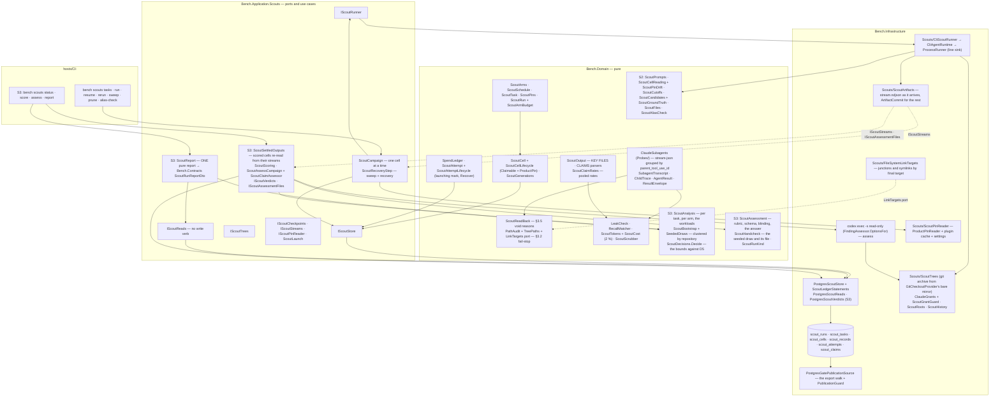

# Module — Scouts: does a Sonnet team find what an Opus team finds, how fast, at what price

> Status: **E1 built, 2026-10-12 — S1, S2 and S3: the context end to end offline; nothing paid has run.**
> S1: the domain, the stream reader, the read-back with its path audit, the pure deciders, the store with its spend ledger, the four live
> fixtures. S2: the two launcher options and the streaming output sink, the history-free trees and their grant guard, `CliScoutRunner`,
> `ScoutCampaign` with the entry step's recovery, and the verbs `tasks`, `run`, `resume`, `rerun`, `sweep`, `prune`, `alias-check` —
> exercised only against `tests/FakeCli`. S3: the analysis (claim pooling, the not-measured rule, the clustered bootstrap, `Decide()`),
> the run's KIND (preliminary / decision), the assessor and the hand-check draw, the verbs `status`, `score`, `assess`, `report`, the scenario
> test and [module_tests.md](module_tests.md). The read API and the Scouts tab moved to E3 S8 (plan decision D8). The design record is
> [PLAN_scout_model_calibration.md](../todo/PLAN_scout_model_calibration.md) (still open in `todo/`: E2 and E3). This file describes what is
> built; a sentence here about something that does not run is a bug in the file.

## Purpose

The shared rule puts every subagent on Opus. The operator wants the read-only **scouts** — code explorers, Explore, lookup agents —
on Sonnet, launched ⌈1.5·N⌉ where N Opus scouts would run, and chose to MEASURE first (plan §1, decisions D1–D6). This section
measures, per team size W1/W2/W3, the share of the files that mattered each team found (recall), its wrong claims per 10, its time
and its cost. It is shaped like the gate and the probes: its own context, store tables and verbs — and, in E3 S8, a read API and a tab.

Three things the module exists to make impossible:

- **a cell scored on a team that did something else** — another model, another prompt, a web call, a call by the main session —
  which is why every cell is read back (§3.5), not a sample;
- **a broken boundary measured as recall** — a child reading the future from a directory the user settings grant — which is why the
  path audit STOPS the campaign instead of voiding the cell (§3.2);
- **money that a crash makes disappear** — which is why every attempt carries its own reservation, the launch boundary is durable,
  and doubt is charged (§3.10).

## The measurement tuple

```
task        = id, PUBLIC repo, P, S, kind, statement, G, removals, tree hash          ScoutTask (frozen; leak-checked)
arm         = A1 B1 A2 B2 A3 B3 C3 + A3-explore B3-explore                             ScoutArms (the one table)
repeat      = 1..n, repeats OUTERMOST                                                  ScoutSchedule
slot/pos    = one block per (repeat, task); arms in a seeded permutation inside it      ScoutSchedule (StableHash, not Random)
generation  = 1, then max + 1 per re-run — appended, never reset                       ScoutCellLifecycle.NextGeneration
attempt     = the claim's attempt number, each with its own reservation row             ScoutAttempt
pins        = CLI version, plugin cache hash, resolved opus/sonnet ids, settings hash   ScoutPins (frozen on the run)
build       = ProductPin of the CLI binary, read at CLAIM time                          ScoutCell.Pin
```

## Diagram



## Core entities, and the rule each one carries

| entity | file | the rule |
|---|---|---|
| `ScoutArm` · `ScoutArms` · `ScoutWorkload` · `ScoutModel` · `ScoutAgent` · `ScoutFocus` | `src/Bench.Domain/Scouts/ScoutArm.cs` | The one arm table: A = Opus N, B = Sonnet ⌈1.5·N⌉, C3 = Sonnet 3, and the W3 Explore replication (A3-explore, B3-explore). Focus areas F1..F5, a team of N takes the first N. The model is an ALIAS here; the id behind it is a pin |
| `ScoutRepository` (S3, D10) | `ScoutRepository.cs` | What a task's repository may be: an `owner/name` slug (cloned through the trees' url template, `https://github.com/{0}.git`) or a repository url used AS IT IS — https://, ssh://, git@, file:// — which is how a private repository is mirrored read-only from the operator's local clone (`file:////wsl.localhost/Ubuntu/home/<user>/git/<repo>`). Anything else is refused naming the value and the legal forms. Read by `ScoutTask.Frozen` and by `ScoutTreeSettings.UrlOf`, so the two cannot disagree. Anonymising a private task's committed records (D10) is E2's |
| `ScoutTask` · `ScoutTaskId` · `LeakCheck` | `ScoutTask.cs`, `LeakCheck.cs` | `Frozen` is the only door: a repository `ScoutRepository` accepts (S1 accepted only a public slug; D10 widened it), ≤ 3 sentences, a non-empty G of repository-relative paths, a SHA-256 tree hash — and the leak check: a ground-truth basename (substring), a stem or an identifier the diff added (whole word, ignoring case) refuses the statement naming the token; tokens shorter than 3 are not checked |
| `ScoutPins` | `ScoutPins.cs` | CLI version, plugin cache hash, resolved opus and sonnet ids, settings hash — frozen on the run; `Continue` refuses naming every pin that moved, both values |
| `ScoutRun` · `ScoutRunProgress` | `ScoutRun.cs` | No status column (open/finished read off the cells); seed, repeats, arms, task order, and the `SpendLedger` on the run row |
| `ScoutSchedule` · `ScheduledCell` | `ScoutSchedule.cs` | Repeats outermost, tasks in a seeded order, the arms of each task in a seeded permutation of their own (a slot = one task in one repeat); the Explore arms only on the named replication tasks. Ordered by `StableHash` of the seed and the cell's identity — reproducible on any machine and runtime, which `Random`'s sequence is not documented to be |
| `ScoutCell` · `ScoutCellLifecycle` · `ScoutGenerations` · `ScoutSettlement` · `ScoutCellFacts` | `ScoutCell.cs` | Composes `Claimable` + `ProductPin` exactly as `ProbeCell`; outcome `Scored` / `Void` / `Stopped` / `Aborted` must agree with its reason; a void cell re-runs as generation max + 1; the report reads the highest SETTLED generation. Facts are captured-or-not, never a zero for "absent" |
| `ScoutReason` · `ScoutReasons` | `ScoutReason.cs` | The ONE allow-listed "why" a row carries (stored by name): 11 void reasons, 5 stop reasons, `SpendLimit`, `Abandoned`. No sentence reaches the database |
| `ClaudeSubagents` · `SubagentTranscript` (+ `TokenUsage`, `ChildTrace`, `AgentResult`, `ResultEnvelope`, …) | `src/Bench.Domain/Probes/ClaudeSubagents.cs`, `SubagentTranscript.cs` | Beside `ClaudeStream`, through the same `ProbeJson`. Per Agent call: `subagent_type`, `model`, the prompt and its SHA-256, the call's timestamp; the result's `resolvedModel`, `totalDurationMs`, status, final-iteration usage and report text (a STRING result — a failed call — reads as an error with every field absent); the child's `message.model`s, its usage summed DEDUPLICATED by message id (the last event of an id wins), its tool calls with their fate (`Denied` / `Errored` / `Returned` / `NotCaptured`) and result text. The envelope: `duration_ms`, `total_cost_usd` (decimal), the main session's `usage`, `modelUsage`, `subagent_stats`. Team time = first Agent `tool_use` → last Agent `tool_result` |
| `ScoutOutput` · `ScoutKeyFiles` · `ScoutClaims` · `ScoutClaimRates` | `ScoutOutput.cs`, `ScoutClaimRates.cs` | Blocks found by header (markdown decoration stripped); bullets and backticks stripped; the first 10 lines read, the rest counted as `Extra`; a line that is not one path (KEY FILES) or not `path[:line] — statement` (CLAIMS; em dash, en dash or spaced hyphen) counted `Unparseable`; no CLAIMS block = `Silent`; a cited line outside 1..1 000 000 is unparseable. Rates are POOLED (Σ wrong ÷ Σ assessed × 10) and absent when nothing was assessed |
| `ScoutReadBack` · `ReadBackExpectation` · `ReadBackVerdict` | `ScoutReadBack.cs` | Exactly N calls; each `input.model` = the arm's alias, `subagent_type` = the arm's agent, the prompts = the frozen ones as a MULTISET of SHA-256s; every result present and not an error; every child's `resolvedModel` present and = the arm's resolved id, every `message.model` too; child tools only Read/Glob/Grep/LS; the main session calls only `Agent`; `subagent_stats.completed = N`. A stop outranks a void |
| `PathAudit` · `TreePaths` · `LinkTargets` | `PathAudit.cs`, `TreePaths.cs` | Each child Read/Glob/Grep/LS target resolved against the session's cwd (an omitted Grep/Glob root = the cwd; a glob judged by its non-wildcard head; an absolute pattern stands alone; `..` folded, one above the drive = unresolvable = outside), then through the `LinkTargets` port (junction/symlink → final target; the ROOT too). Inside: fine — but an inside Glob whose listing resolves outside is `ListedOutside` (STOP). Outside: denied or errored → recorded; an explicitly empty success ("No files found" / "No matches found") → recorded apart from a denial; any other content → STOP; no result → STOP (never a safe read). Pure: own path arithmetic, not `Path.GetFullPath`, so a Windows stream reads the same on a Linux runner |
| `RecallMatcher` | `RecallMatcher.cs` | Normalises an entry (backticks, `:42`, `:42-50`, `#L42`, `\`, `./`, the tree's absolute root) and resolves it against the tree's file list: exact (ignoring case), else a UNIQUE whole-segment suffix (a bare basename included); an ambiguous suffix matches nothing; without the file list only an exact path can match |
| `ScoutTokens` · `ScoutCost` · `PriceTable` · `ModelPrice` · `CostCheck` | `ScoutCost.cs` | See *Tokens, as measured* below. Cost = tokens × the price table per exact model id (input, output, cache read, cache write 5 m / 1 h); the check compares main + scout teams + internal calls with `total_cost_usd`: within 2 % `Agrees`, else `Disagrees` (a STOP, `CostMismatch`), no reported cost `Unchecked` |
| `SpendLedger` · `ScoutAttempt` · `ScoutAttemptLifecycle` · `ScoutRecovery` · `ScoutReservation` | `SpendLedger.cs`, `ScoutAttempt.cs` | See *The ledger* below |
| `ScoutScrubber` · `ScrubDenyList` | `ScoutScrubber.cs` | Composes the gate's `FailureRedaction` (urls, machine paths, private names, hosts) and adds e-mail addresses; the deny-list is read at run time from a local file (never committed); a file that is NAMED (`--deny-list` or `BENCH_SCOUT_DENYLIST`) and does not load refuses the verb (4) — a silently empty list would publish the names it exists to hide. `Leftovers` is the hygiene check a committed record or fixture is held to: a home path (`\Users\x`, `/home/x`, `AppData`), an e-mail, a deny-list entry — named by rule, never by value |
| `ScoutRecord` | `ScoutRecord.cs` | The per-scout row: ordinal, focus, asked and resolved model, prompt hash, duration, tokens (`OutputSeparable`), cost, KEY FILES (repository-relative), claim counts — never text |
| `IScoutStore` · `IScoutReads` · `IScoutRunner` · `IScoutTrees` · `ScoutTree` · `ScoutAttemptResult` | `src/Bench.Application/Scouts/ScoutPorts.cs` | The ports. `IScoutReads` has no write verb (an architecture assertion). S2 widened them: `ScoutAttemptResult.Stopped` (a stop BEFORE the launch — a changed tree), `IScoutTrees.BuildAsync` (what `tasks` freezes the hash from), `ScoutTreeRefusal.HashChanged`, `IScoutCheckpoints` + `ScoutCheckpoint`, `IScoutStreams` (recovery's read of a stream), `IScoutPinReader` + `ScoutLocalPins` |
| `ScoutArmBudget` · `ScoutArmBudgets` (S2) | `ScoutArmBudget.cs` | Each arm's `--max-budget-usd` cap and wall, FROZEN on the run (`ScoutRun.Budgets`, stored as two arrays parallel to `Arms`); a cell is never launched under a default cap (`BudgetOf` refuses). The reservation is the cap × 1.2. The CLI's `--cap-usd` for every arm, `--arm-caps A1=1.5,..` per arm, `--cell-timeout-minutes 20` (or `--cell-timeout-seconds`) as the wall |
| `ScoutPrompts` · `ScoutCellPrompts` (S2) | `ScoutPrompts.cs` | The frozen prompts, a pure function of the statement, the focus area and the arm (version `scout-prompts-v1`): one focus prompt per scout (statement, F1..F5, the KEY FILES / CLAIMS contract) and the DRIVER (launch exactly N Agent calls in one message, the arm's agent type and model alias, each prompt verbatim between markers, read nothing, reply DONE). The read-back compares the calls with their SHA-256s |
| `ScoutCellReading` · `ScoutCellContext` · `ScoutCellVerdict` · `ScoutPinDrift` (S2) | `ScoutCellReading.cs` | A stream read into a settlement, in precedence order: the path audit's STOP; a moved alias (the main session's `init.model` ≠ the run's opus id, or a child's `resolvedModel` ≠ the run's id for the alias its call named) → STOP `PinMoved`; aborted:spend (a quota marker on stderr or in the result's text, a `result` subtype naming the budget, a subagent refused for budget); the cost check — a gap over 2 % OR tokens that cannot be priced → STOP `CostMismatch`; the read-back's voids; else scored. Only a scored cell carries recall (the union of its scouts' KEY FILES against G through the matcher). One `ScoutRecord` per call whose prompt is a frozen one |
| `ScoutCutoffs` · `ModelCutoff` (S2) | `ScoutCutoffs.cs` | `cutoffs.json`: per resolved id, the published cut-off, its https source, the date read. `LaterOf(opus, sonnet)` refuses an id that is missing, listed twice (ambiguous) or listed with no cut-off (unpublished) — the selection stops, nothing is guessed |
| `ScoutCandidates` · `ScoutCandidate` · `ScoutCandidateFacts` · `ScoutGroundTruth` (S2) | `ScoutCandidates.cs` | Admission: P's commit date strictly AFTER the later cut-off, never a pilot task, 3–15 files of G, not docs-only — every exclusion with its reason. The draw: per repository, `StableHash(seed, id)` order, the first k. G = the changed files that existed at P (read with their modes from `git ls-tree -r P`) minus submodule GITLINKS (mode 160000 — not a tree file a scout can name; S3, §3.1 as amended 2026-10-12), lockfiles, generated files, changelogs, version manifests, `PLAN_*`/`RESULTS_*` documents and the PR's own plan. An ADDED identifier = an identifier on the diff's `+` lines that occurs nowhere in the tree at P |
| `ScoutFiles` (S2) | `ScoutFiles.cs` | The operator files, read and written in one place: candidates, `tasks.json` (each task with its added identifiers, so the leak check runs again on the way in), the price table (`--prices`: source, date read, per-model USD per Mtok) |
| `ScoutAliasCheck` · `AliasVerdict` (S2) | `ScoutAliasCheck.cs` | §3.14: the tiny two-scout driver (one `sonnet`, one `opus` code explorer listing a one-file directory, $1 cap) and the comparison: `Same`, `Moved` (alias, recorded id, new id), `NotMeasured` (a scout with no `resolvedModel`) |
| `ScoutRunKind` (S3) | `ScoutRunKind.cs` | D7: `Preliminary` or `Decision`, FROZEN on the run (`scout_runs.Kind`). `bench scouts run --kind`, PRELIMINARY by default — a run can never claim a verdict it was not planned to give |
| `ScoutCellFacts.TeamTokens` · `TeamUsd` · `CapturedTokens` (S3) | `ScoutCell.cs` | The scout TEAM's tokens (each team's exact output, the main session and internal calls excluded) and their cost (`CellCost.ScoutsUsd`), computed at settlement; not captured when the stream cannot be attributed or priced — never a zero |
| `ScoutCallReport` · `ScoutCellReading.Reports` (S3) | `ScoutCellReading.cs` | Each scout's report by ordinal, the frozen prompts matched once each — extracted from the record builder so `score`, `assess` and the hand-check read the SAME scout as the same ordinal the records do |
| `ScoutClaimVerdict` · `ScoutClaimKey` · `ScoutAssessedClaim` (S3) | `ScoutClaimVerdicts.cs` | Wrong / right / unresolved, keyed by (cell, scout ordinal, place among its parseable claims). The tally is wrong ÷ DECIDED — unresolved stays out of the denominator, so an assessor that cannot decide never dilutes a team's wrong claims |
| `ScoutAssessment` · `ScoutBlindClaim` · `ScoutClaimToAssess` (S3) | `ScoutAssessment.cs` | §3.7's OWN rubric (`scout-assess-v1`, its SHA-256 on every verdict) and schema; a cell's claims read off its stream; fresh shuffled blinded ids (`BlindedId.Mint`); batches of 24; an answer read strictly (an id unknown, named twice or answered with another word stays unassessed); what is stored — the statement's hash and a repository-relative path, never the text |
| `ScoutHandcheck` · `HandcheckPair` · `HandcheckClaim` (S3) | `ScoutHandcheck.cs` | §3.7/D9: each (output, G file) pair read by the matcher over the tree; a draw of N found + N not-found pairs + N claim verdicts ordered by `StableHash(seed, item)`; a Markdown file with one `agree` / `disagree` box pair and a note line per item, naming no arm |
| `ScoutAnalysis` · `ScoutCellEvidence` · `ScoutTaskArm` · `ScoutArmSummary` (S3) | `ScoutAnalysis.cs` | §3.6 — see *The analysis* below |
| `ScoutBootstrap` · `TaskDelta` · `ScoutInterval` · `BootstrapSettings` · `SeededDraws` (S3) | `ScoutBootstrap.cs`, `src/Bench.Domain/SeededDraws.cs` | §3.8 — see *The decision* below |
| `ScoutDecisions` · `ScoutWorkloadReading` · `ScoutDecision` (S3) | `ScoutDecisions.cs` | `Decide()` — see *The decision* below |

## Tokens, as measured (a deviation from the plan's assumption)

The plan (§2, §3.6) assumed per-scout tokens are the child's messages' usage deduplicated by message id. Measured on the live
fixture, that is exact for **input and cache tokens** — the Sonnet child alone equals `modelUsage[sonnet]` and the Opus child plus
the main session equal `modelUsage[opus]`, to the token — and **wrong for output tokens**: every assistant event of a message that
called a tool carries the usage as of the message's START, so its `output_tokens` is a placeholder (Sonnet child: 16 + 22 streamed,
118 billed; Opus child: 35 streamed, 1 442 billed). The exact sources are the envelope's: `modelUsage` per model and `usage` for
the main session alone. So `ScoutTokens.Attribute`:

- a TEAM's output on model m = `modelUsage[m].output` − (the main session's output when it is on m too) — exact;
- one scout's output is exact only when it is the only scout on its model (`OutputSeparable`); two scouts on one model share a
  total the stream cannot split, and their per-scout cost is *not captured*, never guessed;
- a model in `modelUsage` that is neither the main session's nor a scout's (the CLI's own Haiku call in every probe) is priced as
  "internal", with its cache creation at the 5-minute rate (the split is not printed per model).

`ClaudeSubagentsTests.Streamed_output_tokens_are_placeholders_and_the_team_output_comes_from_the_envelope` pins this. Recall and
wrong claims (the deciding metrics) are unaffected; per-scout cost and tokens (reported, D6) are exact per team, per scout only when
separable.

## The ledger (§3.10)

Carried on `scout_runs` as `CeilingUsd`, `ReservedUsd`, `SettledUsd`, `UnknownUsd` (`numeric(18,6)`), moved only by guarded
updates in `ScoutLedgerStatements`, each in one transaction with the attempt row it concerns:

| step | statement | refused when |
|---|---|---|
| reserve | the cell must be Claimed by this owner; `UPDATE scout_runs SET Reserved += x WHERE Reserved + Settled + Unknown + x ≤ Ceiling`; insert the attempt (unique per cell + claim attempt) | the reservation does not fit → `ScoutReservation.DoesNotFit(free, asked)`, a VALUE (S2's exit 3); a stranger or a second reservation for the same attempt → `Refused`, the ledger move rolled back |
| mark launching | `UPDATE scout_attempts SET State = Launching WHERE State = Reserved` — BEFORE the CLI is invoked | not Reserved |
| settle | `… WHERE State = Launching` → Settled, then Reserved −= r, Settled += actual | not Launching (so exactly once) |
| charge unknown | `… WHERE State = Launching` → ChargedUnknown, then Reserved −= r, Unknown += r — the WHOLE reservation, never released after | not Launching |
| release | `… WHERE State = Reserved` → Released, then Reserved −= r | anything else — a launching mark means it may have spent |

A reservation is the cap plus 20 % (`SpendLedger.ReservationFor`). Postgres re-evaluates the reserve's WHERE on the row a concurrent
writer just committed, so two reservations cannot both fit one headroom (tested with two racing stores). Recovery's decision per
attempt is pure (`ScoutAttemptLifecycle.Recover`): no launching mark → release; launching with a surviving `result` → settle from its
`total_cost_usd`; launching without → charge unknown; terminal → untouched. The ledger identity is `SpentUsd = Σ settled + Σ unknown`.
The sweep moves no money: it hands a dead owner's cell back (owner-checked, three attempts abandon), and the open attempt of that
cell is recovery's (S2).

## The store — six tables, one migration, no existing table touched

`20261012140639_ScoutTables`: `scout_runs` (pins, seed, repeats, arms and task ids as `text[]`, the ledger), `scout_tasks` (one row
per run × task; unique (run, task)), `scout_cells` (lineage, generation, slot, position, the claim, the CLI pin, outcome, reason, the
captured facts; unique (run, task, arm, repeat, generation); indexed for the claim in schedule order and for the sweep),
`scout_records` (one per scout of a settled cell; unique (cell, ordinal)), `scout_attempts` (reservation, state, settled cost;
unique (cell, number)). The claim is the probe store's guarded UPDATE (one cell at a time, in schedule order), the sweep its
owner-checked one, a re-run an append guarded by the unique index. Every enum is stored by name. S2 added two columns to `scout_runs`
in the SAME migration (regenerated under its original id, as the plan's "one migration per context" asks): `ArmCapsUsd numeric[]` and
`ArmWallSeconds integer[]`, parallel to `Arms` — the frozen budgets. **S3** regenerated it again under the same id (`dotnet ef migrations
add` over the pre-scout snapshot, renamed back; the diff against S2's is purely additive): `scout_runs.Kind` (the run kind, by name), the
team's tokens and cost on `scout_cells` (`TeamTokensCaptured`, `TeamInputTokens` … `TeamCacheWrite1hTokens`, `TeamUsdCaptured`, `TeamUsd`), and
a sixth table, **`scout_claims`** — one row per assessed claim: (cell, ordinal, index) UNIQUE, the repository-relative path, the cited line,
the statement's SHA-256, the verdict by name, the assessor's model, the rubric's SHA-256, when. The unique index is what makes `assess`
idempotent under a race: `PostgresScoutVerdicts.StoreVerdictsAsync` skips a claim that has a verdict, and a unique violation between its read
and its write is read again, never an overwrite. Recall is rescored only on a settled, SCORED cell (a guarded UPDATE).

**Publication.** The five tables joined the gate's publication walk (`PostgresGatePublicationSource.ScoutEntities`), so
`bench gate export --public` carries them under the same `PublicationGuard`; the claim owner never reaches a public row.
`ScoutEntitiesGuardTests` holds every text column to a `Type.Property` allow-list; the ONE sentence stored by design is the task
statement (committed to `tasks.json` anyway, leak-checked). A path planted in a scout row is refused naming table, column and row
(`ScoutPublicationTests`).

## One cell, end to end (S2)

The campaign (`ScoutCampaign`, `src/Bench.Application/Scouts/ScoutCampaign.cs`) runs ONE cell at a time in schedule order. Per step:

1. **Pins before the claim** (§3.4): `ScoutPinReader` reads the CLI binary's `ProductPin` (its version text's first token is the CLI-version
   pin), the plugin cache hash (SHA-256 over every file's path and bytes under `~/.claude/plugins/cache/claude-plugins-official/feature-dev`,
   `--plugin-cache`) and the settings hash (`~/.claude/settings.json`, `--claude-settings`); `ScoutPins.Continue` against the frozen pins —
   a move stops the run, nothing claimed. The resolved model ids cannot be read before a claim without a paid call, so they are checked on
   every cell AFTER it ran, off its own stream (`ScoutPinDrift`).
2. **Claim** the next pending cell under the binary's pin; **reserve** its arm's cap × 1.2 against the ceiling — one that does not fit stops
   the run (exit 3) naming what was free and what was asked; nothing is launched.
3. **The runner** (`CliScoutRunner`, `src/Bench.Infrastructure/Scouts/`): prepares the tree (a tree that no longer hashes to its frozen
   hash → `Stopped(PinMoved)`: the reservation released, the cell settled stopped, the run stopped), the empty MCP config, the prompts and
   an argv the CLI has flags for; opens the attempt's stream file; marks the attempt **launching** (durable, BEFORE the CLI starts);
   launches; writes every stdout line to `stream.ndjson` and flushes it the moment it is read; commits stderr, `argv.json` (argv + the
   child environment's NAMES), the prompt and the stream's seal (`stream.sha256`) — a refused commit THROWS, and the next entry settles
   the money from the stream; reads the stream (`ScoutCellReading`).
4. **Settle**: the attempt's money first — `total_cost_usd` when the result reached the stream, else an unknown charge of the WHOLE
   reservation; released only when nothing launched — then the cell with its per-scout records. A STOPPED or ABORTED cell stops the
   campaign (exit 3).

### The launch (§3.4)

```
claude -p --model opus --output-format stream-json --verbose --tools Task Read Glob Grep --strict-mcp-config
       --mcp-config <artefact root>/scouts/empty-mcp.json --forward-subagent-text --max-budget-usd <arm cap>
       --no-session-persistence            (driver on stdin, cwd = the task's tree, the probes' minimal environment)
```

Spelled once by `ScoutLaunch.Options` (`src/Bench.Application/Scouts/ScoutLaunch.cs`) over four options S2 added to `AgentAskOptions`:
`ForwardSubagentText`, `MaxBudgetUsd` (invariant culture; a negative cap refused), `McpConfigFile`, `NoSessionPersistence` — claude
only; `CliArgv.For` refuses each BY NAME for codex, agy and gemini. Never `--restricted` (it removes the plugin agent under test). The
child environment is `ProbeChildEnvironment`'s allow-list and nothing more in production; a TEST adds `FAKE_CLI_HOME` through
`CliScoutSettings.TestChildVariables`.

**The line sink.** `ProcessRunner.RunAsync(…, stdoutLine, …)` (and `AgentAsk.Output` through `ICliAgentTranscripts`) hands each stdout
line to a sink AS IT ARRIVES and still returns the whole stdout; the wall and the whole-tree kill on timeout and on external
cancellation are unchanged; a sink that THROWS kills the child and its exception reaches the caller. A streamed launch reads and writes
its pipes as UTF-8 regardless of the console's code page — the stream carries the frozen prompts back, and the OEM code page decoded
`—` as `ΓÇö` (found red by `ScoutLaunchProcessTests`). The buffered launch keeps the platform default every earlier caller was measured
under.

### The trees and the grant guard (§3.2, §3.11, §3.13)

`ScoutTrees` builds `<trees root>/<task id>`: `git archive --format=zip P` from the bare mirror `GitCheckoutProvider.EnsureMirrorAsync`
keeps (widened: the mirror alone, no worktree), extracted in a staging folder (a ZIP, so a symlink lands as a plain file; with
`-c core.autocrlf=false -c core.eol=lf` on the invocation, because a ZIP archive otherwise applies the machine's autocrlf — found red by
the submodule test); each submodule
archived at the sha P pins, from its own mirror (url from P's `.gitmodules`); the PR's own plan removed and recorded; `git init` + ONE
commit with author, committer and date fixed through the environment (`--no-verify`, per-invocation `-c` flags only — no git config is
written); then renamed into place, and a marker written under `<trees root>/.scout-trees/`. The **tree hash** is SHA-256 over every
file's path and its bytes' SHA-256 (`.git` excluded) — stable on any machine, and so is the commit. A tree found again is re-checked (one
commit, no other ref, its own settings granting nothing outside it) and re-hashed before every cell.

The **grant guard** (`ClaudeGrants` + `ScoutGrantGuard`, run by `ScoutRoots.CheckAsync` before any verb that builds or launches): the
trees root and the mirror root must not overlap any directory the Claude user settings grant (`permissions.additionalDirectories`,
`~` and relative paths resolved as from a tree — `..` IS the trees root) — exit 4 naming both paths; a tree whose OWN project settings
grant a directory outside it is refused. The trees root defaults to `<checkout root>/scout-trees`, outside every repository; one inside a
checkout must be git-ignored there and nothing under it tracked (`ScoutRoots.IgnoredAsync` / `TrackedAsync`); this repository's
`.gitignore` carries `scout-trees/`, and `ScoutTreesTests` holds it to that.

### The checkpoints and recovery (§3.10)

`IScoutCheckpoints` is passed, in order, at: `BeforeLaunchingMark` · `AfterLaunchingMark` · `AfterFirstOutputLine` · `AfterResultLine` ·
`AfterArtifactCommit` (the runner) · `BeforeSettlement` (the campaign). Production passes nothing there; a test throws to play a crash.
The **entry step** (`ScoutRecoveryStep`, run by every claiming verb and by `sweep`): the owner-checked sweep, then every attempt still
Reserved or Launching whose cell no LIVE owner holds at that attempt number is decided by `ScoutAttemptLifecycle.Recover` with the cost
of the `result` that survived in its stream on disk (`ScoutArtifacts.SurvivingCost`) and moved by the store's guarded UPDATE — so it
settles exactly once, whoever recovers it. Measured by `ScoutsCrashTests`, one crash per boundary:

| crash at | the attempt becomes |
|---|---|
| before the launching mark | released — it provably never started |
| after the mark (the CLI never invoked) · after the first line | charged its whole reservation as unknown cost, never released after |
| after the result line · after the artefact commit · before settlement | settled once, from the stream's `total_cost_usd` |

### The verbs and their exit codes

| verb | what it does |
|---|---|
| `bench scouts tasks --candidates … --cutoffs … --opus-id … --sonnet-id … --out tasks.json [--pilot a,b] [--seed] [--per-repository]` | the cut-offs first (4 on a missing, unpublished or ambiguous id), each candidate read off its mirror (P's date, G) — serially, each announced as it starts (`reading [i/n] <id> …`), admitted after the later cut-off and never a pilot task, a seeded draw, each drawn tree BUILT and its hash frozen, every statement leak-checked — any leak refuses the whole selection (4) with nothing written |
| `bench scouts run --tasks-file … --opus-id … --sonnet-id … --ceiling-usd … --cap-usd … --prices … [--arms] [--arm-caps] [--repeats] [--seed] [--replication-tasks]` | every tree prepared and re-hashed, the local pins read and frozen with the two ids, the run and its seeded schedule planned in one transaction, then the entry step and the campaign |
| `bench scouts resume --run <id> --prices …` | the entry step, then exactly the cells not settled, under the run's frozen pins and budgets |
| `bench scouts rerun --cell <id> --prices …` | the next generation of that lineage, measured alone (refused while any cell of the run is open) |
| `bench scouts sweep [--run <id>]` | the entry step alone, over one run or every run; prints the ledger identity |
| `bench scouts prune --run <id>` | the trees of the run's tasks this builder made (marker, path under the root, no link followed); refused while a cell is open; the artefacts are kept |
| `bench scouts alias-check --opus-id … --sonnet-id …` | one tiny paid cell launched as a scout cell is; 0 the same ids, 3 an alias moved (the new id named), 5 nothing measured. The weekly scheduled task is registered only once a verdict exists (E3) |
| `bench scouts status --run <id>` (S3) | every cell, every generation, by state and outcome; the outcomes of each lineage's latest settled generation; the ledger — reserved, settled, unknown (with the count of charges), spent, the ceiling LEFT, the attempts. Claims nothing |
| `bench scouts score --run <id> [--handcheck N --seed S] [--out file] [--deny-list file]` (S3) | recall of every scored cell recomputed from its stream and stored (`ScoutScoring`); with `--handcheck`, the draw written as Markdown (default `scouts/<run>/handcheck-seed<S>.md` under the artefact root), scrubbed (§3.13) before it is written. A deny-list named by `--deny-list` or `BENCH_SCOUT_DENYLIST` MUST load: a missing or unreadable path refuses the verb before anything is scored or written, the refusal naming the path and where it came from. 0 · 3 a stream or tree unreadable · 4 a flag, an unknown run, a named deny-list that does not load · 5 no scored cell |
| `bench scouts assess --run <id> --assessor-model <id> [--codex-exe path] [--assess-timeout-minutes 10]` (S3) | PAID — see *The assessor*. 0 every claim has a verdict · 3 claims remain (re-run asks exactly those) · 5 no claim to assess |
| `bench scouts report --run <id> [--json] [--bootstrap-seed 20261012] [--resamples 10000]` (S3) | `ScoutReport` as JSON (web defaults, byte-deterministic) or text; a PRELIMINARY run prints "preliminary — not a verdict" and its intervals |

Exit codes, as the probes': **0** cells produced · **3** resumable — a pin moved, the next reservation does not fit, a cell stopped the
campaign, a spend limit, the environment · **4** configuration — flags, files, roots, the grant guard, an unknown run · **5** nothing
produced. Every measuring verb takes `--db`/`BENCH_DB`, `--artifact-root`/`BENCH_ARTIFACT_ROOT` (outside git), `--trees-root`,
`--checkout-root`, `--claude-exe` (default `claude` on PATH), `--plugin-cache`, `--claude-settings`, `--repo-url-template`
(default `https://github.com/{0}.git`).

## The analysis (§3.6, S3)

`ScoutAnalysis.Of` is pure: in, the highest SETTLED generation of every lineage (`ScoutCellEvidence`: the cell, its task's repository, its
scouts' records, its claims' verdicts); out, one row per (task, arm), one summary per arm, and the paired readings of W1–W3. Only SCORED
cells carry numbers; void, stopped and aborted cells are counted.

| quantity | rule |
|---|---|
| recall | per cell found ÷ \|G\|; per (task, arm) the MEAN over its runs; per arm the mean over its tasks |
| wrong claims per 10 | per (task, arm) POOLED over its runs — Σ wrong ÷ Σ decided × 10 (`ScoutClaimRates.Pooled`), so a run with one claim weighs less than a run with ten; per arm the mean over its tasks that have a rate. Decided = wrong + right; *unresolved* is counted and left out |
| *not measured* | an arm's wrong-claim result is `not-measured` (`Figure.Withheld` on the domain side, `not-measured` on the wire) when MORE than 10 % of its scored cells are silent, or while any claim of its scored cells has no verdict yet (`claims-unassessed`); the workload then cannot pass |
| silent cell | a scored cell whose team has NO decided claim — every scout without a CLAIMS block, every claim unparseable, unresolved or not yet assessed. It still counts for recall |
| team time | the cell's `TeamMs` (first Agent `tool_use` → last Agent `tool_result`); the cross-check counts cells whose team time is SHORTER than their slowest scout's `totalDurationMs`, which the timestamps make impossible |
| scout · session time | every scout's `totalDurationMs`; the envelope's `duration_ms` |
| tokens | the team's per scored cell (exact); one scout's input and cache (exact), its output only where it was the one scout on its model |
| cost | team $ per scored cell (`TeamUsd`), session $ (`total_cost_usd`), $ per right file = Σ team $ ÷ Σ files of G found |
| caller load | the size of the union of the team's KEY FILES, case-insensitive |

The deciding pair of a workload is A (Opus N) against B (Sonnet ⌈1.5·N⌉); C3 and the Explore replication are summarised and never decided.
Δ = B − A per task, over the tasks where BOTH arms have the value, each delta tagged with its task's repository.

## The decision (§3.8, S3)

`ScoutBootstrap.Of` resamples whole REPOSITORIES with replacement (as many draws as there are repositories; every task of a drawn
repository joins the resample) and takes the mean over the tasks drawn — paired by construction, since each task carries its own B − A.
10 000 resamples and the fixed seed 20261012 by default; the bounds are the linearly interpolated 5th (lower) and 95th (upper) percentiles,
one-sided 95 %. The draws are `SeededDraws` (SplitMix64, pinned to its published first outputs in a test), never `Random`, and clusters and
tasks are taken in ordinal order — the same input gives the same interval to the last bit, which is what makes `report --json`
byte-deterministic. **Fewer than two repositories** collapse the interval onto the point; the reading says so (`one-repository`) instead of
calling a point estimate a bound.

`ScoutDecisions.Decide(readings, kind)` holds D5's margins as constants (−0.03, +0.5) and reads only the BOUNDS:

| reading of one workload | outcome |
|---|---|
| lower Δrecall ≥ −0.03 and upper Δwrong ≤ +0.5, both measured, both estimable | `pass` |
| even the upper Δrecall < −0.03, or even the lower Δwrong > +0.5 | `fail` (`recall-below-margin`, `wrong-above-margin`) |
| an interval straddling its margin | `not-shown` (`recall-crosses-margin`, `wrong-crosses-margin`) |
| no paired task · one repository · wrong claims not measured | `not-shown` (`no-paired-task`, `one-repository`, `wrong-not-measured`) |
| the run measured no pair of this workload | `not-shown` (`workload-missing`) |

The verdict is `rule-change-shown` only on a DECISION run whose W1, W2 and W3 all pass; otherwise `not-shown`. A **PRELIMINARY** run's verdict
is `preliminary` ("preliminary — not a verdict" in text), every workload's outcome is `preliminary`, and only the reasons that say a half
was not MEASURED are kept — where its intervals sit against the margins is for the reader of the intervals, not a reading the run states.

## The assessor (§3.7, S3)

`bench scouts assess` reads every scored cell's stream again (`ScoutSettledOutputs`: the cell's claim attempt — its attempt number is the
cell's attempt count), parses each scout's CLAIMS (`ScoutAssessment.ClaimsOf`, the scouts matched to their ordinals as at settlement), and
subtracts the claims that already have a verdict. Per task, the remaining claims of ALL its arms and repeats are blinded together — fresh
eight-hex ids, shuffled — and put to codex in batches of 24: `codex exec -s read-only --output-schema … -o … -m <assessor-model>` with every
MCP server off (`FindingAssessor.OptionsFor`, reused, not copied), the working directory the task's history-free TREE, the prompt this
context's own rubric (the four §3.7 wrong-rules, `unresolved` only for a claim too vague to check). Each batch's folder
(`scouts/<run>/assess/<batch>/`, never inside a tree) holds the prompt, the schema, the answer and — written only AFTER the answer is read —
the blinding key. The verdicts of a batch are stored the moment it answers (a paid unit is saved as it is earned); a failed batch is recorded
and skipped, and three failures in a row stop the pass. The pass's tally (asked, stored, failed, failures in a row, problems) is an immutable
record: each task and each batch returns the next one. The open claims are grouped by task once, and each task reads its own group. A re-run
asks exactly the claims still without a verdict. E1 exercises it only
against `tests/FakeCli` playing a codex that answers recorded verdicts keyed by what a row says (`assessVerdicts`, `assessSkip`); the first
real call is E2 S4's.

## The hand-check (§3.7, D9, S3)

`bench scouts score --handcheck N --seed S` pools every (output, G file) pair of every scored cell — the team's KEY FILES as WRITTEN beside one
file of G, and whether the matcher found it over the tree — and every assessed claim with its verdict, and draws N found pairs, N not-found
pairs and N verdicts, each pool ordered by `StableHash(seed, item)`: the same seed over the same run draws the same items on any machine. The
Markdown file states the thresholds (≥ 19 of 20 for the matcher, ≥ 18 of 20 for the assessor) and gives every item `- [ ] agree`,
`- [ ] disagree` and a `note:` line; it never names the arm. D9: this session reads each item, opening each file, and the filled file is
committed as `research/scout-calibration/handcheck.md` in E2 S5.

## S3's decisions — where the plan's words left a choice

| plan text | what was built, and why |
|---|---|
| §3.6 "wrong ÷ assessed × 10" | *assessed* = DECIDED (wrong + right). An `unresolved` verdict is counted and reported, never in the denominator — otherwise an assessor that cannot decide lowers a team's wrong-claim rate |
| §3.6 "more than 10 % of an arm's cells are silent" | a cell is silent when its team has NO decided claim (the §3.6 cell "with no wrong-claim rate"); and claims still waiting for a verdict make the arm `not measured` too (`claims-unassessed`) — a rate over part of the claims is biased by which part |
| §3.7 "every CLAIMS line of every settled cell" | every claim of every SCORED cell (each lineage at its highest settled generation): a void, stopped or aborted cell is never measured, so assessing it would be paid for and read by nothing |
| §3.8 "any interval that crosses a bound is not shown" | a FAIL (the whole interval beyond the margin) and a CROSSING are told apart per workload; both keep Opus. Fewer than two repositories is `one-repository`, not a pass — a one-cluster bootstrap is a point estimate in disguise |
| D7 "labelled preliminary" | a run KIND frozen on the run (`--kind`, PRELIMINARY by default); its verdict and workload outcomes are `preliminary`, its intervals shown, only measurement reasons kept |
| §3.6 "team cost … exact" | S1/S2 stored only the whole cell's computed and reported cost; S3 stores the TEAM's tokens and cost at settlement (new columns in the one migration) |
| S3 "`score` computes recall and stores it" | settlement already computes recall; `score` RECOMPUTES it from the streams (so a matcher fixed after a hand-check is re-applied) and stores it, idempotently |
| §3.7 "its own prompt" | the rubric is a versioned C# constant (`scout-assess-v1`, hashed onto every verdict), as `ScoutPrompts` is — not a `prompts/` file |
| D10 "mirrored from its local clone through a `file://` url" | `ScoutRepository`: a url is read as it is, a slug through the template; `ScoutTask.Frozen` accepts both (S1's test that an https url is refused was changed to the new rule). P as the PR's base (D10's other half) is the candidates file's to carry — `tasks` reads P from it and does not derive it |
| §3.1 "submodule gitlinks" leave G | G is computed from `git ls-tree -r P` WITH modes; a 160000 entry is excluded at the one place G is computed (`ScoutGroundTruth.Of`, called by `ScoutHistory`) |

## The scenario (S3)

`tests/Bench.Tests/Cli/ScoutsScenarioTests.cs` drives the real flow offline — `run` over two tasks × A1/B1 with the real store and trees, a
crash once the first cell's result reached disk, `status`, `resume`, one VOID cell (its scouts launched on the wrong model), `score`, `assess`,
`report --json`, `report`, `prune` — and compares the report with a table computed BY HAND in the test. It is catalogued in
[module_tests.md](module_tests.md), whose flow list `ModuleTestsCatalogTests` derives from the CLI's verbs and the API's routes.

## Fixtures

`tests/Bench.Tests/Fixtures/scouts/` holds the four LIVE streams of 2026-10-12 (claude 2.1.289) — the two-children probe and the
three confinement probes (default, `--restricted`, allow-list under a granted directory) — scrubbed before commit to neutral
placeholders (`C:\work\tree`, `C:\work\granted`, `C:\cli\…`); the folder's README says where each came from and what it shows.
`ScoutScrubberTests.Every_committed_scout_fixture_and_record_is_clean` fails the suite on a home path, an e-mail or a deny-list entry
(`BENCH_SCOUT_DENYLIST`, a local file) in that folder or in `research/scout-calibration/`.

## Tests

**S3** — `tests/Bench.Tests/Scouts/`: `ScoutDecisionTests` (`Decide()` as a table: pass, fail on recall, fail on wrong claims, both crossings,
a bound exactly on the margin, not measured, one repository, no paired task; one workload failing; a crossing whose POINT passes; a run missing
workloads; a preliminary run with no verdict and only the measurement reasons), `ScoutBootstrapTests` (fixed by its seed to the last bit,
blind to input order, clustering by repository proven against the per-task resampling it refutes, one repository collapsing, SplitMix64's
published outputs), `ScoutAnalysisTests` (pooling against a hand table, recall averaged per task first, the 10 % rule at 20 % and at exactly
10 %, unresolved out of the denominator, unassessed claims, only scored cells measured, the workload pairs and their clusters, C3 never
decided, the team-time cross-check), `ScoutReportTests` (a hand-built run, a decision run passing all three workloads, the JSON byte-identical
whatever order the rows arrive in), `ScoutHandcheckTests`, `ScoutAssessmentTests`, `ScoutContractsGuardTests` (the wire allow-list), `ScoutRepositorySourceTests` (D10: a slug through the template, an https / ssh / git@ / file:// url as it is, a malformed value refused by name, a private task frozen with its local url; a gitlink never in G — parsed, and through `ScoutHistory` over a real repository whose change bumps a submodule, mirrored from its `file://` url as it is; written red first: eleven of twelve failed on the stub, the gitlink one with `{"src/A.cs", "src/B.cs", "vendor/lib"} contains 1 item(s) too many`).
`tests/Bench.Tests/Cli/`: `ScoutsAnalysisCommandTests` (`status` and its ledger line; `score` restoring a tampered recall from the streams;
the hand-check draw fixed by its seed; `assess` storing 12 verdicts and a re-run asking nothing; a partial pass finished by asking exactly
the unanswered claims; `report --json` byte-identical across two invocations; a NAMED deny-list that is missing or a folder refusing
`score --handcheck` (4) with no file written — written red first, both cases exit 0 with the file written, and red again with the fix
reverted), `ScoutsScenarioTests`, `ModuleTestsCatalogTests`.
`tests/Bench.Tests/Infrastructure/`: `PostgresScoutVerdictsTests` (one verdict per claim, never overwritten, even inside one batch; rescoring
only a scored cell; the kind and the team facts round-trip). Break-its watched red and restored: the cost tolerance widened to 20 %
(`ScoutCostTests` and the CostOff cell went red); `Decide()` reading the point estimate instead of the bounds (three crossing cases red);
`assess` ignoring the claims already assessed (both idempotency tests red); the bootstrap clustering by task instead of by repository (three
bootstrap tests red); the team cost taken from the whole cell instead of the team (the scenario red on A1's team $, 0.00554 for 0.00252).

**S2** — `tests/Bench.Tests/Scouts/`: `ScoutArgvTests` (the two options and the whole launch; each new option refused by name for codex,
agy and gemini; invariant culture), `ScoutLaunchProcessTests` (lines reach the sink while the child runs; the wall kills the tree and
keeps the lines that arrived; a throwing sink kills the child; two fakes on `--model opus` with the same prompt each replay their own
stream and count their own calls; the replay chosen by prompt hash, a non-ASCII prompt included), `ScoutSelectionTests` (cut-offs: the
later of two, missing, unpublished, ambiguous, malformed; admission after the cut-off and never a pilot task; G sized and filtered; the
seeded draw; added identifiers), `ScoutCellReadingTests` (every outcome and reason, quota, a cut stream, pin drift, the alias comparison,
budgets, prompts), `ScoutTreesTests` (one commit, stable hash and commit, the plan removed and recorded, a changed tree refused, a
submodule at its pin, the grant guard incl. a relative `..`, a tree's own grant, the ignored/tracked rule and this repository's hygiene).
`tests/Bench.Tests/Cli/` (Testcontainers, the fake CLI, real trees): `ScoutsCampaignTests` (a two-task replay with one void and one
aborted cell; a moved pin; the reservation that does not fit; a changed tree; a hung CLI killed at the wall; `rerun`; `alias-check`),
`ScoutsCrashTests` (one crash per money boundary, recovered once, the ledger identity), `ScoutsOutOfProcessTests` (a real
`bench scouts run` killed by pid mid-cell, then a real `resume`), `ScoutsTasksCommandTests` (the cut-off guard, the pilot, a leaking
statement, every candidate announced `[i/n] id` in order before the draw). Break-it watched red and restored: recovery releasing a launched attempt instead of charging it.

**S1** — `tests/Bench.Tests/Scouts/` — `ClaudeSubagentsTests` (the fixture: two children, models, durations, deduplicated tokens against
`modelUsage`, the naive sum, the output placeholders, incomplete stream, missing `resolvedModel`, the failed restricted call),
`ScoutReadBackTests` (one planted defect per void reason; stop outranks void; the live probes), `PathAuditTests` (the three
confinement fixtures; relative, omitted root, absolute glob, junction through the port, a linked root, truncated, unrecognised),
`ScoutOutputTests` (parsers, pooled rates by hand), `RecallMatcherTests`, `ScoutCostTests` (a hand-computed cell to the micro-dollar,
the 2 % stop), `SpendLedgerTests`, `ScoutScheduleTests` (arms, schedule, pins, run, cell lifecycle, generations), `ScoutTaskTests`
(leak check), `ScoutScrubberTests` (+ the hygiene scan and its planted negative), `ScoutEntitiesGuardTests`.
`tests/Bench.Tests/Infrastructure/` — `PostgresScoutStoreTests` (Testcontainers: plan, schedule-order claims, the claim race, settle
with records, generations, the sweep and abandonment, every ledger rule, the reservation race, the migration on an empty database and
on one holding the gate and probe tables), `ScoutPublicationTests`, `FileSystemLinkTargetsTests` (a real junction / symlink).
Break-its watched red and restored: the matcher accepting any basename; the read-back ignoring `resolvedModel`; the cost tolerance
widened to 20 %; the unknown charge booking nothing.

## What does NOT exist yet

- **Nothing paid has run**: every launch so far is `tests/FakeCli`. E2 S4's pilot is the first real cell, the first real access check
  (whether the allow-list launch also drops the user grant is still S4's to prove — §3.2) and the first real alias check.
- **The candidate list is the operator's**: `tasks` reads a candidates file; listing squash-merged PRs off GitHub is not built.
- **The read API and the Scouts tab** are E3 S8 (D8); `bench scouts report` is the only reader of a run until then.
- **The assessor and the matcher have not met a person**: §3.7's hand-checks (19 of 20, 18 of 20) are E2 S5's; the draw and its file exist,
  the reading does not. Until they pass, no recall or wrong-claim number is published.
- **The sizing simulation** (§3.8, E2 S5) is not built; it will reuse `ScoutBootstrap` and `ScoutDecisions`.
- **The 2 % cost check has not met a real price table**: the live fixtures' Opus costs could not be reproduced from any round price
  set tried (Sonnet's and Haiku's could), so E2 S4's pilot is where the check first runs against `total_cost_usd` for real.
