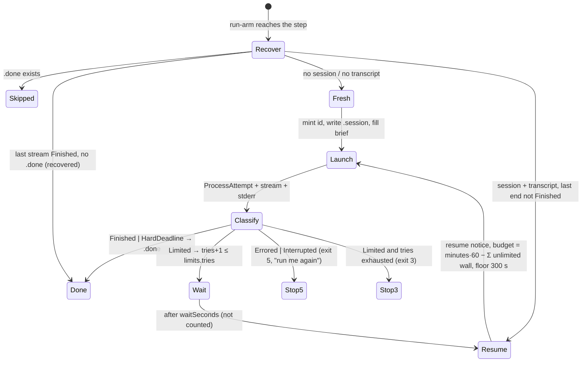

# PLAN — model arms: the experiment harness that launches the test runs, in C#, as a module of this repository

> Status: **plan only, nothing implemented yet, 2026-10-29.** Scope: a new self-contained module `tools/model-arms/` (two
> projects, a console `model-arms`), tests in `tests/Bench.Tests/ModelArms/`, three files moved out of `hosts/Cli` into a shared
> host-support project, two widenings of the shared CLI launcher, one widening of `tests/FakeCli`, a `research/module_model_arms.md`
> and the `research/module_tests.md` rows. It ports the RUN half of the owner's part-6 harness; the ANALYSIS half is deferred to
> `todo/PLAN_model_arms_analysis.md` (not written yet — §5 says what it must take and why).
>
> Related: [research/local-model-coding/harness.md](../research/local-model-coding/harness.md) and
> [harness/](../research/local-model-coding/harness/README.md) (parts 1–5's scripts, the same design one generation earlier),
> [PLAN_local_model_coding_qwen38.md](PLAN_local_model_coding_qwen38.md) (stays on the shell harness, §5),
> [PLAN_subagent_policy_ab.md](PLAN_subagent_policy_ab.md) (its own instrument, §5), [research/module_scouts.md](../research/module_scouts.md)
> and [research/module_probes.md](../research/module_probes.md) (the pieces this composes), [research/MEASURED_LESSONS.md](../research/MEASURED_LESSONS.md) §3
> (the ways a run lies about itself — the reason an error result is never "done").

## 1. The goal, before any solution

The owner runs an experiment that compares coding pipelines ("arms") of headless Claude Code sessions on one frozen plan in a
target repository: three schemes (C, CR, SRS) × three runs, every arm ending in the product's multi-vendor code gate. The harness
that launches those runs is a set of bash scripts with inline node, living in the experiment's own folder
(`/home/jinx/git/coai-exp2/`; the previous generation is checked in under [research/local-model-coding/harness/](../research/local-model-coding/harness/README.md)).
The owner's ask, 2026-10-29: **"Put the code that launches the test runs into the benchmark repository as a separate module — and in
this repository everything must be written in C# only; rewrite it in C# where needed."** Location chosen by the owner: `tools/model-arms/`.

What the shell harness does, and what must survive the port unchanged (its behaviour is the specification):

- **One arm, resumable.** A step is one `claude -p` session with a fixed session id, its `stream-json` kept per attempt, timing
  lines, a budget in minutes; a step with `<step>.done` is skipped; an interrupted step RESUMES its own session with the time left
  of its budget (`/home/jinx/git/coai-exp2/run-arm.sh:9-11`, `:76-126`).
- **Limits.** A step that ends on a usage limit, a rate limit or an overload is NOT done: the runner waits 15 min and resumes the
  same session, up to 40 times; waiting is not counted against the budget. Detection reads the result envelope's STRUCTURED fields
  first — `is_error`, `api_error_status` 429/529, `api_error` — and the wording as a fallback (`run-arm.sh:54-63`). **Why the
  structured read exists:** at ~21:45 UTC on 2026-10-28 the session limit was reached with the result
  `{"type":"result",…,"is_error":true,"api_error_status":429,"api_error":"usage_limit_reached","result":"You've hit your individual spend limit · run /usage-credits to ask your admin for a higher limit · your session limit resets 1:20am (Europe/Paris)"}`;
  the detector of the day read words alone and missed it, so nine steps were marked done in seconds and the next round started and
  burned the same way (`/home/jinx/git/coai-exp2/repair-limit-2026-10-28.sh:2-5`). **An error result that is not a limit is never
  "done" either** — the runner stops so a person looks (`run-arm.sh:117-119`).
- **Three schemes** with per-step models, budgets, tool allow-lists, deny rules and a strict MCP config (`run-arm.sh:25-38`, `:164-185`).
- **The gate step** under a cross-process lock (one arm in the gate at a time, for the providers' quotas), with a `blocked` status in
  `gate.json` that waits 30 min and resumes, up to 8 times (`run-arm.sh:144-162`).
- **Brief templates** filled from the experiment's facts; an unfilled field stops the arm; no brief ever names the arm or its scheme
  (`run-arm.sh:40-50`).
- **The task pipeline (SRS).** A split step writes `tasks.json` + one brief per task; a checker validates it (4–7 tasks, ids `t<n>`,
  every file owned by exactly one task, dependencies exist, no cycles, the plan file owned by the last task which depends on all others,
  every scenario delivered) and computes batches of at most 4 ready tasks; tasks of a batch run at the same time in git worktrees of
  the arm's clone, their commits cherry-picked back in order; one fix round when the checker refuses the list
  (`/home/jinx/git/coai-exp2/t-lib.sh`, `/home/jinx/git/coai-exp2/tasks-plan.mjs`).
- **The chain.** Make every arm from a built base under a random folder name, lock the folders that would reveal another arm, run
  rounds of three arms as detached processes, resume an arm whose runner died, unlock, run the objective checks; markers per stage, so
  it can be started again (`/home/jinx/git/coai-exp2/after6.sh`, `run-all.sh`, `lock.sh`).
- **Isolation by file modes** on Linux: the old experiment closed (000), the folders above the arms and Claude Code's own folders
  made unlistable (300), modes saved and restored (`lock.sh:12-19`); a Windows keep-awake guard so the host does not sleep
  (`after6.sh:14-23`, `research/local-model-coding/harness/windows/keep-awake.ps1`).
- **The objective checks** on an arm's final commit: build, the whole test suite (CTRF), format on the changed C# files, the
  extension's tests, per-scenario presence and passing, new failures against a baseline, diff statistics → `objective.json`
  (`/home/jinx/git/coai-exp2/objective-checks.sh`).

Why a port rather than keeping the scripts: every fact of the experiment is a constant at the top of a script (`E=/home/jinx/git/coai-exp2`,
the Windows temp path of the keep-awake script, the target's solution name, the test executable's path), the limit detector was wrong
once and was repaired by a one-off script, the resume rules differ between the two generations (§2, the "finished, runner died" rule),
and nothing of it has a test. The port makes the facts configuration, the decisions pure types with tests on recorded streams, and the
launch go through this repository's one process launcher.

## 2. What exists — verified 2026-10-29

Everything below was opened at `f1c410e` (branch `feat/shared-rules`). Cross-repository citations are paths, never links.

| Fact | Where |
|---|---|
| The ONE process launcher: exe + argv, never a shell; a timeout that kills the whole tree; stdin; a replaced environment; a line-by-line stdout sink; a timeout is a VALUE (`ProcessAttempt.TimedOut`) | `src/Bench.Infrastructure/Process/ProcessRunner.cs:52` (class), `:106` (line-sink overload), `:241-277` (the wait, the wall, the tree kill), `:355` (`Kill`) |
| A long-lived child over pipes with stderr streamed to a file, polite stop then kill — for a process that must stay alive for a scope | `src/Bench.Infrastructure/Process/ProcessSession.cs:44`, `Start` `:85`, `StopAsync` `:169` |
| "Is pid N alive on this machine" — refused counts as alive | `src/Bench.Infrastructure/Process/WorkerLiveness.cs:25` |
| The CLI-agent launch: `AgentAsk` (prompt on stdin, wall, model), `AgentAskOptions`, `AgentEnvironment.Only`, `AgentOutputSink.Lines`; the transcript port `ICliAgentTranscripts` | `src/Bench.Application/CliAgent.cs:21`, `:100`, `:75`, `:54`, `:271` |
| claude's argv as built today: `-p --model`, `--output-format stream-json --verbose`, `--permission-mode plan` ONLY for `Sandbox.ReadOnly`, `--tools` (the built-in allow-list, NOT `--allowedTools`), `--disallowedTools`, `--max-turns`, `--strict-mcp-config`, `--mcp-config`, `--add-dir`, `--max-budget-usd`, `--no-session-persistence`, `--setting-sources`, `--settings`, `--plugin-dir`; **no `--session-id`, no `--resume`, no `--permission-mode acceptEdits|default`, no `--allowedTools` patterns** — these are widenings, §4.4 | `src/Bench.Infrastructure/Models/CliAgentRuntime.cs:111-130`; `Unsupported` `:153` refuses by name what a CLI has no flag for |
| `AgentAskOptions.IsNone` enumerates every option — a new option must join it | `src/Bench.Application/CliAgent.cs:171-177` |
| The result envelope reader knows `is_error`, `result`, `subtype`, `total_cost_usd`, `usage` — **not** `api_error_status` / `api_error` | `src/Bench.Infrastructure/Models/ClaudeEnvelope.cs:103-108` (`EnvelopeWire`) |
| The stream-json reader (init, tool_use, tool_result, result) and the envelope's own voice (`subtype`, `result`, `errors`) | `src/Bench.Domain/Probes/ClaudeStream.cs:23`, `OwnVoice` `:40`; the subagent reader `src/Bench.Domain/Probes/ClaudeSubagents.cs:29` |
| The account-out detector — words only, deliberately NOT a plain 429 or `rate limited` (those are transient for a measured subject): `spend limit`, `usage limit`, `usage_limit_reached`, `quota reached`, … | `src/Bench.Domain/Gate/ReviewerAccountOut.cs:30-31`, `:47`, `CliReason` `:55` — a different question from this plan's (§4.5: here a 429 is exactly the thing to wait for) |
| One git command as a value: merged output, stdout alone, a yes/no answer | `src/Bench.Infrastructure/Git/GitHistory.cs:12` (`GitCommand`), `RunAsync` `:14`, `ReadAsync` `:29`, `AskAsync` `:47` |
| A disposable worktree at a commit under an explicit root, removal bounded at 60 s and never cancellable | `src/Bench.Infrastructure/Git/ScratchWorktree.cs:11`, `AddAsync(…, underRoot)` `:22`, `RemoveAsync` `:47` |
| Stage → flush → hash → rename, never overwrite | `src/Bench.Infrastructure/Gate/ArtifactCommit.cs:17`, `CommitAsync` `:24` |
| A stream file written line by line and flushed as the CLI prints | `ScoutStreamWriter`, `src/Bench.Infrastructure/Scouts/ScoutArtifacts.cs:255` |
| The minimal child environment by NAME (never `BENCH_*`, never a secret) with the model-guard opt-out forced | `src/Bench.Domain/Probes/ProbeChildEnvironment.cs:72` (`Of`), `:58` (`ForScouts`, background tasks off) |
| `Outcome<T>` and its `Match` | `src/Bench.Domain/Outcome.cs:6`, `:19` |
| The fake CLI: scripted per model id (`FAKE_CLI_SCRIPT` or `%TEMP%/bench-fake-cli/<model>/script.json`), modes `answer · refuse · hang · quota · exit · silent`, a replay file per prompt hash / prompt substring / one file, `lineDelayMs`, `holdAfterLine` (hangs mid-stream until killed), every call logged with its argv | `tests/FakeCli/Program.cs:61` (`Script`), `:74` (`Mode`), `:114-127` (`StdoutFile`, `StdoutFor`, `StdoutContaining`), `:134` (`HoldAfterLine`), `:565` (`Events`); the test-side handle `tests/Bench.Tests/Probes/Driver/FakeCli.cs:31` (`Executable`) |
| The test project references the fake as `ReferenceOutputAssembly="false"` so it is built first and launched from its own folder | `tests/Bench.Tests/Bench.Tests.csproj:37` |
| The architecture guard reads assembly references; every pure decider is NAMED in one list | `tests/Bench.Tests/ArchitectureTests.cs:16` (domain is a leaf), `:57` (Application never reaches Infrastructure), `:109-200` (the named deciders) |
| The sibling-leaf precedent: `Bench.Delivered` references nothing and is referenced only by the Application layer | `research/architecture.md:86-93`; `tests/Bench.Tests/ArchitectureTests.cs:32`, `:43` |
| The flow catalogue is DERIVED from `hosts/Cli/Program.cs`'s dispatch and `ScoutsCommand.cs` only; a verb ships with its row | `tests/Bench.Tests/Cli/ModuleTestsCatalogTests.cs:51-66`; `research/module_tests.md:156-158` |
| The CLI host's own parser, exit codes and Ctrl+C root token — in the EXE project, so no other host can reuse them | `hosts/Cli/CommandLine.cs` (103 lines, namespace `Bench.Cli`, no usings), `hosts/Cli/ExitCodes.cs:12`, `hosts/Cli/ShutdownSignal.cs`; tested by `tests/Bench.Tests/Cli/CommandLineTests.cs` |
| Local builds and tests are lowered and capped; the test executable, never `dotnet test` | `.agents/PROJECT.md` *Commands*; `tests/Bench.Tests/xunit.runner.json` (8 threads) |
| The previous generation's resume rule that the current scripts LOST: a session whose last stream holds the `result` but whose runner died before `.done` is DONE, not resumed (arm C got +14 min and +$0.43 when it was resumed) | `research/local-model-coding/harness/run-arm.sh:83-89`; `research/local-model-coding/incidents.md:39` |
| A real 429 envelope recorded by the product's own tests: `{"type":"result","subtype":"success","is_error":true,"api_error_status":429,…,"result":"You've hit your monthly spend limit. Switch to another model to continue.",…,"terminal_reason":"api_error"}` — note `subtype` says `success` | `dew_flow_connect_other_ais · src_mcp/tests/AClaudeReasonInItsEnvelopeTests.cs:23` (and `:87`, where `api_error_status` arrives as the STRING `"429"`) |
| A real `timing.jsonl` and `objective.json` of a finished arm, in this repository | `research/local-model-coding/data/arms/C/timing.jsonl`, `research/local-model-coding/data/arms/C/objective.json` |
| The keep-awake script holds `SetThreadExecutionState` for the LIFETIME of its own process (a 14400 s sleep, released in `finally`) | `research/local-model-coding/harness/windows/keep-awake.ps1:1-6` |
| `File.SetUnixFileMode` / `File.GetUnixFileMode` exist in .NET 10 — no `chmod` process is needed for the isolation | .NET runtime API (`System.IO.File`) |

**Found while planning.** Three things the shell sources disagree on or leave implicit, settled in §3: the lost "finished, runner died"
rule (above); the `.before` snapshot of a review-and-fix step taken at the END of a step that later turned out to be a limited
attempt (the repair script had to delete them — `repair-limit-2026-10-28.sh:30-34`); and `api_error_status` arriving as a number
in one envelope and as a string in another.

## 3. Decisions

| # | Decision | Reason |
|---|---|---|
| D1 | **The module is `tools/model-arms/`, two projects**: `ModelArms.Core` (pure: the decisions, the records, the readers — references `Bench.Domain` and `Bench.Application` only) and `ModelArms` (the console `model-arms`: adapters and verbs — references Core, `Bench.Infrastructure`, `Bench.Hosting`). Both in `dew_flow_benchmark.slnx` under a `/tools/` folder. **Nothing under `src/` or `hosts/` references `ModelArms.*`**, and Core never references `Bench.Infrastructure` or EF — asserted by `ArchitectureTests`. | The owner chose the location. The repository's rule is that a decision is pure by CONSTRUCTION (`research/architecture.md:14-17`): one project cannot be guarded by assembly references, two can. Core reaches `Bench.Application` because the launch records (`AgentAsk`, `AgentAskOptions`) and the transcript port live there — the layer that already carries ports and no adapters. The precedent is `Bench.Delivered`'s sibling leaf (§2). The consultants (2 of 2 answered, 2026-10-29) read it the same way; one qualified that an assembly test cannot prove purity against the runtime's own file and process APIs — so Core's tests inject every clock, file and launch, and a Core type that opens a file is a review finding, not a compiler error. |
| D2 | **Tests live in `tests/Bench.Tests/ModelArms/`** (namespace `Bench.Tests.ModelArms`); `Bench.Tests.csproj` references both module projects. No second test project. | One runner, one `xunit.runner.json`, the CPU budget, `FakeCli` and the architecture guard are all there already; a second xUnit project is the duplicate `reuse-first` forbids. |
| D3 | **`CommandLine`, `ExitCodes` and `ShutdownSignal` move to a new `src/Bench.Hosting` project, namespace kept `Bench.Cli`**; `hosts/Cli` references it; no `using` changes anywhere. `CommandLineTests` runs unedited — the proof the move changed nothing. | reuse-first's fourth move: two hosts need them and neither may reference the other (a tool referencing `bench`'s exe would drag EF and Npgsql into the module's deployment). |
| D4 | **The experiment's facts are one JSON file, `experiment.json`, at the experiment ROOT**, read once by every verb, refused by name for an unknown member, an absent file, a root inside a git checkout, or a root inside this repository. Random arm names are `arms.map.json` beside it, minted by `model-arms make` from `RandomNumberGenerator` (8 bytes, hex) — never printed, never in a brief, never in a log line. §4.2. | The shell's `exp.env`, `.map-<hash>.json`, `scenarios.json`, `baseline.json` and the constants at the top of each script, as configuration. Unpredictable rather than seeded: the whole point of a random name is that no arm can guess another's. |
| D5 | **The on-disk layout of an arm (`r/<token>/{arm,out,notes,work,tmp,wt,coai-data}`, `out/<step>.session|.a<N>.jsonl|.a<N>.err|.a<N>.prompt.md|.done|.before|.diff`, `out/timing.jsonl`, `chain/*`, `pids/*`) is kept byte-compatible with the shell's, with ONE named rename** (`task-<id>-haiku.*` → `task-<id>-coder.*`, since the coder model is now a configuration field). `ArmPaths` in Core is the one spelling; a test pins every path. | The analysis half (§5) reads these files; keeping the layout is what lets the shell analysis scripts run on a C# run while their port is pending, and the compatibility test (§7, E5) is what makes "the same files" a fact. |
| D6 | **A step ends in exactly one of six states**, decided by a pure classifier over the stream's last `result` line, the stderr tail and the launcher's attempt: `Finished` · `HardDeadline` (the wall killed the tree) · `Limited(reason)` · `Errored(text)` · `Interrupted` · `NotStarted(reason)`. `Limited` is read **structured first**: `is_error` AND (`api_error_status` ∈ {429, 529} read as number OR string, OR `api_error` matches the limit words, OR `result` + `errors` match them); then the stderr tail's words. `Errored` = `is_error` and not limited. Only `Finished` and `HardDeadline` write `.done`. | The 2026-10-28 incident (§1); `subtype` is `success` on a real 429 (§2) so it is never read; the string-typed status is real (§2). `ReviewerAccountOut.CliReason` is NOT reused for this: it refuses a plain 429 on purpose, because for a measured subject a rate limit is transient — here it is exactly what the runner must wait for. The words list is this plan's own and is tested on the three recorded lines. |
| D7 | **Recovery is a pure decision** over the files a step left: `.done` → skip; no session file → fresh; a session file whose transcript does not exist → fresh (new id); the last stream's result is `Finished` and no `.done` → **done, recovered** (not resumed); the last stream's result is an error of any kind → resume; otherwise resume with `budget − Σ wall of unlimited ended attempts`, floored at the configured minimum (300 s). | Both generations' rules reconciled (§2): the lost "finished, runner died" rule back, and the repair script's "an error result is never kept as done" on top of it. A floor is a decision, not an accident — the consultants named it as the thing to decide explicitly. |
| D8 | **The wall is the launcher's**: the attempt runs under `ProcessRunner` with `remaining + killGrace` (600 s) and the tree is killed at it — no SIGINT first. `HardDeadline` is done. | The shell's `timeout -s INT -k 60` could make the CLI write a `result` on the INT and read as finished; the previous generation already warned that "a polite stop can make Claude write a result event" (`research/local-model-coding/harness.md` §4). The stream on disk holds everything the CLI printed before the kill; the brief told the agent its deadline ten minutes earlier. |
| D9 | **Resume keys on the session id**: a fresh attempt passes `--session-id <guid>` (minted by the runner and written to `<step>.session` BEFORE the launch); a resume passes `--resume <guid>` with the resume notice on stdin. Both are launch options the shared `CliArgv` gains (§4.4), refused by name on every other CLI. | The transcript the CLI keeps under `~/.claude/projects/<cwd-slug>/<guid>.jsonl` is what `--resume` reads; the shell checks it exists by exact name because the folder is unlistable under the lock (`run-arm.sh:67`). An `ISessionTranscripts` port answers that question; its adapter opens the path by name. |
| D10 | **The gate lock is a file lock through the one launcher's sibling, tested with two real processes.** `IGateLock.AcquireAsync(path, ct)` — the POSIX/Windows adapter opens `.gate.lock` with `FileShare.None` and holds it for the step; the live test holds it from a second `model-arms gate-lock hold` process and asserts the first waits. A `blocked` status in `gate.json` removes `.done`, waits `gateWaitSeconds`, resumes — at most `gateTries`. | The shell used `flock`. One consultant warned (verified in the product's own `HeldFile`) that Linux's `FileShare.None` combined with inheritable handles once produced a SHARED lock — hence a test between two processes, not two tasks, and never a promise about a lock nobody watched. |
| D11 | **Isolation is a port with a POSIX adapter and a refusal elsewhere.** `IsolationPlan.From(config, home)` (pure) names the closed (000) and unlisted (300) folders; the adapter saves every mode to `.locked-modes` BEFORE the first change, applies them with `File.SetUnixFileMode`, then **verifies** by trying to list one unlisted folder and refusing if it CAN (root, `CAP_DAC_OVERRIDE`); `unlock` restores in reverse order and renames the file `.locked-modes.restored-<utc>`; `model-arms unlock` is idempotent and `chain` runs it on entry when `chain/locked` exists without `chain/unlocked`. On Windows the adapter refuses: *"isolation by file modes is POSIX only"*. | `lock.sh:12-19`, with the two traps the consultants named: order and crash recovery, and a mode that does nothing for root. A measure you have not observed working is a comment (`common.security`): the verification is the observation. |
| D12 | **Keep-awake is a port with three adapters, chosen by a pure decision from host facts**: `WindowsAwake` (in-process `SetThreadExecutionState` through `[LibraryImport("kernel32.dll")]`, released on dispose), `WslHostAwake` (a `pwsh.exe -NoProfile -ExecutionPolicy Bypass -File keep-awake.ps1` child HELD by `ProcessSession` for the scope and relaunched if it exits, checked every 2 min), `NoAwake` (declared no-op, logged once). WSL is detected from `WSL_DISTRO_NAME` or `/proc/version` containing `microsoft`. The three `.ps1` files ship with the module (`tools/model-arms/ModelArms/windows/`, copied to the output). | `after6.sh:14-23` and `keep-awake.ps1`. `SetThreadExecutionState` is per process: a `pwsh` that exits clears it — which is why the script sleeps and why the C# adapter must hold the child (consultant, verified against `keep-awake.ps1:1-6`). The harness runs under WSL on this machine, where kernel32 is not reachable in-process; natively on Windows it is. |
| D13 | **Arms run as detached processes, through a port**: `IDetachedLauncher.Start(exe, argv, log) → pid`; the POSIX adapter launches `setsid` as exe + argv `[setsid, model-arms, run-arm, <arm>]` with stdout/stderr appended to `pids/<arm>.log`; the Windows adapter launches `model-arms.exe` directly (a child outlives its parent unless a job object holds it — declared, not assumed). Liveness is `WorkerLiveness.ProcessIsAlive`. `run-all` leaves an arm whose pid is alive alone. | `run-all.sh:7` (`setsid nohup`): the arms must survive the orchestrating session — three crashes taught it (`research/local-model-coding/harness.md` §4). |
| D14 | **Parallel tasks of a batch run as parallel `Task`s inside the one `run-arm` process**, each its own CLI process in its own worktree; a batch whose task was interrupted stops the arm with "run me again" (exit 5), and re-entry resumes exactly the tasks without `.done`. Worktrees stranded by a crash are removed on re-entry when their task has no `picked-<id>` and no `.done` (recreated fresh). | `t-lib.sh:57-76`. One process, one cancellation token, one wall per task — the shell's subshells had none of that. |
| D15 | **Brief templates ship with the module** (`tools/model-arms/briefs/*.template.md`, the eight of `/home/jinx/git/coai-exp2/briefs/`, byte for byte), and the `briefs` folder of an experiment root may OVERRIDE any of them by name. `BriefFiller.Fill(template, fields)` refuses an unfilled `{{NAME}}` naming it, and refuses a field VALUE that contains an arm name, a scheme name or a token (the leak check). | `run-arm.sh:40-50`, with the "no brief names the arm or its scheme" rule made a check rather than a habit. |
| D16 | **Exit codes are this repository's contract** (`ExitCodes`): `0` the verb did its work · `3` environment (the CLI is not there, still limited after every wait, a worktree's warm build failed, the lock could not be verified) · `4` configuration (usage, an unknown arm, an unfilled brief, an invalid `experiment.json`, a task list still invalid after its fix round, a cherry-pick conflict — the split declared the files disjoint) · `5` stopped, resumable (interrupted, an error result, a batch's task interrupted). The last line of `timing.jsonl` says which, as `{"kind":"stopped","why":…}`. | `run-arm.sh`'s 1–6 mapped onto the vocabulary an agent already reads (`hosts/Cli/ExitCodes.cs:12`). |

## 4. Design

### 4.1 Projects and layout

```
tools/model-arms/
  ModelArms.Core/            pure — references Bench.Domain, Bench.Application; no packages
    Experiment/              ExperimentFile (the JSON shape, D4) · Scheme · StepSpec · ToolSets · ArmMap · ArmPaths (D5)
    Steps/                   StepEnd (D6) · StepRecovery (D7) · TimingLine · StepBudget · ResumeNotice · ReviewAnswer
    Launch/                  StepLaunch (AgentAskOptions per step mode) · ClaudeResultEnvelope · GateStatus
    Tasks/                   TasksPlan (the checker + batches) · TaskRecovery · PickBackOrder
    Chain/                   ChainPlan (markers → next action) · RoundState
    Isolation/               IsolationPlan · IsolationRestoreOrder · HostAwakeSelection
    Checks/                  CtrfScenarios · TestLogSummary · TsTestLog · DiffStats · ObjectiveReport
    Briefs/                  BriefFiller · BriefFields
    Ports/                   ISessionTranscripts · IGateLock · IFolderIsolation · IHostAwake · IDetachedLauncher · IArmFiles · ITargetTools
  ModelArms/                 the console — references Core, Bench.Infrastructure, Bench.Hosting
    Program.cs               parse (CommandLine) · dispatch · ExitCodes · ShutdownSignal
    Verbs/                   PrepBase · Make · Lock · Unlock · RunArm · RunAll · Chain · Checks · Status · GateLock
    Adapters/                StepRunner (over ICliAgentTranscripts + ScoutStreamWriter) · ClaudeSessionTranscripts · FileGateLock
                             · PosixFolderIsolation · WindowsAwake · WslHostAwake · NoAwake · SetsidLauncher · WindowsLauncher
                             · ArmFiles (ArtifactCommit) · TargetTools (ProcessRunner: dotnet/node/npm/git as exe + argv) · TaskWorktrees
    windows/                 keep-awake.ps1 · check-keep-awake.ps1 · stop-keep-awake.ps1 (copied from research/…/harness/windows/)
  briefs/                    the eight templates (D15)
src/Bench.Hosting/           CommandLine.cs · ExitCodes.cs · ShutdownSignal.cs (moved, namespace Bench.Cli) — D3
tests/Bench.Tests/ModelArms/ the tests of §7; Fixtures/model-arms/ the recorded lines and streams
research/module_model_arms.md   created with the first code story, updated by every story
```

The verbs, as an operator types them (`model-arms <verb> --experiment <root> …`; `--experiment` falls back to `MODEL_ARMS_EXPERIMENT`):

| verb | does | shell source |
|---|---|---|
| `prep-base` | clone the target's plan branch into `<root>/base`, point its rules submodule at the local checkout, `npm ci` the rules' tools, build, run both suites once, write `baseline.json` | `prep-base.sh` |
| `make` | mint `arms.map.json` once; per arm copy `base` → `r/<token>/arm`, branch `<branch>`, warm build, write `mcp-none.json`, `mcp-coai.json`, copy the coai settings; `chain/made-<arm>` | `after6.sh:26-37` |
| `lock` / `unlock` | D11 | `lock.sh` |
| `run-arm <arm>` | one arm, resumable (D6–D9, D14) | `run-arm.sh`, `t-lib.sh` |
| `run-all <arm>…` | start or resume arms detached (D13) | `run-all.sh` |
| `chain` | make → lock → rounds → unlock → checks, markers per stage, keep-awake for the whole of it (D12) | `after6.sh` |
| `checks <arm>` | the objective checks → `out/objective.json` (§4.9) | `objective-checks.sh` |
| `status` | every arm: steps done / resumable / limited, the last timing line, pid liveness, the chain's markers | — (new; read-only) |
| `gate-lock status\|hold --seconds N` | is the gate lock held; hold it (the live lock test's second process, and an operator's probe) | — (new) |
| `version` · `help` | — | — |

### 4.2 `experiment.json` — the facts

```json
{
  "schema": "model-arms/experiment-v1",
  "target": {
    "source": "/home/jinx/git/dew_flow_connect_other_ais",
    "planBranch": "docs/plan-a-spent-quota-cools-the-model-down",
    "base": "6786582e30d3e771549d05ed719478396f8099cd",
    "plan": "todo/PLAN_a_spent_quota_cools_the_model_down.md",
    "branch": "feat/quota-cooldown",
    "rulesSubmodule": ".agents/conventions",
    "lowPriority": ["node", ".agents/conventions/tools/low-priority.mjs"],
    "build":      ["dotnet", "build", "dew_flow_connect_other_ais.slnx", "-c", "Debug", "-m:4", "--disable-build-servers"],
    "suite":      { "command": ["./src_mcp/tests/bin/Debug/net10.0/CoaiMcp.Tests", "--report-xunit-ctrf"], "ctrfFile": "mcp.ctrf.json", "namePrefix": "CoaiMcp.Tests." },
    "format":     { "solution": "dew_flow_connect_other_ais.slnx", "verbs": ["whitespace", "style"] },
    "extension":  { "directory": "src_vs_code", "command": ["npm", "test"] },
    "nodeModules": ["src_vs_code/node_modules", ".agents/conventions/node_modules"],
    "testGlobs":  ["src_mcp/tests", "src_vs_code/src/test"]
  },
  "scenarios": "scenarios.json",
  "baseline": "baseline.json",
  "known": "Nothing is known to fail: at the base commit the whole MCP suite (13,807 tests) and the extension tests pass on this host …",
  "steps": {
    "code":     { "model": "sonnet", "minutes": 180, "mode": "write" },
    "hreview":  { "model": "haiku",  "minutes": 60,  "mode": "write" },
    "review":   { "model": "opus",   "minutes": 40,  "mode": "read"  },
    "fix":      { "model": "sonnet", "minutes": 60,  "mode": "write" },
    "gate":     { "model": "sonnet", "minutes": 150, "mode": "gate"  },
    "split":    { "model": "sonnet", "minutes": 40,  "mode": "write" },
    "splitFix": { "model": "sonnet", "minutes": 15,  "mode": "write" },
    "taskCode": { "model": "haiku",  "minutes": 45,  "mode": "write" }
  },
  "schemes": {
    "C":   ["1-code:code", "2-review:review", "3-fix:fix", "4-gate:gate"],
    "CR":  ["1-code:code", "2-hreview:hreview", "3-review:review", "4-fix:fix", "5-gate:gate"],
    "SRS": ["tasks", "3-hreview:hreview", "4-review:review", "5-fix:fix", "6-gate:gate"]
  },
  "rounds": [["C1", "CR1", "SRS1"], ["C2", "CR2", "SRS2"], ["C3", "CR3", "SRS3"]],
  "limits": { "waitSeconds": 900, "tries": 40, "gateWaitSeconds": 1800, "gateTries": 8, "minimumRemainingSeconds": 300, "killGraceSeconds": 600 },
  "tasks":  { "min": 4, "max": 7, "maxParallel": 4 },
  "tools":  { "write": ["Read", "Edit", "Write", "Glob", "Grep", "TodoWrite", "Agent", "Bash(git *)", "…"], "read": ["…"], "gate": ["mcp__coai__providers", "…"], "deny": ["Read(//home/jinx/.claude/**)", "…"] },
  "coai":   { "binary": "/home/jinx/.vscode-server/…/coai-mcp", "settings": "/mnt/v/connectOtherAis/wsl-ubuntu/settings.json", "side": "wsl-ubuntu" },
  "isolation": { "closed": ["/home/jinx/git/coai-exp"], "unlisted": ["<root>", "<root>/r", "<root>/pids", "~/.claude/projects", "~/.claude/file-history", "~/.claude/session-env", "~/.claude/shell-snapshots"] },
  "awake": "auto"
}
```

Every command is **exe + argv**, never a string; `lowPriority` is prepended to `build`, `suite` and `extension` (the target's own
lowering wrapper, run as `node` — a tool of the TARGET, exactly as `objective-checks.sh:11` did). An arm name's scheme is its letters
(`SRS2` → `SRS`); `rounds` may only name arms whose scheme exists. `<root>` and `~` are the two placeholders `ExperimentFile` expands.
Unknown members are refused (`JsonUnmappedMemberHandling.Disallow`, the catalog's rule). The `tasks` entry of a scheme is the SRS
pipeline (§4.6) with the step names the shell used (`1-split`, `1b-split-fix`, `2-<id>-code`).

### 4.3 The experiment root

`<root>/experiment.json`, `scenarios.json`, `baseline.json`, `briefs/` (overrides), `base/`, `arms.map.json`, `r/<token>/…`,
`pids/<arm>.pid|.log`, `chain/made-<arm>|locked|unlocked|objective-<arm>|arms-done`, `.gate.lock`, `.locked-modes`, `lock.log`,
`keep-awake.log`. Under `r/<token>/`: `arm/` (the clone), `out/` (streams, timing, markers, `objective/`, `objective.json`), `notes/`
(`code.md`, `hreview.md`, `fix.md`, `gate.md`, `review.json`, `gate.json`, `<id>-code.md`), `work/` (`tasks.json`, `t<n>.md`,
`batches.json`), `tmp/` (the CLI's `TMPDIR`), `wt/<id>/`, `coai-data/<side>/settings.json`, `mcp-none.json`, `mcp-coai.json`.
`ArmPaths` is the one spelling of all of it; nothing else concatenates a path.

### 4.4 The launch boundary — one launcher, widened

`StepLaunch.Options(mode, spec, paths)` returns an `AgentAskOptions` per mode, and `CliArgv` gains four options (refused by name on
codex, gemini and agy through `Unsupported`):

| option | claude flag | write | read | gate |
|---|---|---|---|---|
| `SessionId` / `ResumeSessionId` (mutually exclusive, both refused together) | `--session-id` / `--resume` | per attempt | per attempt | per attempt |
| `PermissionMode` (`NotAsked · Default · AcceptEdits · Plan`; refused beside `Sandbox.ReadOnly`, which already spells `plan`) | `--permission-mode` | `acceptEdits` | `default` | `acceptEdits` |
| `PermittedTools` — the PERMISSION allow-list with patterns (`Bash(git *)`), distinct from `AllowedTools` = `--tools` | `--allowedTools` | `tools.write` | `tools.read` | `tools.write` + `tools.gate` |
| `DisallowedTools` (exists) | `--disallowedTools` | `tools.deny` | `Edit Write NotebookEdit` + `tools.deny` | `tools.deny` |
| `JsonEvents` (exists) | `--output-format stream-json --verbose` | yes | yes | yes |
| `McpServersOff` + `McpConfigFile` (exist) | `--strict-mcp-config --mcp-config` | `mcp-none.json` | `mcp-none.json` | `mcp-coai.json` |
| `AddDirectories` (exists) | `--add-dir` | `notes`, `work` | `notes`, `work` | `notes`, `work` |

`AgentAskOptions.IsNone` and `ToString` grow with them; `ProbeArgvTests` and `ScoutArgvTests` run unedited — the proof the existing
launches did not move. The prompt (a filled brief, or the resume notice) rides stdin; the environment is
`ProbeChildEnvironment.ForScouts(parent)` plus `TMPDIR=<arm>/tmp` (a FIXED value, as the background-tasks switch is) — the arm's own temp
folder, because `/tmp/claude-<uid>` would show every arm's name (`run-arm.sh:20`). The stream goes to `out/<step>.a<N>.jsonl` through
`AgentOutputSink.Lines` into a `ScoutStreamWriter`; stderr to `.a<N>.err` after exit; the prompt to `.a<N>.prompt.md` before the launch.

### 4.5 The step — a state machine, pure, over files



`timing.jsonl` lines are the shell's: `start` (arm, step, attempt, how, session, model, start_utc, budget_s, deadline, head, stream),
`end` (end_utc, wall_s, exit, result, limited, head), `arm-done`, plus `stopped` (D16). `StepBudget.Used(timing, step)` sums the
`end` lines' `wall_s` where `limited` is false (`run-arm.sh:68-74`). The review step's answer is extracted by `ReviewAnswer.Extract`
(the last `result`'s text, the first `{…}` block, else `{"verdict":"unparsed","raw":…}`) into `notes/review.json` — and a review
whose last result is an error produces no `review.json` at all (the repair script's finding). The `.before` snapshot of `hreview` and
`gate` is taken BEFORE the first attempt and kept until the step is done; a `.diff` is written only from a `Finished` step.

**The gate step** (D10): acquire the lock → the step → read `notes/gate.json`'s `status`; `blocked` → delete `.done`, wait, loop; else
write `.diff`, release. The lock is released during the wait, as the shell did (`run-arm.sh:149-158`).

### 4.6 The task pipeline (SRS)

`TasksPlan.Validate(tasksJson, planPath, scenarioIds, limits, workFiles) → Outcome<Batches>` is `tasks-plan.mjs:13-50` as a pure
function: every problem is a sentence in the refusal (the fix brief's `{{PROBLEMS}}`), the batches are the ready tasks in input
order, at most `maxParallel` per batch, and `batches.json` is written in the shell's shape. The arm: `1-split` → validate → on refusal
ONE `1b-split-fix` → validate again or stop (exit 4) → batches: a batch of one runs in the clone; a batch of many creates
`wt/<id>` per task (`git worktree add -q <wt> -b tmp/<id> HEAD`, the rules submodule initialised from the ARM'S OWN checkout with
`protocol.file.allow=always`, the node_modules folders symlinked, a warm build — `t-lib.sh:8-22`), runs the tasks in parallel (D14),
cherry-picks each task's commits back in task order (`task-<id>.before..tmp/<id>`, a conflict aborts and stops with exit 4 —
`t-lib.sh:24-38`), removes the worktrees, writes `batch-<i>.done`. Each task's step is the ordinary step (§4.5) with the coder brief's
extra fields (`TASK`, `TASK_BRIEF`, `TASK_FILES`, `BEFORE`) and `task-<id>-coder.head|.diff` written once from a `Finished` step.

### 4.7 The chain, the detached arms, the lock

`ChainPlan.Next(markers, arms, liveness, rounds)` is pure and answers one action at a time: `Make(arm)` · `Lock` · `Start(arms)` ·
`WaitFor(arm)` · `StopArmDied(arm)` · `Unlock` · `Check(arm)` · `Finished`. The verb loops on it with a 60 s `PeriodicTimer`, under the
keep-awake scope (D12), and exits 5 with "resume it (`run-all <arm>`), then start me again" when an arm's runner died without its
`arm-done` line (`after6.sh:39-46`). `run-all` (D13) writes `pids/<arm>.pid` and never starts an arm whose pid is alive.

### 4.8 Isolation and keep-awake

Ports and adapters as D11 and D12. What is tested how: the pure selections (`IsolationPlan.From`, `IsolationRestoreOrder`,
`HostAwakeSelection.For`) on facts; the chain's use of both through recording fakes (every `Lock`/`Unlock`/`Awake` call in order, and
the unlock on every path out including a thrown exception); the POSIX adapter live on a temp tree **only on Linux**, including the
verification's refusal when the current user can still list a 300 folder (skipped with a printed reason elsewhere — a skip that says
why, never a silent pass); `WslHostAwake` with `tests/FakeCli` as the `pwsh.exe` in `hang` mode (held, then killed on dispose);
`WindowsAwake` live only on Windows, asserting the P/Invoke's previous-state return value is non-zero.

### 4.9 The objective checks

`checks <arm>`: in the arm's clone, `build` → `suite` with the CTRF report into `out/objective/` → `format` on the `.cs` files changed
since `base` (whitespace, then style; none changed = pass) → `extension`; then the pure `ObjectiveReport.From(logs, ctrf, scenarios,
baseline, diffNumstat, head, commits, uncommitted)` writes `objective.json` in the shell's shape (`objective-checks.sh:53-64`): per
scenario `present` (a `git grep -F` of the name under `testGlobs`) and `passing` (`passed` · `failed` · `absent` · the joined statuses
when mixed), the suite's totals and `failedNew` / `failedBaseline`, the extension's `failedNew`, `scenariosPresentCount`,
`scenariosPassingCount`, and the diff's `changedLines` split into tests / src / docs. The parsers (`TestLogSummary` for MTP's `total:`
/ `succeeded:` / `skipped:` / `failed <name>`, `TsTestLog` for node's `✔ … (` / `✖ … (` / `ℹ tests N`, `CtrfScenarios`) are pure and
tested on recorded lines; `PARSE_ONLY` becomes `--parse-only` (re-run the parsers over logs already there).

### 4.10 Briefs

The eight templates (D15) and their field sets — `BriefFields.For(step, paths, facts)`: `PLAN BASE BRANCH SCEN_COUNT DEADLINE NOTES
KNOWN REVIEW CODE_NOTES HREVIEW_NOTES FIX_NOTES WORK GATE_JSON`, plus `TASK TASK_BRIEF TASK_FILES BEFORE` for the task coder and
`PROBLEMS` for the split fix. A test fills every template with its step's fields and asserts no `{{…}}` survives; a template with a
field nobody provides is refused naming it; a value carrying an arm name, a scheme name or a token is refused (the leak check).

### 4.11 Growth — before the first write

| what grows | projected at 9 arms (3 × 3) | who retires it | interrupted |
|---|---|---|---|
| `r/<token>/arm` — a built clone of the target per arm | ~1.5 GB each (coai with `bin/`, `obj/`, two `node_modules`), **~14 GB** | **kept until the experiment's record is promoted**, deleted by the owner with the root — a decision: the clones ARE the result (every arm's branch lives only there) | a crashed `make` is redone whole (`rm -rf` the arm folder first, as the shell did) |
| `out/<step>.a<N>.jsonl` streams | 5–30 MB per attempt; ~6 steps × ≤ 3 attempts × 9 arms ≈ **0.3–1.5 GB** | kept forever with the clones — the analysis half reads them | an attempt's stream is complete up to the last flushed line; the next entry classifies it |
| `wt/<id>` worktrees | up to 4 per batch, each a built clone ≈ 1.5 GB, **≤ 6 GB transient** | removed after pick-back by the same verb | re-entry removes a worktree whose task has neither `.done` nor `picked-<id>` and creates it again |
| `tmp/` (the CLI's temp per arm) | ≤ 1 GB per arm | with the clone | — |
| `pids/*.log` | KB | with the root | — |
| `.locked-modes` | one small file | `unlock` renames it; never deleted | a crash while locked leaves it; `chain` restores on entry (D11) |

No table, no database, no spawned process that outlives the verb except the detached arms (D13), which are owned by `pids/` and
`WorkerLiveness`.

## 5. Scope, and the boundaries named on both sides

**This plan ports the RUN half.** Everything a run needs to be started, resumed, limited, isolated, chained and checked.

**Deferred to `todo/PLAN_model_arms_analysis.md` (to be written when the run half's first arm has run):** the metrics from stream files
and session transcripts (`research/local-model-coding/harness/metrics.mjs` — note it reads `~/.claude/projects/*/<session>.jsonl`
inside an attempt's time window for interrupted attempts, because the stream undercounts output tokens ~45×), the absolute blind
judge (`judge-abs.sh`), the coai-findings judge, the mutation checks (`mutate.mjs`), the survival scripts, `compare.mjs` and
`make-tables.mjs`. **Why deferred:** they consume files the run half writes and never change what a run does; porting both halves in
one plan doubles the surface before a single C# arm has run; and the shell analysis scripts run on a C# run's files as they are
(D5), so nothing is unverifiable meanwhile. **What this plan keeps for them (the evidence contract):** the session id, the attempt
windows and the `how` in `timing.jsonl`; every stream and stderr per attempt; the `.before`/`.diff` of every review-and-fix and gate
step; `task-<id>-coder.head|.diff` and `picked-<id>`; `objective.json` in the shell's shape; and the layout-compatibility test (E5).

| item | this plan | the analysis plan | disjoint? |
|---|---|---|---|
| the files an arm leaves (§4.3) | writes them, pins the layout | reads them, never writes | yes |
| `timing.jsonl` | writer | reader (wall per attempt, the price fit) | yes |
| `objective.json` | writer (§4.9) | reader (tables, the judge's input) | yes |
| session transcripts under `~/.claude` | records the id and window | reads tokens from them | yes |
| judges, mutation, survival, tables | — | all | yes |

Order: this plan first — it lands the layout the other reads.

**Not taken from anyone, and said on this side:** [PLAN_local_model_coding_qwen38.md](PLAN_local_model_coding_qwen38.md) keeps running
on the shell harness in `research/local-model-coding/harness/` (its D1 adds a `qwen-task.mjs` filler there); this module is the C#
successor of that harness's RUN half, and a later plan may move the Qwen arms onto it — not this one. [PLAN_subagent_policy_ab.md](PLAN_subagent_policy_ab.md)
is its own instrument (`bench policy`); it shares nothing but the launcher widenings of §4.4, which it may use. Neither document is
edited by this plan (nothing is taken from them); the table above names the one new boundary, with the plan that does not exist yet.

## 6. Build order

0. The plan round of the review gate (`mcp__coai__review_plan` on this document, by the session that implements it — the gate's
   order is plan → gate → implement), then the question consultant's advice already taken (D1, D6, D7, D10, D11, D12 carry it).
1. **E1** — `Bench.Hosting` (D3); the module's two projects, in the solution, the architecture guard widened; `ExperimentFile`,
   `ArmPaths`, `ArmMap`; the four launcher options (§4.4); `BriefFiller` and the templates. Nothing launches yet.
2. **E2** — the step: `ClaudeResultEnvelope`, `StepEnd`, `StepRecovery`, `TimingLine`, `StepBudget`, `ReviewAnswer`, `GateStatus`;
   `StepRunner` over `ICliAgentTranscripts` against `tests/FakeCli` (widened: `stdoutByCall`); `FileGateLock` with its two-process test;
   `run-arm` for C and CR.
3. **E3** — `TasksPlan`, `TaskWorktrees`, the batches, pick-back; `run-arm` for SRS.
4. **E4** — `IsolationPlan` + `PosixFolderIsolation` (+ the refusal), `HostAwakeSelection` + the three adapters, `SetsidLauncher`,
   `ChainPlan`; `prep-base`, `make`, `lock`, `unlock`, `run-all`, `chain`, `status`.
5. **E5** — `checks` and its parsers; the layout-compatibility test; `research/module_model_arms.md` (created in E1's first code story,
   finished here), the `research/module_tests.md` rows (the catalogue test widened to the module's dispatch), `README.md`'s layout table,
   `POST_DEPLOY.md` unchanged (nothing deploys; the module is run by hand).
6. One attended dry run against a scratch target with `tests/FakeCli` as `claude` (every verb, all three schemes, one limited attempt,
   one interrupted arm resumed) — the pilot this plan's `module_tests.md` rows name as *not covered live*.

## 7. Test plan — red first, exact names

Every class is in `tests/Bench.Tests/ModelArms/` unless noted; every test is written against a missing type or a stub first (the red
is a compile failure naming the type, or the stub's wrong value); a break-it plants the named defect in the finished code and watches
the named test go red with the real symptom, then restores it. Fixtures under `tests/Bench.Tests/Fixtures/model-arms/`: the three
recorded result lines of §1–§2 (`result-429-usage-limit-reached.jsonl` — the 2026-10-28 line verbatim; `result-429-monthly-spend-limit.jsonl`
and `result-429-string-status.jsonl` from the product's tests, cited as paths), a `result-400-model-unsupported.jsonl`, a clean
`result-success.jsonl`, a stream with no result, `timing-arm-C.jsonl` (a copy of `research/local-model-coding/data/arms/C/timing.jsonl`),
`objective-arm-C.json`, an MTP log head, a node test log head, a small CTRF.

**E1 — facts, layout, launch boundary**

- `HostingExtractionTests` — `The_cli_parser_and_exit_codes_live_in_Bench_Hosting_under_their_old_namespace`; `tests/Bench.Tests/Cli/CommandLineTests.cs` unedited and green.
- `ModelArmsArchitectureTests` — `Core_references_only_the_runtime_the_domain_and_the_application_layer`; `Nothing_under_src_or_hosts_references_the_model_arms_module`; `Core_never_references_infrastructure_or_entity_framework`; `Every_core_decider_is_named_in_the_pure_list` (the module's own list, the gate's pattern).
- `ExperimentFileTests` — `A_complete_file_reads_into_facts_with_every_command_as_exe_and_argv`; `An_unknown_member_is_refused_by_name`; `A_round_naming_an_arm_of_an_unknown_scheme_is_refused_naming_both`; `A_root_inside_a_git_checkout_is_refused`; `A_root_inside_this_repository_is_refused`; `The_root_and_home_placeholders_expand_in_isolation_paths`.
- `ArmPathsTests` — `Every_path_of_an_arm_is_spelled_as_the_shell_spelled_it` (the whole table of §4.3, one assertion per path); `The_coder_diff_is_the_one_renamed_file`.
- `ArmMapTests` — `Tokens_are_minted_once_and_never_reminted_for_an_existing_map`; `A_token_never_appears_in_a_log_line_or_a_brief` (through `BriefFiller`'s leak check and the console writer's scrub).
- `ClaudeArgvSessionTests` (in `tests/Bench.Tests/Models/`) — `A_fresh_attempt_passes_session_id_and_a_resume_passes_resume`; `Session_id_and_resume_together_are_refused`; `Permission_mode_accept_edits_default_and_plan_are_spelled`; `Permission_mode_beside_the_read_only_sandbox_is_refused`; `Permitted_tool_patterns_are_allowedTools_and_the_builtin_list_stays_tools`; `Codex_gemini_and_antigravity_refuse_the_four_options_by_name`; `IsNone_is_false_for_each_new_option`; `ProbeArgvTests` and `ScoutArgvTests` unedited and green.
- `StepLaunchTests` — `Write_read_and_gate_modes_produce_the_shells_three_argv_shapes` (the exact token lists of `run-arm.sh:86-89`, `:106-108`); `The_child_environment_is_the_scouts_set_plus_the_arms_own_tmpdir_and_nothing_else`.
- `BriefFillerTests` — `Every_shipped_template_fills_completely_with_its_steps_fields` (8 templates); `An_unfilled_field_is_refused_naming_it`; `A_value_carrying_an_arm_name_a_scheme_or_a_token_is_refused`; `An_experiment_root_overrides_a_template_by_name`.

**E2 — the step (cornerstone area: the state machine)**

- `ClaudeResultEnvelopeTests` — `The_last_result_line_is_read_whatever_lines_precede_it`; `Api_error_status_reads_as_a_number_and_as_a_string`; `Subtype_success_on_an_error_result_is_ignored`; `A_stream_without_a_result_reads_as_none`.
- `StepEndTests` — `The_2026_10_28_line_is_limited_by_its_structured_fields_whatever_the_words_say` (the verbatim line, the words removed); `A_monthly_spend_limit_429_is_limited`; `A_string_429_is_limited`; `A_529_overload_is_limited`; `An_error_result_that_is_not_a_limit_is_errored_never_finished`; `Limit_words_on_stderr_without_a_result_are_limited`; `A_success_result_is_finished`; `A_killed_tree_is_the_hard_deadline`; `No_result_and_no_limit_is_interrupted`; `A_launch_the_executable_refused_is_not_started`.
- `StepRecoveryTests` — `A_done_marker_skips`; `A_last_stream_that_finished_without_a_marker_is_recovered_as_done_never_resumed`; `A_last_stream_whose_result_is_an_error_resumes`; `A_session_without_a_transcript_starts_fresh_with_a_new_id`; `The_remaining_budget_excludes_limited_attempts_and_floors_at_the_minimum`; `Timing_of_a_real_arm_reads_back_every_line` (the arm-C fixture).
- `StepRunnerTests` — against `tests/FakeCli` as `claude` (D9, the fake's `stdoutByCall` widening): `A_limited_attempt_waits_then_resumes_the_same_session_and_the_wait_is_not_counted` (manual clock, two calls, the second with `--resume <same id>`); `An_errored_attempt_stops_the_arm_with_exit_5_and_no_done_marker`; `A_finished_attempt_writes_done_the_stream_the_stderr_the_prompt_and_both_timing_lines`; `The_wall_kills_the_tree_and_marks_the_hard_deadline_done` (`holdAfterLine`); `Still_limited_after_every_wait_exits_3`; `Ctrl_c_during_the_wait_exits_5_resumable`; `The_resume_notice_names_the_new_deadline_and_the_base_commit`; `The_session_file_is_written_before_the_launch` (break-it: write it after → the test that kills the fake mid-launch finds no session).
- `ReviewAnswerTests` — `The_json_block_of_the_last_result_is_the_review`; `No_block_is_unparsed_with_the_raw_text`; `An_error_result_produces_no_review_file`.
- `GateStepTests` — `A_blocked_status_removes_done_waits_and_resumes_up_to_the_tries`; `The_lock_is_released_during_the_wait`; `The_before_snapshot_is_taken_before_the_first_attempt_and_the_diff_only_from_a_finished_step`.
- `FileGateLockTests` — `A_second_process_holding_the_lock_makes_the_first_wait` (a live `model-arms gate-lock hold` child); `Cancellation_while_waiting_releases_nothing_and_surfaces_as_cancelled`.
- `RunArmSchemeTests` — `Scheme_C_runs_its_four_steps_in_order_against_the_fake`; `Scheme_CR_inserts_the_fresh_review_and_fix`; `An_unknown_arm_is_refused_with_exit_4`.

**E3 — the task pipeline**

- `TasksPlanTests` — one test per problem sentence of `tasks-plan.mjs:18-41`: `Fewer_than_four_or_more_than_seven_tasks_are_refused`; `A_task_id_used_twice_is_refused`; `An_id_not_shaped_t_n_is_refused`; `A_task_with_no_files_is_refused`; `A_file_owned_by_two_tasks_is_refused_naming_both`; `A_dependency_that_does_not_exist_is_refused`; `A_cycle_is_refused`; `No_task_owning_the_plan_is_refused`; `The_plan_owner_must_depend_on_every_other_task`; `A_scenario_nobody_delivers_is_refused`; `A_missing_brief_file_is_refused`; `Batches_are_ready_tasks_in_order_at_most_four_at_a_time`; `Every_problem_is_reported_at_once_not_the_first`.
- `TaskWorktreesTests` (real git, a temp repository) — `A_worktree_is_added_on_a_tmp_branch_from_head_with_the_submodule_from_the_arms_own_checkout`; `Pick_back_cherry_picks_each_tasks_commits_in_task_order`; `A_conflict_aborts_the_pick_and_stops_with_exit_4`; `Uncommitted_changes_left_in_a_worktree_are_warned_and_not_carried`; `A_stranded_worktree_of_an_unpicked_task_is_removed_on_reentry`.
- `RunArmSrsTests` — `A_refused_split_gets_one_fix_round_then_stops_with_exit_4`; `A_batch_of_many_runs_its_tasks_at_once_each_in_its_worktree` (the fake's call log shows overlapping windows); `An_interrupted_task_stops_the_arm_and_reentry_resumes_only_it`.

**E4 — chain, isolation, keep-awake**

- `ChainPlanTests` — `The_first_action_is_making_every_unmade_arm`; `Lock_comes_after_the_last_make_and_before_the_first_start`; `An_arm_whose_runner_died_without_arm_done_stops_the_chain_naming_the_resume_command`; `A_finished_round_starts_the_next`; `Unlock_precedes_every_check`; `A_restarted_chain_skips_every_marked_stage`.
- `ChainVerbTests` (recording fakes) — `Every_lock_is_unlocked_on_every_path_out_including_a_throw`; `The_awake_scope_spans_the_whole_chain`; `A_chain_entered_while_locked_restores_first`.
- `IsolationPlanTests` — `The_closed_and_unlisted_folders_are_the_shells_in_the_shells_order`; `Restore_order_is_the_reverse_of_lock_order`; `HostAwakeSelection_picks_windows_wsl_or_none_from_the_facts`.
- `PosixFolderIsolationTests` (Linux only, skipped with a printed reason elsewhere) — `Modes_are_saved_before_the_first_change_and_restored_in_reverse`; `A_locked_folder_cannot_be_listed_by_this_user`; `Verification_refuses_when_the_user_can_still_list_it`; `Unlock_is_idempotent`.
- `WslHostAwakeTests` — `The_pwsh_child_is_held_for_the_scope_and_killed_on_dispose` (`tests/FakeCli` in `hang` mode as `pwsh.exe`); `A_child_that_exits_is_relaunched_at_the_next_check`.
- `DetachedLauncherTests` — `An_arm_with_a_live_pid_is_left_alone`; `A_started_arm_survives_its_launchers_exit` (Linux: the child is a `FakeCli` hold).

**E5 — checks, docs, compatibility**

- `ObjectiveParsersTests` — `The_mtp_summary_reads_total_succeeded_skipped_and_every_failed_name`; `The_node_log_reads_passed_failed_and_the_count`; `Ctrf_decides_passed_failed_absent_and_mixed_per_scenario`; `New_failures_exclude_the_baseline`; `Changed_lines_split_into_tests_src_and_docs`.
- `ObjectiveReportTests` — `The_report_of_a_real_arm_round_trips_the_shells_shape` (the arm-C fixture: every key present).
- `LayoutCompatibilityTests` — `A_fake_arm_run_leaves_exactly_the_files_the_shell_analysis_scripts_read` (the list from `metrics.mjs`, `judge-abs.sh`, `t-survival.mjs` — by name).
- `ModuleTestsCatalogTests` widened — `The_scans_still_find_known_flows_in_each_source` gains `model-arms run-arm` and `model-arms chain`; every verb of §4.1 has a row.

What the suite does not prove, said in `module_tests.md`: a real `claude` under a real limit; a real `pwsh.exe`; a cherry-pick of a
real multi-hour task; the chain on nine real arms. Step 6 of the build order is the attended pilot of the whole thing with the fake
CLI; the first real experiment is the owner's.

## 8. Commands

```bash
node .agents/conventions/tools/low-priority.mjs dotnet build dew_flow_benchmark.slnx -c Release -m:4
node .agents/conventions/tools/low-priority.mjs ./tests/Bench.Tests/bin/Release/net10.0/Bench.Tests --filter-namespace "Bench.Tests.ModelArms"
node .agents/conventions/tools/low-priority.mjs ./tests/Bench.Tests/bin/Release/net10.0/Bench.Tests --filter-class "*ClaudeArgvSessionTests"
node .agents/conventions/tools/low-priority.mjs ./tests/Bench.Tests/bin/Release/net10.0/Bench.Tests --filter-class "*ArchitectureTests"
node .agents/conventions/tools/low-priority.mjs ./tests/Bench.Tests/bin/Release/net10.0/Bench.Tests --filter-class "*CommandLineTests"
node .agents/conventions/tools/low-priority.mjs ./tests/Bench.Tests/bin/Release/net10.0/Bench.Tests   # the whole suite once per story
node .agents/conventions/tools/plan-lifecycle.mjs
# the module, once built (this machine is WSL: no .exe)
./tools/model-arms/ModelArms/bin/Release/net10.0/model-arms status --experiment /path/outside/every/checkout
```

Docker must be up for the whole suite (the durability tests); the module's own tests need none.

## 9. Threats, and what is decided rather than measured

- **The fake CLI is not claude.** Every resume and limit scenario is proven against `tests/FakeCli`; whether claude 2.1.x honours
  `--resume` after a 429 the way the shell observed on 2026-10-28/29 is the pilot's to confirm (build order step 6, then the first
  real arm). The structured fields are read from three real lines, so the classifier is pinned on evidence; the resume is not.
- **Isolation by file modes is an access constraint, not a security boundary** against a same-user process that can change modes;
  the shell said the same ("chmod is not in their tools"). The arms' tool lists keep `chmod` out; nothing here claims more.
- **A kill at the wall instead of SIGINT-then-kill (D8)** is a behaviour change: a session that would have finished in the 60 s grace
  now reads as `HardDeadline`. Recorded as a deviation to watch in the pilot; the brief's deadline is ten minutes earlier.
- **A lock between .NET processes on Linux** is proven by the two-process test (D10); a lock against a NON-.NET holder (the shell's
  `flock`) is not claimed, and the shell harness must not run beside this module on one experiment root.

## 10. Definition of Done

- [ ] `dotnet build dew_flow_benchmark.slnx -c Release` — 0 warnings; `dotnet format --verify-no-changes` clean.
- [ ] `ArchitectureTests` green with the module's three new assertions (D1); `CommandLineTests`, `ProbeArgvTests`, `ScoutArgvTests` unedited and green (D3, §4.4).
- [ ] Every test of §7 exists under its exact name, was watched red first (or its break-it was watched red with the real symptom), and is green.
- [ ] `tests/FakeCli` widened (`stdoutByCall`), the probes' and scouts' suites unedited and green.
- [ ] `experiment.json` of the owner's part-6 experiment (`/home/jinx/git/coai-exp2/exp.env`, `scenarios.json`, `baseline.json`, the tool lists of `run-arm.sh:25-38`) written once by the owner into a root outside every checkout and read by `model-arms status` without a refusal.
- [ ] The attended pilot with the fake CLI (build order step 6) ran every verb and all three schemes, with one limited attempt resumed and one interrupted arm resumed; its log is in `research/module_model_arms.md`.
- [ ] `research/module_model_arms.md` describes the module as it is (purpose, the state machine diagram, the layout, the ports and adapters, the verbs, the growth table); `research/architecture.md`'s module map gains its row; `README.md`'s layout table gains `tools/model-arms`; `research/module_tests.md` carries every verb's row.
- [ ] Every growth surface of §4.11 is owned as written; no new table, no new database.
- [ ] The plan is promoted with its deviations recorded; `todo/PLAN_model_arms_analysis.md` exists with its status line before the first real experiment is analysed.
- [ ] The completion check: `node .agents/conventions/tools/plan-lifecycle.mjs` green.

## Epics

Cornerstones: 0 of 2 — (none marked yet; the areas are E1's launch boundary and E2's step state machine)

Stories documents (`todo/PLAN_model_arms_E<n>.md`) are written when each epic starts, by the judge role, from the story maps below
and §7's scenarios; the ledger line above is updated by the commit that marks a cornerstone story. Sizes are changed lines, tests
included.

### E1 — Facts, layout and the launch boundary (M) — cornerstone area: the launch boundary

**Goal.** The module exists as two guarded projects, the facts are a refusing file, every path has one spelling, the shared launcher
can start and resume a claude session under the three tool modes, and every brief fills completely. Nothing launches yet.
**Scope.** D1–D5, D9 (the options), D15, §4.1–§4.4, §4.10. **Depends on.** Nothing. **Done when.** E1's tests of §7 are green;
`CommandLineTests`, `ProbeArgvTests` and `ScoutArgvTests` unedited; the solution builds with 0 warnings; `research/module_model_arms.md`
exists with the layout.

| Id | Story | Owns | Files | Done when |
|---|---|---|---|---|
| E1.S1 | `Bench.Hosting`: move the parser, the exit codes and the shutdown signal | D3 | `src/Bench.Hosting/*`, `hosts/Cli/Cli.csproj`, the three deleted files, the solution | `HostingExtractionTests`; `CommandLineTests` unedited |
| E1.S2 | The two module projects and the architecture guard | D1, D2 | `tools/model-arms/ModelArms.Core/*.csproj`, `tools/model-arms/ModelArms/*.csproj`, `dew_flow_benchmark.slnx`, `tests/Bench.Tests/Bench.Tests.csproj`, `tests/Bench.Tests/ModelArms/ModelArmsArchitectureTests.cs` | the three assertions red against a planted reference, then green |
| E1.S3 | `ExperimentFile` and its refusals | D4, §4.2 | `Core/Experiment/ExperimentFile.cs`, `Scheme.cs`, `StepSpec.cs`, `ToolSets.cs`, `ExperimentFileTests.cs` | `ExperimentFileTests` |
| E1.S4 | `ArmPaths` and `ArmMap` | D4, D5, §4.3 | `Core/Experiment/ArmPaths.cs`, `ArmMap.cs`, `ArmPathsTests.cs`, `ArmMapTests.cs` | the path table pinned |
| E1.S5 | The launcher's four options — **cornerstone candidate** | §4.4 | `src/Bench.Application/CliAgent.cs`, `src/Bench.Infrastructure/Models/CliAgentRuntime.cs`, `tests/Bench.Tests/Models/ClaudeArgvSessionTests.cs` | `ClaudeArgvSessionTests`; the existing argv suites unedited |
| E1.S6 | `StepLaunch` and the child environment | §4.4 | `Core/Launch/StepLaunch.cs`, `StepLaunchTests.cs` | `StepLaunchTests` |
| E1.S7 | `BriefFiller`, `BriefFields`, the eight templates | D15, §4.10 | `Core/Briefs/*`, `tools/model-arms/briefs/*.template.md`, `BriefFillerTests.cs` | `BriefFillerTests` |

### E2 — The step: classify, recover, run, gate (L) — cornerstone area: the step's state machine

**Goal.** One step runs end to end against the fake CLI with every ending of §4.5 and every recovery of D7, the limit read from the
envelope's structured fields, the gate step under a real lock; `run-arm` for C and CR. **Scope.** D6–D10, D16, §4.5. **Depends on.**
E1. **Done when.** E2's tests of §7 green, including the two-process lock test and the verbatim 2026-10-28 line; the break-its of
`StepRunnerTests` watched red.

| Id | Story | Owns | Files | Done when |
|---|---|---|---|---|
| E2.S1 | `ClaudeResultEnvelope` and `StepEnd` — **cornerstone candidate** | D6 | `Core/Launch/ClaudeResultEnvelope.cs`, `Core/Steps/StepEnd.cs`, the five result fixtures, `ClaudeResultEnvelopeTests.cs`, `StepEndTests.cs` | every recorded line classified as §7 says |
| E2.S2 | `TimingLine`, `StepBudget`, `StepRecovery` | D7 | `Core/Steps/*`, `timing-arm-C.jsonl`, `StepRecoveryTests.cs` | `StepRecoveryTests` |
| E2.S3 | `tests/FakeCli`: `stdoutByCall` | D9 | `tests/FakeCli/Program.cs` | the probes' and scouts' suites unedited |
| E2.S4 | `StepRunner`, `ClaudeSessionTranscripts`, `ArmFiles` | D8, D9, D16 | `ModelArms/Adapters/StepRunner.cs`, `ClaudeSessionTranscripts.cs`, `ArmFiles.cs`, `StepRunnerTests.cs` | `StepRunnerTests` |
| E2.S5 | `ReviewAnswer`, the review and fix steps' files | §4.5 | `Core/Steps/ReviewAnswer.cs`, `ReviewAnswerTests.cs` | `ReviewAnswerTests` |
| E2.S6 | `FileGateLock`, `gate-lock` verb, `GateStatus`, the gate step | D10 | `ModelArms/Adapters/FileGateLock.cs`, `ModelArms/Verbs/GateLock.cs`, `Core/Launch/GateStatus.cs`, `FileGateLockTests.cs`, `GateStepTests.cs` | the two-process test |
| E2.S7 | `run-arm` for C and CR, `Program.cs`, exit codes | D16, §4.1 | `ModelArms/Program.cs`, `ModelArms/Verbs/RunArm.cs`, `RunArmSchemeTests.cs`, `research/module_tests.md` rows | `RunArmSchemeTests`; the catalogue test green |

### E3 — The task pipeline (M)

**Goal.** The SRS scheme: the split validated by the pure checker, batches in parallel worktrees, commits carried back in order,
every stage resumable. **Scope.** D14, §4.6. **Depends on.** E2. **Done when.** E3's tests of §7 green, `TaskWorktreesTests` against
real git.

| Id | Story | Owns | Files | Done when |
|---|---|---|---|---|
| E3.S1 | `TasksPlan` (the checker and the batches) | §4.6 | `Core/Tasks/TasksPlan.cs`, `TasksPlanTests.cs` | one green test per problem sentence |
| E3.S2 | `TaskWorktrees` (add, submodule, links, warm build, pick-back, drop, strand recovery) | D14 | `ModelArms/Adapters/TaskWorktrees.cs`, `Core/Tasks/PickBackOrder.cs`, `TaskRecovery.cs`, `TaskWorktreesTests.cs` | `TaskWorktreesTests` |
| E3.S3 | `run-arm` for SRS: split, fix round, batches, the task step's fields | D14 | `ModelArms/Verbs/RunArm.cs`, `RunArmSrsTests.cs` | `RunArmSrsTests` |

### E4 — The chain, the detached arms, isolation and keep-awake (L)

**Goal.** `chain` runs the experiment unattended from `make` to `checks` with markers per stage, the arms detached, the folders locked
and verified, the host awake. **Scope.** D11–D13, §4.7, §4.8. **Depends on.** E2 (E3 for a chain holding SRS arms). **Done when.** E4's
tests of §7 green; the POSIX adapter's live test green on Linux; `WslHostAwakeTests` green with the fake `pwsh.exe`.

| Id | Story | Owns | Files | Done when |
|---|---|---|---|---|
| E4.S1 | `IsolationPlan`, `IsolationRestoreOrder`, `PosixFolderIsolation` + the Windows refusal, `lock`/`unlock` | D11 | `Core/Isolation/*`, `ModelArms/Adapters/PosixFolderIsolation.cs`, `ModelArms/Verbs/Lock.cs`, `IsolationPlanTests.cs`, `PosixFolderIsolationTests.cs` | the verification's refusal observed on a listable folder |
| E4.S2 | `HostAwakeSelection` and the three adapters | D12 | `Core/Isolation/HostAwakeSelection.cs`, `ModelArms/Adapters/WindowsAwake.cs`, `WslHostAwake.cs`, `NoAwake.cs`, `ModelArms/windows/*.ps1`, `WslHostAwakeTests.cs` | `WslHostAwakeTests` |
| E4.S3 | `SetsidLauncher` / `WindowsLauncher`, `run-all`, pid files | D13 | `ModelArms/Adapters/*Launcher.cs`, `ModelArms/Verbs/RunAll.cs`, `DetachedLauncherTests.cs` | `DetachedLauncherTests` |
| E4.S4 | `prep-base`, `make`, `status` | §4.1 | `ModelArms/Verbs/PrepBase.cs`, `Make.cs`, `Status.cs`, `MakeVerbTests.cs` | an arm made from a scratch base reads back by `status` |
| E4.S5 | `ChainPlan` and `chain` | §4.7 | `Core/Chain/*`, `ModelArms/Verbs/Chain.cs`, `ChainPlanTests.cs`, `ChainVerbTests.cs` | the unlock-on-every-path test |

### E5 — The objective checks, the compatibility contract and the record (M)

**Goal.** `checks` writes `objective.json` in the shell's shape from the target's own tools; a C# arm leaves exactly the files the
shell analysis scripts read; the module is documented as it is. **Scope.** §4.9, D5's compatibility, the docs of the build order's
step 5, step 6's pilot. **Depends on.** E2–E4. **Done when.** E5's tests of §7 green; the pilot's log in `research/module_model_arms.md`;
every DoD line of §10 ticked.

| Id | Story | Owns | Files | Done when |
|---|---|---|---|---|
| E5.S1 | The parsers and `ObjectiveReport` | §4.9 | `Core/Checks/*`, the log and CTRF fixtures, `objective-arm-C.json`, `ObjectiveParsersTests.cs`, `ObjectiveReportTests.cs` | `ObjectiveReportTests` round-trips the real shape |
| E5.S2 | `TargetTools` and the `checks` verb | §4.9 | `ModelArms/Adapters/TargetTools.cs`, `ModelArms/Verbs/Checks.cs` | `checks --parse-only` over the fixtures |
| E5.S3 | `LayoutCompatibilityTests` and the catalogue widening | D5 | `LayoutCompatibilityTests.cs`, `tests/Bench.Tests/Cli/ModuleTestsCatalogTests.cs`, `research/module_tests.md` | both green |
| E5.S4 | Docs and the attended pilot | §6 step 5–6 | `research/module_model_arms.md`, `research/architecture.md` (module map), `README.md`, this plan's promotion | the DoD |
