# PLAN — model arms: the experiment harness that launches the test runs, in C#, as a module of this repository

> Status: **in progress — E1 complete at `24e8e8f` (2026-10-29); epoch 2 OPEN since 2026-10-30, approved by reviewers (the coai
> document gate, the interim path of `common.plan-change-control`; verdict proceed, its six findings taken into the baseline; Narrowed:
> no) after the stop of 2026-10-29 (`## Plan changes`, epoch 1: entries 1.1–1.3, closed) and the WHOLE plan's revision by the re-review
> (its record is under `## Plan changes`; §11's last row says what changed) — E2 may start; PR #116 (E1) merged to `main` at `431e759`
> (2026-10-30) as judged; E2 runs on its own branch `feat/model-arms-e2`, whose plan round passed the same day (the note under epoch 2); E2's stories are built — E2.S0–E2.S8 landed (E2.S8, `run-arm`, last, 2026-10-30; M1 observed), pending E2's coai code gate — a status change, not a plan change.** Scope: a new self-contained module
> `tools/model-arms/` (two projects, a console `model-arms`), tests in `tests/Bench.Tests/ModelArms/`, three files moved out of `hosts/Cli`
> into a shared host-support project, two widenings of the shared CLI launcher, one widening of `tests/FakeCli`, a `research/module_model_arms.md`
> and the `research/module_tests.md` rows. It ports the RUN half of the owner's part-6 AND part-7 harness (four schemes: C, CR, SRS, CHH — the
> fourth added by the owner on 2026-10-29 while E1 was being built, §1) as six epics (`## Epics`); the ANALYSIS half is deferred to
> `todo/PLAN_model_arms_analysis.md` (not written yet — §5 says what it must take and why).
>
> Related: [research/local-model-coding/harness.md](../research/local-model-coding/harness.md) and
> [harness/](../research/local-model-coding/harness/README.md) (parts 1–5's scripts, the same design one generation earlier),
> [PLAN_local_model_coding_qwen38.md](PLAN_local_model_coding_qwen38.md) (stays on the shell harness, §5),
> [PLAN_subagent_policy_ab.md](PLAN_subagent_policy_ab.md) (its own instrument, §5), [research/module_scouts.md](../research/module_scouts.md)
> and [research/module_probes.md](../research/module_probes.md) (the pieces this composes), [research/MEASURED_LESSONS.md](../research/MEASURED_LESSONS.md) §3
> (the ways a run lies about itself — the reason an error result is never "done").

## Plan changes

> Epoch 1 · approved 2026-10-29 · by reviewers · state: closed

- 1.1 · 2026-10-29 · reviewer · approach, contract — a blocked gate never resumed (D7 read a finished stream without `.done` as done, D10 removed `.done` to resume): the gate records a `<step>.continue` marker before removing `.done` and recovery honours it (D7, D10; E2.S2, E2.S4, E2.S7)
- 1.2 · 2026-10-29 · reviewer · contract — D17 gains (d): every child the module starts is launched by the absolute path it resolved, with a replaced environment and a chosen cwd; E2's git launches go by the resolved path carried in `StepContext`, E3's worktree orchestration inherits it (E2.S4, E2.S8, E3.S2)
  (The second change of the epoch: the plan stopped for re-review here, before any E2 code. Entries 1.2 and 1.3 are independent causes found by one ordered coai consultation over epics 1–3 and recorded in one commit.)
- 1.3 · 2026-10-29 · reviewer · scope, stories, contract — no step starts a subagent unless its spec says so: a `subagents` member per step, `Agent`/`Task` denied on every fresh and resumed launch by default (E2.S0, a new story that changes E1's `StepSpec` and `StepLaunch`; §4.4; E3.S3's scenario named)
  (The ledger opened with this amendment: the plan was approved before `common.plan-change-control` reached this repository's rules pin, so epoch 1 is dated at the plan-gate's pass and the earlier D19 correction stays in §11 as a deviation. The re-review record for epoch 2 is written by the re-review, not here.)

### Re-review for epoch 2

Narrowed: no — nothing left the scope, the Definition of Done, the merge conditions or the release; the re-review ADDED the part-7 scheme (CHH), the step contract that lets a scheme be configured (D25), the isolation recovery rule (D11 rewritten), the pinned source (§2) and the consumer check (D28), and re-split E2–E5 into E2–E6

  (The re-review, 2026-10-30, by Fable: the whole plan revised against what is known now — the `## Epics` section, §6 and §7 re-split into six epics; the step contract corrected (D25); D11's restore-on-entry rule replaced; §2 pins the source harness by checksum; §10 asks the pinned consumers to read a generated arm. What this record changes is the baseline epoch 2 is approved on, never a ledger entry. The Verdict column is the Opus judge's; the Action column is the proposed disposition. Every row is on `feat/model-arms`, pushed, unmerged — PR #116 — so a correction is a fix forward in a new story, never a history rewrite.)

| Work | Where | Verdict | Action |
|---|---|---|---|
| E1.S1 `Bench.Hosting`, 9718538 85b860e 78a54cc 07eb18a | pushed, unmerged (PR #116) | fits | keep |
| E1.S2 the two projects and the guard, 5461294 d82fae4 | pushed, unmerged (PR #116) | fits | keep |
| E1.S3 `ExperimentFile` (`FlowSection`, `StepSpec`, `Scheme`), the example, d319ba7 ff5e513 | pushed, unmerged (PR #116) | fits | keep; corrected by E2.S0 (D25: `steps` keyed by identity, `kind` a closed member, the bindings; `runs`; schema v2) |
| E1.S4 `RootPaths`, `ArmPaths`, `ArmMap`, 9848cae 11b81ae e159468 | pushed, unmerged (PR #116) | fits | keep; corrected forward by E2.S0 (`NotesFile(binding)`), E2.S2 (`Continue(step)`, C9) and E5.S1/E5.S4 (`Locked`/`Unlocked`/`ArmsDone` move from `chain/` to `chain/<run>/` per D27; `.isolation.lock` added per D11) |
| E1.S5 the launcher's four options and the stderr sink, a6759a0 | pushed, unmerged (PR #116) | fits | keep as is |
| E1.S6 `StepLaunch`, `ArmChildEnvironment`, d8a82d9 a208d75 | pushed, unmerged (PR #116) | fits | keep; corrected by E2.S0 (`Options(StepSpec, …)`, the delegation policy) |
| E1.S7 `BriefFiller`, `BriefFields`, the eight templates, 69bcec6 788fead | pushed, unmerged (PR #116) | fits | keep; corrected by E2.S0 (`BriefTemplates.NameOf(kind)` → the step's `brief`; fields = facts + predecessors' outputs; eleven templates) |
| E1.S8 root requirements, trust, `ExecutableResolution`, scenarios, baseline, b2812b8 43acad7 0098b05 8bcbaa6 91300cb 0dd18e5 | pushed, unmerged (PR #116) | fits | keep as is (D26 makes its findings constraints); `RootRequirements.For` gets the `<run>` argument of `lock`/`chain` as an extension in E5 |
| E1.S9 `ModelArmsCommandLine`, `Program`, a1680ef 109476f 7b68e69 | pushed, unmerged (PR #116) | fits | keep; `lock <run>` and `unlock --force` join the positional/flag table in E5.S1 and `chain <run>` in E5.S4; the `NotBuilt` messages' story ids are replaced by the stories that build each verb |
| E1.S10 `HostChecks`, `validate`, c62b75e 39b177a 3253946 ab78662 ace3ecf | pushed, unmerged (PR #116) | fits | keep; corrected by E2.S0 (the brief rehearsal per scheme position, the `tasks` block's three ids, the v1 schema refused naming v2); `prep-base`'s 'E4.S4' message is replaced by E3.S2 |
| E1.S11 `init`, the template, 2d3a224 244906e 5a779f9 24e8e8f | pushed, unmerged (PR #116) | fits | keep; the template follows the example by derivation when E2.S0 changes it |
| the E2 stories document, 5e808e1 91e8197 8f9c8cf (E2.S1's spec by Fable included) | pushed, unmerged (PR #116) | fits | kept and rewritten to the new split by this re-review; E2.S1's spec unchanged |
| the parent plan and the E1 stories document, b2348c0 ff9ed2f ae1aed4 558cbe9 be33737 73fe432 04e15bf d0e7296 5d27bba 793febf 3c5be37 d8d3057 153872f 6925a32 eb11ee3 | pushed, unmerged (PR #116) | fits | kept as history (the parent revised whole by 7f9a47c) |
| merge of main, 6c47b2a (carries 85c54b7, #115) | pushed, unmerged (PR #116); 85c54b7 is on main | fits | kept |
| the re-review, 7f9a47c | local, then pushed | fits | kept |

  (The coai document gate on the revised plan — the interim path, the branch's plan round having passed — said PROCEED with six findings, all accepted into the baseline: the `tasks` block's contribution to later briefs (D25), one owner for the chain markers (D11, §4.7), the snapshot keyed on the run and the closed set (D11), `chain` without isolation and on Windows (D11, D12), `notes` naming an earlier step's output (D25), the two-file snapshot since nothing overwrites (D11). Not ledger entries: the baseline epoch 2 is approved on.)

> Epoch 2 · approved 2026-10-30 · by reviewers · state: open

  (E2.S0's cornerstone spec — Fable, 2026-10-30 at `c8213f3` on `feat/model-arms-e2` — and the two ordered coai RISK consultations the
  E2 plan round's reply asked for (story 2.0, the step contract and the delegation policy; story 2.7, the gate's continue marker; both
  closed solved, every finding verified against the E1 code before it was taken) are the stories document written as the epic starts
  (`common.plan-change-control` § *What counts as a change*: not a change), on the same approval path as that plan round: before E2's
  first code round, ordered by the gate's own reply (`common.coai-consultant`, trigger 7). Their findings refine E2's shared contracts
  (C6: a `gate-wait` timing line and the end line's `missing`; C8: `StepPoint.Prepared`; C9: `GateStatus.WaitsSoFar`, two gate probe
  points) and E2.S2, E2.S4 and E2.S7 — not this plan's decisions: D5's layout, D7, D10, D21 and D25 hold as written; the destination rule
  (one producer per path a scheme places), the model-written class of bindings (recorded, never required) and the durable wait count are
  refinements D25 and D6 leave open, each settled in E2 §8 items 37–46 with the delegation policy's measurement on claude 2.1.310
  (item 43: the check reads tool events and subagent messages, never `modelUsage` alone — M3 repeats it on the measurement build). Not
  ledger entries: the baseline of E2 under epoch 2, as the plan round's five below. Epoch 2 stays at zero entries.)

  (E2's own plan round — `mcp__coai__review_plan` on `feat/model-arms-e2` over `todo/PLAN_model_arms_E2.md` at `431e759`, 2026-10-30, verdict proceed; five findings accepted, one rejected because that reviewer had read a truncated copy — is the round `common.plan-change-control` § *Reviewing the revised plan* orders for an epic not yet started: it is part of the re-review's approval path for E2, so its accepted findings are the re-review's baseline for E2, never epoch-2 entries, exactly as step 4 says of what the re-review changes. The five: E2.S0 lands strictly before every other E2 story; the deadline is spelled `HH:mm UTC (HH:mm ±hh:mm)`; an interruption-and-resume scenario per sequential scheme; the MCP key guarantee narrowed to "the config requests the delivery" with M2's key check in E3; an output field bound once. Each is settled in E2 §8 items 31–36 and carried into §4.2, §4.5, §6, §7, §11 and the epics here. Epoch 2 stays at zero entries; a finding of a later round on this branch — a code round, or a plan round of E3–E6 that changes what E2 built — is an entry.)

## 1. The goal, before any solution

The owner runs an experiment that compares coding pipelines ("arms") of headless Claude Code sessions on one frozen plan in a
target repository: part 6 ran three schemes (C, CR, SRS) × three runs; part 7 (the owner, 2026-10-29, while E1 was being built) runs a
fourth, CHH, × three on the same task, plan and base — every arm ending in the product's multi-vendor code gate. The harness
that launches those runs is a set of bash scripts with inline node, living in the experiment's own folder
(`/home/jinx/git/coai-exp2/`; the previous generation is checked in under [research/local-model-coding/harness/](../research/local-model-coding/harness/README.md)).
The owner's ask, 2026-10-29: **"Put the code that launches the test runs into the benchmark repository as a separate module — and in
this repository everything must be written in C# only; rewrite it in C# where needed."** Location chosen by the owner: `tools/model-arms/`.

**What the re-review of 2026-10-30 found the plan had got wrong** (`## Plan changes`): the plan took part 6's particular workflow for the
reusable contract — a closed `StepKind` enum keyed the step definitions, picked one brief template per kind and named one `review.json`
per arm, so the scheme the owner added a day later (CHH: two read-only Haiku reviewers with different briefs writing `hA.json` and
`hB.json`, a fixer that reads both, a diff spanning three steps) could not be configured without code. The port is of a HARNESS, not
of one experiment: a step's IDENTITY (its name, brief, outputs) is configuration, its EXECUTION KIND is a closed set, and a new scheme
composes them (D25). The same re-review replaced D11's restore-on-entry rule, which would have unlocked a running experiment (D11).

What the shell harness does, and what must survive the port unchanged (its behaviour is the specification; the files are pinned by
checksum in §2):

- **One arm, resumable.** A step is one `claude -p` session with a fixed session id, its `stream-json` kept per attempt, timing
  lines, a budget in minutes; a step with `<step>.done` is skipped; an interrupted step RESUMES its own session with the time left
  of its budget (`/home/jinx/git/coai-exp2/run-arm.sh:9-11`, `:76-126`).
- **Limits.** A step that ends on a usage limit, a rate limit or an overload is NOT done: the runner waits 15 min and resumes the
  same session, up to 40 times; waiting is not counted against the budget. Detection reads the result envelope's STRUCTURED fields
  first — `is_error`, `api_error_status` 429/529, `api_error` — and the wording as a fallback (`run-arm.sh:54-63`). **Why the
  structured read exists:** at ~21:45 UTC on 2026-10-28 the session limit was reached with the result
  `{"type":"result",…,"is_error":true,"api_error_status":429,"api_error":"usage_limit_reached","result":"You've hit your individual spend limit · run /usage-credits to ask your admin for a higher limit · your session limit resets 1:20am (Europe/Paris)"}`;
  the detector of the day read words alone and missed it, so nine steps were marked done in seconds and the next round started and
  burned the same way (`/home/jinx/git/coai-exp2/repair-limit-2026-10-28.sh:2-5`). **An error result that is not a limit is never
  "done" either** — the runner stops so a person looks (`run-arm.sh:117-119`).
- **Four schemes** with per-step models, budgets, tool allow-lists, deny rules and a strict MCP config (`run-arm.sh:25-38`, `:164-204`).
  **Part 7's CHH** (`run-arm.sh:187-200`, read 2026-10-30): Sonnet codes → Haiku A reads only, briefed as a decision tracer
  (`briefs/hA-trace.template.md`), its final JSON kept as `notes/hA.json` → Haiku B reads only, briefed on test truth
  (`briefs/hB-tests.template.md`), `notes/hB.json` → Sonnet fixes both (`briefs/hfix.template.md`, fields `HA_JSON` and `HB_JSON`,
  notes `notes/hfix.md`; its `.diff` runs from the snapshot taken BEFORE Haiku A, `2-hA.before`, to HEAD after the fix) → Opus reviews →
  Sonnet fixes → the gate. Every read step now denies `Agent` and `Task` (`run-arm.sh:90-92`); the fill map gained `HA_JSON` and `HB_JSON`
  (`run-arm.sh:40-50`). Part 7's chain (`after7.sh`) runs one scheme's three arms at once, keeps its markers in `chain7/` beside part 6's
  `chain/`, and closes (000) every part-6 result an arm could learn from — the nine arm folders through the map, the judges' folders, the
  metrics, the logs, the protocol, the write-up's worktree — through `EXTRA_CLOSED` (`after7.sh:41-45`, `lock.sh:12-13`).
- **The gate step** under a cross-process lock (one arm in the gate at a time, for the providers' quotas), with a `blocked` status in
  `gate.json` that waits 30 min and resumes, up to 8 times (`run-arm.sh:144-162`).
- **Brief templates** filled from the experiment's facts; an unfilled field stops the arm; no brief ever names the arm or its scheme
  (`run-arm.sh:40-50`).
- **The task pipeline (SRS).** A split step writes `tasks.json` + one brief per task; a checker validates it (4–7 tasks, ids `t<n>`,
  every file owned by exactly one task, dependencies exist, no cycles, the plan file owned by the last task which depends on all others,
  every scenario delivered) and computes batches of at most 4 ready tasks; tasks of a batch run at the same time in git worktrees of
  the arm's clone, their commits cherry-picked back in order; one fix round when the checker refuses the list
  (`/home/jinx/git/coai-exp2/t-lib.sh`, `/home/jinx/git/coai-exp2/tasks-plan.mjs`).
- **The chain.** Make every arm from a built base under a random folder name, lock the folders that would reveal another arm, run
  rounds of three arms as detached processes, resume an arm whose runner died, unlock, run the objective checks; markers per stage, so
  it can be started again (`/home/jinx/git/coai-exp2/after6.sh`, `run-all.sh`, `lock.sh`).
- **Isolation by file modes** on Linux: the old experiment closed (000), the folders above the arms and Claude Code's own folders
  made unlistable (300), modes saved and restored (`lock.sh:12-19`); a Windows keep-awake guard so the host does not sleep
  (`after6.sh:14-23`, `research/local-model-coding/harness/windows/keep-awake.ps1`).
- **The objective checks** on an arm's final commit: build, the whole test suite (CTRF), format on the changed C# files, the
  extension's tests, per-scenario presence and passing, new failures against a baseline, diff statistics → `objective.json`
  (`/home/jinx/git/coai-exp2/objective-checks.sh`).

Why a port rather than keeping the scripts: every fact of the experiment is a constant at the top of a script (`E=/home/jinx/git/coai-exp2`,
the Windows temp path of the keep-awake script, the target's solution name, the test executable's path), the limit detector was wrong
once and was repaired by a one-off script, the resume rules differ between the two generations (§2, the "finished, runner died" rule),
and nothing of it has a test. The port makes the facts configuration, the decisions pure types with tests on recorded streams, and the
launch go through this repository's one process launcher.

## 2. What exists — verified 2026-10-29

Everything below was opened at `f1c410e` (branch `feat/shared-rules`). Cross-repository citations are paths, never links.

| Fact | Where |
|---|---|
| The ONE process launcher: exe + argv, never a shell; a timeout that kills the whole tree; stdin; a replaced environment; a line-by-line stdout sink; a timeout is a VALUE (`ProcessAttempt.TimedOut`) | `src/Bench.Infrastructure/Process/ProcessRunner.cs:52` (class), `:106` (line-sink overload), `:241-277` (the wait, the wall, the tree kill), `:355` (`Kill`) |
| A long-lived child over pipes with stderr streamed to a file, polite stop then kill — for a process that must stay alive for a scope | `src/Bench.Infrastructure/Process/ProcessSession.cs:44`, `Start` `:85`, `StopAsync` `:169` |
| "Is pid N alive on this machine" — refused counts as alive | `src/Bench.Infrastructure/Process/WorkerLiveness.cs:25` |
| The CLI-agent launch: `AgentAsk` (prompt on stdin, wall, model), `AgentAskOptions`, `AgentEnvironment.Only`, `AgentOutputSink.Lines`; the transcript port `ICliAgentTranscripts` | `src/Bench.Application/CliAgent.cs:21`, `:100`, `:75`, `:54`, `:271` |
| claude's argv as built today: `-p --model`, `--output-format stream-json --verbose`, `--permission-mode plan` ONLY for `Sandbox.ReadOnly`, `--tools` (the built-in allow-list, NOT `--allowedTools`), `--disallowedTools`, `--max-turns`, `--strict-mcp-config`, `--mcp-config`, `--add-dir`, `--max-budget-usd`, `--no-session-persistence`, `--setting-sources`, `--settings`, `--plugin-dir`; **no `--session-id`, no `--resume`, no `--permission-mode acceptEdits|default`, no `--allowedTools` patterns** — these are widenings, §4.4 | `src/Bench.Infrastructure/Models/CliAgentRuntime.cs:111-130`; `Unsupported` `:153` refuses by name what a CLI has no flag for |
| `AgentAskOptions.IsNone` enumerates every option — a new option must join it | `src/Bench.Application/CliAgent.cs:171-177` |
| The result envelope reader knows `is_error`, `result`, `subtype`, `total_cost_usd`, `usage` — **not** `api_error_status` / `api_error` | `src/Bench.Infrastructure/Models/ClaudeEnvelope.cs:103-108` (`EnvelopeWire`) |
| The stream-json reader (init, tool_use, tool_result, result) and the envelope's own voice (`subtype`, `result`, `errors`) | `src/Bench.Domain/Probes/ClaudeStream.cs:23`, `OwnVoice` `:40`; the subagent reader `src/Bench.Domain/Probes/ClaudeSubagents.cs:29` |
| The account-out detector — words only, deliberately NOT a plain 429 or `rate limited` (those are transient for a measured subject): `spend limit`, `usage limit`, `usage_limit_reached`, `quota reached`, … | `src/Bench.Domain/Gate/ReviewerAccountOut.cs:30-31`, `:47`, `CliReason` `:55` — a different question from this plan's (§4.5: here a 429 is exactly the thing to wait for) |
| One git command as a value: merged output, stdout alone, a yes/no answer | `src/Bench.Infrastructure/Git/GitHistory.cs:12` (`GitCommand`), `RunAsync` `:14`, `ReadAsync` `:29`, `AskAsync` `:47` |
| A disposable worktree at a commit under an explicit root, removal bounded at 60 s and never cancellable | `src/Bench.Infrastructure/Git/ScratchWorktree.cs:11`, `AddAsync(…, underRoot)` `:22`, `RemoveAsync` `:47` |
| Stage → flush → hash → rename, never overwrite | `src/Bench.Infrastructure/Gate/ArtifactCommit.cs:17`, `CommitAsync` `:24` |
| A stream file written line by line and flushed as the CLI prints | `ScoutStreamWriter`, `src/Bench.Infrastructure/Scouts/ScoutArtifacts.cs:255` |
| The minimal child environment by NAME (never `BENCH_*`, never a secret) with the model-guard opt-out forced — **not reused here** (D19): it strips and adds what a MEASURED subject needs, and this harness must hand claude the environment the shell gave it | `src/Bench.Domain/Probes/ProbeChildEnvironment.cs:72` (`Of`), `:58` (`ForScouts`, background tasks off); `CoaiEnvironment.IsHarnessVariable` / `IsSecretName` (the name tests, reused) |
| `Outcome<T>` and its `Match` | `src/Bench.Domain/Outcome.cs:6`, `:19` |
| The fake CLI: scripted per model id (`FAKE_CLI_SCRIPT` or `%TEMP%/bench-fake-cli/<model>/script.json`), modes `answer · refuse · hang · quota · exit · silent`, a replay file per prompt hash / prompt substring / one file, `lineDelayMs`, `holdAfterLine` (hangs mid-stream until killed), every call logged with its argv | `tests/FakeCli/Program.cs:61` (`Script`), `:74` (`Mode`), `:114-127` (`StdoutFile`, `StdoutFor`, `StdoutContaining`), `:134` (`HoldAfterLine`), `:565` (`Events`); the test-side handle `tests/Bench.Tests/Probes/Driver/FakeCli.cs:31` (`Executable`) |
| The test project references the fake as `ReferenceOutputAssembly="false"` so it is built first and launched from its own folder | `tests/Bench.Tests/Bench.Tests.csproj:37` |
| The architecture guard reads assembly references; every pure decider is NAMED in one list | `tests/Bench.Tests/ArchitectureTests.cs:16` (domain is a leaf), `:57` (Application never reaches Infrastructure), `:109-200` (the named deciders) |
| The sibling-leaf precedent: `Bench.Delivered` references nothing and is referenced only by the Application layer | `research/architecture.md:86-93`; `tests/Bench.Tests/ArchitectureTests.cs:32`, `:43` |
| The flow catalogue is DERIVED from `hosts/Cli/Program.cs`'s dispatch and `ScoutsCommand.cs` only; a verb ships with its row | `tests/Bench.Tests/Cli/ModuleTestsCatalogTests.cs:51-66`; `research/module_tests.md:156-158` |
| The CLI host's own parser, exit codes and Ctrl+C root token — in the EXE project, so no other host can reuse them | `hosts/Cli/CommandLine.cs` (103 lines, namespace `Bench.Cli`, no usings), `hosts/Cli/ExitCodes.cs:12`, `hosts/Cli/ShutdownSignal.cs`; tested by `tests/Bench.Tests/Cli/CommandLineTests.cs` |
| Local builds and tests are lowered and capped; the test executable, never `dotnet test` | `.agents/PROJECT.md` *Commands*; `tests/Bench.Tests/xunit.runner.json` (8 threads) |
| The previous generation's resume rule that the current scripts LOST: a session whose last stream holds the `result` but whose runner died before `.done` is DONE, not resumed (arm C got +14 min and +$0.43 when it was resumed) | `research/local-model-coding/harness/run-arm.sh:83-89`; `research/local-model-coding/incidents.md:39` |
| A real 429 envelope recorded by the product's own tests: `{"type":"result","subtype":"success","is_error":true,"api_error_status":429,…,"result":"You've hit your monthly spend limit. Switch to another model to continue.",…,"terminal_reason":"api_error"}` — note `subtype` says `success` | `dew_flow_connect_other_ais · src_mcp/tests/AClaudeReasonInItsEnvelopeTests.cs:23` (and `:87`, where `api_error_status` arrives as the STRING `"429"`) |
| A real `timing.jsonl` and `objective.json` of a finished arm, in this repository | `research/local-model-coding/data/arms/C/timing.jsonl`, `research/local-model-coding/data/arms/C/objective.json` |
| The keep-awake script holds `SetThreadExecutionState` for the LIFETIME of its own process (a 14400 s sleep, released in `finally`) | `research/local-model-coding/harness/windows/keep-awake.ps1:1-6` |
| `File.SetUnixFileMode` / `File.GetUnixFileMode` exist in .NET 10 — no `chmod` process is needed for the isolation | .NET runtime API (`System.IO.File`) |

**Found while planning.** Three things the shell sources disagree on or leave implicit, settled in §3: the lost "finished, runner died"
rule (above); the `.before` snapshot of a review-and-fix step taken at the END of a step that later turned out to be a limited
attempt (the repair script had to delete them — `repair-limit-2026-10-28.sh:30-34`); and `api_error_status` arriving as a number
in one envelope and as a string in another.

**The pinned source (re-review, 2026-10-30).** `/home/jinx/git/coai-exp2/` is not a git repository, so "unchanged behaviour" needs a
fixed referent: the files below, as read on 2026-10-30 (sha256, size in bytes, the file's own modification time). A later copy into
`research/local-model-coding/harness/part6/` (the part-6 write-up branch `docs/local-model-coding-part6` does not carry one yet —
checked: its `research/local-model-coding/harness/` is parts 1–5's) must match these sums or record the difference as a deviation. The
part-7 run was in progress while this was read and had closed its root (mode 300) and `PROTOCOL.md` (mode 000, 7354 bytes, 22:33:46 —
**not read**); `metrics.mjs`, `t-survival.mjs`, `compare.mjs`, `make-tables.mjs` and `mutate.mjs` are not in that folder at all (the
checked-in parts 1–5 copies under `research/local-model-coding/harness/` are what §5's consumer rows cite); `judge-abs.sh` (4158 bytes),
`judge-coai.sh` (3358), `prep-base.sh` (1671) and `repair-limit-2026-10-28.sh` (3260) were readable but are analysis-side or one-off and not pinned here.

| file | sha256 | bytes | modified |
|---|---|---|---|
| `run-arm.sh` | `95dead2b92ac5386934bc944511d8ab83f905c13e87ae437ac4544dab1b6bb57` | 15112 | 2026-10-29 22:32:57 |
| `after7.sh` | `12199719e5e46ccebbdd19f81f413d44bb66547eef536ccaa494df057bbcde4c` | 4154 | 2026-10-29 22:33:28 |
| `lock.sh` | `531be3e8cee4ed29507ebd6cd46cbe077afd6a10d381a81b266946b9e9012903` | 1539 | 2026-10-29 22:33:02 |
| `t-lib.sh` | `6ee808d13b96cc6c6212acc59c19118fd4041c5484c58175762a442a44b02986` | 5562 | 2026-10-28 20:31:57 |
| `after6.sh` | `097b5592a1dd5584822d9e3e6e85871640ca363e5bf4818188073f65dc51d15d` | 3725 | 2026-10-28 20:32:56 |
| `run-all.sh` | `dacc74d261e2f54f05ddb6c7ab3925d675b76a76dcd644187156e934af18cb85` | 464 | 2026-10-28 20:33:10 |
| `objective-checks.sh` | `7e18ae7d1c2c7fbed676f1b24b135754c0d932ba6e02428280af32552cba92ea` | 5314 | 2026-10-28 20:54:05 |
| `tasks-plan.mjs` | `b5f0bcfb8e2b78668286d1ce24d348689f1d49575efe73101a0f553bdef382c8` | 3779 | 2026-10-28 20:32:13 |
| `exp.env` | `09aa93e549765abbedab5562e06d762e677c5f40d262cc9f91d8685857bdea85` | 693 | 2026-10-28 21:10:49 |
| `briefs/1-code.template.md` | `65b6b7aaa7733e1afc50e04ed9e6136f1c5a262998cd85adc5f23bee04bccacb` | 2572 | 2026-10-28 20:53:04 |
| `briefs/2-review.template.md` | `abfdcce74ae696ba9d0689e158932f262df27d60bd28e622a8fcc4e1dd335631` | 1607 | 2026-10-28 20:53:04 |
| `briefs/3-fix.template.md` | `4396dea47812456887a0bf47ad464dc773a914a20c86e3a274e7b832ef028cb4` | 1836 | 2026-10-28 20:53:04 |
| `briefs/gate.template.md` | `7f4711f156df1d029298f2c113ca36b8e1b0e033fe5c686794163024ee437e0c` | 4867 | 2026-10-28 20:33:52 |
| `briefs/hr-review-fix.template.md` | `04ecdfff5e8fc1baeef828544df91c01c29235303afffb40e3bdf75f4cac844d` | 2611 | 2026-10-28 20:53:04 |
| `briefs/t2-coder.template.md` | `43136bc01d61a3fc920abbbff7b7c2b9cc3c1f16fbccfeacd1f484f8d1861984` | 1579 | 2026-10-28 20:53:29 |
| `briefs/x-split.template.md` | `b4790d61b816265085dc9600439582e6f7bebfa5c16fb5785d81348caa294918` | 4267 | 2026-10-28 20:53:29 |
| `briefs/x-split-fix.template.md` | `ce256a919da26ae3c6bcb41aa1fe903e1d6cf768f24ef951ee9adb998a8b1e2b` | 485 | 2026-10-28 20:53:29 |
| `briefs/hA-trace.template.md` (part 7) | `971c664b5b29f1e4cc7778e7f5e658319ef2e8a944439cdcb5a26e595a8b862b` | 3424 | 2026-10-29 22:32:14 |
| `briefs/hB-tests.template.md` (part 7) | `a34fbe71a0e91cc005adb464f7cc14a9a91ce4507d00af60a2275fd989662cbc` | 3415 | 2026-10-29 22:32:15 |
| `briefs/hfix.template.md` (part 7) | `fb2ecc7c2c9611b2452cc64244ca7ecf0a9b2e6b155f292e6fe8942ba67a4b09` | 2062 | 2026-10-29 22:32:16 |

`briefs/5-judge-abs.template.md` and `briefs/judge-coai.template.md` are the analysis half's (§5) and are not shipped by this module.
The eight part-6 templates shipped by E1.S7 are byte for byte the first eight rows (E1.S7's test pins them against the shipped copies;
E2.S0 adds the three part-7 rows the same way).

## 3. Decisions

| # | Decision | Reason |
|---|---|---|
| D1 | **The module is `tools/model-arms/`, two projects**: `ModelArms.Core` (pure: the decisions, the records, the readers — references `Bench.Domain` and `Bench.Application` only) and `ModelArms` (the console `model-arms`: adapters and verbs — references Core, `Bench.Infrastructure`, `Bench.Hosting`). Both in `dew_flow_benchmark.slnx` under a `/tools/` folder. **Nothing under `src/` or `hosts/` references `ModelArms.*`**, and Core never references `Bench.Infrastructure` or EF — asserted by `ArchitectureTests`. | The owner chose the location. The repository's rule is that a decision is pure by CONSTRUCTION (`research/architecture.md:14-17`): one project cannot be guarded by assembly references, two can. Core reaches `Bench.Application` because the launch records (`AgentAsk`, `AgentAskOptions`) and the transcript port live there — the layer that already carries ports and no adapters. The precedent is `Bench.Delivered`'s sibling leaf (§2). The consultants (2 of 2 answered, 2026-10-29) read it the same way; one qualified that an assembly test cannot prove purity against the runtime's own file and process APIs — so Core's tests inject every clock, file and launch, and a Core type that opens a file is a review finding, not a compiler error. |
| D2 | **Tests live in `tests/Bench.Tests/ModelArms/`** (namespace `Bench.Tests.ModelArms`); `Bench.Tests.csproj` references both module projects. No second test project. | One runner, one `xunit.runner.json`, the CPU budget, `FakeCli` and the architecture guard are all there already; a second xUnit project is the duplicate `reuse-first` forbids. |
| D3 | **`CommandLine`, `ExitCodes` and `ShutdownSignal` move to a new `src/Bench.Hosting` project, namespace kept `Bench.Cli`**; `hosts/Cli` references it; no `using` changes anywhere. `CommandLineTests` runs unedited — the proof the move changed nothing. | reuse-first's fourth move: two hosts need them and neither may reference the other (a tool referencing `bench`'s exe would drag EF and Npgsql into the module's deployment). |
| D4 | **The experiment's facts are one JSON file, `experiment.json`, at the experiment ROOT**, read once by every verb, refused by name for an unknown member, an absent file, a root inside a git checkout, or a root inside this repository; **`schema` is a required string and `validate` refuses any value but `model-arms/experiment-v2`** (plan-gate round 2, F3; **v2 by the re-review, D25 and D27** — a v1 file is refused naming what moved: `steps` keyed by identity with `kind` and `brief`, `rounds` → `runs`; E1 shipped v1 and nothing has run on it). Random arm names are `arms.map.json` beside it, minted by `model-arms make` from `RandomNumberGenerator` (8 bytes, hex) — never printed, never in a brief, never in a log line; **the map is extended, never reminted**, when a later run adds arms (part 7 added CHH1–3 to part 6's map). §4.2. | The shell's `exp.env`, `.map-<hash>.json`, `scenarios.json`, `baseline.json` and the constants at the top of each script, as configuration. Unpredictable rather than seeded: the whole point of a random name is that no arm can guess another's. |
| D5 | **The on-disk layout of an arm (`r/<token>/{arm,out,notes,work,tmp,wt,coai-data}`, `out/<step>.session|.a<N>.jsonl|.a<N>.err|.a<N>.prompt.md|.done|.before|.diff`, `out/timing.jsonl`, `chain/*`, `pids/*`) is kept byte-compatible with the shell's, with ONE named rename** (`task-<id>-haiku.*` → `task-<id>-coder.*`, since the coder model is now a configuration field) **and two additions**: `out/<step>.continue` (D7/D10, ledger 1.1) and the per-run chain markers (`chain/<run>/locked|unlocked|arms-done`, D27 — the shell's `chain/` and `chain7/`). The notes files a step writes (`notes/code.md`, `notes/review.json`, `notes/hA.json`, …) are the step's BINDINGS (D25), spelled in the configuration: `ArmPaths` spells the folders and the per-step and per-task files and `NotesFile(binding)` resolves a binding under `notes/`; a test pins every fixed path and the part-6/7 example's bindings reproduce the shell's names exactly. | The analysis half (§5) reads these files; keeping the layout is what lets the shell analysis scripts run on a C# run while their port is pending, and the consumer check (D28, E6) is what makes "the same files" a fact rather than a list. |
| D6 | **A step ends in exactly one of six states**, decided by a pure classifier over the stream's last `result` line, the stderr tail and the launcher's attempt: `Finished` · `HardDeadline` (the wall killed the tree) · `Limited(reason)` · `Errored(text)` · `Interrupted` · `NotStarted(reason)`. `Limited` is read **structured first**: `is_error` AND (`api_error_status` ∈ {429, 529} read as number OR string, OR `api_error` matches the limit words, OR `result` + `errors` match them); then the words of the stderr tail, read from the attempt's `.err` FILE on disk (F8: stderr is streamed there while the process runs, §4.4). `Errored` = `is_error` and not limited. Only `Finished` and `HardDeadline` write `.done`, and **the marker and the timing line carry the state** (`{"end":"finished"}` / `{"end":"hard-deadline"}` in `.done`; an `end` field on the `end` timing line) so the two are never confused afterwards. | The 2026-10-28 incident (§1); `subtype` is `success` on a real 429 (§2) so it is never read; the string-typed status is real (§2). `ReviewerAccountOut.CliReason` is NOT reused for this: it refuses a plain 429 on purpose, because for a measured subject a rate limit is transient — here it is exactly what the runner must wait for. The words list is this plan's own and is tested on the three recorded lines. |
| D7 | **Recovery is a pure decision** over the files a step left: a `<step>.continue` marker naming the LAST attempt → **resume that completed session** (the gate's recorded intent, D10 — the one case where a finished stream is continued; a marker naming any other attempt is stale and decides nothing; amended 2026-10-29, ledger 1.1); `.done` → skip; no session file → fresh; a session file whose transcript does not exist → fresh (new id); the last stream's result is `Finished` and no `.done` → **done, recovered** (not resumed); the last stream's result is an error of any kind → resume; otherwise resume with `budget − Σ wall of unlimited ended attempts`, floored at the configured minimum (300 s). | Both generations' rules reconciled (§2): the lost "finished, runner died" rule back, and the repair script's "an error result is never kept as done" on top of it. A floor is a decision, not an accident — the consultants named it as the thing to decide explicitly. The marker: "finished, no `.done`" is both the arm-C defect's shape and the shape a blocked gate leaves on purpose, and only a fact written by the gate — durable across the runner's death — tells them apart (E2 §8 item 24). |
| D8 | **The wall is the launcher's**: the attempt runs under `ProcessRunner` with `remaining + killGrace` (600 s) and the tree is killed at it — no SIGINT first. **`HardDeadline` is DONE, deliberately** (plan-gate round 1, F1/F4 rejected): a step's budget is a condition of the experiment, not a failure of the step; the step ends and the next step works on what it left. The distinction stays visible everywhere: the `.done` marker and the `end` timing line say `hard-deadline` (D6), `status` lists every step that ended on its deadline, and `objective.json` carries `stepsOnDeadline` (an additive key, §4.9). | The shell's `timeout -s INT -k 60` could make the CLI write a `result` on the INT and read as finished; the previous generation already warned that "a polite stop can make Claude write a result event" (`research/local-model-coding/harness.md` §4). The stream on disk holds everything the CLI printed before the kill; the brief told the agent its deadline ten minutes earlier. Measured in part 6: C2's Opus review wrote its verdict and then hit its deadline, and the fixer used that verdict — resuming a reviewer that had finished would be the arm-C defect of the previous generation (§2) in another coat. |
| D9 | **Resume keys on the session id**: a fresh attempt passes `--session-id <guid>` (minted by the runner and written to `<step>.session` BEFORE the launch); a resume passes `--resume <guid>` with the resume notice on stdin. Both are launch options the shared `CliArgv` gains (§4.4), refused by name on every other CLI. | The transcript the CLI keeps under `~/.claude/projects/<cwd-slug>/<guid>.jsonl` is what `--resume` reads; the shell checks it exists by exact name because the folder is unlistable under the lock (`run-arm.sh:67`). An `ISessionTranscripts` port answers that question; its adapter opens the path by name. |
| D10 | **The gate lock is a file lock through the one launcher's sibling, tested with two real processes.** `IGateLock.AcquireAsync(path, ct)` — the POSIX/Windows adapter opens `.gate.lock` with `FileShare.None` and holds it for the step; the live test holds it from a second `model-arms gate-lock hold` process and asserts the first waits. A `blocked` status in `gate.json` writes `<step>.continue` (the attempt that finished, the reason), THEN removes `.done`, waits `gateWaitSeconds`, resumes the same session — at most `gateTries`; a runner that dies between the two writes, or between them and the resume, continues the session on re-entry (amended 2026-10-29, ledger 1.1; E2.S7). | The shell used `flock`. One consultant warned (verified in the product's own `HeldFile`) that Linux's `FileShare.None` combined with inheritable handles once produced a SHARED lock — hence a test between two processes, not two tasks, and never a promise about a lock nobody watched. |
| D11 | **Isolation is a port with a POSIX adapter and a refusal elsewhere, crash-safe in this order** (plan-gate round 1, F5; **the recovery rule rewritten by the re-review, 2026-10-30**): `IsolationPlan.From(config, run, map, home)` (pure) names the closed (000) and unlisted (300) folders — the configured paths, plus the run's `closedArms` resolved through the map and its `closed` paths (D27); the adapter (1) reads EVERY folder's current mode and writes the whole snapshot to `.locked-modes` through `ArtifactCommit` — staged, flushed, renamed, durable BEFORE the first mode changes; **the snapshot names the run and carries the digest of the ordered closed-and-unlisted path list** (`{"run":"part7","digest":"<sha256>","since":"<utc>","modes":[…]}`); (2) applies the modes with `File.SetUnixFileMode` in the plan's order; (3) **verifies** by trying to list one unlisted folder and, if it CAN (root, `CAP_DAC_OVERRIDE`), restores first and then refuses; (4) commits a SECOND immutable file, `.locked-modes.applied` (the same run and digest, the verification's utc), through `ArtifactCommit` — **nothing overwrites**: `ArtifactCommit` never does (`ArtifactCommit.cs:38`, `overwrite: false`) and the repository has no atomic-replace helper, so the state is two files with one authority: snapshot present and `.applied` present with the same digest = `applied`; snapshot present without it = `applying`; recovery and `status` read it so (gate finding 5). **Only `lock` and `unlock` touch modes, each under an exclusive file lock (`.isolation.lock`, `IGateLock`'s adapter), and the snapshot is restored only by them; neither writes a chain marker — `chain <run>` writes `chain/<run>/locked` after `lock <run>` returns and `chain/<run>/unlocked` after `unlock` returns (§4.7, gate finding 1)**: `unlock` restores every entry of `.locked-modes` in reverse order and renames both files `.locked-modes.restored-<utc>` and `.locked-modes.applied.restored-<utc>`; `unlock` is REFUSED (exit 4, naming the arm) while any arm of the map has a live pid (`pids/<arm>.pid` opened by name, `WorkerLiveness`) unless `--force`; `lock <run>` on a snapshot in state `applying` (a `lock` killed half-way) restores it and applies afresh; `lock <run>` on an `applied` snapshot **of the same run and the same digest** is a no-op that says *already locked for <run>*; **on an `applied` snapshot of another run or another digest it is REFUSED (exit 4): *locked for <run'> with a different closed set — `unlock` first*** — a run never executes under another run's isolation (gate finding 2, security); `unlock` without a snapshot is a no-op that says so. **No other verb restores a snapshot**: `run-arm`, `run-all`, `status`, `checks`, `make` read it and print one line (*isolation applied for <run> since <utc>* / *a lock was interrupted — run `lock <run>` or `unlock`*) and go on by name. **Without an `isolation` block the port's adapter is `NoIsolation` (named, logged once): `lock` and `unlock` say *no isolation configured* and exit 0, and `chain` runs the same stages without a mode change; on Windows `NoIsolation` is the only adapter and `chain` runs under `WindowsAwake` (D12) — an `isolation` block configured on Windows is refused by `validate` before any of this (D23, `HostChecks`; gate finding 3).** The POSIX adapter on Windows is never constructed; asked, it would refuse: *"isolation by file modes is POSIX only"*. **Every harness path is addressed by NAME, and no harness verb enumerates an unlisted folder while the lock stands — `status` included** (F0): mode 300 keeps traversal and open-by-name and removes listing only, which is the design and not a defect; the part-6 harness ran nine arms for hours under exactly these modes, and the one break was the operator's own glob over `pids/*.log`, fixed by naming the file. | `lock.sh:12-19`, with the two traps the consultants named: order and crash recovery, and a mode that does nothing for root. **Why the re-review replaced "restored on entry of ANY verb"**: with that rule, `lock → run-arm` or `chain → status` would have restored the modes and UNLOCKED the experiment while the detached arms were running — the one state the isolation exists for; the shell never restored except in `unlock` (`lock.sh:10`, `:15-19`), and a half-applied lock is the only partial state, owned by the verb that makes it. A measure you have not observed working is a comment (`common.security`): the verification is the observation. |
| D12 | **Keep-awake is a port with three adapters, chosen by a pure decision from host facts**: `WindowsAwake` (in-process `SetThreadExecutionState` through `[LibraryImport("kernel32.dll")]`, released on dispose), `WslHostAwake` (a `pwsh.exe -NoProfile -ExecutionPolicy Bypass -File keep-awake.ps1` child HELD by `ProcessSession` for the scope and relaunched if it exits, checked every 2 min), `NoAwake` (declared no-op, logged once). WSL is detected from `WSL_DISTRO_NAME` or `/proc/version` containing `microsoft`. The three `.ps1` files ship with the module (`tools/model-arms/ModelArms/windows/`, copied to the output). | `after6.sh:14-23` and `keep-awake.ps1`. `SetThreadExecutionState` is per process: a `pwsh` that exits clears it — which is why the script sleeps and why the C# adapter must hold the child (consultant, verified against `keep-awake.ps1:1-6`). The harness runs under WSL on this machine, where kernel32 is not reachable in-process; natively on Windows it is. |
| D13 | **Arms run as detached processes, through a port**: `IDetachedLauncher.Start(exe, argv, log) → pid`; the POSIX adapter launches `setsid` as exe + argv `[setsid, model-arms, run-arm, <arm>]` with stdout/stderr appended to `pids/<arm>.log`; the Windows adapter launches `model-arms.exe` directly (a child outlives its parent unless a job object holds it — declared, not assumed). Liveness is `WorkerLiveness.ProcessIsAlive`. `run-all` leaves an arm whose pid is alive alone. | `run-all.sh:7` (`setsid nohup`): the arms must survive the orchestrating session — three crashes taught it (`research/local-model-coding/harness.md` §4). |
| D14 | **Parallel tasks of a batch run as parallel `Task`s inside the one `run-arm` process**, each its own CLI process in its own worktree; a batch whose task was interrupted stops the arm with "run me again" (exit 5), and re-entry resumes exactly the tasks without `.done`. Worktrees stranded by a crash are removed on re-entry when their task has no `picked-<id>` and no `.done` (recreated fresh). | `t-lib.sh:57-76`. One process, one cancellation token, one wall per task — the shell's subshells had none of that. |
| D15 | **Brief templates ship with the module** (`tools/model-arms/briefs/*.template.md`, the ELEVEN of `/home/jinx/git/coai-exp2/briefs/` — part 6's eight and part 7's three, byte for byte, §2's sums), and the `briefs` folder of an experiment root may OVERRIDE any of them by name — or add one, since a step names its template (`"brief": "hA-trace"` → `hA-trace.template.md`, D25); a name is a stem with no separator and no `..`. `BriefFiller.Fill(template, fields)` refuses an unfilled `{{NAME}}` naming it, and refuses a field VALUE that contains an arm name, a scheme name or another arm's token (the leak check; the arm's own token is in every path, E1 §8 item 2). | `run-arm.sh:40-50`, with the "no brief names the arm or its scheme" rule made a check rather than a habit. |
| D16 | **Exit codes are this repository's contract** (`ExitCodes`): `0` the verb did its work · `3` environment (the CLI is not there, still limited after every wait, a worktree's warm build failed, the lock could not be verified) · `4` configuration (usage, an unknown arm, an unfilled brief, an invalid `experiment.json`, a root missing a required file, a root or file the trust check refuses, a task list still invalid after its fix round, a cherry-pick conflict — the split declared the files disjoint) · `5` stopped, resumable (interrupted, an error result, a batch's task interrupted). The last line of `timing.jsonl` says which, as `{"kind":"stopped","why":…}`. | `run-arm.sh`'s 1–6 mapped onto the vocabulary an agent already reads (`src/Bench.Hosting/ExitCodes.cs:12`). |
| D17 | **`experiment.json` is TRUSTED operator input that names executables run with the user's rights** (plan-gate round 1, F7), so: (a) on POSIX every verb refuses a root, an `experiment.json` or a `scenarios.json` that is not owned by the current user or is writable by group or others, naming the file and its mode (on Windows the printed line says the check was *not performed* — never silently passed); (b) **the EXECUTABLE of every command is resolved outside the target** — from `PATH`, or an absolute path that is not under `target.source` or the experiment root itself (which covers `<root>/base` and `<root>/r`; the whole root, because a locked root at mode 300 still lets the same user create a file there by name — E1.S3 review R7), compared case-insensitively so it fails closed (R5), the executable AND the forbidden roots resolved to the real path the kernel would open — every link and every `..` in the kernel's order, `realpath(3)` / `GetFinalPathNameByHandle`, never a textual join — by `ExecutableResolution`, which returns, and the harness launches and prints, that real path (E1.S8, R6; the fix after its Opus not-ready review, R1/R2) — and a path under the target may appear only as an ARGUMENT (a solution, a script, a `.dll`): `ExperimentFile` refuses `./src_mcp/tests/bin/…/CoaiMcp.Tests` as an executable and takes `dotnet src_mcp/tests/bin/…/CoaiMcp.Tests.dll` instead; (c) `chain`, `run-arm` and `checks` print the resolved executables (name → absolute path) before their first launch, and `chain` writes them to `<root>/chain/executables.txt`; **(d) every child the module starts is launched by an absolute path it resolved, with a replaced environment and a chosen cwd** (amended 2026-10-29, ledger 1.2 — the E1.S10 fix spec named it, E2 made it an obligation): the path is the REAL one `ExecutableResolution` found, carried from the verb that resolved it into every launch (`StepContext.ClaudeExecutable`, `.GitExecutable`), never a second look-up and never a bare name; the environment is one the module built (`ArmChildEnvironment.Of` for claude, `GitEnvironment.Of` for git — no `GIT_*` of the parent's); the cwd is named by the launch; `ModelArmsArchitectureTests.The_module_launches_nothing_by_a_bare_name` is the structural guard and E2.S4's and E2.S8's shim scenarios the behavioural one. Binds (the re-split of 2026-10-30) E2 (`ArmGit`), E3 (`TargetTools`: `prep-base`, `make`, `checks`), E4 (`TaskWorktrees`: `worktree add`, `submodule`, `cherry-pick`, `patch-id`, `worktree remove`) and E5 (`SetsidLauncher`, `WslHostAwake`); D26 (b) is the same obligation stated as a constraint. | The agents in the arms write into the target's `bin/`; a harness that then ran a file from there would run whatever an arm wrote. The target's lowering wrapper stays what it was in the shell — `node` is the executable, the script the argument. |
| D18 | **Initialisation is a workflow with verbs** (plan-gate round 1, F6): `init <root>` creates the root — refusing one that exists — and writes a commented `experiment.json` template with every required member present and `<fill me>` values, an empty `scenarios.json` and an empty `briefs/`; the operator fills the two files; `validate` reads them through every refusal of D4 and D17 and prints the resolved executables; `prep-base` is refused until `validate` passes and refused when `baseline.json` exists, and writes `baseline.json`; `make`, `run-arm`, `run-all`, `chain` and `checks` each refuse a root missing a file their stage needs, naming it (`RootRequirements`, §4.12). | §4.1's table left the first run to be guessed from the shell; a refusal that names the missing file is the only honest answer to a half-made root. |
| D19 | **The arms' child environment is the module's own, `ArmChildEnvironment` (Core, pure)** (plan-gate round 2, F0): the PARENT environment as the shell harness handed it on — `HOME`, `PATH`, the locale variables, claude's own configuration and OAuth state, everything — **minus** this repository's variables (`BENCH_*`, `ConnectionStrings__*`, every name `CoaiEnvironment.IsHarnessVariable` or `IsSecretName` recognises) — **except a name starting `CLAUDE_` or `ANTHROPIC_`, which passes through even when it looks like a secret** (corrected while writing E1, §11): `IsSecretName` (`src/Bench.Domain/Gate/CoaiEnvironment.cs:286-291`) strips every `*_KEY` and `*_TOKEN`, and claude's own login travels as `CLAUDE_CODE_OAUTH_TOKEN` or `ANTHROPIC_API_KEY`, so the unqualified rule would launch nine arms that cannot authenticate; every other secret-named variable (`GITHUB_TOKEN`, `DB_PASSWORD`, the creds key) is still stripped — **plus** `TMPDIR=<arm>/tmp` as a FIXED value; **no scout flag** — neither `SUBAGENT_MODEL_GUARD` nor `CLAUDE_CODE_DISABLE_BACKGROUND_TASKS` is set, so the arms run under the operator's hooks and settings exactly as part 6 measured them. **One `TMPDIR` per ARM, shared by the parallel tasks of a batch** (F1 rejected): measured in part 6, the SRS arms ran their parallel tasks on the per-arm `TMPDIR` without a collision, and `coai-data` is used by the gate step only, one arm at a time under the lock — a per-task folder would be a condition no run has measured. | `ProbeChildEnvironment.ForScouts` forces the guard off and the background tasks off because a scout MEASURES a model under the harness's conditions; an arm reproduces the OPERATOR'S conditions, and a flag the shell never set would change what the experiment compares. The `CLAUDE_*` / `ANTHROPIC_*` pass-through is the same reasoning applied to the login: the shell handed claude its own variables untouched, and a secret rule written for the probes (whose child must never see the bench's keys) would here remove the one key the subject needs. |
| D20 | **`model-arms`'s command line is parsed in two halves** (plan-gate round 2, F2): `ModelArmsCommandLine.Split(args)` (Core, pure) takes the verb and exactly its positional arguments by a per-verb table — `init <root>`, `run-arm <arm>`, `run-all <arm>…` (one or more), `checks <arm>`, `gate-lock status\|hold`, `lock <run>` (the run whose closed set is applied and recorded in the snapshot) and `chain <run>` (D11, D27 — added by E5.S1 and E5.S4, as §4.1 shows), every other verb none (`unlock` takes no run — it restores whatever snapshot stands — and the flag `--force`) — and hands the REST to the unchanged `CommandLine.Parse` for the flags (`--experiment`, `--seconds`, `--parse-only`, `--force`); too few, too many or an unknown positional is refused naming the verb's shape (exit 4). `CommandLine` is not widened. | The shared parser is flags-only and is tested as such; widening it for one host's positionals would change every `bench` verb's parse for a grammar only this module uses. |
| D21 | **Recovery reconciles a step's DERIVED outputs before the step is declared done** (plan-gate round 2, F5): `StepOutputs.Reconcile(spec, files)` (Core, pure) lists, per the step's BINDINGS (D25, re-review — never a kind table), the artefacts derived from the final stream and the named snapshot — the bound verdict file from the result's text (`review` kind), `<step>.diff` from the `.before` of the step `diffFrom` names to HEAD, `task-<id>-coder.head\|.diff` (`taskCode` kind) — and answers `Complete` · `Regenerate(list)` · `Resumable(reason)`: a missing derived artefact whose inputs are present is regenerated deterministically on re-entry (the same function the first run used); a missing INPUT (`.before` absent for a step that needs it, a result with no text) leaves the step without `.done` and resumable, never done with a hole. `StepRecovery`'s "recovered as done" (D7) runs through it. | A runner killed between the result line and `review.json` left the shell with a done review nobody could read; regenerating from the stream is the only answer that costs no model call. |
| D22 | **Pick-back is crash-safe** (plan-gate round 2, F7): before cherry-picking a task's commits (`task-<id>.before..tmp/<id>`), `TaskWorktrees` reads `out/pick-<id>.json` (source sha → picked sha, appended after EACH cherry-pick, flushed) and compares every remaining source commit's `git patch-id` against the arm branch's commits since `task-<id>.before`; a commit already carried — by the record or by patch-id — is skipped; the marker `picked-<id>` is written LAST and carries the full list. A crash after a pick and before the marker therefore re-enters, skips what landed and picks the rest. | `t-lib.sh:24-38` wrote the marker after the whole pick; a crash between the two cherry-picked the same commits twice on re-entry (a conflict at best, a duplicate at worst). |
| D23 | **`validate` checks the HOST, not only the file** (plan-gate round 2, F6): every configured executable (`dotnet`, `node`, `npm`, `git`, `claude`, `pwsh.exe` when the host needs it, the coai binary when a scheme has a gate step) resolves to an absolute path on THIS host or is refused by name; `target.source` exists, is a git repository, has `planBranch`; the plan file exists AT `base` (`git cat-file -e <base>:<plan>` in the source); `scenarios.json` holds at least one scenario with unique ids; the coai settings file exists when a gate step exists; and unsupported host/configuration combinations are refused naming each — `isolation` configured on Windows, `awake: "wsl"` on a host that is not WSL, a `tasks` block whose three step ids are missing or of the wrong kind (D25), a run naming an arm twice or two runs naming one arm (D27). | A root that validates on paper and fails at the first launch three hours later is the environment-vs-configuration confusion `ExitCodes` exists to prevent. |
| D24 | **The authoring path ships** (plan-gate round 2, F8): `tools/model-arms/examples/part6.experiment.json` — the part-6 run's values with `/example/root` and `/example/target` as paths — beside the `init` template, and a fixture root in the tests that creates those paths so `validate` ACCEPTS the example; `baseline.json`'s shape is explicit — `{"schema":"model-arms/baseline-v1","base":"<sha>","measuredAt":"<utc>","host":"<machine>","mcpFailed":[…],"tsFailed":[…],"suiteTotal":N,"extensionTotal":N,"note":""}` (the shell's `mcpFailed`/`tsFailed` keys kept for `objective.json`'s reader, §4.9) — and its prerequisites: `validate` passed, `base/` built, BOTH suites ran to completion with an exit code recorded; a suite that did not run is a refusal, never an empty failure list (*absent is not zero*). | A template nobody has filled is a shape nobody has checked; the example is the one `validate` run every operator can repeat before touching a real target. |
| D25 | **A step's IDENTITY is configuration; its EXECUTION KIND is closed** (re-review, 2026-10-30; replaces E1's `StepKind`-keyed `steps`, `BriefTemplates.NameOf(kind)`, `BriefFields`' fixed paths and `ArmPaths.ReviewJson`). `steps` is keyed by a step ID (letters and digits, the identity a scheme entry names: `"2-hA:hA"`), and each step carries: `kind` — one of `session` (one claude session), `review` (a session whose last result's JSON block is written to its `verdict` output), `gate` (under the lock, reads its `status` output, waits out `blocked`), `taskCode` (the task pipeline's coder, launched per task in its worktree); `model`, `minutes`, `mode` (`write · read · gate`), `subagents` (ledger 1.3, default false), `brief` (the template stem), and the BINDINGS: `outputs` — a map of brief FIELD NAME → a path under the arm folder the step writes (`{"CODE_NOTES":"notes/code.md"}`, `{"HA_JSON":"notes/hA.json"}`); `notes` — the field whose path is the `NOTES` field: one of the step's own outputs, or an output of an EARLIER step of the scheme, which the step then appends to (the shell's split fix wrote to the split's `notes/split.md`; absent → `-`, the shell's dash for the review); `verdict` (`review` kind) / `status` (`gate` kind) — which output the kind binds; `snapshot: true` → `out/<name>.before` is taken before the first attempt; `diffFrom: "<step id>"` → `out/<name>.diff` is written from that step's `.before` (its own id included) to HEAD when the step is done. **A step's brief is filled with the FACTS** (`PLAN BASE BRANCH SCEN_COUNT DEADLINE KNOWN WORK`, plus `NOTES`; the task pipeline adds `TASK TASK_BRIEF TASK_FILES BEFORE PROBLEMS`) **and every output of every EARLIER step of the same scheme** — the shell handed every template every path, and this makes that the rule rather than a copy per kind; a template field nothing earlier provides is refused by `validate`'s rehearsal, per scheme and per position (E1.S10's rehearsal, widened). The `tasks` block names its three step ids (`split`, `splitFix`, `taskCode`), whose kinds must be `session`, `session`, `taskCode`; **as a scheme entry it contributes to every later step the outputs of its split and split-fix steps (in that order, so the split fix may append to the split's notes) plus the block's own `outputs`** — the part-6/7 example binds `CODE_NOTES` to `notes/code.md` there, the path the shell handed SRS's reviewers although no SRS step wrote it (`run-arm.sh:44`, `t-lib.sh:103-105`; kept as measured, said in the example's comment) — so the shipped example's `3-hreview` and `4-review` find `CODE_NOTES` bound and `validate`'s rehearsal accepts it (gate finding 0). `StepOutputs.Of(spec)` (D21) derives from the bindings — the verdict and the diff — never from a kind table. | `run-arm.sh:187-200`: CHH's two `review_json` calls to different files, `hfix`'s two new fields and a diff spanning three steps are three things a kind-keyed table cannot say, and they appeared one day after E1 keyed it. The closed part is the BEHAVIOUR the runner must know (a lock, a verdict, a worktree); the open part is everything an owner changes between parts. The consultants (coai and codex, the re-review consultation of 2026-10-30) named this first; the code was checked (`FlowSection.cs:17`, `BriefTemplates.cs:11`, `BriefFields.cs:36`, `ArmPaths.cs:162`) before it was accepted. |
| D26 | **E1's security findings are constraints every later epic inherits, not findings to rediscover** (re-review): (a) a trust path's facts come from the kernel — `statx(2)` with `AT_SYMLINK_NOFOLLOW` on Linux, never `stat`'s text, never a textual path join (E1.S8 R1–R6; `KernelFacts`); (b) nothing under `tools/model-arms` launches by a bare name — every child goes by the real path `ExecutableResolution` found, under an environment the module built, from a chosen cwd (D17 d; the scan `The_module_launches_nothing_by_a_bare_name` covers `GitCommand`, `ProcessRunner.*Async("…")` and `Process.Start`); (c) a `HOME` or `XDG_CONFIG_HOME` under a forbidden root (the target, the experiment root) is refused — git and claude read their configuration there, and an arm writes there (E1.S10 R9); a PATH entry under a forbidden root, or an empty or relative one, is refused (E1.S10); (d) the placeholder `<fill me>` is refused wherever it stands — in a string, a path, an array element (E1.S11 R1); (e) a root is created EXCLUSIVELY (`mkdir` that fails on an existing folder, the modes set on creation) so no one else's folder is adopted (E1.S11 R2); (f) `experiment.json` is re-read by the gate after the trust check and the ctime compared, so a swap between check and use is seen (E1.S9 R1). Every new adapter (E2's `ArmGit`, E3's `TargetTools`, E4's `TaskWorktrees`, E5's `SetsidLauncher`, `WslHostAwake`, `PosixFolderIsolation`) is reviewed against (a)–(f) by name. | Three fix rounds of E1 (E1.S8, S10, S11) found these; a plan that lets E4 or E5 find them a fourth time has not learned. |
| D27 | **Runs are named** (re-review; `after7.sh`): `runs` replaces `rounds` — a map of run name → `{ "rounds": [[arms]…], "closedArms": [arm names], "closed": [paths] }`; `chain <run>` runs one and keeps its stage markers under `chain/<run>/` (`locked`, `unlocked`, `arms-done` — written by `chain` alone, after `lock <run>` and `unlock` return, D11; the per-arm `made-<arm>` and `objective-<arm>` stay under `chain/` because an arm is made and checked once whatever run names it); `closedArms` are folders resolved through the map at lock time and closed (000) for the run — part 7 closed part 6's nine arms this way, with its judges' folders and logs as `closed` paths; `run-all` and `run-arm` take arms and need no run. The experiment file is re-read at every verb's entry (D4), so a later part adds its scheme, steps, templates and run by editing it; the map is extended (D4). | `after7.sh:8` (`chain7/`), `:41-45` (`EXTRA_CLOSED`), `:46` (`lock.sh lock` with it): the second part of one experiment is the normal case, not a fork of the scripts — and it was a fork of the scripts. |
| D28 | **"The same files" is proven by the consumers, not by a list** (re-review; the DoD strengthened): a test runs the pinned downstream readers over a fake arm's files — the checked-in `research/local-model-coding/harness/metrics.mjs`, `t-survival.mjs`, `compare.mjs` and `make-tables.mjs` (parts 1–5's, the readers the analysis plan ports), with node as `exe + argv` under the test's own temp root — and asserts each reads the arm without an error and reports what the fake arm did (its step count, its wall, its diff lines); the part-6/7 judges (`judge-abs.sh`, `judge-coai.sh`, the coai-findings judge) read only `objective.json` and the findings file, so `ObjectiveReportTests`' round trip of the shell's shape stands for them, said so. **The one rename** (`task-<id>-haiku.*` → `task-<id>-coder.*`, D5) is where `t-survival.mjs` reads the shell's name: the test passes the renamed file through a one-line map and the analysis plan carries the rename; the plan's §5 table names it. | A list of filenames is what the plan had, and it did not notice `.continue` or `chain7/`; a consumer that runs is a measurement. |

## 4. Design

### 4.1 Projects and layout

```
tools/model-arms/
  ModelArms.Core/            pure — references Bench.Domain, Bench.Application; no packages
    Experiment/              ExperimentFile (the JSON shape, D4) · Scheme · StepSpec · ToolSets · ArmMap · ArmPaths (D5)
                             · RootRequirements (D18) · RootTrust · ExecutableResolution (D17, pure over facts)
                             · ArmChildEnvironment (D19) · ModelArmsCommandLine (D20) · HostChecks (D23) · BaselineFile (D24)
    Steps/                   StepEnd (D6) · StepRecovery (D7) · StepOutputs (D21) · TimingLine · StepBudget · ResumeNotice · ReviewAnswer
    Launch/                  StepLaunch (AgentAskOptions per step mode) · ClaudeResultEnvelope · GateStatus
    Tasks/                   TasksPlan (the checker + batches) · TaskRecovery · PickBackOrder · PickRecord (D22)
    Chain/                   ChainPlan (markers → next action) · RoundState
    Isolation/               IsolationPlan · IsolationRestoreOrder · HostAwakeSelection
    Checks/                  CtrfScenarios · TestLogSummary · TsTestLog · DiffStats · ObjectiveReport
    Briefs/                  BriefFiller · BriefFields
    Ports/                   ISessionTranscripts · IGateLock · IFolderIsolation · IHostAwake · IDetachedLauncher · ITargetTools (no IArmFiles: E2 §8 item 9)
  ModelArms/                 the console — references Core, Bench.Infrastructure, Bench.Hosting
    Program.cs               parse (ModelArmsCommandLine.Split, then CommandLine.Parse — D20) · dispatch · ExitCodes · ShutdownSignal
    Verbs/                   Init · Validate · PrepBase · Make · Lock · Unlock · RunArm · RunAll · Chain · Checks · Status · GateLock
    Adapters/                StepRunner (over ICliAgentTranscripts + ScoutStreamWriter) · ClaudeSessionTranscripts · FileGateLock
                             · PosixFolderIsolation · WindowsAwake · WslHostAwake · NoAwake · SetsidLauncher · WindowsLauncher
                             · ArmFiles (ArtifactCommit) · TargetTools (ProcessRunner: dotnet/node/npm/git as exe + argv) · TaskWorktrees
    windows/                 keep-awake.ps1 · check-keep-awake.ps1 · stop-keep-awake.ps1 (copied from research/…/harness/windows/)
  briefs/                    the eleven templates — part 6's eight, part 7's three (D15)
  examples/                  part6.experiment.json — the worked example validate accepts over a fixture root (D24)
src/Bench.Hosting/           CommandLine.cs · ExitCodes.cs · ShutdownSignal.cs (moved, namespace Bench.Cli) — D3
tests/Bench.Tests/ModelArms/ the tests of §7; Fixtures/model-arms/ the recorded lines and streams
research/module_model_arms.md   created with the first code story, updated by every story
```

The verbs, as an operator types them (`model-arms <verb> --experiment <root> …`; `--experiment` falls back to `MODEL_ARMS_EXPERIMENT`):

| verb | does | shell source |
|---|---|---|
| `init <root>` | create the root (refused if it exists), write the `experiment.json` template, an empty `scenarios.json`, `briefs/` (D18) | — (new) |
| `validate` | read `experiment.json` and `scenarios.json` through every refusal (D4, D17), resolve every executable on this host, check the target's inputs and the host/configuration combinations (D23), print the resolved executables (D17) | — (new) |
| `prep-base` | clone the target's plan branch into `<root>/base`, point its rules submodule at the local checkout, `npm ci` the rules' tools, build, run both suites once, write `baseline.json` (refused before `validate` passes, refused when `baseline.json` exists) | `prep-base.sh` |
| `make` | mint `arms.map.json` once; per arm copy `base` → `r/<token>/arm`, branch `<branch>`, warm build, write `mcp-none.json`, `mcp-coai.json`, copy the coai settings; `chain/made-<arm>` | `after6.sh:26-37` |
| `lock <run>` / `unlock [--force]` | D11 — the only two verbs that change a mode, each under the exclusive `.isolation.lock`; `lock` closes the run's `closedArms` and `closed` paths too and records the run and the set's digest in the snapshot (D27); `lock` for another run over an applied snapshot is refused; `unlock` refuses while an arm is alive; neither writes a chain marker; `NoIsolation` when no block is configured or on Windows | `lock.sh` |
| `run-arm <arm>` | one arm, resumable (D6–D9, D14), every scheme: sequential (C, CR, CHH — any composition of D25's kinds) and the task pipeline (SRS) | `run-arm.sh`, `t-lib.sh` |
| `run-all <arm>…` | start or resume arms detached (D13) | `run-all.sh` |
| `chain <run>` | make → lock → the run's rounds → unlock → checks, markers per stage under `chain/<run>/` (D27), keep-awake for the whole of it (D12) | `after6.sh`, `after7.sh` |
| `checks <arm>` | the objective checks → `out/objective.json` (§4.9) | `objective-checks.sh` |
| `status` | every arm of the map: steps done / resumable / limited / **ended on its deadline** / continuing (`.continue`), the last timing line, pid liveness, every run's markers, the isolation snapshot's state — every file opened by NAME from `ArmPaths` and the arm map, nothing enumerated (D11, F0) | — (new; read-only) |
| `gate-lock status\|hold --seconds N` | is the gate lock held; hold it (the live lock test's second process, and an operator's probe) | — (new) |
| `version` · `help` | — | — |

### 4.2 `experiment.json` — the facts (schema v2, D25 and D27)

```json
{
  "schema": "model-arms/experiment-v2",
  "target": {
    "source": "/home/jinx/git/dew_flow_connect_other_ais",
    "planBranch": "docs/plan-a-spent-quota-cools-the-model-down",
    "base": "6786582e30d3e771549d05ed719478396f8099cd",
    "plan": "todo/PLAN_a_spent_quota_cools_the_model_down.md",
    "branch": "feat/quota-cooldown",
    "rulesSubmodule": ".agents/conventions",
    "lowPriority": ["node", ".agents/conventions/tools/low-priority.mjs"],
    "build":      ["dotnet", "build", "dew_flow_connect_other_ais.slnx", "-c", "Debug", "-m:4", "--disable-build-servers"],
    "suite":      { "command": ["dotnet", "src_mcp/tests/bin/Debug/net10.0/CoaiMcp.Tests.dll", "--report-xunit-ctrf"], "ctrfFile": "mcp.ctrf.json", "namePrefix": "CoaiMcp.Tests." },
    "format":     { "solution": "dew_flow_connect_other_ais.slnx", "verbs": ["whitespace", "style"] },
    "extension":  { "directory": "src_vs_code", "command": ["npm", "test"] },
    "nodeModules": ["src_vs_code/node_modules", ".agents/conventions/node_modules"],
    "testGlobs":  ["src_mcp/tests", "src_vs_code/src/test"]
  },
  "scenarios": "scenarios.json",
  "baseline": "baseline.json",
  "known": "Nothing is known to fail: at the base commit the whole MCP suite (13,807 tests) and the extension tests pass on this host …",
  "steps": {
    "code":     { "kind": "session", "model": "sonnet", "minutes": 180, "mode": "write", "subagents": false, "brief": "1-code",
                  "outputs": { "CODE_NOTES": "notes/code.md" }, "notes": "CODE_NOTES" },
    "hreview":  { "kind": "session", "model": "haiku",  "minutes": 60,  "mode": "write", "subagents": false, "brief": "hr-review-fix",
                  "outputs": { "HREVIEW_NOTES": "notes/hreview.md" }, "notes": "HREVIEW_NOTES", "snapshot": true, "diffFrom": "hreview" },
    "review":   { "kind": "review",  "model": "opus",   "minutes": 40,  "mode": "read",  "subagents": false, "brief": "2-review",
                  "outputs": { "REVIEW": "notes/review.json" }, "verdict": "REVIEW" },
    "fix":      { "kind": "session", "model": "sonnet", "minutes": 60,  "mode": "write", "subagents": false, "brief": "3-fix",
                  "outputs": { "FIX_NOTES": "notes/fix.md" }, "notes": "FIX_NOTES" },
    "gate":     { "kind": "gate",    "model": "sonnet", "minutes": 150, "mode": "gate",  "subagents": false, "brief": "gate",
                  "outputs": { "GATE_NOTES": "notes/gate.md", "GATE_JSON": "notes/gate.json" }, "notes": "GATE_NOTES", "status": "GATE_JSON", "snapshot": true, "diffFrom": "gate" },
    "split":    { "kind": "session", "model": "sonnet", "minutes": 40,  "mode": "write", "subagents": false, "brief": "x-split",
                  "outputs": { "SPLIT_NOTES": "notes/split.md" }, "notes": "SPLIT_NOTES" },
    "splitFix": { "kind": "session", "model": "sonnet", "minutes": 15,  "mode": "write", "subagents": false, "brief": "x-split-fix",
                  "outputs": {}, "notes": "SPLIT_NOTES" },
    "taskCode": { "kind": "taskCode", "model": "haiku", "minutes": 45,  "mode": "write", "subagents": false, "brief": "t2-coder" },
    "hA":       { "kind": "review",  "model": "haiku",  "minutes": 40,  "mode": "read",  "subagents": false, "brief": "hA-trace",
                  "outputs": { "HA_JSON": "notes/hA.json" }, "verdict": "HA_JSON", "snapshot": true },
    "hB":       { "kind": "review",  "model": "haiku",  "minutes": 40,  "mode": "read",  "subagents": false, "brief": "hB-tests",
                  "outputs": { "HB_JSON": "notes/hB.json" }, "verdict": "HB_JSON" },
    "hfix":     { "kind": "session", "model": "sonnet", "minutes": 60,  "mode": "write", "subagents": false, "brief": "hfix",
                  "outputs": { "HFIX_NOTES": "notes/hfix.md" }, "notes": "HFIX_NOTES", "diffFrom": "hA" }
  },
  "schemes": {
    "C":   ["1-code:code", "2-review:review", "3-fix:fix", "4-gate:gate"],
    "CR":  ["1-code:code", "2-hreview:hreview", "3-review:review", "4-fix:fix", "5-gate:gate"],
    "SRS": ["tasks", "3-hreview:hreview", "4-review:review", "5-fix:fix", "6-gate:gate"],
    "CHH": ["1-code:code", "2-hA:hA", "3-hB:hB", "4-hfix:hfix", "5-review:review", "6-fix:fix", "7-gate:gate"]
  },
  "runs": {
    "part6": { "rounds": [["C1", "CR1", "SRS1"], ["C2", "CR2", "SRS2"], ["C3", "CR3", "SRS3"]] },
    "part7": { "rounds": [["CHH1", "CHH2", "CHH3"]], "closedArms": ["C1", "CR1", "SRS1", "C2", "CR2", "SRS2", "C3", "CR3", "SRS3"],
               "closed": ["<root>/judge-abs", "<root>/judge-coai", "<root>/chain/part6"] }
  },
  "limits": { "waitSeconds": 900, "tries": 40, "gateWaitSeconds": 1800, "gateTries": 8, "minimumRemainingSeconds": 300, "killGraceSeconds": 600 },
  "tasks":  { "min": 4, "max": 7, "maxParallel": 4, "split": "split", "splitFix": "splitFix", "taskCode": "taskCode",
              "outputs": { "CODE_NOTES": "notes/code.md" } },
  "tools":  { "write": ["Read", "Edit", "Write", "Glob", "Grep", "TodoWrite", "Agent", "Bash(git *)", "…"], "read": ["…"], "gate": ["mcp__coai__providers", "…"], "deny": ["Read(//home/jinx/.claude/**)", "…"] },
  "coai":   { "binary": "/home/jinx/.vscode-server/…/coai-mcp", "settings": "/mnt/v/connectOtherAis/wsl-ubuntu/settings.json", "side": "wsl-ubuntu" },
  "isolation": { "closed": ["/home/jinx/git/coai-exp"], "unlisted": ["<root>", "<root>/r", "<root>/pids", "~/.claude/projects", "~/.claude/file-history", "~/.claude/session-env", "~/.claude/shell-snapshots"] },
  "awake": "auto"
}
```

Every command is **exe + argv**, never a string; `lowPriority` is prepended to `build`, `suite` and `extension` (the target's own
lowering wrapper, run as `node` — a tool of the TARGET, exactly as `objective-checks.sh:11` did). **The executable of every command
is resolved outside the target (D17)** — `dotnet`, `node`, `npm`, `git` from `PATH` or an absolute path — and a path under the target
is an argument only, which is why the suite runs as `dotnet <tests.dll>` (an MTP test assembly runs that way) and not as the apphost
the shell invoked from the target's `bin/`. An arm name's scheme is its letters (`SRS2` → `SRS`); a run's `rounds` may only name arms
whose scheme exists, and no arm twice across the runs. `<root>` and `~` are the two placeholders `ExperimentFile` expands. Unknown members
are refused (a problem-collecting walker, E1 §8 item 6); `schema` is required and must be exactly `model-arms/experiment-v2` (D4 — a
v1 file is refused with the three moves named).

**The step entries (D25).** A step id is letters and digits; a scheme entry is `"<file name>:<step id>"` (the file name is the
`out/<name>.*` stem, as the shell's) or `"tasks"`. `kind` is closed (`session · review · gate · taskCode`); `brief` is a template stem
resolved in the root's `briefs/` then the shipped folder; `outputs` maps brief field names (`[A-Z_]+`) to paths under the arm folder
(`notes/…` or `work/…`, no `..`, no absolute path); `notes` names one of the step's own outputs (absent → the `NOTES` field is `-`);
`verdict` names the output a `review` kind writes the last result's JSON block to, `status` the output a `gate` kind reads `status`
from — each required for its kind and refused on any other; `snapshot` and `diffFrom` are the `.before` / `.diff` pair, `diffFrom`
naming a step id that the scheme places at or before this one and that has `snapshot: true` (checked per scheme by `validate`). The
`tasks` block names its three step ids and `validate` checks their kinds; the block contributes its split's and split-fix's outputs and its own `outputs` to the steps after it (D25). `notes` may name an earlier step's output (the split fix appends to `SPLIT_NOTES`). **A field name is bound once** — within a step (a duplicate key is refused at the parse) and by at most one step of the `steps` map; the `tasks` block's `outputs` may repeat a step's field only where no scheme places both (the example's `CODE_NOTES`), and a scheme placing both is refused naming the scheme, the step and the field (E2's plan round, 2026-10-30; E2 §8 item 35). **The part-6/7 example** (`tools/model-arms/examples/part6.experiment.json`,
D24) carries every row above with the real tool lists; read as v2 it reproduces the shell's files name for name — the test
`The_example_binds_every_file_the_shell_wrote` says so for `notes/code.md`, `hreview.md`, `review.json`, `fix.md`, `gate.md`,
`gate.json`, `split.md`, `hA.json`, `hB.json`, `hfix.md`.

### 4.3 The experiment root

`<root>/experiment.json`, `scenarios.json`, `baseline.json`, `briefs/` (overrides), `base/`, `arms.map.json`, `r/<token>/…`,
`pids/<arm>.pid|.log`, `chain/made-<arm>|objective-<arm>`, `chain/<run>/locked|unlocked|arms-done` (D27), `.gate.lock`,
`.isolation.lock` (D11), `.locked-modes`, `lock.log`, `keep-awake.log`. Under `r/<token>/`: `arm/` (the clone), `out/` (streams, timing,
markers — `.done`, `.continue`, `.before`, `.diff` —, `objective/`, `objective.json`), `notes/` (the steps' bound outputs — for the
part-6/7 example `code.md`, `hreview.md`, `fix.md`, `gate.md`, `hfix.md`, `split.md`, `review.json`, `gate.json`, `hA.json`, `hB.json`
— and `<id>-code.md`), `work/` (`tasks.json`, `t<n>.md`, `batches.json`), `tmp/` (the CLI's `TMPDIR`), `wt/<id>/`,
`coai-data/<side>/settings.json`, `mcp-none.json`, `mcp-coai.json`. `ArmPaths` is the one spelling of all of it — the fixed files by
member, a bound output by `NotesFile(binding)` (D25) — and nothing else concatenates a path.

### 4.4 The launch boundary — one launcher, widened

`StepLaunch.Options(spec, tools, paths, session)` returns an `AgentAskOptions` per mode (the step's `mode` and `subagents`, D25), and `CliArgv` gains four options (refused by name on
codex, gemini and agy through `Unsupported`):

| option | claude flag | write | read | gate |
|---|---|---|---|---|
| `SessionId` / `ResumeSessionId` (mutually exclusive, both refused together) | `--session-id` / `--resume` | per attempt | per attempt | per attempt |
| `PermissionMode` (`NotAsked · Default · AcceptEdits · Plan`; refused beside `Sandbox.ReadOnly`, which already spells `plan`) | `--permission-mode` | `acceptEdits` | `default` | `acceptEdits` |
| `PermittedTools` — the PERMISSION allow-list with patterns (`Bash(git *)`), distinct from `AllowedTools` = `--tools` | `--allowedTools` | `tools.write` | `tools.read` | `tools.write` + `tools.gate` |
| `DisallowedTools` (exists) | `--disallowedTools` | `Agent Task` + `tools.deny` | `Agent Task Edit Write NotebookEdit` + `tools.deny` | `Agent Task` + `tools.deny` |
| `JsonEvents` (exists) | `--output-format stream-json --verbose` | yes | yes | yes |
| `McpServersOff` + `McpConfigFile` (exist) | `--strict-mcp-config --mcp-config` | `mcp-none.json` | `mcp-none.json` | `mcp-coai.json` |
| `AddDirectories` (exists) | `--add-dir` | `notes`, `work` | `notes`, `work` | `notes`, `work` |

(amended 2026-10-29, ledger 1.3 — E2.S0) `Agent Task` lead every deny-list, and are stripped from the permission list, unless the step's
spec says `"subagents": true` — on fresh AND resumed launches, since both come from the one `StepLaunch.Options`. Measured in the shell's
part 6: a Haiku review step started Opus and Sonnet subagents, $3.79 of its $5.35 not Haiku; the shell's repair (`run-arm.sh:90-92`)
covered read steps only, and the measured Haiku steps are write steps.

`AgentAskOptions.IsNone` and `ToString` grow with them; `ProbeArgvTests` and `ScoutArgvTests` run unedited — the proof the existing
launches did not move. The prompt (a filled brief, or the resume notice) rides stdin; the environment is
`ArmChildEnvironment.Of(parent, armPaths)` (D19): the parent's variables as the shell handed them on, minus this repository's,
plus `TMPDIR=<arm>/tmp` as a FIXED value — the arm's own temp folder, because `/tmp/claude-<uid>` would show every arm's name
(`run-arm.sh:20`) — and no scout flag; it is passed as `AgentEnvironment.Only(...)`, so the launcher REPLACES rather than merges and
the test can read every name the child saw. The stream goes to `out/<step>.a<N>.jsonl` through
`AgentOutputSink.Lines` into a `ScoutStreamWriter`; **stderr is streamed the same way to `.a<N>.err` while the process runs, every
line flushed** (F8) — one more widening of the one launcher: `ProcessRunner` gains a `stderrLine` sink beside `stdoutLine` (the
wait, the wall and the tree kill unchanged, the whole stderr still returned), and `AgentAsk` gains `ErrorOutput` (an
`AgentOutputSink`, `None` for every existing caller); the classifier reads the stderr tail from that file. The prompt goes to
`.a<N>.prompt.md` before the launch.

### 4.5 The step — a state machine, pure, over files

```mermaid
stateDiagram-v2
    [*] --> Recover: run-arm reaches the step
    Recover --> Resume: .continue names the last attempt (the gate's intent, D10) — whatever .done says
    Recover --> Skipped: .done exists, no live .continue
    Recover --> Done: last stream Finished, no .done, no live .continue (recovered)
    Recover --> Fresh: no session / no transcript
    Recover --> Resume: session + transcript, last end not Finished
    Fresh --> Launch: mint id, write .session, fill brief
    Resume --> Launch: resume notice, budget = minutes·60 − Σ unlimited wall, floor 300 s
    Launch --> Classify: ProcessAttempt + stream + stderr
    Classify --> Outputs: Finished | HardDeadline — the bound verdict / diff derived (D21, D25)
    Outputs --> Done: → .done; a gate reading blocked writes .continue, removes .done, waits (D10)
    Classify --> Wait: Limited → tries+1 ≤ limits.tries
    Wait --> Resume: after waitSeconds (not counted)
    Classify --> Stop5: Errored | Interrupted (exit 5, "run me again")
    Classify --> Stop3: Limited and tries exhausted (exit 3)
```



`timing.jsonl` lines are the shell's: `start` (arm, step, attempt, how, session, model, start_utc, budget_s, deadline, head, stream),
`end` (end_utc, wall_s, exit, result, limited, head — plus `end`, the classifier's state, D6), `arm-done`, plus `stopped` (D16). The start line's
`deadline`, the brief's `DEADLINE` and the resume notice are one string, `HH:mm UTC (HH:mm ±hh:mm)` — the local clock with its UTC offset
at the deadline, where the shell printed `%Z` (`CET`): .NET has no portable abbreviation and the zone's id differs by host, so the offset
is the deliberate divergence (E2's plan round; E2 §8 item 32); `status` prints the recorded text and never re-spells it. `StepBudget.Used(timing, step)` sums the
`end` lines' `wall_s` where `limited` is false (`run-arm.sh:68-74`). A `review` kind's answer is extracted by `ReviewAnswer.Extract`
(the last `result`'s text, the shell's first-`{`-to-last-`}` span when it parses as a JSON object, else `{"verdict":"unparsed","raw":…}`)
into the output its `verdict` binding names (`notes/review.json` for the Opus review, `notes/hA.json` and `notes/hB.json` for CHH's two
Haiku reviews — D25) — and a review whose last result is an error produces no verdict file at all (the repair script's finding). The
`.before` snapshot of a step with `snapshot: true` is taken BEFORE the first attempt and kept until the step that names it in `diffFrom`
is done; a `.diff` is written only from a DONE step (`Finished` or `HardDeadline`, E2 §8 item 2), from the named snapshot to HEAD —
`hreview` and `gate` name their own, CHH's `hfix` names `hA`'s, so its diff spans the two reviews and the fix as the shell's did
(`run-arm.sh:195`).

**Derived outputs are reconciled on every entry** (D21, over the bindings): before a step is skipped as done or recovered as done,
`StepOutputs.Reconcile(spec, facts)` compares what the step's bindings say it must have left — its verdict file, its `.diff`,
`task-<id>-coder.head|.diff` for a `taskCode` kind — with what is on disk; a missing artefact with its inputs present is regenerated
from the final stream and `<snapshot>..HEAD` through the same functions the first run used, and a missing input leaves the step
resumable with the reason in the log. A runner killed between the result line and the verdict file therefore produces the verdict on
the next entry and never a fixer reading nothing.

**The gate step** (D10, ledger 1.1): acquire the lock → the step → read the `status` field of the output its `status` binding names
(`notes/gate.json`); `blocked` → write `<step>.continue` (`{"after":N,"why":…}`, the attempt that finished and the reason), THEN remove
`.done`, release, wait `gateWaitSeconds`, loop (at most `gateTries`; then done with the status logged, E2 §8 item 10); else write `.diff`,
remove any `.continue`, release. The lock is released during the wait, as the shell did (`run-arm.sh:149-158`); recovery's first row
honours a `.continue` naming the last attempt, whatever `.done` says (D7), so a runner that dies between the two writes, or between
them and the resume, continues the session on re-entry.

### 4.6 The task pipeline (SRS)

`TasksPlan.Validate(tasksJson, planPath, scenarioIds, limits, workFiles) → Outcome<Batches>` is `tasks-plan.mjs:13-50` as a pure
function: every problem is a sentence in the refusal (the fix brief's `{{PROBLEMS}}`), the batches are the ready tasks in input
order, at most `maxParallel` per batch, and `batches.json` is written in the shell's shape. The three steps are the ids the `tasks`
block names (`split`, `splitFix`, `taskCode` — D25; their kinds `session`, `session`, `taskCode`), filled with the facts plus `PROBLEMS`
(the split fix) and `TASK TASK_BRIEF TASK_FILES BEFORE` (the coder). The arm: `1-split` → validate → on refusal
ONE `1b-split-fix` → validate again or stop (exit 4) → batches: a batch of one runs in the clone; a batch of many creates
`wt/<id>` per task (`git worktree add -q <wt> -b tmp/<id> HEAD`, the rules submodule initialised from the ARM'S OWN checkout with
`protocol.file.allow=always`, the node_modules folders symlinked, a warm build — `t-lib.sh:8-22`), runs the tasks in parallel (D14),
cherry-picks each task's commits back in task order (`task-<id>.before..tmp/<id>`, a conflict aborts and stops with exit 4 —
`t-lib.sh:24-38`) **crash-safely** (D22: `out/pick-<id>.json` appended after every cherry-pick, a commit already carried skipped by
the record or by `git patch-id`, the marker `picked-<id>` last with the full list), removes the worktrees, writes `batch-<i>.done`. Each task's step is the ordinary step (§4.5) with the coder brief's
extra fields (`TASK`, `TASK_BRIEF`, `TASK_FILES`, `BEFORE`) and `task-<id>-coder.head|.diff` written once from a `Finished` step.

### 4.7 The chain, the detached arms, the lock

`ChainPlan.Next(markers, run, liveness)` is pure and answers one action at a time: `Make(arm)` · `Lock` · `Start(arms)` ·
`WaitFor(arm)` · `StopArmDied(arm)` · `Unlock` · `Check(arm)` · `Finished`, over the named run's rounds (D27). The verb `chain <run>`
loops on it with a 60 s `PeriodicTimer`, under the keep-awake scope (D12), and exits 5 with "resume it (`run-all <arm>`), then start me
again" when an arm's runner died without its `arm-done` line (`after6.sh:39-46`, `after7.sh:50-53`). The run's stage markers live under
`chain/<run>/` (`locked`, `unlocked`, `arms-done`); the per-arm markers (`made-<arm>`, `objective-<arm>`) under `chain/`, because an arm
is made and checked once whatever run names it — part 7's `chain7/` beside part 6's `chain/` is this, as configuration. `Lock` is
`lock <run>` (D11): the run's `closedArms` and `closed` paths join the configured isolation, and `chain` writes `chain/<run>/locked` when the verb
returns 0 (also when it answered *already locked for <run>*); `Unlock` is `unlock`, then `chain/<run>/unlocked` — the markers have one writer,
the chain, and `lock`/`unlock` know nothing of them (gate finding 1). Without an `isolation` block, or on Windows, the port is `NoIsolation` and
the two stages are logged no-ops (gate finding 3). `run-all` (D13) writes `pids/<arm>.pid`
and never starts an arm whose pid is alive.

### 4.8 Isolation and keep-awake

Ports and adapters as D11 (as rewritten by the re-review) and D12. **Who may change a mode:** `lock <run>` and `unlock [--force]`, each
under the exclusive `.isolation.lock` (the `IGateLock` adapter on another path), and nobody else — `run-arm`, `run-all`, `status`,
`checks`, `make` and `chain` read `.locked-modes` by name, print its state (`applying` since <utc> / `applied` since <utc> / none) and
never restore it; `chain` calls `lock <run>`, which is the one place a half-applied lock is recovered (restore, then apply afresh) and which
refuses to stand on another run's applied snapshot, and `unlock`, which refuses while an arm of the map is alive; `chain` alone writes the
`locked`/`unlocked` markers. The state is two immutable files (`.locked-modes`, `.locked-modes.applied`), never an overwrite. What is tested how: the pure selections (`IsolationPlan.From` with a run's
closed arms, `IsolationRestoreOrder`, `HostAwakeSelection.For`) on facts; the chain's use of both through recording fakes (every
`Lock`/`Unlock`/`Awake` call in order, and the unlock on every path out including a thrown exception); `IsolationRecoveryTests` over a
recording file port — every verb entered over a snapshot in each state makes no mode call, and `Lock_then_run_arm_leaves_the_experiment_locked`
is the defect the re-review found, as a test; the POSIX adapter live on a temp tree **only on Linux**, including the
verification's refusal when the current user can still list a 300 folder and the killed-half-way lock recovered by the next `lock`
(skipped with a printed reason elsewhere — a skip that says why, never a silent pass); `WslHostAwake` with `tests/FakeCli` as the
`pwsh.exe` in `hang` mode (held, then killed on dispose); `WindowsAwake` live only on Windows, asserting the P/Invoke's previous-state
return value is non-zero.

### 4.9 The objective checks

`checks <arm>`: in the arm's clone, `build` → `suite` with the CTRF report into `out/objective/` → `format` on the `.cs` files changed
since `base` (whitespace, then style; none changed = pass) → `extension`; then the pure `ObjectiveReport.From(logs, ctrf, scenarios,
baseline, diffNumstat, head, commits, uncommitted)` writes `objective.json` in the shell's shape (`objective-checks.sh:53-64`): per
scenario `present` (a `git grep -F` of the name under `testGlobs`) and `passing` (`passed` · `failed` · `absent` · the joined statuses
when mixed), the suite's totals and `failedNew` / `failedBaseline`, the extension's `failedNew`, `scenariosPresentCount`,
`scenariosPassingCount`, the diff's `changedLines` split into tests / src / docs — and one additive key, `stepsOnDeadline`, the
steps whose `.done` says `hard-deadline` (D8), so a report never hides that a review or a fix was cut by its budget. The parsers (`TestLogSummary` for MTP's `total:`
/ `succeeded:` / `skipped:` / `failed <name>`, `TsTestLog` for node's `✔ … (` / `✖ … (` / `ℹ tests N`, `CtrfScenarios`) are pure and
tested on recorded lines; `PARSE_ONLY` becomes `--parse-only` (re-run the parsers over logs already there).

### 4.10 Briefs

The eleven templates (D15) and their fields — `BriefFields.For(scheme, position, paths, facts)` (D25): the FACTS `PLAN BASE BRANCH
SCEN_COUNT DEADLINE KNOWN WORK`, the step's own `NOTES` (its `notes` binding's path, or `-`), and every output of every earlier step of
the scheme under the field name the output was declared with (`CODE_NOTES`, `REVIEW`, `HA_JSON`, `HB_JSON`, …), plus `TASK TASK_BRIEF
TASK_FILES BEFORE` for the task coder and `PROBLEMS` for the split fix. `validate`'s rehearsal fills every template at every position
of every scheme that uses it and asserts no `{{…}}` survives — a template with a field nothing earlier provides is refused naming the
scheme, the position and the field; a value carrying an arm name, a scheme name or another arm's token is refused (the leak check).
The part-6/7 example fills exactly what the shell's fill map handed every template (`run-arm.sh:40-50`), name for name.

### 4.11 Growth — before the first write

| what grows | projected at 9 arms (3 × 3) | who retires it | interrupted |
|---|---|---|---|
| `r/<token>/arm` — a built clone of the target per arm | ~1.5 GB each (coai with `bin/`, `obj/`, two `node_modules`), **~14 GB** | **kept until the experiment's record is promoted**, deleted by the owner with the root — a decision: the clones ARE the result (every arm's branch lives only there) | a crashed `make` is redone whole (`rm -rf` the arm folder first, as the shell did) |
| `out/<step>.a<N>.jsonl` streams | 5–30 MB per attempt; ~6 steps × ≤ 3 attempts × 9 arms ≈ **0.3–1.5 GB** | kept forever with the clones — the analysis half reads them | an attempt's stream is complete up to the last flushed line; the next entry classifies it |
| `wt/<id>` worktrees | up to 4 per batch, each a built clone ≈ 1.5 GB, **≤ 6 GB transient** | removed after pick-back by the same verb | re-entry removes a worktree whose task has neither `.done` nor `picked-<id>` and creates it again |
| `tmp/` (the CLI's temp per arm) | ≤ 1 GB per arm | with the clone | — |
| `pids/*.log` | KB | with the root | — |
| `.locked-modes` and `.locked-modes.applied` | two small immutable files (the run, the set's digest, the modes) | `unlock` renames both; never deleted, never overwritten | a `lock` killed half-way leaves it in state `applying`: the next `lock` restores and applies afresh, `unlock` restores; a crash while locked leaves it `applied` and the experiment LOCKED, which is the design — no other verb restores it (D11 as rewritten) |
| `out/<step>.continue` | under 100 bytes per blocked gate round, replaced in place | the gate step removes it when the step is done | ignored by its attempt number when a crash leaves it stale (D7, ledger 1.1) |
| `chain/<run>/` | three empty markers per run | with the root | a restarted `chain <run>` skips every marked stage (D27) |

No table, no database, no spawned process that outlives the verb except the detached arms (D13), which are owned by `pids/` and
`WorkerLiveness`.

### 4.12 Initialisation and trust — the first run

The order, each step refusing what the one before did not leave (D18): `init <root>` → the operator fills `experiment.json` and
`scenarios.json` → `validate` → `prep-base` (writes `baseline.json`) → `make` → `lock` / `chain`. `RootRequirements.For(verb)` is the
pure table of which files a verb needs (`init`: a root that does not exist; `validate`: `experiment.json`, `scenarios.json`;
`prep-base`: both, and no `baseline.json`; `make`: both and `baseline.json`; `run-arm` / `run-all` / `checks`: those and
`arms.map.json` and `chain/made-<arm>` for every arm named; `chain <run>`: what `make` requires, and the run must exist (E1 §8 item 3);
`lock <run>` / `unlock` / `gate-lock`: the root and `experiment.json`; `status`: `experiment.json` only), and every verb prints the first
missing file by name and exits 4. `RootTrust.Decide(ownerUid, currentUid, mode)` is the pure half of D17's check and the adapter
reads the facts; `ExecutableResolution.Resolve(command, path, forbiddenRoots)` is the pure half of D17's executable rule. Before the
first launch, `chain` prints and writes the resolved executables; an operator who sees a path under the target there has found the bug.

`validate` is the host check too (D23): `HostChecks.Decide(facts)` (Core, pure) over facts the verb gathers — every executable's
resolved path or absence, the source's existence, its branches, whether `<base>:<plan>` exists, the scenarios file's ids, the coai
files, the host kind (Windows · WSL · other POSIX) — answers every refusal at once, each naming what is missing or unsupported.
`baseline.json` (D24) is written by `prep-base` only when both suites ran to completion; its shape is `BaselineFile` and
`objective.json`'s reader takes its `mcpFailed` / `tsFailed` exactly as the shell's `baseline.json` was read. The worked example
`tools/model-arms/examples/part6.experiment.json` is the file `init`'s template is derived from (one source, the values blanked), and
`research/module_model_arms.md` walks the first run with it.

## 5. Scope, and the boundaries named on both sides

**This plan ports the RUN half.** Everything a run needs to be started, resumed, limited, isolated, chained and checked.

**Deferred to `todo/PLAN_model_arms_analysis.md` (to be written when the run half's first arm has run):** the metrics from stream files
and session transcripts (`research/local-model-coding/harness/metrics.mjs` — note it reads `~/.claude/projects/*/<session>.jsonl`
inside an attempt's time window for interrupted attempts, because the stream undercounts output tokens ~45×), the absolute blind
judge (`judge-abs.sh`), the coai-findings judge, the mutation checks (`mutate.mjs`), the survival scripts, `compare.mjs` and
`make-tables.mjs`. **Why deferred:** they consume files the run half writes and never change what a run does; porting both halves in
one plan doubles the surface before a single C# arm has run; and the shell analysis scripts run on a C# run's files as they are
(D5), so nothing is unverifiable meanwhile. **What this plan keeps for them (the evidence contract):** the session id, the attempt
windows and the `how` in `timing.jsonl`; every stream and stderr per attempt; the `.before`/`.diff` of every review-and-fix and gate
step; `task-<id>-coder.head|.diff` and `picked-<id>`; `objective.json` in the shell's shape; and the consumer check (D28, E6).

| item | this plan | the analysis plan | disjoint? |
|---|---|---|---|
| the files an arm leaves (§4.3) | writes them, pins the layout | reads them, never writes | yes |
| `timing.jsonl` | writer | reader (wall per attempt, the price fit) | yes |
| `objective.json` | writer (§4.9) | reader (tables, the judge's input) | yes |
| session transcripts under `~/.claude` | records the id and window | reads tokens from them | yes |
| judges, mutation, survival, tables | — | all | yes |
| the checked-in readers (`metrics.mjs`, `t-survival.mjs`, `compare.mjs`, `make-tables.mjs`) | RUNS them over a fake arm as the compatibility proof (D28, E6) — never edits them | ports them; carries the one rename (`task-<id>-haiku.*` → `task-<id>-coder.*`, D5) into the port | yes |
| the part-7 templates and the CHH scheme | shipped and configured (D15, D25) | the judges' templates (`5-judge-abs`, `judge-coai`) and their runs | yes |

Order: this plan first — it lands the layout the other reads. **The re-review of 2026-10-30 kept this boundary**: the judges and the
mutation checks stay deferred although the bash harness has them, and the proof that the layout is right moved from a filename list to
the consumers themselves (D28).

**Not taken from anyone, and said on this side:** [PLAN_local_model_coding_qwen38.md](PLAN_local_model_coding_qwen38.md) keeps running
on the shell harness in `research/local-model-coding/harness/` (its D1 adds a `qwen-task.mjs` filler there); this module is the C#
successor of that harness's RUN half, and a later plan may move the Qwen arms onto it — not this one. [PLAN_subagent_policy_ab.md](PLAN_subagent_policy_ab.md)
is its own instrument (`bench policy`); it shares nothing but the launcher widenings of §4.4, which it may use. Neither document is
edited by this plan (nothing is taken from them); the table above names the one new boundary, with the plan that does not exist yet.

## 6. Build order

Re-split by the re-review of 2026-10-30 (`## Plan changes`): six epics, three merge milestones, each a thing an operator can run. The
old E4 held four independent lifecycles (isolation, keep-awake, detached arms, the preparation verbs) and the old E5's checks waited on
the SRS worktrees for no reason; the new order puts a usable vertical slice first and the unattended machinery last.

0. The plan round of the review gate passed (§11, plan 1–2); epoch 2's approval by the path of `common.plan-change-control` (the
   interim document review of this plan on `feat/model-arms`, whose plan round has passed; the owner is not needed since nothing was
   narrowed). **Merge conditions:** PR #116 (E1, as judged in the re-review record) merges after epoch 2 is approved, without new code;
   every later epic is its own branch from `main` and its own pull request, each carrying the plan round of its stories document.
1. **E1** — built (`24e8e8f`): `Bench.Hosting`, the two projects and the guard, `ExperimentFile` (v1), `ArmPaths`, `ArmMap`, the
   launcher's four options and the stderr sink, `StepLaunch`, `ArmChildEnvironment`, `BriefFiller` and the eight templates, the root's
   requirements, trust, `ExecutableResolution`, `HostChecks`, `init`, `validate`. Its corrections are E2.S0's, never a rewrite of its history.
2. **E2 — the step and every sequential scheme** (**M1**), on `feat/model-arms-e2` from `431e759`: E2.S0 the step contract (D25, D27,
   schema v2, the eleven templates, the delegation policy — the correction of E1.S3, S4, S6, S7, S10) **first and alone — every other E2
   story follows it** (E2's plan round, 2026-10-30; E2 §6 wave 0); then `ClaudeResultEnvelope`, `StepEnd`, `StepRecovery`, `StepOutputs` over
   the bindings, `TimingLine`, `StepBudget`, `ReviewAnswer`, `GateStatus`, `McpConfig`; `StepRunner` over `ICliAgentTranscripts` against
   `tests/FakeCli` (widened: `stdoutByCall`); `FileGateLock` with its two-process test; `run-arm` for every scheme without a `tasks`
   block — C, CR and CHH against the fake. **M1 = a fake end-to-end sequential arm of each of the three schemes, resumed once after a
   limit and once after an interruption, whose files are the ones the example binds** — each a scenario of `RunArmSchemeTests` (the
   interruption one a theory over the three schemes, E2's plan round) — the sequential half of the consumer check (D28) runs here on
   the files a sequential arm leaves.
3. **E3 — preparation and the objective checks** (**M2**): `prep-base` (the baseline's shape and prerequisites), `make`, `status`;
   `checks` with its parsers and `ObjectiveReport`, `TargetTools` (D17 d, D26). **M2 = the attended sequential pilot over a scratch
   target with `tests/FakeCli` as `claude`: `init → validate → prep-base → make → run-arm C1 → checks C1`, by hand, logged in
   `research/module_model_arms.md`.** Depends on E2 only through `run-arm`; the parsers and `prep-base` need E1 alone. **M2's key
   check** (E2's plan round, finding 4; E2 §8 item 34): `mcp-coai.json`'s `env` member only REQUESTS that the coai server receive
   `COAI_CREDS_KEY`; no test starts claude with the real server. So, by hand, once, with the REAL `claude` over the `mcp-coai.json` that
   `make` wrote for an arm of the pilot's root — the key exported in the operator's shell and ABSENT from the copied settings file under
   the arm's `coai-data/<side>/`, so the `env` member is the only road — from the arm's clone: `claude -p "call mcp__coai__providers and
   print its answer verbatim" --mcp-config <arm>/mcp-coai.json --strict-mcp-config --allowedTools mcp__coai__providers`; the key arrived
   when `providers` does not answer `no COAI_CREDS_KEY configured` (the server's own sentence, `dew_flow_connect_other_ais ·
   src_mcp/src/Server/KeyVault.cs`, surfaced by `providers`); the same command over a copy of the config with the member removed must
   then answer it — the two answers, logged side by side in `research/module_model_arms.md`, are the observation. If the key does NOT
   arrive: `make`'s copy of the panel's settings file is the delivery (the shell's own road, `after6.sh:32` — the panel writes the key
   into it), the `env` member stays as a request marked unverified in the module doc, D19 is never widened, and the deviation is
   recorded here.
4. **E4 — the task pipeline** (SRS): `TasksPlan`, `TaskWorktrees` with the crash-safe pick-back (D22), the batches, `run-arm` for a
   scheme with a `tasks` block. Depends on E2; may run in parallel with E5.
5. **E5 — isolation, keep-awake, the detached arms and the chain**: `IsolationPlan` and `PosixFolderIsolation` under D11 as rewritten
   (the exclusive lock, the two-state snapshot, `unlock`'s liveness refusal, no restore on entry), `lock`/`unlock`; `HostAwakeSelection`
   and its adapters; `SetsidLauncher`, `run-all`; `ChainPlan` and `chain <run>` with the per-run markers (D27). Depends on E2 and E3
   (`make` and `checks` are the chain's first and last stages); a chain holding SRS arms depends on E4 as well, and the chain's tests
   use sequential arms so E5 never waits for E4.
6. **E6 — the compatibility contract and the record** (**M3**): the consumer check whole (D28: every checked-in reader over a fake
   arm of each scheme, the rename mapped); the catalogue test widened to the module's dispatch (F2); `research/module_model_arms.md`
   finished, `research/module_tests.md`'s rows, `README.md`'s layout table, `research/architecture.md`'s module map; **M3 = the attended
   pilot of the whole thing with the fake CLI — every verb, all four schemes, one run locked and unlocked, one limited attempt resumed,
   one interrupted arm resumed, one blocked gate continued** — then the promotion of this plan with its deviations, and
   `todo/PLAN_model_arms_analysis.md` written with its status line. `POST_DEPLOY.md` unchanged (nothing deploys; the module is run by hand).

## 7. Test plan — red first, exact names

Every class is in `tests/Bench.Tests/ModelArms/` unless noted; every test is written against a missing type or a stub first (the red
is a compile failure naming the type, or the stub's wrong value); a break-it plants the named defect in the finished code and watches
the named test go red with the real symptom, then restores it. Fixtures under `tests/Bench.Tests/Fixtures/model-arms/`: the three
recorded result lines of §1–§2 (`result-429-usage-limit-reached.jsonl` — the 2026-10-28 line verbatim; `result-429-monthly-spend-limit.jsonl`
and `result-429-string-status.jsonl` from the product's tests, cited as paths), a `result-400-model-unsupported.jsonl`, a clean
`result-success.jsonl`, a stream with no result, `timing-arm-C.jsonl` (a copy of `research/local-model-coding/data/arms/C/timing.jsonl`),
`objective-arm-C.json`, an MTP log head, a node test log head, a small CTRF. (Re-split 2026-10-30: the E1 block is as built; E2 gains
E2.S0's classes and CHH; E3 is the old E5's checks with the old E4's preparation verbs; E4 is the old E3; E5 the old E4's remainder
under D11 as rewritten; E6 the old E5's remainder with D28.)

**E1 — facts, layout, launch boundary** (built; the names below are the ones that landed, E1 §7 lists the additions)

- `HostingExtractionTests` — `The_cli_parser_and_exit_codes_live_in_Bench_Hosting_under_their_old_namespace`; `tests/Bench.Tests/Cli/CommandLineTests.cs` unedited and green.
- `ModelArmsArchitectureTests` — `Core_references_only_the_runtime_the_domain_and_the_application_layer`; `Nothing_under_src_or_hosts_references_the_model_arms_module`; `Core_never_references_infrastructure_or_entity_framework`; `Every_core_decider_is_named_in_the_pure_list` (the module's own list, the gate's pattern); `The_module_launches_nothing_by_a_bare_name` (E1.S10; D26 b).
- `ExperimentFileTests` — `A_complete_file_reads_into_facts_with_every_command_as_exe_and_argv`; `An_unknown_member_is_refused_by_name`; `A_round_naming_an_arm_of_an_unknown_scheme_is_refused_naming_both`; `A_root_inside_a_git_checkout_is_refused`; `A_root_inside_this_repository_is_refused`; `The_root_and_home_placeholders_expand_in_isolation_paths`; `An_executable_under_the_target_or_the_root_is_refused_and_may_only_be_an_argument` (F7); `The_suite_runs_as_dotnet_with_the_test_assembly_as_an_argument`; `The_schema_member_is_required_and_must_be_exactly_model_arms_experiment_v1` (round 2, F3 — **renamed `…_v2` by E2.S0**, which adds `A_v1_file_is_refused_naming_the_three_moves`).
- `ArmChildEnvironmentTests` (round 2, F0/F1) — `Home_path_locale_and_claudes_own_variables_pass_through_untouched`; `Every_BENCH_and_database_variable_is_stripped_by_name`; `Tmpdir_is_the_arms_own_whatever_the_parent_holds`; `No_scout_flag_is_present_neither_the_model_guard_nor_background_tasks`; `The_parallel_tasks_of_a_batch_share_the_arms_tmpdir` (F1's measured decision pinned).
- `ModelArmsCommandLineTests` (round 2, F2) — `The_verb_and_its_positionals_are_taken_first_and_the_rest_reaches_CommandLine_Parse_unchanged`; `Too_few_or_too_many_positionals_are_refused_naming_the_verbs_shape`; `An_unknown_positional_is_refused`; `Run_all_takes_one_or_more_arms_and_gate_lock_takes_status_or_hold`; `CommandLineTests` unedited and green.
- `RootTrustTests` (F7) — `A_root_or_file_writable_by_group_or_others_is_refused_naming_the_file_and_the_mode` (live on Linux, a temp root at 664/775); `A_file_not_owned_by_the_current_user_is_refused` (the pure decision over facts — no second user exists in a test); `On_windows_the_check_is_declared_not_performed_never_passed_silently`.
- `RootRequirementsTests` (F6) — `Each_verb_requires_exactly_the_files_its_stage_needs`; `A_root_missing_a_required_file_is_refused_naming_the_first_missing_one_with_exit_4`.
- `InitVerbTests` (F6) — `Init_creates_the_root_the_template_the_empty_scenarios_and_the_briefs_folder`; `Init_refuses_an_existing_root`; `The_template_has_every_required_member_and_validate_refuses_it_until_filled`.
- `ValidateVerbTests` (F6, F7; round 2 F6) — `Validate_names_every_refused_member_in_one_answer`; `Validate_prints_the_resolved_executables_name_to_absolute_path`; `Prep_base_is_refused_before_validate_passes_and_when_a_baseline_exists`; `Every_configured_executable_resolves_on_this_host_or_is_refused_by_name`; `The_plan_file_must_exist_at_the_base_commit_of_the_source` (real git, a temp source); `The_scenarios_file_must_hold_at_least_one_scenario_with_unique_ids`; `A_gate_step_requires_the_coai_binary_and_settings_to_exist`; `An_unsupported_host_configuration_is_refused_naming_it` (isolation on Windows, `awake: "wsl"` off WSL, a `tasks` block whose three ids are missing or of the wrong kind — over `HostChecks` with fabricated facts, one case per `InlineData`).
- `ExampleExperimentTests` (round 2, F8) — `The_shipped_part6_example_validates_over_a_fixture_root_once_its_paths_exist` (the fixture creates `/example/…` stand-ins under a temp root and rewrites the two prefixes); `The_init_template_is_the_example_with_its_values_blanked`.
- `ProcessRunnerStderrSinkTests` (in `tests/Bench.Tests/Infrastructure/`, F8) — `Stderr_lines_reach_the_sink_as_they_arrive_and_the_whole_text_is_still_returned`; `A_stderr_sink_that_throws_kills_the_tree_like_a_stdout_sink_does`; `Every_existing_launch_without_a_stderr_sink_is_unchanged` (the probes' and scouts' suites unedited).
- `ArmPathsTests` — `Every_path_of_an_arm_is_spelled_as_the_shell_spelled_it` (the whole table of §4.3, one assertion per path); `The_coder_diff_is_the_one_renamed_file`.
- `ArmMapTests` — `Tokens_are_minted_once_and_never_reminted_for_an_existing_map`; `A_token_never_appears_in_a_log_line_or_a_brief` (through `BriefFiller`'s leak check and the console writer's scrub).
- `ClaudeArgvSessionTests` (in `tests/Bench.Tests/Models/`) — `A_fresh_attempt_passes_session_id_and_a_resume_passes_resume`; `Session_id_and_resume_together_are_refused`; `Permission_mode_accept_edits_default_and_plan_are_spelled`; `Permission_mode_beside_the_read_only_sandbox_is_refused`; `Permitted_tool_patterns_are_allowedTools_and_the_builtin_list_stays_tools`; `Codex_gemini_and_antigravity_refuse_the_four_options_by_name`; `IsNone_is_false_for_each_new_option`; `ProbeArgvTests` and `ScoutArgvTests` unedited and green.
- `StepLaunchTests` — `Write_read_and_gate_modes_produce_the_shells_three_argv_shapes` (the exact token lists of `run-arm.sh:86-89`, `:106-108`; amended by E2.S0: `Agent Task` lead the deny group); `The_child_environment_is_ArmChildEnvironment_passed_as_a_replaced_set` (renamed in round 2 with D19).
- `BriefFillerTests` — `Every_shipped_template_fills_completely_with_its_steps_fields` (8 templates → 11 by E2.S0, filled per scheme position); `An_unfilled_field_is_refused_naming_it`; `A_value_carrying_an_arm_name_a_scheme_or_a_token_is_refused`; `An_experiment_root_overrides_a_template_by_name`.

**E2 — the step and every sequential scheme (cornerstone areas: the step contract, E2.S0; the state machine, E2.S1)**

- `StepContractTests` (E2.S0, D25) — `Steps_are_keyed_by_identity_and_a_kind_is_one_of_four`; `A_scheme_entry_names_a_step_id_the_file_defines_or_is_refused_naming_both`; `Every_output_is_a_relative_path_under_notes_or_work_and_a_field_name_in_capitals`; `A_review_without_a_verdict_and_a_gate_without_a_status_are_refused_and_so_is_either_on_a_session`; `Diff_from_names_a_snapshotting_step_at_or_before_this_one_in_every_scheme_that_uses_it`; `The_tasks_block_names_three_ids_of_the_right_kinds`; `A_v1_file_is_refused_naming_the_three_moves`; `Runs_are_named_and_no_arm_appears_in_two_runs`; `Closed_arms_of_a_run_must_be_arms_of_some_run`; `The_tasks_block_contributes_its_split_steps_outputs_and_its_own_to_later_steps` (the SRS example's `3-hreview` sees `CODE_NOTES` and `SPLIT_NOTES`; gate finding 0); `Notes_may_name_an_earlier_steps_output_and_is_refused_when_nothing_before_binds_it` (the example's `splitFix` appends to `SPLIT_NOTES`; a `notes` naming a later step's field refused naming scheme, position and field; gate finding 4); `An_output_field_is_bound_by_at_most_one_step_and_once_within_a_step` (E2's plan round; the example still accepted).
- `BriefFieldsTests` (E2.S0) — `A_step_is_filled_with_the_facts_its_notes_and_every_earlier_steps_outputs` (CHH's `4-hfix` sees `HA_JSON`, `HB_JSON`, `CODE_NOTES`; C's `2-review` sees `CODE_NOTES` and no `REVIEW`); `A_template_field_no_earlier_step_provides_is_refused_by_the_rehearsal_naming_scheme_position_and_field` (`validate` over a scheme that places `3-fix` before `2-review`); `The_example_binds_every_file_the_shell_wrote`; `Every_shipped_template_fills_completely_with_its_steps_fields` widened to the eleven, per scheme position.
- `StepLaunchTests` (E2.S0, ledger 1.3) — `No_step_starts_a_subagent_unless_its_spec_says_so` (`[Theory]` over the three modes × `Fresh`/`Resume`); `A_resume_is_never_wider_than_the_launch_it_continues`.
- `ClaudeResultEnvelopeTests` — `The_last_result_line_is_read_whatever_lines_precede_it`; `Api_error_status_reads_as_a_number_and_as_a_string`; `Subtype_success_on_an_error_result_is_ignored`; `A_stream_without_a_result_reads_as_none`.
- `StepEndTests` — `The_2026_10_28_line_is_limited_by_its_structured_fields_whatever_the_words_say` (the verbatim line, the words removed); `A_monthly_spend_limit_429_is_limited`; `A_string_429_is_limited`; `A_529_overload_is_limited`; `An_error_result_that_is_not_a_limit_is_errored_never_finished`; `Limit_words_on_stderr_without_a_result_are_limited`; `A_success_result_is_finished`; `A_killed_tree_is_the_hard_deadline`; `No_result_and_no_limit_is_interrupted`; `A_launch_the_executable_refused_is_not_started`.
- `StepRecoveryTests` — `A_done_marker_skips`; `A_last_stream_that_finished_without_a_marker_is_recovered_as_done_never_resumed`; `A_continue_marker_naming_the_last_attempt_resumes_that_finished_session_whatever_done_says` (ledger 1.1); `A_stale_continue_marker_decides_nothing`; `A_last_stream_whose_result_is_an_error_resumes`; `A_session_without_a_transcript_starts_fresh_with_a_new_id`; `The_remaining_budget_excludes_limited_attempts_and_floors_at_the_minimum`; `Timing_of_a_real_arm_reads_back_every_line` (the arm-C fixture).
- `StepOutputsTests` (round 2, F5; over the BINDINGS, D25) — `A_review_step_with_a_result_and_no_verdict_file_is_regenerated` (CHH's `hA.json` and C's `review.json` are the same rule); `A_snapshotting_step_with_a_before_and_no_diff_is_regenerated_from_the_named_snapshot` (`hfix`'s diff from `2-hA.before`); `A_derived_output_whose_input_is_missing_leaves_the_step_resumable_naming_the_input`; `A_complete_step_needs_nothing`; `Regeneration_is_the_same_function_the_first_run_used` (the regenerated bytes equal the first run's).
- `StepRunnerTests` — against `tests/FakeCli` as `claude` (D9, the fake's `stdoutByCall` widening): `A_limited_attempt_waits_then_resumes_the_same_session_and_the_wait_is_not_counted` (manual clock, two calls, the second with `--resume <same id>`); `An_errored_attempt_stops_the_arm_with_exit_5_and_no_done_marker`; `A_finished_attempt_writes_done_the_stream_the_stderr_the_prompt_and_both_timing_lines`; `The_wall_kills_the_tree_and_marks_the_hard_deadline_done` (`holdAfterLine`); `The_done_marker_and_the_end_line_carry_the_classifiers_state_finished_or_hard_deadline` (F1/F4); `Stderr_is_on_disk_before_the_process_ends` (F8); `Still_limited_after_every_wait_exits_3`; `Ctrl_c_during_the_wait_exits_5_resumable`; `The_resume_notice_names_the_new_deadline_and_the_base_commit`; `The_session_file_is_written_before_the_launch` (break-it); `A_runner_killed_between_the_result_line_and_the_verdict_file_writes_it_on_the_next_entry` (round 2, F5); `Every_launch_carries_the_arms_environment_and_no_scout_flag` (round 2, F0); `Every_git_of_the_step_is_the_resolved_one_with_no_GIT_variable` (ledger 1.2).
- `ReviewAnswerTests` — `The_json_block_of_the_last_result_is_the_review`; `No_block_is_unparsed_with_the_raw_text`; `An_error_result_produces_no_review_file`.
- `GateStepTests` — `A_blocked_status_removes_done_waits_and_resumes_up_to_the_tries`; `The_continue_marker_is_written_before_done_is_removed` (ledger 1.1, break-it: swap the order); `A_runner_killed_between_the_continue_marker_and_the_resume_resumes_on_the_next_entry`; `The_lock_is_released_during_the_wait`; `The_before_snapshot_is_taken_before_the_first_attempt_and_the_diff_only_from_a_done_step`.
- `FileGateLockTests` — `A_second_process_holding_the_lock_makes_the_first_wait` (a live `model-arms gate-lock hold` child); `Cancellation_while_waiting_releases_nothing_and_surfaces_as_cancelled`.
- `RunArmSchemeTests` — `Scheme_C_runs_its_four_steps_in_order_against_the_fake`; `Scheme_CR_inserts_the_fresh_review_and_fix`; `Scheme_CHH_runs_two_read_only_reviews_to_two_verdict_files_a_fix_that_reads_both_and_a_diff_from_the_first_snapshot` (D25); `The_opus_review_and_the_haiku_reviews_are_launched_without_the_agent_tool_fresh_and_resumed` (ledger 1.3); `An_unknown_arm_is_refused_with_exit_4`; `A_scheme_with_a_tasks_block_is_refused_until_the_task_pipeline_lands` (E4 replaces it); `A_sequential_arm_leaves_the_files_the_example_binds_and_the_consumers_read_them` (M1: `metrics.mjs` over the fake arm — the sequential half of D28); `An_arm_interrupted_mid_step_is_resumed_by_the_next_run_arm_and_completes_for_every_sequential_scheme` (E2's plan round; a theory over C, CR, CHH: the fake stops without a result, the verb exits 5, the next `run-arm` resumes the same session, the scheme completes, `metrics.mjs` reads the files).

**E3 — preparation and the objective checks**

- `PrepBaseTests` (round 2, F8) — `Baseline_json_carries_the_base_the_host_the_failures_and_the_totals_of_both_suites`; `A_suite_that_did_not_run_to_completion_refuses_the_baseline_instead_of_writing_an_empty_list`; `Prep_base_requires_validate_and_an_absent_baseline` (fake target tools recording the commands); `Every_target_tool_is_launched_by_its_resolved_path_under_a_built_environment` (D17 d, D26).
- `MakeVerbTests` — `An_arm_is_a_copy_of_the_base_on_the_one_branch_with_its_mcp_files_and_coai_settings`; `A_crashed_make_is_redone_whole`; `The_map_is_extended_for_new_arms_and_existing_tokens_are_kept`; `Mcp_coai_json_carrying_a_key_is_mode_0600` (E2 §8 item 14).
- `StatusVerbTests` (F0, F1/F4) — `A_step_that_ended_on_its_deadline_is_listed_as_such_apart_from_a_finished_one`; `A_continuing_gate_is_listed_as_continuing`; `Status_opens_every_file_by_name_and_enumerates_no_folder` (a recording file port: every call is an open-by-name; the live form on Linux — `status` green over a root whose `r/` and `pids/` are mode 300); `Status_reports_the_isolation_snapshots_state_and_restores_nothing` (D11).
- `ObjectiveParsersTests` — `The_mtp_summary_reads_total_succeeded_skipped_and_every_failed_name`; `The_node_log_reads_passed_failed_and_the_count`; `Ctrf_decides_passed_failed_absent_and_mixed_per_scenario`; `New_failures_exclude_the_baseline`; `Changed_lines_split_into_tests_src_and_docs`.
- `ObjectiveReportTests` — `The_report_of_a_real_arm_round_trips_the_shells_shape` (the arm-C fixture: every key present); `Steps_that_ended_on_a_deadline_are_listed_under_stepsOnDeadline` (F1/F4).
- `ChecksVerbTests` — `Checks_runs_build_suite_format_and_extension_in_order_by_their_resolved_paths` (fake target tools); `Parse_only_rebuilds_the_report_from_logs_already_there`.

**E4 — the task pipeline**

- `TasksPlanTests` — one test per problem sentence of `tasks-plan.mjs:18-41`: `Fewer_than_four_or_more_than_seven_tasks_are_refused`; `A_task_id_used_twice_is_refused`; `An_id_not_shaped_t_n_is_refused`; `A_task_with_no_files_is_refused`; `A_file_owned_by_two_tasks_is_refused_naming_both`; `A_dependency_that_does_not_exist_is_refused`; `A_cycle_is_refused`; `No_task_owning_the_plan_is_refused`; `The_plan_owner_must_depend_on_every_other_task`; `A_scenario_nobody_delivers_is_refused`; `A_missing_brief_file_is_refused`; `Batches_are_ready_tasks_in_order_at_most_four_at_a_time`; `Every_problem_is_reported_at_once_not_the_first`.
- `TaskWorktreesTests` (real git, a temp repository) — `A_worktree_is_added_on_a_tmp_branch_from_head_with_the_submodule_from_the_arms_own_checkout`; `Pick_back_cherry_picks_each_tasks_commits_in_task_order`; `A_conflict_aborts_the_pick_and_stops_with_exit_4`; `Uncommitted_changes_left_in_a_worktree_are_warned_and_not_carried`; `A_stranded_worktree_of_an_unpicked_task_is_removed_on_reentry`; (round 2, F7) `Pick_back_records_the_source_and_picked_shas_after_each_cherry_pick_and_the_marker_last`; `A_crash_after_a_pick_and_before_the_marker_skips_the_carried_commits_on_reentry`; `A_commit_already_in_the_arm_history_by_patch_id_is_skipped_without_a_record`; `Every_git_of_the_task_pipeline_is_the_resolved_one_with_no_GIT_variable` (ledger 1.2).
- `RunArmSrsTests` — `A_refused_split_gets_one_fix_round_then_stops_with_exit_4`; `A_batch_of_many_runs_its_tasks_at_once_each_in_its_worktree` (the fake's call log shows overlapping windows); `An_interrupted_task_stops_the_arm_and_reentry_resumes_only_it`; `Every_task_coder_is_launched_without_the_agent_tool_fresh_and_resumed` (ledger 1.3); `The_task_pipelines_steps_are_the_three_the_tasks_block_names` (D25).

**E5 — isolation, keep-awake, the detached arms and the chain**

- `IsolationPlanTests` — `The_closed_and_unlisted_folders_are_the_shells_in_the_shells_order`; `A_runs_closed_arms_are_resolved_through_the_map_and_closed_after_the_configured_paths` (D27); `Restore_order_is_the_reverse_of_lock_order`; `HostAwakeSelection_picks_windows_wsl_or_none_from_the_facts`.
- `PosixFolderIsolationTests` (Linux only, skipped with a printed reason elsewhere) — `Modes_are_saved_before_the_first_change_and_restored_in_reverse`; `The_snapshot_is_durable_before_the_first_mode_changes` (break-it: write it after); `A_lock_killed_half_way_is_restored_and_applied_afresh_by_the_next_lock` (F5, D11 rewritten: the adapter's test seam stops after the second of four modes with the snapshot in `applying`; a second `lock` enters, restores, applies all four, the snapshot says `applied`); `A_lock_on_an_applied_snapshot_of_the_same_run_and_set_is_a_no_op_that_says_already_locked`; `A_lock_for_another_run_or_closed_set_over_an_applied_snapshot_is_refused_asking_for_unlock` (gate finding 2: part 7's set over part 6's applied snapshot → exit 4, no mode touched); `The_applied_state_is_a_second_immutable_file_and_a_crash_before_it_reads_as_applying` (gate finding 5); `Without_an_isolation_block_lock_and_unlock_are_logged_no_ops` (`NoIsolation`, gate finding 3); `A_verification_failure_restores_before_refusing`; `A_locked_folder_cannot_be_listed_by_this_user_and_is_still_traversed_by_name` (F0); `Verification_refuses_when_the_user_can_still_list_it`; `Unlock_is_idempotent_and_says_so_without_a_snapshot`; `Lock_and_unlock_run_under_an_exclusive_file_lock` (a second process holding `.isolation.lock` makes the first wait).
- `IsolationRecoveryTests` (D11 rewritten, recording fakes) — `No_verb_but_lock_and_unlock_changes_a_mode_or_restores_a_snapshot` (`run-arm`, `run-all`, `status`, `checks`, `make`, `chain` entered over a snapshot in each state: the recording port sees no `SetUnixFileMode` and no rename; the printed line names the state); `Unlock_is_refused_while_an_arm_of_the_map_is_alive_unless_forced` (a `FakeCli` hold as the arm's pid); `Lock_then_run_arm_leaves_the_experiment_locked` (the defect the re-review found, as a test).
- `WslHostAwakeTests` — `The_pwsh_child_is_held_for_the_scope_and_killed_on_dispose` (`tests/FakeCli` in `hang` mode as `pwsh.exe`); `A_child_that_exits_is_relaunched_at_the_next_check`.
- `DetachedLauncherTests` — `An_arm_with_a_live_pid_is_left_alone`; `A_started_arm_survives_its_launchers_exit` (Linux: the child is a `FakeCli` hold); `The_detached_arm_is_launched_by_the_modules_own_resolved_path` (D26 b).
- `ChainPlanTests` — `The_first_action_is_making_every_unmade_arm_of_the_run`; `Lock_comes_after_the_last_make_and_before_the_first_start`; `An_arm_whose_runner_died_without_arm_done_stops_the_chain_naming_the_resume_command`; `A_finished_round_starts_the_next`; `Unlock_precedes_every_check`; `A_restarted_chain_skips_every_marked_stage`; `Two_runs_on_one_root_keep_their_own_stage_markers_and_share_the_per_arm_ones` (D27).
- `ChainVerbTests` (recording fakes) — `Every_lock_is_unlocked_on_every_path_out_including_a_throw`; `The_awake_scope_spans_the_whole_chain`; `A_chain_entered_over_an_applying_snapshot_calls_lock_which_recovers_it` (D11); `The_chain_writes_locked_and_unlocked_after_the_verbs_return_and_the_verbs_write_no_marker` (gate finding 1); `On_windows_or_without_isolation_the_chain_runs_under_no_isolation_and_the_hosts_awake_adapter` (gate finding 3); `Resolved_executables_are_printed_and_written_before_the_first_launch` (F7).

**E6 — the compatibility contract and the record**

- `ConsumerCompatibilityTests` (D28) — `Every_checked_in_reader_reads_a_fake_arm_of_each_scheme_without_an_error` (`metrics.mjs`, `t-survival.mjs`, `compare.mjs`, `make-tables.mjs` as `node` + script over a temp root holding one fake arm per scheme — C, CR, SRS, CHH); `The_readers_report_what_the_fake_arm_did` (step count, wall, diff lines, the verdict); `The_renamed_coder_files_reach_t_survival_through_the_named_map`; `A_file_the_shell_wrote_that_the_module_does_not_is_listed_by_name_or_the_test_fails` (the list of §4.3 against the fake arm — `.continue` and `chain/<run>/` are the two additions, said so).
- `ModuleTestsCatalogTests` widened (F2, E6.S2) — a third scan, `ModelArmsVerbs()`, over `tools/model-arms/ModelArms/Program.cs`'s dispatch with the `Arm()` regex and the prefix `model-arms `; `Every_model_arms_verb_is_derived_from_its_dispatch_and_has_its_row`; `The_scans_still_find_known_flows_in_each_source` gains `model-arms run-arm`, `model-arms chain` and `model-arms init`; the catalogue-row regex admits the `model-arms ` prefix; every verb of §4.1 has a row.

What the suite does not prove, said in `module_tests.md`: a real `claude` under a real limit; a real `pwsh.exe`; a cherry-pick of a
real multi-hour task; the chain on nine real arms; the part-6/7 judges on a C# arm (they read `objective.json`, whose shape is
round-tripped). M1, M2 and M3 of §6 are the attended pilots with the fake CLI; the first real experiment is the owner's.

## 8. Commands

```bash
node .agents/conventions/tools/low-priority.mjs dotnet build dew_flow_benchmark.slnx -c Release -m:4
node .agents/conventions/tools/low-priority.mjs ./tests/Bench.Tests/bin/Release/net10.0/Bench.Tests --filter-namespace "Bench.Tests.ModelArms"
node .agents/conventions/tools/low-priority.mjs ./tests/Bench.Tests/bin/Release/net10.0/Bench.Tests --filter-class "*ClaudeArgvSessionTests"
node .agents/conventions/tools/low-priority.mjs ./tests/Bench.Tests/bin/Release/net10.0/Bench.Tests --filter-class "*ArchitectureTests"
node .agents/conventions/tools/low-priority.mjs ./tests/Bench.Tests/bin/Release/net10.0/Bench.Tests --filter-class "*CommandLineTests"
node .agents/conventions/tools/low-priority.mjs ./tests/Bench.Tests/bin/Release/net10.0/Bench.Tests   # the whole suite once per story
node .agents/conventions/tools/plan-lifecycle.mjs
# the module, once built (this machine is WSL: no .exe)
./tools/model-arms/ModelArms/bin/Release/net10.0/model-arms status --experiment /path/outside/every/checkout
```

Docker must be up for the whole suite (the durability tests); the module's own tests need none.

## 9. Threats, and what is decided rather than measured

- **The fake CLI is not claude.** Every resume and limit scenario is proven against `tests/FakeCli`; whether claude 2.1.x honours
  `--resume` after a 429 the way the shell observed on 2026-10-28/29 is the pilot's to confirm (build order step 6, then the first
  real arm). The structured fields are read from three real lines, so the classifier is pinned on evidence; the resume is not.
- **Isolation by file modes is an access constraint, not a security boundary** against a same-user process that can change modes;
  the shell said the same ("chmod is not in their tools"). The arms' tool lists keep `chmod` out; nothing here claims more.
- **A kill at the wall instead of SIGINT-then-kill (D8)** is a behaviour change: a session that would have finished in the 60 s grace
  now reads as `HardDeadline` — still done (D8), and named as such in the marker, the timing line, `status` and `objective.json`, so
  the pilot can count how often it happens. The brief's deadline is ten minutes earlier.
- **The trust check (D17) is about the operator's own files, not about the arms.** An arm's agent runs with the same user's rights
  and could edit `experiment.json` if it reached it — which the deny list and the unlisted root are there to prevent; the check
  catches a shared or mis-moded root, not a hostile same-user process.
- **A lock between .NET processes on Linux** is proven by the two-process test (D10); a lock against a NON-.NET holder (the shell's
  `flock`) is not claimed, and the shell harness must not run beside this module on one experiment root.
- **A crash while locked leaves the experiment locked, on purpose** (D11 as rewritten): an operator who finds `~/.claude/projects`
  unlistable after a host reboot runs `unlock`; the module never decides for them that no arm needs the isolation any more — the
  re-review found the opposite rule would have unlocked a running experiment from any verb.
- **The step contract (D25) is open where the owner changes things and closed where the runner must know**; a scheme that needs a
  fifth execution kind (a step that is not one session — a loop, a vote) is a code change and a plan change, said here so it is not
  smuggled in as a binding.

## 10. Definition of Done

- [ ] `dotnet build dew_flow_benchmark.slnx -c Release` — 0 warnings; `dotnet format --verify-no-changes` clean.
- [ ] `ArchitectureTests` green with the module's three new assertions (D1); `CommandLineTests`, `ProbeArgvTests`, `ScoutArgvTests` unedited and green (D3, §4.4).
- [ ] Every test of §7 exists under its exact name, was watched red first (or its break-it was watched red with the real symptom), and is green.
- [ ] `tests/FakeCli` widened (`stdoutByCall`), `ProcessRunner` widened (the stderr sink), the probes' and scouts' suites unedited and green.
- [ ] **The step contract (D25):** `StepContractTests` and `BriefFieldsTests` green; the part-6/7 example reads as v2 and `The_example_binds_every_file_the_shell_wrote` green; `RunArmSchemeTests.Scheme_CHH_…` green against the fake — a scheme the plan did not name was configured without a code change (the proof of D25, recorded in `research/module_model_arms.md` as the CHH walk-through).
- [ ] **Isolation (D11 as rewritten):** `PosixFolderIsolationTests.A_lock_killed_half_way_is_restored_and_applied_afresh_by_the_next_lock` watched red against an adapter that wrote its snapshot late, then green (F5); `IsolationRecoveryTests.Lock_then_run_arm_leaves_the_experiment_locked` and `No_verb_but_lock_and_unlock_changes_a_mode_or_restores_a_snapshot` green; `Unlock_is_refused_while_an_arm_of_the_map_is_alive_unless_forced` green.
- [ ] `RootTrustTests` green on Linux (F7); `init → validate → prep-base → make → chain <run>` documented in `research/module_model_arms.md` as the first run, every refusal quoted (F6); the catalogue test derives every `model-arms` verb (F2).
- [ ] Round 2: `ArmChildEnvironmentTests` green and the fake's logged environment of every launch carries no scout flag (F0); `StepRunnerTests.A_runner_killed_between_the_result_line_and_the_verdict_file_writes_it_on_the_next_entry` and `TaskWorktreesTests.A_crash_after_a_pick_and_before_the_marker_skips_the_carried_commits_on_reentry` watched red first (F5, F7); `ExampleExperimentTests` green over the fixture root and the example walked in `research/module_model_arms.md` (F8); `validate` refuses each host case of D23 by name (F6).
- [ ] Ledger 1.1–1.3: `GateStepTests.A_blocked_status_removes_done_waits_and_resumes_up_to_the_tries` and `The_continue_marker_is_written_before_done_is_removed` green; `The_module_launches_nothing_by_a_bare_name` green with every adapter of E2–E5 present (D17 d, D26 b); every launch of `RunArmSchemeTests` and `RunArmSrsTests` carries `--disallowedTools Agent Task …` unless its spec says `subagents: true`.
- [ ] **D26 named per adapter:** every review of an adapter added by E2–E5 (`ArmGit`, `TargetTools`, `TaskWorktrees`, `SetsidLauncher`, `WslHostAwake`, `PosixFolderIsolation`) records which of (a)–(f) it checked, in the story's summary.
- [ ] **The pinned consumers read a generated arm (D28):** `ConsumerCompatibilityTests` green — `metrics.mjs`, `t-survival.mjs`, `compare.mjs` and `make-tables.mjs` run over a fake arm of each of the four schemes and report what it did; the rename reaches `t-survival.mjs` through the named map; the two additions (`.continue`, `chain/<run>/`) are listed by name.
- [ ] **The pinned source (§2):** the behaviour ported is that of the files whose sha256 §2 lists; a copy of them into `research/local-model-coding/harness/part6/` by the part-6 write-up matches those sums, or the difference is recorded as a deviation here; `PROTOCOL.md` is read once the part-7 run ends and anything it changes is a deviation too.
- [ ] `experiment.json` of the owner's part-6 AND part-7 experiment (`/home/jinx/git/coai-exp2/exp.env`, `scenarios.json`, `baseline.json`, the tool lists of `run-arm.sh:25-38`, the CHH scheme and its three templates, part 7's closed arms and paths) written once by the owner into a root outside every checkout and read by `model-arms status` without a refusal.
- [ ] M1 (E2), M2 (E3) and M3 (E6) of §6 ran as written; M2's key check observed with the real `claude` (the two `providers` answers logged) or its fallback recorded as a deviation; M3 — the attended pilot with the fake CLI — ran every verb and all four schemes, one run locked and unlocked, one limited attempt resumed, one interrupted arm resumed, one blocked gate continued; its log is in `research/module_model_arms.md`.
- [ ] `research/module_model_arms.md` describes the module as it is (purpose, the state machine diagram with `.continue`, the layout, the step contract and the CHH walk-through, the ports and adapters, the verbs, the growth table); `research/architecture.md`'s module map gains its row; `README.md`'s layout table gains `tools/model-arms`; `research/module_tests.md` carries every verb's row.
- [ ] Every growth surface of §4.11 is owned as written; no new table, no new database.
- [ ] The plan is promoted with its deviations recorded; `todo/PLAN_model_arms_analysis.md` exists with its status line before the first real experiment is analysed.
- [ ] The completion check: `node .agents/conventions/tools/plan-lifecycle.mjs` green; the ledger's epoch 2 line says `by reviewers` (nothing was narrowed) and the record's every row has its verdict.

## 11. Review record

| round | session | on | verdict | reviewers | gating | findings and decisions |
|---|---|---|---|---|---|---|
| plan 1 | coai `5b0614ae` | `8b08dcb` | REVISE | 2 of 2 (antigravity, codex) | 7 of threshold 6 | **F0** blocking (antigravity), "mode 300 on the root breaks child processes" — **rejected**, measured false (nine arms ran for hours under these modes; traversal needs only `x`; listing alone fails, by design); the plan now states the address-by-name rule and keeps the evidence (D11). **F1** major (antigravity) and **F4** blocking (codex), "`HardDeadline` writes `.done`" — **rejected**, deliberate: a step's budget is a condition of the experiment; the decision and its reason are now explicit and the state is visible in the marker, the timing line, `status` and `objective.json` (D6, D8, §4.9). **F2** major (antigravity) — **accepted**: the catalogue test's widening to the module's dispatch is a story with a test (E5.S3). **F3** minor (antigravity), "`FileGateLock` vs `flock(1)`" — **rejected**: only this harness's own processes take the lock (§9). **F5** major (codex) — **accepted**: crash-safe isolation order, restore keyed off the snapshot file, a killed lock restored on the next entry, tested (D11, §7). **F6** major (codex) — **accepted**: the initialisation workflow with `init` and `validate` and per-verb root requirements (D18, §4.12). **F7** major (codex) — **accepted**: the trust boundary of `experiment.json`, executables resolved outside the target, printed before the first launch (D17). **F8** minor (codex) — **accepted**: stderr streamed to the `.err` file while the process runs; classification reads it (D6, §4.4). Decisions recorded with `resolve` by the main session. |
| plan 2 | coai `5b0614ae` | `135251e` (the branch rebased onto the rebased migration; the round-1 revision's content unchanged) | GOOD_ENOUGH (rounds spent) | 2 of 2 (antigravity, codex) | 8 of threshold 6 | **F0** blocking (antigravity) — **accepted**: the arms' environment is the module's own `ArmChildEnvironment` — the parent's as the shell handed it on, minus this repository's variables, plus `TMPDIR`, no scout flag (D19, §4.4, tests). **F1** major (antigravity), a per-task `TMPDIR` — **rejected**, measured: part 6's SRS arms ran parallel tasks on the per-arm folder without collision, and `coai-data` is gate-only under the lock (D19). **F2** major (antigravity) — **accepted**: `ModelArmsCommandLine.Split` takes the verb and its positionals, the rest goes to `CommandLine.Parse` unchanged; unknown or miscounted positionals refused (D20, tests). **F3** minor (antigravity) — **accepted**: `schema` required, exactly `model-arms/experiment-v1` (D4). **F4** blocking (codex), deadline marks done — **rejected again** (D8's decision and reason stand). **F5** major (codex) — **accepted**: recovery reconciles derived outputs before declaring a step done — regenerate from the stream and `.before`, or stay resumable when an input is missing; a runner killed between the result line and `review.json` tested (D21, §4.5). **F6** major (codex) — **accepted**: `validate` resolves every executable on this host, checks the target's inputs and refuses unsupported host/configuration combinations, each named (D23, §4.12, tests). **F7** major (codex) — **accepted**: crash-safe pick-back — the per-pick record, patch-id detection, the marker last; a crash between pick and marker tested (D22, §4.6). **F8** major (codex) — **accepted**: the worked part-6 `experiment.json` ships as an example `validate` accepts over a fixture root; `baseline.json`'s shape and prerequisites explicit with tests (D24, §4.12). Decisions recorded with `resolve` by the main session; the plan gate is passed. |
| E1 correction | the E1 stories document (`todo/PLAN_model_arms_E1.md` §8 item 1, the judge; the parent amended by the E1.S5 spec, Fable) — no coai round | `558cbe9` | correction | — | — | **D19** amended, found while writing E1: D19 said the arms' environment strips every name `CoaiEnvironment.IsSecretName` recognises AND passes claude's own OAuth state, and the two contradict — `IsSecretName` (`src/Bench.Domain/Gate/CoaiEnvironment.cs:286-291`) strips every `*_TOKEN` and `*_KEY`, which includes `CLAUDE_CODE_OAUTH_TOKEN` and `ANTHROPIC_API_KEY`, claude's own login. D19 now says: names starting `CLAUDE_` or `ANTHROPIC_` pass through even when secret-named, every other secret-named variable is stripped (E1.S6's `ArmChildEnvironment.Of` and `ArmChildEnvironmentTests.Home_path_locale_and_claudes_own_variables_pass_through_untouched` pin it). A document change only; no decision of the two gate rounds is reopened. |
| epics 1–3 consultation | an ordered coai consultation over epics 1–3 (cadence), verified against the E1 code at `24e8e8f` and the E2 stories; amendments by Fable | `24e8e8f` | three changes → **stopped for re-review** (`## Plan changes` 1.1–1.3) | consultants | — | **Gap 1** (accepted, 1.1): a blocked gate never resumed — D7's "finished without `.done` is done" and D10's "blocked removes `.done` and resumes" met in E2.S2 and E2.S7 and the second lost; the gate now records `<step>.continue` before removing `.done`, recovery honours it, a death between the writes is a theory (D7, D10 amended; E2 §8 item 24). **Gap 2** (accepted, 1.2): E2's `ArmGit` went through `GitCommand` — the bare-name launch E1.S10's S22 scan forbids — and `run-arm` resolved git only to print it; D17 gains (d), `StepContext` carries the real path, E3's worktrees inherit it (E2 §8 item 25). **Gap 3** (accepted, 1.3): no step was kept from starting subagents — the example's Haiku steps are write mode with `Agent` permitted, and part 6 measured the contamination; a per-step `subagents` policy, denied by default on fresh and resumed launches, as the new E2.S0 (§4.4 amended; E2 §8 item 26). The second change stops the plan: no E2 code until the whole plan is re-reviewed (`common.plan-change-control` — consult, revise, an Opus judge sorts E1's done work fits/cut, re-review, epoch 2). |
| re-review for epoch 2 | the re-review consultation (coai, codex — step 3 of the full stop, by the main session) and the whole-plan revision by Fable (step 4; step 7's re-split) | `6c47b2a` (E1 at `24e8e8f`, merged with `main`) | the plan revised whole; `Narrowed: no`; the record's verdicts are the Opus judge's (step 5), the approval the gate's (step 8) | consultants | — | **Accepted (verified against the code and `run-arm.sh` at §2's sums):** (1) the plan took part 6's workflow for the contract — `FlowSection.cs:17` keys `steps` by `StepKind`, `BriefTemplates.cs:11` one template per kind, `BriefFields.cs:36` fixed paths, `ArmPaths.cs:162` one `review.json` — so CHH could not be configured: **D25** (identity vs kind, the bindings), schema v2, E2.S0 rewritten as the correction and marked the third cornerstone; (2) D11's "a snapshot found on entry of ANY verb is restored" would have unlocked a running experiment from `lock → run-arm` or `chain → status`: **D11 rewritten** (only `lock`/`unlock` touch modes, under an exclusive lock; two-state snapshot; `unlock` refuses while an arm is alive; no restore on entry); (3) the re-split around a usable vertical slice: six epics, M1–M3 (§6, `## Epics`) — the old E4's four lifecycles separated, `checks` no longer waits for SRS; (4) the judges and mutation checks stay deferred (§5 unchanged), the DoD strengthened from a filename list to the pinned consumers reading a generated arm (**D28**), the source harness pinned by checksum (§2) since `coai-exp2` is not a git repository; (5) `.continue` added to §4.5's diagram and text. **Added by the re-review from the source:** part 7's facts (`after7.sh`: one scheme's three arms at once, `chain7/`, `EXTRA_CLOSED`) as **D27** (named runs, closed arms); E1's security findings as **D26**. **Rejected:** nothing of the five; one suggestion narrowed — the advice's "a fixer step names the outputs it consumes" became "every earlier step's outputs reach every later step, checked by the rehearsal" (D25), because the shell handed every template every path and an explicit consumer list would be a second place to get a name wrong. `Narrowed: no` — nothing left the scope, the DoD, the merge conditions or the release. What this row changes is the baseline of epoch 2, not a ledger entry. |
| E2 plan round | coai `review_plan` on `feat/model-arms-e2` over `todo/PLAN_model_arms_E2.md` (the round § *Reviewing the revised plan* orders for an epic not yet started); amendments by Fable | `431e759` (E1 merged to `main`) | PROCEED | the configured providers | — | **Accepted (five), each verified against the E1 code at `431e759` and settled in E2 §8 items 31–36:** (1) E2.S0 parallel with S1/S3 would have built two stories against E1's contracts — S0 now lands first, alone (E2 §6 wave 0; §6 step 2); (2) `HH:mm <local.Id>` is `Europe/Paris` on Linux and `Romance Standard Time` on Windows, never the shell's `%Z` — the deadline is `HH:mm UTC (HH:mm ±hh:mm)` in every consumer and test (§4.5); (3) M1's "resumed after an interruption" had no scenario — a `RunArmSchemeTests` theory over C, CR and CHH kills an attempt mid-arm, reruns the verb, asserts the same session resumed, the scheme complete and `metrics.mjs` reading the files (§7); (4) `McpConfigTests` cannot prove claude passes `env` to the coai server — the guarantee is "the config requests the delivery", proven by M2's key check with the real `claude`, its fallback named (§6 step 3, E3.S5); (5) one field name bound twice was not refused — bound once within a step and by at most one step, the `tasks` block's repeat allowed only where no scheme places both (§4.2, E2.S0 criterion 1). **Rejected (one):** that reviewer had received a truncated copy of the document and its finding named text the full document already carries. Found while placing (3): through `run-arm` the fake left no transcript, so no re-entry could `Resume` — the fake gains a `transcripts` flag (E2 §8 item 36, a fix that satisfies the scenarios as written). Not ledger entries: the baseline of E2 under epoch 2 (the note under the epoch 2 line). |

## Epics

Cornerstones: 3 of 3 — E1.S5 (the launch boundary; spec by Fable, built), E2.S0 (the step contract — identity, kind and bindings; spec by Fable), E2.S1 (the step's state machine: the result envelope and the classifier; spec by Fable, written at `91e8197`)

Re-split by the re-review of 2026-10-30 (`## Plan changes`), by Fable: six epics, so Q = ⌈2·6/5⌉ = 3. Stories documents
(`todo/PLAN_model_arms_E<n>.md`) are written when each epic starts, by the judge role, from the story maps below and §7's scenarios; E1's
is as built; E2's was rewritten to this split by the re-review; the ledger line above is updated by the commit that marks a cornerstone
story. Sizes are changed lines, tests included. **Every epic inherits D26** (E1's security findings as constraints) and names, per
adapter it adds, which of (a)–(f) its review checks.

### E1 — Facts, layout and the launch boundary (M) — cornerstone area: the launch boundary — BUILT

**Goal.** The module exists as two guarded projects, the facts are a refusing file with a trust check and an initialisation workflow,
every path has one spelling, the shared launcher can start and resume a claude session under the three tool modes with stderr
streamed to disk, and every brief fills completely. Nothing launches a model yet.
**Scope.** D1–D5, D9 (the options), D15, D17–D20, D23, D24, §4.1–§4.4, §4.10, §4.12. **Depends on.** Nothing. **Done when.** E1's tests of §7 are green;
`CommandLineTests`, `ProbeArgvTests` and `ScoutArgvTests` unedited; the solution builds with 0 warnings; `research/module_model_arms.md`
exists with the layout. **Built at `24e8e8f`, 2026-10-29**; sorted by the re-review record (`## Plan changes`): every story kept; the
contracts that bound part 6's workflow (E1.S3's `StepKind`-keyed `steps`, E1.S4's fixed notes members, E1.S6's `Options(StepMode…)`,
E1.S7's template-per-kind, E1.S10's rehearsal per kind) are corrected forward by E2.S0 — never by a rewrite of E1's history.
**Stories:** [PLAN_model_arms_E1.md](PLAN_model_arms_E1.md) — E1.S1–E1.S11; cornerstone **E1.S5** (spec by Fable). Its §8 lists sixteen
points where this plan and the code disagree, each settled there, and item 17 (added by the re-review) points at E2.S0.

| Id | Story | Owns | Files | Done when |
|---|---|---|---|---|
| E1.S1 | `Bench.Hosting`: move the parser, the exit codes and the shutdown signal | D3 | `src/Bench.Hosting/*`, `hosts/Cli/Cli.csproj`, the three deleted files, the solution | `HostingExtractionTests`; `CommandLineTests` unedited |
| E1.S2 | The two module projects and the architecture guard | D1, D2 | `tools/model-arms/ModelArms.Core/*.csproj`, `tools/model-arms/ModelArms/*.csproj`, `dew_flow_benchmark.slnx`, `tests/Bench.Tests/Bench.Tests.csproj`, `tests/Bench.Tests/ModelArms/ModelArmsArchitectureTests.cs` | the three assertions red against a planted reference, then green |
| E1.S3 | `ExperimentFile` and its refusals | D4, §4.2 | `Core/Experiment/ExperimentFile.cs`, `Scheme.cs`, `StepSpec.cs`, `ToolSets.cs`, `ExperimentFileTests.cs` | `ExperimentFileTests` |
| E1.S4 | `ArmPaths` and `ArmMap` | D4, D5, §4.3 | `Core/Experiment/ArmPaths.cs`, `ArmMap.cs`, `ArmPathsTests.cs`, `ArmMapTests.cs` | the path table pinned |
| E1.S5 | The launcher's four options and the stderr sink — **cornerstone** | §4.4, F8 | `src/Bench.Application/CliAgent.cs`, `src/Bench.Infrastructure/Models/CliAgentRuntime.cs`, `src/Bench.Infrastructure/Process/ProcessRunner.cs`, `tests/Bench.Tests/Models/ClaudeArgvSessionTests.cs`, `tests/Bench.Tests/Infrastructure/ProcessRunnerStderrSinkTests.cs` | `ClaudeArgvSessionTests`, `ProcessRunnerStderrSinkTests`; the existing argv and launcher suites unedited |
| E1.S6 | `StepLaunch` and `ArmChildEnvironment` | §4.4, D19 | `Core/Launch/StepLaunch.cs`, `Core/Experiment/ArmChildEnvironment.cs`, `StepLaunchTests.cs`, `ArmChildEnvironmentTests.cs` | `StepLaunchTests`, `ArmChildEnvironmentTests` |
| E1.S7 | `BriefFiller`, `BriefFields`, the eight templates | D15, §4.10 | `Core/Briefs/*`, `tools/model-arms/briefs/*.template.md`, `BriefFillerTests.cs` | `BriefFillerTests` |
| E1.S8 | `RootRequirements`, `RootTrust`, `ExecutableResolution`, `ScenariosFile`, `BaselineFile`; the facts adapters | D17, D18, D24, §4.12 | `Core/Experiment/RootRequirements.cs`, `RootTrust.cs`, `ExecutableResolution.cs`, `BaselineFile.cs`, `ModelArms/Adapters/*Facts*.cs`, the tests | the classes green; `RootTrustTests` live on Linux |
| E1.S9 | `ModelArmsCommandLine` and `Program.cs`'s parse-and-dispatch (the verbs of E2–E6 attach to it) | D20 | `Core/Experiment/ModelArmsCommandLine.cs`, `ModelArms/Program.cs`, `ModelArmsCommandLineTests.cs` | `ModelArmsCommandLineTests`; `CommandLineTests` unedited |
| E1.S10 | `HostChecks` and the `validate` verb; `prep-base`'s guard | D23, D17 (c) | `Core/Experiment/HostChecks.cs`, `ModelArms/Verbs/Validate.cs`, `ValidateVerbTests.cs` | `ValidateVerbTests` |
| E1.S11 | `init`, the template derived from the example, the example validated | D18, D24 | `ModelArms/Verbs/Init.cs`, `Core/Experiment/ExperimentTemplate.cs`, `tools/model-arms/examples/part6.experiment.json`, `InitVerbTests.cs`, `ExampleExperimentTests.cs` | the example validates over the fixture root |

### E2 — The step and every sequential scheme (L) — cornerstone areas: the step contract, the step's state machine

**Goal.** A scheme is configuration (D25, D27): every step has its identity, brief and bindings and its kind is one of four. One step
runs end to end against the fake CLI with every ending of §4.5 and every recovery of D7, the limit read from the envelope's structured
fields, the gate step under a real lock; `run-arm` for every scheme without a `tasks` block — C, CR and CHH. **Scope.** D6–D10, D16,
D21, D25, D27 (the file's half), §4.2, §4.4, §4.5, §4.10. **Depends on.** E1. **Done when.** E2's tests of §7 green, including the
two-process lock test and the verbatim 2026-10-28 line; the break-its of `StepRunnerTests` watched red; **M1**: a fake sequential arm of
each of the three schemes resumed once after a limit and once after an interruption, its files read by `metrics.mjs`.
**Stories:** [PLAN_model_arms_E2.md](PLAN_model_arms_E2.md) — E2.S0–E2.S8, rewritten to this split by the re-review and amended by
E2's own plan round (2026-10-30, `431e759`, proceed): **E2.S0 lands strictly before every other story** (its §6 wave 0); cornerstones
**E2.S0** (spec by Fable, when the epic starts) and **E2.S1** (spec by Fable, written). Its §8 lists the points where this plan, E1 and the
code or the recorded streams disagree, each settled there (items 31–36 are the plan round's).

| Id | Story | Owns | Files | Done when |
|---|---|---|---|---|
| E2.S0 | The step contract — **cornerstone**: `steps` keyed by identity with `kind`, `brief` and the bindings; `runs`; schema v2; the eleven templates; the delegation policy (ledger 1.3); the rehearsal per scheme position; `StepLaunch.Options(StepSpec, …)`; `ArmPaths.NotesFile`; the example and the template | D25, D27 (file), D4 (v2), D15, §4.2, §4.4, §4.10, C11/C12 | `Core/Experiment/StepSpec.cs`, `FlowSection.cs`, `Scheme.cs`, `ExperimentFile.cs`, `StrictJson.cs`, `ArmPaths.cs`, `HostChecks.cs`, `Core/Briefs/BriefTemplates.cs`, `BriefFields.cs`, `BriefRehearsal.cs`, `Core/Launch/StepLaunch.cs`, `ModelArms/Adapters/BriefTemplateFiles.cs`, `tools/model-arms/briefs/hA-trace|hB-tests|hfix.template.md`, `examples/part6.experiment.json`, the E1 tests it amends, `StepContractTests.cs`, `BriefFieldsTests.cs` | `StepContractTests`, `BriefFieldsTests`; every E1 test green under v2; `The_example_binds_every_file_the_shell_wrote` |
| E2.S1 | `ClaudeResultEnvelope` and `StepEnd` — **cornerstone** (spec written) | D6 | `Core/Launch/ClaudeResultEnvelope.cs`, `Core/Steps/StepEnd.cs`, `StepClassifier.cs`, the fixtures, `ClaudeResultEnvelopeTests.cs`, `StepEndTests.cs` | every recorded line classified as §7 says |
| E2.S2 | `TimingLine`, `DoneMarker`, `ContinueMarker`, `StepBudget`, `StepRecovery`, `StepOutputs` over the bindings | D7, D21, D25 | `Core/Steps/*`, `timing-arm-C.jsonl`, `StepRecoveryTests.cs`, `StepOutputsTests.cs` | `StepRecoveryTests`, `StepOutputsTests` |
| E2.S3 | `tests/FakeCli`: `stdoutByCall`; both readers observed in `ProcessRunner` (E1 §8 item 15) | D9 | `tests/FakeCli/Program.cs`, `src/Bench.Infrastructure/Process/ProcessRunner.cs` | the probes' and scouts' suites unedited |
| E2.S4 | `StepRunner`, `ArmFiles`, `ArmGit` (by the real path, D17 d), `ClaudeSessionTranscripts` | D8, D9, D16, D17 (d), D26 (b) | `ModelArms/Adapters/StepRunner.cs`, `ArmGit.cs`, `ClaudeSessionTranscripts.cs`, `ArmFiles.cs`, `StepRunnerTests.cs` | `StepRunnerTests` |
| E2.S5 | `ReviewAnswer`: the verdict of a `review` kind, to the bound output | §4.5, D25 | `Core/Steps/ReviewAnswer.cs`, `ReviewAnswerTests.cs` | `ReviewAnswerTests` |
| E2.S6 | `FileGateLock`, `gate-lock` verb, `GateStatus`, `McpConfig` | D10 | `ModelArms/Adapters/FileGateLock.cs`, `ModelArms/Verbs/GateLock.cs`, `Core/Launch/GateStatus.cs`, `McpConfig.cs`, `FileGateLockTests.cs` | the two-process test |
| E2.S7 | The gate step: lock, step, the bound `status`, the continue marker before `.done` is removed, the diff once | D10, ledger 1.1 | `ModelArms/Adapters/GateStep.cs`, `GateStepTests.cs` | `GateStepTests`, the swapped-order break-it |
| E2.S8 | `run-arm` for every sequential scheme (C, CR, CHH) on E1.S9's dispatch, the exits, `arm-done`; M1's consumer read | D16, D25, §4.1, D28 (sequential half) | `ModelArms/Verbs/RunArm.cs`, `ModelArms/Program.cs`, `RunArmSchemeTests.cs`, `research/module_tests.md` rows | `RunArmSchemeTests` incl. the CHH scenario, the consumer read and the interruption theory over the three schemes |

### E3 — Preparation and the objective checks (M)

**Goal.** An operator takes a root from `validate` to a checked arm by hand: `prep-base` writes the baseline from both suites, `make`
copies and builds the arms and extends the map, `status` reads everything by name, `checks` writes `objective.json` in the shell's
shape from the target's own tools — every tool launched by its resolved path (D26). **Scope.** §4.9, D18, D24, §4.1's four verbs,
D17 (c)/(d) for `TargetTools`. **Depends on.** E1 (the parsers, `prep-base`, `make`, `status`); E2 for `checks` on a run arm and for M2.
**Done when.** E3's tests of §7 green; **M2**: the attended sequential pilot (`init → validate → prep-base → make → run-arm C1 → checks C1`
over a scratch target with the fake CLI) logged in `research/module_model_arms.md`, **and M2's key check** (§6 step 3: the real `claude`
over a generated `mcp-coai.json`, the two `providers` answers logged, or the fallback recorded as a deviation).

| Id | Story | Owns | Files | Done when |
|---|---|---|---|---|
| E3.S1 | The parsers and `ObjectiveReport` | §4.9 | `Core/Checks/*`, the log and CTRF fixtures, `objective-arm-C.json`, `ObjectiveParsersTests.cs`, `ObjectiveReportTests.cs` | `ObjectiveReportTests` round-trips the real shape |
| E3.S2 | `TargetTools` (dotnet/node/npm/git as exe + argv by the resolved path, under a built environment) and `prep-base` | D17 (d), D24, D26 (b, c) | `ModelArms/Adapters/TargetTools.cs`, `ModelArms/Verbs/PrepBase.cs`, `PrepBaseTests.cs` | `PrepBaseTests` |
| E3.S3 | `make` (the copy, the branch, the warm build, the MCP files at 0600, the map extended) | §4.1, D4, D27 | `ModelArms/Verbs/Make.cs`, `MakeVerbTests.cs` | an arm made from a scratch base reads back by `status` |
| E3.S4 | `status` (by name, never enumerating; the deadline and continuing columns; the snapshot's state) | F0, F1/F4, D11 | `ModelArms/Verbs/Status.cs`, `StatusVerbTests.cs` | `status` green over a mode-300 root on Linux |
| E3.S5 | The `checks` verb, M2's pilot and M2's key check | §4.9, §6 step 3 | `ModelArms/Verbs/Checks.cs`, `ChecksVerbTests.cs`, `research/module_model_arms.md` (the pilot's log; the key check's two `providers` answers) | `checks --parse-only` over the fixtures; the pilot logged; the key check observed or its fallback recorded |

### E4 — The task pipeline (M)

**Goal.** The SRS scheme: the split validated by the pure checker, batches in parallel worktrees, commits carried back in order,
every stage resumable, the three steps the `tasks` block names. **Scope.** D14, D22, §4.6. **Depends on.** E2. **Done when.** E4's tests
of §7 green, `TaskWorktreesTests` against real git.

| Id | Story | Owns | Files | Done when |
|---|---|---|---|---|
| E4.S1 | `TasksPlan` (the checker and the batches) | §4.6 | `Core/Tasks/TasksPlan.cs`, `TasksPlanTests.cs` | one green test per problem sentence |
| E4.S2 | `TaskWorktrees` (add, submodule, links, warm build, the crash-safe pick-back with its per-pick record and patch-id check, drop, strand recovery) — every git launch by `StepContext.GitExecutable` under `GitEnvironment.Of(parent)` from a cwd the adapter names (D17 d, ledger 1.2) | D14, D17 (d), D22, D26 (b) | `ModelArms/Adapters/TaskWorktrees.cs`, `Core/Tasks/PickBackOrder.cs`, `PickRecord.cs`, `TaskRecovery.cs`, `TaskWorktreesTests.cs` | `TaskWorktreesTests`, the crash-between-pick-and-marker test red first; the bare-name scan green with the adapter present |
| E4.S3 | `run-arm` for a scheme with a `tasks` block: split, fix round, batches, the task step's fields; the task coder's launches under E2.S0's policy | D14, D25 | `ModelArms/Verbs/RunArm.cs`, `RunArmSrsTests.cs` | `RunArmSrsTests`, including `Every_task_coder_is_launched_without_the_agent_tool_fresh_and_resumed` |

### E5 — Isolation, keep-awake, the detached arms and the chain (L) — security judgement: D11 (Fable, outside the quota)

**Goal.** `chain <run>` runs a named run unattended from `make` to `checks` with markers per stage, the arms detached, the folders
locked under the rule of D11 as rewritten (only `lock` and `unlock` change a mode, under an exclusive lock; a snapshot is never
restored on entry) and verified, the host awake. **Scope.** D11–D13, D27 (the chain's half), §4.7, §4.8. **Depends on.** E2, E3 (E4
for a chain holding SRS arms; the chain's tests use sequential arms). **Done when.** E5's tests of §7 green; the POSIX adapter's live
tests green on Linux; `Lock_then_run_arm_leaves_the_experiment_locked` green; `WslHostAwakeTests` green with the fake `pwsh.exe`.

| Id | Story | Owns | Files | Done when |
|---|---|---|---|---|
| E5.S1 | `IsolationPlan` (with a run's closed arms), `IsolationRestoreOrder`, `PosixFolderIsolation` + the Windows refusal, the two-state snapshot, the exclusive `.isolation.lock`, `lock <run>` / `unlock [--force]` — spec by Fable (security judgement) | D11, D27, F0, F5 | `Core/Isolation/*`, `ModelArms/Adapters/PosixFolderIsolation.cs`, `ModelArms/Verbs/Lock.cs`, `Unlock.cs`, `ModelArms/Adapters/NoIsolation.cs`, `Core/Experiment/ArmPaths.cs` (`IsolationLock`, `LockedModesApplied`), `Core/Experiment/ModelArmsCommandLine.cs` (`lock <run>`, `--force`), `Core/Experiment/RootRequirements.cs` (`lock <run>`), `IsolationPlanTests.cs`, `PosixFolderIsolationTests.cs`, `IsolationRecoveryTests.cs` | the verification's refusal observed on a listable folder; the killed-half-way lock recovered by the next `lock`; another run's lock refused; no other verb restores; no chain marker written here |
| E5.S2 | `HostAwakeSelection` and the three adapters | D12 | `Core/Isolation/HostAwakeSelection.cs`, `ModelArms/Adapters/WindowsAwake.cs`, `WslHostAwake.cs`, `NoAwake.cs`, `ModelArms/windows/*.ps1`, `WslHostAwakeTests.cs` | `WslHostAwakeTests` |
| E5.S3 | `SetsidLauncher` / `WindowsLauncher`, `run-all`, pid files | D13, D26 (b) | `ModelArms/Adapters/*Launcher.cs`, `ModelArms/Verbs/RunAll.cs`, `DetachedLauncherTests.cs` | `DetachedLauncherTests` |
| E5.S4 | `ChainPlan` and `chain <run>` with the per-run markers; `chain` joins the positional table | §4.7, D27, D20 | `Core/Chain/*`, `ModelArms/Verbs/Chain.cs`, `Core/Experiment/ModelArmsCommandLine.cs` (`chain <run>`), `Core/Experiment/ArmPaths.cs` (`Locked`, `Unlocked`, `ArmsDone` under `chain/<run>/` — the chain's markers, written by the chain alone), `Core/Experiment/RootRequirements.cs` (`chain <run>`), `ChainPlanTests.cs`, `ChainVerbTests.cs` | the unlock-on-every-path test; two runs on one root |

### E6 — The compatibility contract and the record (M)

**Goal.** A C# arm of every scheme leaves the files the pinned consumers read — proven by running them (D28); every verb has its
catalogue row; the module is documented as it is; the plan is promoted. **Scope.** D5's compatibility, D28, F2, the docs of §6 step 6,
M3's pilot. **Depends on.** E2–E5. **Done when.** E6's tests of §7 green; M3's log in `research/module_model_arms.md`; every DoD line
of §10 ticked.

| Id | Story | Owns | Files | Done when |
|---|---|---|---|---|
| E6.S1 | `ConsumerCompatibilityTests`: the checked-in readers over a fake arm of each scheme; the rename map | D28, D5 | `ConsumerCompatibilityTests.cs`, a fake-arm builder per scheme in the test project | the four readers run green over the four schemes |
| E6.S2 | The catalogue test reads the module's dispatch (F2) — `ModelArmsVerbs()` over `tools/model-arms/ModelArms/Program.cs`, the row regex's `model-arms ` prefix, every verb's row | §7 E6 | `tests/Bench.Tests/Cli/ModuleTestsCatalogTests.cs` (~80 changed lines), `research/module_tests.md` | `Every_model_arms_verb_is_derived_from_its_dispatch_and_has_its_row` red against a verb without a row, then green |
| E6.S3 | Docs, M3's attended pilot, the promotion | §6 step 6, §10 | `research/module_model_arms.md` (the first-run workflow of §4.12 included), `research/architecture.md` (module map), `README.md`, `todo/PLAN_model_arms_analysis.md` (status line), this plan's promotion | the DoD |
