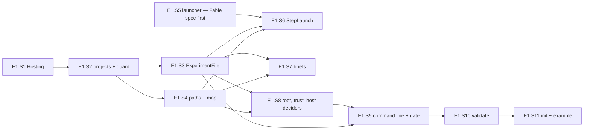

# PLAN — E1 stories: facts, layout and the launch boundary of the model-arms module

> Status: **plan only, nothing implemented yet, 2026-10-29.** Epic E1 of [PLAN_model_arms.md](PLAN_model_arms.md) (§3 D1–D5, D9,
> D15, D17–D20, D23, D24; §4.1–§4.4, §4.10, §4.12; §7's E1 tests).
>
> Scope: a new `src/Bench.Hosting` (three files moved out of `hosts/Cli`), the two projects under `tools/model-arms/`, the launcher
> widenings in `src/Bench.Application/CliAgent.cs`, `src/Bench.Infrastructure/Models/CliAgentRuntime.cs` and
> `src/Bench.Infrastructure/Process/ProcessRunner.cs`, the eight brief templates, the worked example, the `init` and `validate`
> verbs, tests under `tests/Bench.Tests/ModelArms/` (plus one class each in `tests/Bench.Tests/Models/` and
> `tests/Bench.Tests/Infrastructure/`), `research/module_model_arms.md`. Nothing here launches a model.
> Eleven stories, E1.S1–E1.S11 (the parent's map named nine; §8 records the split). Cornerstone area of this epic: **the launch
> boundary**, marked on **E1.S5** (`model: fable`). The parent's ledger now reads `Cornerstones: 1 of 2 — E1.S5`.

## 1. Goal, before any solution

The parent (§1) ports the owner's bash harness to C#. Before a single step can run (E2), four things must exist and be pinned by
tests: **the module itself**, guarded so its decisions stay pure (D1); **the experiment's facts** as one refusing file with a trust
check and a way to create and check a root (D4, D17, D18, D23, D24); **one spelling of every path** an arm leaves (D5); and **a launch
the shared launcher can actually express** — a claude session started under a known id or resumed, under the three tool modes, with
stderr on disk as it arrives (§4.4) — plus every brief filled completely without leaking an arm (D15). A step that cannot be
launched, or a path spelled twice, is a defect E2 would inherit and hide.

## 2. What exists — verified at `83c221e`, 2026-10-29

Every line below was opened in this worktree. Shell-harness citations are paths in `/home/jinx/git/coai-exp2/` (read 2026-10-29).

| Fact | Where |
|---|---|
| The parser, its exception and the flag rule ("a bare word after a flag is its value"); a cref to the host's `Program.Run` | `hosts/Cli/CommandLine.cs:1` (namespace `Bench.Cli`), `:4` (`<see cref="Program.Run"/>`), `:6`, `:11`, `Parse` `:68-97`, `NextValue` `:99-102` |
| The exit codes — `Pass 0 · Regression 1 · Environment 3 · Configuration 4 · NoReport 5` | `hosts/Cli/ExitCodes.cs:12-29` |
| The root token; its notice says `bench:` | `hosts/Cli/ShutdownSignal.cs:16`, `Install` `:28`, `Request` `:43`, the notice `:50` |
| The CLI host: `public static class Program` in `Bench.Cli`; `Main` installs the signal and maps a late cancel to `NoReport`; `Run` maps `CommandLineException` to `Configuration`; the dispatch is a block-bodied switch of `"verb" =>` arms | `hosts/Cli/Program.cs:15`, `:17-45`, `:53-70`, `:96-103`; `hosts/Cli/Cli.csproj` (exe `bench`, references Application, Infrastructure, ServiceDefaults) |
| The solution's folders | `dew_flow_benchmark.slnx:2-23` (`/src/`, `/hosts/`, `/tests/`; no `/tools/`) |
| Build defaults for every project under the root (`net10.0`, nullable, `TreatWarningsAsErrors`, central packages) | `Directory.Build.props:3-10` |
| The test project: references the Cli EXE, the fakes as `ReferenceOutputAssembly="false"`, copies `Fixtures\**` | `tests/Bench.Tests/Bench.Tests.csproj:20`, `:23-38` |
| The architecture guard's helpers are PRIVATE: `Referenced(fileName)` loads `AppContext.BaseDirectory/<file>`; `IsRuntime` = `System*`, `netstandard`, `mscorlib`; the named-decider pattern | `tests/Bench.Tests/ArchitectureTests.cs:465-471`; `:108-201` |
| The repository root for tests (two copies exist: internal `Repository.Root` in `Bench.Tests.Cli`, `TestRepository.Root()` in `Bench.Tests.Infrastructure`) | `tests/Bench.Tests/Cli/AppHostLaunchProfileTests.cs:95-112`; `tests/Bench.Tests/Infrastructure/TestRepository.cs:7-18` |
| Test helpers `Ok()`, `Reason()`, `Failed()` over `Outcome<T>` | `tests/Bench.Tests/OutcomeEx.cs` |
| `Outcome<T>` (`Ok`/`Fail`, `Success`, `Failure`, `Match`) | `src/Bench.Domain/Outcome.cs:6-25` |
| `CommitSha.Parse` — 40 hex, lower-cased, abbreviations refused | `src/Bench.Domain/Targets/MeasurementTarget.cs:36-61` |
| The strict-JSON precedent (`UnmappedMemberHandling.Disallow` — stops at the FIRST unknown member) | `src/Bench.Application/Lanes/LaneJson.cs:27-49` |
| `AgentAsk(Runtime, Executable, Prompt, WorkingDirectory, Wall, ModelId)` with `Options`, `Environment`, `Output` init-properties | `src/Bench.Application/CliAgent.cs:21-40` |
| `AgentOutputSink.None` / `Lines(Action<string>)`; `AgentEnvironment.Inherited` / `Only(dict)` (replaced, not merged) | `src/Bench.Application/CliAgent.cs:44-59`, `:64-85` |
| `AgentAskOptions` and `IsNone`; no custom `ToString` (the record's generated one) | `src/Bench.Application/CliAgent.cs:100-178`, `IsNone` `:171-177` |
| `CliArgv.For` → refusal first (`Unsupported`), then per-CLI argv; claude's argv; the deny list; the per-option "honoured by" table | `src/Bench.Infrastructure/Models/CliAgentRuntime.cs:68-89`, `Claude` `:111-131`, `ClaudeDenied` `:148-149`, `Unsupported` `:153-186` |
| The one launch path: argv, then `ProcessRunner.RunAsync(exe, argv, cwd, wall, prompt, env-or-null, stdout-sink-or-null, ct)` | `src/Bench.Infrastructure/Models/CliAgentRuntime.cs:263-303` (the call `:292-300`) |
| `ProcessRunner`: the overload chain ending in the stdout line-sink overload; `StartInfo`; the core wait/wall/tree-kill; UTF-8 for a streamed launch; `PumpAsync` (a throwing sink cancels the budget → the tree dies) | `src/Bench.Infrastructure/Process/ProcessRunner.cs:54-136`, `:168-190`, `:228-277`, `:285-296`, `:300-320` |
| The child-environment names: `IsHarnessVariable` = `BENCH_*` or `COAI_*`; `IsSecretName` = `*_KEY`, `*_TOKEN`, `*_SECRET`, `*_PASSWORD`, the creds key | `src/Bench.Domain/Gate/CoaiEnvironment.cs:277-278`, `:286-291` |
| The scout flags D19 forbids: `SUBAGENT_MODEL_GUARD`, `CLAUDE_CODE_DISABLE_BACKGROUND_TASKS` | `src/Bench.Domain/Probes/ProbeChildEnvironment.cs:44`, `:52` |
| A mode check precedent (`File.GetUnixFileMode(path) & group/other bits`) | `src/Bench.Infrastructure/Gate/FileHashKeyFile.cs:93-95` |
| `GitCommand.RunAsync` (merged output) / `ReadAsync` (stdout) / `AskAsync` (exit 1 is git's "no") | `src/Bench.Infrastructure/Git/GitHistory.cs:12-63` |
| A real temp git repository for tests | `tests/Bench.Tests/Infrastructure/GitCheckoutTests.cs:147-215` (`TempGitRepo`) |
| The fake CLI: script field `stderr` (`:105`), `lineDelayMs` (`:130`), `holdAfterLine` (`:134`); `exit` mode writes stderr and exits (`:200-204`); `answer` writes stderr then the answer (`:228-231`); a replay never writes stderr (`:251-279`); every call logs argv, cwd, prompt, pid and the env NAMES (`:562-591`); the test handle | `tests/FakeCli/Program.cs`; `tests/Bench.Tests/Probes/Driver/FakeCli.cs:10-79` |
| The stdout-sink tests this epic's stderr tests mirror | `tests/Bench.Tests/Scouts/ScoutLaunchProcessTests.cs:24-66` |
| The argv suites that must stay unedited | `tests/Bench.Tests/Probes/ProbeArgvTests.cs`, `tests/Bench.Tests/Scouts/ScoutArgvTests.cs`, `tests/Bench.Tests/Models/AssessorArgvTests.cs` |
| The shell's tool lists, deny list, `fill`, the three modes' flags and the claude argv; `TMPDIR` per arm | `run-arm.sh:25-38`, `:40-50`, `:86-89`, `:106-108`, `:20` |
| The shell's SRS files: `wt-build-<id>.log`, `pick-<id>.log`, `picked-<id>`, `task-<id>.before`, `<id>-code.md`, `task-<id>-haiku.head\|.diff`, `batch-<i>.done`, `tasks-plan.log`, `notes/split.md` | `t-lib.sh:20`, `:26-36`, `:52-54`, `:61`, `:74`, `:80-85` |
| The shell's facts: `scenarios.json` = `[{"id","kind":"cs"\|"node","name"}]` (43 rows); `baseline.json` = `{"mcpFailed","tsFailed","note"}`; the arm map = `{"C1":"<12 hex>",…}` | `scenarios.json`, `baseline.json`, `.map-904c78af.json` |
| The eight templates and the fields each uses (sha256 in E1.S7) | `briefs/*.template.md` |

## 3. Conventions every story follows

- **Namespaces.** Core: `ModelArms.Core.<Folder>` (`ModelArms.Core.Experiment`, `.Launch`, `.Briefs`). Console: `ModelArms`
  (`Program`, `ExperimentGate`, `VerbInput`…), `ModelArms.Verbs`, `ModelArms.Adapters`. Tests: `Bench.Tests.ModelArms` in
  `tests/Bench.Tests/ModelArms/`. **Inside the test namespace never write a name starting `ModelArms.`** — the compiler resolves it to
  `Bench.Tests.ModelArms`. Put `using ModelArms.Core.Experiment;` etc. at the top of the file, and alias the console's entry point:
  `using ArmsProgram = ModelArms.Program;`.
- **Pure means pure.** A Core type opens no file, starts no process, reads no clock and no environment; facts arrive as parameters.
  Every `public static class` a story adds to Core is added, in the same story, to `PureDeciders` in
  `tests/Bench.Tests/ModelArms/ModelArmsArchitectureTests.cs`, **under that story's own marker line** (`// E1.S3` …), so parallel
  stories touch disjoint lines.
- **Data are records; refusals are values.** `Outcome<T>` for one-reason refusals; a list of problem sentences (one per line) where a
  file can be wrong in several places at once. A programming error (a path segment containing a separator) throws
  `ArgumentException`; an operator's mistake never throws.
- **Every refusal names what it refused and the legal values** (`common.coding-style`). English only.
- **Red first, on an assertion.** Write the type with its final signature and a stub body that returns the wrong answer (named per
  story), write the tests, build, run the class, and record the FAILING ASSERTION messages; then implement. A compile error is not a
  red.
- **Docs per story.** `research/module_model_arms.md` is created by E1.S2 with one heading per story; each later story writes ONLY under
  its own heading.
- **Commands** (WSL — no `.exe`; never `dotnet test`; always through the lowering wrapper):

```bash
node .agents/conventions/tools/low-priority.mjs dotnet build dew_flow_benchmark.slnx -c Release -m:4
node .agents/conventions/tools/low-priority.mjs ./tests/Bench.Tests/bin/Release/net10.0/Bench.Tests --filter-class "*<Class>"
node .agents/conventions/tools/low-priority.mjs ./tests/Bench.Tests/bin/Release/net10.0/Bench.Tests --filter-namespace "Bench.Tests.ModelArms"
node .agents/conventions/tools/low-priority.mjs dotnet format dew_flow_benchmark.slnx --verify-no-changes --no-restore
node .agents/conventions/tools/low-priority.mjs ./tests/Bench.Tests/bin/Release/net10.0/Bench.Tests   # the whole suite, once per story, Docker up
node .agents/conventions/tools/plan-lifecycle.mjs
```

  "Green" below always means: the build has 0 warnings, the story's classes pass, `dotnet format` is clean, and the whole suite
  passes (Docker up for the durability tests).

## 4. Shared contracts (fixed here so stories can run in parallel)

**C1 — the experiment facts** (E1.S3; read by S6–S11). In `ModelArms.Core.Experiment`:

```csharp
public sealed record ExperimentLocation(string Root, string Home, string EnclosingGitTop, string ThisRepository);
public enum StepMode { Write, Read, Gate }
public enum StepKind { Code, Review, Fix, HReview, Gate, Split, SplitFix, TaskCode }   // JSON keys: code review fix hreview gate split splitFix taskCode
public enum AwakeChoice { Auto, Windows, Wsl, None }                                   // JSON: auto windows wsl none
public sealed record StepSpec(StepKind Kind, string Model, int Minutes, StepMode Mode);
public abstract record SchemeEntry { private SchemeEntry() { } public sealed record Step(string Name, StepKind Kind) : SchemeEntry; public sealed record Tasks : SchemeEntry; }
public sealed record Scheme(string Name, IReadOnlyList<SchemeEntry> Entries);
public sealed record ToolSets(IReadOnlyList<string> Write, IReadOnlyList<string> Read, IReadOnlyList<string> Gate, IReadOnlyList<string> Deny);
public sealed record SuiteFacts(IReadOnlyList<string> Command, string CtrfFile, string NamePrefix);
public sealed record FormatFacts(string Solution, IReadOnlyList<string> Verbs);
public sealed record ExtensionFacts(string Directory, IReadOnlyList<string> Command);
public sealed record TargetFacts(string Source, string PlanBranch, CommitSha Base, string Plan, string Branch, string RulesSubmodule,
    IReadOnlyList<string> LowPriority, IReadOnlyList<string> Build, SuiteFacts Suite, FormatFacts Format, ExtensionFacts Extension,
    IReadOnlyList<string> NodeModules, IReadOnlyList<string> TestGlobs);
public sealed record Limits(int WaitSeconds, int Tries, int GateWaitSeconds, int GateTries, int MinimumRemainingSeconds, int KillGraceSeconds);
public sealed record TaskLimits(int Min, int Max, int MaxParallel) { public static TaskLimits Shell { get; } = new(4, 7, 4); }
public sealed record CoaiFacts(string Binary, string Settings, string Side) { public static CoaiFacts None { get; } = new("", "", ""); public bool Configured => Binary.Length > 0; }
public sealed record IsolationFacts(IReadOnlyList<string> Closed, IReadOnlyList<string> Unlisted) { public static IsolationFacts None { get; } = new([], []); public bool Configured => Closed.Count + Unlisted.Count > 0; }
public sealed record Experiment(string Root, TargetFacts Target, string ScenariosFile, string BaselineFile, string Known,
    IReadOnlyDictionary<StepKind, StepSpec> Steps, IReadOnlyList<Scheme> Schemes, IReadOnlyList<IReadOnlyList<string>> Rounds,
    Limits Limits, TaskLimits Tasks, ToolSets Tools, CoaiFacts Coai, IsolationFacts Isolation, AwakeChoice Awake);
public static class ExperimentFile
{
    public const string Schema = "model-arms/experiment-v1";
    public static Outcome<Experiment> Read(string json, ExperimentLocation location);           // Reason = every problem, one per line
    public static IReadOnlyList<string> Placement(ExperimentLocation location);                // the two root refusals of D4
}
public static class ArmNames { public static Outcome<string> SchemeOf(string arm); }            // "SRS2" → "SRS"; ^[A-Za-z]+[0-9]+$
public static class ExecutableRule { public static string Refusal(string executable, IReadOnlyList<string> forbiddenRoots); } // "" = fine
public static class StepKinds { public static Outcome<StepKind> Parse(string key); public static string Key(StepKind kind); }
```

`ScenariosFile` and `BaselineFile` are RELATIVE names inside the root, as configured (`"scenarios.json"`). `Root` is absolute,
normalised, without a trailing separator. Paths inside `Isolation` are expanded (`<root>` → `Root`, a leading `~` → `Home`).

**C2 — the paths and the map** (E1.S4; read by S6–S11 and every later epic). In `ModelArms.Core.Experiment`:

```csharp
public sealed record RootPaths(string Root) { /* members listed in E1.S4 */ public Outcome<string> Of(string relative); public ArmPaths Arm(string token); }
public sealed record ArmPaths(string Root, string Token) { /* members listed in E1.S4 */ }
public sealed record ArmMap { public static ArmMap Empty { get; } public IReadOnlyList<KeyValuePair<string, string>> Entries { get; }
    public static Outcome<ArmMap> Read(string json); public string ToJson(); public static ArmMap Extend(ArmMap existing, IReadOnlyList<string> arms, Func<byte[]> eightRandomBytes);
    public Outcome<string> TokenOf(string arm); public IReadOnlyList<string> Leaks(string text, string ownArm, IReadOnlyCollection<string> schemes); public string Scrub(string line); }
```

**C3 — the launch options** (E1.S5, the cornerstone; read by S6 and E2.S4). Binding names and types — Fable's spec may change them
only by changing E1.S6's section in the same commit:

```csharp
namespace Bench.Application;
public enum AgentPermissionMode { NotAsked, Default, AcceptEdits, Plan }
// AgentAskOptions gains:  Guid SessionId (Guid.Empty = none) · Guid ResumeSessionId · AgentPermissionMode PermissionMode = NotAsked · IReadOnlyList<string> PermittedTools = []
// AgentAsk gains:         AgentOutputSink ErrorOutput { get; init; } = AgentOutputSink.None
namespace Bench.Infrastructure.Process;
// ProcessRunner gains:    RunAsync(string executable, IReadOnlyList<string> arguments, string workingDirectory, TimeSpan timeout, string input,
//                                  IReadOnlyDictionary<string, string>? environment, Action<string>? stdoutLine, Action<string>? stderrLine, CancellationToken)
```

Claude spells them `--session-id <guid "D">`, `--resume <guid "D">`, `--permission-mode default|acceptEdits|plan`, and
`--allowedTools <name> <name> …` (each name its own token); every other CLI refuses each by name.

**C4 — the console's verb input** (E1.S9; read by S10, S11 and every later verb). In namespace `ModelArms`:

```csharp
public sealed record ModuleFiles(string ExampleFile, string ShippedBriefs) { public static ModuleFiles Beside(string baseDirectory); }  // <base>/examples/part6.experiment.json, <base>/briefs
public sealed record VerbInput(string Verb, IReadOnlyList<string> Positionals, Bench.Cli.CommandLine Flags, TextWriter Output, TextWriter Error,
    IReadOnlyDictionary<string, string> Environment, ModuleFiles Module, CancellationToken Stopping);
public sealed record ExperimentInput(VerbInput Verb, RootPaths Root, Experiment Experiment);
public static class ExperimentGate { public static Task<int> RunAsync(VerbInput input, Func<ExperimentInput, Task<int>> verb); }
```

## 5. Stories

### E1.S1 — `Bench.Hosting`: the parser, the exit codes and the shutdown signal move out of the CLI host

- **Coder:** sonnet · **Spec:** this section (Opus) · **Review:** Opus. **Depends on:** nothing. **Parallel with:** E1.S5.
- **Owns:** D3. **Size:** ≈ 60 changed lines plus three moved files.

**Files.**

| File | Change |
|---|---|
| `src/Bench.Hosting/Bench.Hosting.csproj` | new — `Microsoft.NET.Sdk`, no packages, no references, `<RootNamespace>Bench.Cli</RootNamespace>`, a comment: *"The CLI hosts' shared plumbing — the flag parser, the exit-code contract, the root cancellation token. Moved out of hosts/Cli (todo/PLAN_model_arms.md D3) because two hosts need them and an exe may not reference an exe. The namespace stays Bench.Cli so no using changed."* |
| `src/Bench.Hosting/CommandLine.cs`, `ExitCodes.cs`, `ShutdownSignal.cs` | `git mv` from `hosts/Cli/`; content unchanged EXCEPT `CommandLine.cs:4`: `<see cref="Program.Run"/>` → `<c>Program.Run</c> of the host` (the type is no longer visible from this assembly; a dangling cref is a broken reference whether or not the compiler checks it) |
| `hosts/Cli/Cli.csproj` | add `<ProjectReference Include="..\..\src\Bench.Hosting\Bench.Hosting.csproj" />` |
| `dew_flow_benchmark.slnx` | add `<Project Path="src/Bench.Hosting/Bench.Hosting.csproj" />` in `/src/` after `Bench.Delivered` |
| `tests/Bench.Tests/ModelArms/HostingExtractionTests.cs` | new |
| `research/architecture.md` | the layers diagram (`:19-81`): a node `hosting["Bench.Hosting — CommandLine · ExitCodes · ShutdownSignal<br/>(namespace Bench.Cli, shared by the CLI hosts)"]` and an edge `cli --> hosting`; one sentence under the diagram saying why it is a project |
| `todo/PLAN_gate_measurement_tail.md:185`, `todo/PLAN_subagent_policy_ab_E3.md:70`, `todo/PLAN_subagent_policy_ab_E4.md:296` | the path `hosts/Cli/ExitCodes.cs` → `src/Bench.Hosting/ExitCodes.cs` (line numbers unchanged: the file's content did not change). Research records citing the old path are dated evidence and stay |

**Existing code used.** The three files as listed in §2; `tests/Bench.Tests/Cli/AppHostLaunchProfileTests.cs:95` (`Repository.Root`).

**Scenarios** (`HostingExtractionTests`, namespace `Bench.Tests.ModelArms`, `using Bench.Cli;`).

| Test | Given / When / Then | Red (before the move) |
|---|---|---|
| `The_cli_parser_and_exit_codes_live_in_Bench_Hosting_under_their_old_namespace` | Given the built test assembly; when `typeof(CommandLine)`, `typeof(CommandLineException)`, `typeof(ExitCodes)`, `typeof(ShutdownSignal)` are inspected; then each `.Assembly.GetName().Name` is `"Bench.Hosting"` and each `.Namespace` is `"Bench.Cli"` | `Expected … to be "Bench.Hosting", but "bench" differs near "ben"` |
| `The_cli_host_no_longer_carries_its_own_copy` (added) | Given `Repository.Root`; then `hosts/Cli/CommandLine.cs`, `ExitCodes.cs`, `ShutdownSignal.cs` do not exist and `src/Bench.Hosting/` holds all three | `Expected File.Exists(".../hosts/Cli/CommandLine.cs") to be false` |

Write the test first, run it red against the unmoved files, then move. `tests/Bench.Tests/Cli/CommandLineTests.cs` and
`ShutdownSignalTests.cs` stay byte-for-byte unedited (`git diff --stat` shows neither).

**Commands.** `--filter-class "*HostingExtractionTests"`, `"*CommandLineTests"`, `"*ShutdownSignalTests"`, `"*CliContractTests"`; then the whole suite.

**Done when.** Both tests green; `CommandLineTests`, `ShutdownSignalTests` unedited and green; the solution builds with 0 warnings;
`git status` shows the three files as renames (`R`), not as delete + add with changes beyond line 4 of `CommandLine.cs`.

**Out of bounds.** Any change to the moved code's behaviour; the `bench:` wording of `ShutdownSignal.cs:50` (model-arms will print it
too — recorded in §8, not fixed here); `.agents/PROJECT.md`'s project table (an instruction file — not this task); other hosts.

### E1.S2 — The two module projects, their references, and the architecture guard

- **Coder:** sonnet · **Spec:** Opus · **Review:** Opus. **Depends on:** E1.S1 (the console references `Bench.Hosting`).
- **Owns:** D1, D2. **Size:** ≈ 200 changed lines.

**Files.**

| File | Change |
|---|---|
| `tools/model-arms/ModelArms.Core/ModelArms.Core.csproj` | new — `Microsoft.NET.Sdk`; `<RootNamespace>ModelArms.Core</RootNamespace>`; `ProjectReference` to `..\..\..\src\Bench.Domain\Bench.Domain.csproj` and `..\..\..\src\Bench.Application\Bench.Application.csproj`; no packages; a comment stating D1 (pure by construction; facts arrive as parameters) |
| `tools/model-arms/ModelArms/ModelArms.csproj` | new — `<OutputType>Exe</OutputType>`, `<AssemblyName>model-arms</AssemblyName>`, `<RootNamespace>ModelArms</RootNamespace>`; references `..\ModelArms.Core\ModelArms.Core.csproj`, `..\..\..\src\Bench.Infrastructure\Bench.Infrastructure.csproj`, `..\..\..\src\Bench.Hosting\Bench.Hosting.csproj`; two content items so later stories never touch this file: `<Content Include="..\briefs\*.template.md" Link="briefs\%(Filename)%(Extension)" CopyToOutputDirectory="PreserveNewest" />` and `<Content Include="..\examples\*.json" Link="examples\%(Filename)%(Extension)" CopyToOutputDirectory="PreserveNewest" />` |
| `tools/model-arms/ModelArms/Program.cs` | new, minimal so the exe links: `namespace ModelArms; public static class Program { public static int Main(string[] args) => Bench.Cli.ExitCodes.Configuration; }` (E1.S9 replaces it) |
| `dew_flow_benchmark.slnx` | a `<Folder Name="/tools/">` after `/hosts/` holding both projects |
| `tests/Bench.Tests/Bench.Tests.csproj` | `ProjectReference` to both module projects (ordinary references) |
| `tests/Bench.Tests/ArchitectureTests.cs` | `:465` and `:468`: `private static` → `internal static` on `Referenced` and `IsRuntime` (reuse, widened — no copy) |
| `tests/Bench.Tests/ModelArms/ModelArmsArchitectureTests.cs` | new |
| `research/module_model_arms.md` | new — status line, *Purpose* (from the parent §1, five lines), *Projects and the guard* (filled by this story), and these empty headings each owned by one story: *The experiment file (E1.S3)*, *Paths and the arm map (E1.S4)*, *The launch boundary (E1.S5, E1.S6)*, *Briefs (E1.S7)*, *The root, trust and the host (E1.S8, E1.S10)*, *The command line (E1.S9)*, *The first run: init and validate (E1.S11)* |

**Contract.** `ModelArmsArchitectureTests` holds `private static readonly Type[] PureDeciders = [ /* E1.S3 */ … ];` written as one marker
comment per story, each on its own line with a blank line between them: `// E1.S3`, `// E1.S6`, `// E1.S7`, `// E1.S8`, `// E1.S9`,
`// E1.S10`, `// E1.S11`, `// E2`, `// E3`, `// E4`, `// E5`. Empty in this story.

**Scenarios** (all four names from the parent §7).

| Test | Given / When / Then | Red — planted, observed, removed |
|---|---|---|
| `Core_references_only_the_runtime_the_domain_and_the_application_layer` | `ArchitectureTests.Referenced("ModelArms.Core.dll")` should `OnlyContain(r => IsRuntime(r) \|\| r.Name is "Bench.Domain" or "Bench.Application")` | plant a `ProjectReference` to `Bench.Infrastructure` in Core and `internal static class Planted { internal static readonly Type T = typeof(Bench.Infrastructure.Process.ProcessRunner); }` → `Expected … to contain only items matching … but … Bench.Infrastructure … do not` |
| `Core_never_references_infrastructure_or_entity_framework` | same assembly; `NotContain(r => r.Name == "Bench.Infrastructure" \|\| r.Name!.StartsWith("Microsoft.EntityFrameworkCore") \|\| r.Name!.StartsWith("Npgsql"))` | the same plant → red naming `Bench.Infrastructure` |
| `Nothing_under_src_or_hosts_references_the_model_arms_module` | every `*.csproj` under `src/` and `hosts/` (from `Repository.Root`) contains neither `ModelArms` nor `model-arms`; and for each `Bench.*.dll` and `bench.dll` in `AppContext.BaseDirectory`, `Referenced(...)` contains no `ModelArms.Core` and no `model-arms` | plant `<ProjectReference Include="..\..\tools\model-arms\ModelArms.Core\ModelArms.Core.csproj" />` in `src/Bench.Api/Bench.Api.csproj` → `Expected … to be empty, but found {"src/Bench.Api/Bench.Api.csproj"}` |
| `Every_core_decider_is_named_in_the_pure_list` | (a) every type in `PureDeciders` has `Assembly.GetName().Name == "ModelArms.Core"`; (b) every `public static class` of `ModelArms.Core.dll` (`IsAbstract && IsSealed && IsPublic`, not in a namespace ending `.Ports`) is in `PureDeciders` | plant `public static class PlantedDecider {}` in Core → `Expected … to contain PlantedDecider` |

E1.S3 adds the companion `ScannedStaticClasses().Should().NotBeEmpty("a structural scan that matches nothing passes forever")` with
its first decider; until then (b) is vacuous, which is why the plant above is the red.

**Commands.** `--filter-class "*ModelArmsArchitectureTests"`, `"*ArchitectureTests"`; the whole suite.

**Done when.** The four tests were each seen red against their plant (messages recorded in the summary), the plants removed, all
green; `ArchitectureTests` green; `tools/model-arms/ModelArms/bin/Release/net10.0/model-arms` exists after the build.

**Out of bounds.** Any Core type; the dispatch; `research/architecture.md`'s module map (E5.S5).

### E1.S3 — `ExperimentFile`: the facts, every refusal named at once, and the worked example

- **Coder:** sonnet · **Spec:** Opus · **Review:** Opus. **Depends on:** E1.S2. **Parallel with:** E1.S4.
- **Owns:** D4 (the file), §4.2, D17(b) (the static half), D24 (the example file). **Size:** ≈ 650 lines (≈ 300 code, 120 example, 230 tests).

**Files.**

| File | Contents |
|---|---|
| `tools/model-arms/ModelArms.Core/Experiment/ExperimentFacts.cs` | the records and enums of C1 except `Scheme`/`SchemeEntry`/`StepSpec`/`ToolSets`, plus `ExperimentLocation` |
| `…/Experiment/Scheme.cs` | `Scheme`, `SchemeEntry`, `ArmNames` |
| `…/Experiment/StepSpec.cs` | `StepMode`, `StepKind`, `StepSpec`, `StepKinds` |
| `…/Experiment/ToolSets.cs` | `ToolSets` |
| `…/Experiment/ExecutableRule.cs` | `ExecutableRule` |
| `…/Experiment/StrictJson.cs` | `internal sealed class StrictJson` — the problem-collecting reader below |
| `…/Experiment/ExperimentFile.cs` | `ExperimentFile` |
| `tools/model-arms/examples/part6.experiment.json` | the worked example (content below) |
| `tests/Bench.Tests/ModelArms/ExperimentFileTests.cs` | new |
| `tests/Bench.Tests/ModelArms/ModelArmsArchitectureTests.cs` | under `// E1.S3`: `typeof(ExperimentFile), typeof(ArmNames), typeof(ExecutableRule), typeof(StepKinds),`; and the companion `NotBeEmpty` assertion |
| `research/module_model_arms.md` | *The experiment file*: the members, the refusals, the placeholders |

**How `ExperimentFile.Read` works (no design left).** Parse with `JsonNode.Parse(json, default, new JsonDocumentOptions { CommentHandling
= JsonCommentHandling.Skip, AllowTrailingCommas = false })`; a `JsonException` is the single problem `"experiment.json is not JSON:
<message>"`. Then walk the tree with `StrictJson`, which holds `List<string> Problems` and offers `Object(node, path, string[] known,
string[] required)`, `Text(obj, path, name, required)`, `Int(…)`, `Texts(…)` (an array of strings) — each records a sentence instead
of throwing, and `Object` records **every** unknown member of that object (`"target.bulid is not a member this build knows (known:
source, planBranch, …) — refused rather than ignored"`) and every missing required one (`"target.base is missing"`). Every problem is
collected; `Read` returns `Success` only with zero problems, else `Failure(string.Join('\n', problems))` in document order. (Why not
`JsonUnmappedMemberHandling.Disallow`, the catalog's rule: it stops at the first member, and D4 + `Validate_names_every_refused_member_in_one_answer` want all.)

**The members** (§4.2). Top level — required: `schema`, `target`, `scenarios`, `baseline`, `known`, `steps`, `schemes`, `rounds`,
`limits`, `tools`, `awake`; optional: `tasks` (absent → `TaskLimits.Shell`), `coai` (absent → `CoaiFacts.None`), `isolation` (absent →
`IsolationFacts.None`). `target` — all required: `source`, `planBranch`, `base`, `plan`, `branch`, `rulesSubmodule`, `lowPriority`,
`build`, `suite{command,ctrfFile,namePrefix}`, `format{solution,verbs}`, `extension{directory,command}`, `nodeModules`, `testGlobs`.
`limits` — all six required; `tasks` — `min`, `max`, `maxParallel`; `tools` — `write`, `read`, `gate`, `deny`; `coai` — `binary`,
`settings`, `side`; `isolation` — `closed`, `unlisted`.

**The value rules** (each a sentence naming the path and the legal shape):

- `schema` exactly `model-arms/experiment-v1`: `"schema is 'x' — this build reads exactly 'model-arms/experiment-v1'"`.
- `target.source`, `coai.binary`, `coai.settings`: absolute (`Path.IsPathFullyQualified`). `target.plan`, `rulesSubmodule`,
  `format.solution`, `extension.directory`, each of `nodeModules` and `testGlobs`, `scenarios`, `baseline`: relative, not rooted, no
  `..` segment. `target.base`: `CommitSha.Parse` (its reason quoted). Every other text: non-empty.
- Every command (`lowPriority`, `build`, `suite.command`, `extension.command`): a non-empty array whose first element passes
  `ExecutableRule.Refusal(argv[0], [target.source, <root>/base, <root>/r])`.
- `ExecutableRule.Refusal`: a bare name (no `/`, no `\`) → `""`; a path that is not fully qualified → `"the executable './x' is a
  relative path, resolved against the target — use a name from PATH or an absolute path outside the target (D17)"`; an absolute path
  equal to or under a forbidden root (compare `Path.GetFullPath`, ordinal, with a trailing separator) → `"the executable '<p>' is
  under '<root>' — a harness never runs a file an arm could write; pass it as an argument of an executable resolved outside (D17)"`.
- `steps`: an object whose keys parse with `StepKinds.Parse` (unknown → `"steps.lint is not a step kind (code, review, fix, hreview,
  gate, split, splitFix, taskCode)"`); each value `{model, minutes, mode}` all required, `minutes > 0`, `mode` ∈ `write|read|gate`.
- `schemes`: an object; each value an array of entries, each entry either exactly `"tasks"` or matching
  `^(?<name>[0-9]+[a-z]?-[A-Za-z0-9-]+):(?<kind>[A-Za-z]+)$` whose kind is a key present in `steps`; scheme names match `^[A-Za-z]+$`.
- `rounds`: an array of non-empty arrays of arm names; each arm `ArmNames.SchemeOf(arm)` must name a scheme present:
  `"rounds[1] names 'XY2', whose scheme 'XY' is not among the schemes (C, CR, SRS)"`. (An arm named twice is `HostChecks`', E1.S10.)
- `limits.*`, `tasks.*` > 0, and `tasks.min ≤ tasks.max`. `awake` ∈ `auto|windows|wsl|none`. `coai.side`: no separator, no `..`.
- `isolation.*`: each entry is `<root>`, starts `<root>/`, starts `~/`, or is absolute; expanded into `Experiment.Isolation`.
- `ExperimentFile.Placement(location)`: `ThisRepository` non-empty and `Root` equal to or under it → `"the experiment root <root> is
  inside this repository (<repo>) — a root lives outside every checkout"`; `EnclosingGitTop` non-empty → `"the experiment root <root>
  is inside the git checkout <top> — the arms' clones would nest in it"`. `Read` adds these problems first.

**The worked example** `tools/model-arms/examples/part6.experiment.json` — the parent's §4.2 with every absolute path under
`/example/`, the full tool lists of `run-arm.sh:25-38`, and `//` comments inside the root object only (none before `{`):

```jsonc
{
  "schema": "model-arms/experiment-v1",
  // The repository the arms work on: its plan branch, the frozen base commit, the plan, the branch every arm commits to.
  "target": {
    "source": "/example/target",
    "planBranch": "docs/plan-a-spent-quota-cools-the-model-down",
    "base": "6786582e30d3e771549d05ed719478396f8099cd",
    "plan": "todo/PLAN_a_spent_quota_cools_the_model_down.md",
    "branch": "feat/quota-cooldown",
    "rulesSubmodule": ".agents/conventions",
    // Every command is an executable and its arguments. The executable is a name from PATH or an absolute path OUTSIDE the target
    // (D17); a file under the target may only be an argument — which is why the suite runs as `dotnet <tests>.dll`.
    "lowPriority": ["node", ".agents/conventions/tools/low-priority.mjs"],
    "build": ["dotnet", "build", "dew_flow_connect_other_ais.slnx", "-c", "Debug", "-m:4", "--disable-build-servers"],
    "suite": { "command": ["dotnet", "src_mcp/tests/bin/Debug/net10.0/CoaiMcp.Tests.dll", "--report-xunit-ctrf"], "ctrfFile": "mcp.ctrf.json", "namePrefix": "CoaiMcp.Tests." },
    "format": { "solution": "dew_flow_connect_other_ais.slnx", "verbs": ["whitespace", "style"] },
    "extension": { "directory": "src_vs_code", "command": ["npm", "test"] },
    "nodeModules": ["src_vs_code/node_modules", ".agents/conventions/node_modules"],
    "testGlobs": ["src_mcp/tests", "src_vs_code/src/test"]
  },
  "scenarios": "scenarios.json",
  "baseline": "baseline.json",
  // Said to every coder and reviewer as KNOWN: what fails at the base before any arm touched it.
  "known": "Nothing is known to fail: at the base commit the whole MCP suite (13,807 tests) and the extension tests pass on this host (Linux, WSL2; tests marked Windows-only skip). A failure you see is yours or a flaky test: re-run that one test alone before you decide.",
  // One entry per step kind: the model alias, the budget in minutes, and the tool mode (write · read · gate).
  "steps": {
    "code":     { "model": "sonnet", "minutes": 180, "mode": "write" },
    "hreview":  { "model": "haiku",  "minutes": 60,  "mode": "write" },
    "review":   { "model": "opus",   "minutes": 40,  "mode": "read"  },
    "fix":      { "model": "sonnet", "minutes": 60,  "mode": "write" },
    "gate":     { "model": "sonnet", "minutes": 150, "mode": "gate"  },
    "split":    { "model": "sonnet", "minutes": 40,  "mode": "write" },
    "splitFix": { "model": "sonnet", "minutes": 15,  "mode": "write" },
    "taskCode": { "model": "haiku",  "minutes": 45,  "mode": "write" }
  },
  // A scheme is its steps in order, "<file name>:<step kind>"; "tasks" is the SRS pipeline (split, one fix round, the batches).
  "schemes": {
    "C":   ["1-code:code", "2-review:review", "3-fix:fix", "4-gate:gate"],
    "CR":  ["1-code:code", "2-hreview:hreview", "3-review:review", "4-fix:fix", "5-gate:gate"],
    "SRS": ["tasks", "3-hreview:hreview", "4-review:review", "5-fix:fix", "6-gate:gate"]
  },
  // Rounds run one after another; the arms of a round run at the same time. An arm's scheme is its letters (SRS2 → SRS).
  "rounds": [["C1", "CR1", "SRS1"], ["C2", "CR2", "SRS2"], ["C3", "CR3", "SRS3"]],
  "limits": { "waitSeconds": 900, "tries": 40, "gateWaitSeconds": 1800, "gateTries": 8, "minimumRemainingSeconds": 300, "killGraceSeconds": 600 },
  "tasks": { "min": 4, "max": 7, "maxParallel": 4 },
  // The PERMISSION lists (--allowedTools / --disallowedTools): write and read steps, the gate's own tools, and what no step may read.
  "tools": {
    "write": ["Read", "Edit", "Write", "Glob", "Grep", "TodoWrite", "Agent", "Bash(git *)", "Bash(dotnet *)", "Bash(node *)", "Bash(npm *)", "Bash(npx *)", "Bash(ls *)", "Bash(cat *)", "Bash(head *)", "Bash(tail *)", "Bash(grep *)", "Bash(rg *)", "Bash(find *)", "Bash(sed *)", "Bash(awk *)", "Bash(wc *)", "Bash(diff *)", "Bash(mkdir *)", "Bash(cd *)", "Bash(echo *)", "Bash(pwd)", "Bash(sort *)", "Bash(uniq *)", "Bash(tee *)", "Bash(cp *)", "Bash(mv *)", "Bash(test *)", "Bash(date *)", "Bash(timeout *)", "Bash(xargs *)", "Bash(./src_mcp/tests/bin/Debug/net10.0/CoaiMcp.Tests *)"],
    "read": ["Read", "Glob", "Grep", "TodoWrite", "Bash(git *)", "Bash(dotnet *)", "Bash(node *)", "Bash(npm *)", "Bash(ls *)", "Bash(cat *)", "Bash(head *)", "Bash(tail *)", "Bash(grep *)", "Bash(rg *)", "Bash(find *)", "Bash(sed *)", "Bash(awk *)", "Bash(wc *)", "Bash(diff *)", "Bash(cd *)", "Bash(echo *)", "Bash(pwd)", "Bash(sort *)", "Bash(test *)", "Bash(./src_mcp/tests/bin/Debug/net10.0/CoaiMcp.Tests *)"],
    "gate": ["mcp__coai__providers", "mcp__coai__open", "mcp__coai__review_plan", "mcp__coai__review_code", "mcp__coai__resolve", "mcp__coai__status"],
    "deny": ["Read(//example/home/.claude/**)", "Read(//example/home/.codex/**)", "Read(//example/home/.gemini/**)", "Read(//example/home/.antigravity/**)", "Read(//example/home/.vibe/**)", "Read(//proc/**)", "Read(//example/old-experiment/**)", "Read(//example/vault/**)"]
  },
  "coai": { "binary": "/example/coai/coai-mcp", "settings": "/example/vault/connectOtherAis/wsl-ubuntu/settings.json", "side": "wsl-ubuntu" },
  // Closed (000) and unlisted (300) while the arms run; <root> and ~ are expanded.
  "isolation": { "closed": ["/example/old-experiment"], "unlisted": ["<root>", "<root>/r", "<root>/pids", "~/.claude/projects", "~/.claude/file-history", "~/.claude/session-env", "~/.claude/shell-snapshots"] },
  "awake": "auto"
}
```

**Scenarios** (`ExperimentFileTests`; the example is read from `Repository.Root/tools/model-arms/examples/part6.experiment.json`;
`Loc = new ExperimentLocation("/x/root", "/x/home", "", "/x/repo")`).

| Test | Given / When / Then |
|---|---|
| `A_complete_file_reads_into_facts_with_every_command_as_exe_and_argv` | the example → `Ok`; `Target.Build` equals the example's 7 tokens; `Target.Suite.Command[0] == "dotnet"`; `Steps[StepKind.Review]` = `("opus", 40, Read)`; `Schemes` in order C, CR, SRS with SRS's first entry `SchemeEntry.Tasks`; 3 rounds; `Limits.KillGraceSeconds == 600`; `Awake == Auto` |
| `An_unknown_member_is_refused_by_name` | the example with `"bulid": []` added in `target` and `"colour": 1` at the top → `Failed`; the reason contains `target.bulid` AND `colour` (two lines) |
| `A_round_naming_an_arm_of_an_unknown_scheme_is_refused_naming_both` | rounds `[["C1","XY2"]]` → reason contains `XY2` and `XY` and `C, CR, SRS` |
| `A_root_inside_a_git_checkout_is_refused` | `Loc with { EnclosingGitTop = "/x" }` → reason contains `inside the git checkout /x` |
| `A_root_inside_this_repository_is_refused` | `Loc with { Root = "/x/repo/exp" }` → reason contains `inside this repository` |
| `The_root_and_home_placeholders_expand_in_isolation_paths` | → `Isolation.Unlisted` contains `/x/root`, `/x/root/r`, `/x/home/.claude/projects` (built with `Path.Combine`); `Closed == ["/example/old-experiment"]` |
| `An_executable_under_the_target_or_the_root_is_refused_and_may_only_be_an_argument` | `suite.command` = `["/example/target/src_mcp/tests/bin/Debug/net10.0/CoaiMcp.Tests"]` → refused naming the path and `D17`; `["./src_mcp/…/CoaiMcp.Tests"]` → refused as a relative path; the example's `["dotnet", "src_mcp/….dll"]` → read |
| `The_suite_runs_as_dotnet_with_the_test_assembly_as_an_argument` | the example → `Suite.Command` = `["dotnet", "src_mcp/tests/bin/Debug/net10.0/CoaiMcp.Tests.dll", "--report-xunit-ctrf"]` and `ExecutableRule.Refusal("dotnet", …) == ""` |
| `The_schema_member_is_required_and_must_be_exactly_model_arms_experiment_v1` | `schema` removed → `schema is missing`; `"model-arms/experiment-v2"` → `this build reads exactly 'model-arms/experiment-v1'` |
| `A_missing_required_member_is_refused_by_name` (added) | `target.base` and `limits` removed → both named in one reason |
| `A_step_kind_this_build_does_not_know_is_refused_naming_the_legal_ones` (added) | `steps.lint` added → the reason lists the eight keys |
| `Comments_in_the_file_are_skipped` (added) | the example (it has `//` comments) reads `Ok` — the guard against a reader that forgets `CommentHandling.Skip` |

Tests edit the example as a `JsonNode` (parse with comments skipped, mutate, `ToJsonString()`), never by string surgery.

**Red stub.** `Read` returns `Outcome<Experiment>.Failure("not read yet")`; `Placement` returns `[]`; `ExecutableRule.Refusal` returns
`""`. Expected reds: the `Ok` tests fail `expected success, got failure: not read yet` (from `OutcomeEx.Ok`), the refusal tests fail
`Expected string "not read yet" to contain "target.bulid"`.

**Commands.** `--filter-class "*ExperimentFileTests"`, `"*ModelArmsArchitectureTests"`; the whole suite.

**Done when.** All twelve green; `ExperimentFile.cs` ≤ 400 lines (split a named unit out if not); every method's cyclomatic
complexity ≤ 4 (switch expressions); the example reads `Ok`.

**Out of bounds.** Reading files (the console does it); resolving executables on a host (E1.S8); duplicate arms, host combinations and
the three tasks steps (E1.S10's `HostChecks`); `scenarios.json` (E1.S8).

### E1.S4 — `RootPaths`, `ArmPaths` and `ArmMap`: one spelling of every path, and the arm map

- **Coder:** sonnet · **Spec:** Opus · **Review:** Opus. **Depends on:** E1.S2. **Parallel with:** E1.S3.
- **Owns:** D4 (the map), D5, §4.3. **Size:** ≈ 420 lines.

**Files.** `tools/model-arms/ModelArms.Core/Experiment/ArmPaths.cs` (`RootPaths`, `ArmPaths`), `…/Experiment/ArmMap.cs`,
`tests/Bench.Tests/ModelArms/ArmPathsTests.cs`, `tests/Bench.Tests/ModelArms/ArmMapTests.cs`, `research/module_model_arms.md` (*Paths and
the arm map*: the full table below). No static class → nothing under `// E1.S4`.

**`RootPaths(string Root)`** — every member a `Path.Combine` of `Root`:
`ExperimentFile` = `experiment.json` · `Briefs` = `briefs` · `Base` = `base` · `ArmMapFile` = `arms.map.json` · `Arms` = `r` ·
`Pids` = `pids` · `PidFile(arm)` = `pids/<arm>.pid` · `PidLog(arm)` = `pids/<arm>.log` · `Chain` = `chain` · `Made(arm)` =
`chain/made-<arm>` · `Locked` = `chain/locked` · `Unlocked` = `chain/unlocked` · `ObjectiveMarker(arm)` = `chain/objective-<arm>` ·
`ArmsDone` = `chain/arms-done` · `Executables` = `chain/executables.txt` · `GateLock` = `.gate.lock` · `LockedModes` =
`.locked-modes` · `LockLog` = `lock.log` · `KeepAwakeLog` = `keep-awake.log` · `Of(relative)` → `Outcome<string>` (refuses a rooted
name or any `..` segment: `"'<x>' must be a file name inside the experiment root"`) · `Arm(token)` → `new ArmPaths(Root, token)`.

**`ArmPaths(string Root, string Token)`** — `Folder` = `r/<token>`; under it: `Clone` = `arm` · `Out` = `out` · `Notes` = `notes` ·
`Work` = `work` · `Tmp` = `tmp` · `Worktrees` = `wt` · `Worktree(id)` = `wt/<id>` · `CoaiSettings(side)` = `coai-data/<side>/settings.json`
· `McpNone` = `mcp-none.json` · `McpCoai` = `mcp-coai.json`. Under `out/`: `Session(step)` = `<step>.session` · `Stream(step, n)` =
`<step>.a<n>.jsonl` · `Stderr(step, n)` = `<step>.a<n>.err` · `Prompt(step, n)` = `<step>.a<n>.prompt.md` · `Done(step)` = `<step>.done` ·
`Before(step)` = `<step>.before` · `Diff(step)` = `<step>.diff` · `Timing` = `timing.jsonl` · `ObjectiveFolder` = `objective` ·
`Objective` = `objective.json` · `TasksPlanLog` = `tasks-plan.log` · `BatchDone(i)` = `batch-<i>.done` · `TaskBefore(id)` =
`task-<id>.before` · `CoderHead(id)` = `task-<id>-coder.head` · `CoderDiff(id)` = `task-<id>-coder.diff` · `Picked(id)` = `picked-<id>` ·
`PickRecord(id)` = `pick-<id>.json` · `PickLog(id)` = `pick-<id>.log` · `WorktreeBuildLog(id)` = `wt-build-<id>.log`. Under `notes/`:
`CodeNotes` = `code.md` · `HReviewNotes` = `hreview.md` · `FixNotes` = `fix.md` · `GateNotes` = `gate.md` · `SplitNotes` = `split.md` ·
`ReviewJson` = `review.json` · `GateJson` = `gate.json` · `TaskNotes(id)` = `<id>-code.md`. Under `work/`: `TasksJson` = `tasks.json` ·
`TaskBrief(id)` = `<id>.md` · `BatchesJson` = `batches.json`. Every `step`, `id`, `arm`, `side` and `token` argument that is empty,
`.`/`..`, or contains `/` or `\` throws `ArgumentException` (a programming error: callers pass names validated upstream). `n` and `i`
are `int`, printed invariant.

**`ArmMap`** — `Entries` keeps insertion order. `Read(json)`: a JSON object of string values; refused, naming the arm: a value that is
not 16 lower-case hex characters; two arms with one token; an arm name not matching `^[A-Za-z]+[0-9]+$`. `ToJson()`: indented, insertion
order, `{"C1": "…"}` — the shell's shape. `Extend(existing, arms, eightRandomBytes)`: returns a map holding every existing entry
unchanged, then each arm of `arms` not yet present with `Convert.ToHexStringLower(eightRandomBytes())`, re-drawn while it collides
with a token already in the map; arms absent from `arms` are kept. `TokenOf(arm)` refuses an unknown arm naming the known ones.
`Leaks(text, ownArm, schemes)`: the list of what `text` would leak — every arm name of the map (own included) and every scheme name
found as a whole word (not preceded or followed by `[A-Za-z0-9]`, case-sensitive), and every token OTHER than `ownArm`'s found
anywhere; empty = clean. `Scrub(line)`: every token of the map replaced by `<token>`.

**Scenarios.**

| Test | Given / When / Then |
|---|---|
| `ArmPathsTests.Every_path_of_an_arm_is_spelled_as_the_shell_spelled_it` | `RootPaths("/e")` and `Arm("abc")`; one assertion per member above against the expected relative spelling joined with `Path.Combine` (e.g. `Stream("2-review", 3)` → `/e/r/abc/out/2-review.a3.jsonl`; `TaskNotes("t2")` → `/e/r/abc/notes/t2-code.md`; `SplitNotes` → `…/notes/split.md`) |
| `ArmPathsTests.The_coder_diff_is_the_one_renamed_file` | `CoderHead("t1")`/`CoderDiff("t1")` end `task-t1-coder.head`/`.diff`; reflecting over every string-returning member and method with sample arguments, no path contains `haiku` |
| `ArmPathsTests.A_configured_file_name_that_escapes_the_root_is_refused` (added) | `Of("../x.json")` and `Of("/etc/x.json")` fail; `Of("scenarios.json")` is `/e/scenarios.json` |
| `ArmPathsTests.A_path_segment_with_a_separator_is_a_programming_error` (added) | `Stream("a/b", 1)` and `Worktree("..")` throw `ArgumentException` |
| `ArmMapTests.Tokens_are_minted_once_and_never_reminted_for_an_existing_map` | a counter-based byte source; `Extend(Empty, [C1, CR1])` → two 16-hex tokens; `Extend(that, [C1, CR1, SRS1])` → C1 and CR1 unchanged, SRS1 new; `Extend(that, [C1])` → equal entries; a source that repeats C1's bytes once is re-drawn |
| `ArmMapTests.A_token_never_appears_in_a_log_line_or_a_brief` | map {C1: t1, CR1: t2}: `Scrub("C1 started in /e/r/t1/arm")` = `"C1 started in /e/r/<token>/arm"`; `Leaks("/e/r/t1/notes/code.md", "C1", ["C","CR"])` is empty (own token, in a path); `Leaks("/e/r/t2/notes", "C1", …)` names `t2`; `Leaks("see C1", "C1", …)` names `C1`; `Leaks("scheme CR", …)` names `CR`; `Leaks("MCP suite", "C1", ["C"])` is empty (whole words only) |
| `ArmMapTests.A_map_round_trips_through_its_json_in_the_shells_shape` (added) | `Read(map.ToJson())` equals the entries in order; the JSON is an object of strings |
| `ArmMapTests.A_malformed_or_duplicate_token_is_refused` (added) | `{"C1":"XYZ"}`, `{"C1":"<t>","C2":"<t>"}`, `{"c-1":"<t>"}` → each `Failed`, naming the arm |

**Red stub.** Every `ArmPaths`/`RootPaths` member returns `Root`; `Read` → `Failure("not read")`; `Extend` → `existing`; `Leaks` →
`[]`; `Scrub` → `line`. Reds: `Expected … to be "/e/r/abc/out/2-review.a3.jsonl", but "/e" …`; `Expected … to contain 2 item(s), but found 0`.

**Commands.** `--filter-class "*ArmPathsTests"`, `"*ArmMapTests"`; the whole suite.

**Done when.** All eight green; the table in `research/module_model_arms.md` equals the members above.

**Out of bounds.** Writing `arms.map.json` or any folder (E4's `make`); the console writer that calls `Scrub` (E2.S4 — it must call
`ArmMap.Scrub`, never its own copy).

### E1.S5 — The launcher's four options and the stderr sink (CORNERSTONE)

**Cornerstone — spec by Fable** (`model: fable`, written 2026-10-29 at `558cbe9`, every citation below re-opened). Area: the launch
boundary (parent `## Epics`, E1). Every launch in this repository — probes, scouts, authoring, assessors — goes through the two files
this story widens, so a regression here is silent everywhere. The goal, the binding contract (C3), the acceptance criteria and the
verified facts are the judge's; the scenarios, the red stubs and the brief are Fable's and follow.

- **Coder:** sonnet · **Spec:** fable · **Review:** Opus. **Depends on:** nothing. **Parallel with:** E1.S1 (and E1.S2–S4 once spec'd).
- **Owns:** §4.4 (the four options, `ErrorOutput`, the `stderrLine` sink), D9 (the options), F8. **Size:** ≈ 330 changed lines.
- **Files.** `src/Bench.Application/CliAgent.cs` · `src/Bench.Infrastructure/Models/CliAgentRuntime.cs` ·
  `src/Bench.Infrastructure/Process/ProcessRunner.cs` · `tests/FakeCli/Program.cs` (one additive script field, `stderrBeforeLines` —
  needed, see the facts; E2.S3 must not re-add it) · `tests/Bench.Tests/Models/ClaudeArgvSessionTests.cs` (new) ·
  `tests/Bench.Tests/Infrastructure/ProcessRunnerStderrSinkTests.cs` (new) · `research/module_scouts.md` (one paragraph beside *The line sink*, `:352-357`).
- **Goal.** A claude launch can be started under a session id the harness minted, resumed by that id, run under `acceptEdits` /
  `default` / `plan`, and given a permission allow-list with patterns distinct from the built-in `--tools` list; stderr reaches a sink
  line by line while the child runs; and **no existing launch changes by one token or one byte of behaviour**.
- **Acceptance criteria.**
  1. C3 exactly (names, types, defaults). `IsNone` false for each new option set alone; true for `new AgentAskOptions()`.
  2. Claude argv carries `--session-id <id:D>` / `--resume <id:D>` / `--permission-mode <default|acceptEdits|plan>` /
     `--allowedTools <names…>` for the options set, and nothing new for options unset. `AllowedTools` keeps spelling `--tools`.
  3. Refused by `CliArgv.For` (a `Failure`, never a dropped flag): `SessionId` and `ResumeSessionId` both set; `PermissionMode` set
     beside `Sandbox.ReadOnly` (which already spells `plan`); on codex, gemini and agy each of the four by name (the `Unsupported` table,
     `CliAgentRuntime.cs:157-178`, gains four rows honoured by claude only).
  4. `ProcessRunner`'s new overload hands each stderr line to `stderrLine` as it arrives and still returns the whole stderr in
     `StandardError` and `Output`; the wait, the wall and the tree kill are unchanged; a throwing stderr sink kills the tree exactly as a
     throwing stdout sink does and its exception reaches the caller; every existing overload delegates with `stderrLine: null` and keeps
     today's encoding (UTF-8 only when a sink is given).
  5. `CliAgentRuntime.LaunchAsync` passes `ask.ErrorOutput.IsNone ? null : ask.ErrorOutput.Line`.
  6. Unedited and green: `ProbeArgvTests`, `ScoutArgvTests`, `AssessorArgvTests`, `CliAgentRuntimeTests`, `ProcessRunnerTests`,
     `ProcessRunnerCancellationTests`, `ScoutLaunchProcessTests`, the probes' and scouts' suites.
- **Facts for the spec** (verified, §2, re-opened by Fable): the argv builder `CliAgentRuntime.cs:111-131` (`-p --model` first `:113`,
  JSON events `:114`, the sandbox's `--permission-mode plan` `:115`, `--tools` `:118`, the deny list `:119`); the refusal order in `For`
  `:71-78` (the budget check, then `Unsupported`); the honoured table `:157-178` and its gemini clause `:182`; `IsNone` `CliAgent.cs:171-177`;
  `AgentOutputSink` `:44-59` (its doc says "stdout" — it becomes "stdout or stderr"); the launcher's overload chain `ProcessRunner.cs:54-136`
  (the 8-parameter overload `:106-136`, `Utf8` applied when `stdoutLine is not null` `:118-121`); the wrapper `AwaitAsync` `:228-237`
  (chooses `ReadToEndAsync` or `PumpAsync` for stdout); the core `AwaitAsync` `:241-277` with the stderr read `:248`
  (`process.StandardError.ReadToEndAsync(CancellationToken.None)`); `StreamAsync` `:145-166` calls the core directly `:162`; `PumpAsync`
  `:300-320` (a throwing sink cancels the budget `:315`); `Utf8` `:285-296`; `LaunchAsync`'s call `:292-300` (`ask.Output.IsNone ? null :
  ask.Output.Line` `:299`). The stdout-sink tests to mirror: `ScoutLaunchProcessTests.cs:24-66` (`ChildAlive` `:116-117`, `GoneAsync`
  `:119-127`, both private — copied, not extracted, because that file is pinned unedited by criterion 6). The fake CLI: `exit` writes
  stderr and exits (`tests/FakeCli/Program.cs:200-204`), `answer` writes stderr in one write then answers (`:228-231`), a replay never
  writes stderr (`Replay` `:249-277`; the one-write fast path `:253-259`, the line loop `:263-274`, the hold `:265-269`, the stdout write `:271`), so **no existing script
  can write stderr line by line while alive — the one additive field below is needed**. The test-side handle keyed by MODEL id (no
  environment needed): `tests/Bench.Tests/Probes/Driver/FakeCli.cs:12-18` (`Model`, `Home`), `Executable` `:31-43`, `Rewrite` `:46`,
  `Calls` `:49-52`; the fake finds that home from `--model` (`Program.cs:13-31`, `FakeHome.For` `:554`). The shell's argv the options
  must express: `run-arm.sh:86-87` (`--permission-mode acceptEdits|default`, `--disallowedTools …`), `:92` (`--resume <sid>`), `:100`
  (`--session-id <sid>`), `:106-108` (`claude -p --model … --output-format stream-json --verbose --strict-mcp-config --mcp-config … <session>
  <extra> --add-dir … --add-dir … --allowedTools <tools…>`, stderr to `<step>.a<N>.err`).

#### The binding shape (C3, made exact)

```csharp
// src/Bench.Application/CliAgent.cs — after AgentSandbox (:88-95)
/// <summary>claude <c>--permission-mode</c>: what the CLI does with a tool call that needs permission. <see cref="NotAsked"/> leaves the
/// CLI's default and spells nothing; <see cref="Plan"/> is the same word <see cref="AgentSandbox.ReadOnly"/> already spells, which is why
/// the two are refused together.</summary>
public enum AgentPermissionMode { NotAsked, Default, AcceptEdits, Plan }

// AgentAskOptions — four init-properties after PluginDirectories (:168), before IsNone
public Guid SessionId { get; init; }                       // claude --session-id <D>; Guid.Empty = none
public Guid ResumeSessionId { get; init; }                 // claude --resume <D>;     Guid.Empty = none
public AgentPermissionMode PermissionMode { get; init; } = AgentPermissionMode.NotAsked;
public IReadOnlyList<string> PermittedTools { get; init; } = [];   // claude --allowedTools <pattern>…, the PERMISSION list ("Bash(git *)"); distinct from AllowedTools (--tools)
// IsNone gains:  && SessionId == Guid.Empty && ResumeSessionId == Guid.Empty && PermissionMode == AgentPermissionMode.NotAsked && PermittedTools.Count == 0

// AgentAsk — after Output (:39)
public AgentOutputSink ErrorOutput { get; init; } = AgentOutputSink.None;   // stderr as it arrives; None for every existing caller

// src/Bench.Infrastructure/Process/ProcessRunner.cs — the chain's new end
public static Task<ProcessAttempt> RunAsync(string executable, IReadOnlyList<string> arguments, string workingDirectory, TimeSpan timeout,
    string input, IReadOnlyDictionary<string, string>? environment, Action<string>? stdoutLine, Action<string>? stderrLine, CancellationToken cancellationToken);
```

**Claude's argv, token order fixed** (the only places `Claude(…)` `:111-131` changes; every existing token keeps its place):

```csharp
"-p", "--model", modelId,
.. options.SessionId != Guid.Empty ? ["--session-id", options.SessionId.ToString("D")] : Array.Empty<string>(),          // NEW
.. options.ResumeSessionId != Guid.Empty ? ["--resume", options.ResumeSessionId.ToString("D")] : Array.Empty<string>(),  // NEW
.. options.JsonEvents ? [...] : ...,                                                                                         // as today
.. options.Sandbox == AgentSandbox.ReadOnly ? ["--permission-mode", "plan"] : ...,                                            // as today
.. options.PermissionMode != AgentPermissionMode.NotAsked ? ["--permission-mode", Spelled(options.PermissionMode)] : Array.Empty<string>(), // NEW
.. options.Restricted ..., .. Grants(options), .. options.AllowedTools.Asked ? ["--tools", ...] : ...,                         // as today
.. options.PermittedTools.Count > 0 ? ["--allowedTools", .. options.PermittedTools] : Array.Empty<string>(),                 // NEW
.. ClaudeDenied(...) ... // and everything after it, as today
```

`Spelled(AgentPermissionMode)` is a private static switch expression: `Default => "default"`, `AcceptEdits => "acceptEdits"`, `Plan => "plan"`,
`_ => throw new ArgumentOutOfRangeException(nameof(mode), mode, "not a permission mode this build spells")` (`NotAsked` never reaches
it: both call sites test for it first). A `Guid` prints as `"D"` — 36 lower-case characters with hyphens, the form the shell wrote
(`/proc/sys/kernel/random/uuid`, `run-arm.sh:100`).

**The two refusals, verbatim** (a private static `Conflict(AgentAskOptions o)` returning the sentence or `string.Empty`):

- both ids: `$"a session id ({o.SessionId:D}) and a session to resume ({o.ResumeSessionId:D}) were both asked — a launch starts a session or resumes one, never both"`;
- a mode beside the sandbox: `$"a permission mode ({Spelled(o.PermissionMode)}) was asked beside a read-only sandbox — the read-only sandbox already spells --permission-mode plan; ask for one or the other"`
  (also when the mode asked is `Plan`: two spellings of one thing is the ambiguity the refusal exists to stop).

`For` (`:68-89`) evaluates them in this order: the budget check (`:71-72`, as today) → `Conflict` → `Unsupported`. Extract the three into
`private static string FirstRefusal(ModelRuntimeKind runtime, AgentAskOptions o) => new[] { Budget(o), Conflict(o), Unsupported(runtime, o) }.FirstOrDefault(r => r.Length > 0) ?? string.Empty;`
so `For` keeps a complexity ≤ 4 (`Budget` is today's ternary moved into a method). A conflict is refused on every CLI, before any
"no flag for" sentence.

**The four `Unsupported` rows** (appended to the `asked` array `:157-178`, each honoured by `[ModelRuntimeKind.CliClaude]` alone):

| asked | name in the refusal |
|---|---|
| `o.SessionId != Guid.Empty` | `a session id` |
| `o.ResumeSessionId != Guid.Empty` | `a session to resume` |
| `o.PermissionMode != AgentPermissionMode.NotAsked` | `a permission mode` |
| `o.PermittedTools.Count > 0` | `a permission allow-list` |

**`ProcessRunner`, exact.** The 8-parameter overload (`:106-136`) becomes an expression body delegating to the new one with
`stderrLine: null` (its doc comment stays). The new 9-parameter overload is today's body with two changes: `if (stdoutLine is not null ||
stderrLine is not null) { Utf8(start); }`, and `return await AwaitAsync(process, timeout, stdoutLine, stderrLine, cancellationToken);`.
The wrapper `AwaitAsync` (`:228-237`) takes `stderrLine` too and calls the core with two readers built by one helper:

```csharp
private static Task<ProcessAttempt> AwaitAsync(System.Diagnostics.Process process, TimeSpan timeout, Action<string>? stdoutLine, Action<string>? stderrLine, CancellationToken cancellationToken) =>
    AwaitAsync(process, timeout, Reader(process.StandardOutput, stdoutLine), Reader(process.StandardError, stderrLine), cancellationToken);

/// <summary>Buffered to the end when no sink is given — the reads end on their own when the pipe closes, which is why the token is None
/// (see the core's comment) — or pumped line by line into the sink, under the wait's budget.</summary>
private static Func<CancellationTokenSource, Task<string>> Reader(StreamReader pipe, Action<string>? line) =>
    budget => line is null ? pipe.ReadToEndAsync(CancellationToken.None) : PumpAsync(pipe, line, budget);
```

The core `AwaitAsync` (`:241-277`) gains a fourth parameter `Func<CancellationTokenSource, Task<string>> readStderr` and line `:248`
becomes `var stderr = readStderr(budget);` — nothing else in it moves: the linked budget, `WaitForExitAsync`, the kill on any
cancellation, the rethrow of the caller's own, the `TimedOut` and `Completed` shapes are byte for byte today's. `StreamAsync` (`:162`)
passes `Reader(process.StandardError, null)` as that reader. `PumpAsync` (`:300-320`) is reused unchanged for both pipes (rename its
parameter `stdoutLine` → `line`, its summary "stdout" → "a pipe"). `Merge`, `Utf8`, `Replace`, `Kill` untouched. The core's comment at
`:232-235` (why the buffered read's token is `None`) moves onto `Reader`.

**`CliAgentRuntime.LaunchAsync`** (`:292-300`): one more argument between the stdout sink and the token — `ask.ErrorOutput.IsNone ? null : ask.ErrorOutput.Line`.

**`tests/FakeCli/Program.cs`, additive.** In `Script`, after `HoldAfterLine` (`:134`):

```csharp
/// <summary>A replay writes these to STDERR, the n-th (flushed) just before its n-th stdout line — a CLI that warns while it streams, for a
/// test watching stderr arrive beside stdout (model arms E1.S5). Empty, the default, writes no stderr, as before; a replay holding any
/// leaves the one-write fast path and goes line by line.</summary>
public IReadOnlyList<string> StderrBeforeLines => [.. (Node("stderrBeforeLines") as JsonArray ?? []).Select(n => n?.GetValue<string>() ?? string.Empty)];
```

In `Replay` (`:249-277`): the fast-path condition (`:253`) gains `&& script.StderrBeforeLines.Count == 0`; in the loop, read the list
once before it (`var stderr = script.StderrBeforeLines;`) and, AFTER the hold check (`:265-269`) and BEFORE `Console.Out.Write(lines[i]…)`
(`:271`): `if (i < stderr.Count) { Console.Error.Write(stderr[i] + "\n"); Console.Error.Flush(); }`. With `holdAfterLine: k` the fake
therefore writes k stderr lines and k stdout lines, then hangs. Nothing else in the fake changes; every existing script omits the
field and takes exactly today's path.

#### Scenarios — `ClaudeArgvSessionTests` (`tests/Bench.Tests/Models/`, namespace `Bench.Tests.Models`)

`using Bench.Application; using Bench.Domain.Registry; using Bench.Infrastructure.Models; using FluentAssertions; using Xunit;`. Class
doc, as the sibling suites say it: *asserting argv proves what is ASKED of the CLI, not that the CLI honours it (`common.testing`,
delegated options); what this layer guarantees is the spelling and that an option a CLI has no flag for is refused by name, never
dropped.* Fixed id `private static readonly Guid Id = Guid.Parse("0f3c9a1e-5b7d-4c2a-9e8f-1234567890ab");` so every expected argv is a
literal. Helper `private static IReadOnlyList<string> Claude(AgentAskOptions o) => CliArgv.For(ModelRuntimeKind.CliClaude, "sonnet", o, []).Ok();`
and `private static string Refusal(ModelRuntimeKind runtime, AgentAskOptions o) { var refused = CliArgv.For(runtime, "m", o, []); refused.Failed().Should().BeTrue($"{runtime} must refuse, never drop, {o}"); return refused.Reason(); }`
— the `Failed()` assertion is what goes red on the stub; a bare `.Reason()` would throw `InvalidOperationException`, which is not a red.

| Test | Given / When / Then | Red against the stub (an assertion message) |
|---|---|---|
| `A_fresh_attempt_passes_session_id_and_a_resume_passes_resume` | **Given** `{ SessionId = Id }`, `{ ResumeSessionId = Id }` and `{ SessionId = Id, JsonEvents = true }`; **when** spelled for claude; **then** exactly `["-p","--model","sonnet","--session-id","0f3c9a1e-5b7d-4c2a-9e8f-1234567890ab"]`, `["-p","--model","sonnet","--resume","0f3c9a1e-5b7d-4c2a-9e8f-1234567890ab"]` and `["-p","--model","sonnet","--session-id","0f3c9a1e-…","--output-format","stream-json","--verbose"]` (the session pair sits right after the model, before every other flag — the shell's `claude -p --model … <session>` order is a multiset, this pins ONE spelling) | `IsNone` is still true for the stub, so `Plain` answers: `Expected argv to be equal to {"-p", "--model", "sonnet", "--session-id", "0f3c9a1e-5b7d-4c2a-9e8f-1234567890ab"}, but {"-p", "--model", "sonnet"} contains 2 item(s) less.` |
| `Session_id_and_resume_together_are_refused` | **Given** `{ SessionId = Id, ResumeSessionId = Guid.NewGuid() }`; **when** `CliArgv.For(CliClaude, …)`; **then** `Failed()` is true and the reason contains `starts a session or resumes one, never both` and both ids as `D` strings | `Expected refused.Failed() to be true because CliClaude must refuse, never drop, …, but found False.` |
| `Permission_mode_accept_edits_default_and_plan_are_spelled` | `[Theory]` `[InlineData(AgentPermissionMode.AcceptEdits, "acceptEdits")]`, `(Default, "default")`, `(Plan, "plan")`; **given** `{ PermissionMode = mode }`; **then** exactly `["-p","--model","sonnet","--permission-mode", word]`; and `{ PermissionMode = mode, JsonEvents = true }` puts the pair AFTER `--verbose` (the sandbox's slot) | `Expected argv to be equal to {"-p", "--model", "sonnet", "--permission-mode", "acceptEdits"}, but {"-p", "--model", "sonnet"} contains 2 item(s) less.` |
| `Permission_mode_beside_the_read_only_sandbox_is_refused` | **Given** `{ Sandbox = AgentSandbox.ReadOnly, PermissionMode = AgentPermissionMode.AcceptEdits }` and `{ Sandbox = ReadOnly, PermissionMode = Plan }`; **then** each `Failed()` with a reason containing `read-only sandbox already spells --permission-mode plan`; and `{ Sandbox = ReadOnly }` alone still spells `["-p","--model","sonnet","--permission-mode","plan"]` (the assessor's launch, unchanged) | the stub builds `--permission-mode plan` and succeeds: `Expected refused.Failed() to be true …, but found False.` |
| `Permitted_tool_patterns_are_allowedTools_and_the_builtin_list_stays_tools` | **Given** `{ AllowedTools = AgentToolAllowlist.Only(["Read","Edit"]), PermittedTools = ["Bash(git *)","Read","mcp__coai__open"] }`; **then** exactly `["-p","--model","sonnet","--tools","Read","Edit","--allowedTools","Bash(git *)","Read","mcp__coai__open"]` (each pattern its own token, spaces and parentheses intact, the built-in list first); **and given** `{ PermittedTools = ["Bash(git *)"] }` alone **then** `["-p","--model","sonnet","--allowedTools","Bash(git *)"]` and the argv contains no `--tools` | `Expected argv to be equal to {…, "--tools", "Read", "Edit", "--allowedTools", "Bash(git *)", "Read", "mcp__coai__open"}, but {"-p", "--model", "sonnet", "--tools", "Read", "Edit"} contains 4 item(s) less.` |
| `Codex_gemini_and_antigravity_refuse_the_four_options_by_name` | `[Theory]` over `CliCodex`, `CliGemini`, `CliAntigravity`; **given** each of `{ SessionId = Id }`, `{ ResumeSessionId = Id }`, `{ PermissionMode = Default }`, `{ PermittedTools = ["Read"] }` alone; **then** `Refusal(runtime, o)` contains, respectively, `a session id`, `a session to resume`, `a permission mode`, `a permission allow-list`, and every reason contains `has no flag for` | the stub's `IsNone` is true → `Plain` succeeds: `Expected refused.Failed() to be true because CliCodex must refuse, never drop, …, but found False.` |
| `IsNone_is_false_for_each_new_option` | **Then** `new AgentAskOptions { SessionId = Id }.IsNone`, `{ ResumeSessionId = Id }`, `{ PermissionMode = Default }`, `{ PermittedTools = ["Read"] }` are each false (one assertion each, with a `because` naming the option); `new AgentAskOptions().IsNone` and `AgentAskOptions.None.IsNone` are true — the reason every existing caller's argv stays `Plain` | `Expected new AgentAskOptions { SessionId = Id }.IsNone to be false because a session id is a request, but found True.` |

#### Scenarios — `ProcessRunnerStderrSinkTests` (`tests/Bench.Tests/Infrastructure/`, namespace `Bench.Tests.Infrastructure`)

`using System.Diagnostics; using System.Text.Json.Nodes; using Bench.Application; using Bench.Domain.Registry; using Bench.Infrastructure.Models;
using Bench.Infrastructure.Process; using Bench.Tests.Probes.Driver; using FluentAssertions; using Microsoft.Extensions.Logging.Abstractions; using Xunit;`.
Every launch goes to `tests/FakeCli` through the model-keyed handle (`FakeCli`, no environment needed: the fake finds its script under
`%TEMP%/bench-fake-cli/<model>/` from `--model`); nothing paid is called. Helpers, private static: `Ct => TestContext.Current.CancellationToken`;
`Stream(int lines)` = `{"type":"line","n":i}\n` per line (as `ScoutLaunchProcessTests.cs:21-22`); `Warns(int n)` = `["warn 1", …, "warn n"]`;
`Argv(FakeCli fake)` = `["-p", "--model", fake.Model]`; `Cwd` = `Path.GetTempPath()`;
`Replay(FakeCli fake, int lines, JsonObject extra)` writes `Stream(lines)` to `Path.Combine(fake.Home, "stream.ndjson")`, sets
`extra["stdoutFile"]` to that path and `extra["stderrBeforeLines"]` to `new JsonArray(Warns(lines).Select(w => (JsonNode)w).ToArray())`,
then `fake.Rewrite(extra)`; `ChildAlive(fake)` and `GoneAsync(pid)` copied from `ScoutLaunchProcessTests.cs:116-127` (that file is
pinned unedited; say in the summary that the two helpers now exist twice and a later cleanup may extract both). The stderr text the fake
writes is `string.Join('\n', Warns(n))` once the launcher trims it.

| Test | Given / When / Then | Red (an assertion message) |
|---|---|---|
| `Stderr_lines_reach_the_sink_as_they_arrive_and_the_whole_text_is_still_returned` | **Given** `Replay(fake, 4, new JsonObject { ["lineDelayMs"] = 300 })`; `var seen = new List<(string Line, bool ChildAlive)>()`, `var stdoutSeen = new List<string>()`; **when** `ProcessRunner.RunAsync(FakeCli.Executable, Argv(fake), Cwd, TimeSpan.FromMinutes(1), "prompt", environment: null, stdoutLine: stdoutSeen.Add, stderrLine: line => seen.Add((line, ChildAlive(fake))), Ct)`; **then** `seen.Select(s => s.Line)` equals `Warns(4)`; `seen.Take(3)` all `ChildAlive` ("a stderr line reaches the sink as it arrives — not at exit"); the attempt is `Completed` with `Result.ExitCode == 0`, `Result.StandardError == "warn 1\nwarn 2\nwarn 3\nwarn 4"`, `Result.StandardOutput == Stream(4).TrimEnd('\n')`, `Result.Output` contains `"warn 4"` and `"\"n\":4"`; `stdoutSeen` equals `Stream(4).TrimEnd('\n').Split('\n')` (both pumps ran side by side) | the stub drops the sink: `Expected seen.Select(s => s.Line) to be equal to {"warn 1", "warn 2", "warn 3", "warn 4"}, but found empty collection.` |
| `A_stderr_sink_that_throws_kills_the_tree_like_a_stdout_sink_does` | **Given** `Replay(fake, 50, new JsonObject { ["lineDelayMs"] = 200, ["holdAfterLine"] = 10 })` — the child never exits on its own; `var clock = Stopwatch.StartNew()`; **when** `var launch = () => ProcessRunner.RunAsync(…, TimeSpan.FromSeconds(60), "prompt", null, stdoutLine: null, stderrLine: _ => throw new InvalidOperationException("the .err file refused a line"), Ct)`; **then** `await launch.Should().ThrowAsync<InvalidOperationException>().WithMessage("*refused a line*")`; `clock.Elapsed.Should().BeLessThan(TimeSpan.FromSeconds(30), "the sink's throw killed the tree — the 60 s wall did not")`; `await GoneAsync(fake.Calls().Single().Pid)` | the stub drops the sink, the fake holds after 10 lines, the wall ends it after 60 s and the launch returns `TimedOut`: `Expected a <System.InvalidOperationException> to be thrown, but no exception was thrown.` (observed after ≈ 60 s) |
| `Every_existing_launch_without_a_stderr_sink_is_unchanged` | **Given** `Replay(fake, 4, [])` (the field alone takes the line-by-line path; no delay); `var stdoutSeen = new List<string>()`; **when** the same fake is launched through the three existing overloads that take input — `RunAsync(exe, argv, Cwd, 1 min, "prompt", Ct)`, `RunAsync(…, "prompt", environment: null, Ct)`, `RunAsync(…, "prompt", null, stdoutLine: stdoutSeen.Add, Ct)`; **then** each attempt is `Completed`, exit 0, `Result.StandardOutput == Stream(4).TrimEnd('\n')`, `Result.StandardError == string.Join('\n', Warns(4))` (the whole stderr still comes back with no sink), `Result.Output` contains `"warn 4"` and `"\"n\":4"`; `stdoutSeen` equals exactly the 4 stdout lines (no stderr line strayed into the stdout sink); `fake.Calls()` has 3 entries | passes against the stub (the stub already delegates with `null`), so its red is a plant: in the 8-parameter overload pass `stderrLine: stdoutLine` → a `.Should().Equal` failure on `stdoutSeen` whose actual items include `"warn 1"` (eight items where four were expected); restore |
| `The_runtime_hands_an_asks_ErrorOutput_to_the_launcher_as_its_stderr_sink` (added — criterion 5 had no test) | **Given** `Replay(fake, 4, new JsonObject { ["lineDelayMs"] = 300 })`; `var ask = new AgentAsk(ModelRuntimeKind.CliClaude, FakeCli.Executable, "prompt", Cwd, TimeSpan.FromMinutes(1), fake.Model) { ErrorOutput = AgentOutputSink.Lines(line => seen.Add((line, ChildAlive(fake)))) }` (options `None`, environment `Inherited` — the authoring callers' launch); **when** `(await new CliAgentRuntime(NullLogger<CliAgentRuntime>.Instance).TranscriptAsync(ask, Ct)).Ok()`; **then** `seen.Select(s => s.Line)` equals `Warns(4)`, `seen.Take(3)` all `ChildAlive`, `transcript.TimedOut` false, `transcript.Stderr == string.Join('\n', Warns(4))`, `transcript.Stdout == Stream(4).TrimEnd('\n')`, `transcript.Argv` equals `Argv(fake)` (options `None` → `Plain`) | `LaunchAsync` still passes `null`: `Expected seen.Select(s => s.Line) to be equal to {"warn 1", "warn 2", "warn 3", "warn 4"}, but found empty collection.` |

#### Brief — the order of work

1. **Stubs, so every test compiles and goes red on an assertion** (`common.testing`: a compile error is not a red).
   `CliAgent.cs`: add `AgentPermissionMode`, the four `AgentAskOptions` properties and `AgentAsk.ErrorOutput` exactly as above; leave
   `IsNone` (`:171-177`) as it is. `ProcessRunner.cs`: add the 9-parameter overload with its final signature and doc, body
   `=> RunAsync(executable, arguments, workingDirectory, timeout, input, environment, stdoutLine, cancellationToken)` — `stderrLine`
   accepted and dropped, for this step only. `CliAgentRuntime.cs`: untouched.
2. `tests/FakeCli/Program.cs`: `stderrBeforeLines` as above (the fake is rebuilt by the test project's `ReferenceOutputAssembly="false"`
   reference, `tests/Bench.Tests/Bench.Tests.csproj:37`).
3. Write `ClaudeArgvSessionTests` (7) and `ProcessRunnerStderrSinkTests` (4) as specified — names verbatim.
4. Build; run the two classes; **record the ten failing assertion messages** in the summary (the three stderr reds, the seven argv
   reds; `Every_existing_launch_without_a_stderr_sink_is_unchanged` is green here and gets its red in step 8).
5. **Implement**: `IsNone` widened; `Claude(…)` with the three new token groups in the places fixed above; `Spelled`, `Conflict`,
   `Budget`, `FirstRefusal`, the four `Unsupported` rows; `ProcessRunner`'s real chain (`Reader`, the core's `readStderr`, `Utf8` on
   either sink, `StreamAsync`'s call, `PumpAsync` renamed parameter); `LaunchAsync`'s new argument. Widen `AgentOutputSink`'s summary
   (`:42-43`) to "a line-by-line sink for one launch's stdout or stderr" and `AgentAsk.Output`'s neighbour `ErrorOutput` gets the doc
   given in the shape above.
6. Build (0 warnings); the two classes green; then every class of criterion 6 and `--filter-class "*ProcessRunner*"`; `dotnet format
   --verify-no-changes`; the whole suite (Docker up).
7. `research/module_scouts.md`: after *The line sink* (`:352-357`) one paragraph **The stderr sink (model arms E1.S5).** — the
   9-parameter `RunAsync` and `AgentAsk.ErrorOutput` do for stderr what the line sink does for stdout, the whole stderr still returned,
   UTF-8 whenever either sink is given, the buffered launch unchanged; and the four claude options (`SessionId` / `ResumeSessionId`,
   `PermissionMode`, `PermittedTools` = `--allowedTools`, distinct from `--tools`), refused by name elsewhere. One paragraph; the module
   document of the arms (E1.S6) describes the per-mode use.
8. **Break-its, each observed red then restored** — (a) drop `PermittedTools.Count == 0` from `IsNone` → `IsNone_is_false_for_each_new_option`:
   `Expected … IsNone to be false because a permission allow-list is a request, but found True.`; (b) spell `PermittedTools` as `"--tools"`
   → `Permitted_tool_patterns_are_allowedTools_and_the_builtin_list_stays_tools`: `Expected argv to be equal to {…"--allowedTools"…}, but
   {…"--tools", "Bash(git *)"…} differs at index 6.`; (c) remove `await budget.CancelAsync()` from `PumpAsync`'s catch (`:315`) →
   `A_stderr_sink_that_throws_kills_the_tree_like_a_stdout_sink_does`: the exception still arrives, after the wall — `Expected clock.Elapsed
   to be less than 30s, but found 1m 0.…s.` (the tree lived until the wall, which is the defect); (d) the plant of
   `Every_existing_launch_without_a_stderr_sink_is_unchanged` (step 4's note). Note that the scouts' sibling test (`ScoutLaunchProcessTests.cs:56-66`)
   does not catch (c) — its child exits by itself after 10 s — which is why this one holds the child and bounds the time.
9. Commit by path (`git add` the eight files by name; `git diff --staged --stat` read against ≈ 330 lines):
   `feat(launcher): session id, resume, permission mode and permitted tools on claude's argv; a stderr line sink beside stdout (model arms E1.S5)`,
   the body carrying the runner's numbers for the two classes, the suite, and the four reds observed in step 8.

**Commands** (WSL, no `.exe`; never `dotnet test`; always through the lowering wrapper):

```bash
node .agents/conventions/tools/low-priority.mjs dotnet build dew_flow_benchmark.slnx -c Release -m:4
node .agents/conventions/tools/low-priority.mjs ./tests/Bench.Tests/bin/Release/net10.0/Bench.Tests --filter-class "*ClaudeArgvSessionTests"
node .agents/conventions/tools/low-priority.mjs ./tests/Bench.Tests/bin/Release/net10.0/Bench.Tests --filter-class "*ProcessRunnerStderrSinkTests"
node .agents/conventions/tools/low-priority.mjs ./tests/Bench.Tests/bin/Release/net10.0/Bench.Tests --filter-class "*ProbeArgvTests"
node .agents/conventions/tools/low-priority.mjs ./tests/Bench.Tests/bin/Release/net10.0/Bench.Tests --filter-class "*ScoutArgvTests"
node .agents/conventions/tools/low-priority.mjs ./tests/Bench.Tests/bin/Release/net10.0/Bench.Tests --filter-class "*AssessorArgvTests"
node .agents/conventions/tools/low-priority.mjs ./tests/Bench.Tests/bin/Release/net10.0/Bench.Tests --filter-class "*CliAgentRuntimeTests"
node .agents/conventions/tools/low-priority.mjs ./tests/Bench.Tests/bin/Release/net10.0/Bench.Tests --filter-class "*ProcessRunner*"
node .agents/conventions/tools/low-priority.mjs ./tests/Bench.Tests/bin/Release/net10.0/Bench.Tests --filter-class "*ScoutLaunchProcessTests"
node .agents/conventions/tools/low-priority.mjs ./tests/Bench.Tests/bin/Release/net10.0/Bench.Tests --filter-namespace "Bench.Tests.Probes"
node .agents/conventions/tools/low-priority.mjs ./tests/Bench.Tests/bin/Release/net10.0/Bench.Tests --filter-namespace "Bench.Tests.Scouts"
node .agents/conventions/tools/low-priority.mjs dotnet format dew_flow_benchmark.slnx --verify-no-changes --no-restore
node .agents/conventions/tools/low-priority.mjs ./tests/Bench.Tests/bin/Release/net10.0/Bench.Tests   # the whole suite, Docker up
```

**Done when.** The eleven tests green, the ten reds of step 4 and the four of step 8 recorded as assertion messages in the summary;
criterion 6 holds (`git diff --stat` on those test files is empty); the build has 0 warnings, `dotnet format` is clean, the whole suite
is green; the paragraph of step 7 is in `research/module_scouts.md`; the commit of step 9 carries only the eight files.

**Out of bounds.** `StepLaunch` and `ArmChildEnvironment` (E1.S6); `FakeCli`'s `stdoutByCall` (E2.S3); the envelope reader (E2.S1);
`ProcessSession`; extracting `ChildAlive`/`GoneAsync` out of `ScoutLaunchProcessTests` (it is pinned unedited — name the duplication,
do not resolve it); any change to the order or spelling of an existing token in `Claude(…)`, `Codex(…)` or `Antigravity(…)`; a
`ToString` on `AgentAskOptions` (§8 item 9: the record's generated one already carries the new properties).

### E1.S6 — `StepLaunch` and `ArmChildEnvironment`

- **Coder:** sonnet · **Spec:** Opus · **Review:** Opus. **Depends on:** E1.S3 (C1), E1.S4 (C2), E1.S5 (C3). **Parallel with:** E1.S7, E1.S8.
- **Owns:** §4.4 (the per-mode options), D19. **Size:** ≈ 330 lines.

**Files.** `tools/model-arms/ModelArms.Core/Launch/StepLaunch.cs`, `tools/model-arms/ModelArms.Core/Experiment/ArmChildEnvironment.cs`,
`tests/Bench.Tests/ModelArms/StepLaunchTests.cs`, `tests/Bench.Tests/ModelArms/ArmChildEnvironmentTests.cs`, under `// E1.S6` in the pure
list `typeof(StepLaunch), typeof(ArmChildEnvironment),`, `research/module_model_arms.md` (*The launch boundary* — also describing C3).

**Contracts.**

```csharp
namespace ModelArms.Core.Launch;
public abstract record StepSession { private StepSession() { } public sealed record Fresh(Guid Id) : StepSession; public sealed record Resume(Guid Id) : StepSession; }
public sealed record StepLaunchRequest(string ClaudeExecutable, StepSpec Spec, ToolSets Tools, ArmPaths Paths, StepSession Session,
    string WorkingDirectory, string Prompt, TimeSpan Wall, IReadOnlyDictionary<string, string> ParentEnvironment);
public static class StepLaunch
{
    public static AgentAskOptions Options(StepMode mode, ToolSets tools, ArmPaths paths, StepSession session);
    public static AgentAsk Ask(StepLaunchRequest request);
}
namespace ModelArms.Core.Experiment;
public static class ArmChildEnvironment
{
    public const string TmpDir = "TMPDIR";
    public static IReadOnlyDictionary<string, string> Of(IReadOnlyDictionary<string, string> parent, ArmPaths paths);
}
```

**`Options`** — always `JsonEvents = true`, `McpServersOff = true`, `AddDirectories = [paths.Notes, paths.Work]`; the session:
`Fresh(id)` → `SessionId = id`, `Resume(id)` → `ResumeSessionId = id`. Per mode:

| mode | `PermissionMode` | `PermittedTools` | `DisallowedTools` | `McpConfigFile` |
|---|---|---|---|---|
| Write | `AcceptEdits` | `tools.Write` | `tools.Deny` | `paths.McpNone` |
| Read | `Default` | `tools.Read` | `["Edit", "Write", "NotebookEdit", ..tools.Deny]` | `paths.McpNone` |
| Gate | `AcceptEdits` | `[..tools.Write, ..tools.Gate]` | `tools.Deny` | `paths.McpCoai` |

**`Ask`** — `new AgentAsk(ModelRuntimeKind.CliClaude, request.ClaudeExecutable, request.Prompt, request.WorkingDirectory, request.Wall,
request.Spec.Model) { Options = Options(request.Spec.Mode, request.Tools, request.Paths, request.Session), Environment =
AgentEnvironment.Only(ArmChildEnvironment.Of(request.ParentEnvironment, request.Paths)) }`. `Output` and `ErrorOutput` stay `None` —
E2.S4 sets them with `with`.

**`ArmChildEnvironment.Of`** — the parent's variables as they are, MINUS: every name with prefix `BENCH_` or `ConnectionStrings__`
(ordinal-ignore-case), every name `CoaiEnvironment.IsHarnessVariable` accepts, every name `CoaiEnvironment.IsSecretName` accepts **unless
it starts `CLAUDE_` or `ANTHROPIC_`** (claude's own login travels in those — §8 item 1), and `SUBAGENT_MODEL_GUARD` and
`CLAUDE_CODE_DISABLE_BACKGROUND_TASKS` whatever their value (`ProbeChildEnvironment.ModelGuardVariable`, `.BackgroundTasksVariable`);
PLUS `TMPDIR = paths.Tmp`, replacing any spelling of `TMPDIR` the parent had. Nothing else is added. The result's comparer is ordinal.

**Scenarios.**

| Test | Given / When / Then |
|---|---|
| `StepLaunchTests.Write_read_and_gate_modes_produce_the_shells_three_argv_shapes` | the example's tools (read via `ExperimentFile.Read`), `ArmPaths("/e", "tok")`, `Fresh(g)`; for each mode, `CliArgv.For(CliClaude, "sonnet", Options(…), [])` → split into flag groups (a token starting `-` opens a group, the tokens after it are its values); the groups, compared as a multiset, equal the shell's for that mode (`run-arm.sh:86-89`, `:106-108`): `-p`; `--model sonnet`; `--output-format stream-json`; `--verbose`; `--strict-mcp-config`; `--mcp-config <McpNone\|McpCoai>`; `--session-id <g>`; `--permission-mode acceptEdits\|default`; `--disallowedTools <the mode's list, in order>`; `--add-dir <Notes>`; `--add-dir <Work>`; `--allowedTools <the mode's list, in order>` |
| `StepLaunchTests.The_child_environment_is_ArmChildEnvironment_passed_as_a_replaced_set` | a request with a parent map → `ask.Environment.IsReplaced` and `ask.Environment.Variables` equals `ArmChildEnvironment.Of(parent, paths)` entry for entry |
| `StepLaunchTests.A_resume_carries_the_same_options_with_resume_in_place_of_session_id` (added) | `Resume(g)` → `ResumeSessionId == g`, `SessionId == Guid.Empty`, every other option equal to the fresh one's |
| `StepLaunchTests.The_working_directory_model_wall_and_prompt_are_the_requests` (added) | `Ask(r)` → `WorkingDirectory`, `ModelId == Spec.Model`, `Wall`, `Prompt`, `Executable` are `r`'s; `Runtime == CliClaude` |
| `ArmChildEnvironmentTests.Home_path_locale_and_claudes_own_variables_pass_through_untouched` | parent `HOME, PATH, LANG, LC_ALL, CLAUDE_CONFIG_DIR, CLAUDE_CODE_OAUTH_TOKEN, ANTHROPIC_API_KEY, EDITOR` → each present with its value |
| `ArmChildEnvironmentTests.Every_BENCH_and_database_variable_is_stripped_by_name` | parent `BENCH_DB, bench_artifact_root, ConnectionStrings__bench, COAI_PROVIDERS, GITHUB_TOKEN, DB_PASSWORD` → none present |
| `ArmChildEnvironmentTests.Tmpdir_is_the_arms_own_whatever_the_parent_holds` | parent `TMPDIR=/tmp/claude-1000` → `TMPDIR == paths.Tmp`; parent without one → the same |
| `ArmChildEnvironmentTests.No_scout_flag_is_present_neither_the_model_guard_nor_background_tasks` | parent with `SUBAGENT_MODEL_GUARD=off` and `CLAUDE_CODE_DISABLE_BACKGROUND_TASKS=1` → neither name present |
| `ArmChildEnvironmentTests.The_parallel_tasks_of_a_batch_share_the_arms_tmpdir` | two calls for one `ArmPaths` (two tasks of a batch — the signature takes no task) → equal `TMPDIR`; another token → a different one |

**Red stub.** `Options` returns `AgentAskOptions.None`; `Ask` returns an ask with `AgentEnvironment.Inherited`; `Of` returns the parent
unchanged. Reds: `Expected groups … to contain "--session-id"`; `Expected … IsReplaced to be true`; `Expected dictionary not to contain key
"BENCH_DB"`.

**Commands.** `--filter-class "*StepLaunchTests"`, `"*ArmChildEnvironmentTests"`, `"*ModelArmsArchitectureTests"`; the whole suite.

**Done when.** The nine green; the launch boundary section of the module doc names the three modes' flags and the environment rule.

**Out of bounds.** Launching anything; sinks; the wall arithmetic (E2.S2/S4); resolving `claude` (E1.S8/S10).

### E1.S7 — `BriefFiller`, `BriefFields`, the eight templates

- **Coder:** sonnet · **Spec:** Opus · **Review:** Opus. **Depends on:** E1.S3, E1.S4. **Parallel with:** E1.S6, E1.S8.
- **Owns:** D15, §4.10. **Size:** ≈ 360 lines plus the eight copied templates.

**Files.**

| File | Contents |
|---|---|
| `tools/model-arms/briefs/1-code.template.md`, `2-review…`, `3-fix…`, `gate…`, `hr-review-fix…`, `t2-coder…`, `x-split-fix…`, `x-split.template.md` | `cp` from `/home/jinx/git/coai-exp2/briefs/`, byte for byte (sha256 below) |
| `tools/model-arms/ModelArms.Core/Briefs/BriefTemplates.cs` | `public static class BriefTemplates { public static string NameOf(StepKind kind); public static IReadOnlyList<string> All { get; } }` — Code `1-code.template.md` · Review `2-review.template.md` · Fix `3-fix.template.md` · HReview `hr-review-fix.template.md` · Gate `gate.template.md` · Split `x-split.template.md` · SplitFix `x-split-fix.template.md` · TaskCode `t2-coder.template.md` |
| `…/Briefs/BriefFields.cs` | `BriefFacts`, `TaskFacts`, `BriefFields.For` (below) |
| `…/Briefs/BriefFiller.cs` | `BriefLeakGuard`, `BriefFiller.Fill` (below) |
| `tools/model-arms/ModelArms/Adapters/BriefTemplateFiles.cs` | `public sealed class BriefTemplateFiles(string shippedDirectory, string overridesDirectory) { public Outcome<string> Read(string templateName); }` — `<overrides>/<name>` when it exists, else `<shipped>/<name>`, else `Failure("no brief template '<name>' in <overrides> or <shipped>")`; UTF-8 |
| `tests/Bench.Tests/ModelArms/BriefFillerTests.cs` | new |
| `ModelArmsArchitectureTests.cs` under `// E1.S7`; `research/module_model_arms.md` *Briefs* | `typeof(BriefTemplates), typeof(BriefFields), typeof(BriefFiller),` |

**Contracts.**

```csharp
namespace ModelArms.Core.Briefs;
public sealed record TaskFacts(string Id, string Brief, string Files, string Before) { public static TaskFacts None { get; } = new("", "", "", ""); }
public sealed record BriefFacts(string Plan, string Base, string Branch, int ScenarioCount, string Deadline, string Known, TaskFacts Task, string Problems);
public static class BriefFields { public static IReadOnlyDictionary<string, string> For(StepKind kind, ArmPaths paths, BriefFacts facts); }
public sealed record BriefLeakGuard(ArmMap Map, string OwnArm, IReadOnlyCollection<string> Schemes);
public static class BriefFiller { public static Outcome<string> Fill(string template, IReadOnlyDictionary<string, string> fields, BriefLeakGuard guard); }
```

`BriefFields.For` — always: `PLAN`, `BASE`, `BRANCH`, `SCEN_COUNT` (invariant), `DEADLINE`, `KNOWN`, `REVIEW` = `paths.ReviewJson`,
`CODE_NOTES` = `paths.CodeNotes`, `HREVIEW_NOTES` = `paths.HReviewNotes`, `FIX_NOTES` = `paths.FixNotes`, `WORK` = `paths.Work`, `GATE_JSON`
= `paths.GateJson`, `NOTES` per kind (Code `CodeNotes`, HReview `HReviewNotes`, Review `-` as the shell passed, Fix `FixNotes`, Gate
`GateNotes`, Split and SplitFix `SplitNotes`, TaskCode `TaskNotes(facts.Task.Id)`); TaskCode adds `TASK`, `TASK_BRIEF`, `TASK_FILES`,
`BEFORE`; SplitFix adds `PROBLEMS`. (The shell: `run-arm.sh:44-46`, `t-lib.sh:50-53`, `:82-84`.)

`BriefFiller.Fill` — replace every `{{NAME}}` (`\{\{([A-Z_]+)\}\}`) whose `NAME` is in `fields`; then, in this order: any `{{NAME}}`
left → `Failure("the brief has unfilled fields: {{A}} {{B}}")` (distinct, in order of appearance); any SUBSTITUTED value for which
`guard.Map.Leaks(value, guard.OwnArm, guard.Schemes)` is non-empty → `Failure("the field NOTES would carry 'C1' into a brief — no brief
names an arm, a scheme or another arm's token (D15)")`. Values never substituted are not checked. An arm's OWN token is allowed — every
path field contains it, as in the shell (§8 item 2).

**sha256 of the eight** (`sha256sum /home/jinx/git/coai-exp2/briefs/*.md`, 2026-10-29):

```
65b6b7aaa7733e1afc50e04ed9e6136f1c5a262998cd85adc5f23bee04bccacb  1-code.template.md
abfdcce74ae696ba9d0689e158932f262df27d60bd28e622a8fcc4e1dd335631  2-review.template.md
4396dea47812456887a0bf47ad464dc773a914a20c86e3a274e7b832ef028cb4  3-fix.template.md
7f4711f156df1d029298f2c113ca36b8e1b0e033fe5c686794163024ee437e0c  gate.template.md
04ecdfff5e8fc1baeef828544df91c01c29235303afffb40e3bdf75f4cac844d  hr-review-fix.template.md
43136bc01d61a3fc920abbbff7b7c2b9cc3c1f16fbccfeacd1f484f8d1861984  t2-coder.template.md
ce256a919da26ae3c6bcb41aa1fe903e1d6cf768f24ef951ee9adb998a8b1e2b  x-split-fix.template.md
b4790d61b816265085dc9600439582e6f7bebfa5c16fb5785d81348caa294918  x-split.template.md
```

**Scenarios** (`BriefFillerTests`; the shipped templates are read from `Repository.Root/tools/model-arms/briefs/`).

| Test | Given / When / Then |
|---|---|
| `Every_shipped_template_fills_completely_with_its_steps_fields` | `[Theory]` over the eight `StepKind`s: template `BriefTemplates.NameOf(kind)`, fields `BriefFields.For(kind, ArmPaths("/e","tok"), facts)` (task and problems filled), a guard over map {C1: tok, CR1: other} for `C1` → `Ok`, the text contains no `{{`, and for Code it contains the plan path and `/e/r/tok/notes/code.md` |
| `An_unfilled_field_is_refused_naming_it` | template `"x {{PLAN}} {{NOPE}} {{NOPE}}"` → reason ends `{{NOPE}}` once |
| `A_value_carrying_an_arm_name_a_scheme_or_a_token_is_refused` | `KNOWN = "as C1 did"` → names `C1`; `KNOWN = "the CR scheme"` → names `CR`; `NOTES` pointing into `/e/r/other/` → names `other`'s token; `NOTES` into `/e/r/tok/` → `Ok` |
| `An_experiment_root_overrides_a_template_by_name` | temp `shipped/1-code.template.md` = "A", `overrides/1-code.template.md` = "B" → `BriefTemplateFiles.Read` = "B"; `2-review` only shipped → its text; a name in neither → `Failed` naming both folders |
| `Each_step_kind_gets_its_notes_file` (added) | `For(Review, …)["NOTES"] == "-"`; `For(SplitFix, …)["NOTES"] == paths.SplitNotes`; `For(TaskCode, …)` with task `t3` → `paths.TaskNotes("t3")`; `PROBLEMS` only for SplitFix, `TASK*` and `BEFORE` only for TaskCode |
| `The_eight_shipped_templates_are_the_shells_byte_for_byte` (added) | the eight files' SHA-256 equal the eight values above (full hex in the test) |

**Red stub.** `Fill` returns `Success(template)`; `For` returns an empty map; `Read` returns `Failure("not read")`. Reds: `Expected text not to
contain "{{"`; `Expected … Failed() to be true`.

**Commands.** `--filter-class "*BriefFillerTests"`, `"*ModelArmsArchitectureTests"`; the whole suite. After the build,
`ls tests/Bench.Tests/bin/Release/net10.0/briefs/` lists the eight (the content item of E1.S2 flows through the project reference).

**Done when.** The six green; the eight files hash as listed; the module doc's *Briefs* section has the kind → template → notes table.

**Out of bounds.** The deadline string's format (E2.S4); the resume notice (E2); writing the prompt file (E2.S4).

### E1.S8 — The root's requirements, its trust, executables on a host, the scenarios and the baseline

- **Coder:** sonnet · **Spec:** Opus · **Review:** Opus. **Depends on:** E1.S3, E1.S4. **Parallel with:** E1.S6, E1.S7.
- **Owns:** D17 (a) and the pure half of (b), D18 (`RootRequirements`), D24 (`BaselineFile`), the scenarios file. **Size:** ≈ 600 lines.
- **Carried from the E1.S3 review (R6, R7):** `ExecutableResolution` checks the FINAL target of a symbolic link (the console adapter
  resolves it with `File.ResolveLinkTarget(path, returnFinalTarget: true)`) against the forbidden roots as well as the path as written —
  `/usr/local/bin/t -> <target>/bin/t` is refused; and the forbidden roots are `target.source` and the experiment ROOT itself (D17 as
  amended), compared case-insensitively. A test for each (the link case skipped where links cannot be made, with the reason).

**Files.** Core `…/Experiment/RootRequirements.cs`, `RootTrust.cs`, `ExecutableResolution.cs`, `ScenariosFile.cs`, `BaselineFile.cs`;
console `tools/model-arms/ModelArms/Adapters/RootFacts.cs`; tests `RootRequirementsTests.cs`, `RootTrustTests.cs`,
`ExecutableResolutionTests.cs`, `ScenariosFileTests.cs`, `BaselineFileTests.cs`; under `// E1.S8` `typeof(RootRequirements),
typeof(RootTrust), typeof(ExecutableResolution), typeof(ScenariosFile), typeof(BaselineFile),`; the module doc's *The root, trust and
the host* (first half).

**Contracts.**

```csharp
namespace ModelArms.Core.Experiment;
public sealed record RootRequirement(string RelativePath, bool MustExist, string Producer);   // "" = the root folder itself
public static class RootRequirements
{
    public static IReadOnlyList<RootRequirement> ToRead { get; }                                // [("", true, "init"), ("experiment.json", true, "init")]
    public static IReadOnlyList<RootRequirement> For(string verb, IReadOnlyList<string> arms, string scenariosFile, string baselineFile);
    public static string FirstUnmet(IReadOnlyList<RootRequirement> requirements, string root, Func<string, bool> exists);  // "" = all met
}
public sealed record FileFacts(string Path, int OwnerUid, UnixFileMode Mode);
public abstract record TrustAnswer { private TrustAnswer() { } public sealed record Trusted : TrustAnswer; public sealed record Refused(IReadOnlyList<string> Problems) : TrustAnswer; public sealed record NotPerformed(string Line) : TrustAnswer; }
public static class RootTrust { public static TrustAnswer Decide(bool posix, int currentUid, IReadOnlyList<FileFacts> files, string root); }
public static class ExecutableResolution
{
    public static Outcome<string> Resolve(string executable, IReadOnlyList<string> pathDirectories, IReadOnlyList<string> forbiddenRoots, Func<string, bool> isExecutableFile, bool windows);
}
public sealed record Scenario(string Id, string Kind, string Name);
public static class ScenariosFile { public static Outcome<IReadOnlyList<Scenario>> Read(string json); }
public sealed record SuiteRun(bool Completed, int ExitCode, IReadOnlyList<string> Failed, int Total);
public sealed record Baseline(CommitSha Base, DateTimeOffset MeasuredAt, string Host, IReadOnlyList<string> McpFailed, IReadOnlyList<string> TsFailed, int SuiteTotal, int ExtensionTotal, string Note);
public static class BaselineFile
{
    public const string Schema = "model-arms/baseline-v1";
    public static Outcome<Baseline> Compose(CommitSha @base, DateTimeOffset measuredAt, string host, SuiteRun suite, SuiteRun extension, string note);
    public static string Write(Baseline baseline);
    public static Outcome<Baseline> Read(string json);
}
namespace ModelArms.Adapters;
public static class RootFacts
{
    public static string GitTopOf(string path);                       // nearest existing ancestor-or-self holding a `.git` file or folder; "" when none
    public static string ThisRepository(string baseDirectory);        // nearest ancestor holding dew_flow_benchmark.slnx; ""
    public static Task<Outcome<int>> CurrentUidAsync(CancellationToken ct);                    // ProcessRunner "id" ["-u"], 10 s
    public static Task<Outcome<FileFacts>> FileFactsAsync(string path, CancellationToken ct);  // owner: ProcessRunner "stat" ["-c","%u",path] (macOS: ["-f","%u",path]); mode: File.GetUnixFileMode
}
```

**The requirement table** (D18; `Producer` names the verb that writes the file):

| verb | requirements, in order |
|---|---|
| `init` | `("", MustExist: false)` |
| `version`, `help` | none |
| `validate` | root, `experiment.json`, `<scenarios>` |
| `prep-base` | root, `experiment.json`, `<scenarios>`, `<baseline>` **must not exist** |
| `make`, `chain` | root, `experiment.json`, `<scenarios>`, `<baseline>` |
| `run-arm`, `run-all`, `checks` | the same, then `arms.map.json`, then `chain/made-<arm>` for each arm given |
| `status`, `lock`, `unlock`, `gate-lock` | root, `experiment.json` |

Producers: root, `experiment.json`, `<scenarios>` → `init`; `<baseline>` → `prep-base`; `arms.map.json`, `chain/made-<arm>` → `make`.
`FirstUnmet` messages: missing → `"<root>/<path> is missing — `model-arms <producer>` writes it"` (the root alone: `"<root> does not
exist — `model-arms init <root>` creates it"`); present but must not exist → `"<root>/<path> already exists — prep-base measures a
baseline once; move it away to measure again"` (for init: `"<root> already exists — init creates a new root and never writes into an
existing one"`). An unknown verb returns `[]` (the command line refuses it first).

**`RootTrust.Decide`** — `posix: false` → `NotPerformed("the ownership and mode check of <root> was not performed — POSIX only (D17)")`;
else each file with `OwnerUid != currentUid` → `"<path> is owned by uid <o>, not by you (uid <c>) — refused: a file that names executables
must be the operator's own (D17)"`, each with `(Mode & (GroupWrite | OtherWrite)) != 0` → `"<path> is mode <octal, 3 digits> — writable by
group or others; refused (chmod go-w <path>) (D17)"`; none → `Trusted`.

**`ExecutableResolution.Resolve`** — a fully-qualified `executable`: `isExecutableFile(it)` or `Failure("<exe> does not exist or is not
executable")`; a bare name: the first `Path.Combine(dir, name)` (and on `windows` also `name + ".exe"`) over `pathDirectories` (empty
entries skipped) for which `isExecutableFile` is true, or `Failure("<name> is not on PATH on this host")`; then the resolved path through
`ExecutableRule.Refusal(path, forbiddenRoots)` (a PATH entry under the target is refused like a spelled one). The console's
`isExecutableFile`: `File.Exists(p)` and, off Windows, `(File.GetUnixFileMode(p) & (UserExecute|GroupExecute|OtherExecute)) != 0`.

**`ScenariosFile.Read`** — a JSON array of objects with exactly `id`, `kind`, `name` (unknown members refused by name; strict as in E1.S3);
`kind` ∈ `cs|node`; all problems at once; zero scenarios → `"scenarios.json holds no scenario"`; duplicate ids named.

**`BaselineFile`** — the JSON shape `{"schema":"model-arms/baseline-v1","base":"<sha>","measuredAt":"<ISO-8601 UTC>","host":"<machine>",
"mcpFailed":[…],"tsFailed":[…],"suiteTotal":N,"extensionTotal":N,"note":""}` (D24; the shell's `mcpFailed`/`tsFailed` keys kept).
`Compose` refuses when either run is not `Completed`: `"the <suite|extension> suite did not run to completion — a baseline with an empty
failure list would claim it passed (absent is not zero)"`. `Read` refuses unknown members, another schema, a missing member.

**Scenarios.**

| Test | Given / When / Then |
|---|---|
| `RootRequirementsTests.Each_verb_requires_exactly_the_files_its_stage_needs` | `[Theory]` one row per verb of the table → `For(verb, ["C1"], "scenarios.json", "baseline.json")` equals the row (paths and `MustExist`) |
| `RootTrustTests.A_root_or_file_writable_by_group_or_others_is_refused_naming_the_file_and_the_mode` | Linux only (`Assert.SkipUnless(OperatingSystem.IsLinux(), "file modes are POSIX; the Windows answer is its own test")`): a temp root `0775` with `experiment.json` `0664` (set with `File.SetUnixFileMode`); facts via `RootFacts.FileFactsAsync`, uid via `CurrentUidAsync` → `Refused` with two problems naming each path and `775` / `664` |
| `RootTrustTests.A_file_not_owned_by_the_current_user_is_refused` | `Decide(true, 1000, [new("/r/experiment.json", 0, 0600)], "/r")` → `Refused` naming `uid 0` and `uid 1000` |
| `RootTrustTests.On_windows_the_check_is_declared_not_performed_never_passed_silently` | `Decide(false, …)` → `NotPerformed` whose line contains `not performed`; never `Trusted` |
| `ExecutableResolutionTests.A_name_resolves_to_the_first_executable_on_path` (added) | dirs `[/a, /b]`, `isExecutable` true for `/b/git` → `/b/git` |
| `ExecutableResolutionTests.A_resolved_path_under_the_target_is_refused` (added) | dirs `[/t/bin]`, forbidden `[/t]` → `Failed` containing `D17` |
| `ExecutableResolutionTests.An_absent_name_is_refused_by_name` (added) | → `claude is not on PATH on this host` |
| `ScenariosFileTests.The_shells_scenarios_shape_reads_with_its_kinds` (added) | `[{"id":"S1","kind":"cs","name":"A"},{"id":"S30","kind":"node","name":"B"}]` → two |
| `ScenariosFileTests.An_empty_list_duplicate_ids_or_an_unknown_kind_is_refused` (added) | `[]`; two `S1`; `"kind":"py"` → each `Failed`, naming the case |
| `BaselineFileTests.A_baseline_round_trips_its_shape_with_the_shells_failure_keys` (added) | `Read(Write(b))` equals `b`; the JSON has `mcpFailed` and `tsFailed` and `schema` |
| `BaselineFileTests.A_suite_that_did_not_run_to_completion_refuses_the_baseline` (added) | `Compose(…, new SuiteRun(false, 137, [], 0), …)` → `Failed` containing `absent is not zero` |
| `BaselineFileTests.An_unknown_member_or_another_schema_is_refused` (added) | `"extra":1` → names `extra`; `"schema":"x"` → names the schema |

`A_root_missing_a_required_file_is_refused_naming_the_first_missing_one_with_exit_4` is added to `RootRequirementsTests` by E1.S9 (it
needs the console).

**Red stub.** `For` → `[]`; `FirstUnmet` → `""`; `Decide` → `Trusted`; `Resolve` → `Failure("not resolved")`; `ScenariosFile.Read` /
`BaselineFile.Read` → `Failure("not read")`; `Compose` → `Success(new Baseline(…))`; `Write` → `"{}"`. Reds: `Expected … to be equivalent
to {…}, but found empty`; `Expected TrustAnswer to be of type Refused, but found Trusted`.

**Commands.** `--filter-class "*RootRequirementsTests"`, `"*RootTrustTests"`, `"*ExecutableResolutionTests"`, `"*ScenariosFileTests"`,
`"*BaselineFileTests"`, `"*ModelArmsArchitectureTests"`; the whole suite.

**Done when.** The twelve green; the live trust test ran (not skipped) on this WSL host and on CI's Linux runner.

**Out of bounds.** Where these are called (E1.S9's gate, E1.S10's validate, E4.S4's prep-base); writing `baseline.json` (E4.S4).

#### Fix after the Opus review (not-ready) — spec by Fable (security judgement: D17 is a trust boundary)

- **Coder:** sonnet · **Spec:** Fable · **Review:** Opus. **Fixes on:** `feat/model-arms-e1s8` at `390a476`. **Findings:** R1, R2 (blocking), R3–R7
  (major), R9 (minor); R8 landed in the plan at `d8d3057`. **Size:** ≈ 450 lines, most of them tests.

**What was found.** D17's executable rule is a trust boundary: an executable named by `experiment.json` runs with the operator's rights, and
must never be a file an arm could write — nothing under `target.source` or the experiment root. At `390a476` the rule is applied to the TEXT of
a path and only to the executable's side of it. Re-measured on this WSL host (Linux 6.18, glibc, .NET 10.0.113) on 2026-10-29, with real links:

| # | Fact (measured, not reasoned) | Where it breaks `390a476` |
|---|---|---|
| R1 | `home/c/claude -> sub/../bin/claude` with `home/c/sub -> <target>/x`: the kernel runs `<target>/bin/claude` (`..` is applied to the folder `sub` really points to). `FileInfo.ResolveLinkTarget(returnFinalTarget: true)` answers `home/c/bin/claude` — it joins the link text and collapses `..` as text. `home/l/../bin/claude` with `home/l -> <target>/x` and a decoy at `home/bin/claude`: the kernel runs the target's file; `Path.GetFullPath` answers the decoy. The same through a PATH entry `home/l/../bin`. | `RootFacts.cs:46` (`GetFullPath` before any link is read), `:115` (the textual re-join), `:113` (.NET's own join) |
| R2 | A forbidden root spelled through a link (`~/git -> /mnt/d/git`, the usual WSL shape) is compared as written; a PATH link to the real file under `/mnt/d/git/...` passes. | `ExecutableResolution.cs:57` — only the executable is resolved |
| R3 | `File.Exists` is **true** for a dangling link; `File.GetUnixFileMode` follows it and throws `FileNotFoundException`; a loop throws `IOException: Too many levels of symbolic links`. One stale link on PATH crashes resolution instead of the search moving on. | `RootFacts.cs:36`, `:69` |
| R4 | `stat -c %u` reads the link's own owner; `GetUnixFileMode` reads the followed file's mode — a trust file that is a link to another user's file reads as the operator's own. | `RootFacts.cs:66` |
| R5 | `Compose` ignores `ExitCode` and `Total`: a completed run that exited non-zero naming no failure, a `Total` of 0, or more failures than tests become a baseline with an empty failure list. | `BaselineFile.cs:35` |
| R6 | `CanMakeLinks` makes `probe/probe-link -> probe` (a link to its own parent); `EnumerateFileSystemInfos(AllDirectories)` follows it and throws in some runs (1 of 5 here, 3 of 7 for the reviewer); `Dispose` then never deletes. Every `testsToDelete-modelarms-*` left on this host holds `probe/`. | `TempFolder.cs:30`, `RootFactsTests.cs:34` |
| R7 | (Windows, reasoned) `\\?\C:\target\x.exe`, `\\.\C:\…` and an 8.3 short name (`C:\TARGET~1\…`) are other spellings of a path under the target; `PathScope` compares them as text and they pass. | `ExecutableRule.cs:18`, `PathScope.cs:16` |
| realpath(3) | glibc `realpath` answers `<target>/bin/claude` for both R1 probes, `ENOENT` for a dangling link and a missing component, `ELOOP` for a loop; P/Invoked from .NET it answers the same (`DllImport("libc")` loads on this host). | — the fix |

**Decisions, with reasons.**

1. **The real path is the kernel's answer, asked of the kernel — `realpath(3)` on Unix, `GetFinalPathNameByHandle` on Windows — never a
   managed re-implementation.** The two managed walks this repository already holds (`RootFacts.FinalTargetOf` and the scouts'
   `FileSystemLinkTargets.Resolve`, `src/Bench.Infrastructure/Scouts/FileSystemLinkTargets.cs:37`) both join a link's text with
   `Path.Combine`/`GetFullPath` and both are wrong in the same way, because .NET's `ResolveLinkTarget` is. A segment-by-segment walk done
   right (read the link, join its target to the REAL parent, re-split, restart) is forty lines that re-implement `realpath` and have to be
   proven against it; the P/Invoke is twelve lines and IS it. The platforms are mapped explicitly and an unmapped one fails closed
   (common.platform-limits): Windows → `kernel32!GetFinalPathNameByHandleW` on a handle opened by path (the kernel resolves `\\?\`, 8.3
   names, junctions and links to open it); Linux, macOS, FreeBSD → `libc!realpath`; anything else → `Failure("no real-path resolver is probed
   for this platform — refused (D17)")`. A failure carries the OS's own message (`Marshal.GetLastPInvokeErrorMessage()`); no decision is taken
   on an errno number or a message substring — the only decision is ok/fail.
2. **`Resolve` returns the real path, and that is what the harness launches and prints (D17 c).** Judging the real path and launching the
   written one leaves the link between the check and the `exec` for an arm to re-point; launching the real path closes that for free. The
   cost is `argv[0]`: on this host `claude` is a link to an ELF, `npm` a link to `npm-cli.js` with a `#!/usr/bin/env node` shebang,
   `dotnet` a link to `/usr/lib/dotnet/dotnet`, `node` and `git` real files — every one runs the same under its real name (`execve`
   honours the shebang; the dotnet muxer locates itself through `/proc/self/exe`). A program that behaves by `argv[0]` (a busybox-style
   multi-call binary) is not one this experiment runs; the module doc says so under *what this does NOT prove*.
3. **The forbidden roots go through the same seam, inside `Resolve`, so a caller cannot forget (common.security: the measure on the one road
   in).** A root that does not exist yet (`init`'s root; a `target.source` not cloned) is resolved through its nearest existing ancestor — the
   first ancestor `realPath` answers — with the remaining segments appended; `/` always answers, so this ends. Both spellings are then judged
   against both sets: `{written, real}` × `{roots as written ∪ roots real}`. The written side stays because a link INSIDE the target that
   points out of it (`<target>/sub -> /usr/bin`) must still refuse `<target>/sub/git` — D17 forbids the spelling, not only the bytes.
4. **Refusal versus skip.** A PATH candidate that is a dangling link or a loop is **skipped and the search moves on** — that is what
   `execvp(3)` does (`ENOENT` continues to the next entry), and a stale `~/bin/claude` in front of the real one is the ordinary shape. The
   predicate `IsExecutableFile` answers `false` for every input (common.platform-limits: a predicate never throws the library's validation).
   A **spelled** absolute executable that cannot be resolved is a **refusal** naming the OS reason (`the symbolic links of '<p>' cannot be
   followed: No such file or directory — refused rather than assumed safe (D17)`): the operator named that file, and "not on PATH" would be
   a lie about it. A name found nowhere keeps `<name> is not on PATH on this host`.
5. **A trust path that is itself a symbolic link is refused** — the root folder, `experiment.json`, `scenarios.json` (the LAST segment; an
   ancestor may be a link, `~/git -> /mnt/d/git` is every WSL home). `stat -L` would read the followed file, but a link at a trust path makes
   the subject of the check "whatever the link points to at that instant", and the harness reads `experiment.json` through the link again
   later. One sentence closes both: `<path> is a symbolic link to '<target>' — the trust check judges the file itself, not a link that can be
   re-pointed; put the real file here or pass its real path (D17)`. The trailing separator is trimmed before the check (`readlink("link/")`
   follows the link and reports no link). With links refused, owner and mode are read of one inode.
6. **Three more baseline refusals, one sentence each, all problems at once:** a completed run that exited non-zero and named no failing
   test (`the <which> suite exited <code> and named no failing test — a baseline with an empty failure list would claim it passed (absent is
   not zero)`); a total of zero (`the <which> suite counted 0 tests — a run that ran nothing proves nothing about the target`); more failures
   than tests (`the <which> suite named <n> failing tests of <total> — more failures than tests`). A completed exit 0 with failures named is
   NOT refused: the runner's exit code is the runner's opinion, the names are the measurement.
7. **Test cleanup.** The probe link points at a FILE (`probe-link -> probe-file`), never at its own parent; the mode-fixing walk skips reparse
   points (`EnumerationOptions { RecurseSubdirectories = true, AttributesToSkip = FileAttributes.ReparsePoint }` — measured clean 5 of 5
   where the `SearchOption` walk threw 1 of 5) and fixes the folder's own mode first; the delete sits in `finally`. `Directory.Delete(recursive)`
   unlinks a directory link without entering it, so a loop cannot reach the delete.
8. **Windows.** The verbatim and device prefixes — `\\?\`, `\\.\`, `//?/`, `//./` — are refused as a SPELLING in `ExecutableRule.Refusal`, on
   every platform (a textual rule, testable here); 8.3 short names are closed by decision 1 (the handle opens the real file; its final path is
   the long one, under the real target). The 8.3 test runs only on Windows and skips here with its reason; the coder on this host records it
   as *not observed*, and the operator's Windows run is where it goes red then green. A Windows Store app-execution alias (`python.exe`
   under `WindowsApps`) cannot be opened as a file; it is refused with the OS message — fail closed, named in the doc.
9. **Hard links are a stated gap, not a check.** A hard link is a second NAME for the same inode, and a path check — any path check — sees
   only names. The only check is to compare device+inode of the resolved file with every file under both roots: a full walk of a checkout
   per executable, racing against arms that write, and blind to a link made after the check. It is not done; the module doc's *does NOT
   prove* names it (R9), with the kernel's `..` rule beside it. The premise holds: making that hard link means an arm writing OUTSIDE its
   arm, which D17 never claimed to prevent.
10. **The class, not the instance (common.security).** Swept by `grep -rn "ResolveLinkTarget\|LinkTarget" --include=*.cs src tools tests`:
    two sites — `RootFacts.cs:113` (this fix) and `FileSystemLinkTargets.cs:37` (the scouts' path audit, same textual join). The second is
    named here and left: it audits paths for a report, runs nothing, and is its own story; this fix must not touch it. A structural test keeps
    the count (S21).

**Contracts** (changes only; everything else as in E1.S8 above).

```csharp
namespace ModelArms.Core.Experiment;
public static class ExecutableResolution
{
    /// realPath: the path the kernel would open — every link and every `..` applied in the kernel's order — or a failure carrying the OS's
    /// reason when a component is missing, a link dangles or loops, or the platform has no probed resolver. The result is the REAL path.
    public static Outcome<string> Resolve(string executable, IReadOnlyList<string> pathDirectories, IReadOnlyList<string> forbiddenRoots,
        Func<string, bool> isExecutableFile, Func<string, Outcome<string>> realPath, bool windows);
    // inside: RealRoots(forbiddenRoots, realPath) — nearest existing ancestor + remainder; Judge({written, real} × {asWritten ∪ real})
}
public static class ExecutableRule
{
    // new first case after the empty check: a verbatim/device prefix (`\\?\`, `\\.\`, `//?/`, `//./`) →
    // "the executable '<p>' uses a verbatim or device prefix — spell the path plainly (D17)"
    // UnderForbiddenRoot gains the "is really" form: "the executable '<written>' is really '<real>', which is under '<root>' — …(D17)"
}
public static class BaselineFile { /* Compose adds ExitedWithoutNames, ZeroTotal, MoreFailuresThanTests — one sentence each */ }

namespace ModelArms.Adapters;
public static class RootFacts
{
    public static Outcome<string> RealPathOf(string path);        // replaces FinalTargetOf: libc realpath / kernel32 GetFinalPathNameByHandleW
    public static bool IsExecutableFile(string path);             // RealPathOf ok && File.Exists(real) && (Windows || mode has an execute bit); never throws
    public static Task<Outcome<FileFacts>> FileFactsAsync(string path, CancellationToken ct);  // a link at the path (trailing separator trimmed) → Failure
}
```

`RealPathOf`, Unix: `[DllImport("libc", SetLastError = true)] static extern IntPtr realpath(string path, IntPtr resolved)` with `resolved =
IntPtr.Zero` (glibc and libSystem allocate), `Marshal.PtrToStringUTF8`, `free`. Windows: `File.OpenHandle(path, FileMode.Open, FileAccess.Read,
FileShare.ReadWrite | FileShare.Delete)`, `GetFinalPathNameByHandleW(handle, buffer, length, 0 /* FILE_NAME_NORMALIZED | VOLUME_NAME_DOS */)`,
the `\\?\` prefix stripped (`\\?\UNC\` → `\\`). Both: `try/finally` on the handle and the buffer; every exception the open can throw
(`FileNotFound`, `DirectoryNotFound`, `UnauthorizedAccess`, `IOException`) becomes a `Failure` with its message, named in the `when` clause.
`IsExecutableFile` reads the mode of the REAL path inside the same guard (the file can vanish between the two reads).

**Scenarios.** Real links on Linux; each real-link test skips on Windows with `symbolic links need a privilege on Windows; the Windows
spellings are their own tests`, and skips where `CreateSymbolicLink` throws, naming the exception. `Forbidden` built with
`ExecutableRule.ForbiddenRoots`. The RED column is the assertion message on `390a476` — the reviewer's probes re-run here, except S10.

| # | Test | Given / When / Then | RED on `390a476` |
|---|---|---|---|
| S1 | `ExecutableResolutionTests.A_link_whose_target_climbs_through_a_linked_folder_is_judged_where_the_kernel_lands` | temp: `target/bin/claude` (+x), folder `target/x`, `home/c/sub -> <temp>/target/x`, `home/c/claude -> sub/../bin/claude` (relative text), decoy `home/c/bin/claude` (+x); forbidden `(temp/target, temp/root)`; `Resolve("claude", [home/c], …, RootFacts.IsExecutableFile, RootFacts.RealPathOf, false)` → `Reason()` contains `D17`, `is really`, `<temp>/target/bin/claude` | `InvalidOperationException: expected a failure, got success` (`FinalTargetOf` answers the decoy) |
| S2 | `…A_dot_dot_after_a_linked_folder_is_applied_to_the_folder_the_link_points_to` | `home/l -> <temp>/target/x`, decoy `home/bin/claude`; (a) PATH `[<temp>/home/l/../bin]`, name `claude`; (b) spelled `<temp>/home/l/../bin/claude` → both refused naming `<temp>/target/bin/claude` | `expected a failure, got success`, twice (`GetFullPath` drops `l/..` as text) |
| S3 | `…A_forbidden_root_spelled_through_a_link_is_compared_by_its_real_path` | `mnt/git/proj/bin/t` (+x), `home/git -> <temp>/mnt/git`, `home/bin/t -> <temp>/mnt/git/proj/bin/t`, `home/bin/honest` (+x); forbidden `(<temp>/home/git/proj, <temp>/root)`; `Resolve("t", [home/bin])` → refused naming `<temp>/mnt/git/proj`; `Resolve("honest", …)` → `Ok() == <temp>/home/bin/honest` | `expected a failure, got success` (the root is compared as written) |
| S4 | `…A_dangling_link_on_path_is_skipped_and_the_search_moves_on` | `bin1/claude -> nowhere`, `bin2/claude` (+x); PATH `[bin1, bin2]` → `Ok() == <temp>/bin2/claude` | `System.IO.FileNotFoundException: Could not find file '<temp>/bin1/claude'` (from `IsExecutableFile`) |
| S5 | `…A_spelled_executable_that_is_a_dangling_link_is_refused_naming_the_reason` | `Resolve("<temp>/bin1/claude", …)` → `Reason()` contains `cannot be followed`, `No such file`, `D17` | `FileNotFoundException` thrown |
| S6 | `…A_looping_link_on_path_is_skipped_too` | `bin0/claude -> other`, `bin0/other -> claude`; PATH `[bin0, bin2]` → `Ok() == <temp>/bin2/claude` | `System.IO.IOException: Too many levels of symbolic links` thrown |
| S7 | `…The_result_is_the_real_path_the_kernel_would_open` (replaces `A_link_to_a_safe_place_resolves_to_the_path_as_written`) | pure: `Link(p) => p == "/usr/bin/git" ? "/opt/real/git" : p` → `Ok() == "/opt/real/git"`; real: `outside/git -> <temp>/opt/real/git` → `Ok() == <temp>/opt/real/git` | `Expected resolved.Ok() to be "/opt/real/git", but "/usr/bin/git" differs near …` |
| S8 | `…A_root_that_does_not_exist_yet_is_resolved_through_its_nearest_existing_ancestor` | pure: `realPath("/mnt/d/exp/new")` → `Failure("No such file or directory")`, `realPath("/mnt/d/exp")` → `"/real/exp"`, identity otherwise; forbidden `["/mnt/d/exp/new"]`; `Resolve("/real/exp/new/bin/t", [], …)` → refused naming `/real/exp/new` | `expected a failure, got success` |
| S9 | `…A_verbatim_or_device_prefix_is_refused_as_a_spelling_on_every_platform` | `ExecutableRule.Refusal` of `\\?\C:\t\x.exe`, `\\.\C:\t\x.exe`, `//?/C:/t/x.exe`, `//./C:/t/x.exe` with roots `[C:\t]` → each contains `verbatim or device prefix` and `D17` | Linux: `Expected string "the executable '\\?\C:\t\x.exe' is a relative path, …" to contain "verbatim or device prefix"`; Windows: `Expected "" to contain …` |
| S10 | `…An_8_3_short_name_spelling_of_the_target_is_refused` — `Assert.SkipUnless(OperatingSystem.IsWindows(), "8.3 short names exist only on Windows")` | temp `target-with-a-long-name\x.exe` (a copy of `cmd.exe`); its short name via `GetShortPathNameW` (equal to the long one → `Assert.Skip("8.3 names are disabled on this volume")`); `Resolve(short + "\\x.exe", …)` → refused naming the long real path | reasoned, not observed here: `expected a failure, got success` |
| S11 | `RootFactsTests.The_real_path_of_a_path_is_the_kernels_answer` (replaces the three `FinalTargetOf` tests) | the chain of relative/absolute links → the real file; `shortcut/bin/tool` → the real file; the R1 `sub/..` shape → the target's file; a dangling link → `Failed()`, reason contains `No such file`; a loop → `Failed()`, reason contains `Too many levels` | against the delegating stub (brief, step 4): the `sub/..` case `Expected … to be "<temp>/target/bin/claude", but "<temp>/home/c/bin/claude" differs`; the dangling case `expected a failure, got success` |
| S12 | `…IsExecutableFile_answers_false_for_a_dangling_link_a_loop_and_a_folder_instead_of_throwing` | the three inputs → `false`; a real `+x` file behind a link → `true` | `FileNotFoundException` thrown on the first |
| S13 | `…A_trust_path_that_is_a_symbolic_link_is_refused_naming_where_it_points` (Linux) | `other/experiment.json` (the user's own, `600`), `experiment.json -> other/experiment.json`; `rootlink -> root`; `dangling.json -> nowhere`; `FileFactsAsync` of the link, of `rootlink`, of `rootlink/` (trailing separator), of the dangling one → each `Failed()`, reason contains `symbolic link`, the target, `D17`; `FileFactsAsync("other/experiment.json")` → `Ok()` | the file link: `expected a failure, got success` (owner reads as the operator's — R4); the dangling one: `FileNotFoundException` thrown |
| S14 | `BaselineFileTests.A_completed_run_with_a_non_zero_exit_and_no_named_failure_is_refused` | `Compose(…, new SuiteRun(true, 2, [], 1200), Ran(1), …)` → `Reason()` contains `exited 2`, `named no failing test`, `absent is not zero` | `expected a failure, got success` |
| S15 | `…A_suite_that_counted_zero_tests_is_refused` | `new SuiteRun(true, 0, [], 0)` → contains `counted 0 tests` | `expected a failure, got success` |
| S16 | `…More_named_failures_than_tests_is_refused` | `new SuiteRun(true, 1, ["a", "b"], 1)` → contains `2 failing tests of 1` | `expected a failure, got success` |
| S17 | `…Every_composition_problem_comes_back_at_once` | main `(true, 2, [], 1200)`, extension `(true, 0, [], 0)` → two lines, one `main`, one `extension`; and `(true, 0, [], 1200)` with `Ran(300)` → `Ok()` (exit 0, no failures, a count: the green baseline) | `expected a failure, got success` |
| S18 | `TempFolderTests.Dispose_removes_a_folder_holding_a_link_to_its_own_parent_and_a_folder_closed_to_its_owner` (new file, Linux) | ten times: a `TempFolder` with `probe/probe-link -> probe` and `low/` at `500` holding a file; `Dispose()`; `Directory.Exists(path)` false; no exception | `IOException: Too many levels of symbolic links` in at least one of the ten (1 of 5 measured; the reviewer 3 of 7) |
| S19 | `RootFactsTests` — `CanMakeLinks` links `probe-link -> probe-file` | every real-link test still runs (not skipped) on this host | — (a helper change; S18 is its test) |
| S20 | `ExecutableResolutionTests.A_real_symbolic_link_into_the_target_is_refused_and_a_real_file_beside_it_is_not` (kept) | `control.Ok()` becomes `<temp>/outside/honest` — the real path of a real file is itself | green before and after; a break-it of decision 2 does not touch it (S7 does) |
| S21 | `ModelArmsArchitectureTests.The_module_reads_links_only_through_RootFacts_RealPathOf` + companion `…and_the_scan_still_finds_the_scouts_link_audit` | a scan of `tools/model-arms/**/*.cs` across lines for `ResolveLinkTarget(` and `.LinkTarget` → only `RootFacts.cs`; the same scan over `src/**/*.cs` finds `FileSystemLinkTargets.cs` (the known instance, so the pattern is alive) | green on `390a476` (the module's one site is already in `RootFacts.cs`) — a guard, not a bug test; the companion is what has teeth: break the pattern and it goes red (`Expected the scan to find FileSystemLinkTargets.cs, but found nothing`) |

**Red first (common.testing).** The reds above are the messages to watch, in this order, on the built runner: S18 (then every later run stops
leaving folders), S14–S17, S9, S4–S6 and S12–S13, then S11, S1–S3, S7–S8. `FinalTargetOf` is renamed, so the tests that name `RealPathOf`
cannot compile against `390a476`: step 4 of the brief adds `RealPathOf` as a stub DELEGATING to `FinalTargetOf`, rewires the seam, and watches
S1–S3, S7, S11 red against that stub (the messages in the table are against that stub); then the implementation lands and they go green.

**Break-its** (each watched red, then restored; the summary names each with its message):

- B1 `RealPathOf` → `Path.GetFullPath` + the old `Settle` walk: S1, S2, S11 red.
- B2 `RealRoots` returns the roots as given: S3, S8 red.
- B3 `Resolve` returns the written path: S7 red.
- B4 `IsExecutableFile` back to `File.Exists` + `GetUnixFileMode` of the written path: S4, S6, S12 red (the exception).
- B5 the link check removed from `FileFactsAsync`: S13 red; the trailing-separator trim removed alone: S13's `rootlink/` case red.
- B6 each of the three baseline sentences deleted in turn: S14, S15, S16 red one at a time; S17 red for any.
- B7 `AttributesToSkip` back to the default in `TempFolder`: S18 red in at least one of ten (run the class three times; report the count).
- B8 the prefix case removed from `ExecutableRule.Refusal`: S9 red.
- B9 the `{written}` side dropped from the judgement (real only): `A_fully_qualified_executable_under_the_target_is_refused_even_when_it_exists`
  stays green (its fake `realPath` is identity) — so the test that has teeth for it is a real one: `<temp>/target/sub -> <temp>/outside`,
  `outside/git` (+x), `Resolve("<temp>/target/sub/git")` → refused as written (add it to S1's file as `A_link_inside_the_target_that_points_out_of_it_is_still_refused_by_its_spelling`; RED on `390a476`: green — the written check exists today; it is a guard against B9, say so in its comment).
- The `finally` in `TempFolder.Dispose` has no red of its own (after decision 7 the walk no longer throws); it stays because
  common.test-leftovers requires the run to remove what it created whatever happened in between, and the comment says so.

**Brief — the order of work** (worktree `/home/jinx/git/dew_flow_benchmark-wt/ma-e1s8`, branch `feat/model-arms-e1s8`; run every command
through `node .agents/conventions/tools/low-priority.mjs`; build with `dotnet build dew_flow_benchmark.slnx -c Release -m:4
--disable-build-servers`; run the MTP executable `./tests/Bench.Tests/bin/Release/net10.0/Bench.Tests` — never `dotnet test`):

1. `tests/Bench.Tests/ModelArms/TempFolder.cs` (decision 7) and `TempFolderTests.cs` (S18); `RootFactsTests.CanMakeLinks` → a file link (S19).
   `ls -d /tmp/testsToDelete-modelarms-* | wc -l` before and after three runs of `--filter-class "*RootFactsTests"`: the count must not grow.
2. `BaselineFile.cs` (decision 6) and S14–S17.
3. `ExecutableRule.cs` (decision 8's prefix case; the `is really` sentence) and S9.
4. `RootFacts.cs`: add `RealPathOf` delegating to `FinalTargetOf`; `IsExecutableFile` and `FileFactsAsync` as in the contracts; S4–S6,
   S12–S13 red then green; S11 red against the stub. Then the P/Invoke implementation (decision 1), `FinalTargetOf`, `Settle`, `FollowFirstLink`
   and `MaxLinkRounds` deleted; S11 green.
5. `ExecutableResolution.cs` (decisions 2–4): the seam renamed `realPath`, `RealRoots`, the two-sided judgement; S1–S3, S7, S8 red then
   green; S20 updated; B9's test added.
6. `ModelArmsArchitectureTests.cs`: S21 and its companion.
7. `research/module_model_arms.md`, *The root, trust and the host*: `FinalTargetOf` → `RealPathOf` (the kernel's answer, the two platform
   calls, the unmapped platform refused); the result is the REAL path and why; the PATH skip rule; the trust-path link refusal; the three
   baseline sentences; and *What the tests do NOT prove* gains: hard links (decision 9, with the reason the check is not done), the kernel's
   `..` rule as the thing a textual check cannot see, `argv[0]`-sensitive programs, Windows app-execution aliases (refused, not resolved),
   and that the 8.3 test was not observed on this host.
8. `--filter-namespace "Bench.Tests.ModelArms"` (every class), then the whole suite; the break-its; the summary carries every red message,
   every green count, the three-run leftover count, and the Windows tests as *skipped here, not observed*.

**Commands.** `--filter-class "*ExecutableResolutionTests"`, `"*RootFactsTests"`, `"*BaselineFileTests"`, `"*RootTrustTests"`,
`"*TempFolderTests"`, `"*ModelArmsArchitectureTests"`; `--filter-namespace "Bench.Tests.ModelArms"`; the whole suite.

**Done when.** S1–S9, S11–S21 green on this WSL host with the real-link tests RUN (not skipped) and their reds recorded; S10 written, skipped
here with its reason; the nine break-its watched red; three runs of `RootFactsTests` leave no new `testsToDelete-modelarms-*`; the module
doc says what decision 9 says; `grep -rn "FinalTargetOf\|ResolveLinkTarget" tools/model-arms` finds nothing; the whole suite shows no
failure that is not the Docker-backed set `390a476` already reported; the architecture guard is green.

**Out of bounds.** `FileSystemLinkTargets.Resolve` (decision 10 — named, not touched); where `Resolve`'s real path is launched and printed
(E1.S9, E1.S10: they take what `Resolve` returns); `RootPaths` spelling the root by its real path at entry (a later story, if the operator
wants links at the root to be accepted rather than refused); a hard-link check (decision 9); the Windows observation of S10.

### E1.S9 — `ModelArmsCommandLine` and `Program.cs`: parse, the one road in, the dispatch

- **Coder:** sonnet · **Spec:** Opus · **Review:** Opus. **Depends on:** E1.S3, E1.S8 (and E1.S2's project). **Parallel with:** E1.S6
  and E1.S7 if they are still open (disjoint files).
- **Owns:** D20, D16 (the mapping in `Program`), the central halves of D4 (read once), D17(a) and D18. **Size:** ≈ 600 lines.

**Files.** Core `…/Experiment/ModelArmsCommandLine.cs`; console `tools/model-arms/ModelArms/Program.cs` (replaces E1.S2's stub),
`ModelArms/VerbInput.cs` (C4's three records), `ModelArms/ExperimentGate.cs`, `ModelArms/Verbs/Help.cs`; tests
`ModelArmsCommandLineTests.cs`, `ModelArmsProgramTests.cs`, `ExperimentRoot.cs` (test helper), one method appended to
`RootRequirementsTests.cs`; under `// E1.S9` `typeof(ModelArmsCommandLine),`; module doc *The command line*.

**`ModelArmsCommandLine`** (pure, Core):

```csharp
public sealed record VerbLine(string Verb, IReadOnlyList<string> Positionals, string[] Rest);
public static class ModelArmsCommandLine
{
    public static IReadOnlyList<string> Verbs { get; }   // init validate prep-base make lock unlock run-arm run-all chain checks status gate-lock version help
    public static Outcome<VerbLine> Split(string[] args);
}
```

`Split`: no arguments → `Success(new VerbLine("help", [], ["help"]))`. `args[0]` not in `Verbs` → `Failure("'<x>' is not a verb —
model-arms takes: init, validate, …")`. Then the positionals are the consecutive tokens after the verb that do not start `--`; their
count is checked against the verb's shape — `init <root>` exactly 1; `run-arm <arm>` 1; `checks <arm>` 1; `run-all <arm>…` ≥ 1;
`gate-lock status|hold` exactly 1, and it must be `status` or `hold` (`"'frob' is not a gate-lock action — status or hold"`); every
other verb 0 — refusal: `"<verb> takes <shape>: model-arms <usage>"`. After them, walk the rest: a `--flag` token may be followed by ONE
bare token (its value — `CommandLine`'s own rule, `CommandLine.cs:99-102`); any other bare token is `Failure("'<x>' is not a flag or a
value — <verb> takes <shape>")`. `Rest` = `[verb, ..the flag tokens]`, handed to `Bench.Cli.CommandLine.Parse` unchanged by the console.

**`Program`** (console):

```csharp
namespace ModelArms;
public static class Program
{
    public static async Task<int> Main(string[] args);   // UTF-8 console; ShutdownSignal.Install(Console.Error); RunAsync(…, Snapshot(), token);
                                                         // OperationCanceledException → error "model-arms: stopped — run the same command again to resume" → ExitCodes.NoReport
    public static async Task<int> RunAsync(string[] args, TextWriter output, TextWriter error, IReadOnlyDictionary<string, string> environment, CancellationToken stopping);
    private static Task<int> Dispatch(VerbInput input)
    {
        return input.Verb switch
        {
            "init" => NotBuilt(input, "E1.S11"),
            "validate" => NotBuilt(input, "E1.S10"),
            "prep-base" => NotBuilt(input, "E4.S4"),
            "make" => NotBuilt(input, "E4.S4"),
            "lock" => NotBuilt(input, "E4.S1"),
            "unlock" => NotBuilt(input, "E4.S1"),
            "run-arm" => NotBuilt(input, "E2.S7"),
            "run-all" => NotBuilt(input, "E4.S3"),
            "chain" => NotBuilt(input, "E4.S5"),
            "checks" => NotBuilt(input, "E5.S2"),
            "status" => NotBuilt(input, "E4.S4"),
            "gate-lock" => NotBuilt(input, "E2.S6"),
            "version" => Help.Version(input),
            "help" => Help.Usage(input),
            _ => Help.Unknown(input),
        };
    }
}
```

One `"verb" =>` arm per line, block-bodied, so E5.S3's scan (the catalogue's `Arm()` regex, `ModuleTestsCatalogTests.cs:87-88`) reads it.
`RunAsync`: `Split` → on failure print `model-arms: <reason>` to `error`, return `ExitCodes.Configuration`; `CommandLine.Parse(Rest)`;
build `VerbInput` with `ModuleFiles.Beside(AppContext.BaseDirectory)`; `await Dispatch(input)`; catch `CommandLineException` → 4;
`OperationCanceledException` when `stopping` is cancelled → rethrow (Main maps it); any other exception → `model-arms <verb>:
unexpected <TypeName>: <message>` and `ExitCodes.Environment`. `NotBuilt` prints `model-arms <verb>: not built yet — story <id> of
todo/PLAN_model_arms.md` and returns 4. `Help.Version` prints `model-arms <informational version of the entry assembly>`; `Help.Usage`
prints one line per verb with its shape; both return 0.

**`ExperimentGate.RunAsync(input, verb)`** — the one road in for every verb that reads an experiment (later stories replace a
`NotBuilt` arm with `ExperimentGate.RunAsync(input, SomeVerb.RunAsync)`):

1. root = `input.Flags.Value("experiment")`, else `input.Environment["MODEL_ARMS_EXPERIMENT"]`; empty → `model-arms <verb>: no
   experiment root — pass --experiment <root> or set MODEL_ARMS_EXPERIMENT` → 4. `root = Path.GetFullPath(root).TrimEnd('/', '\\')`.
2. `RootRequirements.FirstUnmet(RootRequirements.ToRead, root, PathExists)` non-empty → print → 4.
3. Trust of the root and `experiment.json`: on Windows print the `NotPerformed` line to `error` and go on; else facts via `RootFacts`
   (a failed `stat`/`id` → `model-arms <verb>: <reason>` → 3); `Refused` → print each problem → 4.
4. `ExperimentFile.Read(text, new ExperimentLocation(root, home, RootFacts.GitTopOf(root), RootFacts.ThisRepository(AppContext.BaseDirectory)))`
   with `home` = `HOME` (else `USERPROFILE`) from `input.Environment`; `Failure` → `model-arms <verb>: experiment.json is refused:` then
   each problem line indented → 4.
5. `RootRequirements.For(verb, arms, experiment.ScenariosFile, experiment.BaselineFile)` with `arms` = `input.Positionals` for `run-arm`,
   `run-all`, `checks` and `[]` otherwise → `FirstUnmet` → 4.
6. Trust of `<scenarios>` (when it exists) as in 3.
7. `await verb(new ExperimentInput(input, new RootPaths(root), experiment))`.

`PathExists(p)` = `File.Exists(p) || Directory.Exists(p)`.

**`ExperimentRoot`** (test helper, `tests/Bench.Tests/ModelArms/ExperimentRoot.cs`, `IDisposable`): creates
`<GetTempPath>/model-arms-<guid>/example/root` (mode 0700, every parent created), writes `experiment.json` = the example's text with
every `/example/` replaced by `<temp>/example/` (mode 0600, `File.SetUnixFileMode` off Windows) and `scenarios.json` =
`[{"id":"S1","kind":"cs","name":"A_scenario"}]` (0600); exposes `Root`, `Temp`, `Environment` (the test process's variables plus
`HOME=<temp>/example/home`), `Write(relative, text)`, `Edit(Action<JsonNode>)` (rewrites `experiment.json`); deletes the temp folder on
dispose. E1.S10 and E1.S11 extend it.

**Scenarios.**

| Test | Given / When / Then |
|---|---|
| `ModelArmsCommandLineTests.The_verb_and_its_positionals_are_taken_first_and_the_rest_reaches_CommandLine_Parse_unchanged` | `Split(["run-all","C1","CR1","--experiment","/r","--seconds","5"])` → verb `run-all`, positionals `[C1, CR1]`, `Rest = ["run-all","--experiment","/r","--seconds","5"]`; `CommandLine.Parse(Rest)` → `Verb == "run-all"`, `Value("experiment") == "/r"`, `Int("seconds", 0) == 5`, `Operand(0) == ""` |
| `ModelArmsCommandLineTests.Too_few_or_too_many_positionals_are_refused_naming_the_verbs_shape` | `["run-arm"]`, `["run-arm","C1","C2"]`, `["validate","x"]`, `["init"]` → each `Failed`, the reason containing the verb's usage |
| `ModelArmsCommandLineTests.An_unknown_positional_is_refused` | `["gate-lock","frob"]` → `status or hold`; `["run-arm","C1","--experiment","/r","C2"]` → names `C2` |
| `ModelArmsCommandLineTests.Run_all_takes_one_or_more_arms_and_gate_lock_takes_status_or_hold` | `["run-all","C1"]`, `["run-all","C1","CR1","SRS1"]`, `["gate-lock","hold","--seconds","3"]`, `["gate-lock","status"]` → `Ok`; `["run-all"]` → `Failed` |
| `ModelArmsProgramTests.Every_verb_the_command_line_accepts_has_a_dispatch_arm` (added) | the text of `tools/model-arms/ModelArms/Program.cs` from `private static Task<int> Dispatch(` to the next `"\n    }"`, matched with `"(?<verb>[a-z][a-z-]*)" =>` → equals `ModelArmsCommandLine.Verbs` as a set |
| `ModelArmsProgramTests.A_verb_not_built_yet_is_refused_naming_its_epic_with_exit_4` (added) | `RunAsync(["chain","--experiment","/x"], …)` → 4, error contains `E4.S5` |
| `ModelArmsProgramTests.Version_and_help_need_no_experiment_root` (added) | `["version"]` and `[]` with an empty environment map → 0; output non-empty |
| `ModelArmsProgramTests.An_unknown_verb_or_a_bad_shape_exits_4` (added) | `["frob"]`, `["run-arm"]` → 4, error starting `model-arms:` |
| `ModelArmsProgramTests.The_gate_refuses_a_missing_root_an_untrusted_file_and_an_invalid_experiment_in_that_order` (added) | through `ExperimentGate.RunAsync` with a recording verb: no flag and no variable → 4 naming `MODEL_ARMS_EXPERIMENT`; a missing root → 4 naming `init`; Linux: `experiment.json` chmod 0664 → 4 naming `664`, the verb not called; an `ExperimentRoot` with `"colour":1` added → 4 naming `colour`; a valid `ExperimentRoot` → the verb called once with `Experiment.Root == root.Root` |
| `RootRequirementsTests.A_root_missing_a_required_file_is_refused_naming_the_first_missing_one_with_exit_4` | an `ExperimentRoot` with `scenarios.json` deleted; `ExperimentGate.RunAsync(input("validate"), recording verb)` → 4, error contains `scenarios.json is missing` and `init`, the verb not called |

Tests call `ArmsProgram.RunAsync` / `ExperimentGate.RunAsync` with `StringWriter`s and an explicit environment map — never
`Environment.SetEnvironmentVariable` (tests run in parallel).

**Red stub.** `Split` → `Failure("not split")`; `ExperimentGate.RunAsync` → `Task.FromResult(0)` without calling the verb; `Dispatch`
complete (the arms are the contract). Reds: `expected success, got failure: not split`; `Expected 0 to be 4`.

**Commands.** `--filter-class "*ModelArmsCommandLineTests"`, `"*ModelArmsProgramTests"`, `"*RootRequirementsTests"`, `"*CommandLineTests"`;
the whole suite. By hand: `./tools/model-arms/ModelArms/bin/Release/net10.0/model-arms version` prints a version and exits 0.

**Done when.** The ten green; `CommandLineTests` unedited and green; every arm of `Dispatch` on its own line.

**Out of bounds.** `init`'s and `validate`'s bodies (E1.S10/S11); the leftover-snapshot restore on entry (E4.S1 adds it as step 2½ of the
gate); a console writer that scrubs tokens (E2.S4).

### E1.S10 — `HostChecks` and the `validate` verb (and `prep-base`'s guard)

- **Coder:** sonnet · **Spec:** Opus · **Review:** Opus. **Depends on:** E1.S9. **Parallel with:** nothing (E1.S11 follows).
- **Owns:** D23, D17(c) for `validate`, D18 (`prep-base` refused until `validate` passes). **Size:** ≈ 650 lines.
- **Carried from the E1.S7 review (R4):** `validate` fills every template the schemes' steps use ONCE, with representative facts
  (a synthetic arm of each scheme, its own token, the configured KNOWN, PLAN, BASE, BRANCH, SCEN_COUNT) through `BriefFiller` and its
  leak guard, so a KNOWN or an override template that would be refused (a scheme name such as `C` in free text: "C#", "(C)") is
  caught before the chain starts, never hours into it at a step's launch. Test: a KNOWN carrying a scheme name makes `validate` refuse,
  naming the field and the template.
- **Carried from the E1.S8 re-review (R5):** a real path for the configured executable is only as safe as the PATH its children
  inherit — a shebang interpreter (`#!/usr/bin/env node`) or a child (`dotnet` spawning `git`) looks its name up there, and an entry
  under a forbidden root, or an empty or relative one with the cwd in the target, is refused today only when the CONFIGURED name is
  found in it (observed: an outside tool's `#!/usr/bin/env mynode` ran the target's `mynode`). `validate` refuses a PATH that holds an
  entry under `ExecutableRule.ForbiddenRoots` (by its kernel real path), or an empty or relative entry, naming each entry and D17.
  Test: PATH = `<temp>/example/target/bin:<temp>/bin` → 4, naming the target entry; PATH with an empty entry → 4, naming it. The
  launch side (a filtered PATH for the children) stays with E2's launcher.

**Files.** Core `…/Experiment/HostChecks.cs` (`HostKind`, `HostKinds`, `ResolvedExecutable`, `HostFacts`, `HostProblem`, `HostChecks`);
console `ModelArms/Adapters/HostFactsReader.cs`, `ModelArms/Verbs/Validate.cs`; `ModelArms/Program.cs` (two arms: `"validate" =>
ExperimentGate.RunAsync(input, ValidateVerb.RunAsync)`, `"prep-base" => ExperimentGate.RunAsync(input, ValidateVerb.PrepBaseGuardAsync)`);
`tests/Bench.Tests/ModelArms/ValidateVerbTests.cs`; `ExperimentRoot.cs` (the extension below); under `// E1.S10` `typeof(HostKinds),
typeof(HostChecks),`; the module doc's *The root, trust and the host* (second half).

**Contracts.**

```csharp
namespace ModelArms.Core.Experiment;
public enum HostKind { Windows, Wsl, OtherPosix }
public static class HostKinds { public static HostKind From(bool isWindows, string wslDistroName, string procVersion); }  // Windows; else WSL if the distro name is non-empty or procVersion contains "microsoft" (ignore case); else OtherPosix
public sealed record ResolvedExecutable(string Name, Outcome<string> Path);
public sealed record HostFacts(HostKind Host, IReadOnlyList<ResolvedExecutable> Executables, bool SourceExists, bool SourceIsGit,
    bool PlanBranchExists, bool BaseExists, bool PlanAtBase, Outcome<IReadOnlyList<Scenario>> Scenarios, bool CoaiBinaryExists, bool CoaiSettingsExists);
public sealed record HostProblem(string Text, bool Environment);
public static class HostChecks
{
    public static IReadOnlyList<string> NeededExecutables(Experiment experiment, HostKind host);
    public static IReadOnlyList<HostProblem> Decide(Experiment experiment, HostFacts facts);
}
```

`NeededExecutables` — distinct, in this order: `git`, `claude`, `dotnet`, `argv[0]` of `lowPriority`, `build`, `suite.command`,
`extension.command`; `pwsh.exe` when `Awake == Wsl` or (`Awake == Auto` and `host == Wsl`); `Coai.Binary` when any scheme has a step whose
`StepSpec.Mode == Gate`.

`Decide` — one `HostProblem` per finding, all at once: an executable whose `Path` failed (its reason; `Environment: true`); every other
problem `Environment: false` — `target.source <p> does not exist`; `… is not a git repository`; `the plan branch <b> does not exist in
<source>`; `the base commit <sha> is not in <source>`; `the plan <plan> does not exist at <sha>` (only when the base exists); the
scenarios' `Failure` reason; a gate step and `!Coai.Configured` → `a scheme has a gate step and coai is not configured`; configured and
binary/settings missing → each named; `isolation` configured on `Windows` → `isolation by file modes is POSIX only — remove "isolation" on
Windows`; `Awake == Wsl` off `Wsl`, `Awake == Windows` off `Windows` → `awake "<x>" needs a <host> host; this host is <y>`; a scheme with a
`Tasks` entry and any of `split`, `splitFix`, `taskCode` absent from `steps` → naming the absent ones; an arm named in two places of
`rounds` → `arm <a> is named twice in rounds`.

**`HostFactsReader.ReadAsync(Experiment, RootPaths, IReadOnlyDictionary<string,string> environment, CancellationToken)`** — host kind from
`OperatingSystem.IsWindows()`, `environment["WSL_DISTRO_NAME"]`, `/proc/version` (read when it exists); PATH = `environment["PATH"]`
split on `Path.PathSeparator`; forbidden roots `ExecutableRule.ForbiddenRoots(Target.Source, root)` (D17 as amended: the target and the whole root); each needed executable through
`ExecutableResolution.Resolve` with the console's `isExecutableFile` (E1.S8); `SourceExists` = `Directory.Exists`; `SourceIsGit` =
`GitCommand.RunAsync(source, 30 s, ct, "rev-parse", "--git-dir")` succeeded; `PlanBranchExists` = `GitCommand.AskAsync(source, …,
"rev-parse", "--verify", "--quiet", "refs/heads/" + planBranch)`; `BaseExists` = `AskAsync(…, "rev-parse", "--verify", "--quiet", base +
"^{commit}")`; `PlanAtBase` = `AskAsync(…, "rev-parse", "--verify", "--quiet", base + ":" + plan)` (D23 says `cat-file -e`; that exits 128,
not 1, on a missing object, so `AskAsync` would turn the answer into a failure — `rev-parse --verify --quiet` asks the same question with
exit 1 as the "no"); scenarios from `root.Of(ScenariosFile)` through `ScenariosFile.Read`; coai files by `File.Exists`. A git failure
other than a "no" becomes `false` plus nothing else (the `Decide` sentence names the fact).

**`ValidateVerb.RunAsync(ExperimentInput)`** — facts → `Decide`; print `resolved executables:` then one line per executable that resolved,
`  <name> → <absolute path>` (D17 c); then either `model-arms validate: <root> is valid on this host (<HostKind>)` → 0, or
`model-arms validate: <n> problem(s):` and `  - <text>` per problem → 4 when any problem is not `Environment`, else 3 (D16: a missing
CLI is the environment). **`PrepBaseGuardAsync`** — the same checks printed the same way; any problem → its exit code; none →
`model-arms prep-base: validated; the baseline measurement is not built yet — story E4.S4 of todo/PLAN_model_arms.md` → 4. (The
"baseline already exists" refusal is the gate's, from `RootRequirements`.)

**`ExperimentRoot` extension** — `WithTargetAsync()`: creates `<temp>/example/target` as a git repository (via `TempGitRepo`'s commands or
`ProcessRunner` `git`): branch `docs/plan-a-spent-quota-cools-the-model-down` with a commit adding
`todo/PLAN_a_spent_quota_cools_the_model_down.md`, and rewrites `target.base` in `experiment.json` to that commit's sha; `<temp>/example/coai/coai-mcp`
(empty, 0755) and `coai/settings.json`; `<temp>/bin/` with empty 0755 files `git`, `claude`, `dotnet`, `node`, `npm`, `pwsh.exe`; and sets
`Environment["PATH"] = <temp>/bin`. (The facts about the source are read with the real `git` on the process PATH; the PATH map is what
`validate` resolves the configured executables against.)

**Scenarios** (`ValidateVerbTests`; through `ArmsProgram.RunAsync([verb, "--experiment", root.Root], out, err, root.Environment, ct)`).

| Test | Given / When / Then |
|---|---|
| `Validate_names_every_refused_member_in_one_answer` | an `ExperimentRoot` with `target.bulid`, `colour` and `limits` removed → 4; the error names all three |
| `Validate_prints_the_resolved_executables_name_to_absolute_path` | `WithTargetAsync()` → 0; output has `claude → <temp>/bin/claude` and `git → <temp>/bin/git` |
| `Prep_base_is_refused_before_validate_passes_and_when_a_baseline_exists` | after `WithTargetAsync()`: `<temp>/bin/claude` deleted → `prep-base` exits 3 naming `claude is not on PATH`; restored and `baseline.json` written → 4 naming `baseline.json already exists`; with neither → 4 naming `E4.S4` |
| `Every_configured_executable_resolves_on_this_host_or_is_refused_by_name` | `lowPriority[0]` = `no-such-node-7f3a` → 3, naming it; `suite.command[0]` = `<temp>/example/target/bin/x` (an existing 0755 file) → 4, naming `D17` |
| `The_plan_file_must_exist_at_the_base_commit_of_the_source` | `target.plan` = `todo/missing.md` → 4 naming `does not exist at <sha>`; `target.base` = 40 × `0` → naming `is not in` |
| `The_scenarios_file_must_hold_at_least_one_scenario_with_unique_ids` | `scenarios.json` = `[]` → 4 `holds no scenario`; two `S1` → 4 naming `S1` |
| `A_gate_step_requires_the_coai_binary_and_settings_to_exist` | the coai settings file deleted → 4 naming it; `coai` removed from the file → 4 `coai is not configured` |
| `An_unsupported_host_configuration_is_refused_naming_it` | `[Theory]` over `HostChecks.Decide` with fabricated `HostFacts` (all good) and one change each: `(Windows, isolation configured)` → `POSIX only`; `(OtherPosix, awake wsl)` → `needs a Wsl host`; `(Wsl, a tasks scheme without splitFix)` → names `splitFix`; `(Wsl, C1 named twice in rounds)` → `named twice` |
| `The_host_kind_is_windows_wsl_or_other_posix_from_the_facts` (added) | `From(true, "", "")` = Windows; `From(false, "Ubuntu", "")` = Wsl; `From(false, "", "Linux version 6.18 …microsoft-standard-WSL2")` = Wsl; `From(false, "", "Linux version 6.8 generic")` = OtherPosix |

**Red stub.** `Decide` → `[]`; `NeededExecutables` → `[]`; `ValidateVerb.RunAsync` → print the success line, return 0. Reds:
`Expected 0 to be 4`; `Expected output to contain "claude → …"`.

**Commands.** `--filter-class "*ValidateVerbTests"`, `"*ModelArmsProgramTests"`, `"*ModelArmsArchitectureTests"`; the whole suite.

**Done when.** The nine green on Linux (the git-backed ones are not skipped); `Every_verb_the_command_line_accepts_has_a_dispatch_arm`
still green.

**Out of bounds.** `prep-base`'s real work (E4.S4); `chain`'s executables file (E4.S5); `run-arm`'s printing of executables (E2.S7).

### E1.S11 — `init`, the template derived from the example, and the example validated

- **Coder:** sonnet · **Spec:** Opus · **Review:** Opus. **Depends on:** E1.S10. **Size:** ≈ 360 lines.
- **Owns:** D18 (`init`), D24 (the example validated; the template derived from it).

**Files.** Core `…/Experiment/ExperimentTemplate.cs`; console `ModelArms/Verbs/Init.cs`; `ModelArms/Program.cs` (one arm: `"init" =>
InitVerb.RunAsync(input)`); tests `InitVerbTests.cs`, `ExampleExperimentTests.cs`; under `// E1.S11` `typeof(ExperimentTemplate),`; the
module doc's *The first run: init and validate* (the walk: `init` → fill → `validate` → `prep-base`, every refusal quoted).

**`ExperimentTemplate.From(string exampleText) → string`** (pure) — read with `Utf8JsonReader` (`CommentHandling = Allow`), write with
`Utf8JsonWriter` (`Indented = true`): property names, structure and comments (`WriteCommentValue`) kept; every string value becomes
`<fill me>` **except** the values of the top-level members `schema`, `scenarios`, `baseline`; every number becomes `0`; array lengths kept.

**`InitVerb.RunAsync(VerbInput)`** — root = `Positionals[0]` made absolute; `RootRequirements.FirstUnmet(RootRequirements.For("init", …),
…)` non-empty → 4; the parent folder must exist (`"<parent> does not exist — init creates one folder, not a path"` → 4);
`ExperimentFile.Placement(new ExperimentLocation(root, home, RootFacts.GitTopOf(root), RootFacts.ThisRepository(AppContext.BaseDirectory)))`
non-empty → 4; then create the root (`Directory.CreateDirectory(root, UserRead|UserWrite|UserExecute)` off Windows), `briefs/` (same mode),
`experiment.json` = `ExperimentTemplate.From(File.ReadAllText(input.Module.ExampleFile))` and `scenarios.json` = `[]\n`, both created with
`UnixCreateMode = UserRead|UserWrite` off Windows; print `created <root>: experiment.json (a template — replace every <fill me>),
scenarios.json (empty), briefs/ (template overrides by name). Next: model-arms validate --experiment <root>` → 0.

**Scenarios.**

| Test | Given / When / Then |
|---|---|
| `InitVerbTests.Init_creates_the_root_the_template_the_empty_scenarios_and_the_briefs_folder` | `RunAsync(["init", "<temp>/fresh"], …)` → 0; `experiment.json`, `scenarios.json` (`[]`), `briefs/` exist; off Windows the root is `700` and both files `600` |
| `InitVerbTests.Init_refuses_an_existing_root` | the folder exists (empty) → 4, `already exists`, nothing written into it |
| `InitVerbTests.The_template_has_every_required_member_and_validate_refuses_it_until_filled` | after `init`, `validate --experiment <root>` → 4; the error contains `<fill me>`-driven problems and **no** line containing `is missing` |
| `InitVerbTests.Init_refuses_a_root_inside_a_git_checkout` (added) | root = `<TempGitRepo.Path>/exp` → 4 naming `inside the git checkout` |
| `ExampleExperimentTests.The_shipped_part6_example_validates_over_a_fixture_root_once_its_paths_exist` | Linux only (`isolation` is refused on Windows, by design): `ExperimentRoot` + `WithTargetAsync()` → `validate` → 0 |
| `ExampleExperimentTests.The_init_template_is_the_example_with_its_values_blanked` | `From(example)` read back (comments skipped) has the same member paths and array lengths as the example; every string is `<fill me>` except `schema`, `scenarios`, `baseline`; every number `0`; the example's comment texts each occur in the template |

**Red stub.** `ExperimentTemplate.From` returns its input; `InitVerb.RunAsync` returns 0 without writing. Reds: `Expected File.Exists(…/experiment.json) to be true`;
`Expected "sonnet" to be "<fill me>"`.

**Commands.** `--filter-class "*InitVerbTests"`, `"*ExampleExperimentTests"`, `"*ValidateVerbTests"`, `"*ModelArmsProgramTests"`; the whole
suite. By hand, once: `model-arms init /tmp/ma-try && model-arms validate --experiment /tmp/ma-try` (exit 4, the problems listed), quoted in
the module doc.

**Done when.** The six green; the module doc walks `init → validate` with the real output; `ls tests/Bench.Tests/bin/Release/net10.0/examples/`
shows the example (the content item flows through the reference).

**Out of bounds.** Filling the template for the owner (§10 of the parent: the owner writes the real `experiment.json`).

## 6. Order and parallel groups



| Wave | Stories, in parallel | Shared files (each story writes only its own lines) |
|---|---|---|
| A | **E1.S1**, **E1.S5** (after Fable commits its spec here) | none — disjoint |
| B | **E1.S2** | — |
| C | **E1.S3**, **E1.S4** | `research/module_model_arms.md` (own heading); `ModelArmsArchitectureTests.cs` (S3 only) |
| D | **E1.S6** (needs S5 too), **E1.S7**, **E1.S8** | the module doc (own heading); `PureDeciders` (own marker) |
| E | **E1.S9** (may overlap E1.S6 and E1.S7 — disjoint files) | the module doc (own heading); `PureDeciders` (own marker) |
| F | **E1.S10** | — |
| G | **E1.S11** | — |

Parallel coders work in separate worktrees branched from `feat/model-arms` and land one at a time (rebase), so a shared file never has
two writers in one tree. E1.S5 lands its options before E1.S6 starts; E1.S9 must land before E1.S10 and E1.S11 because they edit its
`Program.cs` arms.

## 7. Test plan (maps to the parent's §7, E1)

Every class of the parent's E1 list is here with every method under its exact name, except **`PrepBaseTests`**, which the parent's map
assigns to E4.S4 (its verb is E4's; E1 ships the guard tested by `ValidateVerbTests.Prep_base_is_refused_before_validate_passes_and_when_a_baseline_exists`).
Added, in the same style: `HostingExtractionTests.The_cli_host_no_longer_carries_its_own_copy`; one in `ProcessRunnerStderrSinkTests`
(the runtime's hand-off of `ErrorOutput`, E1.S5); three in `ExperimentFileTests`; four in
`ArmPathsTests`/`ArmMapTests`; two in `StepLaunchTests`; two in `BriefFillerTests`; `ExecutableResolutionTests` (3), `ScenariosFileTests`
(2), `BaselineFileTests` (3); `ModelArmsProgramTests` (5); one each in `ValidateVerbTests` and `InitVerbTests`. Fixtures: none under
`Fixtures/model-arms/` in E1 — the example and the shipped templates ARE the fixtures (one source).

What E1's suite does not prove: that claude 2.1.x accepts `--session-id`, `--resume`, `--permission-mode acceptEdits` and
`--allowedTools` patterns as the shell observed (the pilot, build order step 6); `stat`'s output on a non-GNU POSIX host.

## 8. Deviations from the parent, and contradictions found in the code

1. **D19 vs the secret-name rule.** D19 strips "every name `CoaiEnvironment.IsSecretName` recognises" yet passes "claude's own
   configuration and OAuth state, everything". `IsSecretName` (`src/Bench.Domain/Gate/CoaiEnvironment.cs:286-291`) strips every `*_TOKEN`
   and `*_KEY` — so an operator whose claude logs in through `CLAUDE_CODE_OAUTH_TOKEN` or `ANTHROPIC_API_KEY` would launch nine arms that
   cannot authenticate. **Settled here (E1.S6):** names starting `CLAUDE_` or `ANTHROPIC_` pass even when secret-named; every other
   secret-named variable is stripped. The parent should say so in D19.
2. **D15 / D4 "no token in a brief" vs the shell's path fields.** `REVIEW`, `CODE_NOTES`, `NOTES`, `WORK`, `GATE_JSON` are
   `<root>/r/<token>/…` (`run-arm.sh:44-46`) — an arm's own token is in every one, and the arm's working directory already reveals it.
   **Settled (E1.S4, E1.S7):** an arm's OWN token is allowed; arm names, scheme names and OTHER arms' tokens are refused. `ArmMapTests.A_token_never_appears_in_a_log_line_or_a_brief`
   tests exactly that.
3. **§4.12 `chain` requirements vs §4.7.** The table makes `chain` require `arms.map.json` and `chain/made-<arm>`, but `chain`'s first
   action is `make` (`ChainPlanTests.The_first_action_is_making_every_unmade_arm`). **Settled (E1.S8):** `chain` requires what `make` requires.
   `lock`, `unlock`, `gate-lock` (absent from the table) require the root and `experiment.json`.
4. **§4.3 omits files the shell writes:** `notes/split.md` (`t-lib.sh:80`, `:84`), `out/tasks-plan.log` (`:81`), `out/batch-<i>.done`
   (`:61`), `out/task-<id>.before` (`:52`), `out/pick-<id>.log` (`:32`), `out/wt-build-<id>.log` (`:20`) — and, found by the E1.S4
   review (R1), three more this document's table also missed: `out/prep-build.log` (`after6.sh:31`, make's warm build),
   `out/objective.out` (`after6.sh:50`) and `.locked-modes.restored-<UTC stamp>` (`lock.sh:19`). Nine in all; `ArmPaths`/`RootPaths` spell
   them all. (E1.S4 also named the arm's clone folder `CloneFolder`, not `Clone`: a record may not declare a member named `Clone`, CS8859.)
5. **D3's reason is half true.** "A tool referencing `bench`'s exe would drag EF and Npgsql into the module's deployment" — but D1's console
   references `Bench.Infrastructure`, which itself carries EF Core and Npgsql (`src/Bench.Infrastructure/Bench.Infrastructure.csproj:10-14`).
   The move stays right (an exe never references an exe); the stated reason does not hold.
6. **D4's "the catalog's rule" (`JsonUnmappedMemberHandling.Disallow`) cannot name every refused member** — it stops at the first
   (`LaneJson.cs:27-49`). E1.S3 reads with a problem-collecting walker instead; the behaviour (unknown members refused by name) is kept.
7. **D18's "commented" template** — JSON has no comments; E1.S3 reads with `JsonCommentHandling.Skip` and the example carries `//`
   comments, which `ExperimentTemplate` keeps (written back as `/* */`).
8. **D23's `git cat-file -e`** exits 128 on a missing object; `GitCommand.AskAsync` (`GitHistory.cs:50-62`) treats only exit 1 as "no".
   E1.S10 asks the same question with `git rev-parse --verify --quiet`.
9. **§4.4 "`AgentAskOptions.IsNone` and `ToString` grow"** — there is no custom `ToString` (`CliAgent.cs:100-178`); the record's generated
   one includes new properties by itself. Nothing to do.
10. **§4.10's `BEFORE`** appears in no template (`t2-coder.template.md` uses `TASK`, `TASK_BRIEF`, `TASK_FILES`), and `HREVIEW_NOTES` in
    none either; both are still provided, as the shell did.
11. **The map named nine stories; this document has eleven.** E1.S8 split into E1.S8 (the pure deciders and the facts adapter), E1.S10
    (`HostChecks` and `validate`) and E1.S11 (`init` and the example), because one story of fifteen files is not a brief a coder can hold.
    The worked example moved to E1.S3 so the facts reader is tested on the one source the template is derived from.
12. **`ShutdownSignal`'s notice says `bench:`** (`ShutdownSignal.cs:50`); after D3 `model-arms` prints it on Ctrl+C. D3 forbids editing
    the moved code; a later story may widen `Install` with a product name.
13. **Arm tokens** are 16 hex characters (D4's 8 bytes); the shell's were 12. `ArmMap.Read` therefore refuses a shell map — a C# run
    mints its own, as `make` does.
14. **Logging (common.logging-serilog), decided before E1.S9 — from the E1.S2 review (R3).** `tools/model-arms/ModelArms/Program.cs`
    selects the logging rule, and neither the parent nor this document said how the host meets it. Decision: `model-arms` follows the
    `bench` CLI's precedent — it builds no DI container and does not call `AddDewFlowLogging`. Its diagnostics are the run's own durable
    files, which ARE the experiment's record: per arm the `timing.jsonl` lines, every attempt's `.jsonl` stream and `.err` (streamed,
    D6/F8), `run.log`; per chain `chain/` markers and `executables.txt`; their owner and retention are the experiment root's (kept as the
    result, parent §4.11). A verb's own sentences go to stdout/stderr with the exit code (D16). E1.S9 implements exactly this and says so in
    `research/module_model_arms.md`; a host-level Serilog sink is not added.
15. **Follow-ups from the E1.S5 review (verdict ready), owned by E2:** (R1) `ProcessRunner`'s core awaits the two readers in sequence
    (`ProcessRunner.cs:293`, `:297`) — harmless while only stdout had a sink, but with both sinks a throwing stdout sink leaves the stderr
    pump unobserved, so its sink can run after `RunAsync` has thrown and its catch can cancel a disposed budget (common.reliability: no
    unobserved task). E1.S5 kept the core byte for byte, as its spec said; E2.S3/E2.S4, where both sinks get real writers, observe both
    readers before returning or rethrowing (`Task.WhenAll` in a try that rethrows the first fault) and pin it with a test where both sinks
    throw. (R2) Acceptance criterion 4's encoding half (UTF-8 only when a sink is given) is not pinned: on Linux the default is UTF-8, so
    only a Windows run could observe it; `Every_existing_launch_without_a_stderr_sink_is_unchanged` says so in its doc when E2 touches it.
16. **The arm's child environment differs from the shell child's on purpose (E1.S6 review R2, R4):** `COAI_*`, every non-claude
    secret-named variable and the shell's exported `TPL_*` are not passed (D19); `PWD` is set to the step's working directory and `OLDPWD`
    dropped, as the shell's `(cd "$DIR" && …)` did. **Owner of the gap:** the E2 gate step (E2.S6) decides how a coai provider's
    key reaches the coai server — through `mcp-coai.json`'s `env`, never by widening the arm's environment — and pins it with a test;
    providers that sign in through their own CLI homes (part 6's codex, agy, vibe) are unaffected.

## 9. Definition of Done — epic E1

- [ ] E1.S1–E1.S11 landed on `feat/model-arms`, each with its tests watched red on an assertion first (the messages in its summary).
- [ ] E1.S5's spec was written by Fable into its section before its coder started; its three break-its observed.
- [ ] `dotnet build dew_flow_benchmark.slnx -c Release` 0 warnings; `dotnet format --verify-no-changes` clean; the whole suite green.
- [ ] `CommandLineTests`, `ShutdownSignalTests`, `ProbeArgvTests`, `ScoutArgvTests`, `AssessorArgvTests`, `ProcessRunnerTests`,
      `ScoutLaunchProcessTests` unedited and green.
- [ ] `ArchitectureTests` and `ModelArmsArchitectureTests` green; `PureDeciders` lists every public static class of Core.
- [ ] `model-arms init` → `validate` walked by hand and quoted in `research/module_model_arms.md`, which describes E1 as built.
- [ ] `node .agents/conventions/tools/plan-lifecycle.mjs` green.
