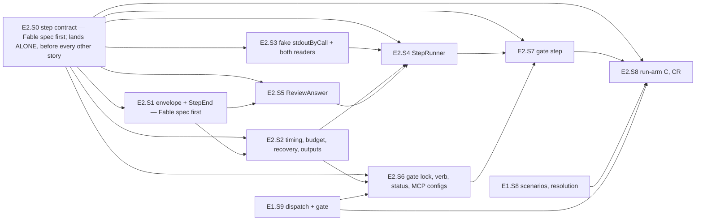

# PLAN — E2 stories: the step of the model-arms module — classify, recover, run, gate

> Status: **plan only, nothing implemented yet — rewritten to the re-review's split on 2026-10-30; the parent's epoch 2 is OPEN
> (approved 2026-10-30 by the coai document gate, interim path, six findings taken — gate finding 0 and 4 reach C12 here), so E2 may start;
> E2's own plan round (`mcp__coai__review_plan` on `feat/model-arms-e2` at `431e759`, 2026-10-30 — the round `common.plan-change-control`
> § *Reviewing the revised plan* orders for an epic not yet started) said PROCEED, five findings taken (§8 items 31–36: E2.S0 strictly
> first; the deadline as a UTC offset; an interruption scenario per scheme; the MCP key guarantee narrowed to a request with M2's check;
> an output field bound once) — the re-review's baseline for E2, never ledger entries. E2.S0's cornerstone spec was written 2026-10-30 at
> `c8213f3` by Fable, after the two ordered coai RISK consultations the plan round's reply asked for (story 2.0, the step contract and the
> delegation policy; story 2.7, the gate's continue marker — both closed solved, every finding verified against the E1 code before it was
> taken): their findings are the spec's criteria and the amendments of C6, C8, C9, E2.S2, E2.S4 and E2.S7 (§8 items 37–46) — part of writing
> this document as the epic starts, not epoch-2 entries (the parent's note under epoch 2).** Epic E2 of [PLAN_model_arms.md](PLAN_model_arms.md) (§3 D6–D10, D16, D21, D25, D27; §4.2, §4.4,
> §4.5, §4.10; §7's E2 tests). Written at `a208d75` on `feat/model-arms`, where E1.S1–E1.S7 had landed; E1 is complete at `24e8e8f`.
>
> Scope: the step's state machine in `tools/model-arms/ModelArms.Core/Steps/` and `…/Launch/` (the result envelope, the classifier,
> timing, budget, recovery, the reconciliation of derived outputs, the review's answer, the gate's status, the two MCP configs); its
> runner, files, git, transcripts and gate lock in `tools/model-arms/ModelArms/Adapters/`; the `gate-lock` and `run-arm` verbs (every
> sequential scheme — C, CR, CHH); one widening of `tests/FakeCli` (`stdoutByCall`); one fix in the shared launcher (`ProcessRunner` observes both readers, E1 §8
> item 15); tests under `tests/Bench.Tests/ModelArms/` (plus two in `tests/Bench.Tests/Infrastructure/`); recorded fixtures under
> `tests/Bench.Tests/Fixtures/model-arms/`; `research/module_model_arms.md`. Nine stories, E2.S0–E2.S8 (the parent's map named seven;
> §8 records the split and the added S0). Two cornerstone areas: **the step contract**, marked on **E2.S0** (`model: fable`; its spec is
> written when the epic starts), and **the step's state machine**, marked on **E2.S1** (`model: fable`; spec written at `91e8197`). The
> parent's ledger now reads `Cornerstones: 3 of 3 — E1.S5, E2.S0, E2.S1` (six epics, Q = 3).
>
> **Rewritten to the re-review's split, 2026-10-30, by Fable** (`common.plan-change-control` steps 4 and 7; the parent's `## Plan changes`
> record). The parent now has six epics: this one covers the step AND every sequential scheme — C, CR and the part-7 CHH (two read-only
> Haiku reviews to two verdict files, a fix that reads both, a diff from the first review's snapshot) — so **E2.S0 is no longer the
> delegation policy alone: it is the step contract** (parent D25: a step's identity, brief and output bindings are configuration, its
> execution kind is one of four; D27: named runs; schema v2; the eleven templates), which absorbs the policy and corrects E1.S3, S4, S6,
> S7, S10 forward. S0's section below carries the contract (C12) and a table of what it changes in S2, S4, S5, S7 and S8; those
> sections keep their earlier text and read C12 where it differs (E1.S9 and E1.S8 have landed, so §8 item 16's waits are over).
> The old E3 (SRS) is the parent's E4; the checks and the preparation verbs are E3; isolation and the chain E5; the record E6.
>
> **Amended 2026-10-29 at `24e8e8f` (E1 complete) after the epics 1–3 consultation, by Fable — before any E2 code** (kept as history; the
> re-review paragraph above is the current baseline). Three gaps, each
> verified against this document and the E1 code, each settled in the story it belongs to and marked *(amended)*: **(1)** a blocked gate
> never resumed — E2.S7 removed `.done` to resume, E2.S2's recovery read the finished stream as done again (§1 *Amended*, S2, S4, S7);
> **(2)** E2's git launches repeated E1's bare-name defect — `ArmGit` went through `GitCommand`, which E1's S22 scan forbids (S4, S8, and
> E4's obligation in the parent's D17 d); **(3)** nothing kept a step from starting subagents — the new E2.S0 (a change to E1's
> `StepLaunch`, `StepSpec` and the example). The parent's `## Plan changes` ledger carries them as 1.1–1.3 and is **stopped for
> re-review** (`common.plan-change-control`); the stories here are the amended baseline that re-review reads.

## 1. Goal, before any solution

The parent (§1) ports the owner's bash harness. E1 built the facts, the paths and a launch the shared launcher can express. E2 makes
**one step** run end to end the way `run-arm.sh` ran it, with the one thing the shell got wrong fixed by construction: on 2026-10-28
at ~21:45 UTC the session limit came back as an error result whose words the detector of the day did not know, nine steps were
marked done in seconds, and the next round burned the same way (`/home/jinx/git/coai-exp2/repair-limit-2026-10-28.sh:2-5`). So:

- a step's **end is decided from the result envelope's structured fields first** (`is_error`, `api_error_status`, `api_error`), the
  words second, and only `Finished` and `HardDeadline` are done (D6, D8);
- a step is **resumable from its files alone** — skipped, recovered as done, started fresh or resumed under its own session with the
  time left of its budget — and is never declared done with a derived output missing (D7, D21);
- a limit **waits and resumes the same session without spending the budget**; an error that is not a limit stops for a person (D6,
  D16);
- the **gate step** runs one arm at a time under a lock observed between two real processes, waits out a `blocked` gate, and gets its
  provider keys without widening the arm's environment (D10; E1 §8 item 16);
- `run-arm` runs the C and CR schemes against the fake CLI, every exit code the parent's (D16).

A classifier that reads one envelope wrong marks a whole round done; a recovery that resumes a finished session buys a finished
agent extra time (the previous generation's arm C, `research/local-model-coding/incidents.md:39`). Those two are why this epic's
cornerstone is the classifier and why every recovery is a pure function with a test.

**Amended after the epics 1–3 consultation (2026-10-29).** Three things this document got wrong or left out, found by an ordered coai
consultation over epics 1–3 and verified line by line before anything was changed:

1. **A blocked gate never resumes.** E2.S7 step 4 deletes `.done` and calls the runner again *so that it resumes the same session*;
   E2.S2's recovery table maps "`LastEnd is Finished` and no `.done`" to `RecoveredDone(Finished, …)` — never resumed. A gate whose
   CLI result succeeded with `gate.json = blocked` would therefore wait `gateTries` times and never call the model again, and
   `A_blocked_status_removes_done_waits_and_resumes_up_to_the_tries` (three calls) would fail against the code as specified (one call).
   The two rules are both right on their own ground — D7's "finished is done" is the previous generation's arm-C lesson, D10's
   "blocked resumes" is the shell's — and they need a **durable intent that tells them apart**: a `<step>.continue` marker the gate
   writes BEFORE it removes `.done`, read by recovery as "continue this completed session" (S2, S4, S7). A crash between the marker and
   the resume is a test.
2. **E2's git launches repeated E1's bare-name defect.** E2.S4's `ArmGit` went through `GitCommand.ReadAsync`, which launches a bare
   `git` with the inherited environment (`src/Bench.Infrastructure/Git/GitHistory.cs:35`) — exactly what E1.S10's S22 scan forbids in
   `tools/model-arms` (`ModelArmsArchitectureTests.The_module_launches_nothing_by_a_bare_name`), and E2.S8 resolved `git` only to print
   it: the resolved path was not in `StepContext`. Now every git launch of E2 goes by the real path `Resolve` found, under
   `GitEnvironment.Of(parent)`, from a cwd the runner chose — as E1's `SourceFacts` does — and E4's worktree orchestration inherits the
   obligation through the parent's D17 (d) (S4, S8).
3. **Nothing prevented a step from delegating to other models.** `StepLaunch` read mode denies `Edit Write NotebookEdit` plus
   `tools.deny` (`StepLaunch.cs:84-90`); omitting `Agent` from `--allowedTools` does not remove it, and the example's Haiku `hreview`
   and `taskCode` steps are WRITE mode, whose list carries `Agent` (`part6.experiment.json:29`, `:34`, `:48`). In the bash harness's
   part 6 a Haiku review step started Opus and Sonnet subagents — $3.79 of $5.35 not Haiku — and the owner's shell repaired it for READ
   steps only (`run-arm.sh:90-92`, part 7). The port makes delegation an explicit per-step policy, denied by default on every launch,
   fresh and resumed: the new **E2.S0**, a change to E1's `StepSpec`, `StepLaunch` and the example.

Each is a change to the parent after its approval; the parent's ledger records them and the plan is stopped for re-review.

**The re-review of 2026-10-30 (the parent's record under `## Plan changes`).** Two findings verified against the E1 code reshape this
epic: **(a)** E1's contracts bind part 6's workflow — `steps` keyed by a closed `StepKind` (`FlowSection.cs:17`), one template per
kind (`BriefTemplates.cs:11`), fixed paths per kind (`BriefFields.cs:36`), one `review.json` (`ArmPaths.cs:162`) — and the owner's
part-7 CHH scheme (`run-arm.sh:187-200`) cannot be configured under them; E2.S0 becomes the step contract (parent D25, D27; C12)
and the third cornerstone, and E2.S8 runs every sequential scheme including CHH. **(b)** D11's restore-on-entry rule is the parent's
E5 to fix, not this epic's; nothing here touches a mode. The SRS pipeline moves to the parent's E4; `prep-base`, `make`, `status`
and `checks` to E3. The consultants' third advice — a usable vertical slice first — is why this epic ends with **M1**: a fake
sequential arm of each of the three schemes, resumed after a limit and after an interruption, whose files `metrics.mjs` reads.

## 2. What exists — verified at `a208d75`, 2026-10-29

Every line below was opened in this worktree or, for the shell and the product, by exact path the same day.

| Fact | Where |
|---|---|
| The transcripts port: `Task<Outcome<AgentTranscript>> TranscriptAsync(AgentAsk ask, CancellationToken)`; a refusal is only what stopped the LAUNCH | `src/Bench.Application/CliAgent.cs:304-307` |
| `AgentTranscript(CapturedCount ExitCode, bool TimedOut, string Stdout, string Stderr, TimeSpan Elapsed)` with `Argv` | `src/Bench.Application/CliAgent.cs:293-298` |
| `AgentAsk(…)` with `Output` and `ErrorOutput` (`AgentOutputSink`, `None` by default); `AgentOutputSink.Lines(Action<string>)` | `src/Bench.Application/CliAgent.cs:21`, `:39`, `:44`, `:59` |
| The runtime: `TranscriptAsync` maps `ProcessAttempt.NotFound` to a Failure, `TimedOut` to `TimedOut: true` with no exit code, `Completed` to its exit code; an empty prompt and an argv refusal are Failures too | `src/Bench.Infrastructure/Models/CliAgentRuntime.cs:297-300`, `Transcript` `:352-365`, `LaunchAsync` `:306-347` (both sinks passed `:342-343`) |
| `ProcessAttempt` = `Completed(ProcessResult)` · `TimedOut(Budget, Output, StandardOutput, StandardError)` · `NotFound(Executable)` | `src/Bench.Infrastructure/Process/ProcessRunner.cs:23-32` |
| The launcher's core: both readers started `:271-272`; on cancellation the tree is killed `:285` and **the caller's cancellation rethrown without awaiting either reader** `:287-291`; the timeout path awaits stdout THEN stderr `:293`; the completed path the same `:297`; `budget` is a `using` local, disposed when the method leaves; `PumpAsync`'s catch cancels the budget `:339` and rethrows `:340` | `src/Bench.Infrastructure/Process/ProcessRunner.cs:261-300`, `:324-344`; `Reader` `:256-257` |
| E1 §8 item 15 (owned by E2): with both sinks real, a throwing stdout sink leaves the stderr pump unobserved; its sink can run after `RunAsync` has thrown and its catch can cancel a disposed budget | `todo/PLAN_model_arms_E1.md` §8 item 15 |
| E1.S5's stderr-sink suite (its own new file; this epic appends two tests) | `tests/Bench.Tests/Infrastructure/ProcessRunnerStderrSinkTests.cs:18`, `:80` (`Every_existing_launch_without_a_stderr_sink_is_unchanged`) |
| A line writer that flushes every line: `ScoutStreamWriter(FileStream file)`, `Line(string)` | `src/Bench.Infrastructure/Scouts/ScoutArtifacts.cs:255`, `:259` |
| Stage → flush → rename, never overwrite: `ArtifactCommit.CommitAsync(string full, ReadOnlyMemory<byte> bytes, ArtifactProbe probe, CancellationToken)`; the synchronous `Stage(string full, byte[] bytes)`; a test's crash seam `ArtifactProbe.None` / `virtual Reached(ArtifactStep)` | `src/Bench.Infrastructure/Gate/ArtifactCommit.cs:23`, `:69`; `src/Bench.Infrastructure/Gate/ArtifactProbe.cs:29-33` |
| One git command as a value: `GitCommand.ReadAsync(string workingDirectory, TimeSpan timeout, CancellationToken, params string[] arguments)` (stdout alone), `RunAsync` (merged), `AskAsync` (exit 1 = no) | `src/Bench.Infrastructure/Git/GitHistory.cs:14`, `:35`, `:50` |
| `CapturedCount(bool WasCaptured, long Value, string Reason)`, `Number`, `Unavailable` — *absent is not zero* as a type | `src/Bench.Domain/Trace/LegTrace.cs:21-26` |
| The existing envelope reader of the `json` output (not the stream) knows `is_error`, `result`, `subtype`, cost, usage — NOT `api_error_status`/`api_error`; it reads the FIRST recognisable `{…}` | `src/Bench.Infrastructure/Models/ClaudeEnvelope.cs:39-61`, `EnvelopeWire` `:103-108` |
| The stream reader of the probes: `ClaudeStream.OwnVoice` takes the LAST `"type":"result"` line through `ProbeJson`, which is `internal` to `Bench.Domain` — not reachable from the module | `src/Bench.Domain/Probes/ClaudeStream.cs:40-55`; `src/Bench.Domain/Probes/ProbeJson.cs:10` |
| The account-out words refuse a plain 429 on purpose (a different question: here a 429 is what to wait for) | `src/Bench.Domain/Gate/ReviewerAccountOut.cs:47-60` |
| The exit codes `Pass 0 · Regression 1 · Environment 3 · Configuration 4 · NoReport 5` | `src/Bench.Hosting/ExitCodes.cs:15-28` |
| The flag parser: `Value(name, fallback)`, `Int(name, fallback)`, `Has(name)` | `src/Bench.Hosting/CommandLine.cs:30-38` |
| `ArmPaths` — `CloneFolder` `:86`, `Tmp` `:95`, `CoaiSettings(side)` `:101`, `McpNone` `:103`, `McpCoai` `:105`, `Session(step)` `:107`, `Stream(step, n)` `:109`, `Stderr(step, n)` `:111`, `Prompt(step, n)` `:113`, `Done(step)` `:115`, `Before(step)` `:117`, `Diff(step)` `:119`, `Timing` `:121`, `ReviewJson` `:162`, `GateJson` `:164`; `RootPaths.GateLock` `:46`. **No member names the folder `coai-data` itself** | `tools/model-arms/ModelArms.Core/Experiment/ArmPaths.cs` |
| `Experiment(…, Limits Limits, …, ToolSets Tools, CoaiFacts Coai, …)`; `Limits(WaitSeconds, Tries, GateWaitSeconds, GateTries, MinimumRemainingSeconds, KillGraceSeconds)`; `CoaiFacts(Binary, Settings, Side)` with `Configured` | `tools/model-arms/ModelArms.Core/Experiment/ExperimentFacts.cs:41`, `:52-57`, `:70-84` |
| `StepKind`, `StepMode`, `StepSpec(StepKind Kind, string Model, int Minutes, StepMode Mode)`, `StepKinds.Key` | `tools/model-arms/ModelArms.Core/Experiment/StepSpec.cs:7-13`, `:31` |
| `SchemeEntry.Step(string Name, StepKind Kind)` / `SchemeEntry.Tasks`; `Scheme(Name, Entries)`; `ArmNames.IsArmName`, `ArmNames.SchemeOf(arm) → Outcome<string>` | `tools/model-arms/ModelArms.Core/Experiment/Scheme.cs:7-19`, `:25`, `:28` |
| `ArmMap.TokenOf(arm) → Outcome<string>`, `Leaks(text, ownArm, schemes)`, `Scrub(line)` (every token → `<token>`) | `tools/model-arms/ModelArms.Core/Experiment/ArmMap.cs:75`, `:84`, `:93` |
| `StepSession.Fresh(Guid)` / `Resume(Guid)`; `StepLaunchRequest(ClaudeExecutable, Spec, Tools, Paths, Session, WorkingDirectory, Prompt, Wall, ParentEnvironment)`; `StepLaunch.Ask(request)` → an ask with `AgentEnvironment.Only(ArmChildEnvironment.Of(…) + PWD)` and both sinks `None` ("the runner sets them with `with`") | `tools/model-arms/ModelArms.Core/Launch/StepLaunch.cs:9-19`, `:25-34`, `:49-54`, `:60-66` |
| `ArmChildEnvironment.Of(parent, paths)` — strips `BENCH_*`, `ConnectionStrings__*`, `COAI_*`, every secret-named variable except `CLAUDE_*`/`ANTHROPIC_*`, both scout flags; sets `TMPDIR = paths.Tmp` | `tools/model-arms/ModelArms.Core/Experiment/ArmChildEnvironment.cs:22-46` |
| `BriefFacts(Plan, Base, Branch, ScenarioCount, Deadline, Known, TaskFacts Task, Problems)`, `TaskFacts.None`, `BriefFields.For(kind, paths, facts)` | `tools/model-arms/ModelArms.Core/Briefs/BriefFields.cs:8-24` |
| `BriefLeakGuard(ArmMap Map, string OwnArm, IReadOnlyCollection<string> Schemes, string Root = "")`; `BriefFiller.Fill(template, fields, guard, templateName = "") → Outcome<string>` | `tools/model-arms/ModelArms.Core/Briefs/BriefFiller.cs:12`, `:25` |
| `BriefTemplates.NameOf(kind)`; `BriefTemplateFiles(shippedDirectory, overridesDirectory).Read(StepKind) → Outcome<string>` (by KIND — E1's contract said a name; the landed code takes the kind) | `tools/model-arms/ModelArms.Core/Briefs/BriefTemplates.cs:11`; `tools/model-arms/ModelArms/Adapters/BriefTemplateFiles.cs:14`, `:18` |
| The console is still E1.S2's stub (E1.S9's dispatch, `ExperimentGate`, `VerbInput`, `ExperimentRoot` have not landed); `ScenariosFile`, `ExecutableResolution`, `RootRequirements`, `RootFacts` (E1.S8) have not landed | `tools/model-arms/ModelArms/Program.cs:6-8`; `todo/PLAN_model_arms_E1.md` C4, E1.S8, E1.S9 |
| The pure list holds ONE marker for this epic | `tests/Bench.Tests/ModelArms/ModelArmsArchitectureTests.cs:23-49` (`// E2` at `:42`) |
| The fake CLI: `Behaviour(Script script, string[] args, string prompt, int call)`; `Run` `:179`; `Answer` chooses a replay by prompt hash, then substring, then `stdoutFile` `:218-226` (`StdoutFor` `:118-121`); `Replay` `:254-290`; `holdAfterLine` `:134`; `stderrBeforeLines` `:139`; the call number is the count of this MODEL's logged calls + 1 `:585`; the home is `FAKE_CLI_HOME` when set, else `Path.GetTempPath()/bench-fake-cli/<model>` `:566-571` — **`GetTempPath` honours `TMPDIR`, which the arm's environment sets to the arm's `tmp/`** | `tests/FakeCli/Program.cs` |
| The fake's test handle: `new FakeCli(script)` (fresh model id, `Home`), `Executable`, `Rewrite`, `Calls()` (argv, cwd, prompt, pid, env NAMES, `SubagentModelGuard`) | `tests/Bench.Tests/Probes/Driver/FakeCli.cs:10-82` |
| Test helpers: `TempGitRepo.CreateAsync()`, `Path`, `HeadAsync()`; `Cli.Repository.Root`; `ManualClock : TimeProvider` (`Advance`) | `tests/Bench.Tests/Infrastructure/GitCheckoutTests.cs:147-181`; `tests/Bench.Tests/Cli/AppHostLaunchProfileTests.cs:95-97`; `tests/Bench.Tests/Ui/ManualClock.cs:6-56` |
| The catalogue test reads only `bench …` and HTTP rows (`CatalogueRow` regex) — a `model-arms …` row is invisible to it until E5.S3 | `tests/Bench.Tests/Cli/ModuleTestsCatalogTests.cs:99-100` |

**Verified for the amendment, at `24e8e8f` (E1 complete), 2026-10-29:**

| Fact | Where |
|---|---|
| `GitCommand.ReadAsync` launches the LITERAL `"git"` through the launcher overload that inherits the process environment | `src/Bench.Infrastructure/Git/GitHistory.cs:35` |
| E1's launch shape for git: the real path `Resolve` found, `ProcessRunner.RunAsync(git, arguments, source, Budget, string.Empty, environment, ct)` — the REPLACING overload — with cwd = the source | `tools/model-arms/ModelArms/Adapters/SourceFacts.cs:87`; `src/Bench.Infrastructure/Process/ProcessRunner.cs:87` |
| `GitEnvironment.Of(environment)` — the map minus every name starting `GIT_` (ordinal, ignoring case); in Core, in the pure list under `// E1.S10` | `tools/model-arms/ModelArms.Core/Experiment/HostChecks.cs:71-76`; `ModelArmsArchitectureTests.cs:41` |
| The S22 scan: `GitCommand\.`, `ProcessRunner.\w+(\s*"[A-Za-z]`, `Process.Start(`, `new ProcessStartInfo` — any match under `tools/model-arms` is red; the canary is the fixture's bare git in `ExperimentRoot.cs` | `tests/Bench.Tests/ModelArms/ModelArmsArchitectureTests.cs:139-144`, `:155-158`, `:147-151` |
| `ExecutableResolution.Resolve(executable, pathDirectories, forbiddenRoots, host, windows) → Found(real) · Absent · Refused`; `PathEntryRefusal(entry, roots, host)` | `tools/model-arms/ModelArms.Core/Experiment/ExecutableResolution.cs:33`, `:52` |
| `StepLaunch.Options(StepMode, ToolSets, ArmPaths, StepSession)`: read mode denies `Edit Write NotebookEdit` + `tools.Deny`; write and gate deny `tools.Deny` only; `PermittedTools` is the mode's list as configured — nothing about `Agent` | `tools/model-arms/ModelArms.Core/Launch/StepLaunch.cs:45`, `:71-100` |
| `StepSpec(StepKind Kind, string Model, int Minutes, StepMode Mode)`; the file's step members are exactly `model`, `minutes`, `mode` | `tools/model-arms/ModelArms.Core/Experiment/StepSpec.cs:13`; `…/Experiment/FlowSection.cs:10`, `:57-64` |
| `StrictJson` reads `Text`, `Positive`, `Texts`, `Choice` — no boolean member reader | `tools/model-arms/ModelArms.Core/Experiment/StrictJson.cs:146`, `:220`, `:244`, `:263` |
| The example: `tools.write` holds `Agent`; `hreview` (haiku) and `taskCode` (haiku) are `"mode": "write"`; `review` (opus) is `read` | `tools/model-arms/examples/part6.experiment.json:48`, `:29`, `:34`, `:30` |
| The template keeps a boolean as it was (strings blanked, numbers 0, "the rest as they were") | `tools/model-arms/ModelArms.Core/Experiment/ExperimentTemplate.cs:26-37` |
| The shell's own repair after the incident: READ steps get `--disallowedTools Edit Write NotebookEdit Agent Task …` ("read steps start no subagent (Part 7: SRS3's Haiku step started Opus and Sonnet subagents in Part 6)"); write steps keep `Agent` | `/home/jinx/git/coai-exp2/run-arm.sh:90-92` |
| `claude` 2.1.310 (`claude --help`, this host): `--disallowedTools, --disallowed-tools <tools...>` — "comma or space-separated list of tool names to deny"; `--allowedTools` the same shape; the subagent tool is `Agent` (the older name `Task` — denied too, as the shell did) | `claude --help` |
| `CliArgv`: `--allowedTools` from `PermittedTools`, then `--disallowedTools` from `ClaudeDenied` (`DisallowedTools` ∪ the web pair, `Distinct`) | `src/Bench.Infrastructure/Models/CliAgentRuntime.cs:157-158`, `:188` |
| E1.S6's argv test pins the three shapes with the denied group exactly `tools.Deny` / `Edit Write NotebookEdit + tools.Deny` — it changes with E2.S0 | `tests/Bench.Tests/ModelArms/StepLaunchTests.cs:76-113` |
| The test root's helpers: `RealGit`, `Shim(path, name, thenRealGit)` (records `$0 $*` then execs the host's git), `ShimScript(path, body)`, `MarkerFile`, `Markers()`, `WithVariables`, `UsePath` | `tests/Bench.Tests/ModelArms/ExperimentRoot.cs:93`, `:100-121`, `:125`, `:134` |
| `ArmPaths` spells paths through `Under(…)`; `Done(step)`, `Before(step)` at `:115`, `:117` — a `Continue(step)` joins them | `tools/model-arms/ModelArms.Core/Experiment/ArmPaths.cs:86-119` |

**The shell, the behaviour to port** (`/home/jinx/git/coai-exp2/run-arm.sh`, read 2026-10-29): `has_result` `:52`; `limited` `:54-63` — the
words `RX` `:56` (`usage.?limit|spend limit|session limit|rate.?limit|hit your (\w+ )*limit|limit reached|limit will reset|resets? at|overloaded|\b529\b|\b429\b|too many requests`, case-insensitive), the LAST result decides when there is one `:60-61`, the last 4000 characters of stderr only when there is none `:62`;
`errored` `:64-66`; `transcript_of` (`$HOME/.claude/projects/<cwd with every [^A-Za-z0-9] → ->/<sid>.jsonl`, by name) `:67`; `used_seconds`
(Σ `wall_s` of `end` lines with `limited` false) `:68-74`; the attempt number `:81`; budget and its 300 s floor `:84`; the deadline
`"%H:%M UTC (%H:%M %Z)"` `:85`; the session choice `:91-102` and the resume notice `:93-97`; the start line `:104`; the launch under
`timeout -s INT -k 60 $((remaining + 600))` `:106-108`; the end line `:111`; the limit wait `:112-116`; the errored stop `:117-119`; done on
a result or `rc` 124/137 `:120-123` with `{"attempts":N,"exit":rc,"stream":…}` `:121`; `review_json` (greedy `/\{[\s\S]*\}/` over the last
result's text, else `{"verdict":"unparsed","raw":…}`, read through `.done`'s `stream`) `:128-135`; `hreview_step` (`.before` before, `.diff`
after) `:137-142`; `gate_step` (lock, step, unlock, `blocked` → `rm .done`, wait, loop while `tries < GATE_TRIES`, else diff and return
0 — **even when still blocked**) `:144-162`; the schemes and `arm-done` `:164-187`. `mcp-coai.json` = `{"mcpServers":{"coai":{"type":"stdio","command":bin,"args":[],"env":{"COAI_DATA_DIR":<arm>/coai-data,"COAI_DATA_SIDE":"wsl-ubuntu"}}}}` and `mcp-none.json` = `{"mcpServers":{}}` (`/home/jinx/git/coai-exp2/after6.sh:33-35`); the settings copied into `coai-data/<side>/` `:32`.

**The recorded streams of 2026-10-28** (arm C1 of part 6; its folder is `r/<token>/out/` with the token from
`/home/jinx/git/coai-exp2/.map-904c78af.json` — opened by name, the parent folder cannot be listed; **the token is not written into this
repository**, see E2.S1):

| file, line | what it is |
|---|---|
| `3-fix.a1.jsonl:8` (1420 bytes with its newline, sha256 `895d7980445470e7ad4588cbdea7a0b7878b47582544b58b82d008c59df52a52`) | THE limited result, verbatim: `"is_error":true`, `"subtype":"success"`, `"api_error_status":429`, `"api_error_origin":"first_party"`, `"api_error":"usage_limit_reached"`, `"result":"You've hit your individual spend limit · run /usage-credits to ask your admin for a higher limit · your session limit resets 1:20am (Europe/Paris)"`, `"terminal_reason":"api_error"` — **and `"type":"result"` is the 20th of the object's 25 top-level keys (the 56th of its 61 key tokens, nested ones counted), starting at character 1264 of 1418**: a reader that matches a line by its prefix never sees it (counted by Fable, §8 item 17) |
| `3-fix.a1.jsonl:6` | `{"type":"rate_limit_event","rate_limit_info":{"status":"rejected","rateLimitType":"five_hour",…}}` — a structured limit signal BEFORE the result; D6 does not read it |
| `3-fix.a1.jsonl:7` (1414 bytes, sha256 `5a2a200b22b52aadb7f8658eeb5e33ca6ad9e472cc024836e66a463213677395`) | an `assistant` line from `"model":"<synthetic>"` whose text is the limit sentence — **and whose TOP level carries `"api_error_status":429` and `"api_error":"usage_limit_reached"` too**: a reader keyed on those fields instead of on `"type":"result"` is decoyed by a line that is not a result (§8 item 22) |
| `3-fix.a1.jsonl:6` (536 bytes, sha256 `1ce54cee01e1ad8e934fbb02d38409e4b31b1d8ea1a5a87eed295b1f8e61c03e`) and `:5` (7376 bytes) | the `rate_limit_event` above, and the `init` line: the operator's plugin inventory, skills, a messaging socket path, memory paths, startup timings — 7.4 KB of the machine, nothing the classifier reads, the token seven times (§8 item 21) |
| `2-review.a1.jsonl:310`, `:317`, `:323` (7723, 2158, 2158 bytes; sha256 `6438bc7d22c7c1996ecb010b841e21ab61f08fd29a6cea8fc0844b418207b058`, `20d59284b73beaba53c2127b6dba5e18738813edace799f290a7b8c522551dd8`, `3087925f6188b168051cda9f95d59d14160b7e5f2c3262524bf870fec715d494`) | **three result lines in ONE stream** (the only three: `grep -c '"type":"result"'` is 3): `:310` `is_error` false, `"result":"I'm waiting for the full MCP suite. When it finishes I will send the verdict."`, `"terminal_reason":"completed"`, **and `"api_error_status":null`** — a JSON null on a success result (§8 item 22); `:317` and `:323` the 429 above (the same fields; they differ only in `runId`, `duration_ms` and `uuid`). The FIRST result is a success; only the LAST says what the attempt was. `:310` carries `permission_denials` whose paths hold the arm's token (five times); `:317` and `:323` hold it nowhere |
| `2-review.a1.err`, `3-fix.a1.err` (one line each) | `Ignoring 5 permissions.allow entries from .claude/settings.json: this workspace has not been trusted. Run Claude Code interactively here once and accept the trust dialog, or set projects["<arm>/arm"].hasTrustDialogAccepted: true in /home/jinx/.claude.json.` — a real stderr that is NOT a limit |
| `timing.jsonl`, the two `2-review` lines | the 429 attempt recorded as `"wall_s":888,"exit":1,"result":true,"limited":false` — the day's detector at work — and the resume budgeted `1512` = 2400 − 888 |
| `2-review.done` | `{"attempts":2,"exit":0,"stream":"<arm>/out/2-review.a2.jsonl"}` — the shell's marker; `review_json` reads its `stream` |

**The product's two envelope fixtures** (`dew_flow_connect_other_ais · src_mcp/tests/AClaudeReasonInItsEnvelopeTests.cs`, at `80b829ef`):
`:23` the monthly spend limit (2.1.284, `"api_error_status":429`, `"subtype":"success"`); `:27` an old CLI refusing a newer model (2.1.258,
`"api_error_status":400`, `"error":null`); `:87` `"api_error_status":"429"` as a STRING; `:72` a SUCCESS envelope whose text holds the words
`a spend limit is not handled`; and `:95-104` (the `InlineData` rows of the theory at `:94-111`) the shapes that must be neither a reason
nor an exception (`"is_error":"true"`, `"result":42`, a JSON array, a truncated object, plain text, empty).

**The vault key** (`dew_flow_connect_other_ais · src_mcp/src/Server/KeyVault.cs`, at `80b829ef`): the coai server's one key is
`COAI_CREDS_KEY` (`:35`), read from the LAYERED configuration — the settings file the panel writes it into, with the client's
environment outranking it key by key (`:76-95`). Part 6 copied that settings file into each arm's `coai-data/<side>/`
(`after6.sh:32`).

## 3. Conventions every story follows

E1's §3 holds unchanged (namespaces, *pure means pure*, refusals as values, red first on an ASSERTION, docs per story, commands). For E2:

- **The pure list.** E2.S1 replaces the single `// E2` marker (`ModelArmsArchitectureTests.cs:46`) with eight, `// E2.S1` … `// E2.S8`,
  each on its own line with a blank line between; every later story writes only under its own. A story that adds a `public static
  class` to Core adds it there in the same commit. E2.S0 adds `SchemePositions` under its own `// E2.S0` marker, inserted ABOVE the single
  `// E2` marker (which S1 then replaces with its eight); `StepLaunch` stays under `// E1.S6`.
- **The module doc.** E2.S1 adds eight empty headings to `research/module_model_arms.md`, after *The first run: init and validate
  (E1.S11)*: *The result envelope and the step's end (E2.S1)*, *Timing, budget and recovery (E2.S2)*, *The launcher's follow-ups (E2.S3)*,
  *The step runner (E2.S4)*, *The review's answer (E2.S5)*, *The gate lock and the MCP configs (E2.S6)*, *The gate step (E2.S7)*, *run-arm
  (E2.S8)*. Each story writes only under its own. E2.S0 writes a paragraph headed *The delegation policy (E2.S0)* at the END of the
  existing *The launch boundary (E1.S5, E1.S6)* section (`research/module_model_arms.md:193`) — a different section from S1's eight, so
  wave A's two writers never touch the same lines.
- **Fixtures** live in `tests/Bench.Tests/Fixtures/model-arms/` (copied to the output by the test project's `Fixtures\**` item) and are
  read with `Path.Combine(AppContext.BaseDirectory, "Fixtures", "model-arms", name)`.
- **The fake CLI as `claude`.** Every launch of a step goes through `ArmChildEnvironment`, which sets `TMPDIR` to the arm's `tmp/` — and
  the fake finds its script and its call log under `Path.GetTempPath()`, which honours `TMPDIR`. So every test that launches the fake
  through a step puts **`FAKE_CLI_HOME = fake.Home`** in the PARENT environment it hands the runner (the name is neither this
  repository's nor secret-named, so `ArmChildEnvironment` passes it), and gives every step kind the fake's model id
  (`fake.Model`) so the per-model call numbers are one sequence. Forgetting it reads as "the fake answered with its composed default".
- **Time.** The runner reads the clock and the local zone through `TimeProvider` (`GetUtcNow`, `LocalTimeZone`) and waits through an
  injected `Func<TimeSpan, CancellationToken, Task>` (tests: a recording delegate that returns at once, or cancels); no test sleeps
  through a limit wait. `ManualClock` (`tests/Bench.Tests/Ui/ManualClock.cs:6`) is `sealed` and keeps the machine's zone, so E2.S4's
  `StepBench` carries its own small `BenchClock : TimeProvider` (a settable now and a given zone).
- **No tokens in this repository.** A recorded line that carries an arm's token is committed with the token replaced by
  `0123456789ab` (the same length, the JSON still valid); the test says so in its doc.
- **Commands** (WSL — no `.exe`; never `dotnet test`; always through the lowering wrapper). "Green" means E1 §3's definition: 0 warnings,
  the story's classes pass, `dotnet format` clean, the whole suite passes (Docker up).

```bash
node .agents/conventions/tools/low-priority.mjs dotnet build dew_flow_benchmark.slnx -c Release -m:4
node .agents/conventions/tools/low-priority.mjs ./tests/Bench.Tests/bin/Release/net10.0/Bench.Tests --filter-class "*<Class>"
node .agents/conventions/tools/low-priority.mjs ./tests/Bench.Tests/bin/Release/net10.0/Bench.Tests --filter-namespace "Bench.Tests.ModelArms"
node .agents/conventions/tools/low-priority.mjs dotnet format dew_flow_benchmark.slnx --verify-no-changes --no-restore
node .agents/conventions/tools/low-priority.mjs ./tests/Bench.Tests/bin/Release/net10.0/Bench.Tests   # the whole suite, once per story, Docker up
node .agents/conventions/tools/plan-lifecycle.mjs
```

## 4. Shared contracts (fixed here so stories can run in parallel)

**C5 — the envelope and the step's end** (E2.S1, the cornerstone; read by S2, S4, S5). Binding names and types — Fable's spec may
change them only by changing every story section below that uses them, in the same commit.

```csharp
namespace ModelArms.Core.Launch;
public sealed record ClaudeResultEnvelope(bool IsError, CapturedCount ApiErrorStatus, string ApiError, string Result,
    IReadOnlyList<string> Errors, string Subtype, int LineNumber)
{
    public static Outcome<ClaudeResultEnvelope> LastOf(string stream);   // Failure = no line of the stream is a result object
}
namespace ModelArms.Core.Steps;
public abstract record StepEnd
{
    private StepEnd() { }
    public sealed record Finished : StepEnd;
    public sealed record HardDeadline : StepEnd;
    public sealed record Limited(string Reason) : StepEnd;
    public sealed record Errored(string Text) : StepEnd;
    public sealed record Interrupted(string Why) : StepEnd;
    public sealed record NotStarted(string Reason) : StepEnd;
    public bool IsDone => this is Finished or HardDeadline;
    public string Word { get; }   // finished · hard-deadline · limited · errored · interrupted · not-started — the spelling of .done and the end line
}
public sealed record AttemptFacts(string NotStartedReason, bool WallKilled, bool StoppedByOperator)
{
    public static AttemptFacts Ran { get; }   // ("", false, false): what recovery assumes of a stream read back from disk
    public bool Started => NotStartedReason.Length == 0;   // added by the E2.S1 spec (§8 item 20): criterion 2.1 reads it; no constructor changes
}
public static class StepClassifier
{
    public const int StderrTailCharacters = 4000;
    public static StepEnd Classify(Outcome<ClaudeResultEnvelope> lastResult, string stderr, AttemptFacts attempt);
}
public static class LimitWords { public static string FirstIn(string text); }   // the matched text, "" when none
```

**C6 — timing, budget, recovery, derived outputs** (E2.S2; read by S4, S7, S8 and E4). In `ModelArms.Core.Steps`:

```csharp
public abstract record TimingLine
{
    private TimingLine() { }
    public sealed record Start(string Arm, string Step, int Attempt, string How, string Session, string Model, DateTimeOffset StartUtc,
        int BudgetSeconds, string Deadline, string Head, string Stream) : TimingLine;
    public sealed record End(string Arm, string Step, int Attempt, DateTimeOffset EndUtc, CapturedCount WallSeconds, CapturedCount Exit,
        bool Result, bool Limited, string Head, string State, bool Recovered) : TimingLine   // State "" = a shell line that carried none
    {
        public IReadOnlyList<string> Missing { get; init; } = [];   // (S0 spec, §8 item 41) the step's MODEL-WRITTEN outputs absent when a DONE attempt ended; written only when non-empty
    }
    public sealed record GateWait(string Arm, string Step, int After, int Wait, string Why, DateTimeOffset AtUtc) : TimingLine;   // (S0 spec, §8 item 44) one blocked round of a gate step, DECIDED: attempt After was blocked, this is wait number Wait (1-based)
    public sealed record ArmDone(string Arm, DateTimeOffset DoneUtc) : TimingLine;
    public sealed record Stopped(string Arm, string Step, int Exit, string Why, DateTimeOffset AtUtc) : TimingLine;
    public sealed record Other(string Raw) : TimingLine;   // a line this build does not read — kept, never dropped
}
public static class TimingLines { public static IReadOnlyList<TimingLine> Read(string text); public static string Write(TimingLine line); }
public sealed record DoneMarker(int Attempts, CapturedCount Exit, string Stream, string State, bool Recovered);
public static class DoneMarkers { public static string Write(DoneMarker marker); public static Outcome<DoneMarker> Read(string json); }
public static class StepBudget
{
    public static int UsedSeconds(IReadOnlyList<TimingLine> timing, string step);
    public static int RemainingSeconds(int minutes, IReadOnlyList<TimingLine> timing, string step, int floorSeconds);
    public static TimeSpan Wall(int remainingSeconds, int killGraceSeconds);
    public static string Deadline(DateTimeOffset startUtc, int remainingSeconds, TimeZoneInfo local);
    // "HH:mm UTC (HH:mm ±hh:mm)" of start + remaining — the local clock and the zone's UTC OFFSET at that instant, never %Z or the zone's id (§8 item 32)
}
public static class ResumeNotice { public static string For(string baseSha, string deadline); }
public static class SessionTranscripts
{
    public static string ClaudeHome(IReadOnlyDictionary<string, string> environment);
    public static string PathOf(string claudeHome, string workingDirectory, Guid session);
}
public sealed record ContinueMarker(int After, string Why);   // (amended) "attempt After finished; continue its session" — the gate's intent, durable
public static class ContinueMarkers { public static string Write(ContinueMarker marker); public static Outcome<ContinueMarker> Read(string json); }
public sealed record RecoveryFacts(bool DoneMarker, Outcome<Guid> Session, bool TranscriptExists, int LastAttempt, StepEnd LastEnd,
    IReadOnlyList<TimingLine> Timing, Outcome<ContinueMarker> Continue);   // (amended) Continue: Failure = no marker, or one that cannot be read
public abstract record StepEntry
{
    private StepEntry() { }
    public sealed record Skip : StepEntry;
    public sealed record RecoveredDone(StepEnd End, int Attempt) : StepEntry;
    public sealed record Fresh(int Attempt, int BudgetSeconds) : StepEntry;
    public sealed record Resume(Guid Session, int Attempt, int BudgetSeconds) : StepEntry;
}
public static class StepRecovery { public static StepEntry Decide(string step, RecoveryFacts facts, StepSpec spec, Limits limits); }
public enum DerivedOutput { Verdict, StepDiff, CoderHead, CoderDiff }   // (re-review) Verdict: the file a review's `verdict` binding names
public sealed record OutputFacts(IReadOnlySet<DerivedOutput> Present, bool BeforeExists, bool TaskBeforeExists,
    Outcome<ClaudeResultEnvelope> FinalResult);
public abstract record OutputAnswer
{
    private OutputAnswer() { }
    public sealed record Complete : OutputAnswer;
    public sealed record Regenerate(IReadOnlyList<DerivedOutput> Outputs) : OutputAnswer;
    public sealed record Resumable(string Reason) : OutputAnswer;
}
public static class StepOutputs
{
    public static IReadOnlyList<DerivedOutput> Of(StepSpec spec);    // (re-review, C12) Verdict when spec.Verdict is bound; StepDiff when spec.DiffFrom is set; TaskCode → [CoderHead, CoderDiff]
    public static bool NeedsBefore(StepSpec spec);                   // spec.Snapshot
    public static OutputAnswer Reconcile(StepSpec spec, OutputFacts facts);
}
```

**C7 — ports** (E2.S2 declares them; adapters in S4 and S6). In `ModelArms.Core.Ports` (excluded from the pure scan by namespace):

```csharp
public interface ISessionTranscripts { bool Exists(string workingDirectory, Guid session); }
public interface IGateLock
{
    IDisposable? TryAcquire(string path);                                         // null = another holder has it
    Task<IDisposable> AcquireAsync(string path, CancellationToken cancellationToken); // waits; cancellation throws and holds nothing
}
```

No `IArmFiles` port (the parent's §4.1 lists one): the runner's tests run over real temp folders — the same files the analysis
reads — and a port would only let a test agree with itself (§8 item 9).

**C8 — the runner** (E2.S4; read by S7, S8 and E4.S3). In namespace `ModelArms.Adapters`:

```csharp
public sealed record StepContext(string Arm, ArmPaths Paths, SchemeEntry.Step Step, Experiment Experiment, string ClaudeExecutable,
    string GitExecutable,   // (amended) the REAL path Resolve found for git — every git launch of the step goes by it (D17 d)
    string WorkingDirectory, IReadOnlyDictionary<string, string> ParentEnvironment, BriefTemplateFiles Templates, BriefLeakGuard Guard,
    int ScenarioCount, TaskFacts Task, string Problems, bool DeriveOutputs = true);
public abstract record StepOutcome
{
    private StepOutcome() { }
    public sealed record Done(StepEnd End, bool Skipped, bool Recovered) : StepOutcome;
    public sealed record Stopped(int ExitCode, string Why) : StepOutcome;
}
public enum StepPoint { SessionWritten, Prepared, Launched, Classified, OutputsDerived }   // Prepared (S0 spec, §8 item 45): the prompt and the start line are on disk, no stream yet
public class StepProbe { public static StepProbe None { get; } = new(); public virtual void Reached(StepPoint point) { } }
public sealed class StepRunner(ICliAgentTranscripts cli, ISessionTranscripts transcripts, TimeProvider clock,
    Func<TimeSpan, CancellationToken, Task> wait, TextWriter log, ArmMap map, StepProbe probe)
{
    public StepEntry Recover(StepContext context);   // (amended) step 1's decision over the step's files — the gate step asks it too (E2.S7)
    public Task<StepOutcome> RunAsync(StepContext context, CancellationToken stopping);
}
```

**C9 — the gate** (E2.S6, E2.S7). `ModelArms.Core.Launch`: `public sealed record GateReading(string Status, string Why) { public bool
IsBlocked => Status == "blocked"; }`, `public static class GateStatus { public static GateReading Read(Outcome<string> gateJson); public
static bool WaitAgain(GateReading reading, int waitsSoFar, int gateTries); public static int WaitsSoFar(IReadOnlyList<TimingLine> timing,
string step); }` (`WaitsSoFar` — S0 spec, §8 item 44: the count of `GateWait` lines of `step`, the DURABLE wait count a restart reads back),
`public static class McpConfig { public const string
VaultKeyVariable = "COAI_CREDS_KEY"; public static string None(); public static string Coai(CoaiFacts coai, ArmPaths paths,
IReadOnlyDictionary<string, string> harnessEnvironment); }`. `ModelArms.Adapters`: `public sealed class FileGateLock(TimeProvider clock,
TimeSpan poll) : IGateLock`, `public enum GatePoint { StatusRead, WaitRecorded, ContinueWritten, DoneRemoved }` and `public class GateProbe { public static GateProbe
None { get; } = new(); public virtual void Reached(GatePoint point) { } }` (amended — the crash seams of the gate's judgement and its writes
(§8 item 44: `StatusRead` after `gate.json` was read, `WaitRecorded` after the `GateWait` line), the shape
of `StepProbe`), `public sealed class GateStep(StepRunner runner, IGateLock gateLock, Func<TimeSpan, CancellationToken, Task> wait,
TextWriter log, GateProbe probe) { public Task<StepOutcome> RunAsync(StepContext context, CancellationToken stopping); }`. `ArmPaths` gains
`public string CoaiData => Under("coai-data");` (E2.S6) and `public string Continue(string step) => Under("out", Step(step) + ".continue");`
(E2.S2, amended — spelled exactly as `Done(step)` is, `ArmPaths.cs:115`).

**C11 — the delegation policy** (E2.S0 as amended on 2026-10-29; **superseded by C12 in E2.S0's section** — the policy is one part of the
step contract now; kept so the amendment's reasoning stays readable). In `ModelArms.Core.Experiment` and `ModelArms.Core.Launch`:

```csharp
public sealed record StepSpec(StepKind Kind, string Model, int Minutes, StepMode Mode, bool Subagents = false);   // the file's "subagents": true|false, default false
public static class StepLaunch
{
    public static readonly IReadOnlyList<string> SubagentTools = ["Agent", "Task"];   // the tool that starts a subagent, under both names the CLI has used
    public static AgentAskOptions Options(StepSpec spec, ToolSets tools, ArmPaths paths, StepSession session);   // was (StepMode, …): the policy rides on the spec
}
```

`Options` applies the mode as today and THEN the policy: unless `spec.Subagents`, `DisallowedTools` = `[.. SubagentTools, .. the mode's list]`
and `PermittedTools` = the mode's list minus `SubagentTools` (ordinal). Fresh and resumed launches share `Options`, so a resume can never
be wider than the launch it continues.

**The exit and timing contract of a step** (D16; every story that stops writes it the same way):

| the step | `.done` | the end line's `end` | the last timing line | `StepOutcome` | the verb's exit |
|---|---|---|---|---|---|
| `Finished` / `HardDeadline`, outputs complete or regenerated | written, `"end"` = the state | the state | the end line | `Done` | continues |
| done, a derived output's INPUT missing (D21) | not written | the state | `stopped`, exit 5, the reason | `Stopped(5)` | 5 |
| `Limited`, waits left | — | `limited` (`"limited":true`) | the end line; the wait follows | (loops) | — |
| `Limited`, `limits.tries` waits spent | — | `limited` | `stopped`, exit 3 | `Stopped(3)` | 3 |
| `Errored` / `Interrupted` | — | the state | `stopped`, exit 5 | `Stopped(5)` | 5 |
| `NotStarted` (no executable, argv refused) | — | `not-started` | `stopped`, exit 3 | `Stopped(3)` | 3 |
| the brief refused (unfilled field, a leak) — before any launch | — | — (no start line) | `stopped`, exit 4 | `Stopped(4)` | 4 |
| the operator's Ctrl+C during an attempt or a wait | — | the classified state, `StoppedByOperator` | `stopped`, exit 5 | `Stopped(5)` | 5 |

## 5. Stories

### E2.S0 — The step contract: identity, kind and bindings; schema v2; the delegation policy (CORNERSTONE — rewritten by the re-review, 2026-10-30)

**Cornerstone — spec by Fable** (`model: fable`, **written 2026-10-30 at `c8213f3`**, after epoch 2 was approved and after the two ordered
coai RISK consultations the plan round's reply asked for — story 2.0 (this story) and story 2.7 (the gate's marker), both closed solved,
every finding re-opened against the E1 code before it was taken; every citation below re-opened the same day): the scenarios (Given/When/Then and the
expected red of each), the red stubs and the brief. The goal, the binding contract (C12) and
the acceptance criteria below are the re-review's; they are the baseline the spec makes exact — where the spec corrects one, §8 says so
(items 37–39). Area: the step contract (parent
`## Epics`, E2; parent D25, D27, D4, D15). The parent's ledger reads `Cornerstones: 3 of 3 — E1.S5, E2.S0, E2.S1`.

- **Coder:** sonnet · **Spec:** Fable · **Review:** Opus. **Depends on:** nothing in E2 (E1 landed whole). **Parallel with:** nothing —
  **it lands first, strictly before every other E2 story** (E2's plan round, 2026-10-30, §8 item 31): it rewrites `StepSpec`, `SchemeEntry`,
  `Experiment`, the step's identity and the bindings (C12) and the launch options, which C6 and C8 read, so a story built beside it would
  be built against E1's contracts and rebased onto different files. **Before:** E2.S1–E2.S8, all of them (§6, wave 0).
- **Owns:** parent D25 (the step contract), D27's file half (`runs`), D4's v2, D15's eleven templates, C12 here; the parent's §4.2,
  §4.4 and §4.10 as revised; the correction of E1.S3, E1.S4, E1.S6, E1.S7, E1.S10 and E1.S11's example and template — **forward, on
  E1's landed code, never a rewrite of E1's history** (`common.plan-change-control` step 6). **Size:** ≈ 1350 changed lines (≈ 450
  code, 700 tests, the example, the three templates, the module doc) — the spec's count; the judge's estimate was 1100.
- **Files.** `tools/model-arms/ModelArms.Core/Experiment/StepSpec.cs` (`StepKind` → `StepId` + the closed `StepKind {Session, Review,
  Gate, TaskCode}`; `StepSpec` with `Brief`, `Outputs`, `Notes`, `Verdict`, `Status`, `Snapshot`, `DiffFrom`, `Subagents`; `OutputPath`,
  `ModelWritten`), `…/Experiment/OutputBinding.cs` (new: the record and its `Parse`), `…/Experiment/SchemePositions.cs` (new: `PlacedOutput`,
  `SchemePositions`), `…/Experiment/StepSection.cs` (new, internal: one step's members and its per-step rules), `…/Experiment/SchemeChecks.cs`
  (new, internal: the per-scheme rules), `…/Experiment/RunSection.cs` (new, internal: `runs`),
  `…/Experiment/FlowSection.cs` (`steps` keyed by id; the schemes over ids), `…/Experiment/Scheme.cs` (`SchemeEntry.Step(Name, Id)`; `Tasks`
  without `Kinds`), `…/Experiment/ExperimentFile.cs` (`Schema = "model-arms/experiment-v2"`, the v1 refusal, `Runs`, the `tasks` block's ids and `outputs`),
  `…/Experiment/ExperimentFacts.cs` (`Experiment.Steps` by `StepId`, `Runs` for `Rounds`, `TaskLimits` with the three ids and `Outputs`, `RunSpec`),
  `…/Experiment/StrictJson.cs` (`Flag`, `TextMap`), `…/Experiment/ArmPaths.cs` (`NotesFile(binding)`; the fixed notes members
  retired — `CodeNotes`, `HReviewNotes`, `FixNotes`, `GateNotes`, `SplitNotes`, `ReviewJson`, `GateJson`; `TaskNotes(id)` stays),
  `…/Experiment/HostChecks.cs` (`HasGateStep` by kind; `Templates` by stem; `FlowProblems` retired — the reader owns those rules now),
  `…/Briefs/BriefTemplates.cs` (`NameOf(stem) → Outcome<string>`, `Shipped` — a stem rule, no kind table), `…/Briefs/BriefFields.cs` (`For(spec,
  visible, tasks, paths, facts)`), `…/Briefs/BriefRehearsal.cs` (the rehearsal per scheme position; `StemsUsed`; its `Deadline` stand-in takes C6's shape,
  `"00:00 UTC (00:00 +00:00)"`, §8 item 32), `…/Launch/StepLaunch.cs` (`Options(StepSpec, …)`, `SubagentTools`, `Delegation`),
  `tools/model-arms/ModelArms/Adapters/BriefTemplateFiles.cs` (`Read(stem)`), `tools/model-arms/ModelArms/Adapters/HostFactsReader.cs`
  (`Templates` over `BriefRehearsal.StemsUsed`, three lines), `tools/model-arms/briefs/hA-trace.template.md`,
  `hB-tests.template.md`, `hfix.template.md` (byte for byte, parent §2's sums), `tools/model-arms/examples/part6.experiment.json`
  (v2, every step of §4.2, the CHH scheme, the two runs), the `init` template by derivation (`ExperimentTemplate` — a map value is
  blanked like a string), the E1 tests this changes (`ExperimentFileTests`, `ArmPathsTests`, `StepLaunchTests`, `BriefFillerTests`,
  `ValidateVerbTests`, `ExampleExperimentTests`, `InitVerbTests`), `tests/Bench.Tests/ModelArms/StepContractTests.cs` (new),
  `BriefFieldsTests.cs` (new), `ModelArmsArchitectureTests.cs` (`// E2.S0`: `typeof(SchemePositions),`), `research/module_model_arms.md`
  (*The step contract (E2.S0)* — replaces E1.S3's and E1.S7's paragraphs on kinds and templates; the CHH walk-through; and *The delegation
  policy (E2.S0)* at the end of *The launch boundary*, carrying the measurement table of this spec's *Evidence* section, §3).

**Why.** E1 keyed the step definitions by a closed `StepKind` enum (`FlowSection.cs:17`), picked one template per kind
(`BriefTemplates.cs:11`), filled fixed paths per kind (`BriefFields.cs:36`) and spelled one `review.json` per arm (`ArmPaths.cs:162`).
One day later the owner's part 7 added CHH (`run-arm.sh:187-200`): two read-only Haiku reviews briefed differently, writing
`notes/hA.json` and `notes/hB.json`; a fixer briefed with `HA_JSON` and `HB_JSON`; a `.diff` from the snapshot before the first review
to HEAD after the fix. None of it is configurable under E1's contract. The port is of a harness: the owner changes a scheme between
parts, and the runner must not have to be rebuilt for it. The parent's D25 says what is open and what is closed; this story makes it so.

**C12 — the step contract** (replaces C11; read by S2, S4, S5, S7, S8 and E4.S3). In `ModelArms.Core.Experiment`:

```csharp
public enum StepKind { Session, Review, Gate, TaskCode }            // closed: what the runner must KNOW; JSON session review gate taskCode
public sealed record StepId(string Value);                          // open: letters and digits, the key under "steps" and the id a scheme entry names
public sealed record OutputBinding(string Field, string RelativePath);   // "HA_JSON" → "notes/hA.json" (under the arm folder; notes/ or work/; no .., never absolute)
public sealed record StepSpec(StepId Id, StepKind Kind, string Model, int Minutes, StepMode Mode, bool Subagents, string Brief,
    IReadOnlyList<OutputBinding> Outputs, string Notes, string Verdict, string Status, bool Snapshot, string DiffFrom)
{   // Notes names one of Outputs' fields OR an earlier step's (gate finding 4) or is ""; Verdict / Status name one of Outputs' fields or are ""; DiffFrom is a StepId's value or ""; Brief is a template stem
    // a field name is bound ONCE within a step and by at most ONE step of the whole map (§8 item 35); a DESTINATION is written by at most one producer a scheme places (§8 item 40)
    public Outcome<string> OutputPath(string field);                // the bound relative path, or a failure naming the field and the step
    public IReadOnlyList<OutputBinding> ModelWritten { get; }       // (S0 spec, §8 item 41) Outputs minus the one Verdict names: what the MODEL is briefed to write, which the runner never requires
}
public abstract record SchemeEntry { public sealed record Step(string Name, StepId Id) : SchemeEntry; public sealed record Tasks : SchemeEntry; }
public sealed record TaskLimits(int Min, int Max, int MaxParallel, StepId Split, StepId SplitFix, StepId TaskCode,
    IReadOnlyList<OutputBinding> Outputs)   // (gate finding 0) what the tasks entry contributes besides its split steps' outputs — the example binds CODE_NOTES
{ public static TaskLimits Shell { get; } }   // (S0 spec) 4 / 7 / 4 and the shell's own step names — split, splitFix, taskCode — with no outputs: what an absent block means
public sealed record RunSpec(string Name, IReadOnlyList<IReadOnlyList<string>> Rounds, IReadOnlyList<string> ClosedArms, IReadOnlyList<string> Closed);
public sealed record Experiment(…, IReadOnlyDictionary<StepId, StepSpec> Steps, IReadOnlyList<Scheme> Schemes, IReadOnlyList<RunSpec> Runs, …);   // Rounds gone
public static class ExperimentFile { public const string Schema = "model-arms/experiment-v2"; … }
public sealed record PlacedOutput(int Position, string Producer, OutputBinding Binding);   // (S0 spec, §8 item 38) Producer: the entry's file name ("2-hA"), or the split / split-fix id, or "tasks" for the block's own outputs
public static class SchemePositions
{   // every output the scheme's entries bind, in scheme order: a Step entry → (position, name, each output); a Tasks entry → the split's, then the split-fix's, then tasks.Outputs (gate finding 0)
    public static IReadOnlyList<PlacedOutput> Outputs(Scheme scheme, IReadOnlyDictionary<StepId, StepSpec> steps, TaskLimits tasks);
    // the bindings a brief at `position` for step `id` may use: every output of an EARLIER position, the step's OWN outputs (the gate's template names its own GATE_JSON — §8 item 37),
    // and, inside a Tasks entry, the block's steps up to and including `id` (split before split-fix before the task coder) — never the block's own `outputs`, which are for the steps AFTER it
    public static IReadOnlyList<OutputBinding> Visible(Scheme scheme, int position, StepId id, IReadOnlyDictionary<StepId, StepSpec> steps, TaskLimits tasks);
}
```

In `ModelArms.Core.Briefs`: `BriefTemplates.NameOf(string stem) → Outcome<string>` (`<stem>.template.md`; a stem is `[A-Za-z0-9-]+`) and
`BriefTemplates.Shipped` (the eleven stems); `BriefFields.For(StepSpec spec, IReadOnlyList<OutputBinding> visible, TaskLimits tasks, ArmPaths
paths, BriefFacts facts)` — the facts, `NOTES`, every visible binding (`OutputBinding.Field` → `paths.NotesFile(binding)`), the task fields
(the callers — the rehearsal, E2.S4's runner — pass `SchemePositions.Visible(…)`); `BriefRehearsal.Problems(experiment, root, scenarioCount,
templates by stem)` fills every template at every position of every scheme and returns every problem at once; `BriefRehearsal.StemsUsed(experiment)`.
In `ModelArms.Core.Launch`: `StepLaunch.Options(StepSpec spec,
ToolSets tools, ArmPaths paths, StepSession session)` applies the mode as today and THEN the policy (unless `spec.Subagents`,
`DisallowedTools` = `[.. SubagentTools, .. the mode's list]` and `PermittedTools` = the mode's list minus `SubagentTools`, ordinal —
fresh and resumed alike). `ArmPaths.NotesFile(OutputBinding binding) → string` resolves a binding under the arm folder (`Segment`-checked,
no `..`).

**What this changes in the other stories of this document** (each story reads the landed C12, not its older text):

| story | was | is |
|---|---|---|
| E2.S2 | `StepOutputs.Of(StepKind kind)`, `NeedsBefore(kind)`, `Reconcile(kind, facts)`; `DerivedOutput.ReviewJson` | `StepOutputs.Of(StepSpec spec)` — `Verdict` when `spec.Verdict` is bound, `StepDiff` when `spec.DiffFrom` is set, `CoderHead`/`CoderDiff` for `TaskCode`; `NeedsBefore(spec)` = `spec.Snapshot`; `Reconcile(spec, facts)`; `DerivedOutput.Verdict` |
| E2.S4 | `StepContext.Step: SchemeEntry.Step(Name, Kind)`, `spec = Experiment.Steps[kind]`, `BriefTemplateFiles.Read(kind)`, `BriefFields.For(kind, …)`, `.before` by `NeedsBefore(kind)` | `StepContext(…, Scheme Scheme, int Position, …)` in place of `Step` — the entry is `Scheme.Entries[Position]`, a `SchemeEntry.Step(Name, Id)`; `spec = Experiment.Steps[id]`, `Read(spec.Brief)`, `visible = SchemePositions.Visible(scheme, position, id, Steps, Tasks)`, `BriefFields.For(spec, visible, Tasks, paths, facts)`; `.before` when `spec.Snapshot`; the `.diff` from the `.before` of the step `spec.DiffFrom` names; `StepBench.Context(scheme, position)` replaces `Context(stepName, kind)` |
| E2.S5 | the verdict to `paths.ReviewJson` | to `paths.NotesFile(spec.OutputPath(spec.Verdict))` |
| E2.S7 | `gate.json` by `paths.GateJson` | by the `status` binding; everything else as amended |
| E2.S8 | `run-arm` for C and CR | for every scheme without a `tasks` block — C, CR, CHH; the CHH scenario; the consumer read (M1) |

**Acceptance criteria** (the spec makes each a scenario with its red):

1. `steps` is keyed by id; a scheme entry `"<name>:<id>"` names a defined id or the refusal names both the entry and the ids defined;
   `kind` is one of the four or the refusal lists them; a `review` without `verdict`, a `gate` without `status`, a `verdict`/`status` on
   any other kind, a `verdict`/`status` naming a field not in the step's own `outputs`, a `notes` naming a field neither the step nor an
   earlier step of the scheme binds (gate finding 4: an earlier step's output may be named — the split fix appends to `SPLIT_NOTES`), an output path that is absolute, holds
   `..` or is outside `notes/` and `work/`, a `diffFrom` naming an id the scheme does not place at or before this step or that has no
   `snapshot` — each a problem sentence collected with the rest (E1 §8 item 6), never the first alone. **An output field is bound once**
   (§8 item 35): a field name bound by two steps of the `steps` map is refused naming both steps and the field (`steps.fix.outputs —
   CODE_NOTES is already bound by step code`); a field bound twice inside one step's `outputs` is a duplicate JSON key, which `StrictJson`
   already refuses at the parse (`StrictJson.cs:58`, `AllowDuplicateProperties = false`) with the parser's sentence naming the member and
   its line — the scenario pins that sentence, since the walker never sees the duplicate; the `tasks` block's `outputs` may repeat a
   step's field only where no scheme places both (the example's `CODE_NOTES`, gate finding 0), and a scheme placing both is refused
   naming the scheme, the step and the field. The example stays accepted.
2. `runs` is a map; every round names arms of defined schemes; no arm in two runs; `closedArms` name arms of some run; `rounds` at the
   top level is refused as *moved to runs.<name>.rounds*; `schema` v1 is refused naming the three moves.
3. `BriefFields.For` at CHH's `4-hfix` yields `HA_JSON`, `HB_JSON`, `CODE_NOTES` (and its own `HFIX_NOTES`) and no `REVIEW`; at C's
   `2-review` yields `CODE_NOTES` and its OWN `REVIEW`, and none of a LATER step's outputs (`FIX_NOTES`, `GATE_JSON`) — corrected by the
   spec, §8 item 37: a step's own outputs ARE fields, because the gate's template names its own `GATE_JSON`; the rehearsal over a scheme
   placing `3-fix` before `2-review` refuses naming the scheme, the position and `REVIEW`; the rehearsal over the example is clean.
4. The example read as v2 binds every file the shell wrote (parent §4.2's list) — `The_example_binds_every_file_the_shell_wrote`; the
   `init` template is the example blanked (E1.S11's test green without an edit); `validate` over the fixture root accepts it.
5. `StepLaunch`: `Agent Task` lead every deny-list and are absent from every allow-list unless `subagents: true`, fresh and resumed
   (the ledger-1.3 scenarios of the earlier S0, kept by name: `No_step_starts_a_subagent_unless_its_spec_says_so`,
   `A_resume_is_never_wider_than_the_launch_it_continues`); the example says `"subagents": false` eleven times.
6. The three part-7 templates ship byte for byte (their sha256 asserted against parent §2's); `BriefTemplates.NameOf` refuses a stem
   with a separator or `..`; an experiment root's `briefs/` may ADD a template a step names.
7. Every E1 test green under v2 under its name (renames: `The_schema_member_is_required_and_must_be_exactly_model_arms_experiment_v2`;
   `Every_shipped_template_fills_completely_with_its_steps_fields` now per scheme position over eleven); `PureDeciders` carries the
   new deciders under `// E2.S0`; `The_module_launches_nothing_by_a_bare_name` green; nothing under `src/` changes.
8. **(risk consultation 2.0, finding 1 — §8 item 40) A destination is written by one producer.** Among the producers a scheme places
   (its steps, and a `tasks` entry's split, split-fix and the block's own `outputs`), two DIFFERENT fields never bind the same
   normalized path: `hB.outputs.HB_JSON = notes/hA.json` beside `hA.outputs.HA_JSON = notes/hA.json` is refused at the READ naming the
   scheme, both producers, both fields and the path — before `validate` or `run-arm` does anything else; two fields of ONE step naming
   one path are refused at the step. `notes` naming an earlier step's output is appending, not a second producer, and stays legal.
9. **(finding 2 — §8 item 41) Bound is not produced.** `StepSpec.ModelWritten` separates what the runner derives (the `verdict` output
   of a `review` kind — D21: regenerated or resumable, required by construction) from what the MODEL is briefed to write (every other
   output; the `tasks` block's `outputs` the same — `CODE_NOTES` under SRS is the path the shell handed its reviewers though no SRS step
   wrote it, kept as an optional, shell-compatible binding). The runner never requires a model-written output: it RECORDS its absence
   (E2.S4 step 6: the `End` line's `missing`, one log line per field) and, before a consumer's launch, logs each visible earlier output
   whose file does not exist (E2.S4 step 3) — the arm goes on, as the shell's did; no exit code is added to D16's table.
10. **(finding 3 — §8 item 42) CHH's two verdicts are two files and its fixer gets both.** At CHH's `4-hfix` the fields `HA_JSON` and
    `HB_JSON` resolve to `notes/hA.json` and `notes/hB.json` — distinct paths from two `review` steps with two `verdict` bindings; a
    scheme placing `4-hfix` before `2-hA` and `3-hB` is refused by the rehearsal naming the scheme, the position and both fields; the
    runtime half (two distinct verdict CONTENTS from two calls) is E2.S8's CHH scenario, amended to assert it.

#### Corrections to the baseline — Fable (each also in §8)

- **Own outputs are fields** (criterion 3; item 37). `gate.template.md` names `{{GATE_JSON}}`, the gate's own `status` output, and
  `hfix.template.md` names `{{NOTES}}` = its own `HFIX_NOTES`; the shell's fill map handed every path to every template
  (`run-arm.sh:40-50`). So `Visible` includes the step's own outputs, and the property worth asserting is "none of a LATER step's".
- **`SchemePositions` returns bindings, not specs** (item 38): `Outputs` (every placed binding with its producer and position — what the
  destination rule and the runner's consumer log need) and `Visible` (what a brief may use); `BriefFields.For` takes the visible list
  rather than re-walking the scheme, so the rehearsal and the runner cannot fill by two rules.
- **A `taskCode` step carries no bindings** (item 39): the pipeline names its notes (`TaskNotes(id)`), its snapshot (`task-<id>.before`)
  and its diff per task — paths a static binding cannot spell. `outputs` (non-empty), `notes`, `verdict`, `status`, `snapshot: true` or
  `diffFrom` on a `taskCode` step are each refused.
- **A gate's mode is `gate`, and only a gate's** (item 39): the mode decides the MCP config and the tool set, the kind decides the lock
  and the status read; a `gate` kind in `write` mode would run without the coai server, a `session` kind in `gate` mode would hold the
  lock for nothing. One refusal each way.
- **An absent `tasks` block means the shell's names** (item 38): `TaskLimits.Shell` is 4 / 7 / 4 with `split`, `splitFix`, `taskCode`
  and no outputs; its three ids are checked (defined, of the right kinds) whenever the block is present OR a scheme has a `tasks` entry.

#### The binding shape (C12, made exact) — Fable

Nothing in C12 is renamed beyond the two corrections above. What follows fixes the bytes a test can assert: every member's reading rule,
the exact sentence of every refusal, the stub each type starts life with, and the private shape that keeps every method under
complexity 4. **Every sentence about a step, a scheme, a run or the tasks block starts with its dotted path, then a space or a colon**
— `UnfilledValues.Refuse` (`UnfilledValues.cs:31-32`) de-duplicates by that prefix, and `ExampleExperimentTests.Every_value_the_template_leaves_unfilled_is_named_by_the_reader`
holds only while every refusal keeps the shape.

**`StepId`, `OutputBinding`** — `…/Experiment/StepSpec.cs`, `…/Experiment/OutputBinding.cs`, namespace `ModelArms.Core.Experiment`:

- `public sealed record StepId(string Value)` with `public static Outcome<StepId> Parse(string text)`: `^[A-Za-z][A-Za-z0-9]*$`
  (`CultureInvariant`), else `Failure("'<text>' is not a step id — letters and digits, starting with a letter (hA, splitFix)")`.
  `ToString` prints the value.
- `public sealed record OutputBinding(string Field, string RelativePath)` with `public static Outcome<OutputBinding> Parse(string field,
  string path)`: the field is `^[A-Z_]+$` (the filler's own `Placeholder`, `BriefFiller.cs:18` — a name the filler cannot match is a
  binding no template can use), else `Failure("<field> is not a field name — capitals and underscores, as a template's {{NAME}}")`;
  the path is split on `'/'` (a `'\\'` anywhere is refused, the path is never a native one), has at least two segments, the first is
  exactly `notes` or `work`, no segment is empty, `.` or `..`, none holds NUL, and `Path.IsPathRooted(path)` is false — else
  `Failure("'<path>' is not an output path — relative, under notes/ or work/, forward slashes, no '..' (notes/hA.json)")`. The value is
  kept as written; `RelativePath` IS the normalized destination, compared `OrdinalIgnoreCase` wherever two are compared (it fails closed
  on a case-insensitive host, as `ExecutableRule` does).
- `StepSpec.OutputPath(field)` → `Success(binding.RelativePath)` of the output with that field (ordinal), else
  `Failure("<field> is not an output of step <id> (outputs: <F1>, <F2>)")` — `(outputs: none)` when there are none.
  `StepSpec.ModelWritten` → `Outputs` minus the one whose `Field == Verdict` (every output when `Verdict` is `""`).
- **Stubs:** `StepId.Parse` and `OutputBinding.Parse` return `Success` of anything (so every refusal test is red on `Failed()`);
  `OutputPath` returns `Failure("stub")`; `ModelWritten` returns `Outputs` whole.

**The reader** — `ExperimentFile` (`Walk`), `StepSection` (one step), `FlowSection` (the map and the schemes), `SchemeChecks` (per
scheme), `RunSection` (`runs`), each internal, each file under 300 lines; `StrictJson` gains `bool Flag(JsonObject obj, string path,
string name, bool fallback)` (absent → `fallback`; the JSON literals → their value; anything else → `"<where> must be true or false"`,
`fallback`) and `IReadOnlyList<KeyValuePair<string, string>> TextMap(JsonObject parent, string path, string name)` (absent → empty; not an
object → `"<where> must be a JSON object"`, empty; an EMPTY object is legal — `MapMember`'s "needs at least one member" is for `steps`,
`schemes` and `runs`; each value through `NonEmptyText` at `<where>.<key>`; the pairs in file order).

| member | rule | the sentence (exact) |
|---|---|---|
| `schema` | exactly `model-arms/experiment-v2` | v1: `schema is 'model-arms/experiment-v1' — this build reads 'model-arms/experiment-v2': steps are keyed by a step id and carry kind, brief and outputs; the notes files are bindings; rounds moved to runs.<name>.rounds`; any other text: `schema is '<x>' — this build reads exactly 'model-arms/experiment-v2'` |
| `rounds` at the top level | in `Known`, never in `Required`; its presence is one sentence | `rounds — moved to runs.<name>.rounds (schema v2)` |
| `steps.<key>` | the key through `StepId.Parse` | `steps.<key>: <Parse's reason>` |
| `steps.<id>` members | known `kind model minutes mode subagents brief outputs notes verdict status snapshot diffFrom`; required `kind model minutes mode brief` | `Object`'s own sentences (`steps.<id>.kind is missing`, `steps.<id>.colour is not a member …`) |
| `kind` | `Choice` over `session review gate taskCode` | `steps.<id>.kind is '<x>' — legal: session, review, gate, taskCode` |
| `mode` | `Choice` as today; then the pairing | `steps.<id>.mode is '<m>' — a gate step's mode is gate` · `steps.<id>.mode is 'gate' — only a gate step runs in gate mode (this step's kind is <k>)` |
| `subagents` | `Flag`, fallback `false` | `steps.<id>.subagents must be true or false` |
| `brief` | `NonEmptyText`, then `BriefTemplates.NameOf` | `steps.<id>.brief: <NameOf's reason>` — `'<x>' is not a template stem — letters, digits and dashes, no separator and no '..' (hA-trace names hA-trace.template.md)` |
| `outputs` | `TextMap`; each pair through `OutputBinding.Parse`; two fields of one step with one path (`OrdinalIgnoreCase`) | `steps.<id>.outputs.<F>: <Parse's reason>` · `steps.<id>.outputs — <A> and <B> both name <path>` |
| `verdict` / `status` | required for `review` / `gate`, naming one of the step's own outputs; refused on any other kind | `steps.<id>.verdict is missing — a review step names the output its last result's JSON block is written to` · `steps.<id>.status is missing — a gate step names the output it reads status from` · `steps.<id>.verdict is '<X>' — not one of the step's outputs (<list or none>)` (status the same) · `steps.<id>.verdict — only a review step has a verdict (this step's kind is <k>)` · `steps.<id>.status — only a gate step has a status (…)` |
| `notes` | a field some step or the tasks block binds (the map-level check; the position check is the scheme's) | `steps.<id>.notes is '<X>' — no step binds it` |
| `snapshot` | `Flag`, fallback `false` | `steps.<id>.snapshot must be true or false` |
| `diffFrom` | a defined step id (the placement and the snapshot are the scheme's) | `steps.<id>.diffFrom is '<x>' — not a step id defined under steps (<ids>)` |
| a `taskCode` step | `outputs` non-empty, `notes`, `verdict`, `status`, `snapshot: true`, `diffFrom` — one sentence each | `steps.<id>.<member> — a taskCode step has no bindings: the task pipeline names its notes, snapshot and diff per task (E4)` |
| the map | a field bound by two steps (file order; `Ordinal`) | `steps.<later>.outputs — <F> is already bound by step <earlier>` |
| `schemes.<S>[<i>]` | `tasks`, or `^(?<name>[0-9]+[a-z]?-[A-Za-z0-9-]+):(?<id>[A-Za-z][A-Za-z0-9]*)$` whose id is defined | `schemes.<S>[<i>] is '<text>' — an entry is "tasks" or "<file name>:<step id>", such as "1-code:code"` · `schemes.<S>[<i>] is '<text>' — step id '<id>' is not defined under steps (defined: <ids>)` |
| a scheme | a name placed twice; `tasks` twice | `schemes.<S> — '<name>' is placed twice` · `schemes.<S> — tasks is placed twice` |
| a scheme, per position (`SchemeChecks`, over `SchemePositions.Visible`) | `notes` naming a field not visible at the position; `diffFrom` not placed at or before, or without `snapshot` | `schemes.<S>[<i>] (<name>): notes <X> is bound by no step at or before this position (visible: <fields>)` · `schemes.<S>[<i>] (<name>): diffFrom <x> is not placed at or before this position` · `schemes.<S>[<i>] (<name>): diffFrom <x> has no snapshot` |
| a scheme, the producers (`SchemePositions.Outputs`) | one path from two (producer, field) pairs (`OrdinalIgnoreCase`); one field from a step and the tasks block | `schemes.<S> — <path> is written by two of its producers: <p1> (<F1>) and <p2> (<F2>)` · `schemes.<S> — <F> is bound by step <id> and by the tasks block` |
| `tasks` | known `min max maxParallel split splitFix taskCode outputs`; the six required, `outputs` optional (`TextMap`, `OutputBinding.Parse`); the ids checked when the block is present or a scheme has a `tasks` entry | `tasks.split is '<x>' — not a step id defined under steps (<ids>)` · `tasks.split is '<x>' — its kind is <k>; the split is a session step` (`splitFix` … `the split fix is a session step`; `taskCode` … `the task coder is a taskCode step`) · `tasks.outputs.<F>: <reason>` |
| `runs` | `MapMember` (at least one); a name `^[A-Za-z0-9-]+$` | `runs.<name> — a run name is letters, digits and dashes: it names the folder chain/<name>/` |
| `runs.<name>` members | known `rounds closedArms closed`; required `rounds` | `Object`'s sentences |
| `runs.<name>.rounds` | a non-empty array of non-empty arrays of arm names of defined schemes (the shapes of today's `Rounds`, re-pathed) | `runs.<name>.rounds must be a non-empty array of arrays of arm names` · `runs.<name>.rounds[<i>] must be a non-empty array of arm names` · `runs.<name>.rounds[<i>][<j>]: '<x>' is not an arm name — letters then a number, such as C1 or SRS2` · `runs.<name>.rounds[<i>][<j>] names '<arm>', whose scheme '<s>' is not among the schemes (<names>)` |
| the runs | an arm twice in one run; an arm in two runs; a closed arm no run names; `closed` through the `isolation` expansion | `runs.<name>.rounds — arm <A> is named twice` · `runs.<name2> — arm <A> is already in run <name1>` · `runs.<name>.closedArms[<i>] names '<A>', which no run names` · `runs.<name>.closed[<i>] is '<x>' — it must be <root>, start with <root>/ or ~/, or be an absolute path` |

Private shape, each ≤ 4 branches: `StepSection.Read(json, id, node)` → the record through `Members`, `Bindings`, `Kinded` (verdict /
status / mode pairing by a `(kind, has verdict, has status)` switch), `TaskCodeRefusals`; `FlowSection.Steps` (ids, `StepSection`,
`FieldBoundOnce`); `FlowSection.Schemes` → `SchemeChecks.Problems(scheme, steps, tasks)` = `[.. Placement, .. Positions, .. Producers]`;
`RunSection.Runs` (`Named`, `Rounds`, `Across`, `ClosedArms`, `Closed`); `SchemePositions.Outputs` is one `SelectMany` over a switch on the
entry; `Visible` filters it by position and, inside a tasks entry, by the block's order. **Stubs:** `ExperimentFile.Schema` is the v2
string and `Walk` reads every v2 member into the records with NO per-step, per-scheme, map or runs rule beyond the shapes — so the
example reads (criterion 4's positive is green on the stub, and says so) and every refusal scenario is red on `Failed() == true`.

**`SchemePositions`, `BriefFields`, `BriefRehearsal`, `BriefTemplates`, `BriefTemplateFiles`** — `BriefTemplates.NameOf(stem)`: the stem
regex `^[A-Za-z0-9-]+$` → `Success(stem + ".template.md")`, else the reason above; `Shipped` = the eleven stems, a literal list in the
order `1-code 2-review 3-fix gate hr-review-fix t2-coder x-split x-split-fix hA-trace hB-tests hfix`. `BriefFields.For(spec, visible,
tasks, paths, facts)`: `PLAN BASE BRANCH SCEN_COUNT DEADLINE KNOWN WORK` as today; `NOTES` = `paths.TaskNotes(facts.Task.Id)` for a
`taskCode` kind, else `-` when `spec.Notes` is `""`, else `paths.NotesFile` of the visible binding whose `Field == spec.Notes` (`Single()`
— the reader guaranteed it; two would be a caller's bug); one field per visible binding, `Field → paths.NotesFile(binding)`; `TASK
TASK_BRIEF TASK_FILES BEFORE` for a `taskCode` kind; `PROBLEMS` when `spec.Id == tasks.SplitFix`. `BriefRehearsal.Problems(experiment,
root, scenarioCount, templates)` (templates keyed by STEM): for every scheme, every position: a Step entry → one fill of its spec's brief;
a Tasks entry → three fills (split, split-fix, task coder) in that order, each with `Visible(scheme, position, id, …)`; a problem is
`<stem>.template.md at schemes.<S>[<i>] (<name or id>): <Fill's reason>`; an unreadable template its `Fail.Reason` as today; distinct.
`StemsUsed(experiment)` = the briefs of every step the schemes place, a tasks entry counting its three, distinct, first-seen order.
`BriefTemplateFiles.Read(string stem)` → `NameOf(stem)` then the two folders as today. **Stubs:** `Outputs` and `Visible` return `[]`;
`For` returns the seven facts and `NOTES` only; `Problems` returns `[]`; `StemsUsed` returns `[]`.

**`ArmPaths.NotesFile(OutputBinding binding)`** = `Path.Combine([Folder, .. binding.RelativePath.Split('/').Select(s => Segment(s, "output segment"))])`
— `Segment` throws on `..`, `.`, an empty segment or a separator: the reader refused them, so a throw here is a caller's bug (defence in
depth, `ArmPathsTests.A_binding_with_a_climbing_segment_is_a_programming_error`). The seven fixed members go; `TaskNotes(id)` stays.

**`StepLaunch`** — `public static readonly IReadOnlyList<string> SubagentTools = ["Agent", "Task"];` `Options(StepSpec spec, ToolSets
tools, ArmPaths paths, StepSession session) => Session(Delegation(ForMode(spec.Mode, tools, paths), spec.Subagents), session);`
`private static AgentAskOptions Delegation(AgentAskOptions options, bool subagents) => subagents ? options : options with { DisallowedTools
= [.. SubagentTools, .. options.DisallowedTools], PermittedTools = [.. options.PermittedTools.Where(tool => !SubagentTools.Contains(tool,
StringComparer.Ordinal))] };` `Ask` passes `request.Spec`. With `subagents: true` the policy adds nothing and removes nothing: the mode's
lists go out as configured (the example's `tools.write` keeps `Agent`; a step that opts in gets it). **Stub:** `Options` without
`Delegation` — the E1 shape — so the policy's three tests are red on the deny group's first token.

#### Evidence — the delegation policy measured on claude 2.1.310 (2026-10-30, this host, by Fable, before the spec)

What the tests of criterion 5 prove is PRESENCE: the argv carries `--disallowedTools Agent Task …` and no `Agent` in `--allowedTools`.
Whether the CLI honours it — on a fresh launch and, the open question of ledger 1.3, on a `--resume` of a session that HAD the tool — is
the receiver's decision (`common.security`: a measure at a boundary you do not own is a request until you have seen the answer). So it was
measured, once, with `claude -p --model haiku --output-format stream-json --verbose --strict-mcp-config --mcp-config '{"mcpServers":{}}'
--permission-mode default` and a prompt asking the model to start a subagent that replies `PONG` (else to answer `NOAGENT`):

| run | launch | the `init` line's `tools` | `Agent` tool_use events | subagent messages (`parent_tool_use_id` set) | result | `modelUsage` |
|---|---|---|---|---|---|---|
| A | fresh, `--allowedTools Read --disallowedTools Agent Task` | no `Agent`, no `Task` | none | none | `NOAGENT` | haiku only |
| B | `--resume` of A, the same deny | no `Agent`, no `Task` | none | none | `NOAGENT` | haiku only |
| C | fresh, `--allowedTools Read Agent Task` (the positive control) | `Agent` present | two | a Sonnet subagent answered `PONG` | `PONG` | haiku + sonnet |
| D | `--resume` of C with `--allowedTools Read --disallowedTools Agent Task` | no `Agent` | ONE — the model still emitted it, and the CLI refused it: `tool_use_error: No such tool available: Agent. Agent is disabled for this session, in subagents as well as here.` | none | `NOAGENT` | haiku + **`claude-sonnet-5-5`, 5 output tokens, $0.0758** (haiku $0.0074) — although no subagent ran |

Read as: the default deny holds on this CLI build on a fresh launch (A) and on a resumed one (B, D) — on D the session's earlier tool
inventory did not survive the resume, and a call the model emitted from memory was refused by the CLI itself. **The anomaly of D is the
caveat for every cost metric**: a resumed haiku attempt carried a sonnet line in `modelUsage` with no subagent — an internal CLI call on
resume, whose purpose this measurement did not establish. Decided here: (1) a delegation check — E6's consumer check, the analysis plan's
cost split (M3) — reads TOOL EVENTS (`tool_use` named `Agent` or `Task`, present in D as a refused call) and SUBAGENT MESSAGES (a line
whose `parent_tool_use_id` is non-null), **never `modelUsage` alone**; (2) `modelUsage`'s per-model cost is still the cost, so the analysis
reports it beside the delegation facts and never infers one from the other; (3) M3 re-runs A–D on the measurement CLI version and records
the version beside the result, because a later build may change what a resume keeps. The module doc's *The delegation policy (E2.S0)*
paragraph carries this table with the version and the date (§3), and §8 item 43 records it for the analysis plan.

#### Scenarios — `StepContractTests` (`tests/Bench.Tests/ModelArms/`, namespace `Bench.Tests.ModelArms`)

`using System.Text.Json; using System.Text.Json.Nodes; using FluentAssertions; using ModelArms.Core.Experiment; using Xunit;`. Class doc:
the step contract (parent D25, D27; schema v2) read strictly, every refusal named at once, the worked example the one source; *what this
does NOT prove*: that a path exists, that a template fills (`BriefFieldsTests`), or that a model writes what it is briefed to (the runner
records that, E2.S4). Helpers, the shape of `ExperimentFileTests`: `ExampleText()`, `Edited(Action<JsonObject>)`, `Refused(edit) →
reason` (asserts `Failed()` first), `Lines(reason)`, `PosixPaths()`; plus `Step(root, id)` = `root["steps"]![id]!.AsObject()` and
`Scheme(root, name)` = `root["schemes"]![name]!.AsArray()`. Every expectation on a reason is `Lines(reason).Should().Contain(line =>
line.StartsWith("<path> ", Ordinal) && line.Contains("<the rest>", Ordinal))` — the prefix rule is asserted on every refusal, not only
named. The reds below are against the stubs (the walker reads v2 shapes and refuses nothing), in FluentAssertions 7.2.2's shape; the
coder records the runner's exact text.

| Test | Given / When / Then | Red against the stub |
|---|---|---|
| `Steps_are_keyed_by_identity_and_a_kind_is_one_of_four` | **Given** the example; **then** `Steps` has eleven keys (`code hreview review fix gate split splitFix taskCode hA hB hfix` as `StepId`s), `Steps[new("hA")]` equals `new StepSpec(new("hA"), StepKind.Review, "haiku", 40, StepMode.Read, false, "hA-trace", [new("HA_JSON", "notes/hA.json")], "", "HA_JSON", "", true, "")`, `Steps[new("splitFix")].Outputs` is empty and its `Notes == "SPLIT_NOTES"`; **and** `Step(root, "code")["kind"] = "lint"` → `steps.code.kind is 'lint' — legal: session, review, gate, taskCode`; `root["steps"]!["2bad"] = <a copy of code>` → `steps.2bad: '2bad' is not a step id — …`; `Step(root, "code").Remove("kind")` → `steps.code.kind is missing`; `Step(root, "code")["subagents"] = "no"` → `steps.code.subagents must be true or false` | `Expected failed to be true because the edited file must be refused, but found False.` |
| `A_scheme_entry_names_a_step_id_the_file_defines_or_is_refused_naming_both` | `Scheme(root, "C")[1] = "2-review:reviewer"` → `schemes.C[1] is '2-review:reviewer' — step id 'reviewer' is not defined under steps (defined: code, hreview, review, …)` (the eleven ids); `Scheme(root, "C")[1] = "2 review:review"` → `… an entry is "tasks" or "<file name>:<step id>"`; `Scheme(root, "C").Add("2-review:review")` → `schemes.C — '2-review' is placed twice`; `Scheme(root, "SRS").Add("tasks")` → `schemes.SRS — tasks is placed twice`; **and** the example's `Schemes[3].Entries[1]` is `new SchemeEntry.Step("2-hA", new("hA"))` | as above |
| `Every_output_is_a_relative_path_under_notes_or_work_and_a_field_name_in_capitals` | `[Theory]` over the paths `/notes/x.md` · `notes/../x.md` · `tmp/x.md` · `notes` · `notes\\x.md` · `notes//x.md` · `notes/./x.md` · `C:/notes/x.md`, each set as `Step(root, "code")["outputs"]!["CODE_NOTES"]` → `steps.code.outputs.CODE_NOTES: '<path>' is not an output path — relative, under notes/ or work/, forward slashes, no '..' (notes/hA.json)`; the field names `code_notes` · `CODE-NOTES` · `CODE_NOTES1` (`[A-Z_]+` is the filler's own pattern) → `steps.code.outputs.<f>: <f> is not a field name — capitals and underscores, as a template's {{NAME}}`; **and** `OutputBinding.Parse("X", "work/a/b.md")` is `Ok()` with `RelativePath == "work/a/b.md"`; **and** `Step(root, "code")["outputs"]!["CODE_TWO"] = "Notes/Code.md"` → `steps.code.outputs — CODE_NOTES and CODE_TWO both name Notes/Code.md` (the case-insensitive comparison, said in the doc) | as above |
| `A_review_without_a_verdict_and_a_gate_without_a_status_are_refused_and_so_is_either_on_a_session` | `Step(root, "review").Remove("verdict")` → `steps.review.verdict is missing — a review step names the output its last result's JSON block is written to`; `Step(root, "gate").Remove("status")` → `steps.gate.status is missing — a gate step names the output it reads status from`; `Step(root, "code")["verdict"] = "CODE_NOTES"` → `steps.code.verdict — only a review step has a verdict (this step's kind is session)`; `Step(root, "code")["status"] = "CODE_NOTES"` → `steps.code.status — only a gate step has a status (this step's kind is session)`; `Step(root, "review")["verdict"] = "NOPE"` → `steps.review.verdict is 'NOPE' — not one of the step's outputs (REVIEW)`; `Step(root, "gate")["mode"] = "write"` → `steps.gate.mode is 'write' — a gate step's mode is gate`; `Step(root, "code")["mode"] = "gate"` → `steps.code.mode is 'gate' — only a gate step runs in gate mode (this step's kind is session)` | as above |
| `Diff_from_names_a_snapshotting_step_at_or_before_this_one_in_every_scheme_that_uses_it` | `Step(root, "hfix")["diffFrom"] = "nope"` → `steps.hfix.diffFrom is 'nope' — not a step id defined under steps (…)`; `Step(root, "hfix")["diffFrom"] = "review"` (placed AFTER hfix in CHH) → `schemes.CHH[3] (4-hfix): diffFrom review is not placed at or before this position`; `Step(root, "hfix")["diffFrom"] = "hB"` (before, no snapshot) → `schemes.CHH[3] (4-hfix): diffFrom hB has no snapshot`; **and** the example is accepted: `hreview`'s `diffFrom` is itself (`snapshot: true`, "at or before" includes the step) and `hfix`'s is `hA` | as above |
| `The_tasks_block_names_three_ids_of_the_right_kinds` | `root["tasks"]!["split"] = "nope"` → `tasks.split is 'nope' — not a step id defined under steps (…)`; `root["tasks"]!["splitFix"] = "review"` → `tasks.splitFix is 'review' — its kind is review; the split fix is a session step`; `root["tasks"]!["taskCode"] = "code"` → `tasks.taskCode is 'code' — its kind is session; the task coder is a taskCode step`; `root.Remove("tasks")` with the example's `split`, `splitFix`, `taskCode` steps in place → accepted, `Tasks == TaskLimits.Shell` (4 / 7 / 4, the three names, no outputs); `root.Remove("tasks")` AND `root["steps"]!.AsObject().Remove("split")` → `tasks.split is 'split' — not a step id defined under steps (…)` (the default is checked because SRS has a `tasks` entry) | as above |
| `A_v1_file_is_refused_naming_the_three_moves` | **Given** the E1 example as it was at `431e759` (the text of `git show 431e759:tools/model-arms/examples/part6.experiment.json`, copied into the test as a fixture `experiment-v1-431e759.json` under `Fixtures/model-arms/`); **then** `Lines(reason)` contains exactly one line starting `schema is 'model-arms/experiment-v1' — this build reads 'model-arms/experiment-v2'` and holding `steps are keyed by a step id and carry kind, brief and outputs`, `the notes files are bindings`, `rounds moved to runs.<name>.rounds`; and one `rounds — moved to runs.<name>.rounds (schema v2)`; and `runs is missing`; and no line holds `is not a member this build knows` for `rounds` | as above |
| `Runs_are_named_and_no_arm_appears_in_two_runs` | the example's `Runs` has two: `part6` (three rounds, `Rounds[1]` is `C2 CR2 SRS2`, no closed arms) and `part7` (one round `CHH1 CHH2 CHH3`, nine `ClosedArms`, three `Closed` paths expanded — `/x/root/judge-abs`, `/x/root/judge-coai`, `/x/root/chain/part6`); `root["runs"]!["part 8"] = <a copy of part7>` → `runs.part 8 — a run name is letters, digits and dashes: it names the folder chain/part 8/`; `root["runs"]!["part7"]!["rounds"]![0]!.AsArray().Add("C1")` → `runs.part7 — arm C1 is already in run part6`; `root["runs"]!["part6"]!["rounds"]![1]!.AsArray().Add("C1")` → `runs.part6.rounds — arm C1 is named twice`; `… .Add("XY2")` → `runs.part6.rounds[1][3] names 'XY2', whose scheme 'XY' is not among the schemes (C, CR, SRS, CHH)`; `root["runs"] = new JsonObject()` → `runs is empty — it needs at least one member`; `root["runs"]!["part6"]!.AsObject().Remove("rounds")` → `runs.part6.rounds is missing` | as above |
| `Closed_arms_of_a_run_must_be_arms_of_some_run` | `root["runs"]!["part7"]!["closedArms"]!.AsArray().Add("C9")` → `runs.part7.closedArms[9] names 'C9', which no run names`; `root["runs"]!["part7"]!["closed"]!.AsArray().Add("relative/x")` → `runs.part7.closed[3] is 'relative/x' — it must be <root>, start with <root>/ or ~/, or be an absolute path`; `… .Add("~/judges")` → accepted, `Closed` ends with `/x/home/judges` | as above |
| `The_tasks_block_contributes_its_split_steps_outputs_and_its_own_to_later_steps` | **Given** the example; **when** `SchemePositions.Outputs(SRS, Steps, Tasks)`; **then** the first three placed outputs are `(0, "split", SPLIT_NOTES → notes/split.md)`, `(0, "tasks", CODE_NOTES → notes/code.md)` (the split fix binds nothing) and `(1, "3-hreview", HREVIEW_NOTES → notes/hreview.md)`; **and** `Visible(SRS, 1, new("hreview"), …)` holds `SPLIT_NOTES`, `CODE_NOTES` and `HREVIEW_NOTES` (its own); `Visible(SRS, 0, new("split"), …)` is `[SPLIT_NOTES]` (its own, nothing earlier, not the block's `CODE_NOTES`); `Visible(SRS, 0, new("splitFix"), …)` is `[SPLIT_NOTES]`; `Visible(SRS, 0, new("taskCode"), …)` is `[SPLIT_NOTES]` | `Expected outputs to contain 3 item(s) at least, but found 0.` (the stub's `[]`) |
| `Notes_may_name_an_earlier_steps_output_and_is_refused_when_nothing_before_binds_it` | the example's `splitFix` has `Notes == "SPLIT_NOTES"` and no output of its own, and the file is accepted; `Step(root, "code")["notes"] = "REVIEW"` (bound by a LATER step of C, CR and CHH) → `schemes.C[0] (1-code): notes REVIEW is bound by no step at or before this position (visible: CODE_NOTES)`, and the same line for `schemes.CR[0]`, `schemes.CHH[0]`; `Step(root, "code")["notes"] = "NOPE"` → `steps.code.notes is 'NOPE' — no step binds it` and no per-scheme line (one cause, one sentence) | as above |
| `An_output_field_is_bound_by_at_most_one_step_and_once_within_a_step` (E2's plan round) | `Step(root, "fix")["outputs"]!["CODE_NOTES"] = "notes/fix2.md"` → `steps.fix.outputs — CODE_NOTES is already bound by step code`; `root["tasks"]!["outputs"]!["HREVIEW_NOTES"] = "notes/hreview.md"` (SRS places both) → `schemes.SRS — HREVIEW_NOTES is bound by step hreview and by the tasks block`, and no such line for `C`, `CR` or `CHH`; the example's `tasks.outputs.CODE_NOTES` beside `code`'s `CODE_NOTES` is accepted (no scheme places both — gate finding 0); **and** the raw text of the example with `"outputs": { "FIX_NOTES": "notes/fix.md", "FIX_NOTES": "notes/fix2.md" }` substituted for `fix`'s outputs (string surgery on purpose — a `JsonObject` cannot hold the duplicate) → `Failed()`, the reason starts `experiment.json is not JSON:`, and the one line names `FIX_NOTES` (the parser's own sentence; if .NET 10's `JsonException` for `AllowDuplicateProperties = false` does not name the member, the coder quotes the real sentence in the summary and the assertion narrows to `is not JSON` plus the line number it does carry — said in the test's doc, never silently) | as above |
| `Two_fields_never_bind_one_file_among_the_producers_a_scheme_places` (added — risk consultation 2.0, finding 1) | `Step(root, "hB")["outputs"]!["HB_JSON"] = "notes/hA.json"` → `schemes.CHH — notes/hA.json is written by two of its producers: 2-hA (HA_JSON) and 3-hB (HB_JSON)`; `Step(root, "hB")["outputs"]!["HB_JSON"] = "Notes/HA.json"` → the same line (`OrdinalIgnoreCase`); `root["tasks"]!["outputs"]!["TASK_NOTES"] = "notes/hreview.md"` → `schemes.SRS — notes/hreview.md is written by two of its producers: tasks (TASK_NOTES) and 3-hreview (HREVIEW_NOTES)`; **and** a step placed in no scheme binding `notes/hA.json` (`root["steps"]!["spare"] = { kind session … outputs { SPARE: notes/hA.json } notes SPARE }`) is accepted — coexistence is per scheme, said in the doc; **and** `Step(root, "splitFix")["notes"] = "SPLIT_NOTES"` (as the example has it) is accepted: appending is not producing | `Expected failed to be true because two producers of one file would make the fixer read one verdict twice, but found False.` |
| `The_verdict_is_the_runners_output_and_every_other_binding_is_the_models` (added — finding 2) | the example: `Steps[review].ModelWritten` is empty; `Steps[hA].ModelWritten` is empty; `Steps[code].ModelWritten` is `[CODE_NOTES → notes/code.md]`; `Steps[gate].ModelWritten` is `[GATE_NOTES, GATE_JSON]` (the gate's status file is the model's — `GateStatus.Read` answers `missing` when it is not there, the shell's rule); `Steps[review].OutputPath("REVIEW")` is `Ok("notes/review.json")`, `OutputPath("NOPE")` fails with `NOPE is not an output of step review (outputs: REVIEW)`; `Steps[taskCode].OutputPath("X")` fails with `(outputs: none)` | `Expected modelWritten to be empty, but found {OutputBinding { Field = REVIEW, … }}.` (the stub returns `Outputs` whole) |
| `A_taskCode_step_carries_no_bindings_the_pipeline_names_them_per_task` (added — §8 item 39) | `[Theory]` over `("outputs", {"X":"notes/x.md"})` · `("notes", "X")` · `("verdict", "X")` · `("status", "X")` · `("snapshot", true)` · `("diffFrom", "code")` set on `Step(root, "taskCode")` → `steps.taskCode.<member> — a taskCode step has no bindings: the task pipeline names its notes, snapshot and diff per task (E4)`; `("outputs", {})` and `("snapshot", false)` → accepted | as above |
| `Every_refusal_of_the_step_contract_starts_with_its_dotted_path` (added) | **Given** every edit of the scenarios above that is refused, run once more through one helper; **then** every line of every reason matches `^(schema|rounds|steps|schemes|tasks|runs)\b` and the character after the longest dotted prefix is a space or a colon — the property `UnfilledValues.Refuse` relies on, pinned in one place (`ExampleExperimentTests.Every_value_the_template_leaves_unfilled_is_named_by_the_reader` is the consumer) | passes on the stub (nothing is refused) — its red is the plant: one sentence rewritten as `the step code: …` → `Expected line to start with "steps"…` |

#### Scenarios — `BriefFieldsTests` (`tests/Bench.Tests/ModelArms/`)

Helpers: the example read at `Loc`; `Paths = new ArmPaths("/e", "tok0000000000000")`; `Facts` as `BriefFillerTests` builds them; `Fields(scheme, position, id)` =
`BriefFields.For(Steps[id], SchemePositions.Visible(Scheme(scheme), position, id, Steps, Tasks), Tasks, Paths, Facts)`; `At(relative)` = `Paths.NotesFile(new("X", relative))`.
Class doc: the fields of a brief at a scheme position — the facts, the step's own `NOTES`, every visible output under the field name it was declared
with; *what this does NOT prove*: that a template uses what it is given (the shipped eleven are pinned by `BriefFillerTests`' theory), or
that a file at any of these paths exists.

| Test | Given / When / Then | Red (the stub's seven facts and `NOTES`) |
|---|---|---|
| `At_CHH_hfix_the_fields_are_both_verdicts_the_code_notes_and_its_own_notes_and_no_review` | `Fields("CHH", 3, hfix)` has `HA_JSON == At("notes/hA.json")`, `HB_JSON == At("notes/hB.json")` (two distinct paths — finding 3), `CODE_NOTES == At("notes/code.md")`, `HFIX_NOTES == At("notes/hfix.md")`, `NOTES == HFIX_NOTES`'s value; no `REVIEW`, no `FIX_NOTES`, no `GATE_JSON` (later steps'); the seven facts present; `SCEN_COUNT` invariant | `Expected fields to contain key "HA_JSON".` |
| `At_C_review_the_fields_are_the_code_notes_and_its_own_verdict_and_none_of_a_later_steps` (criterion 3 as corrected) | `Fields("C", 1, review)` has `CODE_NOTES`, `REVIEW == At("notes/review.json")` (its own), `NOTES == "-"`; no `FIX_NOTES`, `GATE_NOTES`, `GATE_JSON`, `HREVIEW_NOTES`, `HA_JSON`; **and** `Fields("C", 3, gate)` has `GATE_JSON` (its own — `gate.template.md` names it), `GATE_NOTES`, `CODE_NOTES`, `REVIEW`, `FIX_NOTES` and `NOTES == At("notes/gate.md")` | `Expected fields to contain key "CODE_NOTES".` |
| `A_tasks_entry_gives_its_three_steps_their_own_fields_and_later_steps_the_blocks_outputs` | `Fields("SRS", 0, split)` has `NOTES == At("notes/split.md")`, `WORK`, no `PROBLEMS`, no `CODE_NOTES`; `Fields("SRS", 0, splitFix)` has `NOTES == At("notes/split.md")` (the split's — appending), `PROBLEMS == Facts.Problems`; `Fields("SRS", 0, taskCode)` has `NOTES == Paths.TaskNotes(Facts.Task.Id)`, `TASK`, `TASK_BRIEF`, `TASK_FILES`, `BEFORE`; `Fields("SRS", 1, hreview)` has `CODE_NOTES == At("notes/code.md")` (the block's own output, gate finding 0) and `SPLIT_NOTES` | `Expected fields to contain key "PROBLEMS".` |
| `A_scheme_that_places_a_fix_before_the_reviews_it_reads_is_refused_by_the_rehearsal_naming_the_position_and_the_fields` (finding 3) | **Given** the example with a scheme `X: ["1-code:code", "4-hfix:hfix", "2-hA:hA", "3-hB:hB"]` added (`Edited`; the file still reads — placement is the rehearsal's); **when** `BriefRehearsal.Problems(experiment, new RootPaths("/e"), 1, templates)` with the eleven shipped templates read by stem; **then** exactly one problem, `hfix.template.md at schemes.X[1] (4-hfix): the brief has unfilled fields: {{HA_JSON}} {{HB_JSON}}`; **and** over the unedited example the problems are empty; **and** `BriefRehearsal.StemsUsed(example)` equals `BriefTemplates.Shipped` as a set | `Expected problems to contain 1 item(s), but found 0.` |

#### Scenarios — the E1 suites this story amends (every name kept unless a rename is listed)

| Suite · test | What changes | Red after the stubs |
|---|---|---|
| `StepLaunchTests.Write_read_and_gate_modes_produce_the_shells_three_argv_shapes` | `Options(Spec(mode), tools, Arm, Fresh)` with `Spec(mode)` = the `Request` helper's spec at that mode and `subagents: false`; expected `denied` = `["Agent", "Task", .. <the mode's list as today>]`, `allowed` = the mode's list minus `Agent` and `Task`; the theory asserts `tools.Write.Should().Contain("Agent")` first, so the strip is observed and not vacuous | `Expected collection to be equivalent to {…"--disallowedTools\u001fAgent\u001fTask…"…}, but it misses …` (the coder records) |
| `StepLaunchTests.No_step_starts_a_subagent_unless_its_spec_says_so` (added; ledger 1.3's name) | `[Theory]` over the three modes × `subagents` false/true, over `ExampleTools()`: false → `DisallowedTools` starts `Agent, Task` and `PermittedTools` holds neither; true → `DisallowedTools` equals the mode's list exactly (no `Agent`) and `PermittedTools` is the mode's list as configured (`Agent` present for write and gate, absent for read — the example's `tools.read` never had it) | `Expected disallowed to start with {"Agent", "Task"}, but found {"Read(//example/home/.claude/**)", …}.` |
| `StepLaunchTests.A_resume_is_never_wider_than_the_launch_it_continues` (renamed from `A_resume_carries_the_same_options_with_resume_in_place_of_session_id`, widened) | as today over every mode and both flags, plus: with `subagents: false` the resumed options' `DisallowedTools` starts `Agent, Task` and `PermittedTools` holds neither | the plant (`Delegation` applied under `Fresh` only): `Expected resumed.DisallowedTools to start with {"Agent", "Task"}…` |
| `StepLaunchTests.The_working_directory_model_wall_and_prompt_are_the_requests` and the `Request` helper | `StepLaunch.Options(request.Spec, …)`; the helper's spec is `new StepSpec(new("code"), StepKind.Session, "sonnet", 45, StepMode.Write, false, "1-code", [new("CODE_NOTES", "notes/code.md")], "CODE_NOTES", "", "", false, "")` | compiles against the new signature; green |
| `ExperimentFileTests.A_complete_file_reads_into_facts_with_every_command_as_exe_and_argv` | `Steps[new StepId("review")]` is the v2 record (`"review", Review, "opus", 40, Read, false, "2-review", [REVIEW → notes/review.json], "", "REVIEW", "", false, ""`); `Schemes` names `C, CR, SRS, CHH`; `Schemes[0].Entries[1]` is `Step("2-review", new("review"))`; `Runs` has two, `Runs[0].Rounds[1]` is `C2 CR2 SRS2`; `Tasks` is `new TaskLimits(4, 7, 4, new("split"), new("splitFix"), new("taskCode"), [new("CODE_NOTES", "notes/code.md")])` | `Expected experiment.Steps[…] to be StepSpec { … Kind = Review … }, but found …` once the example is v2 and the reader is the stub |
| `ExperimentFileTests.A_round_naming_an_arm_of_an_unknown_scheme_is_refused_naming_both` | the edit is `root["runs"]!["part6"]!["rounds"] = …`; the sentence starts `runs.part6.rounds[0][1] names 'XY2'` and ends `(C, CR, SRS, CHH)` | `Expected failed to be true…` |
| `ExperimentFileTests.The_schema_member_is_required_and_must_be_exactly_model_arms_experiment_v2` (renamed) | `"model-arms/experiment-v3"` → `this build reads exactly 'model-arms/experiment-v2'`; the v1 text → the three-moves sentence (the full assertion is `StepContractTests`') | as above |
| `ExperimentFileTests.A_step_kind_this_build_does_not_know_is_refused_naming_the_legal_ones` | `root["steps"]!["lint"] = { kind: "lint", model, minutes, mode, brief }` → `steps.lint.kind is 'lint' — legal: session, review, gate, taskCode`; the loop over `Enum.GetValues<StepKind>()` asserts each of the four keys | as above |
| `ExperimentFileTests.A_scheme_entry_of_an_undefined_step_or_an_unreadable_shape_is_refused` | `schemes.C[3] is '4-gate:gate' — step id 'gate' is not defined…` after `steps.gate` is removed; `5 - review` → the entry shape; `schemes.C1` (a digit in the name) as today | as above |
| `ExperimentFileTests.An_empty_rounds_steps_or_schemes_is_refused_rather_than_read_as_an_experiment_with_nothing_to_run` | `runs` for `rounds`: `runs is empty — it needs at least one member`; `runs.part6.rounds must be a non-empty array…` | as above |
| `ExperimentFileTests.The_optional_members_default_when_absent` | `tasks` absent → `TaskLimits.Shell` (the three default ids, `Outputs` empty) and the example STILL accepted (its `split`, `splitFix`, `taskCode` steps exist) | `Expected experiment.Tasks to be TaskLimits { … Split = split …}` |
| `ExperimentFileTests.Every_object_valued_member_refuses_a_JSON_null` | rows added: `runs`, `runs.part6`, `steps.code.outputs`, `tasks.outputs` → `must be a JSON object` | as above |
| `ArmPathsTests.Every_path_of_an_arm_is_spelled_as_the_shell_spelled_it` | the seven rows `CodeNotes … GateJson` removed; rows added `(nameof(ArmPaths.NotesFile), Arm.NotesFile(new("HA_JSON", "notes/hA.json")), At("r/abc/notes/hA.json"))` and `(…, Arm.NotesFile(new("X", "work/a/b.md")), At("r/abc/work/a/b.md"))`; `PathMembers(typeof(ArmPaths))` must stop listing the retired seven (the reflection half fails naming them until they are gone) | `Expected … to be equivalent … but it contains {"CodeNotes", …}` on the retired members; `Expected "" to be "/e/r/abc/notes/hA.json"` on the stub |
| `ArmPathsTests.A_binding_with_a_climbing_segment_is_a_programming_error` (added) | `Arm.NotesFile(new("X", "notes/../x.md"))` and `new("X", "notes//x.md")` each throw `ArgumentException` whose message holds `output segment` | `Expected a <System.ArgumentException> to be thrown, but no exception was thrown.` |
| `BriefFillerTests.Every_shipped_template_fills_completely_with_its_steps_fields` | the theory's `MemberData` is every `(scheme, position, id)` the example places — 4 + 5 + (1 × 3 + 4) + 7 = 23 fills over the eleven stems; each `Fill(template of Steps[id].Brief, Fields(scheme, position, id), Guard)` has no `{{`; the `code` row asserts `Facts.Plan` and `…/notes/code.md` as today; the `gate` rows assert `…/notes/gate.json` (its own output filled) | `Expected text not to contain "{{" because the gate template must have a value for every placeholder it carries, but found "{{GATE_JSON}}"…` (the stub's `Visible` is empty) |
| `BriefFillerTests.Each_step_kind_gets_its_notes_file` → `Each_placed_step_gets_its_notes_path_and_every_visible_output` (renamed) | over the example's placements: `review`'s `NOTES` is `-`; `splitFix`'s is the split's `notes/split.md`; `taskCode`'s is `TaskNotes("t3")`; `code`, `hreview`, `fix`, `gate`, `split`, `hfix` their own; `PROBLEMS` only for `splitFix`; the four task fields only for `taskCode`; `SCEN_COUNT` invariant; `WORK` for all | `Expected "" to be "-"` |
| `BriefFillerTests.The_eight_shipped_templates_are_the_shells_byte_for_byte` → `The_eleven_shipped_templates_are_the_shells_byte_for_byte` (renamed) | `ShellHashes` gains `hA-trace.template.md` `971c664b5b29f1e4cc7778e7f5e658319ef2e8a944439cdcb5a26e595a8b862b`, `hB-tests.template.md` `a34fbe71a0e91cc005adb464f7cc14a9a91ce4507d00af60a2275fd989662cbc`, `hfix.template.md` `fb2ecc7c2c9611b2452cc64244ca7ecf0a9b2e6b155f292e6fe8942ba67a4b09` (parent §2; re-computed by Fable on 2026-10-30 over `/home/jinx/git/coai-exp2/briefs/`, equal); `BriefTemplates.Shipped.Select(NameOf → Ok)` equals the keys; the folder scan finds eleven and nothing beside them | `Expected … to be equivalent to {11 items}, but found {8 items}` until the three files are copied |
| `BriefFillerTests` `With(…)` helper and the override/UTF-8 tests | `BriefTemplateFiles.Read("1-code")` by stem; `NameOf("../x")` and `NameOf("a/b")` are `Failed()` with the stem sentence (one added assertion in `An_experiment_root_overrides_a_template_by_name`: an experiment root's `briefs/` may ADD `hC-extra.template.md` that a step names, and `Read("hC-extra")` returns it) | `Expected failed to be true…` on the stem refusal |
| `ValidateVerbTests.Every_step_kind_the_example_runs_has_its_template_rehearsed` → `Every_template_the_example_names_is_rehearsed_at_every_position` (renamed) | `BriefRehearsal.StemsUsed(example)` equals `BriefTemplates.Shipped` as a set | `Expected stems to be equivalent to {11 items}, but found {}` |
| `ValidateVerbTests.A_KNOWN_that_names_a_scheme_is_refused_before_the_chain_starts_naming_the_field_and_the_template`, `An_override_template_that_names_a_scheme_is_refused_naming_it`, `A_template_the_schemes_use_that_cannot_be_found_is_refused_naming_it` | the sentences now start `<stem>.template.md at schemes.<S>[<i>] (<name>):`; the assertions keep what they asserted (the template name, the field, `KNOWN`) and add the position prefix once; the not-found case names `hA-trace.template.md` after `root.Briefs/hA-trace.template.md` is removed AND the shipped copy hidden by an unreadable override — the shape the test already has | as today's reds, re-spelled |
| `ValidateVerbTests.An_unsupported_host_configuration_is_refused_naming_it` | the rows about an arm named twice and a tasks entry without its steps move to `StepContractTests` (the reader's rules now); the host rows stay; `A_host_with_every_fact_good_has_no_problem` builds `Templates` by stem | compiles; green |
| `ExampleExperimentTests.The_example_binds_every_file_the_shell_wrote` (added; criterion 4) | over the example's `Steps` and `Tasks.Outputs`, `{ NotesFile(binding) relative to the arm folder }` as a set equals exactly `notes/code.md notes/hreview.md notes/review.json notes/fix.md notes/gate.md notes/gate.json notes/split.md notes/hA.json notes/hB.json notes/hfix.md` (parent §4.2's list; `CODE_NOTES` once — the step's and the block's are one path); the example's text holds `"subagents": false` exactly eleven times and `"Agent"` inside `tools.write` (the policy strips it; the configured list is the shell's); `validate` over the fixture root still prints `is valid on this host` | `Expected … to be equivalent to {10 items}, but found {}` on the stub |
| `ExampleExperimentTests.The_init_template_is_the_example_with_its_values_blanked`, `A_template_is_read_back…`, `Every_value_the_template_leaves_unfilled…` | by derivation: the template's `steps.*.outputs` keep their field names with `<fill me>` paths, `subagents` stays `false`, `snapshot` stays `true`, `runs.*.rounds` arrays keep their lengths; the unfilled scan must now reach `steps.code.brief`, `steps.code.outputs.CODE_NOTES`, `runs.part6.rounds[0][0]`, `tasks.split` (four names added to the `Contain` of `Every_value…`) | `Expected unfilled to contain {"steps.code.brief", …}` until the example is v2; then each must be named by the reader — a red there is a refusal sentence that lost its prefix |
| `InitVerbTests` | green by derivation (`The_template_has_every_required_member…`, `Init_then_validate_over_a_filled_experiment…` — the fixture's filled text is the v2 example) | compiles; green |

#### Brief — the order of work

1. **The three templates, byte for byte, by path** (never typed): `cp /home/jinx/git/coai-exp2/briefs/{hA-trace,hB-tests,hfix}.template.md
   tools/model-arms/briefs/`; `sha256sum tools/model-arms/briefs/*.template.md` — the eleven sums equal parent §2's (the three new ones
   above); `git check-attr -a tools/model-arms/briefs/hfix.template.md` shows `-text` (the root `.gitattributes` line of E1.S7 covers
   `*.template.md`); the sums go into the summary.
2. **The example as v2**: `tools/model-arms/examples/part6.experiment.json` becomes the parent's §4.2 block with the E1 example's
   `/example/…` paths and its `//` comments kept (one comment per new member: `steps` — "one entry per step id: its kind, model, minutes,
   mode, subagents, brief and bindings"; `runs` — "a run is its rounds; a later part adds a run"; `tasks.outputs` — "handed to the steps
   after the block, as the shell handed CODE_NOTES to SRS's reviewers though no SRS step wrote it"); `"subagents": false` eleven times;
   `tools.write` keeps `Agent`. The v1 text at `431e759` is saved as the fixture `tests/Bench.Tests/Fixtures/model-arms/experiment-v1-431e759.json`
   (`git show 431e759:tools/model-arms/examples/part6.experiment.json > …`; its sha256 in the summary).
3. **Stubs with their final signatures** (E1 §3: a compile error is not a red): `StepId`, `OutputBinding` (+ `Parse` stubs), the v2
   `StepSpec`, `SchemeEntry.Step(Name, Id)`, `TaskLimits` and `Shell`, `RunSpec`, `Experiment` (`Runs`), `PlacedOutput`, `SchemePositions`
   (`[]`), `ExperimentFile.Schema` v2 with the shape-only `Walk`, `StrictJson.Flag`/`TextMap`, `ArmPaths.NotesFile` (the seven members
   deleted), `BriefTemplates.NameOf(stem)`/`Shipped`, `BriefFields.For(spec, visible, tasks, paths, facts)` (facts + `NOTES`),
   `BriefRehearsal.Problems`/`StemsUsed` (`[]`), `BriefTemplateFiles.Read(stem)`, `HostFacts.Templates` by stem, `HostFactsReader.Templates`,
   `HostChecks` (`HasGateStep` by kind, `FlowProblems` deleted), `StepLaunch.Options(StepSpec, …)` WITHOUT `Delegation`;
   `ModelArmsArchitectureTests`: `// E2.S0` + `typeof(SchemePositions),` above `// E2`. Doc comments final from the first write. Build;
   every E1 test of the table above re-pointed at the new signatures and names — nothing else in them changed yet.
4. **The two new classes and the added tests** as specified, names verbatim; build; run `StepContractTests`, `BriefFieldsTests`,
   `StepLaunchTests`, `ExperimentFileTests`, `ArmPathsTests`, `BriefFillerTests`, `ValidateVerbTests`, `ExampleExperimentTests`,
   `InitVerbTests`, `ModelArmsArchitectureTests`; **record every failing assertion message** in the summary (the expected count: 16 + 4
   new, 1 added and 3 amended in `StepLaunchTests`, 1 added in `ArmPathsTests`, 1 added in `ExampleExperimentTests`, and the amended E1
   tests — the four that must be GREEN on the stub are named in their rows: `Every_refusal_of_the_step_contract_starts_with_its_dotted_path`
   and the derivation tests). Any other test green here has no teeth: fix the test, not the stub.
5. **Implement**, in this order, running the named class after each: the reader (`StepSection`, `FlowSection`, `SchemeChecks`,
   `RunSection`, `ExperimentFile`) → `StepContractTests`, `ExperimentFileTests`; `SchemePositions`, `BriefFields`, `BriefRehearsal`,
   `BriefTemplates` → `BriefFieldsTests`, `BriefFillerTests`, `ValidateVerbTests`; `ArmPaths.NotesFile` → `ArmPathsTests`;
   `StepLaunch.Delegation` → `StepLaunchTests`; then `ExampleExperimentTests`, `InitVerbTests`, `ModelArmsArchitectureTests`
   (`The_module_launches_nothing_by_a_bare_name` green: no launch changed); 0 warnings; `dotnet format`; the whole suite (Docker up).
6. **Break-its, each planted in the finished code, observed red on the named test, then restored** — the summary quotes each red:
   - (a) `Delegation` removed → `No_step_starts_a_subagent_unless_its_spec_says_so` and the argv theory (the messages of their rows).
   - (b) `Delegation` applied under `Fresh` only → `A_resume_is_never_wider_than_the_launch_it_continues`.
   - (c) the per-scheme destination rule removed → `Two_fields_never_bind_one_file_among_the_producers_a_scheme_places`: `Expected failed
     to be true because two producers of one file would make the fixer read one verdict twice, but found False.` — the consultation's
     finding, in the suite.
   - (d) the map-level field rule removed → `An_output_field_is_bound_by_at_most_one_step_and_once_within_a_step` (two steps binding
     `CODE_NOTES` read as the later one winning, silently).
   - (e) `diffFrom`'s placement unchecked → `Diff_from_names_a_snapshotting_step_at_or_before_this_one_in_every_scheme_that_uses_it`.
   - (f) the rehearsal over the FIRST position of each scheme only (the kind-table habit) → `A_scheme_that_places_a_fix_before_the_reviews…`:
     `Expected problems to contain 1 item(s), but found 0.`
   - (g) `Visible` without the step's own outputs → `Every_shipped_template_fills_completely…` (the gate rows): `{{GATE_JSON}}` survives.
   - (h) `NotesFile` without `Segment` → `A_binding_with_a_climbing_segment_is_a_programming_error`.
   - (i) `ModelWritten` returning `Outputs` whole → `The_verdict_is_the_runners_output_and_every_other_binding_is_the_models`.
   - (j) one refusal sentence rewritten without its dotted prefix → `Every_refusal_of_the_step_contract_starts_with_its_dotted_path`, and
     `Every_value_the_template_leaves_unfilled_is_named_by_the_reader` red with the same cause (two guards, one property).
7. **Docs.** `research/module_model_arms.md`: a section *The step contract (E2.S0)* after *The experiment file (E1.S3)* — the v2 member
   table (the exact sentences of *The binding shape*'s table), the four kinds and what each closes, the bindings (`outputs`, `notes`,
   `verdict`, `status`, `snapshot`, `diffFrom`), `Visible` and `Outputs` with the SRS example, the destination rule and the model-written
   class (§8 items 40–41), the CHH walk-through from the example to the ten files it binds, `runs`; E1.S3's and E1.S7's paragraphs each
   gain one opening line "superseded by *The step contract (E2.S0)*; kept as the E1 record" and the E1.S7 kind table is replaced by the
   placement table; at the END of *The launch boundary (E1.S5, E1.S6)*: *The delegation policy (E2.S0)* — `SubagentTools`, `Delegation`,
   fresh and resumed, the part-6 incident, and the *Evidence* table of this spec with the CLI version and the date, the anomaly and the
   three decisions. `ArmPathsTests`' path table in the doc loses its seven rows and gains `NotesFile`.
8. **Commit by path** — `git add` every file of the Files line by name (the three templates, the fixture, the example, the Core and
   console files, the two new test classes, the amended test classes, `ModelArmsArchitectureTests.cs`, `research/module_model_arms.md`);
   `git diff --staged --stat` read against ≈ 1350 lines; `git status --short` read for anything else, left alone:
   `feat(model-arms): the step contract — identity, kind and bindings, schema v2, the eleven templates and the delegation policy (E2.S0)`,
   the body carrying the runner's numbers for every class named in step 4 and the suite, the reds of step 4 and the ten of step 6 as the
   runner printed them, the eleven sums of step 1 and the fixture's. Then, as §6 says, land on `feat/model-arms-e2` (rebase); every other
   E2 story waits for this commit.

**Break-its** (the spec names each red): the ten of brief step 6.

**Commands.** `--filter-class "*StepContractTests"`, `"*BriefFieldsTests"`, `"*ExperimentFileTests"`, `"*ArmPathsTests"`,
`"*StepLaunchTests"`, `"*BriefFillerTests"`, `"*ValidateVerbTests"`, `"*ExampleExperimentTests"`, `"*InitVerbTests"`,
`"*ModelArmsArchitectureTests"`; `--filter-namespace "Bench.Tests.ModelArms"`; `dotnet format --verify-no-changes`; the whole suite;
`node .agents/conventions/tools/plan-lifecycle.mjs`.

**Done when.** The ten criteria green, each seen red (the messages of brief step 4 in the summary); the ten break-its of brief step 6
observed red and restored, their messages in the summary; the eleven sums equal parent §2's and the test asserts them; the example reads
as v2 and `The_example_binds_every_file_the_shell_wrote` is green; `validate` over the fixture root prints `is valid on this host`; the
module doc's *The step contract* section walks CHH from the example to the files it binds and *The delegation policy* carries the
measurement table; `research/module_model_arms.md`'s E1.S3 and E1.S7 paragraphs say they are superseded by it; the build has 0
warnings, `dotnet format` is clean, the whole suite green; the commit of brief step 8 carries only the Files line.

**Out of bounds.** A fifth kind (parent §9); a per-step model guard for the subagents a step is ALLOWED to start; `--agents`; any change
to `CliArgv` or `AgentAskOptions`; the task pipeline's launches (E4.S3 goes through `StepLaunch` and inherits the policy); requiring a
model-written output (§8 item 41 — the runner records, E2.S4; a stop is one line of step 7 away if the owner ever wants it, and D16's
table would gain a row then, not now); a step placed twice in one scheme (the destination rule refuses it whenever it binds anything —
said in the doc, not ruled on); any change to C5, C6 or C8 beyond the lines this spec amended (`Missing`, `GateWait`, `Prepared`).

**What this spec's tests do NOT prove.** That claude honours the deny list — the *Evidence* table is the observation, on 2.1.310, and
M3 repeats it on the measurement build; that a template reads well to a model; that the model writes any bound file (the runner records
it, never requires it); that `metrics.mjs` or any consumer reads the bindings' files (E2.S8's `PinnedConsumer` and E6's check do); or
anything about the task pipeline's per-task paths beyond `TaskNotes(id)` (E4).

### E2.S1 — `ClaudeResultEnvelope` and `StepEnd`: the step's end, structured first (CORNERSTONE)

**Cornerstone — spec by Fable** (`model: fable`, written 2026-10-29 at `5e808e1`, every citation below re-opened — the recorded streams
by exact path, the shell, the product's test file at `80b829ef`). Area: the step's state machine (parent `## Epics`, E2). Every later decision of this
module — done or not, wait or stop, resume or recover — is a function of this one, and the defect it exists to prevent has
happened: nine steps marked done in seconds because a limit was read by its words. The goal, the binding contract (C5), the
acceptance criteria and the verified facts are the judge's; **the scenarios (Given/When/Then and the expected red of each), the red
stubs and the brief are Fable's**, written into this section before the coder starts.

- **Coder:** sonnet · **Spec:** fable · **Review:** Opus. **Depends on:** E1.S2 (the projects; landed); E2.S0 landed (§8 item 31 — nothing
  of C5 reads the step contract, but the eight markers of `PureDeciders` and the module doc's headings are written over S0's lines, and
  the parent's build order puts the contract first). **Parallel with:** E2.S3.
- **Owns:** D6 (the classifier and its words), the fixtures of the parent's §7, the E2 markers and headings of §3. **Size:** ≈ 650
  changed lines (≈ 200 code, 400 tests, the fixtures) — the spec's count; the judge's estimate was 500.
- **Files.** `tools/model-arms/ModelArms.Core/Launch/ClaudeResultEnvelope.cs` · `tools/model-arms/ModelArms.Core/Steps/StepEnd.cs` (`StepEnd`,
  `AttemptFacts`) · `tools/model-arms/ModelArms.Core/Steps/StepClassifier.cs` (`StepClassifier`, `LimitWords` — two files, not one: the
  decision and its vocabulary are two responsibilities, each under 120 lines) · `tests/Bench.Tests/ModelArms/ClaudeResultEnvelopeTests.cs` ·
  `tests/Bench.Tests/ModelArms/StepEndTests.cs` · `tests/Bench.Tests/ModelArms/ModelArmsFixtures.cs` (`internal static class`, two members:
  `Path(name)` = `Path.Combine(AppContext.BaseDirectory, "Fixtures", "model-arms", name)` and `Read(name)` = `File.ReadAllText(Path(name))`
  — the shape of `ProbeVerdictsTests.Fixture` (`ProbeVerdictsTests.cs:354`), shared so S4's `StepBench.Replay` calls it) · the fixtures
  below · `ModelArmsArchitectureTests.cs` (the eight markers; under `// E2.S1`:
  `typeof(StepClassifier), typeof(LimitWords),`) · `research/module_model_arms.md` (the eight headings; *The result envelope and the
  step's end*: the precedence table and the words, with the incident).
- **Fixtures** (`tests/Bench.Tests/Fixtures/model-arms/`):

| file | content |
|---|---|
| `result-429-usage-limit-reached.jsonl` | `3-fix.a1.jsonl:8` of the part-6 C1 arm, byte for byte (sha256 above; the line holds no token) |
| `stream-2026-10-28-review-three-results.jsonl` | `2-review.a1.jsonl:310`, `:317`, `:323` of the same arm, in that order, each with its newline, the token replaced as §3 says |
| `stream-2026-10-28-fix-limited-head.jsonl` | four lines: ONE synthetic `init` — `{"type":"system","subtype":"init","cwd":"/home/op/git/exp/r/0123456789ab/arm","session_id":"725e2688-256f-43ee-a24e-d2137ace7cee","model":"claude-sonnet-5-5","permissionMode":"acceptEdits"}` — then `3-fix.a1.jsonl:6`, `:7`, `:8` byte for byte (the `rate_limit_event`, the synthetic assistant line, the result; none holds the token; sha256 above). Not `:5`: the recorded `init` is 7.4 KB of the operator's machine (§8 item 21) |
| `err-2026-10-28-untrusted-workspace.txt` | the one line of `3-fix.a1.err`, the token replaced |
| `result-429-monthly-spend-limit.jsonl` | `AClaudeReasonInItsEnvelopeTests.cs:23`'s JSON, verbatim, one line |
| `result-429-string-status.jsonl` | `AClaudeReasonInItsEnvelopeTests.cs:87`'s JSON, verbatim |
| `result-400-model-unsupported.jsonl` | `AClaudeReasonInItsEnvelopeTests.cs:27`'s JSON, verbatim |
| `result-success.jsonl` | three synthetic lines: `{"type":"system","subtype":"init","cwd":"__CWD__","tools":["Read"]}`, `{"type":"assistant","message":{"content":[{"type":"text","text":"Reviewed."}]}}`, `{"type":"result","subtype":"success","is_error":false,"result":"Reviewed.\n{\"verdict\":\"ready\",\"findings\":[]}","terminal_reason":"completed"}` (also the fake's success replay in S4–S8; `__CWD__` is the fake's own substitution, `FakeCli/Program.cs:254-256`) |
| `stream-no-result.jsonl` | the first two lines of `result-success.jsonl` alone |

Each fixture file's first use cites its source in the test's doc; the sha256 of the two part-6 originals is in the test as a comment.

- **Goal.** One pure reading of a stream's last result line that never throws and never trusts a prefix, and one pure decision of
  how an attempt ended, in the precedence below, pinned on every recorded line this experiment and the product hold.
- **Acceptance criteria.**
  1. C5 exactly. `ClaudeResultEnvelope.LastOf` parses EVERY line that holds a JSON object whose `type` is the string `result`,
     wherever the key sits (the recorded line has it 20th of 25, at character 1264 of 1418), and returns the LAST such line; a line that is not JSON, is truncated, is
     a JSON array, or is an object of another `type` is skipped and never throws (`InvalidOperationException` from a wrong-kind
     `GetString` included — the product's lesson, `AClaudeReasonInItsEnvelopeTests.cs:95-104`). `IsError` is true only for the JSON
     literal `true`. `ApiErrorStatus` is captured from an integral JSON number or a string of ASCII digits, else `Unavailable` with the
     reason — a JSON `null` (the recorded `:310`), an absent key, a fraction, an empty or non-digit string each read as `Unavailable`,
     never as 0 and never as a throw. `ApiError`, `Result` are the strings or `""`; `Errors` the string items of `errors`; `Subtype` is kept and decides nothing.
  2. `StepClassifier.Classify` decides in this order, first match wins:
     1. `!attempt.Started` → `NotStarted(attempt.NotStartedReason)`.
     2. A last result exists and `IsError` and (`ApiErrorStatus` ∈ {429, 529} OR `LimitWords.FirstIn(ApiError)` non-empty OR
        `LimitWords.FirstIn(Result + "\n" + string.Join("\n", Errors))` non-empty) → `Limited(reason)`; the reason names WHAT decided
        it first, in that order (`api_error_status 429`, `api_error 'usage_limit_reached'`, `the words 'spend limit' in the result`) and
        ends with the result's first 200 characters.
     3. A last result exists and `IsError` → `Errored(the result's first 200 characters, or "an error result with no text")`.
     4. A last result exists → `Finished` — **also when the wall then killed the tree or the operator stopped it**: a session that
        printed its own end has ended.
     5. No result and `LimitWords.FirstIn(the last StderrTailCharacters of stderr)` non-empty → `Limited("the words '…' on stderr")`.
     6. No result and `attempt.WallKilled` → `HardDeadline`.
     7. No result and `attempt.StoppedByOperator` → `Interrupted("stopped by the operator")`.
     8. Otherwise → `Interrupted("no result line and no limit — the process ended without saying how")`.
     Stderr is read ONLY when there is no result (the shell's rule, `run-arm.sh:60-62`): a success result with limit words on stderr is
     `Finished`, an error result with them is decided by its own fields.
  3. `LimitWords.FirstIn` is the shell's `RX` (`run-arm.sh:56`) as a .NET regex, `IgnoreCase | CultureInvariant`, with a match timeout;
     it returns the matched text. It is this module's own list (D6), not `ReviewerAccountOut` (which refuses a plain 429 on purpose).
  4. The classifier reads nothing but its three inputs — in particular no `rate_limit_event` line (D6 reads the result and stderr;
     the recorded event is a fact for the record, not an input).
  5. No method of either type exceeds cyclomatic complexity 4; no file exceeds 400 lines.
- **The scenarios required** (names from the parent's §7, plus the added ones in the same style; Fable writes each Given/When/Then,
  its input — every recorded fixture above is used at least once — and its expected red as an assertion message):
  - `ClaudeResultEnvelopeTests` — `The_last_result_line_is_read_whatever_lines_precede_it` (the three-results stream: the third, never
    the first success) · `Api_error_status_reads_as_a_number_and_as_a_string` · `Subtype_success_on_an_error_result_is_ignored` ·
    `A_stream_without_a_result_reads_as_none` · added: `A_result_whose_type_key_comes_last_is_still_read` · `Every_shape_that_is_not_a_result_object_is_skipped_and_nothing_throws`.
  - `StepEndTests` — `The_2026_10_28_line_is_limited_by_its_structured_fields_whatever_the_words_say` (the verbatim line, and the
    same line with `result` replaced by neutral words and `api_error` removed: still `Limited` on `api_error_status 429`) ·
    `A_monthly_spend_limit_429_is_limited` · `A_string_429_is_limited` · `A_529_overload_is_limited` (synthetic — the 429 line with
    `529` and `"result":"API Error: 529 Overloaded"`, said so in its doc) · `An_error_result_that_is_not_a_limit_is_errored_never_finished`
    (the 400 line) · `Limit_words_on_stderr_without_a_result_are_limited` · `A_success_result_is_finished` · `A_killed_tree_is_the_hard_deadline`
    · `No_result_and_no_limit_is_interrupted` · `A_launch_the_executable_refused_is_not_started` · added:
    `A_result_printed_before_the_wall_killed_the_tree_is_finished` · `A_success_result_is_finished_whatever_stderr_says` ·
    `The_real_untrusted_workspace_warning_on_stderr_is_not_a_limit` · `Every_word_of_the_shells_limit_pattern_is_a_limit_and_a_plain_error_is_not`
    (one `InlineData` per alternative of `RX`) · `A_stop_by_the_operator_without_a_result_is_interrupted`.
- **Facts for the spec** (verified above, §2): the recorded lines and their hashes; the shell's `RX`, its last-result rule and its
  stderr-tail rule `run-arm.sh:54-63`; `errored` `:64-66`; done on `rc` 124/137 `:120`; the product's fixtures `:23`, `:27`, `:87`,
  `:95-104`; `CapturedCount` `LegTrace.cs:21`; `Outcome<T>` `src/Bench.Domain/Outcome.cs:6-25`; `ProbeJson` is internal
  (`ProbeJson.cs:10`), so the line reading is this type's own; `ClaudeEnvelope` reads the `json` output's FIRST recognisable object
  (`ClaudeEnvelope.cs:41`) — the opposite of what a stream needs, which is why it is not reused (reuse-first: widening it would
  change a reader the authoring callers depend on).

#### The binding shape (C5, made exact) — Fable

Nothing in C5 is renamed. What follows fixes the bytes a test can assert: the reading rules, the words of every reason, the stub each
type starts life with, and the private shape that keeps every method under complexity 4.

**`ClaudeResultEnvelope.LastOf(string stream)`** — `tools/model-arms/ModelArms.Core/Launch/ClaudeResultEnvelope.cs`, namespace
`ModelArms.Core.Launch`, `using Bench.Domain; using Bench.Domain.Trace; using System.Text.Json;`:

- Split `stream` on `'\n'`, drop one trailing `'\r'` per line, number the lines from 1. A line that is blank, or whose first non-space
  character is not `{`, is skipped without parsing. Every other line is parsed with `JsonDocument.Parse(line, Tolerant)` where
  `Tolerant = new JsonDocumentOptions { AllowDuplicateProperties = true, AllowTrailingCommas = true }` — the same options as
  `ProbeJson.cs:12`, for the same measured reason (a duplicated key in a real stream must skip a line, never fault the step) — inside
  `try { … } catch (JsonException) { continue; }`. The document is a `using` local.
- A line is a result object when the root's `ValueKind` is `Object` and it has a property `type` whose `ValueKind` is `String` and whose
  value is exactly `result` (`TryGetProperty` + `ValueKind` + `ValueEquals("result")`). **The LAST such line wins**; `LineNumber` is its
  1-based line. No `GetString()`, `GetBoolean()` or `GetInt32()` is ever called before the element's `ValueKind` was checked.
- Fields of the winning object: `IsError` = `is_error` present and `ValueKind == JsonValueKind.True` (the literal; `"true"` the string
  is false); `ApiErrorStatus` by `api_error_status`'s kind — absent → `CapturedCount.Unavailable("no api_error_status")`; `Null` →
  `Unavailable("api_error_status is null")`; `Number` with `TryGetInt64` → `Number(n)`, else `Unavailable("api_error_status <raw> is not an integer")`;
  `String` that is non-empty, at most 18 characters and all ASCII digits → `Number(long.Parse(…, CultureInfo.InvariantCulture))`, else
  `Unavailable("api_error_status '<text>' is not a number")`; any other kind → `Unavailable("api_error_status is a <kind>, not a number")`.
  `ApiError`, `Result`, `Subtype` = the property's string when `ValueKind == String`, else `""`. `Errors` = the `String` items of
  `errors` when it is an `Array`, else `[]`.
- No result object → `Outcome<ClaudeResultEnvelope>.Failure("no line of the stream is a result object")`.
- Private shape: `LastResultOf(string stream)` (the loop, returns `(JsonDocument? Document, int Line)`), `IsResult(JsonElement root)`,
  `Read(JsonElement root, int line)`, `Status(JsonElement root)`, `StatusOfString(string text)`, `Text(JsonElement root, string name)`,
  `Strings(JsonElement root, string name)` — each ≤ 4 branches.
- **Stub (red first):** `LastOf` returns
  `Outcome<ClaudeResultEnvelope>.Success(new(false, CapturedCount.Unavailable("stub — not read yet"), "", "", [], "", 0))` — a
  success with the wrong fields, so every envelope test fails on an ASSERTION (a `Failure` stub would let
  `A_stream_without_a_result_reads_as_none` pass unearned).

**`StepEnd`, `AttemptFacts`** — `tools/model-arms/ModelArms.Core/Steps/StepEnd.cs`, namespace `ModelArms.Core.Steps`. `Word` is
`public string Word => this switch { Finished => "finished", HardDeadline => "hard-deadline", Limited => "limited", Errored => "errored",
Interrupted => "interrupted", NotStarted => "not-started", _ => throw new InvalidOperationException("unreachable") }` (the same
`unreachable` arm `Outcome<T>.Match` uses, `Outcome.cs:23`). `AttemptFacts.Ran = new("", false, false)`; `Started => NotStartedReason.Length == 0`.
**Stub:** `Word => ""`.

**`StepClassifier`, `LimitWords`** — `tools/model-arms/ModelArms.Core/Steps/StepClassifier.cs`. The words of every answer, exact
(`<text>` below is `Head(envelope.Result)` — the result when it is 200 characters or fewer, else its first 200 followed by `…` — or
`an error result with no text` when the result is empty or whitespace; the same shape as `ClaudeEnvelope.Head`, `ClaudeEnvelope.cs:101`,
which is private in Infrastructure and therefore copied, one line):

| order | answer | the exact string |
|---|---|---|
| 1 | `NotStarted` | `attempt.NotStartedReason`, untouched |
| 2a | `Limited` | `api_error_status 429 — <text>` (or `529`) |
| 2b | `Limited` | `api_error '<the api_error field>' — <text>` |
| 2c | `Limited` | `the words '<what LimitWords.FirstIn matched>' in the result — <text>` (the search text is `Result + "\n" + string.Join("\n", Errors)`; "in the result" covers the `errors` items too) |
| 3 | `Errored` | `<text>` |
| 4 | `Finished` | — |
| 5 | `Limited` | `the words '<match>' on stderr` (the match is over the last `StderrTailCharacters` of `stderr`; no tail is quoted) |
| 6 | `HardDeadline` | — |
| 7 | `Interrupted` | `stopped by the operator` |
| 8 | `Interrupted` | `no result line and no limit — the process ended without saying how` |

Private shape, each ≤ 4 branches: `Classify` (not started → 1; `lastResult is Outcome<…>.Ok` → `FromResult`; else `WithoutResult`);
`FromResult(envelope)` (`!IsError` → `Finished`; `LimitReason(envelope)` non-empty → `Limited`; else `Errored(Text(envelope))`);
`LimitReason(envelope)` (the three ternaries of 2a–2c, `""` when none); `IsLimitStatus(CapturedCount)` = `WasCaptured && Value is 429 or 529`;
`WithoutResult(stderr, attempt)` (5 → 6 → 7 → 8); `Tail(stderr)` = `stderr.Length <= StderrTailCharacters ? stderr : stderr[^StderrTailCharacters..]`;
`Text(envelope)`, `Head(string)`. **Stub:** `Classify` returns `new StepEnd.Interrupted("stub — not classified yet")` — chosen because
`Finished` would let three tests pass unearned and `Interrupted` with another `Why` fails every test that expects an `Interrupted` on
its exact reason.

`LimitWords` is `public static partial class LimitWords` (partial only because `[GeneratedRegex]` requires it — not a split to duck a size
limit): `FirstIn(string text) => Shell().Match(text) is { Success: true } m ? m.Value : string.Empty;` over
`[GeneratedRegex(@"usage.?limit|spend limit|session limit|rate.?limit|hit your (\w+ )*limit|limit reached|limit will reset|resets? at|overloaded|\b529\b|\b429\b|too many requests", RegexOptions.IgnoreCase | RegexOptions.CultureInvariant, matchTimeoutMilliseconds: 1000)] private static partial Regex Shell();`
— the shell's `RX` (`run-arm.sh:56`) character for character; the one documented difference is that .NET's `\w` and `\b` are Unicode
where node's are ASCII (a superset: nothing the shell matched is missed). The timeout is the ceiling every wait has
(`common.reliability`); it is not caught — on a ≤ 4000-character tail or a result text it cannot fire, and if it ever does the step
runner sees an exception rather than a silent `Errored`. `.NET`'s leftmost-match rule decides which alternative is reported when
several could: in `You've hit your individual spend limit …` the match is `hit your individual spend limit` (it starts at character 7,
`spend limit` at 23); in `API Error: 529 Overloaded` it is `529`. **Stub:** `FirstIn` returns `""`.

#### Scenarios — `ClaudeResultEnvelopeTests` (`tests/Bench.Tests/ModelArms/`, namespace `Bench.Tests.ModelArms`)

`using System.Security.Cryptography; using System.Text; using System.Text.Json.Nodes; using Bench.Domain.Trace; using FluentAssertions;
using ModelArms.Core.Launch; using ModelArms.Core.Steps; using Xunit;`. Class doc: the reader of a `stream-json` attempt, pinned on the
recorded lines of 2026-10-28 (cited by file and line, the token replaced by `0123456789ab` as §3 says; the sha256 of every verbatim line in
a comment) and on the product's envelope fixtures; *what this does NOT prove*: that claude 2.1.x still prints these shapes (the lines
are a record, not a contract), and anything about a stream's non-result lines. Helpers: `Read(name)` / `Path(name)` from
`ModelArmsFixtures`; `Success = Read("result-success.jsonl").Split('\n')[2]` (the one result line of that fixture);
`Sha(byte[] bytes) => Convert.ToHexStringLower(SHA256.HashData(bytes))`; `Line(string file, int n)` = the n-th line of the fixture's BYTES with
its `\n` (split on `0x0A`, re-append) — for the verbatim guards.

| Test | Given / When / Then | Red against the stub (an assertion message) |
|---|---|---|
| `The_last_result_line_is_read_whatever_lines_precede_it` | **Given** `stream-2026-10-28-review-three-results.jsonl`; **when** `LastOf`; **then** `Ok()` with `LineNumber == 3`, `IsError == true`, `ApiErrorStatus == CapturedCount.Number(429)`, `ApiError == "usage_limit_reached"`, `Result` starts with `You've hit your individual spend limit`, `Subtype == "success"`, `Errors` empty; **and** `LastOf(line 1 alone)` is `Ok()` with `LineNumber == 1`, `IsError == false`, `Result == "I'm waiting for the full MCP suite. When it finishes I will send the verdict."`, `ApiErrorStatus.WasCaptured == false` (the recorded success line carries `"api_error_status":null`); **and the bytes are the record**: `Sha(Line(file, 2)) == "20d59284b73beaba53c2127b6dba5e18738813edace799f290a7b8c522551dd8"`, `Sha(Line(file, 3)) == "3087925f6188b168051cda9f95d59d14160b7e5f2c3262524bf870fec715d494"` (lines 2 and 3 hold no token and are committed byte for byte), and line 1 contains `/r/0123456789ab/arm` (the substitution happened and the line still parses) | `Expected envelope.LineNumber to be 3, but found 0.` |
| `Api_error_status_reads_as_a_number_and_as_a_string` | **Given** `result-429-monthly-spend-limit.jsonl` (`:23`, a number), `result-429-string-status.jsonl` (`:87`, the string `"429"`), `result-400-model-unsupported.jsonl` (`:27`); **then** `ApiErrorStatus` is `Number(429)`, `Number(429)`, `Number(400)`; **and** each of `"api_error_status":"4a9"`, `429.5`, `null`, `""`, `true`, absent (synthetic one-line results) reads `WasCaptured == false` with a non-empty `Reason` naming `api_error_status` — never `0` captured, never a throw | `Expected envelope.ApiErrorStatus.WasCaptured to be true because the product's 2.1.284 envelope carries the status as a number, but found False.` |
| `Subtype_success_on_an_error_result_is_ignored` | **Given** the 429 line and the 400 line; **then** each reads `Subtype == "success"` AND `IsError == true`; **and** `StepClassifier.Classify(LastOf(line), "", AttemptFacts.Ran)` is `Limited` for the first and `Errored` for the second — never `Finished`: `subtype` is kept and decides nothing (the product's lesson, `AClaudeReasonInItsEnvelopeTests.cs:17-18`) | `Expected envelope.IsError to be true because subtype "success" sits beside is_error true on a real 429, but found False.` |
| `A_stream_without_a_result_reads_as_none` | **Given** `stream-no-result.jsonl`, `""`, `"\n\n"`, and `result-success.jsonl` with its third line deleted; **then** each `LastOf` has `Failed() == true` and `Reason() == "no line of the stream is a result object"` | `Expected failed to be true because a stream with no result line has no result to read, but found False.` |
| `A_result_whose_type_key_comes_last_is_still_read` | **Given** `result-429-usage-limit-reached.jsonl` (its text has `"type":"result"` at index ≥ 1200 of ≈ 1418 — assert `IndexOf("\"type\":\"result\"") > 1000` so the fixture keeps the property the test needs); **then** `LastOf` is `Ok()` with `LineNumber == 1`, `IsError == true`, `ApiError == "usage_limit_reached"`; **and** a synthetic `{"is_error":false,"result":"ok","type":"result"}` (the key literally last) reads `Ok()`; **and** `Sha(File.ReadAllBytes(Path(fixture))) == "895d7980445470e7ad4588cbdea7a0b7878b47582544b58b82d008c59df52a52"` — the line is the record, byte for byte | `Expected envelope.LineNumber to be 1, but found 0.` |
| `Every_shape_that_is_not_a_result_object_is_skipped_and_nothing_throws` | `[Theory]` over the shapes `["is_error",true]` · `{"type":"result","is_error":true,"resu` (truncated) · `Error: something went wrong before any JSON` · `{"type":"assistant","message":{}}` · `{"type":42}` · `{"type":null}` · `{"is_error":true,"result":"no type"}` · `{"type":"result_x","result":"a decoy"}` · `` (empty) · `   `; **for each**: `LastOf(shape + "\n" + Success)` → `Ok()`, `LineNumber == 2`, `Result == "Reviewed.\n{\"verdict\":\"ready\",\"findings\":[]}"`; `LastOf(Success + "\n" + shape)` → `Ok()`, `LineNumber == 1` (a bad LAST line never hides the real last result); `LastOf(shape)` → `Failed()`; every call wrapped as `var act = () => …; act.Should().NotThrow()` | `Expected envelope.LineNumber to be 2, but found 0.` |
| `An_odd_field_in_a_result_object_reads_as_its_safe_default_and_nothing_throws` (added) | `[Theory]`: `{"type":"result","is_error":true}` → `IsError` true, `Result == ""`, `ApiError == ""`, `Subtype == ""`, `Errors` empty, `ApiErrorStatus.WasCaptured` false; `{"type":"result","is_error":true,"result":42}` → `Result == ""`; `{"type":"result","is_error":"true","result":"a string that says true is not a boolean"}` → `IsError == false`; `{"type":"result","result":"no is_error at all"}` → `IsError == false`; `{"type":"result","is_error":true,"errors":["rate limit exceeded",7,null,{"a":1}]}` → `Errors` equals `["rate limit exceeded"]` and `Classify(…, "", Ran)` is `Limited("the words 'rate limit' in the result — an error result with no text")` (the `errors` items join the words); `{"type":"result","errors":"x","api_error":5}` → `Errors` empty, `ApiError == ""`; each under `NotThrow()` | `Expected envelope.IsError to be true, but found False.` |

#### Scenarios — `StepEndTests` (`tests/Bench.Tests/ModelArms/`, namespace `Bench.Tests.ModelArms`)

Same usings plus `using Bench.Domain;`. Class doc: the one decision of how an attempt ended, in criterion 2's order, pinned on the
2026-10-28 lines (the incident: `repair-limit-2026-10-28.sh:2-5`), the product's fixtures and the shell's `RX` (`run-arm.sh:56`); *what
this does NOT prove*: that claude prints a result before the wall kills it, or what a real 529 looks like (the 529 line is synthetic and
says so). Helpers, private static: `End(string stream, string stderr = "", AttemptFacts? attempt = null) =>
StepClassifier.Classify(ClaudeResultEnvelope.LastOf(stream), stderr, attempt ?? AttemptFacts.Ran)`; `Edited(string line, Action<JsonObject> edit)`
= `JsonNode.Parse(line)!.AsObject()`, the edit applied, `.ToJsonString()` (the verbatim line with a field changed or removed — the
only way to vary ONE fact of a recorded line); `Limit429 = Read("result-429-usage-limit-reached.jsonl")`; `NoResult = Read("stream-no-result.jsonl")`;
`Untrusted = Read("err-2026-10-28-untrusted-workspace.txt")`; `Killed = new AttemptFacts("", true, false)`; `Stopped = new AttemptFacts("", false, true)`;
`LimitText = "You've hit your individual spend limit · run /usage-credits to ask your admin for a higher limit · your session limit resets 1:20am (Europe/Paris)"`
(146 characters: the whole text is the reason's tail). Every expectation is a whole record — `end.Should().Be(new StepEnd.Limited("…"))` —
so a red names the reason that differed, not only the type.

| Test | Given / When / Then | Red against the stub (an assertion message) |
|---|---|---|
| `The_2026_10_28_line_is_limited_by_its_structured_fields_whatever_the_words_say` | **Given** the verbatim line and four edits of it; **then**, in this order: (a) verbatim → `Limited("api_error_status 429 — " + LimitText)`; (b) `result` = `"Request failed."`, `api_error` removed → `Limited("api_error_status 429 — Request failed.")`; (c) `api_error_status` removed, `result` = `"Request failed."`, `api_error` kept → `Limited("api_error 'usage_limit_reached' — Request failed.")`; (d) `api_error_status` and `api_error` removed, the verbatim result → `Limited("the words 'hit your individual spend limit' in the result — " + LimitText)`; (e) both removed and `result` = `"Request failed."` → `Errored("Request failed.")` — the floor: nothing structured and no words is not a limit. (a)'s reason is also asserted with `StartWith("api_error_status 429")` under a `because` naming the order | `Expected end to be Limited { Reason = api_error_status 429 — You've hit your individual spend limit … }, but found Interrupted { Why = stub — not classified yet }.` |
| `A_monthly_spend_limit_429_is_limited` | `result-429-monthly-spend-limit.jsonl` (`:23`) → `Limited("api_error_status 429 — You've hit your monthly spend limit. Switch to another model to continue.")`; `IsDone == false` | `Expected end to be Limited { … }, but found Interrupted { … }.` |
| `A_string_429_is_limited` | `result-429-string-status.jsonl` (`:87`) → `Limited("api_error_status 429 — You've hit your monthly spend limit.")`; **and** the same line with `result` = `"Request failed."` → `Limited("api_error_status 429 — Request failed.")` — the STRING status alone decides, the words are not needed (the product leaves the HTTP suffix off a string status, `:85-89`; this module reads it: a limit is what the runner must wait for) | as above |
| `A_529_overload_is_limited` | **synthetic, said so in the doc**: the 429 line with `api_error_status` = `529`, `api_error` removed, `result` = `"API Error: 529 Overloaded"` → `Limited("api_error_status 529 — API Error: 529 Overloaded")`; the same with `api_error_status` removed → `Limited("the words '529' in the result — API Error: 529 Overloaded")` (leftmost match) | as above |
| `An_error_result_that_is_not_a_limit_is_errored_never_finished` | `result-400-model-unsupported.jsonl` (`:27`) → `Errored("API Error: 400 Claude Code 2.1.258 does not support this model; version 2.1.280 or newer is required. Run 'claude update', or update the Claude desktop app, then try again.")` (172 characters — whole); `IsDone == false`; `end.Should().NotBeOfType<StepEnd.Finished>("an error result is never done — the repair script's rule, repair-limit-2026-10-28.sh:4")` | `Expected end to be Errored { Text = API Error: 400 … }, but found Interrupted { … }.` |
| `Limit_words_on_stderr_without_a_result_are_limited` | **Given** `NoResult` and stderr `"Claude AI usage limit reached. Your limit will reset at 1am (Europe/Paris).\n"` (claude's own stderr marker, `ReviewerAccountOut.cs:43-47`); **then** `Limited("the words 'usage limit' on stderr")` (leftmost); **and** with stderr `"API Error: 529 Overloaded"` → `Limited("the words '529' on stderr")` | `Expected end to be Limited { Reason = the words 'usage limit' on stderr }, but found Interrupted { … }.` |
| `The_stderr_tail_is_the_last_4000_characters` (added) | `StepClassifier.StderrTailCharacters == 4000`; `NoResult` with stderr `"rate limit\n" + new string('x', 4000)` → `Interrupted("no result line and no limit — the process ended without saying how")` (the words sit before the tail — the shell's `slice(-4000)`, `run-arm.sh:62`); with stderr `new string('x', 4000) + "\nrate limit"` → `Limited("the words 'rate limit' on stderr")` | `Expected end to be Interrupted { Why = no result line and no limit — … }, but found Interrupted { Why = stub — not classified yet }.` |
| `A_success_result_is_finished` | `[Theory]`: `result-success.jsonl`; and the product's success envelope `{"type":"result","subtype":"success","is_error":false,"result":"{\"findings\":[{\"title\":\"a spend limit is not handled\"}]}"}` (`:72` — limit words in a SUCCESS text) → each `Finished`, `IsDone == true`, `Word == "finished"` | `Expected end to be Finished { }, but found Interrupted { … }.` |
| `A_killed_tree_is_the_hard_deadline` | `NoResult`, `""`, `Killed` → `HardDeadline`, `IsDone == true`, `Word == "hard-deadline"` | `Expected end to be HardDeadline { }, but found Interrupted { … }.` |
| `No_result_and_no_limit_is_interrupted` | `NoResult`, stderr `Untrusted`, `Ran` → `Interrupted("no result line and no limit — the process ended without saying how")`; `IsDone == false` | `Expected end to be Interrupted { Why = no result line and no limit — … }, but found Interrupted { Why = stub — … }.` |
| `A_launch_the_executable_refused_is_not_started` | `Failure("the executable /x/bin/claude does not exist")` as the last result, `""`, `new AttemptFacts("the executable /x/bin/claude does not exist", false, false)` → `NotStarted("the executable /x/bin/claude does not exist")`, `Word == "not-started"`; the same facts with `WallKilled` true → still `NotStarted` (order 1 wins); `AttemptFacts.Ran.Started == true`, the refused facts' `Started == false` | `Expected end to be NotStarted { Reason = the executable … }, but found Interrupted { … }.` |
| `A_result_printed_before_the_wall_killed_the_tree_is_finished` | `result-success.jsonl` + `Killed` → `Finished`; the 429 line + `Killed` → `Limited("api_error_status 429 — " + LimitText)` (not `HardDeadline`); the 400 line + `Stopped` → `Errored(…)` (not `Interrupted`) — a session that printed its own end has ended (D8's measured case: C2's review wrote its verdict and then hit its deadline) | `Expected end to be Finished { }, but found Interrupted { … }.` |
| `A_success_result_is_finished_whatever_stderr_says` | `result-success.jsonl` with stderr `"Claude AI usage limit reached"` → `Finished`; the 400 line with the same stderr → `Errored(…)` — stderr is read only when there is no result (`run-arm.sh:60-62`) | `Expected end to be Finished { }, but found Interrupted { … }.` |
| `The_real_untrusted_workspace_warning_on_stderr_is_not_a_limit` | `LimitWords.FirstIn(Untrusted) == ""`; `NoResult` + `Untrusted` + `Ran` → `Interrupted("no result line …")`; + `Killed` → `HardDeadline`; the fixture contains `projects["/home/jinx/git/coai-exp2/r/0123456789ab/arm"]` (the substitution happened) | `Expected end to be Interrupted { Why = no result line … }, but found Interrupted { Why = stub … }.` |
| `Every_word_of_the_shells_limit_pattern_is_a_limit_and_a_plain_error_is_not` | `[Theory]` `(text, match)`: `("usage limit reached for this org", "usage limit")` · `("usage_limit_reached", "usage_limit")` · `("You've hit your monthly spend limit.", "hit your monthly spend limit")` · `("session limit resets 1:20am", "session limit")` · `("rate limit exceeded", "rate limit")` · `("rate_limit", "rate_limit")` · `("hit your individual spend limit", "hit your individual spend limit")` · `("limit reached", "limit reached")` · `("Your limit will reset at 3pm", "limit will reset")` · `("resets at 1:20am", "resets at")` · `("reset at 1:20am", "reset at")` · `("API Error: 529 Overloaded", "529")` · `("Overloaded", "Overloaded")` · `("HTTP 429", "429")` · `("Too Many Requests", "Too Many Requests")` — one row per alternative of `RX`, the `?`/`s?` forms both — and the negatives `("API Error: 400 Claude Code 2.1.258 does not support this model; …", "")` · `("Authentication failed. Run claude login and retry.", "")` · `("error 4290 of 5290", "")` (the `\b`) · `("an unlimited retry", "")` · `("", "")`; **then** `LimitWords.FirstIn(text) == match` (the matched text in its ORIGINAL case) and `End("{\"type\":\"result\",\"is_error\":true,\"result\":" + JsonSerializer.Serialize(text) + "}")` is `Limited("the words '" + match + "' in the result — " + text)` when `match` is non-empty, else `Errored(text)` (`Errored("an error result with no text")` for the empty text) | `Expected first to be "usage limit", but found "" (the stub).` then, once `FirstIn` is real, each row's classifier red as above |
| `A_stop_by_the_operator_without_a_result_is_interrupted` | `NoResult`, `""`, `Stopped` → `Interrupted("stopped by the operator")`; `new AttemptFacts("", true, true)` → `HardDeadline` (order 6 before 7: a tree the wall killed is on its deadline whoever also pressed Ctrl+C) | `Expected end to be Interrupted { Why = stopped by the operator }, but found Interrupted { Why = stub … }.` |
| `The_2026_10_28_review_attempt_is_limited_by_its_last_result_never_finished_by_its_first` (added — the epic's DoD line) | **Given** `stream-2026-10-28-review-three-results.jsonl`; **then** `End(stream)` is `Limited("api_error_status 429 — " + LimitText)`, `IsDone == false`; **and** `End(line 1 alone)` is `Finished` — what the day's detector saw, and what `timing.jsonl` recorded as `"result":true,"limited":false` (§2): the first result would have marked the step done | `Expected end to be Limited { … }, but found Interrupted { … }.` |
| `The_limited_fix_stream_is_read_from_its_result_line_and_never_from_the_rate_limit_event` (added — criterion 4) | **Given** `stream-2026-10-28-fix-limited-head.jsonl` (four lines; `Sha(Line(f, 2)) == "1ce54cee…c03e"`, `Sha(Line(f, 3)) == "5a2a200b…7395"`, `Sha(Line(f, 4)) == "895d7980…52"`); **then** `LastOf` has `LineNumber == 4` and `End(stream)` is `Limited("api_error_status 429 — " + LimitText)`; the same text with line 2 (the `rate_limit_event`) removed → the same answer; the same text with line 4 removed (the `init`, the event and the synthetic assistant line — which carries `api_error_status` 429 at ITS top level) → `LastOf` `Failed()` and `End(…)` is `Interrupted("no result line and no limit — the process ended without saying how")`, not `Limited`: the event and the assistant line are facts for the record, not inputs | `Expected end to be Limited { … }, but found Interrupted { … }.` |
| `Every_end_has_its_word_and_only_finished_and_hard_deadline_are_done` (added) | `[Theory]` over the six: `(new Finished(), "finished", true)`, `(new HardDeadline(), "hard-deadline", true)`, `(new Limited("x"), "limited", false)`, `(new Errored("x"), "errored", false)`, `(new Interrupted("x"), "interrupted", false)`, `(new NotStarted("x"), "not-started", false)` → `Word` and `IsDone`; and the six words are distinct (`Distinct().Count() == 6`) — the spelling S2 writes into `.done` and the end line | `Expected end.Word to be "finished", but found "".` |
| `An_errored_ends_text_is_the_results_first_200_characters_or_says_there_is_none` (added) | `{"type":"result","is_error":true,"result":"<300 × a>"}` → `Errored` whose `Text` is 200 × `a` + `…` (length 201); `{"type":"result","is_error":true}` → `Errored("an error result with no text")`; `"result":"   "` → the same; `"result":42` → the same; the 429 line with `result` = `"<300 × a>"` → `Limited("api_error_status 429 — " + 200 × a + "…")` — the same head on a limit's reason | `Expected end to be Errored { Text = aaaa… }, but found Interrupted { … }.` |

The reds above are written in FluentAssertions 7.2.2's shape (`Expected <subject> to be <expected>, but found <actual>.` — a record prints as
`Name { Prop = value }`); the coder records the runner's exact text, not these.

#### Brief — the order of work

1. **Fixtures first, by exact path, the token never typed** (`tests/Bench.Tests/Fixtures/model-arms/` is new; `Bench.Tests.csproj:20`
   already copies `Fixtures\**`):

   ```bash
   E=/home/jinx/git/coai-exp2; T=$(node -e 'console.log(require(process.argv[1]).C1)' "$E/.map-904c78af.json"); O=$E/r/$T/out
   F=tests/Bench.Tests/Fixtures/model-arms; mkdir -p "$F"
   sed -n 8p "$O/3-fix.a1.jsonl" > "$F/result-429-usage-limit-reached.jsonl"
   sed -n '310p;317p;323p' "$O/2-review.a1.jsonl" | sed "s/$T/0123456789ab/g" > "$F/stream-2026-10-28-review-three-results.jsonl"
   { echo '{"type":"system","subtype":"init","cwd":"/home/op/git/exp/r/0123456789ab/arm","session_id":"725e2688-256f-43ee-a24e-d2137ace7cee","model":"claude-sonnet-5-5","permissionMode":"acceptEdits"}'; sed -n 6,8p "$O/3-fix.a1.jsonl"; } > "$F/stream-2026-10-28-fix-limited-head.jsonl"
   sed "s/$T/0123456789ab/g" "$O/3-fix.a1.err" > "$F/err-2026-10-28-untrusted-workspace.txt"
   # the three product lines: copy :23, :27 and :87 of AClaudeReasonInItsEnvelopeTests.cs (at 80b829ef) by hand, one line each, trailing newline
   # result-success.jsonl and stream-no-result.jsonl: the synthetic lines of the fixtures table, verbatim
   sha256sum "$F/result-429-usage-limit-reached.jsonl"            # 895d7980…52
   sed -n 2p "$F/stream-2026-10-28-review-three-results.jsonl" | sha256sum   # 20d59284…1dd8
   sed -n 3p "$F/stream-2026-10-28-review-three-results.jsonl" | sha256sum   # 3087925f…d494
   sed -n 2p "$F/stream-2026-10-28-fix-limited-head.jsonl" | sha256sum       # 1ce54cee…c03e
   grep -c "$T" "$F"/* ; grep -rc "$T" tests/Bench.Tests/ModelArms/        # every count 0 — the token is in no committed file
   grep -c 0123456789ab "$F/stream-2026-10-28-review-three-results.jsonl" "$F/err-2026-10-28-untrusted-workspace.txt"   # 1 and 1
   ```

   The four `sha256sum` values and the two `grep -c` lines go into the summary. Session ids and message uuids stay: the E2 document
   replaces the token only, and the hashes the tests assert depend on every other byte.
2. **Stubs, with their final signatures** (E1 §3: a compile error is not a red): `ClaudeResultEnvelope.cs` (the record, `LastOf` as the
   stub above), `StepEnd.cs` (`StepEnd` with `Word => ""`, `AttemptFacts` with `Ran` and `Started` real), `StepClassifier.cs`
   (`StderrTailCharacters`, `Classify` → `Interrupted("stub — not classified yet")`, `LimitWords.FirstIn` → `""`). Doc comments final
   from the first write. `ModelArmsArchitectureTests.cs:42`: the single `// E2` becomes eight markers `// E2.S1` … `// E2.S8`, each on
   its own line with a blank line between (as `// E1.S8` … `// E1.S11` are); under `// E2.S1`: `typeof(StepClassifier), typeof(LimitWords),`
   with `using ModelArms.Core.Steps;` beside `using ModelArms.Core.Launch;` (`:4`). `Every_core_decider_is_named_in_the_pure_list` is
   green from this step on and stays green — it is the guard, not a red-first test.
3. `ModelArmsFixtures.cs`; `ClaudeResultEnvelopeTests` (7) and `StepEndTests` (20) as specified, names verbatim, every fixture of the
   table used at least once (the table above uses all nine). Build; run the three classes; **record the 27 failing assertion messages**
   in the summary. Any test that is GREEN here is a test with no teeth — fix the test, not the stub.
4. **Implement** `LastOf`, `Word`, `Classify` and its private shape, `LimitWords` — exactly the shape above. Build (0 warnings); the two
   classes green; `--filter-class "*ModelArmsArchitectureTests"` green; `--filter-namespace "Bench.Tests.ModelArms"`; `dotnet format
   --verify-no-changes`; the whole suite (Docker up).
5. **Break-its, each planted in the finished code, observed red on the named test, then restored** — the ten below; the summary quotes
   each red:
   - (a) **the FIRST result line instead of the last** (`LastResultOf` keeps the first match) →
     `The_last_result_line_is_read_whatever_lines_precede_it`: `Expected envelope.LineNumber to be 3, but found 1.`; and
     `The_2026_10_28_review_attempt_is_limited_by_its_last_result_never_finished_by_its_first`: `Expected end to be Limited { … }, but found Finished { }.`
     — the shape of the incident, in the suite.
   - (b) **the words before the structured fields** (`LimitReason` tests 2c first) →
     `The_2026_10_28_line_is_limited_by_its_structured_fields_whatever_the_words_say` (a): `Expected reason to start with "api_error_status 429" because the structured fields decide before the words, but "the words 'hit your individual spend limit' in the result — You've hit …" differs near "the" (index 0).`
   - (c) **`api_error_status` accepted only as a number** (the `String` arm of `Status` removed) →
     `Api_error_status_reads_as_a_number_and_as_a_string`: `Expected envelope.ApiErrorStatus.WasCaptured to be true …, but found False.` (the `:87` line);
     `A_string_429_is_limited` (the `Request failed.` variant): `Expected end to be Limited { Reason = api_error_status 429 — Request failed. }, but found Errored { Text = Request failed. }.`
   - (d) **any `is_error` treated as `Finished`** (`FromResult` returns `Finished` first) →
     `An_error_result_that_is_not_a_limit_is_errored_never_finished`: `Expected end to be Errored { … }, but found Finished { }.`; the four
     limit tests the same way — nine steps marked done in seconds, in one assertion.
   - (e) **stderr read although a result exists** (`Classify` tests the stderr tail before `FromResult`) →
     `A_success_result_is_finished_whatever_stderr_says`: `Expected end to be Finished { }, but found Limited { Reason = the words 'usage limit' on stderr }.`
   - (f) **the whole stderr instead of its tail** (`Tail` returns `stderr`) →
     `The_stderr_tail_is_the_last_4000_characters`: `Expected end to be Interrupted { … }, but found Limited { Reason = the words 'rate limit' on stderr }.`
   - (g) **a prefix reader** (`IsResult` replaced by `line.StartsWith("{\"type\":\"result\"")`) →
     `A_result_whose_type_key_comes_last_is_still_read`: `Expected failed to be false …` / the `Ok()` helper's `expected success, got failure: no line of the stream is a result object`
     — and the three recorded-stream tests of `StepEndTests` all read `Interrupted`.
   - (h) **the `rate_limit_event` read as a limit** (a line whose `type` is `rate_limit_event` answers `Limited`) →
     `The_limited_fix_stream_is_read_from_its_result_line_and_never_from_the_rate_limit_event` (the result-less variant): `Expected end to be Interrupted { … }, but found Limited { … }.`
   - (i) **`GetString()` unguarded on `result`** (`Text` calls it without the `ValueKind` check) →
     `An_odd_field_in_a_result_object_reads_as_its_safe_default_and_nothing_throws` (`"result":42`): `Did not expect any exception, but found System.InvalidOperationException: The requested operation requires an element of type 'String', but the target element has type 'Number'.`
     — the product's codex lesson, in this reader.
   - (j) **`"is_error":"true"` read as true** (`IsError` = the text equals `true`, whatever the kind) → the same test: `Expected envelope.IsError to be false because only the JSON literal true is an error, but found True.`
6. **Docs.** `research/module_model_arms.md`: after *The first run: init and validate (E1.S11)* (`:301`) the eight E2 headings of §3, empty
   but the first; under *The result envelope and the step's end (E2.S1)*: what `LastOf` reads and skips (the last result line, found by its
   `type` wherever the key sits, never by a prefix; the tolerant options; a bad last line never hides the real one); the precedence table
   **equal to criterion 2** with the exact reason strings; the words (`RX` quoted, the leftmost-match rule, the `\w` note); the incident
   (`repair-limit-2026-10-28.sh:2-5`, the recorded three-results stream, the day's `timing.jsonl` line) and why `ReviewerAccountOut` and
   `ClaudeEnvelope` are not reused; the fixture table with sources and hashes; *what this does NOT prove* (as the test docs say it).
7. **Commit by path** — `git add` the seventeen files by name (`ClaudeResultEnvelope.cs`, `StepEnd.cs`, `StepClassifier.cs`, the two test
   classes, `ModelArmsFixtures.cs`, `ModelArmsArchitectureTests.cs`, the nine fixtures, `research/module_model_arms.md`); `git diff --staged
   --stat` read against ≈ 550 lines plus the fixtures; `git status --short` read for anything else, left alone:
   `feat(model-arms): ClaudeResultEnvelope reads a stream's last result line and StepClassifier decides the step's end, structured fields first (E2.S1)`,
   the body carrying the runner's numbers for the three classes and the suite, the 27 reds of step 3 and the ten of step 5 as the
   runner printed them, the four hashes and the zero token counts of step 1. Then, as §6 says, land on `feat/model-arms` (rebase, one
   at a time).

**Commands** (WSL, no `.exe`; never `dotnet test`; always through the lowering wrapper; the test runner is the MTP executable):

```bash
node .agents/conventions/tools/low-priority.mjs dotnet build dew_flow_benchmark.slnx -c Release -m:4
node .agents/conventions/tools/low-priority.mjs ./tests/Bench.Tests/bin/Release/net10.0/Bench.Tests --filter-class "*ClaudeResultEnvelopeTests"
node .agents/conventions/tools/low-priority.mjs ./tests/Bench.Tests/bin/Release/net10.0/Bench.Tests --filter-class "*StepEndTests"
node .agents/conventions/tools/low-priority.mjs ./tests/Bench.Tests/bin/Release/net10.0/Bench.Tests --filter-class "*ModelArmsArchitectureTests"
node .agents/conventions/tools/low-priority.mjs ./tests/Bench.Tests/bin/Release/net10.0/Bench.Tests --filter-namespace "Bench.Tests.ModelArms"
node .agents/conventions/tools/low-priority.mjs dotnet format dew_flow_benchmark.slnx --verify-no-changes --no-restore
node .agents/conventions/tools/low-priority.mjs ./tests/Bench.Tests/bin/Release/net10.0/Bench.Tests   # the whole suite, Docker up
node .agents/conventions/tools/plan-lifecycle.mjs
```

**Done when.** The 27 tests green (7 + 20), each seen red first on an assertion and the 27 messages in the summary; the ten break-its of
step 5 each observed red and restored, their messages in the summary; the four `sha256sum` values of step 1 equal the ones in §2 and the
tests assert them; the token's count over the fixtures and the test folder is 0 (the two `grep -c` lines quoted); the eight markers and
the eight headings in place, `Every_core_decider_is_named_in_the_pure_list` green; the module doc's precedence table equals criterion 2
and its reason strings equal the table of *The binding shape*; the build has 0 warnings, `dotnet format` is clean, the whole suite green;
the commit of step 7 carries only the seventeen files.

**Out of bounds.** Reading files (the runner reads the stream and the `.err` and hands the text in — `LastOf` takes a string); the
timing line and `.done` (E2.S2); `ReviewAnswer` (E2.S5); a change to `ClaudeEnvelope`, `ClaudeStream`, `ProbeJson` or
`ReviewerAccountOut` (reuse-first: each was weighed — `ClaudeEnvelope` reads the FIRST object, `ProbeJson` is `internal` to the domain,
`ReviewerAccountOut` refuses a 429 on purpose; widening any of them changes a reader its callers depend on, so this is the one case
where a separate implementation is right, and the summary says so); reading the `rate_limit_event` or the synthetic assistant line's
fields; any C5 name; a fixture beyond the nine; `3-fix.a1.jsonl:5` (the recorded `init`) in any form.

### E2.S2 — `TimingLine`, `DoneMarker`, `StepBudget`, `ResumeNotice`, `SessionTranscripts`, `StepRecovery`, `StepOutputs`

- **Coder:** sonnet · **Spec:** Opus · **Review:** Opus. **Depends on:** E2.S1 (C5). **Parallel with:** E2.S5, E2.S6.
- **Owns:** D7, D21 (the decision), the timing and marker formats (D6's "the marker and the timing line carry the state"), C6, C7.
  **Size:** ≈ 750 lines (≈ 380 code, 370 tests).

**Files.** `tools/model-arms/ModelArms.Core/Steps/TimingLine.cs` (`TimingLine`, `TimingLines`), `…/Steps/DoneMarker.cs` (`DoneMarker`,
`DoneMarkers`), `…/Steps/StepBudget.cs` (`StepBudget`, `ResumeNotice`), `…/Steps/SessionTranscripts.cs`, `…/Steps/StepRecovery.cs`
(`RecoveryFacts`, `StepEntry`, `StepRecovery`), `…/Steps/StepOutputs.cs` (`DerivedOutput`, `OutputFacts`, `OutputAnswer`, `StepOutputs`),
`tools/model-arms/ModelArms.Core/Ports/ISessionTranscripts.cs`, `…/Ports/IGateLock.cs`; (amended) `…/Steps/ContinueMarker.cs` (`ContinueMarker`,
`ContinueMarkers`) and `…/Experiment/ArmPaths.cs` (`Continue(step)`, one line, with its assertion in `ArmPathsTests.Every_path_of_an_arm_is_spelled_as_the_shell_spelled_it`:
`Continue("4-gate")` → `/e/r/abc/out/4-gate.continue`); tests `StepRecoveryTests.cs`, `StepOutputsTests.cs`,
`TimingLineTests.cs` (added class); fixture `timing-arm-C.jsonl` (a byte copy of `research/local-model-coding/data/arms/C/timing.jsonl`);
under `// E2.S2` `typeof(TimingLines), typeof(DoneMarkers), typeof(ContinueMarkers), typeof(StepBudget), typeof(ResumeNotice), typeof(SessionTranscripts),
typeof(StepRecovery), typeof(StepOutputs),`; the module doc's *Timing, budget and recovery* (the formats, the recovery table, the
outputs table).

**Uses.** C5 (`StepEnd`, `ClaudeResultEnvelope`); `StepSpec` `StepSpec.cs:13`; `Limits` `ExperimentFacts.cs:41`; `StepKind`
`StepSpec.cs:10`; `CapturedCount` `LegTrace.cs:21`; `Outcome<T>`.

**Formats (no design left).**

- `TimingLines.Write` — one line of compact JSON, no newline, the shell's key order (`run-arm.sh:104`, `:111`, `:186`), UTC as
  `yyyy-MM-ddTHH:mm:ssZ`: **start** `kind, arm, step, attempt, how, session, model, start_utc, budget_s, deadline, head, stream`; **end**
  `kind, arm, step, attempt, end_utc, wall_s, exit, result, limited, head, end` and then `"recovered":true` only when recovered, then
  `"missing":["CODE_NOTES",…]` only when non-empty (the S0 spec, §8 item 41: the model-written outputs a DONE attempt left unwritten); an
  uncaptured `wall_s` or `exit` is JSON `null` (*absent is not zero* — the previous generation's recovered line, `research/local-model-coding/harness/run-arm.sh:92`,
  wrote `null` the same way); **arm-done** `kind, arm, done_utc`; **stopped** `kind, arm, step, exit, why, at_utc`; **gate-wait**
  `kind, arm, step, after, wait, why, at_utc` (the S0 spec, §8 item 44: one DECIDED blocked round of a gate step — `after` the attempt
  that was blocked, `wait` 1-based; the durable count E2.S7 reads back; an unknown `kind` passes `metrics.mjs`, which filters
  `kind === 'start'` / `'end'` — `metrics.mjs:14`, `:78-80` — exactly as `stopped` already does).
- `TimingLines.Read` — one `TimingLine` per non-empty line; a line that is not a JSON object, or whose `kind` is unknown, is `Other(raw)`;
  a missing `limited` reads `false`, a missing `end` reads `State = ""`, a missing `missing` reads `[]`, a missing or `null` `wall_s`/`exit`
  reads `Unavailable` (the shell's and the previous generation's lines both read).
- `DoneMarkers.Write` — `{"attempts":N,"exit":rc|null,"stream":"<path>","end":"finished|hard-deadline"}` plus `"recovered":true` when
  recovered: the shell's three keys first (`run-arm.sh:121` — `review_json` and the repair script read `stream`), then `end`. `Read`
  takes the shell's marker (no `end` → `State = ""`) and refuses a non-object, naming it.
- `StepBudget.UsedSeconds` — Σ of `End.WallSeconds.Value` over `End` lines of `step` whose `Limited` is false and whose wall was captured;
  `RemainingSeconds` = `max(minutes·60 − used, floorSeconds)` (`run-arm.sh:84`); `Wall(r, g)` = `TimeSpan.FromSeconds(r + g)` (D8);
  `Deadline(start, r, local)` = `"HH:mm UTC (HH:mm ±hh:mm)"` of `start + r` — the UTC clock, then the local clock with
  `local.GetUtcOffset(start + r)` spelled `+01:00` / `-04:00` / `+00:00` (§8 item 32: the shell's `%Z` printed `CET`; .NET has no portable
  abbreviation and `TimeZoneInfo.Local.Id` differs by host — `Europe/Paris` on Linux, `Romance Standard Time` on Windows — so the offset
  is the one spelling every host writes the same and every reader can add; the divergence from the shell is deliberate).
- `ResumeNotice.For(base, deadline)` — the shell's text (`run-arm.sh:93-97`) with `$BASE` and `$deadline` substituted, its line breaks
  kept, ending with a newline.
- `SessionTranscripts.ClaudeHome(env)` — `CLAUDE_CONFIG_DIR` when non-empty (claude's own relocation of `~/.claude`; the child receives
  it untouched, D19), else `<HOME>/.claude`, else `""`. `PathOf(home, cwd, id)` — `<home>/projects/<slug>/<id:D>.jsonl` with `slug` = `cwd`
  with every character outside `[A-Za-z0-9]` replaced by `-` (`run-arm.sh:67`; observed: the transcript folder of the C1 arm's clone is
  `-home-jinx-git-coai-exp2-r-<token>-arm`, a path recorded in `2-review.a1.jsonl:310`).

- (amended) `ContinueMarkers.Write` — `{"after":N,"why":"<text>"}`, compact, no newline; `Read` takes that shape (`after` a positive
  integer, `why` a string or absent → `""`) and refuses anything else naming it (a non-object, a missing or non-integral `after`), never
  a throw. The marker is the gate's **durable intent**: "attempt `After` of this step FINISHED, and I want its session continued" — the
  one thing a finished stream without `.done` cannot say by itself (D7 reads that as a runner that died after finishing).

**`StepRecovery.Decide(step, facts, spec, limits)`** — in this order (D7; the first row amended after the epics 1–3 consultation):

| facts | entry |
|---|---|
| `Continue is Ok(m)` and `m.After == LastAttempt` and `LastAttempt > 0` — **whatever `DoneMarker` says** | `Resume(session, LastAttempt + 1, remaining)` when `Session` read and `TranscriptExists`; else `Fresh(LastAttempt + 1, remaining)` — the gate asked for this completed session to go on (E2.S7 step 4); a `.done` still beside it is a gate that died between writing the marker and removing `.done`, and the runner removes it before the launch (E2.S4 step 1). A marker whose `After` is not `LastAttempt` is STALE (the attempt it ordered has started, or it never could have) and decides nothing — the rows below apply |
| `DoneMarker` | `Skip` |
| `LastAttempt > 0` and `LastEnd is Finished` | `RecoveredDone(Finished, LastAttempt)` — never resumed (the previous generation's arm C) |
| `LastAttempt > 0` and the `End` line of that attempt in `Timing` has `State == "hard-deadline"` | `RecoveredDone(HardDeadline, LastAttempt)` — the runner died between the end line and `.done` |
| `Session` failed, or `!TranscriptExists` | `Fresh(LastAttempt + 1, remaining)` — the runner mints a new id |
| otherwise | `Resume(session, LastAttempt + 1, remaining)` — an error result of any kind, a limit, an interruption |

`remaining` = `StepBudget.RemainingSeconds(spec.Minutes, facts.Timing, step, limits.MinimumRemainingSeconds)` for both launches (the
shell budgets a fresh launch the same way, `:84`) — a continued gate's finished attempt counts against its budget like any unlimited
attempt (the shell's `used_seconds` summed it too), floored at the minimum. Shape: `Decide` = `Continued(facts) ? Launch(facts, remaining)
: Settled(facts, remaining)`, each ≤ 4 branches; `Launch` is the `Fresh`-or-`Resume` choice the last two rows share.

Why a marker and not a wider rule: "no `.done` and the last result is `Finished`" was EXACTLY the shape of the previous generation's
arm-C defect (`research/local-model-coding/incidents.md:39`) and the shape the gate leaves on purpose; only a fact written by the one
party that knows which it is can separate them, and it must survive the runner's death (the restart scenarios of E2.S7). Rejected: a
field in `.done` (the gate removes `.done`; the shell's `.done` shape is read by the analysis, D5), a field in `timing.jsonl` (append-only;
a resumed gate would need a line that is neither start nor end), and deleting the finished stream (the record).

**`StepOutputs.Reconcile(kind, facts)`** — `missing` = `Of(kind)` minus `facts.Present`, in `Of`'s order. None → `Complete`. Else every
missing output's input is checked, and the FIRST missing input answers `Resumable(reason)`: `ReviewJson` needs `FinalResult` Ok, not
`IsError`, and a non-blank `Result` (`"the review's final stream has no result text — no verdict to read; the step stays resumable"`);
`StepDiff` needs `BeforeExists` (`"<step>.before is missing — the step's diff has no base; the step stays resumable"`); `CoderHead` and
`CoderDiff` need `TaskBeforeExists`. All inputs present → `Regenerate(missing)`. (D21. A `HardDeadline` review with no result is
therefore resumable, not done — §8 item 3.)

**Scenarios** (`StepRecoveryTests` and `StepOutputsTests` — every name from the parent's §7; `TimingLineTests` added).

| Test | Given / When / Then | Red (stub below) |
|---|---|---|
| `StepRecoveryTests.A_done_marker_skips` | **Given** `DoneMarker: true` and every other fact saying "resume"; **when** `Decide`; **then** `Skip` | `Expected entry to be of type StepEntry+Skip, but found StepEntry+Fresh.` |
| `StepRecoveryTests.A_last_stream_that_finished_without_a_marker_is_recovered_as_done_never_resumed` | **Given** no marker, a session, its transcript, `LastAttempt: 2`, `LastEnd: Finished`; **then** `RecoveredDone(Finished, 2)` | `… of type StepEntry+RecoveredDone, but found StepEntry+Fresh.` |
| `StepRecoveryTests.A_last_stream_whose_result_is_an_error_resumes` | `[Theory]` over `Errored("x")`, `Limited("y")`, `Interrupted("z")`; a session `g`, its transcript, `LastAttempt: 1`, timing with one unlimited end of 600 s, `spec.Minutes = 40`, floor 300; **then** `Resume(g, 2, 1800)` | `Expected entry to be Resume { Session = g, Attempt = 2, BudgetSeconds = 1800 }, but found Fresh …` |
| `StepRecoveryTests.A_session_without_a_transcript_starts_fresh_with_a_new_id` | a session `g`, `TranscriptExists: false`, `LastAttempt: 1`, `LastEnd: Limited` → `Fresh(2, …)`; and an unreadable session (`Failure`) → `Fresh` | `… of type StepEntry+Fresh, but found StepEntry+Skip.` |
| `StepRecoveryTests.The_remaining_budget_excludes_limited_attempts_and_floors_at_the_minimum` | timing for `2-review`: end 888 s limited, end 600 s unlimited, an end of ANOTHER step 999 s, a start without an end; `minutes 40` → `RemainingSeconds == 1800`; the same with an unlimited end of 2300 s → `300` (the floor); `UsedSeconds` of the real 2026-10-28 pair (888 s, recorded `"limited":false`) is 888 — the day's arithmetic, kept as evidence | `Expected 2400 to be 1800.` |
| `StepRecoveryTests.Timing_of_a_real_arm_reads_back_every_line` | **Given** `timing-arm-C.jsonl` (8 lines, part 5's generation: no `limited`, no `end`); **when** `TimingLines.Read`; **then** 8 lines: 4 `Start`, 3 `End`, 1 `ArmDone`, no `Other`; `1-code` attempt 1 has a start and NO end; every `End` has `Limited == false`, `State == ""`, `Recovered == false`; `UsedSeconds(timing, "1-code") == 852`; the `2-review` start's `Deadline == "19:45 UTC (20:45 CET)"` (read as text, never re-spelled). The byte round trip is `TimingLineTests`' — on lines this build writes | `Expected lines to contain 8 item(s), but found 0.` |
| `StepRecoveryTests.A_last_attempt_whose_end_line_says_hard_deadline_is_recovered_as_done` (added) | `LastEnd: Interrupted("no result…")` (the stream read back alone cannot see the wall), `LastAttempt: 1`, timing's end of attempt 1 `State: "hard-deadline"` → `RecoveredDone(HardDeadline, 1)` | `… of type StepEntry+RecoveredDone, but found StepEntry+Resume.` |
| `StepRecoveryTests.A_continue_marker_for_the_last_attempt_resumes_the_finished_session_even_beside_a_done_marker` (amended, added) | **Given** `Continue: Ok(new(After: 2, "gate blocked: every provider rate-limited"))`, `LastAttempt: 2`, `LastEnd: Finished`, session `g`, its transcript, one unlimited end of 600 s, `minutes 40`, floor 300 — once with `DoneMarker: false` and once with `DoneMarker: true` (the gate died between its two writes); **then** `Resume(g, 3, 1800)` both times | the table as first written: `Expected entry to be Resume { Session = g, Attempt = 3, … }, but found RecoveredDone { End = Finished, Attempt = 2 }` (and `Skip` for the second case) — the consultation's finding, as an assertion |
| `StepRecoveryTests.A_continue_marker_whose_attempt_has_started_is_stale_and_decides_nothing` (amended, added) | `Continue: Ok(After: 1)`, `LastAttempt: 2`, `LastEnd: Finished`, no `.done` → `RecoveredDone(Finished, 2)`; the same with `DoneMarker: true` → `Skip`; `Continue: Ok(After: 3)` (ahead of any attempt) → the same two answers; `Continue: Failure("no marker")` → the same | `Expected entry to be of type StepEntry+RecoveredDone, but found StepEntry+Resume.` (a reader that honours any marker) |
| `StepRecoveryTests.A_continue_marker_without_a_transcript_starts_the_step_fresh` (amended, added) | `Continue: Ok(After: 1)`, `LastAttempt: 1`, `LastEnd: Finished`, `TranscriptExists: false` → `Fresh(2, …)`; a `Session` failure → the same | `… of type StepEntry+Fresh, but found StepEntry+RecoveredDone.` |
| `TimingLineTests.A_continue_marker_round_trips_and_a_malformed_one_is_refused` (amended, added) | `Write(new(2, "gate blocked: x"))` is `{"after":2,"why":"gate blocked: x"}`; `Read(Write(m))` equals `m`; `Read("{\"after\":2}")` has `Why == ""`; `"[]"`, `{"after":"2"}`, `{"after":0}`, `{"why":"x"}` are each refused naming `after` or the shape | `Expected string to be "{\"after\":2,…", but "".` |
| `StepOutputsTests.A_review_step_with_a_result_and_no_review_json_is_regenerated` | `Review`, nothing present, `FinalResult` = `result-success.jsonl`'s → `Regenerate([ReviewJson])` | `Expected answer to be of type OutputAnswer+Regenerate, but found OutputAnswer+Complete.` |
| `StepOutputsTests.An_hreview_or_gate_step_with_a_before_snapshot_and_no_diff_is_regenerated` | `[Theory]` HReview, Gate; `BeforeExists`, nothing present → `Regenerate([StepDiff])` | as above |
| `StepOutputsTests.A_derived_output_whose_input_is_missing_leaves_the_step_resumable_naming_the_input` | HReview without `.before` → `Resumable` containing `.before is missing`; Review whose `FinalResult` is the 400 line → `Resumable` containing `no result text`; Review with `FinalResult` a Failure → the same | `… of type OutputAnswer+Resumable, but found OutputAnswer+Complete.` |
| `StepOutputsTests.A_complete_step_needs_nothing` | `[Theory]` over every `StepKind` with all of `Of(kind)` present → `Complete`; `Of(Code)`, `Of(Fix)`, `Of(Split)`, `Of(SplitFix)` are empty | passes on the stub for kinds with no output — its red is the plant: make `Of(Code)` return `[StepDiff]` → `Expected answer to be of type Complete, but found Resumable.` |
| `StepOutputsTests.Regeneration_is_the_same_function_the_first_run_used` | `Reconcile` is the only road: for Review the regenerate list is exactly `[ReviewJson]` whether nothing was ever written (a first run) or the file was deleted afterwards (a re-entry) — the two `OutputFacts` differ only in history the type cannot see, and the answers are equal. (The bytes are compared in E2.S4's `A_runner_killed_between_the_result_line_and_review_json_writes_the_review_on_the_next_entry`.) | the stub's `Complete` → `Expected … Regenerate …` |
| `StepOutputsTests.A_review_that_ended_on_its_deadline_without_a_result_is_resumable_not_done_with_a_hole` (added) | Review, `FinalResult` Failure ("no result line") → `Resumable` (D21 over D8 for this one case — §8 item 3) | as above |
| `TimingLineTests.Every_line_kind_round_trips_in_the_shells_key_order` (added) | one value of each kind (an `End` with `Recovered`, one without, one with an `Unavailable` exit, one with `Missing = ["CODE_NOTES"]` whose literal ends `,"missing":["CODE_NOTES"]}` and one with `Missing` empty whose literal has no `missing` key; a `GateWait`) → `Write` produces exactly the expected literal (keys in the order above, `null` for the uncaptured) and `Read(Write(x))` equals `x` | `Expected string to be "{\"kind\":\"start\",…", but "" …` |
| `TimingLineTests.A_gate_wait_line_round_trips_and_the_budget_ignores_it` (added — the S0 spec, §8 item 44) | `Write(new GateWait("C1", "4-gate", 1, 1, "every provider rate-limited", 2026-10-28T21:32:38Z))` is exactly `{"kind":"gate-wait","arm":"C1","step":"4-gate","after":1,"wait":1,"why":"every provider rate-limited","at_utc":"2026-10-28T21:32:38Z"}`; `Read` of it equals the value; a timing of two such lines, one unlimited `End` of 600 s for `4-gate` and one `Start` → `UsedSeconds(timing, "4-gate") == 600` (the lines spend no budget); a `gate-wait` line with no `why` reads `Why == ""`, one with `"wait":"1"` is `Other` | `Expected string to be "{\"kind\":\"gate-wait\",…", but "".` |
| `TimingLineTests.A_shell_end_line_reads_without_an_end_state` (added) | the two recorded 2026-10-28 `2-review` lines (start and end, quoted in the test; they carry `limited` and no `end`) → `End.Limited == false` (as recorded), `State == ""`, `WallSeconds.Value == 888`, `Exit.Value == 1` | `Expected … to be of type End, but found Other.` |
| `TimingLineTests.A_done_marker_round_trips_and_the_shells_marker_reads` (added) | `Write` of `(2, Number(0), "/e/out/2-review.a2.jsonl", "finished", false)` is `{"attempts":2,"exit":0,"stream":"/e/out/2-review.a2.jsonl","end":"finished"}`; the recorded shell marker reads with `State == ""`; `"[]"` is refused | `Expected string to be "{\"attempts\":2,…", but "".` |
| `TimingLineTests.The_deadline_is_spelled_in_utc_and_as_the_local_offset` (added; renamed and widened by §8 item 32) | `[Theory]`: `Deadline(2026-10-28T21:32:38Z, 2400, Europe/Paris)` = `"22:12 UTC (23:12 +01:00)"` — the recorded line's minutes (`"22:12 UTC (23:12 CET)"`), the offset where the shell wrote `%Z`; `Deadline(2026-07-01T10:00:00Z, 600, Europe/Paris)` = `"10:10 UTC (12:10 +02:00)"` (summer — what `CET` could not say); `Deadline(2026-10-28T21:32:38Z, 2400, America/New_York)` = `"22:12 UTC (18:12 -04:00)"`; `Deadline(2026-10-28T21:32:38Z, 2400, TimeZoneInfo.Utc)` = `"22:12 UTC (22:12 +00:00)"`; `Deadline(2026-10-28T23:50:00Z, 1200, Europe/Paris)` = `"00:10 UTC (01:10 +01:00)"` (the clock, never the date — the shell's shape); the zones by `TimeZoneInfo.FindSystemTimeZoneById` with the IANA id, which .NET resolves on every host | `Expected "" to be "22:12 UTC (23:12 +01:00)".` |
| `TimingLineTests.The_resume_notice_is_the_shells_text_with_the_base_and_the_deadline` (added) | `For("6786582e…", "09:10 UTC (10:10 +01:00)")` equals the shell's four lines with both substituted (the literal in the test) | `Expected "" to be "This session was interrupted …".` |
| `TimingLineTests.The_transcript_path_is_the_working_directory_slug_under_the_claude_home` (added) | `PathOf("/h/.claude", "/home/op/git/coai_exp/r/abc/arm", g)` = `/h/.claude/projects/-home-op-git-coai-exp-r-abc-arm/<g:D>.jsonl`; `ClaudeHome({HOME:/h})` = `/h/.claude`; `ClaudeHome({HOME:/h, CLAUDE_CONFIG_DIR:/c})` = `/c`; neither → `""` | `Expected "" to be "/h/.claude/projects/…".` |

**Red stub.** `Decide` → `new StepEntry.Fresh(1, 0)`; `Reconcile` → `Complete`; `Of` → `[]`; `Read` → `[]`; `Write`/`DoneMarkers.Write`/`ContinueMarkers.Write` →
`""`; `ContinueMarkers.Read` → `Failure("stub")`; `RemainingSeconds` → `minutes * 60`; `Deadline` / `For` / `PathOf` / `ClaudeHome` → `""`.

**Commands.** `--filter-class "*StepRecoveryTests"`, `"*StepOutputsTests"`, `"*TimingLineTests"`, `"*ArmPathsTests"`, `"*ModelArmsArchitectureTests"`; the whole suite.

**Done when.** The twenty-four green, each seen red first (the `A_complete_step_needs_nothing` plant observed and removed); `timing-arm-C.jsonl`
is a byte copy (`cmp` in the summary); the module doc's tables equal the two above, the recovery table with its first row.

**Out of bounds.** Writing anything to disk; git; minting a session id; `ReviewAnswer` (E2.S5); TaskCode's use of `CoderHead`/`CoderDiff`
(E4.S3 wires them; the table here is complete so E4 adds no kind).

### E2.S3 — The launcher's follow-ups: `stdoutByCall` in the fake, both readers observed in `ProcessRunner`

- **Coder:** sonnet · **Spec:** Opus · **Review:** Opus. **Depends on:** E2.S0 landed (§8 item 31 — every E2 story follows it; E1.S5 landed).
  **Parallel with:** E2.S1.
- **Owns:** the parent's E2.S3 (`stdoutByCall` and `transcripts`, D9's test means), E1 §8 item 15 (R1 and R2). **Size:** ≈ 280 lines.

**Files.** `tests/FakeCli/Program.cs`; `src/Bench.Infrastructure/Process/ProcessRunner.cs`;
`tests/Bench.Tests/Infrastructure/ProcessRunnerStderrSinkTests.cs` (two tests appended, one doc sentence); `tests/Bench.Tests/ModelArms/FakeCliByCallTests.cs`
(new); `research/module_scouts.md` (one sentence appended to E1.S5's *The stderr sink* paragraph); the module doc's *The launcher's follow-ups*.

**Uses.** `Behaviour(Script script, string[] args, string prompt, int call)` and `Answer()` `FakeCli/Program.cs:175`, `:218-226`;
`StdoutFor(prompt)` `:118-121`; `Replay(file)` `:254`; the core `AwaitAsync` `ProcessRunner.cs:261-300`; `PumpAsync` `:324-344`; the test
helpers of `ProcessRunnerStderrSinkTests` (`Replay`, `Warns`, `Argv`, `ChildAlive`).

**The fake, additive.** In `Script`, after `StdoutFor` (`:118-121`):

```csharp
/// <summary>The replay file for THIS call of the model — <c>stdoutByCall.&lt;n&gt;</c>, n being the call number the log gave this launch
/// (per model, 1-based) — so one test scripts a step's attempts in order: a limited attempt, then its resume (model arms E2.S3). Chosen
/// before every other replay; a call with no entry falls through to them, exactly as before.</summary>
public string StdoutForCall(int call) =>
    (Node("stdoutByCall") as JsonObject)?[call.ToString(CultureInfo.InvariantCulture)]?.GetValue<string>() ?? string.Empty;
```

In `Answer()` (`:218`), after the assessor branch and before `StdoutFor(prompt)`: `if (script.StdoutForCall(call) is { Length: > 0 }
byCall) { return Replay(byCall); }`. Every existing script omits the field.

**The fake, additive (2) — the transcript claude would leave** (§8 item 36). A script flag `transcripts: true` (absent = false; every
existing script unchanged): when set and the argv carries `--session-id <id>` or `--resume <id>`, the fake creates — before it answers —
the empty file claude leaves for a session, `<CLAUDE_CONFIG_DIR, else $HOME/.claude>/projects/<slug>/<id>.jsonl`, `slug` being its cwd
with every character outside `[A-Za-z0-9]` replaced by `-` (the rule of C6's `SessionTranscripts.PathOf`, written a second time on purpose:
the fake references nothing of the module), folders created as needed. Why: through `run-arm` the runner's `ISessionTranscripts` is the
real `ClaudeSessionTranscripts`, and a fake that leaves no transcript makes every re-entry `Fresh` with a new id — the `--resume`
assertions of E2.S8 could never go green. Nothing else in the fake changes.

**The launcher, exact (E1 §8 item 15, R1).** The core `AwaitAsync` (`:261-300`) keeps its wait, its wall, its kill and its two result
shapes; what changes is that **no path out of it leaves a reader running**:

1. On every path — completed, timed out, the caller's cancellation, a sink's fault — BOTH reader tasks are awaited to their end
   before the method returns or throws; their faults are observed there.
2. The caller's cancellation still surfaces as the caller's `OperationCanceledException` (as today, `:287-291`), after both readers ended.
3. Otherwise, when a reader faulted, the exception thrown is the STDOUT reader's if it faulted, else the stderr reader's (task order —
   deterministic, never "whichever happened first"), rethrown with its stack (`ExceptionDispatchInfo.Throw`); the other is observed and
   dropped.
4. The `budget` source is disposed only after both readers ended — `PumpAsync`'s catch (`:339`) can no longer cancel a disposed source.

One private helper (`BothAsync(Task<string> stdout, Task<string> stderr, CancellationToken caller)` returning the pair) carries 1–3 and is
called from both the timeout path (`:293`) and the completed path (`:297`), and from the cancellation branch before its rethrow. Its
complexity stays ≤ 4 by switch expressions; `PumpAsync`, `Reader`, `Utf8`, `Merge`, `Kill` are untouched.

**R2.** `Every_existing_launch_without_a_stderr_sink_is_unchanged`'s doc gains: *"The encoding half of E1.S5's criterion 4 (UTF-8 only
when a sink is given) is not observable here: on Linux the default encoding is already UTF-8, so only a Windows run could see it go
wrong."*

**Scenarios.**

| Test | Given / When / Then | Red (an assertion message) |
|---|---|---|
| `FakeCliByCallTests.Each_call_replays_its_own_file_and_an_unlisted_call_falls_back` | **Given** a `FakeCli` whose script is `{ stdoutByCall: { "1": a, "3": c }, stdoutFile: f }` (three files with distinct one-line contents); **when** the fake is launched four times through `ProcessRunner.RunAsync(FakeCli.Executable, ["-p","--model",fake.Model], cwd, 1 min, "prompt", ct)`; **then** the four stdouts are `a`, `f`, `c`, `f` and `fake.Calls()` numbers them 1–4 | the field is unread: `Expected stdouts to be equal to {"a", "f", "c", "f"}, but {"f", "f", "f", "f"} differs at index 0.` |
| `FakeCliByCallTests.A_launch_with_a_session_id_leaves_the_transcript_claude_would_when_asked` (added, §8 item 36) | **Given** a `FakeCli` with `{ transcripts: true, stdoutFile: f }` launched with `["-p","--model",fake.Model,"--session-id",<g>]` from cwd `<temp>/r/abc/arm` with `HOME = <temp>/home` in a replaced environment; **then** `<temp>/home/.claude/projects/<slug of the cwd>/<g:D>.jsonl` exists and is empty, and `SessionTranscripts.PathOf("<temp>/home/.claude", cwd, g)` names that file; the same with `--resume <g>`; with `CLAUDE_CONFIG_DIR = <temp>/cfg` the file is under `<temp>/cfg/projects/…`; **and** without the flag no `projects` folder appears | `Expected File.Exists("…/projects/-…-r-abc-arm/<g>.jsonl") to be true, but found False.` |
| `ProcessRunnerStderrSinkTests.A_launch_never_returns_while_a_sink_is_still_running` (added) | **Given** `Replay(fake, 20, { lineDelayMs: 50, holdAfterLine: 10 })` (stderr line i is written before stdout line i); a stdout sink that throws `InvalidOperationException("stdout refused <guid>")` on its first line; a stderr sink that, on its FIRST call, sets `entered` and blocks on `release` (at most 20 s), then returns; **when** the launch is started as a task, the test waits for `entered` (≤ 10 s), waits 1 s more, records `releasedAt = Stopwatch` and sets `release`, then awaits the launch; **then** it throws the stdout sink's exception and `threwAt >= releasedAt` | today the core rethrows from `await stdout` while the stderr sink is blocked: `Expected threwAt to be greater than or equal to <releasedAt> because a launch never returns while a sink it started is still running, but found <earlier>.` |
| `ProcessRunnerStderrSinkTests.When_both_sinks_throw_the_stdout_readers_fault_surfaces_and_the_other_is_observed` (added) | **Given** the same replay; both sinks throw on their first line (`"stdout refused <guid>"`, `"stderr refused <guid>"`); `TaskScheduler.UnobservedTaskException` recorded (filtered by `<guid>`, or an `ObjectDisposedException` whose stack holds `PumpAsync`); **when** the launch is awaited, then `GC.Collect(); GC.WaitForPendingFinalizers(); GC.Collect();`; **then** the exception is the stdout's, and nothing was recorded | `Expected unobserved to be empty because a reader's fault is observed before the launch returns, but found {System.InvalidOperationException: stderr refused …}` — finalizer-driven, so if 5 runs in a row do not show it red, the red is a plant (await only stdout in `BothAsync`) and the summary says which |

**Commands.** `--filter-class "*FakeCliByCallTests"`, `"*ProcessRunnerStderrSinkTests"`, `"*ProcessRunner*"`, `"*ScoutLaunchProcessTests"`,
`"*CliAgentRuntimeTests"`; `--filter-namespace "Bench.Tests.Probes"`, `"Bench.Tests.Scouts"`; the whole suite.

**Done when.** The four green, each seen red; `ProcessRunnerTests`, `ProcessRunnerCancellationTests`, `ScoutLaunchProcessTests` and the
probes' and scouts' suites unedited and green (`git diff --stat` on them empty).

**Out of bounds.** Any script field of the fake beyond `stdoutByCall` and `transcripts`; the order of the fake's replay fallbacks after
`stdoutByCall`; `PumpAsync`'s behaviour; the `StreamAsync` byte reader beyond what the shared core does for it.

### E2.S4 — `StepRunner`, `ArmFiles`, `ArmGit`, `ClaudeSessionTranscripts`: one step, end to end

- **Coder:** sonnet · **Spec:** Opus; the amended parts (`ArmGit`, `GitExecutable`, the continue marker's half, the three added scenarios)
  by Fable, 2026-10-29 · **Review:** Opus. **Depends on:** E2.S0, E2.S1, E2.S2, E2.S3, E2.S5 (the review's derived output).
  **Parallel with:** E2.S6.
- **Owns:** D8, D9 (the runner's half), D16 (a step's exits), D17 (d) for the step's git launches (amended), D21 (the runner's half), §4.5's
  flow, E1 §8 items 1, 2 and 14 (the environment, the brief's own token, the log). **Size:** ≈ 1050 lines (≈ 480 code, 570 tests).

**Files.** `tools/model-arms/ModelArms/Adapters/StepRunner.cs` (`StepRunner`, `StepContext`, `StepOutcome`, `StepPoint`, `StepProbe`),
`…/Adapters/ArmFiles.cs`, `…/Adapters/ArmGit.cs`, `…/Adapters/DerivedOutputs.cs`, `…/Adapters/ClaudeSessionTranscripts.cs`;
`tests/Bench.Tests/ModelArms/StepRunnerTests.cs`, `tests/Bench.Tests/ModelArms/StepBench.cs` (test helper); the module doc's *The step
runner* (the flow as a sequence diagram, the exit table of §4, the log format). Split `StepRunner.cs` by responsibility if it passes
400 lines (the launch of one attempt is the natural unit) — never a `partial`.

**Uses.** `ICliAgentTranscripts.TranscriptAsync` `CliAgent.cs:306`; `AgentTranscript` `:293`; `AgentOutputSink.Lines` `:59`; `StepLaunch.Ask`
`StepLaunch.cs:49`; `StepLaunchRequest` `:25`; `BriefTemplateFiles.Read(StepKind)` `BriefTemplateFiles.cs:18`; `BriefFields.For`
`BriefFields.cs:24`; `BriefFiller.Fill` `BriefFiller.cs:25`; `ArmMap.Scrub` `ArmMap.cs:93`; `ArmPaths` members (§2); `ScoutStreamWriter`
`ScoutArtifacts.cs:255`; `ArtifactCommit.Stage` `ArtifactCommit.cs:69`; (amended) `ProcessRunner.RunAsync(exe, args, cwd, timeout, input,
environment, ct)` `ProcessRunner.cs:87` and `GitEnvironment.Of` `HostChecks.cs:73` — never `GitCommand`; `ExitCodes` `ExitCodes.cs:15-28`;
C5, C6, C7, C11, `ReviewAnswer.Extract` (C10, E2.S5).

**Adapters (exact).**

- `ArmFiles(ArmPaths paths)` — `bool Exists(string path)`; `int NextAttempt(string step)` = the smallest n ≥ 1 whose `Stream(step, n)` does
  not exist, **probed by name** (no folder is enumerated, D11); `int LastAttempt(string step)` = that minus 1; `Outcome<Guid> ReadSession(step)`;
  `void ReplaceSession(step, Guid)` (stage, flush, rename over — the one file rewritten, when a fresh id replaces a lost transcript's);
  `ScoutStreamWriter Open(string path)` (`FileMode.CreateNew`, `FileShare.Read`); `void WriteOnce(string path, string text)` (through
  `ArtifactCommit.Stage` — `.before`, `.done`, the verdict file, `.diff`; **never the prompt**); `void Replace(string path, string text)`
  (stage, flush, rename over — the shape of `ReplaceSession`; this story's, moved here from E2.S7, which uses it for the marker);
  `bool WritePrompt(string step, int n, string text)` (the S0 spec, §8 item 45: throws `InvalidOperationException` when `Stream(step, n)`
  exists — a prompt is immutable once its attempt has started, and a caller that tries is wrong — else `Replace(Prompt(step, n), text)`,
  returning whether a prompt was already there); `void Delete(string path)`; `void AppendTiming(TimingLine)`
  (append one line + `\n`, `Flush(flushToDisk: true)`); `IReadOnlyList<TimingLine> ReadTiming()`; `Outcome<string> ReadText(string path)`;
  `string Tail(string path, int characters)` (`""` when absent). Every directory it writes under (`out`, `notes`, `work`, `tmp`) is created
  on first use.
- `ArmGit` (amended — a class, not a static over `GitCommand`): `public sealed class ArmGit(string git, string workingDirectory,
  IReadOnlyDictionary<string, string> environment)` — `HeadAsync(ct)` (`rev-parse HEAD`), `HeadShortAsync(ct)` (`rev-parse --short HEAD`),
  `DiffAsync(from, ct)` (`diff <from> HEAD`, stdout only), each `ProcessRunner.RunAsync(git, [..], workingDirectory, 60 s, string.Empty,
  environment, ct)` — the REPLACING overload (`ProcessRunner.cs:87`), the shape `SourceFacts.GitRun.RunAsync` already has (`SourceFacts.cs:87`);
  a `Completed` with exit 0 → its `StandardOutput` (trimmed for the two heads, verbatim for the diff), anything else → `Failure` with
  git's first stderr line or the attempt's `Describe`. The runner builds it ONCE per step: `new ArmGit(context.GitExecutable,
  context.WorkingDirectory, GitEnvironment.Of(context.ParentEnvironment))` — `git` is the REAL path `run-arm` resolved (C8), the
  environment is the verb's minus every `GIT_*` (E1.S10 decision 5: a parent's `GIT_DIR`, `GIT_WORK_TREE`, `GIT_CEILING_DIRECTORIES`,
  `GIT_CONFIG_*`, `GIT_EXTERNAL_DIFF`, `GIT_PAGER` would redirect the question or name a program; `HOME`, `PATH` pass as judged), the
  cwd is the arm's clone. **Nothing in `ArmGit` names `GitCommand`** — the S22 scan (`GitCommand\.`) is red the moment it does, and that
  scan is this story's first guard. A failed `head` is written as `""` and logged; a failed diff is a `Resumable`-equivalent stop (exit 5,
  the reason). The arm's CLAUDE keeps its `GIT_*` untouched (D19): the harness's git and the agent's git are two processes with two
  environments, on purpose.
- `DerivedOutputs.WriteAsync(StepContext, IReadOnlyList<DerivedOutput>, ArmFiles, ArmGit, ct)` — the ONE writer of derived outputs, used by the
  first run and by every re-entry: `ReviewJson` ← `ReviewAnswer.Extract(ClaudeResultEnvelope.LastOf(final stream))` (C10); `StepDiff` ←
  `git.DiffAsync(<step>.before)`; `CoderHead`/`CoderDiff` refused here with *"task outputs are written by the task pipeline
  (E4.S3)"* (the kinds reach the runner only in E4).
- `ClaudeSessionTranscripts(string claudeHome) : ISessionTranscripts` — `File.Exists(SessionTranscripts.PathOf(claudeHome, cwd, id))`; an
  empty home answers false.

**`StepRunner.RunAsync(context, stopping)` — the flow (D6–D9, D21; `run-arm.sh:76-126`).** `step` = `context.Step.Name`, `kind` =
`context.Step.Kind`, `spec` = `context.Experiment.Steps[kind]`, `files` = `new ArmFiles(context.Paths)`. Every log line is
`<utc yyyy-MM-ddTHH:mm:ssZ> [<arm>] <text>` passed through `map.Scrub` before it is written (E1 §8 item 14: the runner's log is the
verb's output — `pids/<arm>.log` once detached, D13 — there is no `run.log`, §8 item 1). Then, in a loop (`waits` = 0):

1. **Recover.** Facts: `.done` exists; `ReadSession`; `TranscriptExists` (asked only when the session read); `LastAttempt`; `LastEnd` =
   `StepClassifier.Classify(LastOf(stream text), Tail(.err, 4000), AttemptFacts.Ran)` (when `LastAttempt > 0`); `ReadTiming()`;
   (amended) `Continue = ContinueMarkers.Read(files.ReadText(paths.Continue(step)))` — a `Failure` from either the read or the parse,
   and an unreadable marker is logged once (`<step>.continue could not be read (<reason>) — ignored`) →
   `StepRecovery.Decide`.
   - `Skip` → **reconcile** (step 7) without writing `.done` again → `Done(…, Skipped: true)`; log `<step> already done — skipped`.
   - `RecoveredDone(end, n)` → append an `End` line for attempt `n` if `Timing` has none (`WallSeconds`/`Exit` `Unavailable`, `Result` true
     for `Finished`, `Recovered: true`, `State` = `end.Word`) → reconcile → `.done` (`Recovered: true`) → `Done(end, false, true)`; log
     `<step> had finished before its runner died — marked done, not resumed`.
   - (amended) `Resume`/`Fresh` while `Continue is Ok(m)` and `m.After == LastAttempt`: log `<step>: continuing its finished session as the
     gate asked after attempt <n> (<m.Why>)`; if `.done` exists, `files.Delete(paths.Done(step))` NOW — before step 2 — so a gate that died
     between its marker and its delete is finished by the runner, not left half-done.
2. **Before.** If `StepOutputs.NeedsBefore(kind)` and `.before` is absent: write `git.HeadAsync()` + `\n` to it (BEFORE the first
   attempt, `run-arm.sh:139`, `:147`) — `git` being the step's `ArmGit` (amended).
3. **Prompt.** `Fresh(n, budget)`: `id = Guid.NewGuid()`; `ReplaceSession(step, id)`; `probe.Reached(SessionWritten)`; the prompt is the
   brief — `context.Templates.Read(kind)` → `BriefFields.For(kind, paths, new BriefFacts(Target.Plan, Target.Base.Value, Target.Branch,
   ScenarioCount, deadline, Known, context.Task, context.Problems))` → `BriefFiller.Fill(template, fields, context.Guard,
   BriefTemplates.NameOf(kind))`; a refusal → `Stopped` line with exit 4 and the reason → `Stopped(4)` (no start line, no launch).
   `Resume(id, n, budget)`: the prompt is `ResumeNotice.For(Target.Base.Value, deadline)`. `deadline` = `StepBudget.Deadline(now, budget,
   clock.LocalTimeZone)`. Before the fill (the S0 spec, §8 item 41): for every placed output of an EARLIER entry of the scheme
   (`SchemePositions.Outputs(scheme, Steps, Tasks)` with `Position < context.Position`) whose `paths.NotesFile` does not exist, log
   `<step>: <FIELD> (<relative path>) was not written by step <producer> — the brief names a file that does not exist` — one line per
   field, and the launch goes on with the path in the brief, as the shell's did. Write the prompt through `files.WritePrompt(step, n, prompt)`;
   when it answers that a prompt was already there, log `<step>: attempt <n> was prepared by an earlier run and never launched — its prompt
   is rewritten` (risk consultation 2.7, finding 6, §8 item 45: `NextAttempt` counts STREAMS, so a prompt — and a start line — of attempt
   `n` without `Stream(step, n)` belong to a launch that never happened; the fresh prompt carries the fresh deadline, and the earlier start
   line stays in the record — a start without an end is a shape `Timing_of_a_real_arm_reads_back_every_line` already pins, and
   `metrics.mjs` reads such an attempt as `complete: false`).
4. **Start line** — `Start(arm, step, n, "fresh"|"resume", id:D, spec.Model, now, budget, deadline, HeadShort, Stream(step, n))`;
   `probe.Reached(Prepared)`.
5. **Launch.** `ask = StepLaunch.Ask(new StepLaunchRequest(context.ClaudeExecutable, spec, Experiment.Tools, paths, Fresh|Resume(id),
   context.WorkingDirectory, prompt, StepBudget.Wall(budget, Limits.KillGraceSeconds), context.ParentEnvironment)) with { Output =
   Lines(stream.Line), ErrorOutput = Lines(err.Line) }` over two writers opened on `Stream(step, n)` and `Stderr(step, n)` (disposed when
   the launch ends, whatever happened); `probe.Reached(Launched)`; `cli.TranscriptAsync(ask, stopping)`. Facts: a `Failure` →
   `new AttemptFacts(reason, false, false)`; a transcript → `new AttemptFacts("", transcript.TimedOut, false)`; an
   `OperationCanceledException` while `stopping.IsCancellationRequested` → `new AttemptFacts("", false, true)`; any other exception
   propagates (an unexpected infrastructure failure, which E1.S9's `RunAsync` maps to 3).
6. **Classify and record.** `end = Classify(LastOf(File stream text), Tail(.err, 4000), facts)` — **read back from the files**, the same
   bytes recovery will read (D6: the stderr tail from the `.err` FILE); `missing` = when `end.IsDone`, the fields of `spec.ModelWritten`
   whose `paths.NotesFile` does not exist, else `[]` (the S0 spec, §8 item 41 — each logged `<step> done without writing <FIELD>
   (<relative path>)`; recorded, never required: the shell never checked, and a 3-hour step is not undone for a note a model skipped);
   append `End(arm, step, n, now, wall, exit, result: LastOf is Ok,
   limited: end is Limited, HeadShort, end.Word, false) { Missing = missing }` where `wall` = the launch's elapsed whole seconds (`Unavailable` when not
   started) and `exit` = the transcript's `ExitCode` (`Unavailable` when the wall killed it, it never started, or the operator stopped
   it — §8 item 5); `probe.Reached(Classified)`. Then by `end` (the table of §4):
   - operator stop → `Stopped` line (exit 5, `"stopped by the operator — run the same command again to resume"`) → `Stopped(5)`.
   - `Limited`: `waits + 1 > Limits.Tries` → `Stopped` line (exit 3, `"still limited after <tries> waits — run me again later"`) →
     `Stopped(3)`; else `waits++`, log `<step> LIMITED (<reason>) — waiting <s>s, then resuming the same session (wait <k>)`, `await
     wait(TimeSpan.FromSeconds(Limits.WaitSeconds), stopping)` (an `OperationCanceledException` → the operator-stop branch), loop to 1.
   - `Errored` → `Stopped` line (exit 5, `"<step> ended in an ERROR result that is not a limit (<text>) — stopping; run me again to resume it"`) → `Stopped(5)`.
   - `Interrupted` → `Stopped` line (exit 5, `"<step> INTERRUPTED (<why>) — run me again to resume it"`) → `Stopped(5)`.
   - `NotStarted` → `Stopped` line (exit 3, the reason) → `Stopped(3)`.
   - `Finished` / `HardDeadline` → step 7, then `.done` = `DoneMarker(n, exit, Stream(step, n), end.Word, false)`, then (amended) delete
     `<step>.continue` if present — AFTER `.done`, so a death between the two leaves a marker whose `After` (n − 1) is stale by the table
     and decides nothing → `Done(end, false, false)`; log `<step> done (<word>)`. The `RecoveredDone` branch of step 1 deletes it the same
     way after its `.done`.
7. **Reconcile (D21)** — only when `context.DeriveOutputs`: `StepOutputs.Reconcile(kind, facts of the files + LastOf(the final stream))`;
   `Regenerate(list)` → `DerivedOutputs.WriteAsync` → `probe.Reached(OutputsDerived)`; `Resumable(reason)` → `Stopped` line (exit 5, the
   reason), NO `.done` → `Stopped(5)`; `Complete` → nothing.

The `Stopped` line and the end line of an operator stop are written with `CancellationToken.None`: a stop must leave its record.

**`StepBench`** (test helper, `IDisposable`): a temp root `<GetTempPath>/model-arms-step-<guid>`; `Git` = the host's git by its real path
(`ExperimentRoot.RealGit`, amended — the bench launches it through `ProcessRunner` by that path, and hands the same path to every
`StepContext` as `GitExecutable`; a bare `GitCommand` in the bench would make the S22 canary's "one known bare launch" a lie); an
`ArmPaths(root, "tok0000000000000")` whose `CloneFolder` is a git repository with one commit (`git init`, `git commit --allow-empty`);
`Experiment` = the worked example read by `ExperimentFile.Read` at `new ExperimentLocation(root, "/x/home", "", "/x/repo")` after a
`JsonNode` edit: every `steps.*.model` = the bench's `FakeCli.Model`, `steps.*.minutes` = 1, `limits` = `{waitSeconds: 900, tries: 2,
gateWaitSeconds: 1800, gateTries: 2, minimumRemainingSeconds: 1, killGraceSeconds: 1}`; `Fake` (a `FakeCli`); `Parent` = `{HOME: <root>/home,
PATH: <process PATH>, FAKE_CLI_HOME: Fake.Home, BENCH_DB: x, SUBAGENT_MODEL_GUARD: off, CLAUDE_CODE_DISABLE_BACKGROUND_TASKS: 1}`;
`Transcripts` (a settable fake `ISessionTranscripts`, `true` by default); `Clock` (`BenchClock`, at `2026-10-28T21:32:38Z`, zone
Europe/Paris); `Waits` (a recording wait delegate
returning `Task.CompletedTask`, or one that cancels); `Log` (`StringWriter`); `Runner(probe?)`; `Context(scheme, position)` (C12: the
entry's name and id come from the example's scheme — `Context("C", 0)` is `1-code`, `Context("CR", 1)` is `2-hreview`, `Context("C", 3)` is
`4-gate`; the rows below say the step they mean) with
`ClaudeExecutable = FakeCli.Executable`, `GitExecutable = Git` (amended), `WorkingDirectory = CloneFolder`, `Templates` over the shipped `briefs/` and an empty override
folder, `Guard = new BriefLeakGuard(map {C1: tok…}, "C1", ["C","CR","SRS"], root)`, `ScenarioCount = 1`, `Task = TaskFacts.None`,
`Problems = ""`; `Replay(name)` = the fixture's path; `Script(JsonObject)` rewrites the fake's script.

**Scenarios** (`StepRunnerTests` — every name from the parent's §7; each starts from a fresh `StepBench`).

| Test | Given / When / Then | Red (stub: `RunAsync` returns `Done(new Finished(), false, false)` having done nothing) |
|---|---|---|
| `A_limited_attempt_waits_then_resumes_the_same_session_and_the_wait_is_not_counted` | **Given** `stdoutByCall: {1: result-429-usage-limit-reached.jsonl, 2: result-success.jsonl}`, step `1-code`; **when** run; **then** `Done(Finished)`; 2 calls; call 1's argv has `--session-id <g>`, call 2's has `--resume <g>` (the same `g`, equal to `.session`'s content) and no `--session-id`; call 2's prompt is the resume notice; `Waits` recorded exactly `[900 s]`; timing: start 1 `budget_s` 60, end 1 `"limited":true`, start 2 `budget_s` 60 (the limited wall not counted), end 2 `"end":"finished"` | `Expected calls to contain 2 item(s), but found 0.` |
| `An_errored_attempt_stops_the_arm_with_exit_5_and_no_done_marker` | `stdoutFile: result-400-model-unsupported.jsonl` → `Stopped(5)`; no `.done`; last timing line `stopped` with exit 5 and `ERROR result that is not a limit`; 1 call | `Expected outcome to be of type Stopped, but found Done.` |
| `A_finished_attempt_writes_done_the_stream_the_stderr_the_prompt_and_both_timing_lines` | `stdoutFile: result-success.jsonl`, `stderrBeforeLines: ["warn 1"]` → `Done(Finished)`; `1-code.a1.jsonl` equals the replay (with `__CWD__` substituted); `1-code.a1.err` is `warn 1\n`; `1-code.a1.prompt.md` is the filled code brief (contains `PLAN`'s value, no `{{`); `.session` holds the id of call 1's `--session-id`; timing = start then end, the end with `"result":true,"limited":false,"end":"finished"`; `.done` = `{"attempts":1,"exit":0,"stream":"…/1-code.a1.jsonl","end":"finished"}` | `Expected File.Exists(".../1-code.done") to be true …` |
| `The_wall_kills_the_tree_and_marks_the_hard_deadline_done` | timing pre-written with an unlimited end of 59 s for `1-code` (so the budget is the 1 s floor and the wall 2 s); `stdoutFile: stream-no-result.jsonl`, `holdAfterLine: 1` → `Done(HardDeadline)` within 30 s; the fake's pid (from `Calls()`) is gone; `.done`'s `end` is `hard-deadline`, its `exit` `null`; the end line's `exit` `null` | `Expected outcome.End to be of type StepEnd+HardDeadline, but found StepEnd+Finished.` |
| `The_done_marker_and_the_end_line_carry_the_classifiers_state_finished_or_hard_deadline` | `[Theory]` the two set-ups above → `.done`'s `end` and the last `End` line's `end` are the same word, `finished` / `hard-deadline` | `Expected "" to be "finished".` |
| `Stderr_is_on_disk_before_the_process_ends` | `stdoutFile: stream-no-result.jsonl`, `stderrBeforeLines: ["warn 1","warn 2"]`, `holdAfterLine: 2`, timing pre-written with an unlimited end of 55 s (budget 5 s, wall 6 s); the run is started as a task; the test polls `1-code.a1.err` until it holds `warn 2` WHILE `held-<pid>` exists in `Fake.Home` and the pid is alive; then awaits the run | `Expected the .err file to hold "warn 2" while the CLI runs, but it was empty until the process ended.` |
| `Still_limited_after_every_wait_exits_3` | `stdoutFile: result-429-usage-limit-reached.jsonl`, `tries: 2` → `Stopped(3)`; 3 calls; `Waits` = `[900 s, 900 s]`; last line `stopped` exit 3 `still limited after 2 waits` | `Expected outcome to be of type Stopped, but found Done.` |
| `Ctrl_c_during_the_wait_exits_5_resumable` | `stdoutFile: …429…`; `Waits` cancels a `CancellationTokenSource` linked as `stopping` and throws `OperationCanceledException` → `Stopped(5)`; no `.done`; `.session` intact; last line `stopped` exit 5 `stopped by the operator`; a second runner over the same bench with `stdoutFile: result-success.jsonl` resumes `--resume <same id>` and ends `Done(Finished)` | `Expected outcome to be of type Stopped …` |
| `The_resume_notice_names_the_new_deadline_and_the_base_commit` | the limited-then-success set-up with the bench's clock (`2026-10-28T21:32:38Z`, Europe/Paris, not advanced) → call 2's prompt equals `ResumeNotice.For(<example base>, "21:33 UTC (22:33 +01:00)")` (budget 60 s; the offset, §8 item 32) | `Expected prompt to be "This session was interrupted …", but "" …` |
| `The_session_file_is_written_before_the_launch` | a `StepProbe` that, at `Launched`, records whether `.session` exists and equals the `--session-id` the fake will see → recorded true. Break-it: move `ReplaceSession` after the launch → red | `Expected sessionBeforeLaunch to be True, but found False.` |
| `A_runner_killed_between_the_result_line_and_review_json_writes_the_review_on_the_next_entry` | step `2-review` (kind Review), `stdoutFile: result-success.jsonl`; runner 1 with a probe that throws `IOException("killed")` at `Classified` → the exception propagates; `review.json` and `.done` absent; runner 2 (no probe), same bench → `Done(Finished, false, Recovered: true)`, NO new call (`Calls()` still 1), `review.json` equals the bytes a clean run writes in a second bench (`{"verdict":"ready","findings":[]}`), `.done` has `"recovered":true` | `Expected File.Exists(".../notes/review.json") to be true …` |
| `Every_launch_carries_the_arms_environment_and_no_scout_flag` | the finished set-up → the call's `EnvironmentNames` contain `TMPDIR`, `HOME`, `PATH`, `FAKE_CLI_HOME`, `PWD`; contain none of `BENCH_DB`, `SUBAGENT_MODEL_GUARD`, `CLAUDE_CODE_DISABLE_BACKGROUND_TASKS`, `OLDPWD`; `SubagentModelGuard == ""` | `Expected names to contain "TMPDIR".` |
| `A_rerun_after_done_launches_nothing` (added) | a finished step, run again → `Done(Finished, Skipped: true)`, still 1 call, timing unchanged | `Expected calls to contain 1 item(s), but found 2.` |
| `An_unfilled_brief_stops_with_exit_4_before_any_launch` (added) | an override template `1-code.template.md` = `"{{NOPE}}"` → `Stopped(4)` naming `{{NOPE}}`; 0 calls; no start line; last line `stopped` exit 4 | `Expected outcome to be of type Stopped …` |
| `A_missing_claude_is_not_started_and_exits_3` (added) | `ClaudeExecutable` = `<root>/no-such-claude` → `Stopped(3)`; the end line's `end` is `not-started`; no `.done` | as above |
| `Log_lines_carry_no_token` (added) | after the finished set-up, `Log` contains `[C1]` and `1-code done (finished)` and does not contain `tok0000000000000`; `<token>` stands in its place | `Expected log not to contain "tok0000000000000".` |
| `An_ambient_GIT_DIR_in_the_parent_environment_does_not_change_which_head_the_before_snapshot_reads` (amended, added) | **Given** a second temp repository `other` with one commit (its HEAD ≠ the clone's); `Parent` gains `GIT_DIR = <other>/.git` and `GIT_WORK_TREE = <other>`; step `2-hreview` (kind HReview), `stdoutFile: result-success.jsonl`; **when** run; **then** `Done(Finished)`; `2-hreview.before` holds the CLONE's HEAD, never `other`'s; `2-hreview.diff` is empty; the call's `EnvironmentNames` still contain `GIT_DIR` (the arm's claude gets its environment untouched, D19 — the harness's git does not) | the plant (the only way to see it from inside the process: `ArmGit` given `context.ParentEnvironment` without `GitEnvironment.Of`): `Expected before to be "<clone sha>", but found "<other sha>".` — and the structural red, which needs no plant: `ArmGit` through `GitCommand` makes `The_module_launches_nothing_by_a_bare_name` fail with `Expected sites to be empty, but found {"ArmGit.cs"}`; with the inherited PROCESS environment a `GIT_DIR` in the bench's `Parent` map is never even seen, which is why the scan is the first guard and this test the second |
| `The_step_launches_the_git_it_was_handed_by_its_real_path_and_no_other` (amended, added; Linux only — a shell shim; skipped elsewhere with its reason) | **Given** `bench.Git` replaced by a shim at `<root>/bin/git` (`ExperimentRoot.ShimScript`: append `"$0 $*"` and `env \| grep '^GIT_'` to a marker file, then `exec '<RealGit>' "$@"`); `Parent` gains `GIT_DIR=/nowhere`; step `2-hreview`, `stdoutFile: result-success.jsonl`; **when** run; **then** `Done(Finished)`; the marker holds at least three runs (`rev-parse HEAD`, `rev-parse --short HEAD`, `diff <sha> HEAD`) and NO line starting `GIT_`; `.before` holds the clone's HEAD | `Expected the shim to record at least 3 git runs, but found 0.` (the process's own git ran — a launch by name or by another path) |
| `A_continue_marker_makes_the_runner_resume_the_finished_session_and_remove_a_leftover_done` (amended, added) | **Given** a finished `4-gate` (kind Gate, `DeriveOutputs: false`) from a first run (`.done` present, 1 call); the test writes `4-gate.continue` = `{"after":1,"why":"gate blocked: test"}` and leaves `.done` in place (a gate that died between its two writes); `stdoutByCall: {2: result-success.jsonl}`; **when** a second runner runs the step; **then** `Done(Finished, false, false)`; 2 calls, call 2 `--resume <call 1's id>` with the resume notice; `.done` present with `"attempts":2`; `4-gate.continue` gone; the log holds `continuing its finished session as the gate asked after attempt 1` | `Expected calls to contain 2 item(s), but found 1.` (`Skip` on the leftover `.done`, or `RecoveredDone` without it) |
| `A_restart_after_the_prompt_and_the_start_line_but_before_the_launch_launches_the_attempt_once_without_an_overwrite` (added — risk consultation 2.7, finding 6; §8 item 45) | **Given** a finished `4-gate` (1 call, `.done` says `"attempts":1`); the test writes `4-gate.continue` = `{"after":1,"why":"gate blocked: test"}` and deletes `.done` (the gate's two writes done); runner 1 with a probe that throws `IOException("killed")` at `Prepared`; **when** runner 1 runs → the exception propagates; `4-gate.a2.prompt.md` exists (a resume notice), timing has a `Start` for attempt 2 and no `End` for it, `4-gate.a2.jsonl` is absent, still 1 call, the marker still there; **and when** runner 2 (the bench's clock advanced 10 minutes; `stdoutByCall: {2: result-success.jsonl}`) runs → **then** `Done(Finished)`; exactly 2 calls, call 2 `--resume <call 1's id>`; `4-gate.a2.prompt.md` is the NEW resume notice — the test kept the first text and asserts the two differ in their deadline (`21:33 UTC` → `21:43 UTC`); timing for `4-gate` reads `Start a1, End a1, Start a2, Start a2, End a2` — two start lines for attempt 2 (the orphan kept, a start without an end) and one end; `.done` says `"attempts":2`; `.continue` gone; the log holds `attempt 2 was prepared by an earlier run and never launched — its prompt is rewritten`; nothing threw | the prompt through `WriteOnce`: `Did not expect any exception, but found System.IO.IOException: The file '…/out/4-gate.a2.prompt.md' already exists.` (`ArtifactCommit.Stage`'s `File.Move(…, overwrite: false)`, `ArtifactCommit.cs:69-80`; the coder records the runtime's text) |
| `A_step_done_without_writing_a_bound_output_says_so_in_its_log_and_end_line_and_the_arm_goes_on` (added — risk consultation 2.0, finding 2; the S0 spec's criterion 9, §8 item 41) | **Given** `Context("C", 0)` (`1-code`, `CODE_NOTES → notes/code.md`), `stdoutFile: result-success.jsonl` (the fake writes nothing under `notes/`); **when** run → **then** `Done(Finished)`, `.done` written, the log holds `1-code done without writing CODE_NOTES (notes/code.md)`, the last `End` line reads back with `Missing == ["CODE_NOTES"]` and its raw JSON holds `"missing":["CODE_NOTES"]`; **and** in a second bench where the test writes `notes/code.md` before the run → `Missing` empty and no `missing` key in the line, no such log line; **and when**, in the first bench, the test writes `notes/review.json` (`{"verdict":"ready","findings":[]}`) and `3-fix` runs (`Context("C", 2)`; its template names `CODE_NOTES` and `REVIEW`) → **then** `Done(Finished)`, one more call whose prompt holds the `…/notes/code.md` path (the shell's behaviour: the path is handed whether or not the file exists), and the log holds `3-fix: CODE_NOTES (notes/code.md) was not written by step 1-code — the brief names a file that does not exist` and no such line for `REVIEW` | `Expected log to contain "1-code done without writing CODE_NOTES (notes/code.md)", but found …` |

**The restart matrix** (risk consultation 2.7 — the cases the consultant found holding, pinned to the test that proves each; a state
not in this table is a state the next entry must be shown to handle before it is added):

| on disk when the next entry starts | the entry (E2.S2's table) | proved by |
|---|---|---|
| attempt N finished, `.done` N, no marker | `Skip` — nothing launched | `A_rerun_after_done_launches_nothing` |
| attempt N finished, marker `After = N`, `.done` N still there (the gate died between its two writes) | `Resume`; the runner removes `.done` first | `A_continue_marker_makes_the_runner_resume_the_finished_session_and_remove_a_leftover_done` |
| marker `After = N`, prompt and start line N+1, no stream N+1 (died before the launch) | `Resume` as attempt N+1 again; the prompt rewritten, one launch, no overwrite | `A_restart_after_the_prompt_and_the_start_line_but_before_the_launch_…` |
| marker `After = N`, stream N+1 unfinished (an error, a limit, an interruption) | the marker is STALE (`After ≠ LastAttempt`); `Resume` by the ordinary rows | `StepRecoveryTests.A_continue_marker_whose_attempt_has_started_is_stale_and_decides_nothing`; `Ctrl_c_during_the_wait_exits_5_resumable` |
| marker `After = N`, stream N+1 finished, no `.done` (died between the end line and `.done`) | stale marker; `RecoveredDone(Finished, N+1)` — the marker then deleted after `.done` | `A_last_stream_that_finished_without_a_marker_is_recovered_as_done_never_resumed`; `A_runner_killed_between_the_result_line_and_review_json_…` |
| `.done` N+1 written, marker `After = N` not yet deleted (died between the two) | stale marker; `Skip` — no launch | `A_continue_marker_whose_attempt_has_started_is_stale_and_decides_nothing`; `GateStepTests.A_finished_gate_removes_its_continue_marker_and_a_stale_one_is_ignored` |
| a second blocked round: the marker replaced with `After = N+1` | `Resume` of N+2 | `GateStepTests.A_blocked_status_removes_done_waits_and_resumes_up_to_the_tries` (the wait delegate reads `"after"` = the calls so far) |
| a marker whose session has no transcript | `Fresh` with a new id | `StepRecoveryTests.A_continue_marker_without_a_transcript_starts_the_step_fresh` |
| `.done` written by the runner, the gate's round not yet recorded or ordered | the gate judges again from `gate.json` on every entry | `GateStepTests.A_gate_killed_after_done_and_before_its_round_was_recorded_or_ordered_is_judged_again_on_restart` |

**Commands.** `--filter-class "*StepRunnerTests"`, `"*ModelArmsArchitectureTests"`; the whole suite.

**Done when.** The twenty-one green on this WSL host (none skipped), each seen red; the break-it of `The_session_file_is_written_before_the_launch`
observed, the plant of the `GIT_DIR` test observed, and the prompt-through-`WriteOnce` break-it observed with the runtime's text;
`The_module_launches_nothing_by_a_bare_name` green with `ArmGit.cs` in the module
(`grep -n GitCommand tools/model-arms -r --include=*.cs` finds nothing); `StepRunnerTests` runs in under 60 s (the only real wall is the 2 s
one); the module doc's *The step runner* has the sequence diagram, the exit table and one paragraph on the step's git (the real path, the
`GIT_*`-free environment, the chosen cwd — D17 d).

**Out of bounds.** The gate's lock and loop (E2.S7 — `DeriveOutputs: false` is its switch); scheme order and `arm-done` (E2.S8); task
steps (E4); keep-awake; anything under `src/`.

### E2.S5 — `ReviewAnswer`: the review step's verdict, from the last result only

- **Coder:** sonnet · **Spec:** Opus · **Review:** Opus. **Depends on:** E2.S1 (C5). **Parallel with:** E2.S2, E2.S6.
- **Owns:** §4.5's `ReviewAnswer` (`run-arm.sh:128-135`). **Size:** ≈ 160 lines.

**Files.** `tools/model-arms/ModelArms.Core/Steps/ReviewAnswer.cs`; `tests/Bench.Tests/ModelArms/ReviewAnswerTests.cs`; under `// E2.S5`
`typeof(ReviewAnswer),`; the module doc's *The review's answer*.

**C10.** `public static class ReviewAnswer { public static Outcome<string> Extract(Outcome<ClaudeResultEnvelope> lastResult); }` — the
TEXT of `notes/review.json`:

- no result, or an `IsError` result → `Failure("the review's last result is an error or absent — no review.json is written")` (the
  repair script's finding, `repair-limit-2026-10-28.sh:27-29`);
- else take the shell's span — from the FIRST `{` to the LAST `}` of `Result` (`/\{[\s\S]*\}/`, greedy, `run-arm.sh:133`); when that span
  parses as a JSON OBJECT (`JsonDocument.Parse`, comments refused), the span itself, byte for byte, is the answer;
- otherwise (no span, or a span that is not a JSON object) → `{"verdict":"unparsed","raw":<Result as a JSON string>}` (§8 item 7: the shell
  wrote an invalid span as it was; a reader that then crashes on it is worse than an honest `unparsed`).

**Scenarios.**

| Test | Given / When / Then | Red (stub: `Success("")`) |
|---|---|---|
| `The_json_block_of_the_last_result_is_the_review` | `result-success.jsonl` → `{"verdict":"ready","findings":[]}`; and a result `"Here it is:\n{\"verdict\":\"fix-then-ready\",\"findings\":[{\"id\":\"R1\"}]}\nDone."` → the object, byte for byte | `Expected "" to be "{\"verdict\":\"ready\",\"findings\":[]}".` |
| `No_block_is_unparsed_with_the_raw_text` | `"I'm waiting for the full MCP suite. When it finishes I will send the verdict."` (the recorded `:310` text) → `{"verdict":"unparsed","raw":"I'm waiting …"}` | `Expected "" to be "{\"verdict\":\"unparsed\",…".` |
| `An_error_result_produces_no_review_file` | the 2026-10-28 line → `Failed()`; `stream-no-result.jsonl`'s `LastOf` → `Failed()` | `Expected Failed() to be True, but found False.` |
| `A_span_that_is_not_json_is_unparsed_with_the_raw_text` (added) | `"{a} and {b}"` → unparsed with that raw text (the greedy span `{a} and {b}` is not JSON) | as above |

**Commands.** `--filter-class "*ReviewAnswerTests"`, `"*ModelArmsArchitectureTests"`; the whole suite.

**Done when.** The four green, each seen red.

**Out of bounds.** Writing the file (E2.S4's `DerivedOutputs`); validating the review's schema (`findings`, `severity`) — the fixer and the
analysis read it.

### E2.S6 — `FileGateLock`, the `gate-lock` verb, `GateStatus`, `McpConfig`

- **Coder:** sonnet · **Spec:** Opus · **Review:** Opus. **Depends on:** E1.S9 (dispatch, `ExperimentGate`, `ExperimentRoot`), E2.S2 (C7).
  **Parallel with:** E2.S4, E2.S5.
- **Owns:** D10 (the lock and its two-process proof), E1 §8 item 16 (how a provider key reaches the coai server), C9's pure half.
  **Size:** ≈ 600 lines.

**Files.** `tools/model-arms/ModelArms.Core/Launch/GateStatus.cs` (`GateReading`, `GateStatus`); `…/Launch/McpConfig.cs`;
`tools/model-arms/ModelArms.Core/Experiment/ArmPaths.cs` (`CoaiData`, one line); `tools/model-arms/ModelArms/Adapters/FileGateLock.cs`;
`tools/model-arms/ModelArms/Verbs/GateLock.cs` (`GateLockVerb`); `tools/model-arms/ModelArms/Program.cs` (the `gate-lock` arm only:
`"gate-lock" => ExperimentGate.RunAsync(input, GateLockVerb.RunAsync),`); tests `FileGateLockTests.cs`, `GateStatusTests.cs` (added class),
`McpConfigTests.cs` (added class), `ModelArmsBinary.cs` (test helper), one assertion in `ArmPathsTests.Every_path_of_an_arm_is_spelled_as_the_shell_spelled_it`
(`CoaiData` → `/e/r/abc/coai-data`); under `// E2.S6` `typeof(GateStatus), typeof(McpConfig),`; the module doc's *The gate lock and the MCP configs*;
`research/module_tests.md` (a `model-arms gate-lock` row, `covered`, `FileGateLockTests` — invisible to the catalogue test until E5.S3, §2).

**Uses.** `RootPaths.GateLock` `ArmPaths.cs:46`; `CoaiFacts` `ExperimentFacts.cs:52`; `ArmChildEnvironment.Of` `ArmChildEnvironment.cs:32`;
`CommandLine.Int`/`Has` `CommandLine.cs:30-38`; `ExitCodes`; E1.S9's `ExperimentGate.RunAsync(VerbInput, Func<ExperimentInput, Task<int>>)`,
`ExperimentInput`, `VerbInput` (C4 of E1) and `ExperimentRoot` (its test helper); `ProcessRunner.RunAsync(…, stdoutLine, …)` (the 8-parameter
overload, `ProcessRunner.cs:106`); `WorkerLiveness.ProcessIsAlive` `WorkerLiveness.cs:25`.

**`FileGateLock(clock, poll)`** — `TryAcquire(path)`: `new FileStream(path, FileMode.OpenOrCreate, FileAccess.ReadWrite, FileShare.None)`;
an `IOException` that is a sharing violation → `null`; the stream is the held lock, released by `Dispose`. `AcquireAsync(path, ct)`: loop
`TryAcquire`, else `await Task.Delay(poll, clock, ct)` — cancellation throws `OperationCanceledException` and holds nothing. The file is
created once and never deleted (one empty file per root, §9). Construction refuses a runtime whose file locking is switched off
(`DOTNET_SYSTEM_IO_DISABLEFILELOCKING` truthy in the harness's environment, or the `System.IO.DisableFileLocking` switch set) with
*"file locking is disabled in this runtime — the gate lock would be inert"*; **the coder confirms the switch's name against the .NET
runtime's documentation before writing the refusal and quotes the source in the summary** (a measure not observed working is a
comment — `common.security`).

**`gate-lock` verb** (`GateLockVerb.RunAsync(ExperimentInput)`) — the lock path is `RootPaths.GateLock`. `status`: `TryAcquire` → print
`model-arms gate-lock: free` (released at once) or `model-arms gate-lock: held` → 0. `hold`: `--seconds N` required (absent or < 1 → 4,
`gate-lock hold takes --seconds N`); `AcquireAsync` (waiting); print `model-arms gate-lock: held <path>` and flush; `Task.Delay(N s,
stopping)`; release; print `model-arms gate-lock: released` → 0; a Ctrl+C while holding releases and maps as every verb (5).

**`GateStatus.Read(gateJson)`** — a `Failure` (no file), text that is not a JSON object, or no string `status` → `GateReading("missing",
"")`; else `(status, why as a string or "")` (`run-arm.sh:153`, `:156`). `WaitAgain(reading, waitsSoFar, gateTries)` = `reading.IsBlocked &&
waitsSoFar < gateTries` (`:154`).

**`McpConfig` (E1 §8 item 16, decided here).** `None()` = `{"mcpServers":{}}` (`after6.sh:33`). `Coai(coai, paths, harnessEnvironment)` =
the shell's object (`after6.sh:34`), indented by one space like `JSON.stringify(…, null, 1)`: `{"mcpServers":{"coai":{"type":"stdio",
"command":<coai.Binary>,"args":[],"env":{"COAI_DATA_DIR":<paths.CoaiData>,"COAI_DATA_SIDE":<coai.Side>}}}}` — and, **when the harness's
own environment holds a non-empty `COAI_CREDS_KEY`, that one variable is added to `env`**. Why this and nothing wider: the coai server
reads its one vault key from its layered configuration, the copied settings file first and its own environment over it
(`KeyVault.cs:35`, `:76-95`); under the shell, claude inherited the harness's whole environment and handed it to the server, so an
exported key reached it; under D19 the arm's claude never sees `COAI_*` or a secret-named variable, so the key must travel in the one
place the server's environment is written — `mcp-coai.json`'s `env` — and never by widening the arm's environment. Providers that sign
in through their own CLI homes (codex, agy, vibe in part 6) need nothing. **The consequence, stated:** when the key is exported, it is
written into `r/<token>/mcp-coai.json`, which `make` (E4.S4) writes with mode `0600` — the same exposure as the copied settings file the
panel already writes the key into (`after6.sh:32`), and like it, a file the experiment's published record must never carry (E5.S5
excludes `mcp-coai.json` and `coai-data/`). Rejected: forwarding every `*_KEY` (a provider list nobody wrote down), and `${VAR}` expansion
in the config (claude expands from its own environment, which D19 stripped). **What this guarantees, exactly (E2's plan round, finding 4;
§8 item 34): the config REQUESTS the delivery.** `McpConfigTests` prove that the written file carries the key and that the arm's own
environment does not; whether claude hands a stdio server the `env` member of its config is claude's behaviour, which no test here
starts — the proof is **M2's key check** (the parent's §6 step 3, E3.S5): the real `claude` over a generated `mcp-coai.json`,
`providers` asked, with the key absent from the copied settings file so the `env` member is the only road, and the fallback named if
the key does not arrive (the copied settings file — the shell's own road, `after6.sh:32`).

**`ModelArmsBinary`** (test helper) — `Dll` = `<Repository.Root>/tools/model-arms/ModelArms/bin/<configuration>/<framework>/model-arms.dll`,
the configuration and framework read off `AppContext.BaseDirectory` as `FakeCli.Executable` does (`FakeCli.cs:31-43`); launched as
`ProcessRunner` exe `dotnet` with `[Dll, …args]`.

**Scenarios.**

| Test | Given / When / Then | Red |
|---|---|---|
| `FileGateLockTests.A_second_process_holding_the_lock_makes_the_first_wait` | **Given** an `ExperimentRoot` (E1.S9); a child `dotnet model-arms.dll gate-lock hold --seconds 4 --experiment <root>` started as a task with a stdout line sink, the test waiting for `held` (≤ 30 s); **when** `TryAcquire(root/.gate.lock)` → **then** `null`; **and when** `AcquireAsync` is awaited with a 30 s token → **then** it completes after the child printed `released` (the child's pid is gone or exiting; `acquiredAt >= releasedAt`) and the returned handle makes a second child's `gate-lock status` print `held` | stub `TryAcquire` → a handle always: `Expected held to be <null>, but found …` |
| `FileGateLockTests.Cancellation_while_waiting_releases_nothing_and_surfaces_as_cancelled` | the child holds for 20 s; `AcquireAsync` with a token cancelled after 1 s → `OperationCanceledException`; a `gate-lock status` child then prints `held` (the holder still has it, nothing was taken or broken); the first child is killed at the end | stub `AcquireAsync` → returns at once: `Expected a <System.OperationCanceledException> to be thrown, but no exception was thrown.` |
| `FileGateLockTests.A_child_launched_while_the_lock_is_held_does_not_keep_it` (added — D10's warning: an inherited handle once made a shared lock) | in-process `AcquireAsync`; while held, `FakeCli` in `hang` mode is started (`ProcessRunner`, 30 s wall, as a task); the handle is disposed while the fake is alive; **then** a `gate-lock status` child prints `free`; the fake is killed | `Expected "model-arms gate-lock: held" to be "model-arms gate-lock: free"` (an inherited descriptor keeps a flock) |
| `FileGateLockTests.Gate_lock_hold_needs_its_seconds` (added) | `ArmsProgram.RunAsync(["gate-lock","hold","--experiment",root])` → 4, error contains `--seconds` | `Expected 0 to be 4.` |
| `GateStatusTests.A_blocked_status_and_its_reason_are_read` (added) | `{"status":"blocked","why":"every provider rate-limited"}` → `("blocked", "every provider rate-limited")`, `IsBlocked`; `WaitAgain(r, 7, 8)` true, `WaitAgain(r, 8, 8)` false; `{"status":"proceed"}` → not blocked, `WaitAgain` false | stub `("missing","")`: `Expected "missing" to be "blocked".` |
| `GateStatusTests.A_missing_unreadable_or_statusless_file_reads_as_missing` (added) | `Failure("no file")`, `"not json"`, `"[]"`, `{"status":3}`, `{}` → each `("missing", "")` | passes on the stub — the plant: read `status` with `GetString()` unguarded → `InvalidOperationException` on `{"status":3}` |
| `McpConfigTests.Mcp_coai_json_requests_the_vault_key_for_the_coai_server_and_the_arm_never_sees_it` (added — E1 §8 item 16; renamed by §8 item 34: the file is a request, M2's key check is the proof) | harness env `{COAI_CREDS_KEY: k, HOME: /h}`; `Coai(new CoaiFacts("/c/coai-mcp", "/v/settings.json", "wsl-ubuntu"), ArmPaths("/e","tok"), env)` parsed → `mcpServers.coai.env` = `{COAI_DATA_DIR: /e/r/tok/coai-data, COAI_DATA_SIDE: wsl-ubuntu, COAI_CREDS_KEY: k}`; **and** `ArmChildEnvironment.Of(env, paths)` has no `COAI_CREDS_KEY`; without the key in `env` → exactly the two names | stub `None()` text: `Expected node["mcpServers"]["coai"] not to be <null>.` |
| `McpConfigTests.Mcp_coai_json_is_the_shells_shape` (added) | the parsed object equals the shell's (`type: stdio`, `command`, `args: []`, the env) and the text is indented one space | as above |
| `McpConfigTests.Mcp_none_is_an_empty_server_list` (added) | `None()` = `{"mcpServers":{}}` | `Expected "" to be "{\"mcpServers\":{}}".` |

**Commands.** `--filter-class "*FileGateLockTests"`, `"*GateStatusTests"`, `"*McpConfigTests"`, `"*ArmPathsTests"`, `"*ModelArmsProgramTests"`,
`"*ModelArmsArchitectureTests"`; the whole suite.

**Done when.** The nine green on this WSL host and on CI's Linux runner (the two-process tests are not skipped); every red seen;
`Every_verb_the_command_line_accepts_has_a_dispatch_arm` (E1.S9) still green.

**Out of bounds.** Writing `mcp-*.json` into an arm (E4.S4's `make` calls `McpConfig`; the run-arm tests' fixture calls it too); the gate
step's loop (E2.S7); a lock against a non-.NET holder (`flock(1)` — parent §9).

### E2.S7 — The gate step: lock, step, read `gate.json`, wait out `blocked`, the diff once

- **Coder:** sonnet · **Spec:** Opus; step 4, the probe and the three added scenarios amended by Fable, 2026-10-29 · **Review:** Opus.
  **Depends on:** E2.S4, E2.S6. **Parallel with:** nothing.
- **Owns:** D10 (the step), §4.5 *The gate step*, the continue marker's writer (amended). **Size:** ≈ 520 lines.

**Files.** `tools/model-arms/ModelArms/Adapters/GateStep.cs` (`GatePoint`, `GateProbe`, `GateStep`); `tests/Bench.Tests/ModelArms/GateStepTests.cs`; the module doc's *The gate step*.

**Uses.** C8 (`StepRunner.RunAsync`, `StepContext` with `DeriveOutputs`), C9, C6's `ContinueMarkers` and `ArmPaths.Continue` (amended),
`DerivedOutputs.WriteAsync`, `ArmFiles` (`LastAttempt`, `Replace`, `Delete`), `StepOutputs.Reconcile`, `RootPaths.GateLock` (via
`context.Paths.Root`), `StepBench` (E2.S4).

**`GateStep.RunAsync(context, stopping)`** (`run-arm.sh:144-162` — the shell's loop kept whole: lock, step, unlock, read the status,
blocked → remove `.done`, wait, loop; **rewritten by the S0 spec after risk consultation 2.7, finding 5 (§8 item 44): the judgement runs
on EVERY entry, a skipped step's included, and the wait count is DURABLE**). `spec` = `context.Experiment.Steps[id]`, `files` =
`new ArmFiles(context.Paths)`, `statusFile` = `paths.NotesFile` of the binding `spec.OutputPath(spec.Status)` names. The gate reads no
`.done` and keeps no `waits` of its own, and it no longer calls `runner.Recover` (C8 keeps the method public for the runner's own use
and its tests; §8 item 27's "one rule" now holds because the gate asks the runner to RUN, and the runner's recovery is the one rule).
`ArmFiles.Replace` is E2.S4's now (its `WritePrompt` needs it first); this story uses it for the marker.

1. Log `<step>: waiting for the gate lock`; `using (await gateLock.AcquireAsync(new RootPaths(context.Paths.Root).GateLock, stopping))`:
   log `<step>: gate lock taken`; `outcome = await runner.RunAsync(context with { DeriveOutputs = false }, stopping)` — a done step comes
   back `Done(…, Skipped: true)` at once from the runner's own recovery; a step with a live marker is resumed by it (E2.S2's first row),
   and a leftover `.done` beside the marker is removed by it (E2.S4 step 1). The lock is released when the step returns, whatever it
   returned — before any wait (`:151`).
2. `Stopped` → return it.
3. **Judge — on every entry, skipped or not.** `reading = GateStatus.Read(files.ReadText(statusFile))`; `waits =
   GateStatus.WaitsSoFar(files.ReadTiming(), step)` — the count of this step's `gate-wait` lines, the durable count: a restart reads back
   exactly what every earlier entry decided; `probe.Reached(StatusRead)`. `GateStatus.WaitAgain(reading, waits, Limits.GateTries)`:
   - true → **record the round, then the intent, then remove the marker that contradicts it, in this order:**
     `files.AppendTiming(new TimingLine.GateWait(arm, step, files.LastAttempt(step), waits + 1, reading.Why, now))` →
     `probe.Reached(WaitRecorded)` → `files.Replace(paths.Continue(step), ContinueMarkers.Write(new ContinueMarker(files.LastAttempt(step),
     "gate blocked: " + reading.Why)))` → `probe.Reached(ContinueWritten)` → `files.Delete(paths.Done(step))` → `probe.Reached(DoneRemoved)`;
     log `<step>: the gate was blocked (<why>) — waiting <s>s, then continuing the session (wait <k> of <gateTries>)`; `await
     wait(GateWaitSeconds, stopping)` (cancellation → a `stopped` line, exit 5 → `Stopped(5)`); **loop to 1** — the in-process round and a
     restart take one road: the runner RESUMES the same session because the marker names its last attempt (E2.S2's first row), never
     because `.done` is gone (without the marker, D7 reads a finished stream without `.done` as a runner that died after finishing and
     marks it done again — the epics 1–3 consultation's finding).
   - false → 4.
4. **Finalize.** Reconcile `.diff` (write it from the `.before` of the step `spec.DiffFrom` names to HEAD through `DerivedOutputs`; a
   missing `.before` → `Stopped(5)`; present → nothing); log `<step>: gate status <status>` — when still `blocked`: `<step>: gate status
   blocked — after <waits> waits, finished as the shell did` (the shell's fall-through, `:159-160`; §8 item 10) →
   `Done(outcome.End, outcome.Skipped, outcome.Recovered)`.

**Why a timing line and not a field of the marker.** The marker is deleted when the step is done (E2.S4 step 6), so a count kept in it
would read zero on the entry after a gate that finished still blocked — and `gateTries` more waits would follow on EVERY restart.
`timing.jsonl` is append-only, is read by the runner already (`RecoveryFacts.Timing`), survives the step, and an unknown `kind` passes
`metrics.mjs` (it filters `start`/`end`; `stopped` rides the same way). **Why the round is recorded before the marker:** a try is spent
when it is DECIDED; a death between the line and the marker costs one try and never an extra round — the other order would let every
crash in that window buy one round beyond `gateTries`. **What a death at each point leaves, and what the next entry does:** before
`StatusRead` — nothing changed; the entry judges again from the status file. Between `StatusRead` and `WaitRecorded` — the same. Between
`WaitRecorded` and `ContinueWritten` — one line more, `.done` standing, no marker: the runner skips, the judgement counts the line (a
spent try) and decides from the CURRENT status. Between `ContinueWritten` and `DoneRemoved` — the runner removes `.done` and resumes.
After `DoneRemoved` — the marker alone stands and is honoured. In none of them is a blocked gate skipped for good, and in none does
`waits` restart from zero. **The old step 1 was the defect** the consultant found: `Recover is Skip → Done(Skipped)` without reading the
status, so a death after the runner's `.done` and before the marker left a blocked gate done forever, and `waits` lived in a local.
To revive a gate that finished still blocked: raise `limits.gateTries` in the experiment file (re-read at every entry, D4) and run the
arm again — the judgement sees `waits < gateTries` and waits once more. Deliberate, and in the log.

**Scenarios** (`GateStepTests`, over `StepBench` with step `4-gate` kind Gate, a recording `IGateLock` that logs `acquire`/`release` in
order with every launch and wait, and `gate.json` written by the test — the fake cannot write it).

| Test | Given / When / Then | Red (stub: `GateStep.RunAsync` = one `runner.RunAsync`) |
|---|---|---|
| `A_blocked_status_removes_done_waits_and_resumes_up_to_the_tries` | `stdoutFile: result-success.jsonl`; `gate.json` = blocked before the run; `gateTries: 2`; the wait delegate asserts `.done` is ABSENT and `4-gate.continue` PRESENT with `"after"` = the calls so far when called and, on its 2nd call, rewrites `gate.json` to `{"status":"proceed"}` → `Done`; 3 calls (fresh, resume, resume — all one session id); waits `[1800 s, 1800 s]`; `.done` present and `.continue` absent at the end; timing holds exactly two `gate-wait` lines (`after` 1 and 2, `wait` 1 and 2, the test's `why`), each written BEFORE the wait delegate was called (the delegate asserts the count); log ends `gate status proceed` | `Expected calls to contain 3 item(s), but found 1.` — **this is also the red of the consultation's finding against the stories as first written**: with E2.S2's table lacking its first row, the gate removes `.done`, recovery reads the finished stream as `RecoveredDone`, and the model is never called again; the marker is what turns the 1 into 3 |
| `A_gate_killed_after_done_and_before_its_round_was_recorded_or_ordered_is_judged_again_on_restart` (added — risk consultation 2.7, finding 5; `[Theory]` over `(GatePoint.StatusRead, 1)`, `(StatusRead, 2)`, `(WaitRecorded, 1)`, `(WaitRecorded, 2)` — the point and the blocked round it is reached on; `gateTries: 2`) | **Given** `gate.json` = blocked, `stdoutFile: result-success.jsonl`; gate 1 with a probe that throws `IOException("killed")` the n-th time the named point is reached (n = the round); gate 1's wait delegate leaves `gate.json` blocked; **when** gate 1 runs → the exception propagates; the files: `.done` present (the runner's, `attempts` = the round), NO `.continue`, the `gate-wait` lines are round − 1 (`StatusRead`) or round (`WaitRecorded`); **and when** gate 2 (no probe, a new `Runner()`, the same bench) runs with a wait delegate that rewrites `gate.json` to proceed on its first call → **then**, by row: `(StatusRead, 1)` → `Done`, 2 calls (call 2 `--resume`), 1 wait in gate 2, 1 line in all; `(StatusRead, 2)` → `Done`, 3 calls, 1 wait, 2 lines; `(WaitRecorded, 1)` → `Done`, 2 calls, 1 wait, 2 lines (the orphan line counted as a spent try; round 2 is the one ordered); `(WaitRecorded, 2)` → `Done(Skipped: true)`, 2 calls, NO wait in gate 2 (`waits` = 2 = `gateTries`; the delegate never runs and `gate.json` stays blocked), 2 lines, log `gate status blocked — after 2 waits`; every row: `.continue` absent at the end, `.diff` present, `.done`'s `attempts` = the calls | against the old step 1 (`Skip → Done(Skipped)` without reading the status), `(StatusRead, 1)`: `Expected calls to contain 2 item(s), but found 1.` — the consultation's finding; against a count kept in a local, `(WaitRecorded, 2)`: `Expected waits to be empty because the second round was already decided before the death, but found {1800 s}.` |
| `A_gate_finished_still_blocked_after_its_tries_is_not_revived_by_a_restart_unless_the_tries_are_raised` (added — finding 5) | `gate.json` stays blocked, `gateTries: 2` → gate 1: `Done`, 3 calls, waits `[1800 s, 1800 s]`, 2 `gate-wait` lines, log `gate status blocked — after 2 waits`; gate 2 over the same bench → `Done(Skipped: true)`, still 3 calls, no wait, the same log line, `.diff` present; **and** the bench's experiment rewritten with `gateTries: 3` (the file is re-read at every entry) → gate 3 → one more wait, call 4 `--resume`, 3 lines, log `… after 3 waits` | `Expected calls to contain 3 item(s), but found 5.` (a count that restarts at zero: two more waits and two more calls on gate 2) |
| `A_runner_killed_between_the_continue_marker_and_the_resume_resumes_on_the_next_entry` (amended, added; `[Theory]` over `GatePoint.ContinueWritten` and `GatePoint.DoneRemoved`) | **Given** `gate.json` = blocked, `stdoutFile: result-success.jsonl`; gate 1 with a `GateProbe` that throws `IOException("killed")` at the given point; **when** gate 1 runs → the exception propagates; the files: `4-gate.continue` = `{"after":1,"why":"gate blocked: …"}`; `.done` present at `ContinueWritten`, absent at `DoneRemoved`; 1 call; **and when** the test writes `gate.json` = proceed and gate 2 (no probe, a new `StepBench.Runner()`, the same bench) runs → **then** `Done`; 2 calls, call 2 `--resume <call 1's id>`; `.done` present with `"attempts":2`; `.continue` absent; the lock events of gate 2 are `acquire, launch, release` | `Expected calls to contain 2 item(s), but found 1.` (gate 2 sees `.done` → `Skip`, or no `.done` and a finished stream → `RecoveredDone`). Break-it: swap step 4's two writes (delete `.done`, then write the marker) and kill at the point between them → the `DoneRemoved`-first case leaves neither file and gate 2 recovers it as done: red with the same message |
| `A_finished_gate_removes_its_continue_marker_and_a_stale_one_is_ignored` (amended, added) | after the blocked-then-proceed run above, `4-gate.continue` is absent; **and** a finished gate whose test then writes a marker `{"after":1}` while `.done` says `"attempts":2` → a third gate run → `Done(Skipped)`, no new call (the marker is stale: its attempt has started) | `Expected File.Exists(".../4-gate.continue") to be false …` / `Expected calls to contain 2 item(s), but found 3.` |
| `The_lock_is_released_during_the_wait` | the same; the recording lock's event list is `acquire, launch, release, wait, acquire, launch, release, wait, acquire, launch, release` | `Expected events to be equal to {"acquire", "launch", "release", "wait", …}, but {"launch"} …` |
| `The_before_snapshot_is_taken_before_the_first_attempt_and_the_diff_only_from_a_finished_step` | call 1 replays the 429 line, call 2 success; the first limit wait (the runner's) commits a file `g.txt` in the clone and asserts `4-gate.diff` does not exist; → `4-gate.before` holds the commit before the run; `4-gate.diff` exists after and contains `g.txt`; an hreview variant (`2-hreview`, kind HReview, through `StepRunner` directly) has `.before` from before call 1 and `.diff` only once done | `Expected File.Exists(".../4-gate.before") to be true …` |
| `Still_blocked_after_every_wait_finishes_the_step_with_its_status` (added) | `gate.json` stays blocked, `gateTries: 2` → `Done`; 3 calls; 2 waits; 2 `gate-wait` lines; `.done` present; `.diff` written; log ends `gate status blocked — after 2 waits, finished as the shell did` | `Expected outcome to be Done …` / `Expected calls … 3` |
| `A_gate_step_that_is_done_regenerates_a_missing_diff_and_launches_nothing` (added) | a finished gate (status proceed); `4-gate.diff` deleted → second run: the judgement runs (proceed, no wait), finalization regenerates: `Done(Skipped)`, no new call, `.diff` back | `Expected File.Exists(".../4-gate.diff") to be true …` |
| `A_blocked_round_leaves_no_diff_behind` (added) | gate blocked once then proceed; the wait delegate asserts `4-gate.diff` is ABSENT at each wait | `Expected File.Exists(".../4-gate.diff") to be false …` (a runner that derived the gate's diff inside the loop) |

**Commands.** `--filter-class "*GateStepTests"`, `"*StepRunnerTests"`; the whole suite.

**Done when.** The eleven green (the two theories' cases counted once each), each seen red; the swap break-it observed with its message;
the old-step-1 break-it (judge only when the runner did not skip) observed red on `(StatusRead, 1)`, and the local-count break-it
(`waits` a local instead of `WaitsSoFar`) observed red on `(WaitRecorded, 2)` and on the not-revived test — their messages in the summary.

**Out of bounds.** The real `FileGateLock` (E2.S6 proves it; the gate step's tests record the order); `gate.json`'s schema beyond `status`
and `why`.

### E2.S8 — `run-arm` for every sequential scheme (C, CR, CHH): the scheme in order, the exits, `arm-done`, M1

- **Coder:** sonnet · **Spec:** Opus · **Review:** Opus. **Depends on:** E2.S4, E2.S5, E2.S6, E2.S7; E1.S8 (`ScenariosFile`,
  `ExecutableResolution`, `RootRequirements`), E1.S9 (dispatch, `ExperimentGate`, `ExperimentRoot`).
- **Owns:** D16 for the verb, D17(c) for `run-arm` (the resolved executables printed before the first launch), §4.1's `run-arm` row, the
  parent's E2.S8 (re-split). **Size:** ≈ 640 lines.
- **(Re-review, 2026-10-30.)** The verb runs ANY scheme without a `tasks` block by walking its entries over C12 — it knows the four kinds and
  nothing about C, CR or CHH by name; a `tasks` block is refused until E4 (`A_scheme_with_a_tasks_block_is_refused_until_the_task_pipeline_lands`).
  Added scenarios (parent §7): `Scheme_CHH_runs_two_read_only_reviews_to_two_verdict_files_a_fix_that_reads_both_and_a_diff_from_the_first_snapshot`
  (the fake's call log shows `hA-trace` and `hB-tests` briefs, `notes/hA.json` and `notes/hB.json` written from each review's last result,
  `4-hfix`'s prompt carrying both paths, `out/4-hfix.diff` from `out/2-hA.before`; **and the two verdicts are two CONTENTS** — the S0
  spec's criterion 10, §8 item 42: `stdoutByCall: {2: <a copy of result-success.jsonl the test writes whose result text ends
  {"verdict":"ready","findings":[{"id":"A"}]}>, 3: <the same with "B">}`, so `notes/hA.json` is `{"verdict":"ready","findings":[{"id":"A"}]}`
  and `notes/hB.json` is the `"B"` one — each its own call's, never one verdict read twice); `The_opus_review_and_the_haiku_reviews_are_launched_without_the_agent_tool_fresh_and_resumed`;
  `A_sequential_arm_leaves_the_files_the_example_binds_and_the_consumers_read_them` — M1: `research/local-model-coding/harness/metrics.mjs`
  run as `node` + script (by its resolved path, D17 d) over the fake arm's root through `PinnedConsumer` (below), exit 0 and its output
  naming the arm's steps (the sequential half of the parent's D28; E6 runs every reader over every scheme); and (E2's plan round, §8
  item 33) `An_arm_interrupted_mid_step_is_resumed_by_the_next_run_arm_and_completes_for_every_sequential_scheme` — M1's
  "resumed once after an interruption", a theory over C, CR and CHH, in the table. The steps below read `spec = Experiment.Steps[id]` and
  `BriefTemplateFiles.Read(spec.Brief)` where they say `kind`.

**Files.** `tools/model-arms/ModelArms/Verbs/RunArm.cs` (`RunArmVerb`); `tools/model-arms/ModelArms/Program.cs` (the `run-arm` arm only:
`"run-arm" => ExperimentGate.RunAsync(input, RunArmVerb.RunAsync),`); `tests/Bench.Tests/ModelArms/RunArmSchemeTests.cs`; `ExperimentRoot.cs`
(the extension below); `research/module_tests.md` (a `model-arms run-arm` row, `covered`, `RunArmSchemeTests`); the module doc's *run-arm*.

**Uses.** `ArmNames.SchemeOf` `Scheme.cs:28`; `ArmMap.Read`, `TokenOf` `ArmMap.cs:34`, `:75`; `RootPaths.Arm` `ArmPaths.cs:64`;
`ScenariosFile.Read` and `ExecutableResolution.Resolve` (E1.S8 contracts); `ExperimentInput` (E1 C4); `BriefTemplateFiles`; `GateStep`,
`StepRunner`, `ClaudeSessionTranscripts`, `SessionTranscripts.ClaudeHome`, `CliAgentRuntime` (`new CliAgentRuntime(NullLogger<…>.Instance)`,
`CliAgentRuntime.cs:271`), `McpConfig` (the fixture), `TimingLines`.

**`RunArmVerb.RunAsync(ExperimentInput input)`**:

1. `arm = Positionals[0]`; `ArmNames.SchemeOf(arm)` → the scheme must be among `Experiment.Schemes` (else 4: `"<arm> belongs to scheme
   <s>, which is not among the schemes (C, CR, SRS)"`); a scheme holding a `SchemeEntry.Tasks` → 4: `"<arm>'s scheme runs the task
   pipeline — not built yet, story E4.S3 of todo/PLAN_model_arms.md"`.
2. `map = ArmMap.Read(arms.map.json)` → `TokenOf(arm)` (refusal → 4); `paths = root.Arm(token)`.
3. Resolve `claude` and `git` through `ExecutableResolution.Resolve` over `input.Verb.Environment["PATH"]`, forbidden roots
   `[Target.Source, root]`; a failure → 3 naming it; (amended) every PATH entry through `ExecutableResolution.PathEntryRefusal` with the
   same roots — the first refusal → 4 with its sentence (git and claude look their own helpers up in that PATH for hours; `validate`'s
   judgement is not carried over by magic); print `resolved executables:` and `  <name> → <path>` for both (D17 c) BEFORE the first
   launch — **and the two REAL paths go into every `StepContext` as `ClaudeExecutable` and `GitExecutable`** (C8): the printed path and
   the launched path are one value, never two look-ups (D17 d).
4. `scenarios = ScenariosFile.Read(<root>/<ScenariosFile>)` → its count (refusal → 4).
5. Build one `StepRunner` (`CliAgentRuntime`, `ClaudeSessionTranscripts(SessionTranscripts.ClaudeHome(env))`, `TimeProvider.System`,
   `wait = (d, ct) => Task.Delay(d, ct)`, `Output`, `map`, `StepProbe.None`) and one `GateStep(runner, new FileGateLock(TimeProvider.System,
   2 s), wait, Output)`; the `StepContext` per entry: `Templates = new BriefTemplateFiles(input.Verb.Module.ShippedBriefs,
   root.Briefs)`, `Guard = new BriefLeakGuard(map, arm, [scheme names], root.Root)`, `WorkingDirectory = paths.CloneFolder`,
   `ParentEnvironment = input.Verb.Environment`.
6. For each `SchemeEntry.Step` in order: kind `Gate` → `GateStep`, else `StepRunner`; `Stopped(code, why)` → print `model-arms run-arm
   <arm>: <why>` and return `code`.
7. All done → append `ArmDone(arm, now)` **unless the timing's last line already is one for this arm** (a re-run of a finished arm adds
   nothing; the shell appended one per run); log `arm done` → 0.

**`ExperimentRoot` extension** — `MakeArmAsync(string arm, FakeCli fake)`: writes `arms.map.json` (`ArmMap.Extend` with a counter byte
source), `chain/made-<arm>`, a `baseline.json` (`BaselineFile.Write` of a completed fixture baseline — `run-arm` requires it, E1.S8's
table), creates `r/<token>/arm` as a git repository with one commit, writes `mcp-none.json` / `mcp-coai.json` through `McpConfig`; rewrites
every `steps.*.model` to `fake.Model` and `minutes` to 1; puts `<temp>/bin/claude` as a symbolic link to `FakeCli.Executable` (the
apphost resolves its own real path), `git` as a link to the process's `git`, `Environment["PATH"] = <temp>/bin` and
`Environment["FAKE_CLI_HOME"] = fake.Home`; sets the fake's `transcripts: true` (E2.S3, §8 item 36) so a re-entry finds the transcript
under the root's `HOME` and resumes. Linux only (`Assert.SkipWhen(OperatingSystem.IsWindows(), "the run-arm scenarios link
claude to the fake; links and POSIX paths")`).

**`PinnedConsumer`** (test helper, `tests/Bench.Tests/ModelArms/PinnedConsumer.cs`; E6.S1 reuses it for the four readers). The checked-in
`research/local-model-coding/harness/metrics.mjs` (sha256 `63d668b0399dbbef22da7b9ba2105a144118715ec2abea8793f4067786146add`, read
2026-10-30) is parts 1–5's and binds its root and its arms in the file: line 11 `const E = '/home/jinx/git/coai-exp'`; line 12 a fixed
`ARMS` list filtered by the existence of `${E}/results/<arm>/timing.jsonl` — it holds `C`, `CR1` and `CH1`, not `C1` or `CHH1`; each
attempt's stream is read from the start line's `stream` (the module's absolute path, so only `timing.jsonl` needs the shell's layout);
an attempt without a result is read from `ls $HOME/.claude/projects/*/<session>.jsonl` (absent → nothing counted, `complete: false`,
`cost: null` — its own header: never guessed). So `Metrics(root, arm)`: copies the script to `<temp>/metrics.mjs` with line 11 rewritten
to `<temp>` (exactly one `const E = ` line replaced, else the helper fails naming the pinned file — a reshaped script is seen, not
silently read); lays `<temp>/results/<listed>/timing.jsonl` as a symbolic link to the arm's `out/timing.jsonl`, `<listed>` being the
list's name for the scheme (C1 → `C`, CR1 → `CR1`, CHH1 → `CH1`); runs node by its resolved path (D17 d) as `node <copy> --json` with
`HOME = <temp>` under `ProcessRunner` (60 s); returns the exit code and the parsed `report[<listed>]`. The pinned file is never edited
(D28); the copy is a test artefact under the test's temp folder. `A_sequential_arm_leaves_the_files_the_example_binds_and_the_consumers_read_them`
reads through it too.

**Scenarios** (`RunArmSchemeTests`; through `ArmsProgram.RunAsync(["run-arm", arm, "--experiment", root.Root], out, err, root.Environment, ct)`).

| Test | Given / When / Then | Red (stub: the `run-arm` arm still `NotBuilt`) |
|---|---|---|
| `Scheme_C_runs_its_four_steps_in_order_against_the_fake` | `MakeArmAsync("C1", fake)`; `stdoutFile: result-success.jsonl` → 0; 4 calls, in order the `1-code`, `2-review`, `3-fix`, `4-gate` briefs (each prompt's first line equals its template's); the review's argv has `--permission-mode default` and `--disallowedTools Edit Write NotebookEdit …`, the gate's has `--mcp-config <…/mcp-coai.json>`; `.done` for all four; `notes/review.json` = `{"verdict":"ready","findings":[]}`; `4-gate.before` and `4-gate.diff` exist; timing's last line `{"kind":"arm-done","arm":"C1",…}` | `Expected 4 to be 0.` (the `NotBuilt` refusal) |
| `Scheme_CR_inserts_the_fresh_review_and_fix` | `MakeArmAsync("CR1", fake)` → 0; 5 calls, `1-code`, `2-hreview`, `3-review`, `4-fix`, `5-gate`; `2-hreview.before`/`.diff` exist; `review.json` from `3-review` | as above |
| `An_unknown_arm_is_refused_with_exit_4` | `run-arm XY1` → 4 naming `XY` and `C, CR, SRS`; `run-arm C9` (scheme exists, never made) → 4 naming `made-C9` (the gate's requirement) or the map; 0 calls | `Expected … to contain "XY"` |
| `A_finished_arm_run_again_launches_nothing_and_writes_one_arm_done` (added) | C1 run twice → both 0; still 4 calls; exactly one `arm-done` line | `Expected arm-done lines to contain 1 item(s), but found 2.` |
| `An_srs_arm_is_refused_until_the_task_pipeline_exists` (added) | `MakeArmAsync("SRS1", fake)` → 4 naming `E4.S3`; 0 calls | `Expected … "E4.S3"` |
| `Run_arm_prints_the_resolved_claude_and_git_before_the_first_launch` (added) | the C1 run's output contains `claude → <temp>/bin/claude` and `git → …`, and that line comes before the first log line of `1-code` | `Expected output to contain "claude → …"` |
| `A_limited_step_inside_an_arm_waits_and_the_arm_still_finishes` (added) | `stdoutByCall: {2: result-429-usage-limit-reached.jsonl}`, `limits.waitSeconds: 1` → 0; 5 calls; the review resumed `--resume <its id>`; `review.json` from call 3's success | `Expected 4 to be 0.` |
| `Run_arm_launches_the_git_it_resolved_and_never_the_process_git` (amended, added) | **Given** `MakeArmAsync("C1", fake)` with `<temp>/bin/git` as a SHIM instead of a link (`root.ShimScript`: append `"$0 $*"` and `env \| grep '^GIT_'` to `root.MarkerFile("git")`, then `exec '<RealGit>' "$@"`), `root.WithVariables(("GIT_DIR", "/nowhere"), ("GIT_WORK_TREE", "/nowhere"))`; **when** `run-arm C1` → **then** 0; the output's `git → ` line names `<temp>/bin/git`'s REAL path; the marker holds every git run of the arm — at least `rev-parse HEAD` (the gate's `.before`), `rev-parse --short HEAD` (each start and end line) and `diff <sha> HEAD` — and no line starting `GIT_`; `4-gate.before` is the clone's HEAD | `Expected the git shim to have recorded at least 3 runs, but found 0.` (the process's git answered through `GitCommand`) |
| `The_opus_review_and_the_haiku_review_are_launched_without_the_agent_tool_fresh_and_resumed` (amended, added — E2.S0's policy seen through a real launch) | **Given** `MakeArmAsync("CR1", fake)`, `stdoutByCall: {2: result-429-usage-limit-reached.jsonl, 4: result-429-usage-limit-reached.jsonl}`, `limits.waitSeconds: 1`; **when** `run-arm CR1` → **then** 0; 7 calls — `1-code`, `2-hreview` (haiku, write: call 2 fresh, call 3 `--resume`), `3-review` (opus, read: call 4 fresh, call 5 `--resume`), `4-fix`, `5-gate`; for EVERY call the argv's `--disallowedTools` group starts `Agent`, `Task` and its `--allowedTools` group holds neither; calls 2–5 are asserted by name in the message (`2-hreview fresh`, `2-hreview resumed`, `3-review fresh`, `3-review resumed`); call 2's `--model` is the fake's id standing for haiku (the bench rewrites every model — the test reads the step name from the prompt's first line instead) | `Expected 4 to be 0.` on the `NotBuilt` stub; against E2.S0's break-it (no `Delegation`): `Expected the argv of call 2 (2-hreview, fresh) to carry "--disallowedTools" followed by "Agent", "Task", but found "--disallowedTools" followed by "Read(//…/.claude/**)"` |
| `An_arm_interrupted_mid_step_is_resumed_by_the_next_run_arm_and_completes_for_every_sequential_scheme` (added — E2's plan round, finding 3, §8 item 33; `[Theory]` over `("C","C1","2-review",2)`, `("CR","CR1","2-hreview",2)`, `("CHH","CHH1","4-hfix",4)`: a review kind, a snapshotting session kind, and the step whose diff spans three steps) | **Given** `MakeArmAsync(arm, fake)` with `stdoutFile: result-success.jsonl` and `stdoutByCall: {<call>: stream-no-result.jsonl}` (the fake prints two lines and exits without a result — the attempt is `Interrupted`, §4's table); **when** `run-arm <arm>` → **then** exit 5; the output names `<step> INTERRUPTED`; every earlier step has its `.done`, `<step>.done` is absent, `<step>.session` holds the id of call `<call>`'s `--session-id`; the last timing line is `stopped` exit 5; for C no `notes/review.json`, for CHH no `out/4-hfix.diff` (nothing derived from an attempt that did not end); **and when** `run-arm <arm>` runs again on the same root (nothing rewritten) → **then** 0; exactly one new call, `--resume <that id>` with the resume notice as its prompt and the tool groups of the first; the earlier steps launched nothing again; every step `.done`; `<step>.done` says `"attempts":2`; the timing of `<step>` reads start a1, end a1 `"end":"interrupted"`, `stopped`, start a2 `"how":"resume"` with `budget_s` ≤ 60 − a1's `wall_s` (floored at 1), end a2 `"end":"finished"`; exactly one `arm-done`; for C `notes/review.json` = `{"verdict":"ready","findings":[]}` from call 3's result, for CR `2-hreview.diff` exists, for CHH `out/4-hfix.diff` is from `out/2-hA.before`; **and** `PinnedConsumer.Metrics(root, arm)` exits 0 and its report names every step of the scheme, with `<step>` as two attempts — the first `complete: false` with `cost: null`, the second `complete: true` | `Expected 4 to be 0.` on the `NotBuilt` stub; against a runner that re-enters `Fresh` (no transcript — §8 item 36): `Expected the argv of call <call+1> to contain "--resume", but found "--session-id".` |

**Commands.** `--filter-class "*RunArmSchemeTests"`, `"*ModelArmsProgramTests"`, `"*ModuleTestsCatalogTests"`; the whole suite. By hand once,
on a scratch root with the fake as `claude`: `./tools/model-arms/ModelArms/bin/Release/net10.0/model-arms run-arm C1 --experiment <root>`,
quoted in the module doc.

**Done when.** The twelve green on this host (not skipped; the interruption theory's three cases counted once), each seen red;
`Every_verb_the_command_line_accepts_has_a_dispatch_arm` and the catalogue test green; `grep -rn "GitCommand" tools/model-arms --include=*.cs`
finds nothing (D17 d); the module doc walks one C arm's files after a run and shows the `resolved executables:` lines, and walks the
interrupted-and-resumed arm once (M1's record).

**Out of bounds.** SRS (E4.S3); `make`, `run-all`, detaching, pid files (E4); the objective checks (E5); keep-awake.

## 6. Order and parallel groups



| Wave | Stories, in parallel | Shared files (each story writes only its own lines) |
|---|---|---|
| 0 | **E2.S0** alone (after Fable commits its spec here) — **nothing else of E2 starts until it has landed** (§8 item 31: it rewrites the contracts every other story reads) | E1's files; the module doc (*The step contract*); `PureDeciders` (`// E2.S0`) |
| A | **E2.S1** (after Fable commits its spec here), **E2.S3** | the module doc (S1's eight headings); `PureDeciders` (own marker); `tests/FakeCli` (S3 alone) |
| B | **E2.S2**, **E2.S5**, **E2.S6** (E1.S9 has landed) | `ModelArmsArchitectureTests.cs` (own marker); the module doc (own heading) |
| C | **E2.S4** | the module doc (own heading) |
| D | **E2.S7** | — |
| E | **E2.S8** (needs E1.S8 and E1.S9) | `Program.cs` (its own arm line); `research/module_tests.md` (its own row) |

Parallel coders work in separate worktrees branched from `feat/model-arms-e2` (E2's own branch from `main` at `431e759`, the parent's
§6 step 0) and land one at a time (rebase). E2.S6 and E2.S8 each replace exactly one `NotBuilt` arm of E1.S9's `Dispatch`, so they
never edit the same line. E1 landed whole (`431e759`), so no wave waits on E1.

## 7. Test plan (maps to the parent's §7, E2)

Every class and method of the parent's E2 list is here under its exact name. Added, in the same style: `ClaudeResultEnvelopeTests` (2) and
`StepEndTests` (5) — E2.S1, for Fable to specify; `StepRecoveryTests` (4), `StepOutputsTests` (1), `TimingLineTests` (7, a new class) — E2.S2;
`FakeCliByCallTests` (2, new) and two in `ProcessRunnerStderrSinkTests` — E2.S3; `StepRunnerTests` (7) — E2.S4; `ReviewAnswerTests` (1) —
E2.S5; `FileGateLockTests` (2), `GateStatusTests` (2, new), `McpConfigTests` (3, new) — E2.S6; `GateStepTests` (5) — E2.S7;
`RunArmSchemeTests` (6) — E2.S8; and (amended) `StepLaunchTests` (1 amended, 2 added), `ExperimentFileTests` (1), `ExampleExperimentTests`
(1) — E2.S0. Fixtures: the nine of E2.S1 and `timing-arm-C.jsonl` (E2.S2) — the parent's list less
`objective-arm-C.json` and the log heads (E5's), plus the recorded three-results stream, the limited stream's head and the stderr line.
The break-its: `The_session_file_is_written_before_the_launch` (E2.S4), `A_complete_step_needs_nothing` (E2.S2), the finalizer red of E2.S3
if it will not show by itself, the plant of `A_missing_unreadable_or_statusless_file_reads_as_missing` (E2.S6), and (amended) the
`Delegation` removal (E2.S0, seen again in E2.S8), the unfiltered environment of `ArmGit` (E2.S4) and the swapped marker-and-delete order
of the gate (E2.S7). The three amendments' primary reds need no plant: `A_blocked_status_removes_done_waits_and_resumes_up_to_the_tries`
(1 call for 3), `The_module_launches_nothing_by_a_bare_name` (`ArmGit.cs`) and the amended argv theory (`Agent Task` absent).

Re-review additions (2026-10-30; the parent's §7, E2): `StepContractTests` (9) and `BriefFieldsTests` (4) — E2.S0; `StepRecoveryTests`
gains the two continue-marker scenarios by name; `StepOutputsTests`' names say *verdict file* and *named snapshot*; `GateStepTests` gains
`The_continue_marker_is_written_before_done_is_removed`; `RunArmSchemeTests` gains the three scenarios named in E2.S8. Fixtures: the three
part-7 templates (shipped, sums asserted).

Plan-gate additions (E2's own plan round on `feat/model-arms-e2`, 2026-10-30; §8 items 31–36): `StepContractTests.An_output_field_is_bound_by_at_most_one_step_and_once_within_a_step`
(E2.S0); `TimingLineTests.The_deadline_is_spelled_in_utc_and_as_the_local_offset` (renamed, a theory of five) and the two resume-notice
literals re-spelled `+01:00` (E2.S2, E2.S4); `FakeCliByCallTests.A_launch_with_a_session_id_leaves_the_transcript_claude_would_when_asked`
(E2.S3); `McpConfigTests.Mcp_coai_json_requests_the_vault_key_for_the_coai_server_and_the_arm_never_sees_it` (renamed, E2.S6);
`RunArmSchemeTests.An_arm_interrupted_mid_step_is_resumed_by_the_next_run_arm_and_completes_for_every_sequential_scheme` (a theory over
C, CR and CHH, through `PinnedConsumer`, E2.S8).

The S0 spec's additions (Fable, 2026-10-30 at `c8213f3`; §8 items 37–46): `StepContractTests` grows to 16 (`Two_fields_never_bind_one_file_among_the_producers_a_scheme_places`,
`The_verdict_is_the_runners_output_and_every_other_binding_is_the_models`, `A_taskCode_step_carries_no_bindings_the_pipeline_names_them_per_task`,
`Every_refusal_of_the_step_contract_starts_with_its_dotted_path`), `BriefFieldsTests` is 4 as named in E2.S0, `StepLaunchTests` gains
`No_step_starts_a_subagent_unless_its_spec_says_so` and renames its resume test to `A_resume_is_never_wider_than_the_launch_it_continues`,
`ArmPathsTests` gains `A_binding_with_a_climbing_segment_is_a_programming_error`, `ExampleExperimentTests` gains `The_example_binds_every_file_the_shell_wrote`,
the E1 suites are amended as E2.S0's table lists (three renames); `TimingLineTests` gains `A_gate_wait_line_round_trips_and_the_budget_ignores_it`
(E2.S2); `StepRunnerTests` gains `A_restart_after_the_prompt_and_the_start_line_but_before_the_launch_launches_the_attempt_once_without_an_overwrite`
and `A_step_done_without_writing_a_bound_output_says_so_in_its_log_and_end_line_and_the_arm_goes_on` (E2.S4); `GateStepTests` gains
`A_gate_killed_after_done_and_before_its_round_was_recorded_or_ordered_is_judged_again_on_restart` (a theory of four) and
`A_gate_finished_still_blocked_after_its_tries_is_not_revived_by_a_restart_unless_the_tries_are_raised` (E2.S7); `GateStatusTests` asserts
`WaitsSoFar` in `A_blocked_status_and_its_reason_are_read` (E2.S6: over a timing of two `gate-wait` lines of `4-gate` and one of `6-gate`,
`WaitsSoFar(timing, "4-gate") == 2` and `WaitsSoFar(timing, "1-code") == 0`); the CHH scenario of `RunArmSchemeTests` asserts two distinct
verdict contents (E2.S8). Fixtures: `experiment-v1-431e759.json` (E2.S0). Break-its: the ten of E2.S0's brief, the prompt-through-`WriteOnce`
plant (E2.S4), the old-step-1 and the local-count plants (E2.S7).

What E2's suite does not prove: that claude 2.1.x honours `--resume` after a 429 the way the shell observed (the pilot, parent build order
step 6); that `CLAUDE_CONFIG_DIR` relocates the projects folder (read, not measured — part 6 ran without it); a lock against `flock(1)`;
the coai server reading `COAI_CREDS_KEY` from `mcp-coai.json`'s `env` (the product's code says it layers the environment over the file;
nothing here starts the real server — **M2's key check**, the parent's §6 step 3, is the observation, and until it has run the config
is a request, §8 item 34).

## 8. Deviations from the parent, and contradictions found in the code

1. **E1 §8 item 14 names a per-arm `run.log`** — no such file exists in `ArmPaths` (`ArmPaths.cs:79-195`) or in the shell, whose `log`
   wrote to stdout (`run-arm.sh:23`) and `run-all.sh` appended that to `pids/<arm>.log`. **Settled (E2.S4):** the runner's log is the
   verb's output, scrubbed of tokens; detached, it lands in `pids/<arm>.log` (D13). No new file.
2. **§4.5 "a `.diff` is written only from a `Finished` step"** vs **D8 "`HardDeadline` is DONE"**: a step cut by its deadline changed the
   clone too, and the next step works on what it left. **Settled:** derived outputs are written for every DONE step (`Finished` or
   `HardDeadline`), never for a limited, errored or interrupted attempt — the repair script's lesson was about bogus steps, not deadlines.
   The parent's test name `…the_diff_only_from_a_finished_step` is kept; its scenario says "done".
3. **D21 vs D8 for a review.** D21: "a result with no text leaves the step without `.done` and resumable"; D8: a `HardDeadline` step is
   done. A review killed at its wall before its result has no verdict to read. **Settled (E2.S2):** for the one case where a derived
   output's input is missing, D21 wins — the step stays resumable (exit 5, the reason in the `stopped` line); the operator re-runs and the
   resume gets the floor of 300 s. Every other `HardDeadline` step is done.
4. **The recorded streams contradict a prefix reader.** `"type":"result"` is the 47th key of the 2026-10-28 line (`3-fix.a1.jsonl:8`), and
   one attempt's stream holds THREE result lines, the first a success (`2-review.a1.jsonl:310`, `:317`, `:323`). The parent's §7 named the
   fixture "the 2026-10-28 line verbatim" without either fact; both are now criteria of E2.S1.
5. **`exit` of a killed attempt.** The shell wrote `timeout`'s 124/137 (`run-arm.sh:120`); the port writes `null` in the end line and the
   marker whenever the process returned no code (wall, not started, stopped by the operator), and the `end` field says why
   (*absent is not zero*; `research/local-model-coding/harness/metrics.mjs:100` passes `exit` through and reads `null` already).
6. **The deadline's zone.** The shell printed `%Z` (`CET`); .NET has no portable abbreviation. First settled as the zone's id
   (`23:12 Europe/Paris`); re-settled by E2's plan round as the UTC offset (`23:12 +01:00`) — item 32. The minutes are the shell's.
7. **`ReviewAnswer`'s span.** The parent says "the first `{…}` block"; the shell takes the greedy first-`{`-to-last-`}` span
   (`run-arm.sh:133`) and wrote it whether or not it was JSON. **Settled (E2.S5):** the shell's span, written only when it parses as a JSON
   object, else `unparsed` with the raw text.
8. **D6's stderr rule** reads as "structured first, then the stderr tail" for every attempt; the shell reads stderr ONLY when the stream has
   no result (`run-arm.sh:60-62`). Settled as the shell's (E2.S1 criterion 2): a result decides by itself.
9. **No `IArmFiles` port** (parent §4.1): the runner's tests use real temp folders, which are the evidence the analysis reads; a port would
   only let a test agree with itself.
10. **The gate after `gateTries` blocked rounds.** D10 says "at most `gateTries`" and not what then; the shell finished the step as done
    with the status still `blocked` and exit 0 (`run-arm.sh:154-160`). Kept, logged as `gate status blocked`, so the record shows it.
11. **`ArmPaths` has no member for `coai-data/`** — the folder `COAI_DATA_DIR` names (`after6.sh:34`); E2.S6 adds `CoaiData`.
12. **The code that landed for E1 differs from E1's contracts in two places E2 uses:** `BriefTemplateFiles.Read` takes a `StepKind`, not a
    template name (`BriefTemplateFiles.cs:18`), and `BriefFiller.Fill` takes a `templateName` while `BriefLeakGuard` carries the root
    (`BriefFiller.cs:12`, `:25`). E2 calls the landed signatures.
13. **The map named seven stories; this document has eight.** The parent's E2.S6 (lock, verb, status, gate step) is split into E2.S6 (the
    lock, the verb, the status, the MCP configs — parallel with the runner) and E2.S7 (the gate step — needs the runner); the parent's
    E2.S7 (`run-arm`) is E2.S8 here. The parent's E2.S3 also carries E1 §8 item 15 (the launcher's both-readers fix), which E1 assigned to
    "E2.S3/E2.S4".
14. **Vault key on disk.** E1 §8 item 16 asked for the key to reach the server through `mcp-coai.json`'s `env`. That puts an exported
    `COAI_CREDS_KEY` into a file under the arm's folder; E2.S6 states the consequence (mode `0600` by `make`, never in the published record)
    and binds E4.S4 and E5.S5 to it. If the owner's key lives only in the panel's settings file (the product's normal place, `KeyVault.cs:76-95`),
    nothing is written. Narrowed by E2's plan round: the file is a REQUEST for the delivery, proven only by M2's key check — item 34.
15. **The `Interrupted` state carries its reason** (`Interrupted(string Why)`); the parent's D6 lists it bare. The log and the `stopped` line
    need to say whether the operator stopped it or the process ended without a result.
16. **E1.S8–E1.S11 have not landed** (`Program.cs:6-8` is the stub): E2.S6 waits for E1.S9, E2.S8 for E1.S8 and E1.S9; S1–S5 and S7 do not.

Found by the E2.S1 spec (Fable, 2026-10-29 at `5e808e1`, every line re-opened):

17. **"The 47th key" was a miscount.** `"type":"result"` is the 20th of the 2026-10-28 line's 25 top-level keys, the 56th of its 61 key
    tokens with nested objects counted, at character 1264 of 1418. The fact that matters — it sits near the end, where a prefix reader
    never looks — stands; §2 and criterion 1 now carry the counted numbers, and `A_result_whose_type_key_comes_last_is_still_read`
    asserts the position so the fixture keeps the property the test needs.
18. **The sha256 of `2-review.a1.jsonl:323` was mis-abbreviated** (`30879256…` for `3087925f…`); §2 now carries all three hashes in full,
    with the three lines' byte counts, and the tests assert the two token-free lines' hashes.
19. **The product's shape cases are at `:95-104`** (the `InlineData` rows), not `:93-102`; §2 and the facts line are corrected.
20. **`AttemptFacts.Started`**: criterion 2.1 reads a member C5 did not declare. Added to C5 as a computed property
    (`NotStartedReason.Length == 0`); no constructor changes, so S4's `new AttemptFacts(reason, false, false)` stands as written.
21. **The limited stream's head fixture does not carry the recorded `init` line.** `3-fix.a1.jsonl:5` is 7.4 KB of the operator's machine
    — the plugin inventory and cache paths, skills, a messaging socket path, memory paths, startup timings — and holds the token seven
    times; the classifier reads none of it. The fixture is a one-line synthetic `init` (said so in its test) followed by `:6`–`:8` byte
    for byte, which hold no token; their hashes are in §2 and asserted. The judge's table said `:5-8`.
22. **Two decoys the recorded lines hold, now criteria.** `2-review.a1.jsonl:310` — a SUCCESS result — carries `"api_error_status":null`,
    so a reader that calls `GetInt32` on the field throws on the one line that must read as finished (criterion 1: a null reads as
    `Unavailable`). And `3-fix.a1.jsonl:7`, the synthetic `assistant` line, carries `api_error_status` 429 and `api_error` at its TOP
    level: a reader keyed on the fields rather than on `"type":"result"` classifies a stream with no result as limited
    (`The_limited_fix_stream_is_read_from_its_result_line_and_never_from_the_rate_limit_event`, the result-less variant).
23. **`StepEnd.cs` is two files**: `StepEnd.cs` (`StepEnd`, `AttemptFacts`) and `StepClassifier.cs` (`StepClassifier`, `LimitWords`) —
    the decision and the state are two responsibilities; the judge's Files line named one file. `ModelArmsFixtures.cs` is added so
    S4's `StepBench.Replay` reads the same folder through the same helper.

Found by the epics 1–3 consultation (ordered coai consultation over E1–E3; verified by Fable at `24e8e8f`, 2026-10-29; the parent's
ledger entries 1.1–1.3):

24. **D7 and D10 contradict each other for the gate, and this document carried both sides without noticing.** D7: a finished stream
    without `.done` is DONE (never resumed); D10: a `blocked` gate removes `.done` and resumes. E2.S7 step 4 did the second, E2.S2's table
    did the first, and `A_blocked_status_removes_done_waits_and_resumes_up_to_the_tries` would have failed against the code as specified
    (1 call for 3). **Settled (S2, S4, S7):** the gate records its intent in `out/<step>.continue` (`{"after":N,"why":…}`) BEFORE removing
    `.done`; recovery's first row honours a marker whose `after` is the last attempt, whatever `.done` says, and ignores a stale one; the
    runner removes a leftover `.done` and the marker at the right moments; a death between the two writes is a theory in `GateStepTests`.
    The parent's D7 and D10 are amended to name the marker. One new file in the layout (D5): written by the gate, removed when the step
    is done; the analysis scripts read nothing by that name (E5's compatibility test lists what they read, not what must be absent).
25. **`ArmGit` through `GitCommand` was the E1.S10 defect again, one epic later.** `GitCommand.ReadAsync` starts the literal `git` with
    the inherited environment (`GitHistory.cs:35`); the S22 scan forbids `GitCommand\.` under `tools/model-arms`
    (`ModelArmsArchitectureTests.cs:139-158`), so E2.S4 as written could not have gone green — and E2.S8 resolved `git` to print it and
    then handed nothing to the step. **Settled (S4, S8):** `StepContext.GitExecutable` carries the real path; `ArmGit` is an instance over
    (real path, chosen cwd, `GitEnvironment.Of(parent)`) launched through the replacing `ProcessRunner` overload; `run-arm` also judges
    every PATH entry before the first launch; two scenarios with a recording shim and one with an ambient `GIT_DIR`. The parent's D17 gains
    (d), which E4's worktree orchestration (`worktree add`, `submodule`, `cherry-pick`, `patch-id`, `worktree remove`) inherits.
26. **No policy kept a step from delegating.** `StepLaunch` denied `Agent` nowhere; the example's Haiku steps are write mode with `Agent`
    permitted; the measured incident is the shell's part 6 (a Haiku review step's cost was mostly Opus and Sonnet subagents) and the
    shell's own repair covers READ steps only (`run-arm.sh:90-92`). **Settled (E2.S0, new):** `StepSpec.Subagents` (the file's
    `"subagents"`, default false), `StepLaunch.Options(StepSpec, …)` denies `Agent` and `Task` and strips them from the allow-list unless
    the spec opts in — fresh and resumed; the example says `false` eight times; argv asserted pure (S0) and through `run-arm` (S8, the
    Opus review and the Haiku review, fresh and resumed); the Haiku task coder's scenario is E4.S3's, named in the parent's row. E1's
    `StepLaunchTests` theory changes expectation (`Agent Task` first in the deny group, `Agent` absent from the allow group).
27. **`StepRunner.Recover` is public** (C8): the gate step asks the runner's decision instead of reading `.done` itself, so a `.done`
    with a live marker beside it is read by one rule. `GateStep` takes a `GateProbe` (C9) for the two-write crash seam, as `StepRunner`
    takes a `StepProbe`.

Found by the re-review of 2026-10-30 (Fable; the parent's `## Plan changes` record):

28. **E1's kind-keyed contracts cannot express part 7's CHH scheme** — verified at `FlowSection.cs:17`, `BriefTemplates.cs:11`,
    `BriefFields.cs:36`, `ArmPaths.cs:162` against `run-arm.sh:187-200` (sha256 in the parent's §2). **Settled (E2.S0, C12):** the step
    contract of the parent's D25 — identity, kind, brief, bindings — and schema v2; items 12 and 26 above are superseded where they
    name `StepKind` or `BriefTemplateFiles.Read(StepKind)`.
29. **The parent's D11 (restore on entry of any verb) would have unlocked a running experiment.** Not this epic's: nothing in E2 reads
    or changes a mode; the parent's E5.S1 owns the rewritten rule. Said here so no story of E2 adds a restore "to be safe".
30. **The stories named `review.json` and `gate.json` as members of `ArmPaths`** (`ReviewJson`, `GateJson`); under C12 they are the
    example's bindings (`REVIEW`, `GATE_JSON`) resolved by `NotesFile`. The shell's names are unchanged on disk; only the spelling in
    code moves from a member to a binding.

Found by E2's own plan round (`mcp__coai__review_plan` on `feat/model-arms-e2` at `431e759`, 2026-10-30 — verdict proceed; five of six
findings accepted and verified by Fable against the E1 code at `431e759`; the sixth rejected: that reviewer had read a truncated copy of
this document). The round is the one `common.plan-change-control` § *Reviewing the revised plan* orders for an epic not yet started, so
what it changes is the re-review's baseline for E2 (the parent's `## Plan changes`, the note under epoch 2), not a ledger entry:

31. **E2.S0 marked parallel with S1 and S3 would have let two stories build against E1's contracts.** S0 rewrites `StepSpec`, `SchemeEntry`,
    `Experiment`, `FlowSection`, `StepLaunch.Options` and the bindings (C12); C6 and C8 read them. **Settled:** S0 lands first, alone
    (§6, wave 0); every other story depends on it; the graph and the table say so.
32. **`HH:mm <local.Id>` is not what the shell printed, and not the same on two hosts.** `TimeZoneInfo.Local.Id` is `Europe/Paris` on
    Linux and `Romance Standard Time` on Windows; the shell's `%Z` was `CET` (and `CEST` in summer); `StandardName` is a localized long
    name. **Settled (C6, S2):** `StepBudget.Deadline` = `HH:mm UTC (HH:mm ±hh:mm)`, the local zone's offset at the deadline instant —
    one spelling on every host, unambiguous across the DST switch, arithmetic a reader can do. The divergence from the shell is
    deliberate; the minutes are the shell's. Every consumer expects it: the brief's `DEADLINE`, the start line's `deadline` (text;
    `metrics.mjs` never reads it), the resume notice, `status` (E3.S4 prints the recorded text and never re-spells it), the rehearsal's
    stand-in (S0), and the three test literals re-spelled.
33. **M1 promised an interruption resumed for C, CR and CHH, and no scenario did it.** `Ctrl_c_during_the_wait_exits_5_resumable` (S4) is
    one step through the runner, not an arm through the verb. **Settled (S8):** the theory over the three schemes — the fake stops without
    a result mid-arm, the verb exits 5, a second `run-arm` resumes the same session, the scheme completes, and `metrics.mjs` reads the
    files through `PinnedConsumer`.
34. **`McpConfigTests` could not prove the coai server receives the key.** They inspect the written `mcp-coai.json`; whether claude hands a
    stdio server its `env` member is claude's behaviour. **Settled (S6; the parent's §6 step 3 and E3.S5):** the guarantee is that the
    config *requests* the delivery; the proof is M2's key check with the real `claude` — attended, logged, with its fallback (the copied
    settings file, the shell's own road) named.
35. **Nothing refused one field name bound twice.** `BriefFields.For` builds field → path; a later step rebinding an earlier step's field
    would shadow it silently, and `notes`, `verdict` and `status` by field would be ambiguous. **Settled (S0, criterion 1):** a field is
    bound once within a step (the parser's duplicate-key refusal, `StrictJson.cs:58`) and by at most one step of the map; the `tasks`
    block's `outputs` may share a step's field only where no scheme places both (the example's `CODE_NOTES`) — refused per scheme otherwise.
36. **Found while placing item 33: through `run-arm` the fake left no transcript, so no re-entry could ever `Resume`.** `ClaudeSessionTranscripts`
    probes the real path; the fake wrote nothing; S8's `--resume` assertions (the limited review, the Opus and Haiku reviews resumed) were
    unbuildable as written. **Settled (S3):** the fake's `transcripts: true` flag leaves the empty file claude would, at the path
    `SessionTranscripts.PathOf` spells; `MakeArmAsync` sets it. A fix that makes the scenarios as written possible, not a change of what
    they assert.

Found by the E2.S0 spec (Fable, 2026-10-30 at `c8213f3`, every file of E2.S0's Files line re-opened, the eleven templates' sums
re-computed) and by the two ordered coai RISK consultations the plan round's reply asked for — story 2.0 (the step contract and the
delegation policy) and story 2.7 (the gate's continue marker), both closed `solved`, each finding verified against the E1 code before
it was taken. **These are the stories document written as the epic starts, not epoch-2 entries** (item 46):

37. **Criterion 3 said "no `REVIEW` at C's `2-review`"; the gate's own template names its own `GATE_JSON`** (`gate.template.md`, and
    `hfix.template.md` names its own `NOTES` = `HFIX_NOTES`), and the shell's fill map handed every path to every template
    (`run-arm.sh:40-50`). **Settled:** a step's own outputs ARE fields (`SchemePositions.Visible` includes them); the property worth
    asserting is "none of a LATER step's outputs", and the criterion and the `BriefFieldsTests` row say so.
38. **C12's `SchemePositions.Before` returned `StepSpec`s and `BriefFields.For` took a scheme position, which cannot resolve ids without the
    map.** **Settled:** `SchemePositions.Outputs` (every placed binding with its producer and position — what the destination rule and the
    runner's consumer log need) and `Visible` (what a brief may use); `BriefFields.For(spec, visible, tasks, paths, facts)` takes the list,
    so the rehearsal and the runner fill by one rule; `TaskLimits.Shell` carries the shell's step names so an absent `tasks` block means
    what the shell meant, and the ids are checked whenever a scheme has a `tasks` entry.
39. **A `taskCode` step with bindings, and a `gate` kind in another mode, were not refused.** The pipeline names its notes, snapshot and
    diff per task — paths no static binding can spell; the mode decides the MCP config and the kind the lock. **Settled:** six refusals
    on a `taskCode` step's bindings, two on the mode pairing (E2.S0's table).
40. **(risk 2.0, finding 1) Two DIFFERENT fields could bind ONE file** — criterion 1 refused duplicate field NAMES only;
    `hB.outputs.HB_JSON = notes/hA.json` beside `hA`'s would have made CHH's fixer read one verdict twice. **Settled:** among the producers
    a scheme places (its steps; a `tasks` entry's split, split-fix and the block's own `outputs`), one normalized path (`OrdinalIgnoreCase`)
    has one producer, refused at the READ naming the scheme, both producers, both fields and the path; two fields of one step naming one
    path refused at the step; per scheme, not per map (two steps no scheme places together may write one path); `notes` naming an earlier
    output is appending, not producing, and stays legal (gate finding 4).
41. **(risk 2.0, finding 2) Bound is not produced.** A step that finished without writing a bound output let a later consumer be briefed as
    if the file existed, and nothing said so. **Settled, as a record and not a stop:** `StepSpec.ModelWritten` separates the runner's
    derived output (the `verdict` — D21, required by construction) from the model's (everything else, the `tasks` block's `CODE_NOTES`
    included — the path the shell handed SRS's reviewers though no SRS step wrote it, kept as an optional, shell-compatible binding);
    the runner records a done attempt's absent model-written outputs in the `End` line's `missing` and one log line each (E2.S4 step 6),
    and logs, before a consumer's launch, each earlier output whose file does not exist (step 3); the arm goes on, as the shell's did,
    and D16's table gains no row. Rejected: a stop (exit 5) — it would end a three-hour arm for a note a model skipped, a change of the
    experiment's semantics the owner did not ask for; it is one line of step 7 away and is said to be, in E2.S0's *Out of bounds*.
42. **(risk 2.0, finding 3) CHH's two verdicts and the fixer's two fields are now asserted as two paths AND two contents**: `BriefFieldsTests`
    (the paths, from two `review` steps with two `verdict` bindings), the rehearsal scenario (a scheme placing `4-hfix` before `2-hA` and
    `3-hB` is refused naming the position and both fields), and E2.S8's CHH scenario (two replays, two distinct `notes/hA.json` and
    `notes/hB.json`).
43. **(risk 2.0, finding 4) The delegation policy was MEASURED on claude 2.1.310 before the spec was written** (E2.S0 *Evidence*): the
    default deny holds on a fresh launch and on a `--resume` — the resumed session's `init` carries no `Agent`, and a call the model still
    emitted was refused by the CLI (`No such tool available: Agent. Agent is disabled for this session, in subagents as well as here.`).
    **The anomaly:** the resumed haiku attempt's `modelUsage` carried `claude-sonnet-5-5` with 5 output tokens and $0.0758 although no
    subagent ran — an internal CLI call on resume. **Settled:** a delegation check reads tool events and subagent messages, never
    `modelUsage` alone; `modelUsage`'s cost is reported beside, never inferred from; M3 re-runs A–D on the measurement CLI version and
    records the version — a caveat the analysis plan (`todo/PLAN_model_arms_analysis.md`, E6.S3) carries from its first line.
44. **(risk 2.7, finding 5) A blocked gate became permanently skipped, and `waits` was not durable.** E2.S7 step 1 answered `Recover is
    Skip → Done(Skipped)` without reading `gate.json`, so a death after the runner's `.done` and before the marker left a blocked gate done
    forever; `waits` lived in a local, so every restart had `gateTries` fresh waits. **Settled:** the gate always runs the runner under
    the lock (a done step skips by its own recovery) and JUDGES on every entry; each blocked round is a `gate-wait` timing line
    (`TimingLine.GateWait`; `GateStatus.WaitsSoFar` counts them) written BEFORE the marker — a try is spent when decided; a gate that
    finished still blocked is not revived unless `gateTries` is raised in the file; the probe points `StatusRead` and `WaitRecorded`
    make the two new windows theories. Why not a field of the marker: the runner deletes the marker when the step is done. Why not a
    new file: D5's layout is unchanged — `timing.jsonl` is append-only, already read by recovery, and `metrics.mjs` ignores an unknown kind.
45. **(risk 2.7, finding 6) A restart between the prompt and the stream repeated `WriteOnce(prompt)`, which `ArtifactCommit.Stage`
    refuses.** `LastAttempt` counts streams, so the restart picked the same attempt number. **Settled:** the attempt number is reserved by
    the STREAM; a prompt (and a start line) of an attempt whose stream does not exist belong to a launch that never happened and are
    superseded — `ArmFiles.WritePrompt` replaces the prompt (refusing only when the stream exists, a caller's bug), the runner logs the
    rewrite, the orphan start line stays (a start without an end is a pinned shape; `metrics.mjs` reads it as `complete: false`), and
    `StepPoint.Prepared` makes the window a scenario. The restart matrix in E2.S4 pins the consultant's other cases to the tests that
    prove them. Rejected: reserving the number by the prompt (`NextAttempt` counting prompts) — recovery, `metrics.mjs` and the shell's
    `.done` all count streams, and a second counter is a second rule.
46. **The ledger.** The cornerstone spec is the stories document written when the epic starts (`common.plan-change-control` § *What
    counts as a change*: not a change); the two risk consultations were ordered by the plan round's reply (`common.coai-consultant`,
    trigger 7) before E2's first code round, on the same approval path as the plan round whose findings the parent already records as
    the re-review's baseline (the parent's note under epoch 2). Their findings change this document's contracts (C6, C8, C9) and
    stories, not the parent's decisions: D5's layout, D7, D10, D21 and D25 hold as written; the gate-wait line, the model-written class
    and the destination rule are refinements the parent's D25 and D6 leave open. So: the baseline of E2, not epoch-2 entries — one
    indented note under the parent's epoch 2 says so. In doubt, it is a change — and the doubt was checked against each decision above.
47. **E2.S0 as built — a deviation record, not a plan change** (the coder's hand-back and the Opus review, 2026-10-30; the list is also in the module doc). (1) The output folder is EXACTLY `notes` or `work`:
    the spec's clash scenarios used `Notes/Code.md`, the first build accepted the folder case-insensitively, and `Notes/x.md` validated though no launch grants it (review R1); the scenarios now use a case variant
    after the folder, and only two destinations are compared without regard to case. (2) Scheme `X` of the rehearsal scenario adds `hfix2` (no `diffFrom`): `hfix`'s own `diffFrom: hA` makes the reader refuse a scheme
    placing it first. (3) `StepSpec` and `TaskLimits` carry value `Equals`/`GetHashCode`. (4) New types: `TaskSection`, `PlacedStep`, `SchemePositions.Steps`, `BriefFields.FixedNames`, `ArmPaths.IsPipelineFile`,
    the test helper `BriefExample`. (5) The not-found template row is a step whose brief stem exists nowhere (exit 4, the template, the step id and the position named); the unknown-field test is renamed.
    (6) Decisions of the review the spec left open: a binding cannot be named like a fact or a fixed field; a `notes` never names a verdict; `tasks.splitFix` is not `tasks.split`; `diffFrom` inside one tasks entry
    follows the block's order; a path segment has no control or format character and no edge space (`Printable` escapes them); a closed arm is an arm of an EARLIER run only (R8); a `taskCode` step is placed only
    through a tasks entry (R9); a scheme that runs the pipeline refuses a binding of its files (R11); a refused binding is kept by name so nothing says it twice (R13).

## 9. Growth

Nothing here adds a table, a database or a process that outlives its verb. What E2 writes is the parent's §4.11 rows (streams, `.err`,
prompts, timing, markers — kept with the experiment root) plus: `<root>/.gate.lock` — one empty file, created once, never deleted (deleting
a lock file another process holds open would split the lock); `out/<step>.session` — 37 bytes per step, rewritten only when a lost
transcript forces a new id; (amended) `out/<step>.continue` — under 100 bytes, written by the gate step per blocked round, replaced in
place, removed when the step is done, and ignored by its attempt number when a crash leaves it; (the S0 spec) `gate-wait` lines in
`out/timing.jsonl` — at most `gateTries` per gate step per arm (8 in the example), ≈ 150 bytes each, kept with the root like every
timing line; a second `Start` line per attempt only after a death between the prompt and the launch (one per restart in that window,
never more). Tests: each `StepBench`/`ExperimentRoot`
deletes its temp folder on dispose; each `FakeCli` deletes its home.
A run interrupted at any point leaves only files the next entry reads (§4's table) — there is no in-flight state without its own
recovery: a `.session` without a stream starts fresh or resumes, a stream without an end line is classified from disk, an end line without
`.done` is recovered (D7), a `.done` without its derived output regenerates it (D21).

## 10. Definition of Done — epic E2

- [x] The parent's `## Plan changes` re-review for epoch 2 has passed (2026-10-30, epoch 2 open) and the parent's status no longer says *stopped for re-review*
      — E2.S0 and the amended stories are built against the re-approved baseline, never during the stop (`common.plan-change-control`).
- [ ] E2.S0–E2.S8 landed on `feat/model-arms-e2`, each with its tests watched red on an assertion first (the messages in its summary).
- [ ] E2.S0's and E2.S1's scenarios and briefs were written by Fable into their sections before their coders started; the parent's ledger
      reads `3 of 3`; E2.S0 landed before any other E2 story (§8 item 31).
- [ ] (re-review) `StepContractTests` and `BriefFieldsTests` green; `RunArmSchemeTests.Scheme_CHH_…` green — a scheme configured, not coded;
      M1 ran: a fake arm of C, CR and CHH, each resumed once after a limit (`A_limited_step_inside_an_arm_waits_and_the_arm_still_finishes`,
      the Opus/Haiku theory) and once after an interruption (`An_arm_interrupted_mid_step_is_resumed_by_the_next_run_arm_and_completes_for_every_sequential_scheme`),
      read by `metrics.mjs` through `PinnedConsumer`.
- [ ] (E2's plan round) `StepBudget.Deadline` spelled `HH:mm UTC (HH:mm ±hh:mm)` in every consumer and test (§8 item 32);
      `McpConfigTests` state a request and M2's key check is named in E3 (§8 item 34);
      `An_output_field_is_bound_by_at_most_one_step_and_once_within_a_step` green with the example still accepted (§8 item 35).
- [ ] (the S0 spec, 2026-10-30) The ten criteria of E2.S0 green, each seen red, the ten break-its observed; `The_example_binds_every_file_the_shell_wrote`
      green with the eleven sums asserted; the module doc's *The delegation policy (E2.S0)* carries the measurement table with the CLI
      version; `Two_fields_never_bind_one_file_among_the_producers_a_scheme_places` green; the restart matrix of E2.S4 has a green test per
      row (`A_restart_after_the_prompt_and_the_start_line_…` included) and `A_step_done_without_writing_a_bound_output_…` green;
      `GateStepTests.A_gate_killed_after_done_and_before_its_round_was_recorded_or_ordered_is_judged_again_on_restart` (four cases) and
      `A_gate_finished_still_blocked_after_its_tries_is_not_revived_by_a_restart_unless_the_tries_are_raised` green; M3's checklist names
      the A–D re-run of the delegation measurement on the measurement CLI version.
- [ ] (amended) `GateStepTests.A_blocked_status_removes_done_waits_and_resumes_up_to_the_tries` and
      `A_runner_killed_between_the_continue_marker_and_the_resume_resumes_on_the_next_entry` green; `The_module_launches_nothing_by_a_bare_name`
      green with `ArmGit.cs` present and `GitCommand` absent from `tools/model-arms`; every launch of `RunArmSchemeTests` carries
      `--disallowedTools Agent Task …` and the example says `"subagents": false` eight times.
- [ ] `ClaudeResultEnvelopeTests` and `StepEndTests` pass on the verbatim 2026-10-28 line and the three-results stream; the 2026-10-28
      attempt classifies as `Limited`, never `Finished` or `Errored`.
- [ ] The two-process `FileGateLockTests` green on Linux, not skipped; `GateStepTests` show the lock released during every wait.
- [ ] `ProcessRunnerTests`, `ProcessRunnerCancellationTests`, `ScoutLaunchProcessTests`, `ProbeArgvTests`, `ScoutArgvTests` unedited and
      green; `ProcessRunnerStderrSinkTests` holds E1 §8 item 15's two tests.
- [ ] `dotnet build dew_flow_benchmark.slnx -c Release` 0 warnings; `dotnet format --verify-no-changes` clean; the whole suite green.
- [ ] `ModelArmsArchitectureTests` green; `PureDeciders` names every public static class of Core, each under its story's marker.
- [ ] `research/module_model_arms.md` describes E2 as built (the precedence, the formats, the recovery and outputs tables, the runner's
      flow, the gate, `run-arm` walked once by hand with the fake); `research/module_tests.md` has the two `model-arms` rows.
- [ ] `node .agents/conventions/tools/plan-lifecycle.mjs` green.
