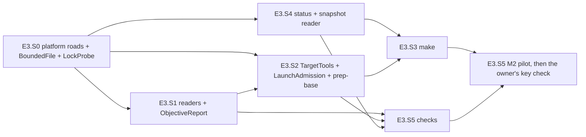

# PLAN — E3 stories: preparation and the objective checks of the model-arms module

> Status: **plan only, nothing implemented yet, 2026-10-30.** Epic E3 of [PLAN_model_arms.md](PLAN_model_arms.md) (§3 D4, D8, D11 (the
> reading half), D16–D18, D23, D24, D26, D27; §4.1's `prep-base`, `make`, `status` and `checks` rows; §4.9; §4.12; §6 step 3 — M2 and M2's
> key check; §7's E3 tests). Written at `5a8b4ce` on `feat/model-arms-e3` (E1 and E2 merged to `main`), by the judge role (Opus), as the epic
> starts — `common.plan-change-control` § *What counts as a change*: not a change. **No cornerstone** (the ledger stays `3 of 3`, §8 item 1).
> **§8 item 2 answered by the owner (2026-10-30): a fix that satisfies the plan as written, not a change** — no ledger entry; E3.S4 lands the
> read side, E5 keeps every writer.
>
> Scope: four verbs of the console `model-arms` — `prep-base` (the baseline, D24), `make` (the arms, D4/D5), `status` (read-only, by name,
> D11/F0) and `checks` (the objective report, §4.9) — the pure readers of the target's logs and the report in
> `tools/model-arms/ModelArms.Core/Checks/`, the target's tools as a launch boundary (`TargetTools`, `TargetArgv`, `TargetEnvironment` — D17 d,
> D26), a bounded no-follow file road shared by every reader of a model-written file, tests under `tests/Bench.Tests/ModelArms/`, fixtures
> under `tests/Bench.Tests/Fixtures/model-arms/objective/`, `research/module_model_arms.md` and four `research/module_tests.md` rows. Six
> stories, E3.S0–E3.S5 — **E3.S0 added 2026-10-30 at `23354c6` by Fable as a SECURITY judgement** (the parent's ledger entry 2.1: the owner
> overturned E1.S10's decision 4 — macOS and FreeBSD run, not refused, each printing what it did not verify; wave 0, it lands first);
> **M2** — the attended pilot — and **M2's key check** — the owner's, by hand — close the epic.

## 1. Goal, before any solution

E2 runs an arm. Nothing yet makes one, measures the target before the arms touch it, says where a root stands, or measures what an arm
left. The shell did all four with constants at the top of each script (`/home/jinx/git/coai-exp2/prep-base.sh:5-6`,
`objective-checks.sh:6-11`, `after6.sh:7-11`) and three habits this port must not copy:

- **It launched the target's tools by name and gave them the operator's whole environment** — `node $D/.agents/conventions/tools/low-priority.mjs
  dotnet build …` (`objective-checks.sh:11`, `:16`), `npm ci` and `npm test` with every exported secret visible to the code an arm wrote.
  Here every child goes by the real path it resolved, under an environment the module built, from a chosen cwd (D17 d, D26 b).
- **It overwrote and followed whatever was at a path.** `> "$O/build.log"` follows a link the arm's own test code may have planted in the
  results folder it was handed (`--results-directory "$O"`, `objective-checks.sh:17`); `JSON.parse(fs.readFileSync(ctrf))` reads a link, a
  FIFO, a file of any size, and crashes on a bad one (`:38`). Here a file the model under test can write — the arm's clone, `notes/`,
  `work/`, `out/` — is read through one bounded, no-follow road, and every file the harness writes is created exclusively or renamed into
  place.
- **It said "zero" where it did not know.** `PARSE_ONLY` set every exit code to 0 (`objective-checks.sh:14`), so a re-parse claimed the
  build passed; the baseline was a hand-written `{"mcpFailed":[],"tsFailed":[]}` (`/home/jinx/git/coai-exp2/baseline.json`) whose note
  says it was measured at another commit than `BASE`. Here an unknown is `null` and a baseline exists only from two suites that completed
  at `target.base` (D24, *absent is not zero*).

What must survive unchanged: **`objective.json` in the shell's shape** (`objective-checks.sh:53-65`) — the part-6/7 judges read it (D28) —
and the arm's layout the analysis half reads (D5). The proof of the first is the shell's own reader run as an oracle over the same inputs
(E3.S1), byte for byte.

**M2** (parent §6 step 3) is the first time an operator takes a root from `init` to a checked arm: `init → validate → prep-base → make →
run-arm C1 → checks C1` over a scratch target with `tests/FakeCli` as `claude`, by hand, logged. **M2's key check** observes, once, with the
real `claude` and the real coai server, whether `mcp-coai.json`'s `env` member delivers the vault key (E2 §8 item 34) — an attended step
for the owner, never an automated test.

## 2. What exists — verified at `5a8b4ce`, 2026-10-30

Every line below was opened in this worktree; the shell and the product by exact path the same day (read-only).

| Fact | Where |
|---|---|
| The dispatch: `make` and `status` say *not built — E4.S4*, `checks` *E5.S2*, `lock`/`unlock` *E4.S1*, `run-all` *E4.S3*, `chain` *E4.S5* (pre-re-split ids); `prep-base` runs the validate guard | `tools/model-arms/ModelArms/Program.cs:78-98` (`:84-92`) |
| `prep-base`'s guard: validate's checks, then exit 4 *"the baseline measurement is not built yet — story E4.S4"* | `tools/model-arms/ModelArms/Verbs/Validate.cs:27-34`, `CheckedAsync` `:36-40` |
| The one road in: root named, present, trusted, `experiment.json` read and re-stat-ed, the stage's files, `scenarios.json` judged; `ArmsOf` gives `checks` its arm | `tools/model-arms/ModelArms/ExperimentGate.cs:38-54`, `:130-131`; `ExperimentInput.JudgedScenarios` `ModelArms/VerbInput.cs:27-32` |
| D18's table: `prep-base` = inputs + no baseline; `make`/`chain` = inputs + baseline (**not** `base/`); `checks` = that + map + `made-<arm>`; `status` = root + `experiment.json` | `ModelArms.Core/Experiment/RootRequirements.cs:33-43` |
| `run-arm`'s admission: PATH entries judged, then `HOME`/`XDG_CONFIG_HOME` through `ConfigFolders`, then `claude` and `git` resolved to REAL paths; Absent → 3, Refused → 4 | `ModelArms/Verbs/RunArmAdmission.cs:79-99`; `ModelArms/Adapters/ConfigFolders.cs:12-16` |
| The executables `validate` resolves: `git`, `claude`, `dotnet`, `lowPriority[0]`, `build[0]`, `suite.command[0]`, `extension.command[0]`, `pwsh.exe` (WSL awake), the coai binary (a gate step) — **no `npm`**, though D23 names it and the shell's `prep-base` runs `npm ci` | `ModelArms.Core/Experiment/HostChecks.cs:89-105`; `prep-base.sh:12`, `:15` |
| `HostFactsReader.ScenariosAsync` — `scenarios.json` read at the judged path and re-stat-ed (the road `run-arm` reuses) | `ModelArms/Adapters/HostFactsReader.cs:100-117` |
| The target's facts: `TargetFacts`, `SuiteFacts(Command, CtrfFile, NamePrefix)`, `FormatFacts(Solution, Verbs)` (no command: the shell ran `dotnet format`), `ExtensionFacts(Directory, Command)`, `NodeModules`, `TestGlobs`; `CoaiFacts.Configured` | `ModelArms.Core/Experiment/ExperimentFacts.cs:15-38`, `:65-70` |
| The reader checks only `argv[0]` of a command (D17 b) and reads `suite.ctrfFile` as any text — a separator is not refused | `ModelArms.Core/Experiment/TargetSection.cs:40-50`, `:52-58` |
| `GitEnvironment.Of` = the map minus every `GIT_*` | `ModelArms.Core/Experiment/HostChecks.cs:71-76` |
| `ArmChildEnvironment.Of` — strips this repository's and secret-named variables EXCEPT `CLAUDE_*`/`ANTHROPIC_*`, both scout flags; sets `TMPDIR` | `ModelArms.Core/Experiment/ArmChildEnvironment.cs:32-45`; the name tests `src/Bench.Domain/Gate/CoaiEnvironment.cs:277`, `:286` |
| `ArmGit` — the harness's git by its real path, cwd chosen, `GIT_NO_LAZY_FETCH=1`, every question `-c core.fsmonitor=false`, diffs `-c diff.external= … --no-ext-diff --no-textconv`; a fixed 60 s budget; only `HEAD`, `HEAD --short` and a diff | `ModelArms/Adapters/ArmGit.cs:18-54` |
| `RootPaths`: `Base` `:19`, `ArmMapFile` `:21`, `Made(arm)` `:34`, `Locked`/`Unlocked` `:36-38` (root-level `chain/`), `ObjectiveMarker(arm)` `:40`, `ArmsDone` `:42`, `LockedModes` `:48` — **no `.locked-modes.applied`, no `chain/<run>/`, no prep-base logs**. `ArmPaths`: `CoaiSettings(side)` `:101`, `CoaiData` `:104`, `McpNone`/`McpCoai` `:106-108`, `ObjectiveFolder` `:129`, `Objective` `:131`, `PrepBuildLog` `:151`, `ObjectiveLog` `:154` | `ModelArms.Core/Experiment/ArmPaths.cs` |
| `ArmMap.Read` `:34`, `ToJson` `:43`, `Extend(existing, arms, eightRandomBytes)` `:64` (never re-mints), `TokenOf` `:75`, `Scrub(line)` `:93` | `ModelArms.Core/Experiment/ArmMap.cs` |
| `McpConfig.None()` `:45`, `Coai(coai, paths, harnessEnvironment)` `:48` (adds `COAI_CREDS_KEY` when the harness holds it); its doc names `make` *E4.S4* and the record's exclusion *E5.S5* (`:9`, `:19`) | `ModelArms.Core/Launch/McpConfig.cs` |
| `ArmFiles.WriteOnce` `:63` (refuses an existing file), `Replace` `:87` (stage + rename over), `ReadText` `:128` (`FileStream` — **follows a link, reads any size**) | `ModelArms/Adapters/ArmFiles.cs` |
| The bounded no-follow road: `KernelFacts.ReadSmall(path, limit)` (`O_NOFOLLOW|O_NONBLOCK|O_NOCTTY|O_CLOEXEC`, the descriptor judged regular, the same inode as the path, at most `limit` bytes; Linux x86-64) `:85-139`; `Present` `:141`; `MakeFolder` (exclusive `mkdir`, 0700) `:161`. `GateStatusFile` puts it behind three answers (Absent · Text · Refused) with a portable fallback | `ModelArms/Adapters/KernelFacts.cs`; `ModelArms/Adapters/GateStatusFile.cs:38-72` |
| `BaselineFile.Compose(base, measuredAt, host, suite, extension, note)` refuses an incomplete run, an exit without names, a zero total; `SuiteRun(Completed, ExitCode, Failed, Total)`; `Write`, `Read` | `ModelArms.Core/Experiment/BaselineFile.cs:11`, `:35`, `:48`, `:62` |
| `Scenario(Id, Kind, Name)`, kinds `cs`/`node` | `ModelArms.Core/Experiment/ScenariosFile.cs:7`, `:20` |
| `TimingLines.Read` / `IsArmDone`, `DoneMarkers.Read`, `ContinueMarkers.Read` | `ModelArms.Core/Steps/TimingLine.cs:47-73`; `DoneMarker.cs:27`; `ContinueMarker.cs:17` |
| `FileGateLock.WhoHolds(path)` (reads the holder's note through `ReadSmall`; creates nothing) | `ModelArms/Adapters/FileGateLock.cs:155` |
| `WorkerLiveness.ProcessIsAlive(pid)` | `src/Bench.Infrastructure/Process/WorkerLiveness.cs:25` |
| The launcher's 9-parameter overload (replaced environment, both line sinks); **every line is also kept in memory** (`StringBuilder` per reader) | `src/Bench.Infrastructure/Process/ProcessRunner.cs:146-175`, `:283-300` |
| The pure list's single `// E3` marker | `tests/Bench.Tests/ModelArms/ModelArmsArchitectureTests.cs:71` |
| Test kit: `ExperimentRoot.MakeArmAsync` `:101`, `Shim(path, name, thenRealGit)` `:185`, `ShimScript(path, body)` `:189`, `UsePath` `:219`, `RealGit` `:178`; `TempFolder` (`testsToDelete-modelarms-…`) `TempFolder.cs:10`; `TempGitRepo` `tests/Bench.Tests/Infrastructure/GitCheckoutTests.cs:147`; `PinnedConsumer` (node by its resolved path) | `tests/Bench.Tests/ModelArms/` |
| The catalogue rows: `make`, `status`, `checks` *not covered* (old ids); `prep-base` *covered* (the guard only) | `research/module_tests.md:105`, `:109`, `:115-116` |

**The shell, the behaviour to port** (read 2026-10-30; `objective-checks.sh`, `after6.sh` and `after7.sh` are pinned by sha256 in the parent's §2;
`prep-base.sh` (1671 bytes) is readable and not pinned there — its sha256 is recorded by E3.S2's coder in the module doc):

- `prep-base.sh:7` clone the plan branch; `:9-11` find the submodule whose path is `.agents/conventions` in `.gitmodules`, point its url at
  the local source's checkout, `git -c protocol.file.allow=always submodule update --init`; `:12` `npm ci --ignore-scripts --prefix
  .agents/conventions`; `:14` lowered build → `base-build.log`; `:15` `npm ci --no-audit --no-fund` in `src_vs_code` → `base-npm.log`;
  `:16` the suite's apphost with `--results-directory base-results --report-xunit-ctrf --report-xunit-ctrf-filename mcp.ctrf.json` →
  `base-test.log`; `:17` lowered `npm test` in `src_vs_code` → `base-ts-test.log`; a summary line per stage in `prep-base.log`. It writes
  no baseline: `baseline.json` was written by hand (147 bytes), and `prep-base.log` says `head=8b1eef7a` while `exp.env`'s `BASE` is
  `6786582e…` (§8 item 9).
- `after6.sh:26-37` (= `after7.sh:27-37`) per arm without `chain/made-<arm>`: `rm -rf` the arm folder, `mkdir -p {out,notes,work,tmp,coai-data/<side>}`,
  `cp -a base arm`, `git checkout -q -b <branch>`, the lowered warm build → `out/prep-build.log` (failure → exit 3), copy the coai settings,
  write `mcp-none.json` and `mcp-coai.json`, `touch chain/made-<arm>`; `:48-52` checks per arm, stdout → `out/objective.out`, then
  `touch chain/objective-<arm>` — written by the chain.
- `objective-checks.sh:13` `uncommitted = git status --porcelain | wc -l`; `:16` lowered build → `build.log`; `:17-18` lowered suite →
  `mcp-tests.log` + `mcp.ctrf.json` in `out/objective/`; `:19-23` `git diff --name-only --diff-filter=AM BASE..HEAD -- '*.cs'`, none →
  format passes, else `dotnet format <sln> whitespace --verify-no-changes --no-restore --include $files` `&&` the same with `style` (NOT
  lowered); `:24` lowered `npm test` in `src_vs_code` → `ts-tests.log`; `:26-68` the node reader: `:33` `num` = first match or `NaN`
  (`JSON.stringify` writes `null`); `:34` `^failed (\S+)` multiline, the prefix `CoaiMcp.Tests.` stripped; `:35` unique `^✖ (.+?) \(\d`;
  `:36` `^\s*✔ (.+?) \(\d`; `:37` `git grep -l -F <name> -- src_mcp/tests src_vs_code/src/test`; `:38` the CTRF's `results.tests`; `:42`
  a `node` scenario: passed · failed · absent from the node log; `:44-46` a `cs` scenario: the CTRF tests whose name matches
  `new RegExp('\\b' + name + '\\b')` — none → `absent`, one status `passed` → `passed`, else the unique statuses joined by `+`; `:51`
  numstat (`+a || 0`); `:53-64` the object, member order as written; `:62-63` `tests` = `/tests?\//`, `src` = `/^src_/` and not tests, `docs`
  = `.md`; `:65` `JSON.stringify(out, null, 2)` to `out/objective.json` (no trailing newline); `:66-67` the one-line summary on stdout.

**A recorded arm** (part 6, C1; its folder opened by name — `r/` is 755 now): `out/objective.json` (no token in it), `out/objective.out`, and
`out/objective/{build.log, format.log (0 bytes), mcp-tests.log (26 KB), mcp.ctrf.json (11.7 MB), ts-tests.log (645 KB)}`. The MTP summary
is indented (`  total: 13894`, `  succeeded: 13777`, `  skipped: 117`, `  failed: 0`); the node log carries TWO `ℹ tests` lines (6540,
then 4) — the shell's `match` takes the first; C1 has no `failed`/`✖` line; **every log but `format.log` holds the arm's token** (in
paths). `research/local-model-coding/data/arms/C/objective.json` is the PARTS 1–5 generation's shape (`generatorCheck`,
`scenariosPresent`/`scenariosPassing` lists, `formatNote`, `mcp.failedEnvironment`) — not this one (§8 item 3).

**The vault key's evidence** (`dew_flow_connect_other_ais` at `80b829ef`, read-only): the server's key is `COAI_CREDS_KEY`
(`src_mcp/src/Server/KeyVault.cs:35`); with none configured the vault answers `no COAI_CREDS_KEY configured — keyless vendors still work on
their own auth` (`:100`); `providers` returns that text as its vault field, else `N vendor key(s) loaded` (`src_mcp/src/Server/PanelService.cs:268`)
and the key NAMES only (`:272-273`); the configuration is the settings file under `COAI_DATA_DIR` layered under the process's environment,
key by key (`src_mcp/src/Program.cs:749-763`).

## 3. Conventions every story follows

E1 §3 and E2 §3 hold unchanged (namespaces; *pure means pure*; refusals as values; red first on an ASSERTION; docs per story; fixtures in
`tests/Bench.Tests/Fixtures/model-arms/`; time through `TimeProvider`; no tokens in this repository; the commands). For E3:

- **The pure list.** E3.S0 replaces the single `// E3` marker (`ModelArmsArchitectureTests.cs:71`) with six, `// E3.S0` … `// E3.S5`, one
  per line with a blank line between; every later story writes only under its own.
- **The module doc.** E3.S0 adds six empty headings to `research/module_model_arms.md` after the last E2 section: *The platform roads
  (E3.S0)*, *The objective readers and the report (E3.S1)*, *The target's tools and prep-base (E3.S2)*, *make (E3.S3)*, *status (E3.S4)*,
  *checks, M2 and the key check (E3.S5)*. Each story writes only under its own.
- **The platform roads (C18, E3.S0).** No adapter of E3 branches on `OperatingSystem.*` for a check it then refuses: a check the host can
  perform is performed, one it cannot is in the one line the gate (or `init`) prints per verb, and nothing is refused for want of a kernel
  reader. Windows rows are unchanged by name (the owner's words name macOS and FreeBSD).
- **The launch boundary, per adapter (D17 d, D26).** Every child an E3 verb starts is launched by the REAL path `ExecutableResolution`
  found in that verb (printed once as `resolved executables:` before the first launch, D17 c — `prep-base`, `make` and `checks` alike),
  never a second look-up and never a bare name; under `TargetEnvironment.Of(parent)` (C14) for the target's tools and
  `GitEnvironment.Of(TargetEnvironment.Of(parent))` for git (applied inside `ArmGit`, whatever a caller hands it); from a cwd the verb names. **PATH, `HOME` and `XDG_CONFIG_HOME` are judged at
  every verb that launches** (`LaunchAdmission`, C14 — the rule `run-arm` has, extracted, not copied). Each story's review names which of
  D26 (a)–(f) it checked, adapter by adapter (the parent's DoD).
- **A model-written file is read through `BoundedFile` (C16)** — no link followed, no FIFO waited on, never more than a stated limit — or
  the story says why not. Model-written here means anything under the arm's clone, `notes/`, `work/` or `out/`, and anything the target's
  own code writes (the suite's CTRF). The root's own files the operator owns (`experiment.json`, `baseline.json`, the map, the snapshot
  files) take the same road with a small limit, because under the lock an arm can still create a file by name in the root (D17's R7).
- **A file the harness writes is created exclusively (`FileMode.CreateNew`, which never follows a link) or staged and renamed over its
  name** (`ArmFiles.Replace`); a file carrying a secret is created at mode `0600` and never widened (`ArmFiles.ReplacePrivate`, C15).
- **No token is ever printed.** Every line `make`, `status` and `checks` write passes `ArmMap.Scrub`; each verb has a test that greps its
  output for every token of the map.
- **The scratch target** is `TargetBench` (E3.S2, a test kit): a rules repository holding `tools/low-priority.mjs` (a node script that
  starts its argv and exits with its code), a target repository whose `.agents/conventions` is that repository as a submodule, a plan file at
  `base`, shims for `dotnet` and `npm` that record `$0`, argv, cwd and the environment's NAMES and print canned MTP and node-runner lines
  (the suite shim writes a CTRF where `--results-directory` says), the host's `git` and `node` by real path. Everything under one
  `TempFolder` (`testsToDelete-modelarms-…`), removed on dispose (`common.test-leftovers`).
- **Exit codes (D16)** for the four verbs: 0 the verb did its work (a failing build or suite is a RESULT for `checks`, not a failure of the
  verb); 3 the host or the target could not be measured (a tool absent or not started, git that cannot answer, the base that does not
  build, a suite that did not complete for the baseline); 4 a wrong configuration or a refused file (a PATH/`HOME` under a forbidden root, a
  map that does not read, an arm that ran without its marker, a live runner under `checks`); 5 the operator's stop (Program's mapping) —
  the same command resumes or redoes it.
- **Cost.** E3 touches no cost: `status` prints no cost figure and `objective.json` carries none. A later column that does takes the LAST
  result per session, never the sum over attempts (E2 §8 item 62).

## 4. Shared contracts (fixed here so stories can run in parallel)

**C13 — the objective readers and the report** (E3.S1; read by E3.S2 and E3.S5). In `ModelArms.Core.Checks`, pure:

```csharp
public sealed record MtpSummary(CapturedCount Total, CapturedCount Succeeded, CapturedCount Skipped, IReadOnlyList<string> Failed);
public static class TestLogSummary { public static MtpSummary Read(string log, string namePrefix); }          // objective-checks.sh:33-34, :56
public sealed record NodeTestLog(CapturedCount Tests, IReadOnlyList<string> Failed, IReadOnlySet<string> Passed);
public static class TsTestLog { public static NodeTestLog Read(string log); }                                   // :35-36, :58 — the FIRST `ℹ tests`
public sealed record CtrfTest(string Name, string Status);
public static class CtrfScenarios
{
    public static Outcome<IReadOnlyList<CtrfTest>> Tests(string ctrf);   // results.tests[]; Failure = not a CTRF object (the caller reads [] and says why)
    public static string Passing(Scenario scenario, IReadOnlyList<CtrfTest> tests, NodeTestLog node);  // passed · failed · absent · "a+b" — :39-47
}
public sealed record NumstatRow(string File, int Added, int Deleted);
public sealed record ChangedLines(int Tests, int Src, int Docs);
public static class DiffStats { public static IReadOnlyList<NumstatRow> Rows(string numstat); public static ChangedLines Split(IReadOnlyList<NumstatRow> rows); }
public sealed record StageExits(CapturedCount Build, CapturedCount Suite, CapturedCount Format, CapturedCount Extension);
public sealed record ObjectiveFacts(string Arm, string HeadShort, CapturedCount Commits, int UncommittedFiles, StageExits Exits,
    string SuiteLog, Outcome<string> Ctrf, string ExtensionLog, IReadOnlyList<Scenario> Scenarios, IReadOnlyDictionary<string, bool> Present,
    Baseline Baseline, string NamePrefix, string Numstat, string Shortstat, IReadOnlyList<string> StepsOnDeadline);
public static class ObjectiveReport
{
    public static string Write(ObjectiveFacts facts);    // objective.json: the shell's members in its order, two-space indent, "\n", no trailing newline, then "stepsOnDeadline" LAST
    public static string Summary(ObjectiveFacts facts);  // the shell's one line (:66-67)
}
```

Rules: a regex is `RegexOptions.ECMAScript | Multiline` where the shell's was (JavaScript's `\b`, `\d`, `\s` are ASCII); a scenario name is
matched as a LITERAL whole word (`Regex.Escape`, §8 item 13); a total the log does not carry is `CapturedCount.Unavailable` and written as
`null` (the shell's `NaN`); an exit `Unavailable` (not recorded, killed at the wall) is written `null` and makes `build` / `format` `false` —
never the shell's `PARSE_ONLY` zero (§8 item 10). The writer is `Utf8JsonWriter` with `Indented`, `IndentSize = 2`, `NewLine = "\n"` and the
relaxed encoder `McpConfig` uses (`JSON.stringify`'s bytes for printable BMP text; the residual is `McpConfig`'s, said in the module doc).

**C14 — the target's tools** (E3.S2; read by E3.S3 and E3.S5). Core, pure — `ModelArms.Core.Launch`:

```csharp
public static class TargetEnvironment { public static IReadOnlyDictionary<string, string> Of(IReadOnlyDictionary<string, string> parent); }
public sealed record ToolPaths(string Git, string Dotnet, string Node, string Build, string Suite, string Extension, string Npm);  // REAL paths; Node = lowPriority[0]'s; "" = not needed by this verb
public sealed record ToolCommand(string Label, string Executable, IReadOnlyList<string> Arguments, string WorkingDirectory, TimeSpan Wall);
public static class TargetWalls { /* Clone 30 min · Npm 30 min · Build 60 min · Suite 180 min · Format 30 min · Extension 60 min · Git 60 s */ }
public static class TargetArgv
{
    public static ToolCommand Build(TargetFacts target, ToolPaths tools, string clone);
    public static ToolCommand Suite(TargetFacts target, ToolPaths tools, string clone, string resultsDirectory);
    public static ToolCommand Extension(TargetFacts target, ToolPaths tools, string clone);
    public static IReadOnlyList<ToolCommand> Format(TargetFacts target, ToolPaths tools, string clone, IReadOnlyList<string> changedCs); // one per verb; [] when none changed
    public static IReadOnlyList<ToolCommand> RulesNpmCi(TargetFacts target, ToolPaths tools, string clone);   // the nodeModules entries under rulesSubmodule — before the build
    public static IReadOnlyList<ToolCommand> OtherNpmCi(TargetFacts target, ToolPaths tools, string clone);   // the rest — after the build (prep-base.sh:12, :15)
}
public static class GitModules { public static string NameOf(string getRegexpOutput, string path); }  // "" = no submodule at that path
```

- `TargetEnvironment.Of(parent)` = the parent minus: `CoaiEnvironment.IsHarnessVariable`, `ConnectionStrings__*`, **every**
  `CoaiEnvironment.IsSecretName` (no `CLAUDE_*`/`ANTHROPIC_*` exception — the target's code has no login to keep, and an arm WROTE that
  code), **the names the shared list's suffixes miss, by `TargetEnvironment`'s own list — `PGPASSWORD`, `DATABASE_URL`, `*_PAT`, `*_APIKEY`, `*_API_KEY`,
  `*_CREDENTIALS`, `*_CREDENTIAL`, `*_AUTH`, `*_AUTHTOKEN`, `*_AUTH_TOKEN` and every `npm_config_*` whose name holds `_auth` (§8 item 49 (b))**, every `GIT_*`, the two scout flags, `SSH_AUTH_SOCK` (the agent's socket is a capability, §8 item 40); nothing added; `TMPDIR`, `HOME`, `PATH`, `DOTNET_*`, `NUGET_*` pass. The baseline and every
  arm's checks run under the same rule, so they compare (§8 item 8).
- **Lowered** (`build`, `suite`, `extension`): executable = `tools.Node`; arguments = `[lowPriority[1] made absolute against the clone when
  relative, .. lowPriority[2..], <the REAL path of the command's [0]>, .. command[1..]]` — the wrapper is handed the resolved executable,
  never its name (§8 item 11); the shell made the wrapper's script absolute the same way (`objective-checks.sh:11`).
- `Suite` appends exactly the shell's two options: `--results-directory <dir> --report-xunit-ctrf-filename <suite.ctrfFile>`.
- `Format`: executable `tools.Dotnet`, arguments `[format, <solution>, <verb>, --verify-no-changes, --no-restore, --include, <file>…]`, each
  file its own element, cwd the clone, NOT lowered (`:21-22`).
- npm: executable `tools.Npm`, arguments `[ci, --no-audit, --no-fund]` plus `--ignore-scripts` under `rulesSubmodule`, cwd = the entry's
  parent folder under the clone.

Port — `ModelArms.Core.Ports` (the parent's §4.1 names it):

```csharp
public sealed record ToolRun(CapturedCount Exit, bool KilledAtWall, bool Started, TimeSpan Elapsed);   // Exit Unavailable when killed or not started
public interface ITargetTools { Task<ToolRun> RunAsync(ToolCommand command, Stream log, CancellationToken stopping); }
```

Adapter `ModelArms.Adapters.TargetTools(IReadOnlyDictionary<string, string> environment) : ITargetTools` — `ProcessRunner.RunAsync`'s
replacing overload, both line sinks writing `line + "\n"` (UTF-8, one lock, flushed) into the `log` the VERB opened, the wall
`command.Wall`. `ModelArms.Verbs.LaunchAdmission` — `FirstRefusal(environment, forbiddenRoots)` (PATH entries, then `ConfigFolders`) and
`Resolve(verb, name, environment, forbiddenRoots) → Passage<string>` (Found → the real path; Absent → 3; Refused → 4) — extracted from
`RunArmAdmission.cs:79-99`, which then calls it.

`ArmGit` is widened, not duplicated (`common.reuse-first`): a per-call budget (default 60 s, `TargetWalls.Clone` for the clone and the
submodule) and these questions, each with the class's hardening: `CloneAsync(source, branch, destination)` (`clone -q --branch <b> --
<source> <dest>`), `DetachAsync(sha)`, `SubmodulePathsAsync()` (`config -f .gitmodules --get-regexp ^submodule\..*\.path$`, exit 1 = none),
`SetSubmoduleUrlAsync(name, url)`, `SubmoduleUpdateAsync(path)` (`-c protocol.file.allow=always submodule update --init -q -- <path>`),
`NewBranchAsync(branch)` (a name starting `-` refused), `UncommittedCountAsync()` (`status --porcelain`), `ChangedCsAsync(base)`,
`NumstatAsync(base)`, `ShortstatAsync(base)`, `CountSinceAsync(base)` (the diffs with `-c diff.external= … --no-ext-diff --no-textconv`,
`base` a hex id), `MentionsAsync(text, globs)` (`grep -l -F -e <text> -- <globs>`; exit 1 = false).

**C15 — making an arm** (E3.S3; read by E5.S4's chain). `ModelArms.Core.Experiment.RunArms.Of(IReadOnlyList<RunSpec>) → IReadOnlyList<string>`
(every arm of every run, in file order, once). `ModelArms.Adapters.ArmMaker` — `Task<MakeOutcome> MakeAsync(string arm, CancellationToken)`
with `MakeOutcome = Made · Stopped(int ExitCode, string Why)`: the one arm, so `chain`'s `Make(arm)` action (parent §4.7) calls the same
code. `ModelArms.Adapters.BaseCopy.Copy(string from, string to) → Outcome<long>` (files copied). `ArmFiles.ReplacePrivate(path, text)` —
`Replace` whose staged file is created with `UnixCreateMode = 0600` (no chmod after).

**C16 — reading by name** (E3.S0 — moved there from E3.S4 by the parent's ledger 2.1; read by E3.S3, E3.S4 and E3.S5). Adapter
`ModelArms.Adapters.BoundedFile`:

```csharp
public abstract record BoundedRead { Absent; Bytes(byte[] Value); Refused(string Reason); }   // closed, private constructor
public static BoundedRead Read(string path, int limit, PlatformRoad road);   // GateStatusFile's Judged + ReadSmall / Portable roads, extracted; the portable road under a 5 s ceiling (E3.S0); GateStatusFile decodes on top
```

**C18 — the platform roads** (E3.S0; read by every adapter that used to refuse off Linux) is spelled in E3.S0's section: `TrustRoad`,
`BoundedRoad`, `HolderRoad`, `PlatformFacts`, `PlatformRoad` (with its one `Line`) and the pure `PlatformRoads.Of`.

Core, pure: `ModelArms.Core.Steps.StepState` (`NotStarted` · `Done(string End, int Attempts)` · `Continuing(int After, string Why)` ·
`Resumable(string End, int Attempt)` · `Limited(int Attempt, string Stop)` · `Unreadable(string Reason)`) and `StepStatuses.Of(StepEvidence) →
StepState`, `StepStatuses.Line(string stem, StepState) → string`; `StepEvidence(string Stem, Read<DoneMarker> Done, Read<ContinueMarker>
Continue, int Streams, IReadOnlyList<TimingLine> Timing)` with `Read<T>` = `Absent · Present(T) · Refused(string)`.
`ModelArms.Core.Isolation.LockSnapshots.State(Read<string> snapshot, Read<string> applied) → LockState` (`None` · `Applying(run, since)` ·
`Applied(run, since)` · `Inconsistent(reason)`) and `IsolationLine.Of(LockState) → string` — the D11 line every non-mode verb prints
(*isolation applied for <run> since <utc>* / *a lock was interrupted — run `lock <run>` or `unlock`* / *no isolation snapshot*). The JSON
it reads is D11's: `.locked-modes` = `{"run","digest","since","modes":[…]}`, `.locked-modes.applied` = `{"run","digest","verifiedAt"}`
(the member name `verifiedAt` is fixed here; E5.S1 writes it — §8 item 2). `RootPaths` gains `LockedModesApplied` and
`RunMarker(string run, RunStage stage)` (`chain/<run>/locked|unlocked|arms-done`) — **subject to §8 item 2**.

**C17 — the objective run** (E3.S5). `ArmPaths` gains `ObjectiveBuildLog`, `ObjectiveSuiteLog`, `ObjectiveFormatLog`,
`ObjectiveExtensionLog` (the shell's `build.log`, `mcp-tests.log`, `format.log`, `ts-tests.log`), `ObjectiveStages` (`out/objective/stages.json`)
and `ObjectivePrevious(string stamp)` (`out/objective.prev-<utc>`). Core, pure: `StageRecord.Write(StageRuns) / Read(string)` —
`{"build":{"exit":0,"seconds":65,"killed":false},"suite":…,"format":…,"extension":…}`, `exit` `null` when not captured;
`DeadlineSteps.Of(Scheme, Func<string, Read<DoneMarker>>) → IReadOnlyList<string>` (the scheme's step stems whose `.done` says
`hard-deadline`, in scheme order).

## 5. Stories

### E3.S0 — The platform roads: macOS, FreeBSD and a Linux without a probed reader RUN, and say what they did not verify (SECURITY JUDGEMENT — spec by Fable, 2026-10-30, the parent's ledger 2.1)

**Security judgement — spec by Fable** (`model: fable`, written 2026-10-30 at `23354c6` on `feat/model-arms-e3`; outside the cornerstone
quota, as E1.S8's and E1.S10's fix specs were): the owner overturned E1.S10's decision 4 — *"macOS and FreeBSD are fine [untested]; do not
forbid their use"* (2026-10-30; the parent's ledger entry 2.1). Today `KernelFacts` answers `Unread`/refused off Linux (and off x86-64 for the
bounded read), so `validate`, `init`, every gated verb, `gate-lock` and the gate step stop with exit 3 on a Mac, and `FileGateLock` refuses
to be constructed there. This story makes those hosts run under ONE rule: **a check the host can perform is performed; a check it cannot
is named in one printed line per verb; nothing is refused for want of a reader; nothing passes as done that was not done.** Windows keeps
every behaviour it has (the owner named macOS and FreeBSD; the rows below say *unchanged* for Windows).

- **Coder:** sonnet · **Spec:** Fable · **Review:** Opus, naming D26 (a)–(f) for `PortableFacts`, `BoundedFile`, `LockProbe` and the widened
  `FileGateLock`. **Depends on:** nothing in E3 (E1 and E2 landed). **Parallel with:** nothing — **wave 0, it lands first**: it changes
  `KernelFacts`, `RootFacts`, `GateSeams`, `ExperimentGate`, `FileGateLock`, `GateHolderNote`, `GateStatusFile` and `InitVerb` — the files
  S2 (`LaunchAdmission`) and S4 (`StatusReads`) build on — and it splits the pure-list marker S1 was to split.
- **Owns:** the parent's ledger 2.1; D10, D17 (a) and D26 (a) as amended; C16 (`BoundedFile` — moved here from S4); C18 below; the gate lock's
  conflict code as a MEASUREMENT; the module doc's platform sentences (E1.S8, E1.S10, E1.S11, E2.S6, E2.S7 — every *refused as unprobed*).
  **Size:** ≈ 750 lines (≈ 300 code, 400 tests, the docs).

**Why this road and not the other two.** Three ways to run were weighed. (1) *A kernel reader written from headers* — `lstat` at 144 bytes
with `lstat$INODE64` on x86-64 Macs, FreeBSD's 224-byte `struct stat`, Darwin's `O_NONBLOCK` as `0x4` — is what decision 4 refused, and that
reason stands: an offset nobody probed reads a WRONG uid or mode without an error, so a mis-moded root passes a check that claims to have
looked (`common.platform-limits` §1; `common.security` — a measure you have not observed working is a comment). Nothing here runs on a Mac
(CI is `ubuntu-latest`), so the layout would be written blind and tested blind; it is the follow-up of §8 item 25, with the self-verifying
probe that would make it honest — not this story. (2) *`/usr/bin/stat -f` by absolute path with `LC_ALL=C`, a replaced environment and cwd
`/`* — D17 (d)-clean, but a second reader of a text format nobody has observed, with the same false-pass shape if a `%` field is misread,
and a process launch inside the trust check. (3) **The runtime's own portable facts** — `FileInfo.LinkTarget` and `Attributes` (lstat-level:
a link, a directory), `File.GetUnixFileMode` (the mode, by `stat`), `Length` and `LastWriteTimeUtc` — are code the runtime ships and tests
on macOS and FreeBSD; they give a TRUE answer for what they cover, and they cannot answer the owner, the inode, the device, the change time
or whether a file is a FIFO — exactly the list the printed line names. **Chosen: (3), under the rule above.** Honesty weighed against
protection: on a single-operator Mac the owner check guards against a shared or mis-moded root (parent §9); the mode half IS still judged
there, and the owner half is SAID to be missing rather than silently skipped — more than Windows gets today, less than Linux, by name.

**C18 — the platform roads** (this story; read by S2, S4 and every adapter that used to branch on the platform to refuse). Core, pure,
`ModelArms.Core.Experiment`:

```csharp
public enum TrustRoad { Kernel, Portable, NotPerformed }        // owner + mode + identity by statx · mode + kind + witness by the runtime · Windows (unchanged)
public enum BoundedRoad { Kernel, Portable }                     // KernelFacts.ReadSmall (Linux x86-64) · the runtime's open-and-read under a ceiling
public enum HolderRoad { ProcTicks, ProcessStartTime, None }     // /proc field 22 · Process.StartTime within 2 s · Windows (unchanged: a holder is never named)
public sealed record PlatformFacts(bool Windows, bool Linux, bool MacOS, bool FreeBSD, bool X64, bool StatxAvailable, string Description);
public sealed record PlatformRoad(string Platform, TrustRoad Trust, BoundedRoad Bounded, HolderRoad Holder, bool LibcMkdir, IReadOnlyList<string> NotVerified)
{
    public string Line { get; }   // "" when NotVerified is empty; else "trust check on <Platform>: NOT verified — <NotVerified, joined by '; '> (D17; the roads: E3.S0)"
}
public static class PlatformRoads { public static PlatformRoad Of(PlatformFacts facts); }
```

The table — every row explicit, no catch-all (`common.platform-limits`): a POSIX host not named is `Portable` on every road with its
`Description` in the line, never refused.

| Host | Trust | Bounded | Holder | LibcMkdir | NotVerified (the line's clauses) |
|---|---|---|---|---|---|
| Linux x86-64, `statx` | Kernel | Kernel | ProcTicks | yes | — (the line is empty) |
| Linux, another architecture, `statx` | Kernel | Portable | ProcTicks | yes | `the bounded read of model-written files is the runtime's: a FIFO or a device is not told from a file (each read runs under a 5 s ceiling), and a link swapped in between the path's check and the open is followed` |
| Linux without `statx` | Portable | Portable | ProcTicks | yes | the three trust clauses below, plus the bounded clause (`ReadSmall` judges its descriptor by `statx`, so the kernel reader needs Linux AND x86-64 AND a working `statx` — consult on 3.0) |
| macOS; FreeBSD | Portable | Portable | ProcessStartTime | yes | `the owner of the root, experiment.json and scenarios.json (no probed kernel reader on <platform>; their mode WAS judged)`; `whether each is a regular file (a FIFO or a device is not told from a file)`; `the inode and change time between the trust check and the read (the length and write time were compared instead)`; `the gate lock's held file against its path after the open`; the bounded clause; `a lock holder's start is believed within 2 s of its note, not by the kernel's tick` |
| any other POSIX | Portable | Portable | ProcessStartTime | yes | as macOS, naming `Description` |
| Windows | NotPerformed | Portable | None | no | — (the line is empty: Windows prints its own *not performed* lines where it does today; unchanged) |

Adapter `ModelArms.Adapters.PlatformFactsReader.Current()`: `OperatingSystem.IsWindows/IsLinux/IsMacOS/IsFreeBSD`,
`RuntimeInformation.ProcessArchitecture == Architecture.X64`, `StatxAvailable` = `KernelFacts.StatxIsAvailable` (Linux: one `statx` of `/`
that throws neither `EntryPointNotFoundException` nor `DllNotFoundException` AND returns 0 — a `-1` (`ENOSYS` under a seccomp filter, an old kernel) is unavailable too, its words kept for the line; false elsewhere), `RuntimeInformation.OSDescription`.
`PlatformRoads.Current` is computed once per process (`Lazy<PlatformRoad>`) and handed to every adapter below AS A PARAMETER — an adapter
never reads the static back, so a test hands the Mac's road on this host. `HostKinds` is unchanged (macOS and FreeBSD stay `OtherPosix`; D23's
refusals — `isolation` on Windows, `awake: wsl` off WSL — are not touched).

**The fact sources, one by one** (the decision per source; the parent's D10, D17 (a) and D26 (a) are amended to this):

1. **The trust facts** — `RootFacts.ReadFacts(path, road)`. `Kernel` → `KernelFacts.Read` (statx), unchanged. `Portable` →
   `PortableFacts.Read(full)` (adapter, new): `new FileInfo(full)`; no entry (`!Exists && !Directory.Exists(full)`) → `Unread("<full>: no
   such file or directory")`; `LinkTarget is not null` → `Read` with `Kind = Link`, `Mode = None` — nothing is read through the link, and
   `RootFacts` refuses it naming the target as today; `Attributes.HasFlag(Directory)` → `Kind = Directory`; else `Kind = Unknown` — the
   runtime cannot tell a regular file from a FIFO or a device, and `Unknown` says so ("not captured is not zero"); `Mode =
   File.GetUnixFileMode(full)` (the runtime's `stat`, read AFTER the link judgement — the window between the two is the road's residual,
   said in the doc); `OwnerUid = null`; `Identity = new FileIdentity(0, 0, kind, 0m)`; `Witness = new FileWitness(Length (0 for a directory),
   LastWriteTimeUtc.Ticks)`; `Source = Portable`. `IOException` / `UnauthorizedAccessException` → `Unread(the words)` (exit 3), never a throw
   (`common.platform-limits` §1.3). `NotPerformed` → as today (the gate fabricates the facts and prints the Windows line).
   `FileFacts` becomes `FileFacts(string Path, int? OwnerUid, UnixFileMode Mode) { FileIdentity Identity = Unknown; FileWitness? Witness; FactsSource Source = Kernel }`
   with `FileWitness(long Length, long WriteTicks)` and `enum FactsSource { Kernel, Portable }` — `null` is "not captured" (the Windows `-1`
   sentinel goes). `KernelFacts.Read`, `ReadOpen` and `ReadSmall` lose their off-Linux refusals: the ROAD decides which reader is asked, the
   reader no longer refuses a platform it is not asked on.
2. **The trust judgement** — `RootTrust.Decide(TrustRoad road, int currentUid, files, root)` (the `bool posix` becomes the enum).
   `NotPerformed` → the line, as today; `Kernel` → owner and mode, as today; `Portable` → the mode alone (`go-w` → `Refused` naming the
   file, the octal mode and `chmod go-w`, exit 4) and the owner not looked at — `Trusted` is `Trusted` because the road's line, printed by
   the gate BEFORE the judgement, has already said what was not verified. `FactsRead.MustBe(expected)`: on `Source = Portable` a `Kind =
   Unknown` satisfies `Regular` (cannot say — the line says so); `Directory` wanted and `Unknown` found is refused as today (a directory
   IS told); on `Source = Kernel` nothing changes.
3. **The re-read comparison** — `RootTrust.Changes(before, after)`: the sources differ → `["source"]`; `Kernel` → the six facts as today;
   `Portable` → `kind`, `mode`, `length`, `mtime` — never a silent `0 == 0` over an identity nobody captured. The gate's `StillTheSame` runs
   on every road but `NotPerformed` (unchanged there).
4. **The effective uid** — `geteuid` through libc on Linux, macOS and FreeBSD (no layout; E1.S10 decision 2): unchanged, and unused by
   the judgement on the portable road.
5. **`Present`** — `statx` on Linux when `StatxAvailable` (as today); `Path.Exists` elsewhere, a statx-less Linux included: a dangling link is there, `EACCES` reads absent — the stated gap
   stays stated in the module doc, not in the line, because it is not a check).
6. **The exclusive root** — `KernelFacts.MakeFolder`: libc `mkdir(path, 0700)` on Linux, macOS and FreeBSD — the one POSIX call, no
   struct, a path and a mode (`mode_t` is 16 bits on Darwin and FreeBSD; `0700` fits and the upper bits are zero); a non-zero answer is
   classified by `Present(path)`: there → `AlreadyThere` (exit 4, nothing touched); not there → `Failed(strerror)` (exit 3) — a STATE, not an
   errno number: the `EEXIST = 17` read goes, and "the one place the module reads an errno number" shrinks to `Present`'s two. Windows →
   `Directory.CreateDirectory`, as today (`InitVerb.MakeRootFolder`). `init`'s `Judged` runs the trust road (`Kernel`/`Portable` through
   `RootFacts.ReadFacts`; Windows `Through`, as today) and `init` prints the road's line FIRST, before anything is made.
7. **The gate lock's conflict code** — `FileGateLock`. On Windows the two documented codes, unchanged. Elsewhere the code is MEASURED at
   construction by `LockProbe.Measure(folder)` (adapter, new; `folder = Path.GetTempPath()`): a file `<folder>/.model-arms-lock-probe-<8
   random hex bytes>` opened `CreateNew | ReadWrite | FileShare.None | DeleteOnClose`, then a SECOND open of the same path `Open | ReadWrite |
   FileShare.None`; the second open throws an `IOException` of exactly that type → `Success(ex.HResult)` — the platform's own number,
   observed on this host at this start (11 on Linux, the witness test; `EAGAIN` 35 on Darwin and FreeBSD by their headers, which the probe
   does not need to know); the second open SUCCEEDS → `Failure("file locking is inert in <folder>: a second open of one file succeeded — no
   gate lock is attempted here")` (exit 3 through `Create`, the road `Refusal` takes today); any other exception → `Failure(the words)`.
   **The released control** (consult on 3.0): after the conflict is seen, the holder is disposed and a THIRD open `Open | ReadWrite |
   FileShare.None` must succeed — else `Failure("the probe's second open failed for a reason other than the lock: <its words>")`, so an
   `EIO` or a descriptor limit is never taken for the conflict code and later accepted as "honoured"; the probe file is then deleted.
   `LockProbe.Decide(Exception? secondOpen, Exception? released)` is the pure half (`null` = the open succeeded), `Measure` the live one. Growth: one 0-byte file
   per construction, deleted on close; a crash leaves at most one per start in the temp folder, named for what it is.
   **The held file is verified honoured** (off Windows): after `Verified` (the Linux inode comparison; on the portable road not performed —
   the line says so), a second open of the lock path with `FileShare.None` must throw the measured code; a stream comes back → both are
   disposed and the answer is `Unread("<path>: the lock is not honoured on this file system — a second open of the held file succeeded; no
   gate runs here (a file system without flock: NFS, CIFS?)")` (exit 3; `GateLockRefusedException` in the gate step); another exception type
   → `Unread(the words)`. This closes the residual D10's doc records as undetected (a file system that ignores `flock` lets two holders
   hold), at one open per acquisition, and it is the observation `common.security` asks of a delegated lock. Test seam: `internal
   Func<string, FileStream?>? SecondOpen { get; init; }` (production: the real open); `AfterJudged` / `AfterOpened` keep their places.
8. **The holder's note** — `GateHolderNote`: written with BOTH `start_ticks` (Linux `/proc`, as today; `null` elsewhere) and `start_unix`
   (`Process.GetCurrentProcess().StartTime` in whole UTC seconds, every platform); believed on `ProcTicks` by equal ticks (as today), on
   `ProcessStartTime` when the pid is alive and `|StartTime(pid) − start_unix| ≤ 2 s` (two readings of one pid differ by milliseconds —
   E2.S6's measured flake — so whole seconds with a 2 s tolerance; a reused pid started within 2 s of the old one is not told apart: the
   note is a hint, D10), on `None` (Windows) never, as today. Read through `BoundedFile.Read` (below) on every road — today `ReadSmall`
   fails off Linux x86-64 and `status` never names a holder there.
9. **The bounded no-follow read** — `BoundedFile` (C16; adapter, new, extracted from `GateStatusFile`'s `Judged` and `Portable`;
   `GateStatusFile.Read` and `GateHolderNote.Read` delegate): `Read(path, limit, road) → BoundedRead` (`Absent · Bytes · Refused`): a link is
   refused by the path (`ReparsePoint`, both roads; on `Portable` the check precedes the open, so a link swapped in between is followed —
   the runtime has no no-follow open, and the bounded clause of the line says so: plan gate F2), an absent path is `Absent`; `Bounded = Kernel` → `KernelFacts.ReadSmall`, as today;
   `Portable` → the runtime's `FileStream(Open, Read, ReadWrite | Delete)` and the `limit + 1` read, the WHOLE open-and-read run on a task under
   `OpenCeiling = 5 s`: not back in time → `Refused("<path> was not read within 5 s — a FIFO with no writer, or a stalled file system; not
   read (D17)")` and the task is left to end when its open returns (a verb process ends it — said in the doc; the alternative is a hang no
   wall covers, because the read is the harness's own, not a child's); a folder → `Refused`, as today; the `FileAttributes.Device` test goes
   (the runtime never sets it on Unix — an inert measure, `common.security`; a device file is now refused past the limit or read as its
   bytes, said).
10. **`GateLockPath.Of`** — Windows `Unjudged`, as today; elsewhere through `RootFacts.ReadFacts(path, road)`: on the portable road a link
    and a folder are refused, a FIFO is not told (the line).

**The one line.** `ExperimentGate.Admit` prints `road.Line` to the error writer ONCE, between step 2 (`Present`) and step 3 (the trust
judgement), when it is not empty — before any refusal it qualifies; `InitVerb` prints it first in `Decided`. No adapter prints; no verb
prints it twice; Windows' two existing lines stay exactly where they are. The verbs reach the road through `GateSeams.Road` (default
`PlatformRoads.Current`) and `InitVerb.RunAsync(input, makeRoot, road)`.

**Files.** Core: `tools/model-arms/ModelArms.Core/Experiment/PlatformRoads.cs` (C18: the three enums, `PlatformFacts`, `PlatformRoad`,
`PlatformRoads`), `RootTrust.cs` (`FileFacts` as above, `FileWitness`, `FactsSource`, `Decide(TrustRoad, …)`, `Changes` by source); adapters
`tools/model-arms/ModelArms/Adapters/PortableFacts.cs` (new), `BoundedFile.cs` (new, C16), `LockProbe.cs` (new), `PlatformFactsReader.cs`
(new), `KernelFacts.cs` (`StatxIsAvailable`; `MakeFolder` on every Unix with the `Present` classification; the off-Linux refusals of `Read`,
`ReadOpen`, `ReadSmall` removed — the road decides), `RootFacts.cs` (`ReadFacts(path, road)`; `ReadFacts(path)` = the current road),
`FactsRead.cs` (`MustBe` by source), `GateLockPath.cs`, `FileGateLock.cs` (the probe at construction off Windows; `SecondOpen`; the honour
check), `GateHolderNote.cs` (`start_unix`, the two believers, `BoundedFile`), `GateStatusFile.cs` (delegates); `tools/model-arms/ModelArms/GateSeams.cs`
(`Road`), `ExperimentGate.cs` (the line; `Judge` and `StillTheSame` by road), `Verbs/Init.cs` (the line; `Judged` by road); tests
`tests/Bench.Tests/ModelArms/PlatformRoadsTests.cs`, `PortableFactsTests.cs`, `BoundedFileTests.cs`, `LockProbeTests.cs`, `FactsReadTests.cs`
(new), `RootTrustTests.cs`, `KernelFactsTests.cs`, `InitVerbTests.cs`, `FileGateLockTests.cs`, `GateLockHolderTests.cs`,
`ModelArmsProgramTests.cs` (the gate on the portable road), `RootFactsTests.cs` (`On_a_platform_without_a_probed_reader_the_facts_are_unread_naming_it`
DELETED — the behaviour it pinned is gone), `ModelArmsArchitectureTests.cs` (the single `// E3` marker → six, `// E3.S0` … `// E3.S5`; under
`// E3.S0`: `typeof(PlatformRoads)`); `research/module_model_arms.md` (six empty E3 headings after the last E2 section — *The platform
roads (E3.S0)* first — and under it the table above, the ten decisions and the residuals; the sentences *macOS and FreeBSD are refused as
unprobed* in *The root, trust and the host*, *The first run*, *The gate lock* and *The gate step* rewritten to point here);
`research/module_tests.md` (the `init`, `validate` and `gate-lock` rows name the platform tests).

**Scenarios.** On this Linux host the non-Linux roads are reached by handing the Mac's or FreeBSD's `PlatformRoad` to the gate, to `init` and
to the lock through their seams, and by calling the portable readers directly — said in every test's header; the composition on a real
Mac is unobserved (§8 item 25). `MacRoad` = `PlatformRoads.Of(new(false, false, true, false, false, false, "macOS 15"))`.

| Test | Given / When / Then | Red (the assertion seen first, against the stub) |
|---|---|---|
| `PlatformRoadsTests.Each_host_takes_its_declared_roads_and_names_what_it_does_not_verify` | theory over the table's rows (Linux x64 statx; Linux arm64 statx; Linux x64 no statx — `Bounded` Portable; macOS arm64; FreeBSD x64; Windows) → `Trust`, `Bounded`, `Holder`, `LibcMkdir` as the table says; `Line` empty for Linux x64 and Windows; the Mac's line names `the owner`, `regular file`, `inode and change time`, `5 s ceiling`, `swapped in`, `2 s` and `macOS` | stub every road `Kernel`: `Expected road.Trust to be Portable, but found Kernel.` |
| `PlatformRoadsTests.No_host_is_refused_for_want_of_a_reader` | every row, and an unnamed POSIX (`Description = "Illumos"`) → a road, never a throw or a failure; `Portable` on every road for the unnamed one, its line naming `Illumos` | stub throws for the unnamed host: `Expected no exception` |
| `PortableFactsTests.The_portable_reader_gives_the_mode_the_kind_and_the_witness_and_never_the_owner` | live: a file `640`, a folder `755` → `Read`: `Mode` the set mode, `Kind` `Unknown` / `Directory`, `OwnerUid` null, `Source` `Portable`, `Witness.Length` the bytes written, `WriteTicks` within a minute of now | stub `Unread("not built")`: `Expected Read, but found Unread` |
| `PortableFactsTests.A_link_is_reported_as_a_link_and_nothing_is_read_through_it` | live: a link to a `777` file → `Kind` `Link`, `Mode` `None`; `RootFacts.ReadFacts(link, MacRoad)` → `Refused` naming the target (E1.S8's sentence) | stub follows the link: `Expected Kind to be Link, but found Unknown` |
| `PortableFactsTests.An_absent_path_and_a_folder_the_user_may_not_search_are_unread_with_words` | live: `<temp>/absent` → `Unread` naming it; a `000` folder's child (skip as root) → `Unread` naming `denied` | stub lets `UnauthorizedAccessException` fly |
| `RootTrustTests.On_the_portable_road_the_mode_is_judged_and_the_owner_is_not` | pure: `Decide(Portable, 1000, [owner null, mode 664])` → `Refused` naming `664` and `chmod go-w`; `[owner null, 600]` → `Trusted`; `Decide(Kernel, 1000, [owner 1001, 600])` → `Refused` (unchanged); `Decide(NotPerformed, …)` → `NotPerformed` (the Windows test, re-spelt from `false`) | stub treats `Portable` as `NotPerformed`: `Expected Refused, but found NotPerformed` |
| `RootTrustTests.Portable_changes_compare_kind_mode_length_and_write_time_and_a_change_of_source_is_a_change` | pure theory: two portable facts differing in `Length` → `["length"]`; `WriteTicks` → `["mtime"]`; `Kind` → `["kind"]`; `Mode` → `["mode"]`; equal → `[]`; a kernel read against a portable one → `["source"]` | stub compares identities: `Expected changes to equal {"length"}, but found empty` |
| `FactsReadTests.A_portable_fact_of_untold_kind_satisfies_regular_and_not_directory` | pure: `MustBe(Regular)` on `Unknown`/`Portable` → the same `Read`; `MustBe(Directory)` → `Refused` naming `not a directory`; `MustBe(Regular)` on `Unknown`/`Kernel` → `Refused` (as today) | stub refuses both: `Expected Read, but found Refused` |
| `ModelArmsProgramTests.On_the_portable_road_the_gate_prints_its_line_once_judges_the_mode_and_compares_the_witness` | `validate` through `GateSeams.Real with { Road = MacRoad, ReadFacts = PortableFacts }` over a `700` root → the host checks run (no trust refusal); stderr holds EXACTLY ONE line containing `NOT verified` and `the owner`, before any other gate line; the same root at `775` → exit 4 naming `775`, the line still once and first; `AfterRead` replacing `experiment.json` by a longer file → exit 4 `changed between its trust check and its read (length` | stub ignores the road: `Expected stderr to contain "NOT verified"` |
| `ModelArmsProgramTests.On_the_portable_road_a_swap_the_witness_cannot_see_is_named_as_not_verified_not_as_no_change` | `AfterRead` swapping in a file of the SAME length and write time (`File.SetLastWriteTimeUtc`) → the gate goes on (invisible to the witness) AND the printed line names `inode and change time` — the honesty assertion: what passed is said to be unchecked | stub prints no line: `Expected stderr to contain "inode and change time"` |
| `InitVerbTests.Init_on_the_portable_road_prints_its_line_first_and_makes_the_root_owner_only` | `InitVerb.RunAsync(input, KernelFacts.MakeFolder, MacRoad)` → exit 0, the root `700`, the files `600`, stderr's FIRST line the road's; the Windows line absent | stub prints nothing: `Expected stderr's first line to contain "NOT verified"` |
| `KernelFactsTests.Mkdir_refuses_a_taken_name_by_its_presence_not_by_an_errno_and_names_the_words_of_any_other_failure` | live: a folder, a file, a dangling link at the name → `AlreadyThere` each, untouched; a parent that is a file → `Failed` naming `Not a directory`; an absent parent → `Failed` naming `No such file`; the structural half: `KernelFacts.cs` holds no `AlreadyExists` and no `== 17` | green by construction on Linux (the errno road answers the same) — its teeth are B6; the structural half red against the current file |
| `LockProbeTests.The_measured_conflict_code_is_the_runtimes_EWOULDBLOCK_on_linux` | live (skip off Linux): `LockProbe.Measure(temp)` → `Ok(11)`; the probe file gone after; `FileGateLock.Create` → `Ok` | stub `Failure("not built")`: `Expected Ok(11)` |
| `LockProbeTests.A_conflict_that_outlives_the_holders_release_is_not_the_lock` | pure: `Decide(new IOException("x") { HResult = 5 }, released: new IOException("io") { HResult = 5 })` → `Failure` naming `other than the lock`; `released: null` → `Ok(5)` | stub ignores `released`: `Expected Failure, but found Ok(5)` |
| `LockProbeTests.A_second_open_that_succeeds_is_inert_and_any_other_fault_carries_its_words` | pure (`released: null` throughout): `Decide(null, null)` → `Failure` naming `inert`; `Decide(new IOException("x") { HResult = 35 }, null)` → `Ok(35)`; `Decide(new FileNotFoundException(), null)` (a subclass) → `Failure`; `Decide(new UnauthorizedAccessException("denied"), null)` → `Failure` naming `denied` | stub `Ok(ex?.HResult ?? 0)`: `Expected Failure, but found Ok(0)` |
| `FileGateLockTests.A_held_lock_whose_file_system_lets_a_second_open_through_is_released_and_refused` | `new FileGateLock(clock, poll) { SecondOpen = _ => new FileStream(<another temp file>, …) }` → `Take(path, true, true)` → `Unread` naming `not honoured`; no holder note left; the lock file openable afterwards (released); with the real `SecondOpen` → `Held` | stub ignores `SecondOpen`: `Expected Unread, but found Held` |
| `FileGateLockTests.The_conflict_code_is_measured_not_tabled_off_windows` | structural: `FileGateLock.cs` holds no `LinuxWouldBlock` and no bare `11`; `ConflictCodes` calls `LockProbe`; the two Windows literals remain (unchanged) | the scan red against the current file |
| `GateLockHolderTests.A_note_is_believed_by_the_kernels_ticks_on_linux_and_by_its_start_second_within_two_seconds_elsewhere` | pure theory over `GateHolderNote.Believe(raw, alive, liveTicks, liveStart, road)`: `ProcTicks` equal → true, differ → false, null → false; `ProcessStartTime` `Δ = 0, 2` → true, `3` → false, null → false; `None` → false whatever the facts | stub believes on `ProcTicks` only: `Expected True (ProcessStartTime, Δ 2 s), but found False` |
| `GateLockHolderTests.The_note_carries_both_the_ticks_and_the_start_second` | live: a held lock's note parses with `start_ticks` = this process's field 22 and `start_unix` within 2 s of `Process.GetCurrentProcess().StartTime` | stub writes ticks only: `Expected note to have "start_unix"` |
| `BoundedFileTests.A_link_a_fifo_a_folder_and_a_file_past_the_limit_are_refused_and_an_absent_file_is_absent` (S4's row, owned here) | live, BOTH roads handed in (`Kernel`, `Portable`): the four refusals name their reason, `Absent` for nothing; `GateStatusTests`, `GateStepTests`, `GateLockHolderTests` unedited and green through the delegation | stub `Absent`: `Expected Refused, but found Absent` |
| `BoundedFileTests.The_portable_road_answers_a_fifo_with_no_writer_within_its_ceiling_instead_of_waiting` | live: `mkfifo`; `BoundedFile.Read(fifo, 4096, PortableRoad)` → `Refused` naming `5 s` in under 8 s (the test's wall 20 s); a FIFO WITH a writer that sends nothing → the same; a regular file → `Bytes` at once | a stub without the ceiling: the test's wall — the symptom IS the hang, said in the test |
| `BoundedFileTests.A_portable_read_follows_no_link_and_reads_at_most_the_limit` | live: a link to a 10-byte file → `Refused` naming `link`; a `limit + 1`-byte file → `Refused` naming `bigger`; a `limit`-byte file → `Bytes` of `limit` | stub reads through: `Expected Refused` |

**Break-its** (plant, watch the named test go red with the real symptom, restore): B1 `Decide(Portable)` returns `NotPerformed` → *the
mode is judged and the owner is not*, and the gate test's `775` row (no refusal); B2 `Changes` compares identities on portable facts →
*compare kind, mode, length* (`[]` for a longer file); B3 the line printed inside `Judge` (twice: the root, then `scenarios.json`) → *prints
its line once*; B4 the ceiling removed from the portable open → *within its ceiling* (the wall); B5 the honour check skipped → *released and
refused*; B6 every mkdir failure `Failed` → *refuses a taken name*; B7 `LockProbe.Decide(null, null)` → `Ok(0)` → *inert*.

**Commands.** `--filter-class "*PlatformRoadsTests"`, `"*PortableFactsTests"`, `"*BoundedFileTests"`, `"*LockProbeTests"`, `"*RootTrustTests"`,
`"*FactsReadTests"`, `"*KernelFactsTests"`, `"*InitVerbTests"`, `"*FileGateLockTests"`, `"*GateLockHolderTests"`, `"*GateLockPathTests"`,
`"*GateStatusTests"`, `"*GateStepTests"`, `"*ModelArmsProgramTests"`, `"*ValidateVerbTests"`, `"*RunArmSchemeTests"`,
`"*ModelArmsArchitectureTests"`; the whole suite.

**Done when.** The twenty-one green on Linux with the live rows RUN; every red seen (the two "green by construction" rows have their
structural red and their break-it); the seven break-its observed; `RootFactsTests.On_a_platform_without_a_probed_reader_…` gone; E2's
suites unedited and green (`GateStatusTests`, `GateStepTests`, `GateLockHolderTests` — the delegation moved nothing); the review names D26
(a)–(f) for the four adapters; the module doc's platform paragraphs say what this story says and name §8 item 25 as the unobserved
composition.

**What it does NOT prove** (in the module doc under *The platform roads*, and in the test headers): any road COMPOSED on a real macOS or
FreeBSD host — the units run here (`PortableFacts`, `BoundedFile`'s portable road, `LockProbe`, the holder's start second, libc `mkdir`'s
classification) on Linux, and the Mac's road is handed in through seams; `Process.StartTime` on macOS and FreeBSD; libc `geteuid` and
`mkdir` on them (POSIX, no layout — not observed); `flock` on APFS, UFS and ZFS (the probe and the honour check observe it at the first
run there — that IS the proof, when it runs); that `File.GetUnixFileMode` reads the file the link judgement saw (a link made in the window
between the two is the road's residual); `EACCES` on `Present` reading as absent off Linux; a thread left behind by the ceiling until its
open returns; a swap that keeps the length and the write time (named as unverified, by design). Linux x86-64 behaves as before, by test.

**Out of bounds.** A self-verifying `lstat` reader for Darwin and FreeBSD (§8 item 25 — the follow-up a Mac run can take); the Windows
rows (unchanged by the owner's words); E5's POSIX adapters on a Mac (`PosixFolderIsolation`, `SetsidLauncher` — E5.S1 and E5.S3 say
*unobserved on macOS and FreeBSD* in their *not proven*; the roads give them nothing to branch on); D23's host refusals (`isolation`,
`awake` untouched); `HostKinds`; the research doc's E1/E2 sections beyond the sentences named in *Files*.

**Brief for the coder** (sonnet; this section is the brief — the order): (1) C18 and its two pure tests; `PlatformFactsReader.Current()`;
the pure-list marker split and the six doc headings. (2) `FileFacts`/`FileWitness`/`FactsSource`, `RootTrust.Decide(TrustRoad, …)`,
`Changes` by source, `MustBe` by source, their tests — every existing `Decide(true/false, …)` call re-spelt (`Kernel`/`NotPerformed`);
build green. (3) `PortableFacts`, `RootFacts.ReadFacts(path, road)`, `GateSeams.Road`, the gate's line and road switches, `GateLockPath`,
the two program tests. (4) `KernelFacts.MakeFolder` on every Unix with the `Present` classification, `InitVerb`'s road and line, the init
test. (5) `BoundedFile` extracted with the ceiling; `GateStatusFile` and `GateHolderNote` delegate; E2's suites green unedited. (6)
`LockProbe`, `FileGateLock`'s construction and honour check, `SecondOpen`; the holder's `start_unix` and `Believe`. (7) The docs. Never: a
kernel layout for Darwin or FreeBSD; a `stat` or `id` process; a change to a Windows branch; a `static` road an adapter reads back (hand
it in); a line printed by an adapter; a refusal whose reason is "this platform".

### E3.S1 — The objective readers and `ObjectiveReport`: the shell's shape, proven by the shell's own reader

- **Coder:** sonnet · **Spec:** Opus (this section) · **Review:** Opus. **Depends on:** E1.S8 (`Scenario`, `Baseline`) — merged; E3.S0
  (the marker split and the doc headings). **Parallel with:** E3.S4.
- **Owns:** §4.9's pure half; D8's `stepsOnDeadline` member; D28's judges' half (the round trip stands for `judge-abs.sh` and
  `judge-coai.sh`, which read only `objective.json`). **Size:** ≈ 750 lines.

**Files.** `tools/model-arms/ModelArms.Core/Checks/TestLogSummary.cs`, `TsTestLog.cs`, `CtrfScenarios.cs`, `DiffStats.cs`, `ObjectiveFacts.cs`,
`ObjectiveReport.cs`; tests `ObjectiveParsersTests.cs`, `ObjectiveReportTests.cs`, `ShellObjectiveReader.cs` (the oracle kit); fixtures under
`tests/Bench.Tests/Fixtures/model-arms/objective/`: `mtp.log` (real lines of part-6 C1's `mcp-tests.log` — its `skipped` lines and its
indented summary — the token replaced by `0123456789ab`, plus two `failed CoaiMcp.Tests.<Class>.<Method> (12ms)` lines written in the shape
of the real `skipped` lines, said in the test), `node.log` (real lines of C1's `ts-tests.log`: `✔` lines with leading spaces, both `ℹ tests`
lines, plus two `✖` lines in the real shape — one printed twice), `ctrf.json` (C1's CTRF envelope with twelve of its tests and four written
for the scenarios: all passed, one failed, mixed), `objective-part6-C1.json` (C1's `out/objective.json`, copied as it is — no token in it,
checked; its sha256 recorded in the test), `objective-checks-reader.mjs` (the heredoc of `objective-checks.sh:27-67` VERBATIM — the
pinned file's sha256 is the parent's §2; the extract's own sha256 is asserted by the test); the pure list (under `// E3.S1`, the marker S0
made: `typeof(TestLogSummary), typeof(TsTestLog), typeof(CtrfScenarios), typeof(DiffStats), typeof(ObjectiveReport)`); the module doc's
*The objective readers and the report* (the heading S0 made).

**Contracts.** C13 exactly. `ObjectiveReport.Write` builds the members in the shell's order (`:54-64`): `arm`, `head`, `commits`,
`uncommittedFiles`, `build`, `format`, `mcp {exit, total, passed, skipped, failedNew, failedBaseline}`, `ts {exit, total, failedNew}`,
`scenarios {<id>: {name, present, passing}}` (in `scenarios.json` order), `scenariosPresentCount`, `scenariosPassingCount`, `diff {shortstat,
changedLines {tests, src, docs}, files}`, then the additive `stepsOnDeadline` (always present; `[]` says none ended on its deadline).
`failedNew`/`failedBaseline` keep the log's order; `mcp.failedNew` filters `Baseline.McpFailed`, `ts.failedNew` filters `Baseline.TsFailed`.
`DiffStats.Split` keeps the shell's three rules verbatim (§8 item 12). `Summary` = `{"arm","build","format","mcpNewFailures","tsNewFailures",
"scenarios":"<present>/<count> present, <passing> passing","stat"}` on one line.

**Scenarios.**

| Test | Given / When / Then | Red (the assertion seen first, against the stub) |
|---|---|---|
| `ObjectiveParsersTests.The_mtp_summary_reads_total_succeeded_skipped_and_every_failed_name` | `mtp.log`, prefix `CoaiMcp.Tests.` → Total 13894, Succeeded 13777, Skipped 117, Failed = the two names without the prefix, log order | stub `(Unavailable×3, [])`: `Expected summary.Total.WasCaptured to be True, but found False.` |
| `ObjectiveParsersTests.The_node_log_reads_passed_failed_and_the_count` | `node.log` → Tests 6540 (the FIRST `ℹ tests`; the second says 4), Failed = the two names once each, Passed holds a name whose line starts with spaces | stub `(Unavailable, [], ∅)`: `Expected log.Tests.WasCaptured to be True, but found False.` |
| `ObjectiveParsersTests.Ctrf_decides_passed_failed_absent_and_mixed_per_scenario` | `ctrf.json`: a `cs` scenario all passed → `passed`; one failed → `failed`; none → `absent`; passed then failed → `passed+failed`; a `node` scenario → from `node.log` | stub `"absent"`: `Expected "absent" to be "passed".` |
| `ObjectiveParsersTests.New_failures_exclude_the_baseline` | failed `[A, B]`, `McpFailed [B]` → failedNew `[A]`, failedBaseline `[B]`; node failed `[X, Y]`, `TsFailed [Y]` → `[X]` | stub every failure new: `Expected failedNew to be a collection with 1 item(s), but … contains 2` |
| `ObjectiveParsersTests.Changed_lines_split_into_tests_src_and_docs` | numstat `10\t2\tsrc_mcp/tests/ATests.cs`, `5\t1\tsrc_mcp/src/A.cs`, `3\t0\tresearch/x.md`, `-\t-\tsrc_vs_code/icon.png`, `1\t1\ttools/b.mjs` → tests 12, src 6, docs 3; five files in order; the binary row 0 | stub zeros: `Expected lines.Tests to be 12, but found 0.` |
| `ObjectiveParsersTests.A_total_the_log_does_not_carry_is_unavailable_never_zero` | a log with no summary → every count `WasCaptured` false; the report writes `null` | stub `Number(0)`: `Expected … WasCaptured to be False` |
| `ObjectiveParsersTests.A_scenario_name_is_a_whole_word_and_never_a_pattern` | `Foo` does not match `FooBar` and matches `Ns.Foo(x: 1)`; `A.B` does not match `AxB` | unescaped plant: `Expected "absent" … but "passed"` |
| `ObjectiveParsersTests.A_ctrf_that_is_not_a_ctrf_object_is_refused_with_its_reason` | `[]`, `{}`, `{"results":{}}`, a truncated object → Failure naming why; a `cs` scenario then `absent` | stub `Success([])`: `Expected outcome to be Fail` |
| `ObjectiveReportTests.The_report_of_a_real_arm_round_trips_the_shells_shape` | **the oracle**: a temp git repo laid out as the coai target (`src_mcp/tests/ATests.cs` naming two `cs` scenarios, `src_vs_code/src/test/a.test.ts` naming the `node` one, `src_mcp/src/A.cs`, `research/x.md`, a binary file; `base`, then two commits); `out/objective/` holds the three fixtures as `mcp-tests.log`, `ts-tests.log`, `mcp.ctrf.json`; the root holds `baseline.json` (`BaselineFile.Write`, failures that overlap the logs') and `scenarios.json`; `node objective-checks-reader.mjs <O> <E> C1 <base> 0 0 1 0 0` (node by its resolved path, cwd the repo) writes `<O>/../objective.json`; the port's `Write` over the same inputs (facts gathered by the test with the real git) **equals the oracle's text byte for byte** with `,\n  "stepsOnDeadline": []` inserted before the final `\n}` | stub `"{}"`: `Expected text to be "{\n  \"arm\": \"C1\",…" with a length of …, but "{}" has a length of 2` |
| `ObjectiveReportTests.The_shape_is_the_part6_arms_every_member_in_its_order` | the member paths (names, nesting, order, JSON kinds; the scenario map's entries aside) of the port's report equal `objective-part6-C1.json`'s, plus `stepsOnDeadline` last | stub: `Expected paths to be equal to {"arm", …}` |
| `ObjectiveReportTests.Steps_that_ended_on_a_deadline_are_listed_under_stepsOnDeadline` | facts with `["3-fix"]` → the text ends `"stepsOnDeadline": [\n    "3-fix"\n  ]\n}` | stub without the member: `Expected text to end with …` |
| `ObjectiveReportTests.The_summary_line_is_the_shells` | equals the oracle's stdout line over the round-trip inputs | stub `""` |
| `ObjectiveReportTests.Arm_written_strings_are_escaped_and_parse_back_exactly` | facts whose scenario names, numstat paths and log-derived names hold `"`, `\\`, a newline, a tab, `\u0001`, `ё`, an emoji and `"},"x":{"` → the text parses with `JsonDocument`; the member paths equal the shape test's; every string reads back equal to its input | a plant that writes raw strings: `JsonReaderException` |
| `ObjectiveReportTests.Unknown_exits_are_null_and_never_pass` | `StageExits` all Unavailable → `"build": false`, `"format": false`, `"mcp": {"exit": null, …`, `"ts": {"exit": null, …` | stub writes `0`: `Expected … "exit": null …` |

**Break-its** (plant, watch the named test go red with the real symptom, restore): `TsTestLog` takes the LAST `ℹ tests` → *the node log*
(6540 vs 4); `Regex.Escape` removed → *whole word*; `Unavailable` written as `0` → *unknown exits*; indent 1 → *round trips* (the oracle
differs at byte 2).

**Commands.** `--filter-class "*ObjectiveParsersTests"`, `"*ObjectiveReportTests"`, `"*ModelArmsArchitectureTests"`; the whole suite.

**Done when.** The thirteen green; every red seen; the four break-its observed; the oracle's sha asserted; `PureDeciders` names the five.

**Out of bounds.** Reading a file or running git (S5 gathers the facts); `stages.json` (S5); the analysis half's readers (E6).

### E3.S2 — `TargetTools`, the launch admission and `prep-base`: the baseline from both suites at `base`

- **Coder:** sonnet · **Spec:** Opus · **Review:** Opus, naming D26 (a)–(f) for `TargetTools` and the widened `ArmGit`; a finding on the
  trust boundary (D17) gets its fix spec from **Fable** (security judgement, outside the quota), as E1.S8's and E1.S10's did.
  **Depends on:** E3.S1 (the two log readers). **Parallel with:** — (wave B alone).
- **Owns:** D17 (c)(d) and D26 (b, c) for the target's tools; D24's measurement; D18 (`prep-base` replaces the guard); D23's missing `npm`;
  `LaunchAdmission` (one rule for every verb that launches). **Size:** ≈ 950 lines.

**Files.** Core: `ModelArms.Core/Launch/TargetEnvironment.cs`, `TargetArgv.cs` (`ToolPaths`, `ToolCommand`, `TargetWalls`),
`ModelArms.Core/Experiment/GitModules.cs`, `HostChecks.cs` (`npm` with the role `target.nodeModules` when `NodeModules` is not empty),
`TargetSection.cs` (`target.suite.ctrfFile` must be one file name), `ArmPaths.cs` (`RootPaths.PrepBaseLog` `prep-base.log`, `BaseBuildLog`
`base-build.log`, `BaseNpmLog(int n)` `base-npm-<n>.log`, `BaseSuiteLog` `base-test.log`, `BaseExtensionLog` `base-ts-test.log`, `BaseResults`
`base-results`, `PrepBasePrevious(string stamp)` `prep-base.prev-<stamp>`); `ModelArms.Core/Ports/ITargetTools.cs`; adapters `ModelArms/Adapters/TargetTools.cs`, `ArmGit.cs` (C14's widening);
verbs `ModelArms/Verbs/LaunchAdmission.cs`, `RunArmAdmission.cs` (calls it), `PrepBase.cs` (`PrepBaseVerb`), `Validate.cs` (`CheckedAsync`
internal, the guard removed); `Program.cs` (the `prep-base` arm only: `"prep-base" => ExperimentGate.RunAsync(input, PrepBaseVerb.RunAsync),`);
tests `TargetEnvironmentTests.cs`, `TargetArgvTests.cs`, `PrepBaseTests.cs`, `TargetBench.cs`, one test in `ValidateVerbTests.cs`, one in
`ExperimentFileTests.cs`, rows in `ArmPathsTests.Every_path_of_an_arm_is_spelled_as_the_shell_spelled_it`; under `// E3.S2`
`typeof(TargetEnvironment), typeof(TargetArgv), typeof(GitModules)`; the module doc (with `prep-base.sh`'s sha256); `research/module_tests.md`
(the `prep-base` row: `covered`, `PrepBaseTests`).

**`PrepBaseVerb.RunAsync(ExperimentInput)`**:

1. Validate's checks (`ValidateVerb.CheckedAsync`): any problem → validate's exit (3/4) and nothing launched. The executables are the ones
   `HostFacts` resolved and printed — `ToolPaths` is built from them, never looked up again.
2. `base/` present (no baseline — the gate refused one) → a crashed `prep-base`: removed whole (`Directory.Delete(recursive)` — a link inside
   is removed, never followed: a test), said in one line. Any of the root's `prep-base.log`, `base-*.log` and `base-results/` left by an
   earlier attempt is RENAMED into `prep-base.prev-<utc stamp>/` (kept, never followed — `checks`' `ObjectivePrevious` shape), said in one
   line, so step 5's exclusive creates succeed on a retry (plan gate F1).
3. `ArmGit(git, root, env).CloneAsync(source, planBranch, base)`; `DetachAsync(target.base)`; `HeadAsync` must equal `target.base` (else 3).
4. `GitModules.NameOf(SubmodulePathsAsync(), rulesSubmodule)` — `""` → 4 *"target.rulesSubmodule <p> is not a submodule of the target at
   <base>"*; `SetSubmoduleUrlAsync(name, <source>/<rulesSubmodule>)`; `SubmoduleUpdateAsync(rulesSubmodule)`.
5. `RulesNpmCi` → `BaseNpmLog(n)`; the build (lowered) → `BaseBuildLog`; `OtherNpmCi`; the suite (lowered, results `BaseResults`) →
   `BaseSuiteLog`; the extension (lowered) → `BaseExtensionLog`. Each log is created exclusively before its tool starts; a line per stage
   in `prep-base.log` in the shell's shape (`build rc=<n|killed> s=<seconds> head=<short>`, …, `DONE`). A tool not started → 3; npm or
   the build not exit 0 → 3 *"the base does not build at <sha> — see <log>; no baseline"*, nothing after it runs.
6. `SuiteRun(Completed: exited AND the summary's total captured, Exit, TestLogSummary.Read(log, namePrefix).Failed, Total)`; the
   extension's from `TsTestLog`; `BaselineFile.Compose(base, now, "<machine> (<host kind>)", suite, extension, "")` — Failure → 3, every
   sentence printed, no baseline; Success → `baseline.json` written once (`ArmFiles.WriteOnce`), 0.

**Scenarios.**

| Test | Given / When / Then | Red |
|---|---|---|
| `PrepBaseTests.Baseline_json_carries_the_base_the_host_the_failures_and_the_totals_of_both_suites` | `TargetBench`: the suite shim prints `failed Tgt.Tests.ATests.Fails (3ms)` and a summary (total 12, succeeded 10, skipped 1), the npm `test` shim prints `✔ a (1ms)`, `✖ b (2ms)`, `ℹ tests 2`; prefix `Tgt.Tests.` → 0; `baseline.json` reads back: `base` = `target.base`, `host` names the machine, `mcpFailed ["ATests.Fails"]`, `tsFailed ["b"]`, totals 12 and 2 | stub returns 0 writing nothing: `Expected File.Exists(baseline) to be True` |
| `PrepBaseTests.A_suite_that_did_not_run_to_completion_refuses_the_baseline_instead_of_writing_an_empty_list` | theory: the suite shim prints no summary and exits 0; the suite shim outlives a 1 s wall (`PrepBaseSeams`); the extension shim exits 1 naming nothing → 3, no `baseline.json`, the sentence names the suite | stub writes an empty-list baseline: `Expected File.Exists(baseline) to be False` |
| `PrepBaseTests.Prep_base_requires_validate_and_an_absent_baseline` | a `baseline.json` → 4 naming it; an unfilled template (a validate problem) → 4; the shims' log is EMPTY in both | a stub that launches first: `Expected calls to be empty` |
| `PrepBaseTests.Every_target_tool_is_launched_by_its_resolved_path_under_a_built_environment` | the parent holds `BENCH_DB`, `GIT_DIR`, `GITHUB_TOKEN`, `CLAUDE_CODE_OAUTH_TOKEN`, `COAI_CREDS_KEY`, `KEEP_ME`; every shim's `$0` is the REAL path printed under `resolved executables:`; every lowered call's first argument is `<base>/.agents/conventions/tools/low-priority.mjs` and its next the `dotnet`/`npm` shim's REAL path; the build's, the suite's and npm's variable names lack all six stripped names and keep `KEEP_ME`, `PATH`, `HOME`; git (a recording shim that execs the real git) sees no `GIT_*` but `GIT_NO_LAZY_FETCH` and no secret | stub passes the parent's environment: `Expected names not to contain "GITHUB_TOKEN"` |
| `PrepBaseTests.The_base_is_the_configured_commit_and_its_rules_submodule_comes_from_the_local_source` | real git: `planBranch` one commit AHEAD of `base` → `base/` HEAD = `base`; `.agents/conventions/tools/low-priority.mjs` present; `submodule.<name>.url` = `<source>/.agents/conventions` | stub clone without the detach: `Expected head to be "<base>", but found "<branch head>"` |
| `PrepBaseTests.A_base_that_does_not_build_writes_no_baseline_and_exits_3` | the build shim exits 1 → 3; no suite call; `prep-base.log` ends `build rc=1 …` | stub goes on: `Expected calls not to contain "suite"` |
| `PrepBaseTests.A_failed_attempts_logs_are_moved_aside_and_the_retry_writes_fresh_ones` | a first run whose build shim exits 1 → 3, `base-build.log` and `prep-base.log` present; the shim fixed, a second run → 0, `prep-base.prev-<stamp>/base-build.log` holds the first run's bytes, the root's `base-build.log` the second's | stub without the move: `Expected exit 0, but found 3` (the exclusive create refused) |
| `PrepBaseTests.A_half_made_base_is_redone_whole` | `base/` holding `stale.txt` and a link to a file outside the root, no baseline → `stale.txt` gone, the outside file's bytes unchanged, baseline written | stub keeps `base/`: `Expected File.Exists(stale) to be False` |
| `PrepBaseTests.Npm_ci_runs_in_every_node_modules_folder_and_ignores_scripts_only_under_the_rules_submodule` | the npm shim's log: `.agents/conventions` `ci --no-audit --no-fund --ignore-scripts` BEFORE the build; `ext` `ci --no-audit --no-fund` AFTER it | stub one list: `Expected index of build call to be greater than …` |
| `ValidateVerbTests.Npm_is_needed_when_node_modules_are_configured` | `extension.command` `["node", …]`, `nodeModules` not empty, no `npm` on PATH → a problem naming `target.nodeModules npm …`, exit 3 | `Expected problems to contain …npm…` |
| `ExperimentFileTests.A_ctrf_file_name_with_a_separator_or_a_climbing_segment_is_refused` | `ctrfFile` `a/b.json`, `..`, `/abs.json` → refused naming `target.suite.ctrfFile` | `Expected outcome to be Fail` |
| `TargetEnvironmentTests.Only_this_repositorys_secret_and_git_variables_are_stripped` | pure: `CLAUDE_CODE_OAUTH_TOKEN` and `ANTHROPIC_API_KEY` stripped (contrast: `ArmChildEnvironment` keeps them), `TMPDIR` kept as the parent's | stub identity: `Expected … not to contain key "BENCH_DB"` |
| `TargetArgvTests.The_lowering_wrapper_is_absolute_and_hands_on_the_resolved_executable` | `["node", ".agents/conventions/tools/low-priority.mjs"]` + `["dotnet","build","X.slnx"]` → exe `/real/node`, args `[<clone>/.agents/…/low-priority.mjs, /real/dotnet, build, X.slnx]`; an absolute wrapper script kept as it is | stub keeps the name: `Expected args[1] to be "/real/dotnet", but found "dotnet"` |
| `TargetArgvTests.The_suite_gets_the_shells_two_ctrf_options_and_format_one_command_per_verb` | the suite ends `--results-directory <d> --report-xunit-ctrf-filename mcp.ctrf.json`; format over `["a b.cs","c.cs"]` → two commands (whitespace, style), each file one element; `[]` → none | stub: `Expected … to end with …` |

`RunArmSchemeTests` and `ValidateVerbTests` run unedited (one test added to the second) and green — the proof the extraction moved
nothing; `The_module_launches_nothing_by_a_bare_name` green with `TargetTools.cs` present.

**Break-its.** `TargetArgv` keeps `command[0]`'s name → *every target tool … resolved path*; `TargetEnvironment` keeps `GIT_*` → the same
test; the baseline composed before the extension suite completes → *did not run to completion*; `Directory.Delete` replaced by a walk that
follows links → *half-made base* (the outside file goes).

**Commands.** `--filter-class "*PrepBaseTests"`, `"*TargetArgvTests"`, `"*TargetEnvironmentTests"`, `"*ValidateVerbTests"`,
`"*ExperimentFileTests"`, `"*RunArmSchemeTests"`, `"*ModelArmsArchitectureTests"`, `"*ModelArmsScenarioTests"`; the whole suite.

**Done when.** The thirteen green, every red seen, the four break-its observed; `RunArmSchemeTests` unedited and green; the review names
D26 (a)–(f) for `TargetTools` and `ArmGit`.

**Out of bounds.** `make`, `checks` (S3, S5); a configurable wall (§8 item 10); a cap on the launcher's in-memory output (§8 item 18).

### E3.S3 — `make`: the arms, copied, branched, built, with their MCP files; the map extended

- **Coder:** sonnet · **Spec:** Opus · **Review:** Opus, naming D26 (a)–(f) for `ArmMaker` and `BaseCopy`. **Depends on:** E3.S0
  (`BoundedFile`), E3.S2 (`TargetTools`, `LaunchAdmission`, `ArmGit`), E3.S4 (the isolation line; `status` for the read-back scenario).
  **Parallel with:** E3.S5 (its code).
- **Owns:** §4.1's `make` row; D4 (the map extended, never re-minted); D5 (a made arm's layout); E2 §8 item 14 (`mcp-coai.json` at `0600`);
  D27 (the arms of every run); the parent's E3.S3 Done-when (a made arm reads back by `status`). **Size:** ≈ 750 lines.

**Files.** `ModelArms/Verbs/Make.cs` (`MakeVerb`), `ModelArms/Adapters/ArmMaker.cs`, `ModelArms/Adapters/BaseCopy.cs`, `ArmFiles.cs`
(`ReplacePrivate`), `ModelArms.Core/Experiment/RunArms.cs`, `RootRequirements.cs` (`make` and `chain` require `base/`, producer `prep-base`),
`McpConfig.cs` (its doc's story ids only: `make` E3.S3, the record's exclusion E6.S3); `Program.cs` (the `make` arm only); tests
`MakeVerbTests.cs`, `BaseCopyTests.cs`, `ArmFilesTests.cs` (new — one test), the `make`/`chain` rows of `RootRequirementsTests.Each_verb_requires_exactly_the_files_its_stage_needs`;
under `// E3.S3` `typeof(RunArms)`; the module doc's *make*; `research/module_tests.md` (`make`: `covered`, `MakeVerbTests`).
**Carried from S4 (§8 item 32), for S3's coder and reviewer.** (1) Replace `StatusVerb.ArmsOf` (`Verbs/Status.cs`) AND the copy in `BriefRehearsal.cs` (`ArmsOf`, the arms the runs name) with `RunArms.Of` — one derivation, three callers. (2) Repoint `StatusVerbTests.The_verbs_source_holds_no_way_to_list_a_folder_and_the_scan_still_finds_one_where_one_lives`'s companion at `BaseCopy.cs`'s `EnumerateFileSystemInfos` (the live instance the parent's text names), or keep `ArmFiles.cs` and say so.

**`MakeVerb.RunAsync(ExperimentInput)`**: (1) `LaunchAdmission`: PATH, `HOME`, `XDG_CONFIG_HOME`; resolve `git`, `lowPriority[0]`,
`build[0]`; print `resolved executables:`. (2) Print `IsolationLine` (C16); restore nothing. (3) `arms` = `RunArms.Of(runs)` without
`chain/made-<arm>`; none → *every arm of every run is made*, 0. (4) The map through `BoundedFile` (1 MiB; absent → `ArmMap.Empty`; refused or
not a map → 4); `ArmMap.Extend(map, arms, RandomNumberGenerator.GetBytes(8))`; when it changed, `ReplacePrivate(arms.map.json)` BEFORE the
first folder. (5) Per arm, in order, `ArmMaker.MakeAsync`; the first `Stopped` ends the verb with its code. (6) 0.

**`ArmMaker.MakeAsync(arm)`**: (a) the arm folder exists without the marker: it is removed ONLY on positive evidence that it never ran
(consult on 3.3) — `r/<token>` is a real folder (not a `ReparsePoint`; a link or a file → `Stopped(4)` naming it, nothing removed) AND
`out` is a real folder (read by name with `KernelFacts`, no follow; a link, live or dangling, a file or anything else → *cannot tell*) — or `out` is absent
AND `arm`, `notes`, `work` and `tmp` are absent too (the crash window between `mkdir r/<token>` and `mkdir out`; otherwise *cannot tell*) — AND its
`out/timing.jsonl` through `BoundedFile` is `Absent`, or is `Bytes` whose every line parses (`TimingLines.Read`, no `Other`) and EVERY line is a
`stopped` line (a runner stopped at its admission, before any attempt). A `start`, `end`, `gate-wait` or `arm-done` line — each is written only once an
attempt ran — → `Stopped(4, "<arm> has run (its timing has lines) but has no made marker — restore chain/made-<arm> or move its
folder away; make never remakes an arm that ran")`; a timing `Refused` (a link, a FIFO, past 1 MiB, not UTF-8) or holding a line that does not parse →
`Stopped(4, "cannot tell whether <arm> ran (<the reason>) — move its folder away by hand")`, nothing removed. (Fixed after the review of 2026-10-30, §8 item 43:
the first text took "no evidence" for "evidence that it never ran".) When removed: whole
(`Directory.Delete(recursive)`, which does not descend through a link — tested on this runtime) and said. (b) `r/<token>` made exclusively (`KernelFacts.MakeFolder`
on Linux, `0700`), then `out`, `notes`, `work`, `tmp`, and `coai-data/<side>` when coai is configured. (c) `BaseCopy.Copy(base, clone)`:
folders, files (bytes, mode, modification time — the warm build is incremental on them, as `cp -a` kept them), links AS links (their text
kept, never followed — a link to a folder is not entered); a FIFO, socket or device → `Stopped(3)` naming its path relative to `base`.
(d) `ArmGit.NewBranchAsync(target.branch)` in the clone. (e) The warm build (lowered) into `out/prep-build.log`, created exclusively; not
exit 0 → `Stopped(3, "warm build of <arm> failed (<exit or killed at its wall>) — see its out/prep-build.log")`, no marker. (f) coai
configured: the settings file's bytes → `ReplacePrivate(CoaiSettings(side))`; `ReplacePrivate(McpCoai, McpConfig.Coai(coai, paths,
input.Verb.Environment) + "\n")` — `0600` keeps the key from OTHER users; the arm's own code runs as the same user and can read it, as
the shell's could (the coai server it launches needs it): the module doc says so, and secrecy from the arm would need another identity
(consult on 3.3). (g) `ReplacePrivate(McpNone, McpConfig.None() + "\n")`. (h) `chain/made-<arm>` LAST (`chain/` made when
absent); print `arm <arm> made and built`. Every line through `map.Scrub`.

**Scenarios.**

| Test | Given / When / Then | Red |
|---|---|---|
| `MakeVerbTests.An_arm_is_a_copy_of_the_base_on_the_one_branch_with_its_mcp_files_and_coai_settings` | `TargetBench` base (a built git checkout at `base` holding a link and a `0750` file), baseline, experiment with one run `[[C1]]` → 0; C1's clone on `<branch>` at `base`, its files equal `base/`'s; `mcp-none.json` = `None()+"\n"`; `mcp-coai.json` parses to `Coai(…)`; the settings copy byte-equal; `chain/made-C1`; `out/prep-build.log` holds the build shim's line | stub 0: `Expected Directory.Exists(clone) to be True` |
| `MakeVerbTests.A_crashed_make_is_redone_whole` | C1's folder holds `arm/half.txt`, no marker, no timing → `half.txt` gone, clone complete, marker present | stub skips an existing folder: `Expected File.Exists(half) to be False` |
| `MakeVerbTests.The_map_is_extended_for_new_arms_and_existing_tokens_are_kept` | map `{C1: t1}`; runs name C1 and C2 → `{C1: t1, C2: <new>}` in that order; a second `make` leaves the file's bytes unchanged | a re-minting plant: `Expected token of C1 to be "t1"` |
| `MakeVerbTests.Mcp_coai_json_carrying_a_key_is_mode_0600` | harness `COAI_CREDS_KEY=k` → `mcp-coai.json` holds `k` at mode `0600`; the settings copy and the map `0600`; `k` in no output line (Linux; skipped elsewhere with the reason printed) | stub writes with the umask: `Expected mode to be UserRead, UserWrite, but found …` |
| `MakeVerbTests.An_arm_that_has_run_is_never_remade_without_its_marker` | C1 folder with a `start` line in its timing, no marker → 4 naming C1; every file of the folder unchanged | stub removes it: `Expected exit 4, but found 0` |
| `MakeVerbTests.An_arm_whose_timing_cannot_be_read_is_never_removed` | theory, C1's folder holds `arm/work.txt`, no marker, and `out/timing.jsonl` as: a link to a file; a FIFO (Linux); 2 MiB; a line `{not json`; → 4 naming `cannot tell`; `work.txt` and the timing unchanged | a plant that treats unreadable as empty: `Expected exit 4, but found 0` |
| `MakeVerbTests.Removing_a_half_made_arm_follows_no_link_and_refuses_an_arm_folder_that_is_a_link` | C1's folder (no marker, no timing) holds a link to an outside folder, a nested folder holding a link to an outside file, a dangling link → removed; every outside sentinel's bytes and listing unchanged; then `r/<token>` itself a link to an outside folder → 4 naming it, the outside folder unchanged | a plant that enumerates and deletes targets: `Expected sentinel to exist` |
| `ArmFilesTests.A_private_file_is_0600_from_its_creation_not_after_it` | Linux: `ReplacePrivate` with a seam that runs after the staging file is written and before the rename → the staging file's mode is `0600` at that moment (the default umask would make a create-then-chmod `0644` there); the final file `0600`; a failing rename's exception text lacks the bytes written | create-then-chmod plant: `Expected mode 0600, but found 0644` |
| `MakeVerbTests.A_failed_warm_build_exits_3_and_leaves_no_marker` | the build shim exits 2 → 3; no `chain/made-C1`; stderr names C1 and `out/prep-build.log`, no token | marker-first plant: `Expected File.Exists(made) to be False` |
| `MakeVerbTests.Every_tool_of_make_is_launched_by_its_resolved_path_under_a_built_environment` | as S2's scenario for the build and git: `$0` = the printed real path, the wrapper `<clone>/.agents/…/low-priority.mjs` with the `dotnet` shim's real path next, the names stripped; git's argv carries `-c core.fsmonitor=false` | `Expected names not to contain "GITHUB_TOKEN"` |
| `MakeVerbTests.A_PATH_HOME_or_XDG_CONFIG_HOME_under_a_forbidden_root_is_refused_before_anything_is_made` | theory over the three, each under the root → 4; no map written, no `r/` folder | stub without the judge: `Expected exit 4` |
| `MakeVerbTests.Make_never_prints_a_token` | every line of output and error lacks every token of the map | an unscrubbed path: `Expected line not to contain "<token>"` |
| `MakeVerbTests.Make_prints_the_isolation_state_and_restores_nothing` | `.locked-modes` alone (applying) → the D11 line printed; its bytes and name unchanged; no `.restored-*` | stub silent: `Expected output to contain "a lock was interrupted"` |
| `MakeVerbTests.A_made_arm_reads_back_by_status` | `make` then `status` through the entry point → C1 listed `made yes`, every step `not started`, exit 0 (the parent's Done-when) | stub: `Expected status output to contain "C1"` |
| `BaseCopyTests.Links_are_copied_as_links_and_never_followed` | `base/l → ../outside.txt`, `base/d → <a folder outside>` → the copy has two links with the same text; the outside file's bytes and the folder's listing unchanged; nothing under `d` copied | a `File.Copy` plant: `Expected copy/l to be a link` |
| `BaseCopyTests.Modes_and_modification_times_are_kept` | a `0750` file and a folder dated 2020-01-01 → the same on the copy | `Expected mode … 0750` |
| `BaseCopyTests.A_fifo_in_the_base_is_refused_naming_it` | Linux: `mkfifo base/p` → Failure naming `p`; the copy returns within the test's 10 s | a plant that opens it: the wall fires |

**Break-its.** A link copied by `File.Copy` → *links as links*; `Extend` re-minting → *map extended*; the marker before the build →
*failed warm build*; the timing check removed → *has run*.

**Commands.** `--filter-class "*MakeVerbTests"`, `"*BaseCopyTests"`, `"*RootRequirementsTests"`, `"*McpConfigTests"`, `"*ModelArmsArchitectureTests"`;
the whole suite.

**Done when.** The fourteen green, every red seen, the four break-its observed; the review names D26 (a)–(f) for `ArmMaker` and `BaseCopy`.

**Out of bounds.** The chain's `Make(arm)` action (E5.S4 calls `ArmMaker`); worktrees (E4); any mode change (E5).

### E3.S4 — `status`: every arm, by name, never enumerating; the deadline and the continuing gate; the snapshot read, never restored

- **Coder:** sonnet · **Spec:** Opus · **Review:** Opus. **Depends on:** E2.S2 (`TimingLines`, `DoneMarkers`, `ContinueMarkers`) — merged;
  E3.S0 (`BoundedFile`, C16 — the road `StatusReads` wraps). **Parallel with:** E3.S1.
- **Owns:** F0 (address by name), F1/F4 (a deadline visible apart from a finish), D11's reading half (the line, no restore), E2 §8 item 32
  (the recorded deadline text printed as recorded), the parent's §4.1 `status` row; it CONSUMES the shared `BoundedFile` road (C16, S0's).
  **Size:** ≈ 700 lines.

**Files.** Core: `ModelArms.Core/Steps/StepStatus.cs` (`StepState`, `StepEvidence`, `Read<T>`, `StepStatuses`),
`ModelArms.Core/Isolation/LockSnapshot.cs` (`LockState`, `LockSnapshots`, `IsolationLine`), `ArmPaths.cs` (`RootPaths.LockedModesApplied`,
`RunMarker(run, stage)` — §8 item 2); adapters `IsolationFiles.cs` (the two snapshot files → `LockState`) — `BoundedFile.cs` and the
delegating `GateStatusFile.cs` are S0's; `ModelArms/Verbs/Status.cs` (`StatusVerb`, `StatusReads` — the seam: `Read(path,
limit) → BoundedRead`, `Present(path) → Outcome<bool>`; production = `BoundedFile.Read(path, limit, PlatformRoads.Current)` +
`KernelFacts.Present`; there is no enumerating member);
`Program.cs` (the `status` arm only); tests `StatusVerbTests.cs`, `StepStatusTests.cs`, `LockSnapshotTests.cs`; under
`// E3.S4` `typeof(StepStatuses), typeof(LockSnapshots), typeof(IsolationLine)`; the module doc's *status*; `research/module_tests.md`
(`status`: `covered`, `StatusVerbTests`).

**`StepStatuses.Of(evidence)`** — first row that holds: a marker `Refused` → `Unreadable(reason)`; `.continue` present and `After` = the last
attempt (`Streams`) → `Continuing(After, Why)` (a stale marker decides nothing, D7); `.done` present → `Done(marker.State or "not recorded",
Attempts)`; the step's last `end` line `limited` → `Limited(attempt, the why of a later `stopped` line of the step, else "")`; its last `end`
any other state → `Resumable(state, attempt)`; `Streams > 0` and no `end` for the last attempt → `Resumable("interrupted (no end line)",
Streams)`; else `NotStarted`. `Line`: `done (finished)` · **`done — ended on its deadline`** · `continuing — blocked after attempt N: <why,
120 printable characters>` · `resumable — <state> at attempt N` · `limited at attempt N — <why>` · `not started` · `unreadable — <reason>`.

**`StatusVerb.RunAsync`** prints, in this order, every file opened by NAME from `RootPaths`/`ArmPaths` (attempts counted by probing
`Stream(stem, n)` for n = 1, 2, … until absent; nothing created, nothing restored):

```
model-arms status: <root>
isolation: <IsolationLine>
run <name>: locked <yes|no>, unlocked <yes|no>, arms done <yes|no>
arm <arm> (scheme <S>): made <yes|no>, checked <yes|no>, runner <none recorded | pid N alive | pid N gone | unreadable — why>
  <stem>: <StepStatuses.Line>
  last line: <the arm's last timing line, as recorded, through ArmMap.Scrub>
```

Arms: the map's, in order, then the arms of the runs the map lacks (`not made`). A scheme not in the experiment → one line saying so. A
`tasks` entry → `tasks: listed when the task pipeline lands (E4)`. Limits: `.done`/`.continue` 4 KiB, `timing.jsonl` 16 MiB, a pid file 64 B,
the snapshot files and the map 1 MiB. Exit 0 once printed; 4 when the map is refused (by the road or as a map).

**Fallback** (NOT taken — the owner classed §8 item 2 as a fix, 2026-10-30) if the owner refuses §8 item 2: `RunMarker`, `LockedModesApplied` and `IsolationFiles` are not added; the `run …` lines are not
printed, `isolation:` says *not read — E5 adds it*, `Status_reports_the_isolation_snapshots_state_and_restores_nothing` and
`Each_runs_markers_…` move to E5.S1/E5.S4 by name, and S3/S5 print no isolation line until then (their
`Make_prints_the_isolation_state_…` and `Checks_prints_the_isolation_state_…` move to E5.S1 by name too).

**Scenarios.**

| Test | Given / When / Then | Red |
|---|---|---|
| `StatusVerbTests.A_step_that_ended_on_its_deadline_is_listed_as_such_apart_from_a_finished_one` | C1 with `1-code.done` `end: finished`, `2-review.done` `end: hard-deadline` (`DoneMarkers.Write`) → `1-code: done (finished)`, `2-review: done — ended on its deadline` | stub `done` for both: `Expected output to contain "ended on its deadline"` |
| `StatusVerbTests.A_continuing_gate_is_listed_as_continuing` | `4-gate.a1.jsonl`, `4-gate.continue` `{after:1, why:"every provider rate-limited"}`, no `.done` → `4-gate: continuing — blocked after attempt 1: every provider rate-limited`; with a second stream the same marker is stale → not continuing | stub: `Expected … "continuing"` |
| `StatusVerbTests.Status_opens_every_file_by_name_and_enumerates_no_folder` | the recording `StatusReads`: every path asked is one `RootPaths`/`ArmPaths` spells for the experiment's arms and schemes (the expected set DERIVED from those members, `common.testing`), and the seam has no enumerating member; **live on Linux**: `r/`, `pids/` and `chain/` at mode 300 → the same output as at 755, exit 0 (skipped elsewhere with the reason printed); the structural pair: `Status.cs` holds none of `Enumerate`, `GetFiles`, `GetDirectories`, `DirectoryInfo` — and the same scan FINDS `EnumerateFileSystemInfos` in `BaseCopy.cs` (the live instance) | an `EnumerateFiles(paths.Out)` plant: `UnauthorizedAccessException` at mode 300 / the scan red |
| `StatusVerbTests.Status_reports_the_isolation_snapshots_state_and_restores_nothing` | theory: none; `.locked-modes` alone (applying); both with one run and digest (applied); digests differ (inconsistent) → each line; the files' bytes, names and modes unchanged; no `.restored-*` | stub `none`: `Expected output to contain "isolation applied for part7"` |
| `StatusVerbTests.Status_never_prints_a_token` | a `start` line whose `stream` is `<root>/r/<token>/out/1-code.a1.jsonl` → printed with `<token>`; no line holds a token of the map | `Expected line not to contain "<token>"` |
| `StatusVerbTests.The_last_timing_line_is_printed_as_recorded` | `"deadline":"23:12 UTC (00:12 +01:00)"` → printed verbatim, never re-spelt (E2 §8 item 32) | a re-spelling plant |
| `StatusVerbTests.A_limited_and_an_interrupted_step_are_listed_with_their_end_and_attempt` | an `end` `limited` and a later `stopped` exit 3 → `limited at attempt 2 — <why>`; a stream with no `end` → `resumable — interrupted (no end line) at attempt 1` | stub `not started` |
| `StatusVerbTests.A_marker_that_is_a_link_a_fifo_or_too_big_is_unreadable_never_done` | `.done` a link to a valid marker → `unreadable — … is a link`; a 5 KiB `.done`; a FIFO (Linux) answered at once (the test's wall 10 s) | a `File.ReadAllText` plant: `done (finished)` / the wall |
| `StatusVerbTests.The_runner_is_reported_alive_gone_or_not_recorded` | a pid file of a live `FakeCli` hold → `alive`; of an exited process → `gone`; none → `none recorded`; `abc` → `unreadable` | stub `none recorded` |
| `StatusVerbTests.Each_runs_markers_and_each_arms_made_and_checked_markers_are_listed` | `chain/part6/locked`, `chain/made-C1`, `chain/objective-C1` → `run part6: locked yes, …`, `made yes, checked yes` | stub |
| `StatusVerbTests.Status_creates_nothing` | the root's recursive listing (taken at 755) equal before and after; an arm without `out/` still has none | an `ArmFiles.Prepare` plant |
| `StatusVerbTests.An_arm_of_a_run_that_is_not_in_the_map_is_listed_as_not_made` | runs name C2, the map does not → `arm C2 … not made` | stub skips it |
| `StepStatusTests.Each_row_of_the_decision_table_gives_its_state` | pure theory, one row per line of the table above (a stale continue marker included: it decides nothing) | stub `NotStarted`: `Expected state to be Done …` |
| `LockSnapshotTests.The_state_is_none_applying_applied_or_inconsistent_by_the_two_files` | pure, every pair of `Read<string>` | stub `None` |
| `BoundedFileTests.A_link_a_fifo_a_folder_and_a_file_past_the_limit_are_refused_and_an_absent_file_is_absent` (S0's; S4 runs it unedited) | the four refusals name their reason; `GateStatusTests` (E2.S6/E2.S7) run unedited and green | — (green from S0) |

**Break-its.** `done` for every `.done` → *deadline*; `File.ReadAllText` for markers → *link, fifo*; an enumeration to count attempts →
*by name* (live and structural); `ArmMap.Scrub` removed → *never prints a token*.

**Commands.** `--filter-class "*StatusVerbTests"`, `"*StepStatusTests"`, `"*LockSnapshotTests"`, `"*BoundedFileTests"`, `"*GateStatusFileTests"`,
`"*GateStepInputTests"`, `"*ModelArmsArchitectureTests"`; the whole suite.

**Done when.** The fifteen green, every red seen, the four break-its observed; `GateStatusFile`'s suites unedited and green.

**Out of bounds.** Writing anything; the gate lock's holder (`gate-lock status` says it, E2.S6 — `status` does not take or report the lock);
cost (§3); the task pipeline's steps (E4.S3 extends `status`).

### E3.S5 — `checks`: the objective report from the target's own tools; M2's pilot; M2's key check

- **Coder:** sonnet (the verb) · **Spec:** Opus · **Review:** Opus, naming D26 (a)–(f) for the objective run (a trust-boundary finding →
  Fable's fix spec, as in S2). **The pilot:** the main session, attended, by hand. **The key check:** the OWNER, by hand (the owner's key
  never passes through an agent). **Depends on:** E3.S0 (`BoundedFile`), E3.S1, E3.S2, E3.S4 (the verb); E3.S3 (the pilot). **Parallel
  with:** E3.S3 (the verb).
- **Owns:** §4.9's verb half; D8 (`stepsOnDeadline` written); D17 (c) for `checks`; §6 step 3 (M2 and the key check); E2 §8 item 34; the
  remaining `NotBuilt` story ids. **Size:** ≈ 850 lines plus the pilot's log.

**Files.** `ModelArms/Verbs/Checks.cs` (`ChecksVerb`, `ChecksSeams(TimeProvider Clock, TargetWalls Walls)` internal),
`ModelArms/Adapters/ObjectiveRun.cs` (the stages, the exclusive logs, `stages.json`), `ModelArms.Core/Checks/StageRecord.cs`,
`DeadlineSteps.cs`, `ArmPaths.cs` (C17's members); `Program.cs` (the `checks` arm; `lock`/`unlock` → *E5.S1*, `run-all` → *E5.S3*, `chain`
→ *E5.S4*); tests `ChecksVerbTests.cs`, `StageRecordTests.cs`, `DeadlineStepsTests.cs`, a `[Fact(Explicit = true)]`
`M2PilotScaffold.Writes_the_scratch_target_and_root_for_the_pilot` (writes the pilot's target and filled root under a named
`testsToDelete-m2-…` folder and prints the paths — the pilot's scaffold in C#, under git, never run by the suite); under `// E3.S5`
`typeof(StageRecord), typeof(DeadlineSteps)`; the module doc's *checks, M2 and the key check*; `research/module_tests.md` (`checks`: `covered`,
`ChecksVerbTests`; the four E5 rows' story ids).
**Carried from S2's review (§8 item 40), for S5's coder and reviewer.** The module doc's *checks* threat paragraph names hooks (`core.hooksPath=`) and filter drivers (the `GIT_CONFIG_*` neutralisation) as CLOSED by measurement, with `ArmGitWideningTests` as the proof, and the submodule corner (`--ignore-submodules=dirty`: an edit inside a submodule's worktree is not counted) as the count's deviation from `objective-checks.sh:13`; its residual list keeps §8 items 17 and 18.

**`ChecksVerb.RunAsync(ExperimentInput)`** (`checks <arm> [--parse-only]`):

1. The arm's scheme (as `run-arm`'s `Choose`; a scheme with `tasks` is allowed) and token (`arms.map.json` through `BoundedFile`).
2. `LaunchAdmission`: PATH, `HOME`, `XDG_CONFIG_HOME`; resolve `git` (both modes) and `dotnet`, `lowPriority[0]`, `build[0]`, `suite[0]`,
   `extension[0]` (full mode); print `resolved executables:`. Print `IsolationLine`; restore nothing.
3. `pids/<arm>.pid` names a live process → 4 *"<arm>'s runner (pid N) is alive — checks measures a finished or stopped arm"*, nothing
   launched. No `arm-done` in the timing → one warning line, go on.
4. `baseline.json` (`BoundedFile` 1 MiB, `BaselineFile.Read`) and `scenarios.json` (`HostFactsReader.ScenariosAsync`) — refused → 4.
5. **Full mode:** an existing `out/objective` is RENAMED to `ObjectivePrevious(<utc stamp>)` (kept); `out/objective` made exclusively; the
   four logs created exclusively (`CreateNew`) and HELD before the first child starts; then, the shell's order, every stage whatever the one
   before did: the build, the suite (results `out/objective`), the format commands (the `.cs` files `ChangedCsAsync(base)` names; none →
   exit 0 recorded, nothing run; a verb's non-zero ends the format stage, the shell's `&&`), the extension. A tool not STARTED → 3, no
   report. Then `stages.json` (`ArmFiles.Replace`). **Parse-only:** no stage; the exits from `stages.json` (absent → all `Unavailable`;
   refused → 4).
6. Git in the clone (`ArmGit`, which reduces the environment itself; the verb hands it the parent's): uncommitted count (`status --porcelain --ignore-submodules=dirty`; an uncommitted edit inside a submodule's worktree is not a line — §8 item 40), `HEAD --short`, the count since
   `base`, numstat, shortstat, and `MentionsAsync(name, testGlobs)` per scenario. A failure → 3, no report.
7. **The folder is still the one made** (consult on 3.5): every child has ended; `out/objective`'s facts now equal those taken right after
   step 5 made it (Kernel road: device and inode; Portable: not a `ReparsePoint` and a folder — the line's clause) — else 3 *"out/objective was
   replaced while the arm's code ran — no report"*, nothing read or written through it. The suite and extension logs are read back from
   the harness's own HELD streams (seek 0, at most 64 MiB each; past it → read as empty, a line says why) — never re-opened by path, so a
   log unlinked and replaced by the arm's code is not what the report reads; the CTRF at
   `out/objective/<ctrfFile>` (`BoundedFile`, 64 MiB — the real one is 11.7 MB; absent → `[]`; refused → `[]` and a line naming why).
8. `stepsOnDeadline` = `DeadlineSteps.Of(scheme, stem → DoneMarkers.Read through BoundedFile)`.
9. `out/objective.json` = `ObjectiveReport.Write` (`ArmFiles.Replace`); the summary line on stdout and in `out/objective.out`; `chain/objective-<arm>`
   LAST (§8 item 6). 0.

**Scenarios.**

| Test | Given / When / Then | Red |
|---|---|---|
| `ChecksVerbTests.Checks_runs_build_suite_format_and_extension_in_order_by_their_resolved_paths` | `TargetBench` arm whose clone changed one `.cs` file since `base` → the shims' log in order: the lowered build; the lowered suite ending `--results-directory <out/objective> --report-xunit-ctrf-filename mcp.ctrf.json`; `dotnet format … whitespace … --include <file>` then `style`; the lowered `npm test` in the extension folder; each `$0` the printed real path; `objective.json` written, then the marker | stub 0: `Expected File.Exists(objective.json) to be True` |
| `ChecksVerbTests.Parse_only_rebuilds_the_report_from_logs_already_there` | after a full run, `--parse-only` → no shim called; `objective.json` byte-equal to the first; with `stages.json` deleted → `"build": false`, `"exit": null` — never the shell's zeros | stub reruns the stages: `Expected calls to be equal to …` |
| `ChecksVerbTests.Format_runs_only_over_the_cs_files_changed_since_base_and_passes_when_none_changed` | none changed → no format call, `"format": true`; an added `a b.cs` → ONE argument | stub runs format always |
| `ChecksVerbTests.A_failed_build_is_recorded_and_the_report_is_still_written` | the build shim exits 1 → `"build": false`, the suite still ran, exit 0 | stub stops at the build |
| `ChecksVerbTests.A_link_planted_where_a_log_will_be_written_is_never_followed` | the BUILD shim (the arm's code) makes `out/objective/mcp-tests.log` and `out/objective/stages.json` links to two files outside the root → their bytes unchanged afterwards; the logs are regular files holding the shims' output | a lazy `FileMode.Create` plant: `Expected outside bytes to be equal to …` |
| `ChecksVerbTests.A_log_the_arms_code_unlinks_and_forges_is_not_what_the_report_reads` | the suite shim prints its summary (total 12, failed 0), then unlinks `out/objective/mcp-tests.log` and writes a forged one (total 99, a failure) at that name → the report's `mcp` totals are 12 and 0 | a by-path re-read plant: `Expected total 12, but found 99` |
| `ChecksVerbTests.An_objective_folder_swapped_for_a_link_is_refused_and_nothing_is_written_through_it` | Linux: the suite shim renames `out/objective` aside and links the name to a fixture folder holding a distinctive CTRF → 3 naming `replaced`; the fixture's listing and bytes unchanged (no `stages.json` in it); no `objective.json`, no marker | a stub without the check: `Expected exit 3, but found 0` |
| `ChecksVerbTests.A_ctrf_that_is_a_link_a_fifo_or_too_big_reads_as_no_tests_and_says_why` | theory (FIFO on Linux): every `cs` scenario `absent`, a line names the reason, exit 0 within the test's wall | a `File.ReadAllText` plant: the wall fires on the FIFO |
| `ChecksVerbTests.An_earlier_objective_folder_is_kept_aside_not_overwritten` | two full runs → `out/objective.prev-<stamp>/build.log` holds the first run's text | stub overwrites |
| `ChecksVerbTests.Checks_refuses_an_arm_whose_runner_is_alive` | `pids/C1.pid` = a live `FakeCli` hold → 4, no shim called | stub runs |
| `ChecksVerbTests.The_objective_marker_is_written_after_objective_json_and_not_on_a_stop` | the token cancelled while the suite shim sleeps → 5, no `objective.json`, no marker; a normal run → the marker's write time ≥ the report's | marker-first plant |
| `ChecksVerbTests.Every_git_of_checks_is_the_resolved_one_hardened_with_no_GIT_or_secret_variable` | a recording git shim that execs the real git: every call starts `-c core.fsmonitor=false -c core.hooksPath=`; the diffs carry `-c diff.external=` `--no-ext-diff` `--no-textconv` `--submodule=short`; `status` carries `--ignore-submodules=dirty`; `grep` carries `-e`; `GIT_NO_LAZY_FETCH` is present and every other `GIT_*` name matches `^GIT_CONFIG_(COUNT|KEY_\d+|VALUE_\d+)$`; no secret name, no `SSH_AUTH_SOCK` | `Expected names not to contain "GITHUB_TOKEN"` |
| `ChecksVerbTests.A_tool_killed_at_its_wall_is_recorded_with_a_null_exit` | seam wall 1 s, the suite shim sleeps 30 s → `stages.json` `"suite":{"exit":null,…,"killed":true}`, `"mcp": {"exit": null` | `Expected … null` |
| `ChecksVerbTests.Steps_that_ended_on_their_deadline_reach_the_report` | C1's `2-review.done` `hard-deadline` → `"stepsOnDeadline": ["2-review"]` | stub `[]` |
| `ChecksVerbTests.Checks_prints_the_isolation_state_and_restores_nothing` | as S3's | stub silent |
| `ChecksVerbTests.Checks_never_prints_a_token` | every output line | unscrubbed plant |
| `StageRecordTests.A_stage_record_round_trips_and_a_missing_exit_is_unavailable` / `DeadlineStepsTests.Only_hard_deadline_markers_are_listed_in_scheme_order` | pure | stubs |

**Break-its.** The marker before the report → *after objective.json*; logs opened lazily → *planted link*; the CTRF by `File.ReadAllText` →
*fifo*; parse-only zeros → *parse only*.

**Commands.** `--filter-class "*ChecksVerbTests"`, `"*StageRecordTests"`, `"*DeadlineStepsTests"`, `"*ModelArmsProgramTests"`,
`"*ModelArmsArchitectureTests"`; the whole suite.

#### M2 — the attended pilot (by hand; the main session; logged in the module doc)

From the worktree, the Release build in place, Docker not needed. `PATH` holds a `bin` folder whose `claude` links to `tests/FakeCli`'s
apphost, plus the host's `git`, `node`, `npm`, `dotnet`; `FAKE_CLI_HOME` set; nothing under the root or the target on PATH.

1. `Bench.Tests --filter-method "*Writes_the_scratch_target_and_root_for_the_pilot"` (explicit) → prints `<target>` and `<root>` (both
   `testsToDelete-m2-…`, outside every checkout; the root NOT created — `init` creates it).
2. `model-arms init <root>`; copy the experiment and `scenarios.json` the scaffold printed into it (three scenarios: two `cs` the scratch
   suite names, one `node`); `validate` → 0, the resolved executables printed.
3. `prep-base` → 0; `baseline.json` read back. 4. `make` → 0, every arm of every run made. 5. `status` → every arm `made yes`, every
   step `not started`. 6. `run-arm C1` (the fake as `claude`) → 0, `arm-done`. 7. `checks C1` → 0; `status` shows `checked yes`.
   8. `checks C1 --parse-only` → the same `objective.json`, byte for byte.

**The log** (*M2* in the module doc): the date, the commit, every command with its exit, the printed lines (`<root>`, `<target>`,
`<token>` substituted), `objective.out`'s line, each verb's wall time. Then the folders are removed (`rm -rf` of the two named
`testsToDelete-m2-…` paths) and the log says so.

#### M2's key check — the owner, by hand, once (parent §6 step 3; E2 §8 item 34)

**Why by hand:** it needs the real `claude` (a paid call), the real coai server and the owner's vault key; no test may hold the key.

1. The pilot's root with `coai.binary` = the real `coai-mcp` and `coai.settings` = a COPY of the panel's settings file with
   `COAI_CREDS_KEY` removed (`grep -c COAI_CREDS_KEY <copy>` → 0). In the OWNER's shell: `export COAI_CREDS_KEY=…`, then `model-arms make`
   (it writes the key into `mcp-coai.json`'s `env`). Check `stat -c %a <arm>/mcp-coai.json` → `600` and
   `grep -c COAI_CREDS_KEY <arm>/coai-data/<side>/settings.json` → 0. Never `cat` the file.
2. From `<arm>/arm`: `env -u COAI_CREDS_KEY claude -p "call mcp__coai__providers and print its answer verbatim" --mcp-config
   <arm>/mcp-coai.json --strict-mcp-config --allowedTools mcp__coai__providers > m2-with.txt`. **The `env -u` is load-bearing:** without
   it claude passes its own inherited key to the server, and the answer could not tell which road carried it (§8 item 4).
3. A copy of `mcp-coai.json` without the `COAI_CREDS_KEY` member (`mcp-coai-nokey.json`, mode 600) → the same command → `m2-without.txt`.
4. **Observed:** the key arrived when (2)'s vault field is NOT `no COAI_CREDS_KEY configured — keyless vendors still work on their own
   auth` (`KeyVault.cs:100`, `PanelService.cs:268` at `80b829ef`) — `N vendor key(s) loaded`, or the vault's own refusal of a key it
   received — AND (3)'s IS that sentence.
5. **The log:** `claude --version`, the date, the two vault fields side by side (only those fields: the answer names keys, never values,
   `PanelService.cs:272-273`, and still nothing else is quoted), the conclusion. Never the key, never a token.
6. **If the key does not arrive:** the copied settings file is the delivery (the shell's road, `after6.sh:32`; the panel writes the key into
   it, `make` copies it at `0600`); `McpConfig`'s `env` member stays and is marked *a request, unverified* in the module doc and in its doc
   comment; D19 is never widened; the deviation is recorded in §8 here and in the parent's §11.
7. Remove the pilot's root (it holds the key) and the settings copy at once; the log says so.

**Done when.** The sixteen green, every red seen, the four break-its observed; M2's log in the module doc; the key check observed (both
answers logged) or its fallback recorded; `research/module_tests.md` rows corrected.

**Out of bounds.** Running `checks` from the chain (E5.S4 calls the verb's code); the judges (the analysis plan); a check of a task's
worktree (E4).

## 6. Order and parallel groups



| Wave | Stories, in parallel | Shared files (each story writes only its own lines) |
|---|---|---|
| 0 | **E3.S0** — alone, first | `KernelFacts.cs`, `RootFacts.cs`, `FileGateLock.cs`, `GateHolderNote.cs`, `GateStatusFile.cs`, `ExperimentGate.cs`, `Init.cs`, `RootTrust.cs`; `ModelArmsArchitectureTests.cs` (the marker split into six); the module doc (the six headings) — the files S2 and S4 build on, so nothing is built beside it |
| A | **E3.S1**, **E3.S4** | the module doc (own headings); `ArmPaths.cs` (S4 only) |
| B | **E3.S2** | `ArmPaths.cs`, `HostChecks.cs`, `TargetSection.cs`, `ArmGit.cs`, `RunArmAdmission.cs`, `Validate.cs`, `Program.cs` (its arm) |
| C | **E3.S3**, **E3.S5** (the verb) | `Program.cs` (one arm each; S5 also the four E5 messages); `ArmFiles.cs` (S3 only); `ArmPaths.cs` (S5 only); `RootRequirements.cs` (S3 only); `research/module_tests.md` (own rows) |
| D | **M2's pilot**, then **M2's key check** (by hand) | the module doc (*checks, M2 and the key check*) |

Parallel coders work in worktrees branched from `feat/model-arms-e3` and land one at a time (rebase). S0 lands whole — its marker split
and the six headings included — before wave A branches.

## 7. Test plan (maps to the parent's §7, E3)

Every class and method of the parent's E3 list is here under its exact name: `PrepBaseTests` (4 of the parent's + 4), `MakeVerbTests` (4 + 7),
`StatusVerbTests` (4 + 8), `ObjectiveParsersTests` (5 + 3), `ObjectiveReportTests` (2 + 3), `ChecksVerbTests` (2 + 12). Added classes:
`PlatformRoadsTests` (2), `PortableFactsTests` (3), `BoundedFileTests` (3), `LockProbeTests` (2), `FactsReadTests` (1) — E3.S0, with rows in
`RootTrustTests` (2), `KernelFactsTests` (1), `InitVerbTests` (1), `FileGateLockTests` (2), `GateLockHolderTests` (2), `ModelArmsProgramTests`
(2), and one E1 test deleted (`RootFactsTests.On_a_platform_without_a_probed_reader_…`, the refusal it pinned is gone);
`TargetEnvironmentTests` (1), `TargetArgvTests` (2), `BaseCopyTests` (3), `StepStatusTests` (1), `LockSnapshotTests` (1),
`StageRecordTests` (1), `DeadlineStepsTests` (1); one test each in `ValidateVerbTests` and `ExperimentFileTests`; rows in `ArmPathsTests` and
`RootRequirementsTests`. Fixtures: S1's five under `Fixtures/model-arms/objective/`. The red of every test is an assertion against a stub with
the final signature; the break-its are listed per story (twenty-seven: seven for S0, four each for the rest). On this Linux host the
non-Linux roads of S0 are reached through seams (the Mac's `PlatformRoad` handed to the gate, `init` and the lock) and by calling the
portable readers directly; their composition on a real Mac or FreeBSD host is unobserved and said so (§8 item 25).

**The parent's fixture named `objective-arm-C.json` (a copy of `research/local-model-coding/data/arms/C/objective.json`) is NOT used**: that file
is the parts 1–5 shape. The round trip uses part 6's C1 report and the shell's own reader as the oracle (§8 item 3).

What E3's suite does not prove, said in `research/module_tests.md`: a real target's build and suite (the scratch target's tools are shims;
the pilot uses node scripts); `npm ci` against a registry; a real `dotnet format`; the vault key's delivery (M2's key check is the
observation); a `checks` that a malicious arm's code cannot defeat (it runs that code by design, §8 item 17); the bounded road off Linux x86-64
on a real host (the portable road cannot tell a FIFO — it answers one within its ceiling, observed here with a Linux FIFO through the
portable road, S0); Windows (the shims are POSIX: the verb scenarios skip there with the reason printed); macOS and FreeBSD composed (S0).

## 8. Deviations from the parent, decisions it left open, and contradictions found

1. **No cornerstone.** The parent's E3 names no cornerstone area and the ledger is full (`3 of 3`, Q = ⌈2·6/5⌉ = 3). Nothing here is
   cryptography, authentication or authorisation; the trust-boundary work applies D17/D26 as decided. A review finding ON that boundary gets
   its fix spec from Fable as a security judgement, outside the quota (S2, S3, S5). Ledger effect: none.
2. **PROPOSED PARENT CHANGE (kind: `stories, contract`) — `status` reads two file shapes E5 writes.** The parent's E3.S4 row and its test
   `Status_reports_the_isolation_snapshots_state_and_restores_nothing` put the snapshot's state in E3, and §4.1's `status` row prints *every
   run's markers*; but the spelling of `.locked-modes.applied` belongs to E5.S1's Files (`ArmPaths.cs (IsolationLock, LockedModesApplied)`)
   and `chain/<run>/locked|unlocked|arms-done` to E5.S4's — E5 lands after E3 (E5 depends on E3). As written, E3.S4 cannot read what has no
   spelling yet. **Proposed:** E3.S4 lands the READ side — `RootPaths.LockedModesApplied`, `RootPaths.RunMarker(run, stage)`, the pure
   `LockSnapshots.State` over D11's JSON with the applied file's time named `verifiedAt` — and the `IsolationLine` that `make`, `checks` and
   `status` print (D11's "read it and print one line"); E5.S1 and E5.S4 keep every WRITER, use these members, and remove the root-level
   `Locked`/`Unlocked`/`ArmsDone`. **If refused:** S4's *Fallback* (the two tests move to E5 by name; no isolation line in E3). The owner
   may also class it as a fix that satisfies the plan as written — the stories are buildable either way.
   **Answered 2026-10-30 by the owner: a fix that satisfies the plan as written, NOT a change** (`common.plan-change-control` § *What counts
   as a change*: the parent's E3.S4 row and its test already put the snapshot's state in E3; only where two path names are first spelled
   moves). No ledger entry — epoch 2 stays at one (2.1). E3.S4 lands the read side as proposed; E5.S1 and E5.S4, when their stories are
   written, USE `RootPaths.LockedModesApplied`, `RootPaths.RunMarker` and `LockSnapshots.State` and keep every writer.
3. **The round-trip fixture.** The parent's §7 names `objective-arm-C.json`, a copy of `research/local-model-coding/data/arms/C/objective.json`;
   that file is the parts 1–5 generation's report (members `generatorCheck`, `scenariosPresent`/`scenariosPassing` as lists, `formatNote`,
   `scenariosNote`, `mcp.failedEnvironment`), not `objective-checks.sh:53-64`'s, which §4.9 requires. **Settled (S1):** part 6's C1 report
   for the shape and the shell's own reader as the byte-for-byte oracle. Satisfies §4.9 as written — not a change.
4. **M2's key check, as written, could not discriminate.** Its command runs `claude` from the operator's shell with the key exported, so
   claude's own inherited environment is a second road to the stdio server and "the `env` member is the only road" does not hold. **Settled
   (S5):** `env -u COAI_CREDS_KEY claude …` for both runs. Satisfies the parent's stated condition — not a change.
5. **`make`'s arms.** D20 gives `make` no positional and §4.1 does not say which arms. **Decided:** every arm of every run without
   `chain/made-<arm>` (`RunArms.Of`), the map extended for exactly those; `chain`'s `Make(arm)` (E5.S4) calls the same `ArmMaker`. An arm in
   no run is not made (a run names it first). Fills a gap without changing a sentence of the parent.
6. **Who writes `chain/objective-<arm>`.** The shell's chain did (`after6.sh:50-51`); §4.7 gives the RUN markers one writer (the chain) and
   §4.1 has `make` write `made-<arm>`. **Decided:** `checks` writes `objective-<arm>` last, as `make` writes `made-<arm>`; the chain reads both.
7. **`npm` was not resolved.** D23 lists `npm`; `HostChecks.NeededExecutables` (`HostChecks.cs:89-105`) resolves it only when it is the
   extension's command, and `prep-base` runs `npm ci` whenever `nodeModules` is set. **Settled (S2):** `npm` with the role `target.nodeModules`.
8. **The target's tools get a built environment** (`TargetEnvironment`, C14): this repository's variables, every secret-named one —
   `CLAUDE_*`/`ANTHROPIC_*` included, unlike D19's arms — and every `GIT_*` are stripped. The shell gave them everything. The baseline and
   every arm's checks run under the same rule, so they compare; a target test that needs a secret skips or fails in both. D17 (d)'s "an
   environment the module built", made concrete. A target restore or test that needs a stripped variable — a token, the agent's socket — fails or skips in the baseline and in every arm's checks alike; a RESTORE that needs one shows as `the base does not build at <sha> — see <log>; no baseline` (exit 3): the operator reads the log and gives the feed another way (`NuGet.Config` under `HOME` passes).
9. **The baseline is measured at `target.base`.** The shell cloned the plan branch's HEAD (`prep-base.sh:7`) and its log says
   `head=8b1eef7a` while `BASE` was `6786582e…`; its hand-written `baseline.json` admits it. **Settled (S2):** clone, detach at `base`,
   assert HEAD = `base`; `baseline.json`'s `base` is then true (D24).
10. **Walls, and no zeros for unknowns.** The shell ran every tool without a timeout; PROJECT §11 requires one. `TargetWalls` (C14) are
    constants, not configuration (a new member would change the schema — a parent change nobody needs yet). A tool killed at its wall has
    `exit: null` in `stages.json` and `objective.json` (the shell never killed one); `--parse-only` reads the recorded exits and writes `null`
    when there are none — the shell's `PARSE_ONLY` wrote 0 (`objective-checks.sh:14`), which claimed a build passed.
11. **The lowering wrapper is handed the resolved executable** (`node <clone>/…/low-priority.mjs /usr/…/dotnet build …`), not `dotnet`:
    one look-up, the printed path is the launched path (D17 d). The wrapper itself is the TARGET's script — as the parent's §4.2 says and
    the shell did; an arm can edit it, which is why the real `node` runs it and the real `dotnet` is passed in.
12. **`changedLines` keeps the shell's three rules** (`/tests?\//`, `/^src_/` and not tests, `.md`) byte for byte, for the judges; they are
    the coai target's layout, so another target's `src` reads 0. Said in the module doc; a configurable split is the analysis plan's
    question. `testGlobs` and `suite.namePrefix` replace the shell's two constants (`:37`, `:34`) — equal values for the example.
13. **Scenario names are matched as literals** (`Regex.Escape`, ECMAScript `\b`); the shell built an unescaped `RegExp` (`:44`). Equal for
    identifiers; different only for a name holding a pattern character.
14. **A bad CTRF is read as no tests, said in a line**; the shell's `JSON.parse` crashed and wrote no report (`:38`).
15. **Logs are created exclusively before the first child, an earlier `out/objective` is kept aside** (`objective.prev-<utc>`); the shell
    overwrote with `>` through whatever was at the path.
16. **One git, one admission.** `ArmGit` is widened (C14) and `LaunchAdmission` extracted from `RunArmAdmission` (`common.reuse-first`); no
    second git class, no copied PATH rule. `BaseCopy` replaces `cp -a` (no new executable to resolve; Windows not excluded).
17. **`checks` runs the arm's model-written code** — its build, its tests, its npm scripts — with the operator's rights, by design: that is
    the measurement, and the shell did the same; in the chain it runs after `unlock` (§4.7). The harness's guarantees are about ITS
    executables (resolved, D17), ITS files (exclusive or renamed) and the model's files it READS (bounded, no-follow) — said in the module
    doc's threat paragraph. **The report is not authenticated against that code** (consult on 3.5): with the operator's rights it can
    rewrite `objective.json` after `checks` ends, and the CTRF is its suite's own output by nature. The exclusive logs, the held-stream
    read-back and the folder's identity check stop the harness from FOLLOWING or CONSUMING a substitution while it measures; they are not
    a claim that the numbers are true — the module doc says so in those words, and authenticity needs an isolation boundary (a residual the
    module doc names). Not a change.
18. **The launcher keeps every output line in memory** (`ProcessRunner.cs:283-300`); a test that prints gigabytes grows the harness until
    its wall. Not widened here (the shared launcher is a cornerstone area); a residual in the module doc.
19. **E2's follow-ups that reach E3:** item 14 (`mcp-coai.json` at `0600` — S3; the published record's exclusion is E6.S3's, and
    `McpConfig`'s doc ids are corrected), item 32 (`status` prints the deadline as recorded — S4), item 34 (the key check — S5), item 57
    (`status` creates nothing, as `gate-lock status` does — S4), item 62 (cost — E3 touches none, §3). Items 59 and 61 (the gate lock's
    ceiling under `run-all`) stay E4's/E5's.
20. **`stepsOnDeadline` for an SRS arm** lists the scheme's step stems only; the task coders' stems are E4's to name (owned follow-up:
    E4.S3 extends `DeadlineSteps` and `status`).
21. **The stale `NotBuilt` ids** (`Program.cs:84-92`, E1.S9's pre-re-split numbers) are corrected as each verb is built; the four E5 ones by
    S5 — a repaired reference, not a change.
22. **The base is a local clone with hard-linked objects** (git's default for a path, as the shell's): it holds only the operator's own
    code, and each arm gets a byte copy (`BaseCopy`), so no arm shares a file with the operator's checkout.
23. **The parent's E3 section** gains a `**Stories:**` line linking this document (`common.planning-docs`: the epic links its stories) —
    a reference, not a decision.
24. **The owner's decision of 2026-10-30 — the parent's ledger entry 2.1 (kinds `approach, contract`), carried by E3.S0.** The owner
    overturned E1.S10's decision 4 ("macOS and FreeBSD are fine [untested]; do not forbid their use"). What moved: `BoundedFile` (C16) and
    the pure-list marker split from S4/S1 to S0, which is wave 0; S1, S2, S4 and S5 depend on it. S4 shrinks by the extraction (≈ 100
    lines). Not a second change: the owner's one cause, recorded once in the parent; this document keeps no ledger.
25. **The follow-up S0 leaves open — a kernel reader for Darwin and FreeBSD, self-verified at runtime.** A reader that could judge the
    owner and the inode on a Mac needs `lstat`'s layout (Darwin: 144 bytes, `st_mode` u16 @4, `st_ino` u64 @8, `st_uid` u32 @16 — plain
    `lstat` on arm64, `lstat$INODE64` on x86-64; FreeBSD ≥ 12: 224 bytes, `st_ino` u64 @8, `st_mode` u16 @24, `st_uid` u32 @28), and the
    honest shape is one that PROVES its layout at start — `lstat` of a file it just made with a known mode and the `geteuid` it knows, the
    two fields read back equal, else the portable road — so a wrong offset refuses itself instead of passing. **Checked: nothing** — no Mac
    or FreeBSD host was reachable on 2026-10-30; the offsets above are from the headers, not a probe, and are written here so the next
    reader sees the edges of the search. Owned by nobody until a host exists; S0's line names the gap on every run until then.
26. **E3.S0's deviations from its own spec, found while building it (2026-10-30; each keeps the spec's behaviour).** (a) `PlatformRoads.Current` lives in the
    adapter (`PlatformFactsReader.CurrentRoad`, a `Lazy<PlatformRoad>`): `PlatformRoads` is in `ModelArms.Core`, which stays pure and cannot ask the host.
    (b) `BoundedFile.Read` takes a `BoundedRoad` (C16's text says `PlatformRoad`); an overload takes the `PlatformRoad` and an internal one a ceiling, so a
    test that plants a FIFO does not wait the production 5 s each time. (c) `LockProbe.Measure` does not open its holder with `DeleteOnClose`: the file would be
    gone when the holder is released and the third open (`Open`) would fail for the wrong reason; the probe file is deleted in `finally` after the control.
    (d) The portable trust reader tells a link by its `ReparsePoint` attribute, not by `FileInfo.LinkTarget`: the architecture scan keeps every read of a link's
    text in `RootFacts` (`The_module_reads_links_only_through_RootFacts_RealPathOf`), and the attribute names a dangling link too. (e) The Linux-without-`statx`
    row names the held-file clause as well as the three trust clauses: `FileGateLock`'s inode comparison asks `statx` (`ReadOpen`), so it is unavailable there
    too and the line must say so. (f) The E2 callers that the story keeps unedited (`FileGateLock(clock, poll)`, `GateStatusFile.Read(path)`,
    `GateHolderNote.Describe(path)`) default to this host's road; the new overloads take the road as a parameter. (g) The ceiling's seconds are one Core
    constant, `PlatformRoads.BoundedCeilingSeconds`, which `BoundedFile` waits by and the printed line names.
    (h) A null owner on the Kernel road is refused as "owned by uid unknown" (not captured is not the operator's). (i) `FactsRead`'s words for an untold
    kind are "a file whose type was not told" (the old "a type stat did not name" was false for a portable read). (j) `PortableFacts`' absent-entry and
    denied-folder words are the runtime's own, prefixed by the path. (k) The first scenario theory's line-content checks (the Mac's line names the owner,
    the file kind, the inode, the ceiling, the swap, the tick, the host) were split out of the table theory into their own tests. (l) The review's fixes:
    `BoundedFile` answers a path it cannot look at as `Refused`, never absent and never a throw, and its portable ceiling covers the path's own check and
    the folder test too; `GateHolderNote.Describe` takes the lock's `PlatformRoad` and reads the note on it; `KernelFacts.ReadSmall` has one structural
    caller; the gate and `HostFactsReader` read the root's own files through `BoundedFile` (1 MiB); `LockProbe`'s inert failure names the folder.
27. **E3.S1's files and one fixture's name, found while building it (2026-10-30; each keeps the spec's behaviour).** (a) Two internal helpers beside the six files —
    `Checks/JsLog.cs` (a log read as JavaScript reads it: every line terminator — `\r`, U+2028, U+2029 — becomes `\n` before a multiline pattern runs, and JavaScript's
    `\s` is spelled out, because .NET's `ECMAScript` option differs from the shell's engine in both) and `Checks/ObjectiveJson.cs` (the `Utf8JsonWriter` options) — and two internal
    records in `ObjectiveReport.cs`; the public surface is C13 exactly. (b) The oracle runs the extract as `node -` with the script on stdin: the extract is named
    `objective-checks-reader.mjs` as the spec says, but its body is the shell's CommonJS (`require`), which a file with that extension refuses; stdin is how the shell ran it.
    (c) The oracle's world holds seven scenarios (passed, failed, mixed, absent, and a `node` one of passed, failed, absent) where the spec says two `cs` and one `node`, so
    every outcome of `passing` is in the byte comparison. (d) *Review:* the stream-writer-decode helper existed four times (`McpConfig.cs`, `ExperimentTemplate.cs`,
    `ArmMap.cs` and S1's `ObjectiveJson`); it is ONE internal `ModelArms.Core.JsonText.Write(JsonWriterOptions, Action<Utf8JsonWriter>)` now and the three files outside S1
    — `Launch/McpConfig.cs`, `Experiment/ExperimentTemplate.cs`, `Experiment/ArmMap.cs` — call it, their output byte for byte as before (their tests ran unedited and green)
    (`common.reuse-first`). (e) *Review, a residual of the shell's shape copied as the spec requires:* `num(/total: (\d+)/, mcpLog)` (and `succeeded:`, `skipped:`) reads the FIRST
    match ANYWHERE in the log, so a failing test whose message prints `total: 5` before the summary sets `mcp.total`; the port copies it exactly, and E3.S5 names it in its
    threat and residual text. (f) *Review:* the writer is `Utf8JsonWriter` with the relaxed encoder, which writes U+FFFD for a lone surrogate without refusing (`McpConfig`
    refuses before it writes); the CTRF reader refuses an escaped lone surrogate in a test's name or status with its index (it used to throw).
28. **E3.S1's reading choices, each inside C13's words.** `ObjectiveFacts.Present` is keyed by scenario id (an id with no entry reads as not present); the shortstat is
    trimmed (the shell's `git()` trimmed it); a CTRF the caller could not read (`Ctrf` a failed outcome) and one that is not a CTRF (`CtrfScenarios.Tests` Failure) are both
    read as no tests, and `checks` says why (S5 calls `CtrfScenarios.Tests` itself); a numstat line of fewer than three fields is not a row; a count too large for
    `long` reads as not captured. *Review:* `NumstatRow` and `ChangedLines` are `long` (C13 says `int`): a numstat count beyond `int` read as 0 and the `int` sums could throw
    `OverflowException`; a count beyond `long` still reads 0. The residuals the shell's own code has and the port does not copy are in the module doc (an id JavaScript would re-order as an array index,
    a pattern character in a name, a character outside printable BMP text in the bytes).
29. **E3.S1's tests beyond the table, and what the table's fixtures could not be.** One test more than the spec's fourteen (`A_line_ends_where_javascript_ends_it`, from 27 (a)).
    Part 6's C1 run had no failing test and no indented `✔` line, so `mtp.log` carries two WRITTEN `failed …` records and `node.log` two WRITTEN `✖` lines (one twice) and three
    indented `✔` lines — said in the test class's comment, as the spec asks for the `failed` and `✖` ones; the MTP summary lines stay C1's (`failed: 0`). `ctrf.json`'s
    `summary` is recomputed for its sixteen tests and its envelope `extra` dropped; its twelve real tests lost their per-test `start`, `stop` and `extra` and the two hash entries
    of their `suite` array; `node.log`'s written lines are the two `✖` lines (one twice), `✖ failing tests:`, an `AssertionError …` line and three indented `✔` lines. `research/module_tests.md` has no row of S1's own (its flows are verbs): the `checks` row names the
    pure half's tests and stays *not covered*. A one-off run of the three parsers over all twelve part-6 arms' own logs and CTRF reports (outside the repository,
    read-only, not kept as a test) agreed with each arm's recorded `objective.json` on every count, failed list and scenario.
30. **E3.S4's reading of the decision table where the story is silent (2026-10-30; behaviour inside the spec's rows).** (a) The step's last `end` line decides rows 4/5 only when
    it is for the LAST attempt (its `attempt` is not below the number of streams): attempt 3 begun after a `limited` attempt 2 and never ended is `resumable — interrupted (no end line)
    at attempt 3`, not `limited at attempt 2` — read literally ("the step's last `end` line") the limited line would outlive the attempt that replaced it. (b) The `why` of the
    `limited` row is the LAST `stopped` line of the step after that end line; a `why` and a refusal are printed through `ExecutableRule.Printable` and a `why` is scrubbed, then cut at 120
    characters with a `…` (the order is (e)'s), never inside a surrogate pair. (c) A `.done` whose `end` is empty (a shell marker) reads `done (not recorded)`, and an end line with no
    state `resumable — not recorded at attempt N`. (d) A `timing.jsonl` the road refused is not an absent one: every step that no marker decided (not `unreadable`, `continuing` or `done`) is `unreadable — timing.jsonl: <why>` and the arm's `last line:` says `unreadable`; the adapter decides it, `StepEvidence`'s shape is C16's and unchanged. (e) A `why` and a pid text are scrubbed by `ArmMap.Scrub` BEFORE they are cut (`StepStatuses.Line` takes the scrub as a parameter); the cut is `ExecutableRule.Cut`, the one copy, which `GateStep` uses too.
31. **E3.S4's decisions about what the files do not say.** (a) `Applied(run, since)`'s `since` is the applied file's `verifiedAt` (the moment the isolation was observed to hold),
    `Applying`'s is the snapshot's own `since` — the story names the member `verifiedAt` (§8 item 2) and the line says *applied since*. (b) An ABSENT `arms.map.json` is an empty
    map — every arm of every run is `not made`, exit 0 — and only a map that is there and refused (the road, or as a map) is exit 4, as the story says. (c) A marker presence the kernel
    cannot answer prints `unknown (<why>)`, never `no`; a `Streams` probe it cannot answer makes that step `unreadable`. (d) `isolation:` and `IsolationLine` both start with the word
    (*isolation: isolation applied for part7 since …*), as the story's layout and the line's spelling give it; `make` and `checks` print the line alone. (e) The live mode-300 test
    also closes each arm's `out/` — stronger than the lock, which lists only `r/`, `pids/` and `chain/` — so a verb that counted attempts by listing `out/` is red live as well as by
    the scan. The by-name test of the story is three methods (names asked, live run, scan).
32. **E3.S4 is built before E3.S3, which depends on it (wave C, §6)**, so `RunArms.Of` (C15) and `BaseCopy.cs` could not exist for it; two follow-ups are carried into E3.S3's section ("Carried from S4"). `status` derives the arms of the runs privately (`StatusVerb.ArmsOf`, the map's arms then each run's, once), and the by-name scan's companion finds the live `EnumerateFiles` of `ArmFiles.cs` where the parent's text names `EnumerateFileSystemInfos` in `BaseCopy.cs`. `status` reads the pid file as the decimal text of a pid and asks `WorkerLiveness`; nothing writes a pid file until E4's `run-all`, so the format is the story's `pids/<arm>.pid` and not settled until E4 writes one.
33. **E3.S2's two existing tests that asserted the guard it removes.** `ValidateVerbTests.Prep_base_is_refused_before_validate_passes_and_when_a_baseline_exists` (its last block asserted `E4.S4`) and `ModelArmsScenarioTests.Prep_base_through_the_binary_runs_the_same_checks_and_is_refused_until_E4_S4` (renamed) now assert what the verb does after the checks pass — exit 4, `target.rulesSubmodule … is not a submodule of the target at <base>`, the base cloned; the story says `ValidateVerbTests` runs unedited (one test added), which cannot hold for a test of the guard itself. `RunArmSchemeTests` ran unedited and green (the proof the `LaunchAdmission` extraction moved nothing). `ValidateVerb.PrepBaseGuardAsync` is removed and `CheckedAsync` (internal) takes an async continuation.
34. **The pure list names `TargetWalls`** under `// E3.S2` beside the story's three (`TargetEnvironment`, `TargetArgv`, `GitModules`): C14 declares it a public static class of Core, which `Every_core_decider_is_named_in_the_pure_list` counts. It holds constants only.
35. **The leftovers of an earlier `prep-base` are found by NAME, not by the glob `base-*.log`** (step 2): `prep-base.log`, `base-build.log`, `base-npm-<n>.log` (from 1 until one is absent, and at least `nodeModules.Count`), `base-test.log`, `base-ts-test.log`, `base-results` — all spelled by `RootPaths`, the root never listed (the spirit of D11/F0), each renamed into `prep-base.prev-<utc stamp>/` (a link as a link). A stray `base-foo.log`, or the shell's own `base-npm.log`, stays where it is: only what this verb creates can make its exclusive creates refuse. A second move in the same second takes `prep-base.prev-<stamp>-2`, a third `-3`, … (up to 999; the kernel's exclusive `mkdir` decides which name is free, never a look first — §8 item 49 (c)); it used to find the folder and end with exit 3 naming it.
36. **Logs are read back through the handle that made them** (`ToolLog.ReadBack`, 64 MiB), not by a second open of the path through `BoundedFile`: the harness created the file exclusively and holds it, so there is no second look-up to swap; a log past the limit is not read and the suite counts as not completed (the baseline is refused). `baseline.json` is written with a trailing newline (`BaselineFile.Write` + `"\n"`), and by the static `ArmFiles.WriteFileOnce` (the instance `WriteOnce` forwards to it) because the file is the root's, not an arm's.
37. **`ArmGit` is widened by every question of C14**, though `prep-base` asks six (`Clone`, `Detach`, `HeadShort`, `SubmodulePaths`, `SetSubmoduleUrl`, `SubmoduleUpdate`); the rest (`NewBranch`, `UncommittedCount`, `ChangedCs`, `Numstat`, `Shortstat`, `CountSince`, `Mentions`) are proven in `ArmGitWideningTests` — a class beyond the story's tests — so S3 and S5 read a proven class. `ChangedCsAsync` reads NUL-separated names (`-z`: a name with a space, quote or newline is one name; the shell split on newlines), `CountSinceAsync` answers `long`, `UncommittedCountAsync` `int`, a base is a hex id and a branch never starts with `-`. ~~A residual: `status` can run a `clean` filter a clone names~~ — closed by the review, see item 40.
38. **Extractions and seams beyond the story's file list** (`common.reuse-first`; each so a second copy never exists): `ExclusiveFolder` (from `Init`'s private root maker; `Init` calls it, its tests unedited), `Passage.Stopped.Print` (the four loops of `ExperimentGate`, `RunArm`, `Validate` and `Init` use it too — review N1), `ArmChildEnvironment.IsThisRepositorys` and `IsScoutFlag` (internal; `TargetEnvironment` asks the same questions), `ExecutableResolution.PathEntries` (Core; `LaunchAdmission` and `HostFactsReader` call it in place of the adapter's private copy — review N2), `ToolPaths.Of` / `Missing`, `ToolLog` and `LogLines`, and `PrepBaseSeams(Clock, SuiteWall)` — the wall REPLACES the suite's (only, so a loaded machine cannot kill a shim that starts slowly) so a suite shim that never ends is bounded in seconds. `TargetArgv.Format` hands a file name that starts with `-` as `./name` (a name an arm chose is never read by the formatter as an option); a `lowPriority` of one word has no wrapper words (the command follows the node). The scratch target's PATH is its shim folder then `/usr/bin:/bin`: git's own shell scripts (`git submodule`) need their coreutils, and a shim-only PATH failed with `basename: not found`. The story's "lack all six stripped names" lists six names with `KEEP_ME`, which is kept: five are stripped. `npm` takes the role `target.nodeModules` AFTER the extension's command in `NeededExecutables`, so an extension command of `npm` keeps its own role (`DistinctBy` keeps the first).
39. **E3.S2 review, part one (Opus: READY with findings).** (M2) the scratch wrapper records `process.argv0` and `process.execPath`, and `Every_target_tool_is_launched_by_its_resolved_path_…` asserts both equal the printed `node` real path — planted `TargetArgv.Lowered` launching `target.LowPriority[0]` by its name: `Expected wrapped.Select(call => call.NodeStartedAs) to contain only items matching … but {"node", "node", "node"} do(es) not match` (`execPath` alone cannot tell, the link and the real node are one binary; `argv0` is what the launcher gave). (M3) the stop test cancels when the suite shim has recorded itself, not on a 3 s timer. (M5) `ArmGit`'s residual paragraph no longer says the E2 questions are "the only ones asked": it names the questions E3 added that take other paths (`status`, a worktree `grep`, `clone`, `checkout`, `submodule update`); the filter sentence and `UncommittedCountAsync` are untouched (part two, Fable). (N1) the four identical stop-printing loops call `Passage.Stopped.Print`, their tests unedited and green. (N2) `PathEntries` moved to Core's `ExecutableResolution`. (N3) `ExclusiveFolder.Make` itself refuses an existing entry on a road without libc `mkdir` — a check then a create, best effort, said in its doc (`ExclusiveFolderTests`, red first: `Expected type to be … AlreadyThere … but found … Made`). (N4) the two scout flags are one list in `ArmChildEnvironment`. (N5) `module_tests.md` no longer says macOS and FreeBSD are refused. **(N6) a residual, not fixed:** a target tool inherits the harness's stdin, because `ProcessRunner` redirects stdin only when it is given input and the shared launcher is not changed here (a fake one-byte input would change what the tool reads); a test that reads stdin waits to its wall — the operator runs `prep-base` with stdin closed or `</dev/null` until the launcher widens (a cornerstone area, like item 18).
40. **E3.S2 review, part two — M1 (git runs programs a clone names) and M4 (`TargetEnvironment` by name); fix spec by Fable (security judgement).** *Measured on git 2.53.0 with planted programs writing a sentinel, each proven live with the host's git first:* `status --porcelain` and `checkout -q -b` over a stat-dirty file hash it through the clone's `clean` and `process` filter (any scope git reads, a `process` driver alone too); `status` runs the clone's `post-index-change` hook and `checkout -b` its `post-checkout`, from `.git/hooks` or an arm-written `core.hooksPath` into the worktree; `status` spawns a status inside a submodule and runs ITS config's driver; the gate's snapshot `diff <from> HEAD` over the ARM's clone under `diff.submodule=diff` spawns `git diff` in the submodule and runs its `diff.<driver>.command` past `--no-ext-diff` — merged E2 code, under run-arm's `GitEnvironment.Of(parent)`, which kept `GITHUB_TOKEN`: an escalation fixed forward here. `-c filter.<d>.clean=` is NOT safe: it splits at the first `=`, and a driver named `a=b` slipped past it. *Fixed, inside `ArmGit` (one road in):* the class builds its own environment `GitEnvironment.Of(TargetEnvironment.Of(parent))` + `GIT_NO_LAZY_FETCH=1` whatever it is handed; every question starts `-c core.fsmonitor=false -c core.hooksPath=`; every filter driver git would read (`config --name-only -z --get-regexp ^filter\.`, fail closed on any exit but 0/1; an EMPTY driver name — `[filter ""]`, the key `filter..clean` — counts: found by the re-review, planted, closed) is neutralised through `GIT_CONFIG_COUNT`/`KEY_n`/`VALUE_n` (`clean`, `smudge`, `process` empty, `required` false) for every question except `clone`, `checkout --detach` and `submodule update`, which write the base's worktree from the operator's objects (D17 trusts it; an LFS target's `filter.lfs.process` must run there) — `smudge=` is neutralised by the same mechanism but unobserved here: no question here writes a worktree; `status` carries `--ignore-submodules=dirty` and every diff `--submodule=short`. **A deviation from `objective-checks.sh:13`, story-level like items 12–14:** the count no longer sees an uncommitted edit INSIDE a submodule's worktree (a changed submodule commit is still ` M <path>`; pinned by a test); `diff-files`/`diff-index --quiet` miscount a stat-dirty unchanged file and recursing into every gitlink is more surface. *M4:* `TargetEnvironment` strips `SSH_AUTH_SOCK` (a capability no target tool needs) and its doc now claims only the names it lists — `HOME` passes (the operator's files under it are readable by the target's code, item 17), and a secret whose name the suffix list misses (`PGPASSWORD`, `*_PAT`, `*_APIKEY`, `*_CREDENTIALS`, `DATABASE_URL`, `npm_config__authToken`) or that sits under an innocent name passes; widening `CoaiEnvironment.IsSecretName` is a `Bench.Domain` change with three consumers, its own task. **Not a change to the parent plan** (epoch 2 stays at one entry): D17 (d) and D26 (b) ask for "an environment the module built" and composing `TargetEnvironment.Of` beneath `GitEnvironment.Of` inside the one class is putting the measure on the road in; E2's run-arm git losing the parent's secrets is a fix forward of one adapter under D26. **Carried to E4.S2:** `worktree add`, `cherry-pick` and any checkout of the ARM's clone write its worktree — smudge filters, merge drivers (`merge.<n>.driver`), `core.editor`/`sequence.editor`, `commit.gpgsign` → `gpg.program`, `submodule.<n>.update=!cmd` — so they go through `ArmGit`'s road (item 16: one git), pin `-c commit.gpgsign=false` and `--no-edit`, and prove `smudge=` with a planted smudge writing a sentinel; **the smudge opt-out is tied to the QUESTION, not the folder** — `CloneAsync`, `DetachAsync` and `SubmoduleUpdateAsync` skip the neutralisation, so a later story that calls `DetachAsync` or `SubmoduleUpdateAsync` in an ARM's clone loses it: E4.S2 must give those questions a neutralised form (or a folder-keyed opt-out) for the arm's clone; `HostFactsReader`'s `SourceFacts` over the operator's own source keeps `GitEnvironment.Of(parent)` — the operator's repository, D17.
41. **E3.S3's one guard amended: the link scan names `BaseCopy.cs`.** `ModelArmsArchitectureTests.The_module_reads_links_only_through_RootFacts_RealPathOf` allowed `RootFacts.cs` alone — the module's one answer to *where a link leads*. `BaseCopy` must read a link's TEXT (`FileSystemInfo.LinkTarget`) to make the same link in an arm's clone (`cp -a` kept links as links; C15 says *their text kept, never followed*), and the runtime has no other way to read it (a `readlink` P/Invoke would only dodge the scan). The test now allows `["RootFacts.cs", "BaseCopy.cs"]` and a companion asserts `BaseCopy.cs` is in the scanned tree and does not name `ResolveLinkTarget`; that nothing is followed is `BaseCopyTests.Links_are_copied_as_links_and_never_followed`'s, with outside sentinels (red by a plant that copies a link's target as a file). The guard weakens by one named file with a stated reason, not by a pattern.
42. **Extractions, additions and the carried follow-ups of E3.S3** (`common.reuse-first`; beyond the story's file list). (a) `ArmLeftovers` — the judgement (`Judge`) and the removal (`Remove`) of a marker-less arm folder — is its own file: the deleting guard is one unit with one doc, and `ArmMaker` stays under 300 lines. (b) `ArmFiles.ReplacePrivate` takes text or BYTES (the coai settings are copied as they are, not through a UTF-8 round trip) and has an internal seam between the staged write and the rename (the only place a test can see the mode a file has while it already holds the secret); `Replace` and `ReplacePrivate` now share one staging routine, which removes the staged file when the write or the rename fails (a private staged file must not be left holding a key; `Replace`'s old behaviour of leaving it is changed with it). (c) `BaseCopy` on a road with no kernel reader opens each file once on a background thread under the road's ceiling (`PlatformRoads.BoundedCeilingSeconds`) before copying it: a FIFO is not told from a file there, and an open that does not return is one; the test hands in the macOS road and a 0.5 s ceiling. Two further `BaseCopyTests` (dot-files and dot-folders — the enumeration must not skip the hidden `.git`; an existing destination is never adopted) and one `ArmMaker`-level test (`An_arm_that_has_its_marker_is_never_touched_even_when_ArmMaker_is_asked_for_it_directly` — `chain`'s `Make(arm)` calls the unit, so the verb's own filter is not the only guard). (d) `RunArms.Of` is the one derivation (C15) and replaces `StatusVerb.ArmsOf` (inlined: the map's arms, then `RunArms.Of(runs)`, once) and the derivation in `BriefRehearsal` (the follow-up of item 32 (1), both callers; the rehearsal keeps its own `<scheme>1` stand-ins); `RunArmsTests` is two pure tests; `RunArms` is named under `// E3.S3` in the pure list. (e) The by-name scan's companion (item 32 (2)) is repointed at `BaseCopy.cs`'s `EnumerateFileSystemInfos` (the live instance the parent's text names): it asserts that word is there and that the forbidden words still match there. (f) `MakeKit` (a `TargetBench` whose `prep-base` has RUN, with a distinctive settings file) and `MakeKit.Describe` (a tree as text: kind, mode, link text, hash — never entering a link) are the test kit. (g) `RootRequirements` requires `base/` for `make` and `chain` AFTER `baseline.json` (producer `prep-base`), so the first missing file named is still the baseline; `run-arm`, `run-all` and `checks` are unchanged. The `module_tests.md` row of `status` names `BaseCopy` as the live listing instead of `ArmFiles`. (h) *The suite's shims are written by `ShimFiles` (re-review).* `ArmGitWideningTests` failed intermittently (2 of 13 namespace runs; `FileNotFoundException: …/calls.log` — the recording git shim never wrote its log). Cause CONFIRMED, not assumed: a shell script written and started at once fails with `ETXTBSY` (*Text file busy*) while another thread of the process forks (the fork's child holds a copy of the write descriptor until its own `exec`); a standalone repro with six forking threads and four writers failed 144 of 1200 starts, and `ShimFilesTests` with the probe removed fails with the same words. The fix: `ShimFiles.Write` adds a guard line that makes the script exit when `MODEL_ARMS_SHIM_PROBE` is set and starts it that way until a start succeeds (a successful start proves nobody holds it for writing, and nobody can afterwards); `ExperimentRoot.ShimScript`, `StepBench.ShimScript` and the three writers of `ArmGitWideningTests` (`PlantProgram`, `RecordingShim`, the hardening test's git) go through it. The scripts that are only RESOLVED, never started (`TempFolder.Executable`, `RootFactsTests`), are left. Ten namespace runs after the fix: 10 of 10 with 0 failures.
43. **Decisions where E3.S3 is silent, taken with the reading the story supports.** (a) The coai settings file is read through `BoundedFile` (1 MiB), the road every reader of a file takes: a link at `coai.settings` is refused (4) naming it, not followed — an operator who keeps it as a link points `coai.settings` at the real file; an absent file is 4 (validate had judged it present; a file removed since is a wrong configuration). (b) The folders `make` CREATES (`r/<token>`, `out`, `notes`, `work`, `tmp`, `coai-data/<side>`, `chain/`) are owner-only `0700`, the mode set explicitly (the umask may narrow `mkdir`'s); a folder that was already there (`r/`, `chain/`) keeps the mode it has — changing a mode is `lock`'s and `unlock`'s alone (D11), and `make` may meet `r/` at the isolation's. (c) `ArmMaker` refuses an arm that has `chain/made-<arm>` (4, *is made already*): the verb filters made arms out, but the deleting unit is also called by `chain`. (d) A marker-less arm folder that is a FILE is the same refusal as a link (4, *is not a folder*, nothing removed). (e) A folder the delete cannot remove (a copy of a `0550` folder the base held) is exit 3, *cannot remove … move it away by hand*: the module does not change modes inside a tree it is removing. (f) A timing of bytes that are not UTF-8 is *cannot tell* (4), not decoded with replacement characters; a timing with an `Other` line (an unknown kind, a missing required field — even a `start` with a field gone) is *cannot tell*, never *never ran*. (g) With no arm to make the verb prints `every arm of every run is made` and exits 0, also when no run names an arm. (h) The count `BaseCopy` answers is the files and links copied, folders not counted; a link's own modification time is not kept (no no-follow setter in the runtime), nor is anything `cp -a` kept beyond bytes, mode and time (xattrs, ACLs, ownership). (i) Counts: the story's table has 17 rows (13 `MakeVerbTests`, 1 `ArmFilesTests`, 3 `BaseCopyTests`) against its *the fourteen green*; all 17 are green, with the additions of item 42. **Review fix, 2026-10-30 (one Major, a trust-boundary Minor).** (j) *The delete guard took no evidence for proof that the arm never ran* — a story-text fix, recorded here: the first reading ("timing absent, or no `start` line") deleted a whole arm, work and notes included, when `out` was a dangling link, a link to a folder with no timing, or absent while `arm/` and `notes/` held work, and when the timing held only `end`, `gate-wait` or `arm-done` lines (each written only after an attempt ran). A half-made arm of THIS `ArmMaker` always has a real `out` (made before the copy), so tightening loses nothing: now `out` must be a real folder (by name, no follow), or be absent with `arm`, `notes`, `work` and `tmp` absent too (the crash window); and the timing absent, or every line a `stopped` line; everything else exits 4 (*cannot tell* / *has run*). E3.S3's spec text above says so; the earlier residual (an `out` that is a link reads as *never ran*) is gone. Seven shapes of `An_arm_with_no_proof_that_it_never_ran_is_never_removed` were red (the arm deleted), two more rows of the timing theory (not UTF-8, a `start` with a field gone) and one row each for a settings link (4), an arm folder that is a file (4) and a folder the delete cannot remove (3) — each red by a plant. (k) *A rooted link in `base/` that leads into `base/` or into the experiment root is refused* (`BaseCopy`, exit 3 naming the link): copied as it is, it let an arm write into the shared base, which every later `make` copies and builds with the operator's rights (probe: `clone/objlink/shared.txt` changed `base/obj/shared.txt`). The folders are compared as NAMED and as their REAL path (`RootFacts.RealPathOf`: a root reached through a linked parent has a real path the gate never spelled, and that is what a realpath-using tool writes — the re-review's probe copied such a link); the link's text stays lexical, never followed. A rooted link elsewhere (a system folder, the operator's checkout) and a relative link are still copied as they are, as `cp -a` did; the character-device residual on the portable road is in the module doc.
44. **E3.S5's seam and its extras (found while building it, 2026-10-30; each keeps the spec's behaviour).** `ChecksSeams` is `(TimeProvider Clock, TimeSpan? SuiteWall, Action? AfterReport = null)`: the story's `(Clock, TargetWalls Walls)` cannot be — `TargetWalls` is a static class (C14) — so the seam takes `PrepBaseSeams`'s shape (the wall REPLACES the suite's only, so a loaded machine cannot kill a shim that starts slowly), and `AfterReport` is called when `objective.json` and `objective.out` are on disk and the marker is not, so `The_objective_marker_is_written_after_objective_json_and_not_on_a_stop` sees the order without comparing two write times that a coarse kernel clock can make equal (a marker-first plant would otherwise pass on a fast machine). `TargetBench` gains `build.hook`, `suite.hook` and `ext.hook` (shell text a shim runs after it has printed — the arm's own code doing what arm code can); `ExperimentRoot` is unchanged; `ChecksKit` (a made arm over the bench) and `TickingClock` are new test kit.
45. **E3.S5's order, where steps 5–7 meet.** The story puts `stages.json` at the end of step 5 and says in step 7 that nothing is written through a replaced folder; both hold only if the folder's identity is checked BEFORE `stages.json` is written, and "after every child has ended" holds only if it is checked after git has answered (git is a child too). So the order is: stages, git's facts, the identity check, `stages.json`, the held-log read-back, the CTRF, the markers, the report. Git's facts are taken after the stages (the story's order; the shell took `uncommitted` before the build, so a build that leaves an untracked file now counts, and `--parse-only` and a full run count the same — the byte-equality the story asks of `--parse-only`). `--parse-only` asks git as a full run does and rewrites the report, the summary and the marker; its "no shim called" is "no stage runs" (the git shim records git's own calls). A tool that is not started, git that cannot answer, a folder replaced and a file that cannot be written are all exit 3 with *no report*; a stop is the operator's 5 (Program's mapping), which the tests observe as `OperationCanceledException`.
46. **E3.S5's reuse and two refusals the story does not name** (`common.reuse-first`). `ArmChoices.Of(input, verb, allowTasks)` is `run-arm`'s `Choose` extracted (it calls it; `RunArmSchemeTests` ran unedited); `RunnerPid.Parse` is `status`'s pid reading extracted (`ArmReport` calls it); `BaseLeftovers.Rename` (S2's one rename of a file, a link or a folder) is internal and `ObjectiveRun` calls it; `OutcomeChain` (`Bind` / `Map` / `BindAsync` / `MapAsync` over `Outcome<T>` — the adapters' counterpart of `PassageSteps`) chains the objective run's steps so no method passes the doctrine's complexity of four; `ExperimentGate.TextOf` reads `arms.map.json` and `baseline.json` through `BoundedFile` at the root files' 1 MiB. A `pids/<arm>.pid` that cannot be read (a link, a FIFO, past 64 bytes) or holds no pid is exit 4 — whether the runner is alive cannot be told, and `checks` would run the arm's code under a runner that may still be writing the clone. (`suite.ctrfFile` is a plain file name by the time it reaches `checks`: S2's `PathFields.FileName` refuses a separator or a climbing segment, so E3 §2's remark that the reader does not is out of date and the verb has no guard of its own.) `Program.cs` corrects the four E5 verbs' story ids (`lock`/`unlock` E5.S1, `run-all` E5.S3, `chain` E5.S4; the story owns them) and `ModelArmsProgramTests.A_verb_not_built_yet_…` its `chain` assertion.
47. **M2's scaffold and what it is not (2026-10-30).** `M2PilotScaffold.Writes_the_scratch_target_and_root_for_the_pilot` is `Explicit = true`: xunit v3 then runs it only under `--explicit only` (`--filter-method` alone reports it *Not run (due to explicit test filtering)*), so the pilot's first command is `Bench.Tests --explicit only --filter-method "*Writes_the_scratch_target_and_root_for_the_pilot"`. It writes `/tmp/testsToDelete-m2-target-<id>` (a real tiny solution, an xunit v3 test project, an `src_vs_code` whose `npm test` is `node --test --test-reporter=spec`, the rules repository inside it as the submodule `.agents/conventions` holding a one-screen wrapper, a `.gitignore`, one commit on the plan branch = `target.base`) and names `/tmp/testsToDelete-m2-root-<id>` (NOT created); the experiment and `scenarios.json` are written to `<target>/.git/m2-pilot/` (untracked, inside the repository's own folder, so exactly two named folders outlive the test) and printed; both are read through `ExperimentFile.Read` and `ScenariosFile.Read` before they are printed. The experiment is the worked example with this target's paths and ONE run holding `C1` (the story's steps 5–8 name one arm). **It keeps `coai`** (review of E3.S5, Major: the first cut removed it, reading the key check's "the owner's" as "no coai at all"; every kept scheme has a gate step, so `validate` refused with *a scheme has a gate step and coai is not configured*, `run-arm C1`'s gate step needs `mcp-coai.json` and `McpConfig.Coai` throws without coai): `binary` an absolute executable outside the target and the root — `M2_COAI_BINARY` when set (a PATH, never a key), else the FakeCli apphost as a stand-in the fake pilot never starts —, `settings` `M2_COAI_SETTINGS` when set, else a key-free `{}` written beside `experiment.json`, `side` `wsl-ubuntu`; only the KEY is the owner's. No `isolation`; `awake: none` (the pilot's PATH holds no `pwsh.exe`); the deny entries of `//example/old-experiment` and `//example/vault` removed and `//example/home` made the operator's home. After the read the scaffold asserts `experiment.Coai.Configured` and runs the host checks it can — `validate` through the gate over a throwaway root (`testsToDelete-m2-probe-<id>`, an empty `claude`, links to the host's `git`, `dotnet`, `node`, `npm`, removed in `finally`) — so a file the module would refuse fails the scaffold, red-first (`Expected code to be 0 … a scheme has a gate step and coai is not configured`). **The key check runs in a FRESH root from the same two files** (`make` never touches a made arm, so it never rewrites the pilot's arms' MCP files): init, copy, set `coai.binary` to the real `coai-mcp` and `coai.settings` to the key-free copy of the panel's file, validate, prep-base, export the key in the owner's shell, `make`. **Verified once on this host, outside the pilot:** the scratch solution builds, its dll prints `total: 3` and writes a CTRF naming the three tests, `npm test` prints `✔ … (` and `ℹ tests 2`, `git status` is clean after the build. No verb of the module, no `claude` and no coai ran. **The pilot is the owner's and has NOT been run; its step 4 (`make`) waits for E3.S3**, and step 6's `FAKE_CLI_HOME` script is the owner's to write; the key check (parent §6 step 3) has not been run and needs the owner's key.
48. **E3.S5 review round (Opus: NOT READY on one Major; fixed, 2026-10-31).** (Major) the M2 scaffold kept no `coai` — see item 47, corrected; red-first by a probe-root `validate` inside the scaffold. (Minor, trust boundary) the threat paragraph's residual (4) and `ChecksVerb`'s doc now say a program the arm's code left running can act between the identity check and the reads and writes after it (`stages.json`, the CTRF, the markers); `ToolLog.ReadBack` takes at most `limit + 1` bytes in chunks instead of `ReadToEnd` after a length check (`ToolLogTests`, red first through a seam that grows the log after the check: `Expected type to be Fail … but found Ok`); `--parse-only` judges `out/objective` itself first — a link or a non-folder is exit 4, an absent folder reads as absent files — because `BoundedFile` judges only a path's last component (`Parse_only_refuses_an_objective_folder_that_is_a_link_or_not_a_folder`, red: `Expected run.Code to be 4 … found 0`). (Nits) `ChecksReport.GitAsync`'s doc says all five questions are asked and the first FAILURE in their order is the sentence; `RunnerPid` names E5.S3; `StageRecord.Read`'s doc says a stage with no `exit` reads as not captured (the code's behaviour); the `Reason<T>` helper is `OutcomeChain.Reason` (one copy inside the module; `BankImport.cs:238` and `PostgresQuestionBank.cs:447` are outside it and left); the stop test asserts the verb ended within its wall before it awaits it.
49. **The coai code gate over E3, 2026-10-31 (verdict proceed; the accepted findings, and two hardenings checked on git 2.53.0 by the main session).** Each item red first, fixed, green, then a plant that takes the fix out and shows red again. Built on `fec47a4` in the worktree `ma-e3-gate`. (a) *Gate #0, convention — `ArmFilesTests` mutated a list to capture the staging callback.* The test now assigns a nullable tuple local in the callback and asserts on it; no behaviour change. Plant: the staged file created with the default mode and `chmod`ed after the rename — `Expected seen to be UnixFileMode.UserWrite|UserRead {value: 384} because a create-then-chmod would leave the default umask's 0644 here … but found OtherRead|GroupRead|UserWrite|UserRead {value: 420}`. **What the seam cannot see:** a `chmod` made between the create and the seam (microseconds, inside `Commit`) — a plant that chmods BEFORE the seam passes; the test's job is the mode at the seam and after the rename, which is what a create-then-chmod written the obvious way leaves wrong. (b) *Gate #2, Major, security — `TargetEnvironment` passed secret-shaped names its list misses.* `TargetEnvironment` has its OWN list now (`CoaiEnvironment.IsSecretName` is unchanged: three consumers, out of scope): whole names `PGPASSWORD`, `DATABASE_URL`; endings `_PAT`, `_APIKEY`, `_API_KEY`, `_CREDENTIALS`, `_CREDENTIAL`, `_AUTH`, `_AUTHTOKEN`, `_AUTH_TOKEN`; and any `npm_config_*` whose name holds `_auth` — all case-insensitive. Checked, not assumed: `_API_KEY` ends `_KEY` and `NODE_AUTH_TOKEN` / `NPM_TOKEN` end `_TOKEN`, so the shared list already stripped them (rows stay, green before and after); `npm_config_//registry/:_authToken` was NOT covered (`…authToken` has no underscore before `Token`) and is now. `npm_config_always_auth` (a boolean) goes with the rest of `_auth` — a harmless loss. `A_secret_shaped_name_the_shared_suffix_list_misses_is_stripped_whatever_its_case` (27 rows; `KEEP_ME`, `PATH`, `HOME`, `DOTNET_ROOT`, `NUGET_PACKAGES` kept) was red on 22 rows (`Expected dictionary {["PGPASSWORD"] = "hunter2", …} not to contain key "PGPASSWORD"`); `A_name_that_only_looks_like_one_of_them_is_kept` (11 rows: `npm_config_cache`, `NODE_PATH`, `PATHEXT`, `MY_PATH`, `AUTHOR`, `OAUTH_ENABLED`, `DATABASE_HOST` …) keeps the ending from becoming a search. Plant (`IsSecretShaped` taken out of `Stripped`): the same 22 red. The class doc's list moved: the names above are stripped, the residual stays for innocent names and for a bare `PASSWD`. C14's stripped list says so. (c) *Gate #7, Major, reliability — `prep-base.prev-<utc stamp>` has whole-second resolution; a retry within the same second hit the folder and ended with exit 3.* `BaseLeftovers.MoveAside` now tries `prep-base.prev-<stamp>`, then `-2`, `-3` … (the kernel's exclusive `mkdir` through `ExclusiveFolder.Make` decides — `AlreadyThere` takes the next number, never a look first; at most 999, then a refusal naming the folders) and answers `MovedAside(Folder, Names)`, so the verb's line names the folder it really used (before: `RootPaths.PrepBasePrevious(stamp)`, which would have named the wrong one). The numbers sort as numbers, not as text (`-10` is read before `-2` by a plain sort): the order is the number. `Attempts_moved_aside_within_one_second_each_get_their_own_numbered_folder_in_order` (three failing runs and a retry on one clock instant; each attempt's own `base-build.log` in `prev`, `prev-…-2`, `prev-…-3`; the root holds the fourth's) was red on the third run: `…/prep-base.prev-20261030T123015Z already exists — an attempt was moved aside a second ago; run again` (exit 3, not `the base does not build`). Plant (`AlreadyThere` no longer takes the next number): the same test red, the third run ending at the refused move. `checks`' `objective.prev-<stamp>` (`ObjectiveRun.Begin`) has the same whole-second name; the gate named only `prep-base`, so it is not changed here and is left for the owner to say.

## 9. Growth

| what grows | at 12 arms (part 6 + part 7) | who retires it | interrupted |
|---|---|---|---|
| `base/` — a built clone of the target | ~1.5 GB, one per root | with the root (the owner, after the record is promoted) | a `base/` without `baseline.json` is removed whole and redone by the next `prep-base` |
| `base-*.log`, `prep-base.log`, `base-results/` (the CTRF ~12 MB) | ~13 MB, once | with the root | moved into `prep-base.prev-<utc>/` by the next `prep-base` (which requires no baseline), which writes fresh ones |
| `prep-base.prev-<utc>/` | ~13 MB per failed attempt (rare) | with the root; the operator may delete them | — |
| the arms (`r/<token>/…`) | the parent's §4.11 row, ~18 GB | the parent's §4.11 | an arm without `made-<arm>` is redone whole unless it ran (then refused, exit 4) |
| `out/objective/` per checked arm | ~13 MB (the CTRF ~12 MB, logs ~0.7 MB) → ~160 MB | with the root | a stopped `checks` leaves a partial folder and no marker; the next run moves it aside |
| `out/objective.prev-<utc>/` | ~13 MB per re-run of `checks` (by hand, rare) | with the root; the operator may delete them | — |
| `out/objective.json`, `objective.out`, `stages.json`, `chain/made-*`, `chain/objective-*`, `arms.map.json` | KB | with the root | each written by rename or exclusively; a marker only after what it marks |

No table, no database, no process that outlives its verb. Tests: every root, target and scratch repository is under a `TempFolder`
(`testsToDelete-modelarms-…`) removed on dispose; the pilot's two folders are `testsToDelete-m2-…` and are removed when its log is written.

## 10. Risk items for the coai gate

1. **E3.S5 — `checks`**: runs the arm's own code and then reads what that code could have written (the CTRF, the results folder, links
   planted where the harness writes) — the bounded no-follow road and the exclusive logs are the whole defence; and `objective.json`'s bytes
   are what the judges read.
2. **E3.S3 — `make`**: deletes a half-made arm (a wrong guard deletes a finished arm's clone, the experiment's result), copies `base/`
   without following links, and writes the owner's vault key into `mcp-coai.json` at `0600` — a mode widened once leaks the key.
3. **E3.S2 — `TargetTools` and `prep-base`**: four new executables across the D17 (d)/D26 boundary (the lowering wrapper handed a real
   path, `npm` newly resolved), the environment that keeps secrets from model-written code, and a baseline that must never claim "no
   failures" for a suite that did not complete.
4. **E3.S0 — the platform roads**: a portable road that lets a check PASS it did not make (the owner on a Mac, a swapped inode), a line
   printed twice or not at all, a lock whose conflict code the probe got wrong (a real fault read as "busy", looped to the ceiling), a
   ceiling that abandons a thread per read, and an honour check that refuses a healthy lock.

## 11. Definition of Done — epic E3

- [ ] E3.S0 landed first, then E3.S1–E3.S5, on `feat/model-arms-e3`, each with its tests watched red on an assertion first (the messages
      in its summary) and its break-its observed.
- [ ] **The platform roads (ledger 2.1):** `PlatformRoadsTests` green; the Mac's road through the gate and `init` prints ONE line naming the
      owner as not verified and judges the mode; `LockProbeTests` measure 11 on Linux; the FIFO ceiling observed; no verb exits 3 on a POSIX
      host for want of a kernel reader (`RootFactsTests.On_a_platform_without_a_probed_reader_…` deleted); the module doc's *The platform
      roads* says what is unobserved (§8 item 25); the review names D26 (a)–(f) for `PortableFacts`, `BoundedFile`, `LockProbe` and
      `FileGateLock`.
- [ ] The parent's E3 tests of §7 exist under their exact names and are green; the added ones of §7 here too.
- [ ] `ObjectiveReportTests.The_report_of_a_real_arm_round_trips_the_shells_shape` green against the shell's own reader, byte for byte.
- [ ] `PrepBaseTests.Every_target_tool_is_launched_by_its_resolved_path_under_a_built_environment`, the same scenario of `MakeVerbTests`,
      and `ChecksVerbTests.Every_git_of_checks_…` green; `The_module_launches_nothing_by_a_bare_name` green with `TargetTools.cs`, `ArmMaker.cs`
      and `ObjectiveRun.cs` present; every review names D26 (a)–(f) per adapter.
- [ ] `StatusVerbTests.Status_opens_every_file_by_name_and_enumerates_no_folder` green live on Linux at mode 300; `ChecksVerbTests.A_link_planted_…`
      and `…a_fifo…` green; no verb of E3 prints a token.
- [ ] `RunArmSchemeTests`, `GateStatusFileTests` (and E2's suites) unedited and green after the two extractions.
- [ ] **M2** ran as written and is logged in `research/module_model_arms.md`; **M2's key check** observed by the owner (the two vault fields
      logged) or its fallback recorded here and in the parent's §11.
- [x] §8 item 2 answered by the owner (2026-10-30: a fix, not a change), and the stories followed the answer (the proposal).
- [ ] `research/module_model_arms.md` describes E3 as built (the threat paragraph of §8 item 17, the walls, the environment rule, the
      residuals); `research/module_tests.md`'s `prep-base`, `make`, `status`, `checks` rows `covered`, and the E5 rows' ids corrected.
- [ ] `dotnet build dew_flow_benchmark.slnx -c Release` 0 warnings; `dotnet format --verify-no-changes` clean; the whole suite green.
- [ ] `ModelArmsArchitectureTests` green; `PureDeciders` names every public static class of Core, each under its story's marker.
- [ ] `node .agents/conventions/tools/plan-lifecycle.mjs` green.
