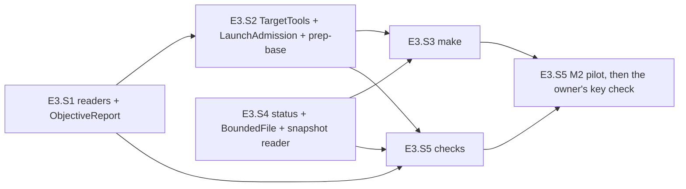

# PLAN — E3 stories: preparation and the objective checks of the model-arms module

> Status: **plan only, nothing implemented yet, 2026-10-30.** Epic E3 of [PLAN_model_arms.md](PLAN_model_arms.md) (§3 D4, D8, D11 (the
> reading half), D16–D18, D23, D24, D26, D27; §4.1's `prep-base`, `make`, `status` and `checks` rows; §4.9; §4.12; §6 step 3 — M2 and M2's
> key check; §7's E3 tests). Written at `5a8b4ce` on `feat/model-arms-e3` (E1 and E2 merged to `main`), by the judge role (Opus), as the epic
> starts — `common.plan-change-control` § *What counts as a change*: not a change. **No cornerstone** (the ledger stays `3 of 3`, §8 item 1).
> **One proposed parent change** waits for the owner (§8 item 2 — E3.S4 reads two file shapes E5 writes); the stories are written so that
> either answer leaves them buildable (E3.S4 *Fallback*).
>
> Scope: four verbs of the console `model-arms` — `prep-base` (the baseline, D24), `make` (the arms, D4/D5), `status` (read-only, by name,
> D11/F0) and `checks` (the objective report, §4.9) — the pure readers of the target's logs and the report in
> `tools/model-arms/ModelArms.Core/Checks/`, the target's tools as a launch boundary (`TargetTools`, `TargetArgv`, `TargetEnvironment` — D17 d,
> D26), a bounded no-follow file road shared by every reader of a model-written file, tests under `tests/Bench.Tests/ModelArms/`, fixtures
> under `tests/Bench.Tests/Fixtures/model-arms/objective/`, `research/module_model_arms.md` and four `research/module_tests.md` rows. Five
> stories, E3.S1–E3.S5; **M2** — the attended pilot — and **M2's key check** — the owner's, by hand — close the epic.

## 1. Goal, before any solution

E2 runs an arm. Nothing yet makes one, measures the target before the arms touch it, says where a root stands, or measures what an arm
left. The shell did all four with constants at the top of each script (`/home/jinx/git/coai-exp2/prep-base.sh:5-6`,
`objective-checks.sh:6-11`, `after6.sh:7-11`) and three habits this port must not copy:

- **It launched the target's tools by name and gave them the operator's whole environment** — `node $D/.agents/conventions/tools/low-priority.mjs
  dotnet build …` (`objective-checks.sh:11`, `:16`), `npm ci` and `npm test` with every exported secret visible to the code an arm wrote.
  Here every child goes by the real path it resolved, under an environment the module built, from a chosen cwd (D17 d, D26 b).
- **It overwrote and followed whatever was at a path.** `> "$O/build.log"` follows a link the arm's own test code may have planted in the
  results folder it was handed (`--results-directory "$O"`, `objective-checks.sh:17`); `JSON.parse(fs.readFileSync(ctrf))` reads a link, a
  FIFO, a file of any size, and crashes on a bad one (`:38`). Here a file the model under test can write — the arm's clone, `notes/`,
  `work/`, `out/` — is read through one bounded, no-follow road, and every file the harness writes is created exclusively or renamed into
  place.
- **It said "zero" where it did not know.** `PARSE_ONLY` set every exit code to 0 (`objective-checks.sh:14`), so a re-parse claimed the
  build passed; the baseline was a hand-written `{"mcpFailed":[],"tsFailed":[]}` (`/home/jinx/git/coai-exp2/baseline.json`) whose note
  says it was measured at another commit than `BASE`. Here an unknown is `null` and a baseline exists only from two suites that completed
  at `target.base` (D24, *absent is not zero*).

What must survive unchanged: **`objective.json` in the shell's shape** (`objective-checks.sh:53-65`) — the part-6/7 judges read it (D28) —
and the arm's layout the analysis half reads (D5). The proof of the first is the shell's own reader run as an oracle over the same inputs
(E3.S1), byte for byte.

**M2** (parent §6 step 3) is the first time an operator takes a root from `init` to a checked arm: `init → validate → prep-base → make →
run-arm C1 → checks C1` over a scratch target with `tests/FakeCli` as `claude`, by hand, logged. **M2's key check** observes, once, with the
real `claude` and the real coai server, whether `mcp-coai.json`'s `env` member delivers the vault key (E2 §8 item 34) — an attended step
for the owner, never an automated test.

## 2. What exists — verified at `5a8b4ce`, 2026-10-30

Every line below was opened in this worktree; the shell and the product by exact path the same day (read-only).

| Fact | Where |
|---|---|
| The dispatch: `make` and `status` say *not built — E4.S4*, `checks` *E5.S2*, `lock`/`unlock` *E4.S1*, `run-all` *E4.S3*, `chain` *E4.S5* (pre-re-split ids); `prep-base` runs the validate guard | `tools/model-arms/ModelArms/Program.cs:78-98` (`:84-92`) |
| `prep-base`'s guard: validate's checks, then exit 4 *"the baseline measurement is not built yet — story E4.S4"* | `tools/model-arms/ModelArms/Verbs/Validate.cs:27-34`, `CheckedAsync` `:36-40` |
| The one road in: root named, present, trusted, `experiment.json` read and re-stat-ed, the stage's files, `scenarios.json` judged; `ArmsOf` gives `checks` its arm | `tools/model-arms/ModelArms/ExperimentGate.cs:38-54`, `:130-131`; `ExperimentInput.JudgedScenarios` `ModelArms/VerbInput.cs:27-32` |
| D18's table: `prep-base` = inputs + no baseline; `make`/`chain` = inputs + baseline (**not** `base/`); `checks` = that + map + `made-<arm>`; `status` = root + `experiment.json` | `ModelArms.Core/Experiment/RootRequirements.cs:33-43` |
| `run-arm`'s admission: PATH entries judged, then `HOME`/`XDG_CONFIG_HOME` through `ConfigFolders`, then `claude` and `git` resolved to REAL paths; Absent → 3, Refused → 4 | `ModelArms/Verbs/RunArmAdmission.cs:79-99`; `ModelArms/Adapters/ConfigFolders.cs:12-16` |
| The executables `validate` resolves: `git`, `claude`, `dotnet`, `lowPriority[0]`, `build[0]`, `suite.command[0]`, `extension.command[0]`, `pwsh.exe` (WSL awake), the coai binary (a gate step) — **no `npm`**, though D23 names it and the shell's `prep-base` runs `npm ci` | `ModelArms.Core/Experiment/HostChecks.cs:89-105`; `prep-base.sh:12`, `:15` |
| `HostFactsReader.ScenariosAsync` — `scenarios.json` read at the judged path and re-stat-ed (the road `run-arm` reuses) | `ModelArms/Adapters/HostFactsReader.cs:100-117` |
| The target's facts: `TargetFacts`, `SuiteFacts(Command, CtrfFile, NamePrefix)`, `FormatFacts(Solution, Verbs)` (no command: the shell ran `dotnet format`), `ExtensionFacts(Directory, Command)`, `NodeModules`, `TestGlobs`; `CoaiFacts.Configured` | `ModelArms.Core/Experiment/ExperimentFacts.cs:15-38`, `:65-70` |
| The reader checks only `argv[0]` of a command (D17 b) and reads `suite.ctrfFile` as any text — a separator is not refused | `ModelArms.Core/Experiment/TargetSection.cs:40-50`, `:52-58` |
| `GitEnvironment.Of` = the map minus every `GIT_*` | `ModelArms.Core/Experiment/HostChecks.cs:71-76` |
| `ArmChildEnvironment.Of` — strips this repository's and secret-named variables EXCEPT `CLAUDE_*`/`ANTHROPIC_*`, both scout flags; sets `TMPDIR` | `ModelArms.Core/Experiment/ArmChildEnvironment.cs:32-45`; the name tests `src/Bench.Domain/Gate/CoaiEnvironment.cs:277`, `:286` |
| `ArmGit` — the harness's git by its real path, cwd chosen, `GIT_NO_LAZY_FETCH=1`, every question `-c core.fsmonitor=false`, diffs `-c diff.external= … --no-ext-diff --no-textconv`; a fixed 60 s budget; only `HEAD`, `HEAD --short` and a diff | `ModelArms/Adapters/ArmGit.cs:18-54` |
| `RootPaths`: `Base` `:19`, `ArmMapFile` `:21`, `Made(arm)` `:34`, `Locked`/`Unlocked` `:36-38` (root-level `chain/`), `ObjectiveMarker(arm)` `:40`, `ArmsDone` `:42`, `LockedModes` `:48` — **no `.locked-modes.applied`, no `chain/<run>/`, no prep-base logs**. `ArmPaths`: `CoaiSettings(side)` `:101`, `CoaiData` `:104`, `McpNone`/`McpCoai` `:106-108`, `ObjectiveFolder` `:129`, `Objective` `:131`, `PrepBuildLog` `:151`, `ObjectiveLog` `:154` | `ModelArms.Core/Experiment/ArmPaths.cs` |
| `ArmMap.Read` `:34`, `ToJson` `:43`, `Extend(existing, arms, eightRandomBytes)` `:64` (never re-mints), `TokenOf` `:75`, `Scrub(line)` `:93` | `ModelArms.Core/Experiment/ArmMap.cs` |
| `McpConfig.None()` `:45`, `Coai(coai, paths, harnessEnvironment)` `:48` (adds `COAI_CREDS_KEY` when the harness holds it); its doc names `make` *E4.S4* and the record's exclusion *E5.S5* (`:9`, `:19`) | `ModelArms.Core/Launch/McpConfig.cs` |
| `ArmFiles.WriteOnce` `:63` (refuses an existing file), `Replace` `:87` (stage + rename over), `ReadText` `:128` (`FileStream` — **follows a link, reads any size**) | `ModelArms/Adapters/ArmFiles.cs` |
| The bounded no-follow road: `KernelFacts.ReadSmall(path, limit)` (`O_NOFOLLOW|O_NONBLOCK|O_NOCTTY|O_CLOEXEC`, the descriptor judged regular, the same inode as the path, at most `limit` bytes; Linux x86-64) `:85-139`; `Present` `:141`; `MakeFolder` (exclusive `mkdir`, 0700) `:161`. `GateStatusFile` puts it behind three answers (Absent · Text · Refused) with a portable fallback | `ModelArms/Adapters/KernelFacts.cs`; `ModelArms/Adapters/GateStatusFile.cs:38-72` |
| `BaselineFile.Compose(base, measuredAt, host, suite, extension, note)` refuses an incomplete run, an exit without names, a zero total; `SuiteRun(Completed, ExitCode, Failed, Total)`; `Write`, `Read` | `ModelArms.Core/Experiment/BaselineFile.cs:11`, `:35`, `:48`, `:62` |
| `Scenario(Id, Kind, Name)`, kinds `cs`/`node` | `ModelArms.Core/Experiment/ScenariosFile.cs:7`, `:20` |
| `TimingLines.Read` / `IsArmDone`, `DoneMarkers.Read`, `ContinueMarkers.Read` | `ModelArms.Core/Steps/TimingLine.cs:47-73`; `DoneMarker.cs:27`; `ContinueMarker.cs:17` |
| `FileGateLock.WhoHolds(path)` (reads the holder's note through `ReadSmall`; creates nothing) | `ModelArms/Adapters/FileGateLock.cs:155` |
| `WorkerLiveness.ProcessIsAlive(pid)` | `src/Bench.Infrastructure/Process/WorkerLiveness.cs:25` |
| The launcher's 9-parameter overload (replaced environment, both line sinks); **every line is also kept in memory** (`StringBuilder` per reader) | `src/Bench.Infrastructure/Process/ProcessRunner.cs:146-175`, `:283-300` |
| The pure list's single `// E3` marker | `tests/Bench.Tests/ModelArms/ModelArmsArchitectureTests.cs:71` |
| Test kit: `ExperimentRoot.MakeArmAsync` `:101`, `Shim(path, name, thenRealGit)` `:185`, `ShimScript(path, body)` `:189`, `UsePath` `:219`, `RealGit` `:178`; `TempFolder` (`testsToDelete-modelarms-…`) `TempFolder.cs:10`; `TempGitRepo` `tests/Bench.Tests/Infrastructure/GitCheckoutTests.cs:147`; `PinnedConsumer` (node by its resolved path) | `tests/Bench.Tests/ModelArms/` |
| The catalogue rows: `make`, `status`, `checks` *not covered* (old ids); `prep-base` *covered* (the guard only) | `research/module_tests.md:105`, `:109`, `:115-116` |

**The shell, the behaviour to port** (read 2026-10-30; `objective-checks.sh`, `after6.sh` and `after7.sh` are pinned by sha256 in the parent's §2;
`prep-base.sh` (1671 bytes) is readable and not pinned there — its sha256 is recorded by E3.S2's coder in the module doc):

- `prep-base.sh:7` clone the plan branch; `:9-11` find the submodule whose path is `.agents/conventions` in `.gitmodules`, point its url at
  the local source's checkout, `git -c protocol.file.allow=always submodule update --init`; `:12` `npm ci --ignore-scripts --prefix
  .agents/conventions`; `:14` lowered build → `base-build.log`; `:15` `npm ci --no-audit --no-fund` in `src_vs_code` → `base-npm.log`;
  `:16` the suite's apphost with `--results-directory base-results --report-xunit-ctrf --report-xunit-ctrf-filename mcp.ctrf.json` →
  `base-test.log`; `:17` lowered `npm test` in `src_vs_code` → `base-ts-test.log`; a summary line per stage in `prep-base.log`. It writes
  no baseline: `baseline.json` was written by hand (147 bytes), and `prep-base.log` says `head=8b1eef7a` while `exp.env`'s `BASE` is
  `6786582e…` (§8 item 9).
- `after6.sh:26-37` (= `after7.sh:27-37`) per arm without `chain/made-<arm>`: `rm -rf` the arm folder, `mkdir -p {out,notes,work,tmp,coai-data/<side>}`,
  `cp -a base arm`, `git checkout -q -b <branch>`, the lowered warm build → `out/prep-build.log` (failure → exit 3), copy the coai settings,
  write `mcp-none.json` and `mcp-coai.json`, `touch chain/made-<arm>`; `:48-52` checks per arm, stdout → `out/objective.out`, then
  `touch chain/objective-<arm>` — written by the chain.
- `objective-checks.sh:13` `uncommitted = git status --porcelain | wc -l`; `:16` lowered build → `build.log`; `:17-18` lowered suite →
  `mcp-tests.log` + `mcp.ctrf.json` in `out/objective/`; `:19-23` `git diff --name-only --diff-filter=AM BASE..HEAD -- '*.cs'`, none →
  format passes, else `dotnet format <sln> whitespace --verify-no-changes --no-restore --include $files` `&&` the same with `style` (NOT
  lowered); `:24` lowered `npm test` in `src_vs_code` → `ts-tests.log`; `:26-68` the node reader: `:33` `num` = first match or `NaN`
  (`JSON.stringify` writes `null`); `:34` `^failed (\S+)` multiline, the prefix `CoaiMcp.Tests.` stripped; `:35` unique `^✖ (.+?) \(\d`;
  `:36` `^\s*✔ (.+?) \(\d`; `:37` `git grep -l -F <name> -- src_mcp/tests src_vs_code/src/test`; `:38` the CTRF's `results.tests`; `:42`
  a `node` scenario: passed · failed · absent from the node log; `:44-46` a `cs` scenario: the CTRF tests whose name matches
  `new RegExp('\\b' + name + '\\b')` — none → `absent`, one status `passed` → `passed`, else the unique statuses joined by `+`; `:51`
  numstat (`+a || 0`); `:53-64` the object, member order as written; `:62-63` `tests` = `/tests?\//`, `src` = `/^src_/` and not tests, `docs`
  = `.md`; `:65` `JSON.stringify(out, null, 2)` to `out/objective.json` (no trailing newline); `:66-67` the one-line summary on stdout.

**A recorded arm** (part 6, C1; its folder opened by name — `r/` is 755 now): `out/objective.json` (no token in it), `out/objective.out`, and
`out/objective/{build.log, format.log (0 bytes), mcp-tests.log (26 KB), mcp.ctrf.json (11.7 MB), ts-tests.log (645 KB)}`. The MTP summary
is indented (`  total: 13894`, `  succeeded: 13777`, `  skipped: 117`, `  failed: 0`); the node log carries TWO `ℹ tests` lines (6540,
then 4) — the shell's `match` takes the first; C1 has no `failed`/`✖` line; **every log but `format.log` holds the arm's token** (in
paths). `research/local-model-coding/data/arms/C/objective.json` is the PARTS 1–5 generation's shape (`generatorCheck`,
`scenariosPresent`/`scenariosPassing` lists, `formatNote`, `mcp.failedEnvironment`) — not this one (§8 item 3).

**The vault key's evidence** (`dew_flow_connect_other_ais` at `80b829ef`, read-only): the server's key is `COAI_CREDS_KEY`
(`src_mcp/src/Server/KeyVault.cs:35`); with none configured the vault answers `no COAI_CREDS_KEY configured — keyless vendors still work on
their own auth` (`:100`); `providers` returns that text as its vault field, else `N vendor key(s) loaded` (`src_mcp/src/Server/PanelService.cs:268`)
and the key NAMES only (`:272-273`); the configuration is the settings file under `COAI_DATA_DIR` layered under the process's environment,
key by key (`src_mcp/src/Program.cs:749-763`).

## 3. Conventions every story follows

E1 §3 and E2 §3 hold unchanged (namespaces; *pure means pure*; refusals as values; red first on an ASSERTION; docs per story; fixtures in
`tests/Bench.Tests/Fixtures/model-arms/`; time through `TimeProvider`; no tokens in this repository; the commands). For E3:

- **The pure list.** E3.S1 replaces the single `// E3` marker (`ModelArmsArchitectureTests.cs:71`) with five, `// E3.S1` … `// E3.S5`, one
  per line with a blank line between; every later story writes only under its own.
- **The module doc.** E3.S1 adds five empty headings to `research/module_model_arms.md` after the last E2 section: *The objective readers
  and the report (E3.S1)*, *The target's tools and prep-base (E3.S2)*, *make (E3.S3)*, *status (E3.S4)*, *checks, M2 and the key check
  (E3.S5)*. Each story writes only under its own.
- **The launch boundary, per adapter (D17 d, D26).** Every child an E3 verb starts is launched by the REAL path `ExecutableResolution`
  found in that verb (printed once as `resolved executables:` before the first launch, D17 c — `prep-base`, `make` and `checks` alike),
  never a second look-up and never a bare name; under `TargetEnvironment.Of(parent)` (C14) for the target's tools and
  `GitEnvironment.Of(TargetEnvironment.Of(parent))` for git; from a cwd the verb names. **PATH, `HOME` and `XDG_CONFIG_HOME` are judged at
  every verb that launches** (`LaunchAdmission`, C14 — the rule `run-arm` has, extracted, not copied). Each story's review names which of
  D26 (a)–(f) it checked, adapter by adapter (the parent's DoD).
- **A model-written file is read through `BoundedFile` (C16)** — no link followed, no FIFO waited on, never more than a stated limit — or
  the story says why not. Model-written here means anything under the arm's clone, `notes/`, `work/` or `out/`, and anything the target's
  own code writes (the suite's CTRF). The root's own files the operator owns (`experiment.json`, `baseline.json`, the map, the snapshot
  files) take the same road with a small limit, because under the lock an arm can still create a file by name in the root (D17's R7).
- **A file the harness writes is created exclusively (`FileMode.CreateNew`, which never follows a link) or staged and renamed over its
  name** (`ArmFiles.Replace`); a file carrying a secret is created at mode `0600` and never widened (`ArmFiles.ReplacePrivate`, C15).
- **No token is ever printed.** Every line `make`, `status` and `checks` write passes `ArmMap.Scrub`; each verb has a test that greps its
  output for every token of the map.
- **The scratch target** is `TargetBench` (E3.S2, a test kit): a rules repository holding `tools/low-priority.mjs` (a node script that
  starts its argv and exits with its code), a target repository whose `.agents/conventions` is that repository as a submodule, a plan file at
  `base`, shims for `dotnet` and `npm` that record `$0`, argv, cwd and the environment's NAMES and print canned MTP and node-runner lines
  (the suite shim writes a CTRF where `--results-directory` says), the host's `git` and `node` by real path. Everything under one
  `TempFolder` (`testsToDelete-modelarms-…`), removed on dispose (`common.test-leftovers`).
- **Exit codes (D16)** for the four verbs: 0 the verb did its work (a failing build or suite is a RESULT for `checks`, not a failure of the
  verb); 3 the host or the target could not be measured (a tool absent or not started, git that cannot answer, the base that does not
  build, a suite that did not complete for the baseline); 4 a wrong configuration or a refused file (a PATH/`HOME` under a forbidden root, a
  map that does not read, an arm that ran without its marker, a live runner under `checks`); 5 the operator's stop (Program's mapping) —
  the same command resumes or redoes it.
- **Cost.** E3 touches no cost: `status` prints no cost figure and `objective.json` carries none. A later column that does takes the LAST
  result per session, never the sum over attempts (E2 §8 item 62).

## 4. Shared contracts (fixed here so stories can run in parallel)

**C13 — the objective readers and the report** (E3.S1; read by E3.S2 and E3.S5). In `ModelArms.Core.Checks`, pure:

```csharp
public sealed record MtpSummary(CapturedCount Total, CapturedCount Succeeded, CapturedCount Skipped, IReadOnlyList<string> Failed);
public static class TestLogSummary { public static MtpSummary Read(string log, string namePrefix); }          // objective-checks.sh:33-34, :56
public sealed record NodeTestLog(CapturedCount Tests, IReadOnlyList<string> Failed, IReadOnlySet<string> Passed);
public static class TsTestLog { public static NodeTestLog Read(string log); }                                   // :35-36, :58 — the FIRST `ℹ tests`
public sealed record CtrfTest(string Name, string Status);
public static class CtrfScenarios
{
    public static Outcome<IReadOnlyList<CtrfTest>> Tests(string ctrf);   // results.tests[]; Failure = not a CTRF object (the caller reads [] and says why)
    public static string Passing(Scenario scenario, IReadOnlyList<CtrfTest> tests, NodeTestLog node);  // passed · failed · absent · "a+b" — :39-47
}
public sealed record NumstatRow(string File, int Added, int Deleted);
public sealed record ChangedLines(int Tests, int Src, int Docs);
public static class DiffStats { public static IReadOnlyList<NumstatRow> Rows(string numstat); public static ChangedLines Split(IReadOnlyList<NumstatRow> rows); }
public sealed record StageExits(CapturedCount Build, CapturedCount Suite, CapturedCount Format, CapturedCount Extension);
public sealed record ObjectiveFacts(string Arm, string HeadShort, CapturedCount Commits, int UncommittedFiles, StageExits Exits,
    string SuiteLog, Outcome<string> Ctrf, string ExtensionLog, IReadOnlyList<Scenario> Scenarios, IReadOnlyDictionary<string, bool> Present,
    Baseline Baseline, string NamePrefix, string Numstat, string Shortstat, IReadOnlyList<string> StepsOnDeadline);
public static class ObjectiveReport
{
    public static string Write(ObjectiveFacts facts);    // objective.json: the shell's members in its order, two-space indent, "\n", no trailing newline, then "stepsOnDeadline" LAST
    public static string Summary(ObjectiveFacts facts);  // the shell's one line (:66-67)
}
```

Rules: a regex is `RegexOptions.ECMAScript | Multiline` where the shell's was (JavaScript's `\b`, `\d`, `\s` are ASCII); a scenario name is
matched as a LITERAL whole word (`Regex.Escape`, §8 item 13); a total the log does not carry is `CapturedCount.Unavailable` and written as
`null` (the shell's `NaN`); an exit `Unavailable` (not recorded, killed at the wall) is written `null` and makes `build` / `format` `false` —
never the shell's `PARSE_ONLY` zero (§8 item 10). The writer is `Utf8JsonWriter` with `Indented`, `IndentSize = 2`, `NewLine = "\n"` and the
relaxed encoder `McpConfig` uses (`JSON.stringify`'s bytes for printable BMP text; the residual is `McpConfig`'s, said in the module doc).

**C14 — the target's tools** (E3.S2; read by E3.S3 and E3.S5). Core, pure — `ModelArms.Core.Launch`:

```csharp
public static class TargetEnvironment { public static IReadOnlyDictionary<string, string> Of(IReadOnlyDictionary<string, string> parent); }
public sealed record ToolPaths(string Git, string Dotnet, string Node, string Build, string Suite, string Extension, string Npm);  // REAL paths; Node = lowPriority[0]'s; "" = not needed by this verb
public sealed record ToolCommand(string Label, string Executable, IReadOnlyList<string> Arguments, string WorkingDirectory, TimeSpan Wall);
public static class TargetWalls { /* Clone 30 min · Npm 30 min · Build 60 min · Suite 180 min · Format 30 min · Extension 60 min · Git 60 s */ }
public static class TargetArgv
{
    public static ToolCommand Build(TargetFacts target, ToolPaths tools, string clone);
    public static ToolCommand Suite(TargetFacts target, ToolPaths tools, string clone, string resultsDirectory);
    public static ToolCommand Extension(TargetFacts target, ToolPaths tools, string clone);
    public static IReadOnlyList<ToolCommand> Format(TargetFacts target, ToolPaths tools, string clone, IReadOnlyList<string> changedCs); // one per verb; [] when none changed
    public static IReadOnlyList<ToolCommand> RulesNpmCi(TargetFacts target, ToolPaths tools, string clone);   // the nodeModules entries under rulesSubmodule — before the build
    public static IReadOnlyList<ToolCommand> OtherNpmCi(TargetFacts target, ToolPaths tools, string clone);   // the rest — after the build (prep-base.sh:12, :15)
}
public static class GitModules { public static string NameOf(string getRegexpOutput, string path); }  // "" = no submodule at that path
```

- `TargetEnvironment.Of(parent)` = the parent minus: `CoaiEnvironment.IsHarnessVariable`, `ConnectionStrings__*`, **every**
  `CoaiEnvironment.IsSecretName` (no `CLAUDE_*`/`ANTHROPIC_*` exception — the target's code has no login to keep, and an arm WROTE that
  code), every `GIT_*`, the two scout flags; nothing added; `TMPDIR`, `HOME`, `PATH`, `DOTNET_*`, `NUGET_*` pass. The baseline and every
  arm's checks run under the same rule, so they compare (§8 item 8).
- **Lowered** (`build`, `suite`, `extension`): executable = `tools.Node`; arguments = `[lowPriority[1] made absolute against the clone when
  relative, .. lowPriority[2..], <the REAL path of the command's [0]>, .. command[1..]]` — the wrapper is handed the resolved executable,
  never its name (§8 item 11); the shell made the wrapper's script absolute the same way (`objective-checks.sh:11`).
- `Suite` appends exactly the shell's two options: `--results-directory <dir> --report-xunit-ctrf-filename <suite.ctrfFile>`.
- `Format`: executable `tools.Dotnet`, arguments `[format, <solution>, <verb>, --verify-no-changes, --no-restore, --include, <file>…]`, each
  file its own element, cwd the clone, NOT lowered (`:21-22`).
- npm: executable `tools.Npm`, arguments `[ci, --no-audit, --no-fund]` plus `--ignore-scripts` under `rulesSubmodule`, cwd = the entry's
  parent folder under the clone.

Port — `ModelArms.Core.Ports` (the parent's §4.1 names it):

```csharp
public sealed record ToolRun(CapturedCount Exit, bool KilledAtWall, bool Started, TimeSpan Elapsed);   // Exit Unavailable when killed or not started
public interface ITargetTools { Task<ToolRun> RunAsync(ToolCommand command, Stream log, CancellationToken stopping); }
```

Adapter `ModelArms.Adapters.TargetTools(IReadOnlyDictionary<string, string> environment) : ITargetTools` — `ProcessRunner.RunAsync`'s
replacing overload, both line sinks writing `line + "\n"` (UTF-8, one lock, flushed) into the `log` the VERB opened, the wall
`command.Wall`. `ModelArms.Verbs.LaunchAdmission` — `FirstRefusal(environment, forbiddenRoots)` (PATH entries, then `ConfigFolders`) and
`Resolve(verb, name, environment, forbiddenRoots) → Passage<string>` (Found → the real path; Absent → 3; Refused → 4) — extracted from
`RunArmAdmission.cs:79-99`, which then calls it.

`ArmGit` is widened, not duplicated (`common.reuse-first`): a per-call budget (default 60 s, `TargetWalls.Clone` for the clone and the
submodule) and these questions, each with the class's hardening: `CloneAsync(source, branch, destination)` (`clone -q --branch <b> --
<source> <dest>`), `DetachAsync(sha)`, `SubmodulePathsAsync()` (`config -f .gitmodules --get-regexp ^submodule\..*\.path$`, exit 1 = none),
`SetSubmoduleUrlAsync(name, url)`, `SubmoduleUpdateAsync(path)` (`-c protocol.file.allow=always submodule update --init -q -- <path>`),
`NewBranchAsync(branch)` (a name starting `-` refused), `UncommittedCountAsync()` (`status --porcelain`), `ChangedCsAsync(base)`,
`NumstatAsync(base)`, `ShortstatAsync(base)`, `CountSinceAsync(base)` (the diffs with `-c diff.external= … --no-ext-diff --no-textconv`,
`base` a hex id), `MentionsAsync(text, globs)` (`grep -l -F -e <text> -- <globs>`; exit 1 = false).

**C15 — making an arm** (E3.S3; read by E5.S4's chain). `ModelArms.Core.Experiment.RunArms.Of(IReadOnlyList<RunSpec>) → IReadOnlyList<string>`
(every arm of every run, in file order, once). `ModelArms.Adapters.ArmMaker` — `Task<MakeOutcome> MakeAsync(string arm, CancellationToken)`
with `MakeOutcome = Made · Stopped(int ExitCode, string Why)`: the one arm, so `chain`'s `Make(arm)` action (parent §4.7) calls the same
code. `ModelArms.Adapters.BaseCopy.Copy(string from, string to) → Outcome<long>` (files copied). `ArmFiles.ReplacePrivate(path, text)` —
`Replace` whose staged file is created with `UnixCreateMode = 0600` (no chmod after).

**C16 — reading by name** (E3.S4; read by E3.S3 and E3.S5). Adapter `ModelArms.Adapters.BoundedFile`:

```csharp
public abstract record BoundedRead { Absent; Bytes(byte[] Value); Refused(string Reason); }   // closed, private constructor
public static BoundedRead Read(string path, int limit);   // GateStatusFile's Judged + ReadSmall / Portable roads, extracted; GateStatusFile decodes on top
```

Core, pure: `ModelArms.Core.Steps.StepState` (`NotStarted` · `Done(string End, int Attempts)` · `Continuing(int After, string Why)` ·
`Resumable(string End, int Attempt)` · `Limited(int Attempt, string Stop)` · `Unreadable(string Reason)`) and `StepStatuses.Of(StepEvidence) →
StepState`, `StepStatuses.Line(string stem, StepState) → string`; `StepEvidence(string Stem, Read<DoneMarker> Done, Read<ContinueMarker>
Continue, int Streams, IReadOnlyList<TimingLine> Timing)` with `Read<T>` = `Absent · Present(T) · Refused(string)`.
`ModelArms.Core.Isolation.LockSnapshots.State(Read<string> snapshot, Read<string> applied) → LockState` (`None` · `Applying(run, since)` ·
`Applied(run, since)` · `Inconsistent(reason)`) and `IsolationLine.Of(LockState) → string` — the D11 line every non-mode verb prints
(*isolation applied for <run> since <utc>* / *a lock was interrupted — run `lock <run>` or `unlock`* / *no isolation snapshot*). The JSON
it reads is D11's: `.locked-modes` = `{"run","digest","since","modes":[…]}`, `.locked-modes.applied` = `{"run","digest","verifiedAt"}`
(the member name `verifiedAt` is fixed here; E5.S1 writes it — §8 item 2). `RootPaths` gains `LockedModesApplied` and
`RunMarker(string run, RunStage stage)` (`chain/<run>/locked|unlocked|arms-done`) — **subject to §8 item 2**.

**C17 — the objective run** (E3.S5). `ArmPaths` gains `ObjectiveBuildLog`, `ObjectiveSuiteLog`, `ObjectiveFormatLog`,
`ObjectiveExtensionLog` (the shell's `build.log`, `mcp-tests.log`, `format.log`, `ts-tests.log`), `ObjectiveStages` (`out/objective/stages.json`)
and `ObjectivePrevious(string stamp)` (`out/objective.prev-<utc>`). Core, pure: `StageRecord.Write(StageRuns) / Read(string)` —
`{"build":{"exit":0,"seconds":65,"killed":false},"suite":…,"format":…,"extension":…}`, `exit` `null` when not captured;
`DeadlineSteps.Of(Scheme, Func<string, Read<DoneMarker>>) → IReadOnlyList<string>` (the scheme's step stems whose `.done` says
`hard-deadline`, in scheme order).

## 5. Stories

### E3.S1 — The objective readers and `ObjectiveReport`: the shell's shape, proven by the shell's own reader

- **Coder:** sonnet · **Spec:** Opus (this section) · **Review:** Opus. **Depends on:** E1.S8 (`Scenario`, `Baseline`) — merged.
  **Parallel with:** E3.S4.
- **Owns:** §4.9's pure half; D8's `stepsOnDeadline` member; D28's judges' half (the round trip stands for `judge-abs.sh` and
  `judge-coai.sh`, which read only `objective.json`). **Size:** ≈ 750 lines.

**Files.** `tools/model-arms/ModelArms.Core/Checks/TestLogSummary.cs`, `TsTestLog.cs`, `CtrfScenarios.cs`, `DiffStats.cs`, `ObjectiveFacts.cs`,
`ObjectiveReport.cs`; tests `ObjectiveParsersTests.cs`, `ObjectiveReportTests.cs`, `ShellObjectiveReader.cs` (the oracle kit); fixtures under
`tests/Bench.Tests/Fixtures/model-arms/objective/`: `mtp.log` (real lines of part-6 C1's `mcp-tests.log` — its `skipped` lines and its
indented summary — the token replaced by `0123456789ab`, plus two `failed CoaiMcp.Tests.<Class>.<Method> (12ms)` lines written in the shape
of the real `skipped` lines, said in the test), `node.log` (real lines of C1's `ts-tests.log`: `✔` lines with leading spaces, both `ℹ tests`
lines, plus two `✖` lines in the real shape — one printed twice), `ctrf.json` (C1's CTRF envelope with twelve of its tests and four written
for the scenarios: all passed, one failed, mixed), `objective-part6-C1.json` (C1's `out/objective.json`, copied as it is — no token in it,
checked; its sha256 recorded in the test), `objective-checks-reader.mjs` (the heredoc of `objective-checks.sh:27-67` VERBATIM — the
pinned file's sha256 is the parent's §2; the extract's own sha256 is asserted by the test); the pure list (`// E3` → five markers; under
`// E3.S1`: `typeof(TestLogSummary), typeof(TsTestLog), typeof(CtrfScenarios), typeof(DiffStats), typeof(ObjectiveReport)`); the module doc's
five headings and *The objective readers and the report*.

**Contracts.** C13 exactly. `ObjectiveReport.Write` builds the members in the shell's order (`:54-64`): `arm`, `head`, `commits`,
`uncommittedFiles`, `build`, `format`, `mcp {exit, total, passed, skipped, failedNew, failedBaseline}`, `ts {exit, total, failedNew}`,
`scenarios {<id>: {name, present, passing}}` (in `scenarios.json` order), `scenariosPresentCount`, `scenariosPassingCount`, `diff {shortstat,
changedLines {tests, src, docs}, files}`, then the additive `stepsOnDeadline` (always present; `[]` says none ended on its deadline).
`failedNew`/`failedBaseline` keep the log's order; `mcp.failedNew` filters `Baseline.McpFailed`, `ts.failedNew` filters `Baseline.TsFailed`.
`DiffStats.Split` keeps the shell's three rules verbatim (§8 item 12). `Summary` = `{"arm","build","format","mcpNewFailures","tsNewFailures",
"scenarios":"<present>/<count> present, <passing> passing","stat"}` on one line.

**Scenarios.**

| Test | Given / When / Then | Red (the assertion seen first, against the stub) |
|---|---|---|
| `ObjectiveParsersTests.The_mtp_summary_reads_total_succeeded_skipped_and_every_failed_name` | `mtp.log`, prefix `CoaiMcp.Tests.` → Total 13894, Succeeded 13777, Skipped 117, Failed = the two names without the prefix, log order | stub `(Unavailable×3, [])`: `Expected summary.Total.WasCaptured to be True, but found False.` |
| `ObjectiveParsersTests.The_node_log_reads_passed_failed_and_the_count` | `node.log` → Tests 6540 (the FIRST `ℹ tests`; the second says 4), Failed = the two names once each, Passed holds a name whose line starts with spaces | stub `(Unavailable, [], ∅)`: `Expected log.Tests.WasCaptured to be True, but found False.` |
| `ObjectiveParsersTests.Ctrf_decides_passed_failed_absent_and_mixed_per_scenario` | `ctrf.json`: a `cs` scenario all passed → `passed`; one failed → `failed`; none → `absent`; passed then failed → `passed+failed`; a `node` scenario → from `node.log` | stub `"absent"`: `Expected "absent" to be "passed".` |
| `ObjectiveParsersTests.New_failures_exclude_the_baseline` | failed `[A, B]`, `McpFailed [B]` → failedNew `[A]`, failedBaseline `[B]`; node failed `[X, Y]`, `TsFailed [Y]` → `[X]` | stub every failure new: `Expected failedNew to be a collection with 1 item(s), but … contains 2` |
| `ObjectiveParsersTests.Changed_lines_split_into_tests_src_and_docs` | numstat `10\t2\tsrc_mcp/tests/ATests.cs`, `5\t1\tsrc_mcp/src/A.cs`, `3\t0\tresearch/x.md`, `-\t-\tsrc_vs_code/icon.png`, `1\t1\ttools/b.mjs` → tests 12, src 6, docs 3; five files in order; the binary row 0 | stub zeros: `Expected lines.Tests to be 12, but found 0.` |
| `ObjectiveParsersTests.A_total_the_log_does_not_carry_is_unavailable_never_zero` | a log with no summary → every count `WasCaptured` false; the report writes `null` | stub `Number(0)`: `Expected … WasCaptured to be False` |
| `ObjectiveParsersTests.A_scenario_name_is_a_whole_word_and_never_a_pattern` | `Foo` does not match `FooBar` and matches `Ns.Foo(x: 1)`; `A.B` does not match `AxB` | unescaped plant: `Expected "absent" … but "passed"` |
| `ObjectiveParsersTests.A_ctrf_that_is_not_a_ctrf_object_is_refused_with_its_reason` | `[]`, `{}`, `{"results":{}}`, a truncated object → Failure naming why; a `cs` scenario then `absent` | stub `Success([])`: `Expected outcome to be Fail` |
| `ObjectiveReportTests.The_report_of_a_real_arm_round_trips_the_shells_shape` | **the oracle**: a temp git repo laid out as the coai target (`src_mcp/tests/ATests.cs` naming two `cs` scenarios, `src_vs_code/src/test/a.test.ts` naming the `node` one, `src_mcp/src/A.cs`, `research/x.md`, a binary file; `base`, then two commits); `out/objective/` holds the three fixtures as `mcp-tests.log`, `ts-tests.log`, `mcp.ctrf.json`; the root holds `baseline.json` (`BaselineFile.Write`, failures that overlap the logs') and `scenarios.json`; `node objective-checks-reader.mjs <O> <E> C1 <base> 0 0 1 0 0` (node by its resolved path, cwd the repo) writes `<O>/../objective.json`; the port's `Write` over the same inputs (facts gathered by the test with the real git) **equals the oracle's text byte for byte** with `,\n  "stepsOnDeadline": []` inserted before the final `\n}` | stub `"{}"`: `Expected text to be "{\n  \"arm\": \"C1\",…" with a length of …, but "{}" has a length of 2` |
| `ObjectiveReportTests.The_shape_is_the_part6_arms_every_member_in_its_order` | the member paths (names, nesting, order, JSON kinds; the scenario map's entries aside) of the port's report equal `objective-part6-C1.json`'s, plus `stepsOnDeadline` last | stub: `Expected paths to be equal to {"arm", …}` |
| `ObjectiveReportTests.Steps_that_ended_on_a_deadline_are_listed_under_stepsOnDeadline` | facts with `["3-fix"]` → the text ends `"stepsOnDeadline": [\n    "3-fix"\n  ]\n}` | stub without the member: `Expected text to end with …` |
| `ObjectiveReportTests.The_summary_line_is_the_shells` | equals the oracle's stdout line over the round-trip inputs | stub `""` |
| `ObjectiveReportTests.Unknown_exits_are_null_and_never_pass` | `StageExits` all Unavailable → `"build": false`, `"format": false`, `"mcp": {"exit": null, …`, `"ts": {"exit": null, …` | stub writes `0`: `Expected … "exit": null …` |

**Break-its** (plant, watch the named test go red with the real symptom, restore): `TsTestLog` takes the LAST `ℹ tests` → *the node log*
(6540 vs 4); `Regex.Escape` removed → *whole word*; `Unavailable` written as `0` → *unknown exits*; indent 1 → *round trips* (the oracle
differs at byte 2).

**Commands.** `--filter-class "*ObjectiveParsersTests"`, `"*ObjectiveReportTests"`, `"*ModelArmsArchitectureTests"`; the whole suite.

**Done when.** The thirteen green; every red seen; the four break-its observed; the oracle's sha asserted; `PureDeciders` names the five.

**Out of bounds.** Reading a file or running git (S5 gathers the facts); `stages.json` (S5); the analysis half's readers (E6).

### E3.S2 — `TargetTools`, the launch admission and `prep-base`: the baseline from both suites at `base`

- **Coder:** sonnet · **Spec:** Opus · **Review:** Opus, naming D26 (a)–(f) for `TargetTools` and the widened `ArmGit`; a finding on the
  trust boundary (D17) gets its fix spec from **Fable** (security judgement, outside the quota), as E1.S8's and E1.S10's did.
  **Depends on:** E3.S1 (the two log readers). **Parallel with:** — (wave B alone).
- **Owns:** D17 (c)(d) and D26 (b, c) for the target's tools; D24's measurement; D18 (`prep-base` replaces the guard); D23's missing `npm`;
  `LaunchAdmission` (one rule for every verb that launches). **Size:** ≈ 950 lines.

**Files.** Core: `ModelArms.Core/Launch/TargetEnvironment.cs`, `TargetArgv.cs` (`ToolPaths`, `ToolCommand`, `TargetWalls`),
`ModelArms.Core/Experiment/GitModules.cs`, `HostChecks.cs` (`npm` with the role `target.nodeModules` when `NodeModules` is not empty),
`TargetSection.cs` (`target.suite.ctrfFile` must be one file name), `ArmPaths.cs` (`RootPaths.PrepBaseLog` `prep-base.log`, `BaseBuildLog`
`base-build.log`, `BaseNpmLog(int n)` `base-npm-<n>.log`, `BaseSuiteLog` `base-test.log`, `BaseExtensionLog` `base-ts-test.log`, `BaseResults`
`base-results`); `ModelArms.Core/Ports/ITargetTools.cs`; adapters `ModelArms/Adapters/TargetTools.cs`, `ArmGit.cs` (C14's widening);
verbs `ModelArms/Verbs/LaunchAdmission.cs`, `RunArmAdmission.cs` (calls it), `PrepBase.cs` (`PrepBaseVerb`), `Validate.cs` (`CheckedAsync`
internal, the guard removed); `Program.cs` (the `prep-base` arm only: `"prep-base" => ExperimentGate.RunAsync(input, PrepBaseVerb.RunAsync),`);
tests `TargetEnvironmentTests.cs`, `TargetArgvTests.cs`, `PrepBaseTests.cs`, `TargetBench.cs`, one test in `ValidateVerbTests.cs`, one in
`ExperimentFileTests.cs`, rows in `ArmPathsTests.Every_path_of_an_arm_is_spelled_as_the_shell_spelled_it`; under `// E3.S2`
`typeof(TargetEnvironment), typeof(TargetArgv), typeof(GitModules)`; the module doc (with `prep-base.sh`'s sha256); `research/module_tests.md`
(the `prep-base` row: `covered`, `PrepBaseTests`).

**`PrepBaseVerb.RunAsync(ExperimentInput)`**:

1. Validate's checks (`ValidateVerb.CheckedAsync`): any problem → validate's exit (3/4) and nothing launched. The executables are the ones
   `HostFacts` resolved and printed — `ToolPaths` is built from them, never looked up again.
2. `base/` present (no baseline — the gate refused one) → a crashed `prep-base`: removed whole (`Directory.Delete(recursive)` — a link inside
   is removed, never followed: a test), said in one line.
3. `ArmGit(git, root, env).CloneAsync(source, planBranch, base)`; `DetachAsync(target.base)`; `HeadAsync` must equal `target.base` (else 3).
4. `GitModules.NameOf(SubmodulePathsAsync(), rulesSubmodule)` — `""` → 4 *"target.rulesSubmodule <p> is not a submodule of the target at
   <base>"*; `SetSubmoduleUrlAsync(name, <source>/<rulesSubmodule>)`; `SubmoduleUpdateAsync(rulesSubmodule)`.
5. `RulesNpmCi` → `BaseNpmLog(n)`; the build (lowered) → `BaseBuildLog`; `OtherNpmCi`; the suite (lowered, results `BaseResults`) →
   `BaseSuiteLog`; the extension (lowered) → `BaseExtensionLog`. Each log is created exclusively before its tool starts; a line per stage
   in `prep-base.log` in the shell's shape (`build rc=<n|killed> s=<seconds> head=<short>`, …, `DONE`). A tool not started → 3; npm or
   the build not exit 0 → 3 *"the base does not build at <sha> — see <log>; no baseline"*, nothing after it runs.
6. `SuiteRun(Completed: exited AND the summary's total captured, Exit, TestLogSummary.Read(log, namePrefix).Failed, Total)`; the
   extension's from `TsTestLog`; `BaselineFile.Compose(base, now, "<machine> (<host kind>)", suite, extension, "")` — Failure → 3, every
   sentence printed, no baseline; Success → `baseline.json` written once (`ArmFiles.WriteOnce`), 0.

**Scenarios.**

| Test | Given / When / Then | Red |
|---|---|---|
| `PrepBaseTests.Baseline_json_carries_the_base_the_host_the_failures_and_the_totals_of_both_suites` | `TargetBench`: the suite shim prints `failed Tgt.Tests.ATests.Fails (3ms)` and a summary (total 12, succeeded 10, skipped 1), the npm `test` shim prints `✔ a (1ms)`, `✖ b (2ms)`, `ℹ tests 2`; prefix `Tgt.Tests.` → 0; `baseline.json` reads back: `base` = `target.base`, `host` names the machine, `mcpFailed ["ATests.Fails"]`, `tsFailed ["b"]`, totals 12 and 2 | stub returns 0 writing nothing: `Expected File.Exists(baseline) to be True` |
| `PrepBaseTests.A_suite_that_did_not_run_to_completion_refuses_the_baseline_instead_of_writing_an_empty_list` | theory: the suite shim prints no summary and exits 0; the suite shim outlives a 1 s wall (`PrepBaseSeams`); the extension shim exits 1 naming nothing → 3, no `baseline.json`, the sentence names the suite | stub writes an empty-list baseline: `Expected File.Exists(baseline) to be False` |
| `PrepBaseTests.Prep_base_requires_validate_and_an_absent_baseline` | a `baseline.json` → 4 naming it; an unfilled template (a validate problem) → 4; the shims' log is EMPTY in both | a stub that launches first: `Expected calls to be empty` |
| `PrepBaseTests.Every_target_tool_is_launched_by_its_resolved_path_under_a_built_environment` | the parent holds `BENCH_DB`, `GIT_DIR`, `GITHUB_TOKEN`, `CLAUDE_CODE_OAUTH_TOKEN`, `COAI_CREDS_KEY`, `KEEP_ME`; every shim's `$0` is the REAL path printed under `resolved executables:`; every lowered call's first argument is `<base>/.agents/conventions/tools/low-priority.mjs` and its next the `dotnet`/`npm` shim's REAL path; the build's, the suite's and npm's variable names lack all six stripped names and keep `KEEP_ME`, `PATH`, `HOME`; git (a recording shim that execs the real git) sees no `GIT_*` but `GIT_NO_LAZY_FETCH` and no secret | stub passes the parent's environment: `Expected names not to contain "GITHUB_TOKEN"` |
| `PrepBaseTests.The_base_is_the_configured_commit_and_its_rules_submodule_comes_from_the_local_source` | real git: `planBranch` one commit AHEAD of `base` → `base/` HEAD = `base`; `.agents/conventions/tools/low-priority.mjs` present; `submodule.<name>.url` = `<source>/.agents/conventions` | stub clone without the detach: `Expected head to be "<base>", but found "<branch head>"` |
| `PrepBaseTests.A_base_that_does_not_build_writes_no_baseline_and_exits_3` | the build shim exits 1 → 3; no suite call; `prep-base.log` ends `build rc=1 …` | stub goes on: `Expected calls not to contain "suite"` |
| `PrepBaseTests.A_half_made_base_is_redone_whole` | `base/` holding `stale.txt` and a link to a file outside the root, no baseline → `stale.txt` gone, the outside file's bytes unchanged, baseline written | stub keeps `base/`: `Expected File.Exists(stale) to be False` |
| `PrepBaseTests.Npm_ci_runs_in_every_node_modules_folder_and_ignores_scripts_only_under_the_rules_submodule` | the npm shim's log: `.agents/conventions` `ci --no-audit --no-fund --ignore-scripts` BEFORE the build; `ext` `ci --no-audit --no-fund` AFTER it | stub one list: `Expected index of build call to be greater than …` |
| `ValidateVerbTests.Npm_is_needed_when_node_modules_are_configured` | `extension.command` `["node", …]`, `nodeModules` not empty, no `npm` on PATH → a problem naming `target.nodeModules npm …`, exit 3 | `Expected problems to contain …npm…` |
| `ExperimentFileTests.A_ctrf_file_name_with_a_separator_or_a_climbing_segment_is_refused` | `ctrfFile` `a/b.json`, `..`, `/abs.json` → refused naming `target.suite.ctrfFile` | `Expected outcome to be Fail` |
| `TargetEnvironmentTests.Only_this_repositorys_secret_and_git_variables_are_stripped` | pure: `CLAUDE_CODE_OAUTH_TOKEN` and `ANTHROPIC_API_KEY` stripped (contrast: `ArmChildEnvironment` keeps them), `TMPDIR` kept as the parent's | stub identity: `Expected … not to contain key "BENCH_DB"` |
| `TargetArgvTests.The_lowering_wrapper_is_absolute_and_hands_on_the_resolved_executable` | `["node", ".agents/conventions/tools/low-priority.mjs"]` + `["dotnet","build","X.slnx"]` → exe `/real/node`, args `[<clone>/.agents/…/low-priority.mjs, /real/dotnet, build, X.slnx]`; an absolute wrapper script kept as it is | stub keeps the name: `Expected args[1] to be "/real/dotnet", but found "dotnet"` |
| `TargetArgvTests.The_suite_gets_the_shells_two_ctrf_options_and_format_one_command_per_verb` | the suite ends `--results-directory <d> --report-xunit-ctrf-filename mcp.ctrf.json`; format over `["a b.cs","c.cs"]` → two commands (whitespace, style), each file one element; `[]` → none | stub: `Expected … to end with …` |

`RunArmSchemeTests` and `ValidateVerbTests` run unedited (one test added to the second) and green — the proof the extraction moved
nothing; `The_module_launches_nothing_by_a_bare_name` green with `TargetTools.cs` present.

**Break-its.** `TargetArgv` keeps `command[0]`'s name → *every target tool … resolved path*; `TargetEnvironment` keeps `GIT_*` → the same
test; the baseline composed before the extension suite completes → *did not run to completion*; `Directory.Delete` replaced by a walk that
follows links → *half-made base* (the outside file goes).

**Commands.** `--filter-class "*PrepBaseTests"`, `"*TargetArgvTests"`, `"*TargetEnvironmentTests"`, `"*ValidateVerbTests"`,
`"*ExperimentFileTests"`, `"*RunArmSchemeTests"`, `"*ModelArmsArchitectureTests"`, `"*ModelArmsScenarioTests"`; the whole suite.

**Done when.** The thirteen green, every red seen, the four break-its observed; `RunArmSchemeTests` unedited and green; the review names
D26 (a)–(f) for `TargetTools` and `ArmGit`.

**Out of bounds.** `make`, `checks` (S3, S5); a configurable wall (§8 item 10); a cap on the launcher's in-memory output (§8 item 18).

### E3.S3 — `make`: the arms, copied, branched, built, with their MCP files; the map extended

- **Coder:** sonnet · **Spec:** Opus · **Review:** Opus, naming D26 (a)–(f) for `ArmMaker` and `BaseCopy`. **Depends on:** E3.S2
  (`TargetTools`, `LaunchAdmission`, `ArmGit`), E3.S4 (`BoundedFile`, the isolation line; `status` for the read-back scenario).
  **Parallel with:** E3.S5 (its code).
- **Owns:** §4.1's `make` row; D4 (the map extended, never re-minted); D5 (a made arm's layout); E2 §8 item 14 (`mcp-coai.json` at `0600`);
  D27 (the arms of every run); the parent's E3.S3 Done-when (a made arm reads back by `status`). **Size:** ≈ 750 lines.

**Files.** `ModelArms/Verbs/Make.cs` (`MakeVerb`), `ModelArms/Adapters/ArmMaker.cs`, `ModelArms/Adapters/BaseCopy.cs`, `ArmFiles.cs`
(`ReplacePrivate`), `ModelArms.Core/Experiment/RunArms.cs`, `RootRequirements.cs` (`make` and `chain` require `base/`, producer `prep-base`),
`McpConfig.cs` (its doc's story ids only: `make` E3.S3, the record's exclusion E6.S3); `Program.cs` (the `make` arm only); tests
`MakeVerbTests.cs`, `BaseCopyTests.cs`, the `make`/`chain` rows of `RootRequirementsTests.Each_verb_requires_exactly_the_files_its_stage_needs`;
under `// E3.S3` `typeof(RunArms)`; the module doc's *make*; `research/module_tests.md` (`make`: `covered`, `MakeVerbTests`).

**`MakeVerb.RunAsync(ExperimentInput)`**: (1) `LaunchAdmission`: PATH, `HOME`, `XDG_CONFIG_HOME`; resolve `git`, `lowPriority[0]`,
`build[0]`; print `resolved executables:`. (2) Print `IsolationLine` (C16); restore nothing. (3) `arms` = `RunArms.Of(runs)` without
`chain/made-<arm>`; none → *every arm of every run is made*, 0. (4) The map through `BoundedFile` (1 MiB; absent → `ArmMap.Empty`; refused or
not a map → 4); `ArmMap.Extend(map, arms, RandomNumberGenerator.GetBytes(8))`; when it changed, `ReplacePrivate(arms.map.json)` BEFORE the
first folder. (5) Per arm, in order, `ArmMaker.MakeAsync`; the first `Stopped` ends the verb with its code. (6) 0.

**`ArmMaker.MakeAsync(arm)`**: (a) the arm folder exists without the marker: its `out/timing.jsonl` (through `BoundedFile`) holds a
`start` line → `Stopped(4, "<arm> has run (its timing has lines) but has no made marker — restore chain/made-<arm> or move its folder away;
make never remakes an arm that ran")`; else removed whole (no link followed) and said. (b) `r/<token>` made exclusively (`KernelFacts.MakeFolder`
on Linux, `0700`), then `out`, `notes`, `work`, `tmp`, and `coai-data/<side>` when coai is configured. (c) `BaseCopy.Copy(base, clone)`:
folders, files (bytes, mode, modification time — the warm build is incremental on them, as `cp -a` kept them), links AS links (their text
kept, never followed — a link to a folder is not entered); a FIFO, socket or device → `Stopped(3)` naming its path relative to `base`.
(d) `ArmGit.NewBranchAsync(target.branch)` in the clone. (e) The warm build (lowered) into `out/prep-build.log`, created exclusively; not
exit 0 → `Stopped(3, "warm build of <arm> failed (<exit or killed at its wall>) — see its out/prep-build.log")`, no marker. (f) coai
configured: the settings file's bytes → `ReplacePrivate(CoaiSettings(side))`; `ReplacePrivate(McpCoai, McpConfig.Coai(coai, paths,
input.Verb.Environment) + "\n")`. (g) `ReplacePrivate(McpNone, McpConfig.None() + "\n")`. (h) `chain/made-<arm>` LAST (`chain/` made when
absent); print `arm <arm> made and built`. Every line through `map.Scrub`.

**Scenarios.**

| Test | Given / When / Then | Red |
|---|---|---|
| `MakeVerbTests.An_arm_is_a_copy_of_the_base_on_the_one_branch_with_its_mcp_files_and_coai_settings` | `TargetBench` base (a built git checkout at `base` holding a link and a `0750` file), baseline, experiment with one run `[[C1]]` → 0; C1's clone on `<branch>` at `base`, its files equal `base/`'s; `mcp-none.json` = `None()+"\n"`; `mcp-coai.json` parses to `Coai(…)`; the settings copy byte-equal; `chain/made-C1`; `out/prep-build.log` holds the build shim's line | stub 0: `Expected Directory.Exists(clone) to be True` |
| `MakeVerbTests.A_crashed_make_is_redone_whole` | C1's folder holds `arm/half.txt`, no marker, no timing → `half.txt` gone, clone complete, marker present | stub skips an existing folder: `Expected File.Exists(half) to be False` |
| `MakeVerbTests.The_map_is_extended_for_new_arms_and_existing_tokens_are_kept` | map `{C1: t1}`; runs name C1 and C2 → `{C1: t1, C2: <new>}` in that order; a second `make` leaves the file's bytes unchanged | a re-minting plant: `Expected token of C1 to be "t1"` |
| `MakeVerbTests.Mcp_coai_json_carrying_a_key_is_mode_0600` | harness `COAI_CREDS_KEY=k` → `mcp-coai.json` holds `k` at mode `0600`; the settings copy and the map `0600`; `k` in no output line (Linux; skipped elsewhere with the reason printed) | stub writes with the umask: `Expected mode to be UserRead, UserWrite, but found …` |
| `MakeVerbTests.An_arm_that_has_run_is_never_remade_without_its_marker` | C1 folder with a `start` line in its timing, no marker → 4 naming C1; every file of the folder unchanged | stub removes it: `Expected exit 4, but found 0` |
| `MakeVerbTests.A_failed_warm_build_exits_3_and_leaves_no_marker` | the build shim exits 2 → 3; no `chain/made-C1`; stderr names C1 and `out/prep-build.log`, no token | marker-first plant: `Expected File.Exists(made) to be False` |
| `MakeVerbTests.Every_tool_of_make_is_launched_by_its_resolved_path_under_a_built_environment` | as S2's scenario for the build and git: `$0` = the printed real path, the wrapper `<clone>/.agents/…/low-priority.mjs` with the `dotnet` shim's real path next, the names stripped; git's argv carries `-c core.fsmonitor=false` | `Expected names not to contain "GITHUB_TOKEN"` |
| `MakeVerbTests.A_PATH_HOME_or_XDG_CONFIG_HOME_under_a_forbidden_root_is_refused_before_anything_is_made` | theory over the three, each under the root → 4; no map written, no `r/` folder | stub without the judge: `Expected exit 4` |
| `MakeVerbTests.Make_never_prints_a_token` | every line of output and error lacks every token of the map | an unscrubbed path: `Expected line not to contain "<token>"` |
| `MakeVerbTests.Make_prints_the_isolation_state_and_restores_nothing` | `.locked-modes` alone (applying) → the D11 line printed; its bytes and name unchanged; no `.restored-*` | stub silent: `Expected output to contain "a lock was interrupted"` |
| `MakeVerbTests.A_made_arm_reads_back_by_status` | `make` then `status` through the entry point → C1 listed `made yes`, every step `not started`, exit 0 (the parent's Done-when) | stub: `Expected status output to contain "C1"` |
| `BaseCopyTests.Links_are_copied_as_links_and_never_followed` | `base/l → ../outside.txt`, `base/d → <a folder outside>` → the copy has two links with the same text; the outside file's bytes and the folder's listing unchanged; nothing under `d` copied | a `File.Copy` plant: `Expected copy/l to be a link` |
| `BaseCopyTests.Modes_and_modification_times_are_kept` | a `0750` file and a folder dated 2020-01-01 → the same on the copy | `Expected mode … 0750` |
| `BaseCopyTests.A_fifo_in_the_base_is_refused_naming_it` | Linux: `mkfifo base/p` → Failure naming `p`; the copy returns within the test's 10 s | a plant that opens it: the wall fires |

**Break-its.** A link copied by `File.Copy` → *links as links*; `Extend` re-minting → *map extended*; the marker before the build →
*failed warm build*; the timing check removed → *has run*.

**Commands.** `--filter-class "*MakeVerbTests"`, `"*BaseCopyTests"`, `"*RootRequirementsTests"`, `"*McpConfigTests"`, `"*ModelArmsArchitectureTests"`;
the whole suite.

**Done when.** The fourteen green, every red seen, the four break-its observed; the review names D26 (a)–(f) for `ArmMaker` and `BaseCopy`.

**Out of bounds.** The chain's `Make(arm)` action (E5.S4 calls `ArmMaker`); worktrees (E4); any mode change (E5).

### E3.S4 — `status`: every arm, by name, never enumerating; the deadline and the continuing gate; the snapshot read, never restored

- **Coder:** sonnet · **Spec:** Opus · **Review:** Opus. **Depends on:** E2.S2 (`TimingLines`, `DoneMarkers`, `ContinueMarkers`) — merged.
  **Parallel with:** E3.S1.
- **Owns:** F0 (address by name), F1/F4 (a deadline visible apart from a finish), D11's reading half (the line, no restore), E2 §8 item 32
  (the recorded deadline text printed as recorded), the shared `BoundedFile` road (C16), the parent's §4.1 `status` row. **Size:** ≈ 800 lines.

**Files.** Core: `ModelArms.Core/Steps/StepStatus.cs` (`StepState`, `StepEvidence`, `Read<T>`, `StepStatuses`),
`ModelArms.Core/Isolation/LockSnapshot.cs` (`LockState`, `LockSnapshots`, `IsolationLine`), `ArmPaths.cs` (`RootPaths.LockedModesApplied`,
`RunMarker(run, stage)` — §8 item 2); adapters `ModelArms/Adapters/BoundedFile.cs` (extracted), `GateStatusFile.cs` (delegates),
`IsolationFiles.cs` (the two snapshot files → `LockState`); `ModelArms/Verbs/Status.cs` (`StatusVerb`, `StatusReads` — the seam: `Read(path,
limit) → BoundedRead`, `Present(path) → Outcome<bool>`; production = `BoundedFile` + `KernelFacts.Present`; there is no enumerating member);
`Program.cs` (the `status` arm only); tests `StatusVerbTests.cs`, `StepStatusTests.cs`, `LockSnapshotTests.cs`, `BoundedFileTests.cs`; under
`// E3.S4` `typeof(StepStatuses), typeof(LockSnapshots), typeof(IsolationLine)`; the module doc's *status*; `research/module_tests.md`
(`status`: `covered`, `StatusVerbTests`).

**`StepStatuses.Of(evidence)`** — first row that holds: a marker `Refused` → `Unreadable(reason)`; `.continue` present and `After` = the last
attempt (`Streams`) → `Continuing(After, Why)` (a stale marker decides nothing, D7); `.done` present → `Done(marker.State or "not recorded",
Attempts)`; the step's last `end` line `limited` → `Limited(attempt, the why of a later `stopped` line of the step, else "")`; its last `end`
any other state → `Resumable(state, attempt)`; `Streams > 0` and no `end` for the last attempt → `Resumable("interrupted (no end line)",
Streams)`; else `NotStarted`. `Line`: `done (finished)` · **`done — ended on its deadline`** · `continuing — blocked after attempt N: <why,
120 printable characters>` · `resumable — <state> at attempt N` · `limited at attempt N — <why>` · `not started` · `unreadable — <reason>`.

**`StatusVerb.RunAsync`** prints, in this order, every file opened by NAME from `RootPaths`/`ArmPaths` (attempts counted by probing
`Stream(stem, n)` for n = 1, 2, … until absent; nothing created, nothing restored):

```
model-arms status: <root>
isolation: <IsolationLine>
run <name>: locked <yes|no>, unlocked <yes|no>, arms done <yes|no>
arm <arm> (scheme <S>): made <yes|no>, checked <yes|no>, runner <none recorded | pid N alive | pid N gone | unreadable — why>
  <stem>: <StepStatuses.Line>
  last line: <the arm's last timing line, as recorded, through ArmMap.Scrub>
```

Arms: the map's, in order, then the arms of the runs the map lacks (`not made`). A scheme not in the experiment → one line saying so. A
`tasks` entry → `tasks: listed when the task pipeline lands (E4)`. Limits: `.done`/`.continue` 4 KiB, `timing.jsonl` 16 MiB, a pid file 64 B,
the snapshot files and the map 1 MiB. Exit 0 once printed; 4 when the map is refused (by the road or as a map).

**Fallback** if the owner refuses §8 item 2: `RunMarker`, `LockedModesApplied` and `IsolationFiles` are not added; the `run …` lines are not
printed, `isolation:` says *not read — E5 adds it*, `Status_reports_the_isolation_snapshots_state_and_restores_nothing` and
`Each_runs_markers_…` move to E5.S1/E5.S4 by name, and S3/S5 print no isolation line until then (their
`Make_prints_the_isolation_state_…` and `Checks_prints_the_isolation_state_…` move to E5.S1 by name too).

**Scenarios.**

| Test | Given / When / Then | Red |
|---|---|---|
| `StatusVerbTests.A_step_that_ended_on_its_deadline_is_listed_as_such_apart_from_a_finished_one` | C1 with `1-code.done` `end: finished`, `2-review.done` `end: hard-deadline` (`DoneMarkers.Write`) → `1-code: done (finished)`, `2-review: done — ended on its deadline` | stub `done` for both: `Expected output to contain "ended on its deadline"` |
| `StatusVerbTests.A_continuing_gate_is_listed_as_continuing` | `4-gate.a1.jsonl`, `4-gate.continue` `{after:1, why:"every provider rate-limited"}`, no `.done` → `4-gate: continuing — blocked after attempt 1: every provider rate-limited`; with a second stream the same marker is stale → not continuing | stub: `Expected … "continuing"` |
| `StatusVerbTests.Status_opens_every_file_by_name_and_enumerates_no_folder` | the recording `StatusReads`: every path asked is one `RootPaths`/`ArmPaths` spells for the experiment's arms and schemes (the expected set DERIVED from those members, `common.testing`), and the seam has no enumerating member; **live on Linux**: `r/`, `pids/` and `chain/` at mode 300 → the same output as at 755, exit 0 (skipped elsewhere with the reason printed); the structural pair: `Status.cs` holds none of `Enumerate`, `GetFiles`, `GetDirectories`, `DirectoryInfo` — and the same scan FINDS `EnumerateFileSystemInfos` in `BaseCopy.cs` (the live instance) | an `EnumerateFiles(paths.Out)` plant: `UnauthorizedAccessException` at mode 300 / the scan red |
| `StatusVerbTests.Status_reports_the_isolation_snapshots_state_and_restores_nothing` | theory: none; `.locked-modes` alone (applying); both with one run and digest (applied); digests differ (inconsistent) → each line; the files' bytes, names and modes unchanged; no `.restored-*` | stub `none`: `Expected output to contain "isolation applied for part7"` |
| `StatusVerbTests.Status_never_prints_a_token` | a `start` line whose `stream` is `<root>/r/<token>/out/1-code.a1.jsonl` → printed with `<token>`; no line holds a token of the map | `Expected line not to contain "<token>"` |
| `StatusVerbTests.The_last_timing_line_is_printed_as_recorded` | `"deadline":"23:12 UTC (00:12 +01:00)"` → printed verbatim, never re-spelt (E2 §8 item 32) | a re-spelling plant |
| `StatusVerbTests.A_limited_and_an_interrupted_step_are_listed_with_their_end_and_attempt` | an `end` `limited` and a later `stopped` exit 3 → `limited at attempt 2 — <why>`; a stream with no `end` → `resumable — interrupted (no end line) at attempt 1` | stub `not started` |
| `StatusVerbTests.A_marker_that_is_a_link_a_fifo_or_too_big_is_unreadable_never_done` | `.done` a link to a valid marker → `unreadable — … is a link`; a 5 KiB `.done`; a FIFO (Linux) answered at once (the test's wall 10 s) | a `File.ReadAllText` plant: `done (finished)` / the wall |
| `StatusVerbTests.The_runner_is_reported_alive_gone_or_not_recorded` | a pid file of a live `FakeCli` hold → `alive`; of an exited process → `gone`; none → `none recorded`; `abc` → `unreadable` | stub `none recorded` |
| `StatusVerbTests.Each_runs_markers_and_each_arms_made_and_checked_markers_are_listed` | `chain/part6/locked`, `chain/made-C1`, `chain/objective-C1` → `run part6: locked yes, …`, `made yes, checked yes` | stub |
| `StatusVerbTests.Status_creates_nothing` | the root's recursive listing (taken at 755) equal before and after; an arm without `out/` still has none | an `ArmFiles.Prepare` plant |
| `StatusVerbTests.An_arm_of_a_run_that_is_not_in_the_map_is_listed_as_not_made` | runs name C2, the map does not → `arm C2 … not made` | stub skips it |
| `StepStatusTests.Each_row_of_the_decision_table_gives_its_state` | pure theory, one row per line of the table above (a stale continue marker included: it decides nothing) | stub `NotStarted`: `Expected state to be Done …` |
| `LockSnapshotTests.The_state_is_none_applying_applied_or_inconsistent_by_the_two_files` | pure, every pair of `Read<string>` | stub `None` |
| `BoundedFileTests.A_link_a_fifo_a_folder_and_a_file_past_the_limit_are_refused_and_an_absent_file_is_absent` | the four refusals name their reason; `GateStatusFileTests` (E2.S6/E2.S7) run unedited and green | stub `Absent` |

**Break-its.** `done` for every `.done` → *deadline*; `File.ReadAllText` for markers → *link, fifo*; an enumeration to count attempts →
*by name* (live and structural); `ArmMap.Scrub` removed → *never prints a token*.

**Commands.** `--filter-class "*StatusVerbTests"`, `"*StepStatusTests"`, `"*LockSnapshotTests"`, `"*BoundedFileTests"`, `"*GateStatusFileTests"`,
`"*GateStepInputTests"`, `"*ModelArmsArchitectureTests"`; the whole suite.

**Done when.** The fifteen green, every red seen, the four break-its observed; `GateStatusFile`'s suites unedited and green.

**Out of bounds.** Writing anything; the gate lock's holder (`gate-lock status` says it, E2.S6 — `status` does not take or report the lock);
cost (§3); the task pipeline's steps (E4.S3 extends `status`).

### E3.S5 — `checks`: the objective report from the target's own tools; M2's pilot; M2's key check

- **Coder:** sonnet (the verb) · **Spec:** Opus · **Review:** Opus, naming D26 (a)–(f) for the objective run (a trust-boundary finding →
  Fable's fix spec, as in S2). **The pilot:** the main session, attended, by hand. **The key check:** the OWNER, by hand (the owner's key
  never passes through an agent). **Depends on:** E3.S1, E3.S2, E3.S4 (the verb); E3.S3 (the pilot). **Parallel with:** E3.S3 (the verb).
- **Owns:** §4.9's verb half; D8 (`stepsOnDeadline` written); D17 (c) for `checks`; §6 step 3 (M2 and the key check); E2 §8 item 34; the
  remaining `NotBuilt` story ids. **Size:** ≈ 850 lines plus the pilot's log.

**Files.** `ModelArms/Verbs/Checks.cs` (`ChecksVerb`, `ChecksSeams(TimeProvider Clock, TargetWalls Walls)` internal),
`ModelArms/Adapters/ObjectiveRun.cs` (the stages, the exclusive logs, `stages.json`), `ModelArms.Core/Checks/StageRecord.cs`,
`DeadlineSteps.cs`, `ArmPaths.cs` (C17's members); `Program.cs` (the `checks` arm; `lock`/`unlock` → *E5.S1*, `run-all` → *E5.S3*, `chain`
→ *E5.S4*); tests `ChecksVerbTests.cs`, `StageRecordTests.cs`, `DeadlineStepsTests.cs`, a `[Fact(Explicit = true)]`
`M2PilotScaffold.Writes_the_scratch_target_and_root_for_the_pilot` (writes the pilot's target and filled root under a named
`testsToDelete-m2-…` folder and prints the paths — the pilot's scaffold in C#, under git, never run by the suite); under `// E3.S5`
`typeof(StageRecord), typeof(DeadlineSteps)`; the module doc's *checks, M2 and the key check*; `research/module_tests.md` (`checks`: `covered`,
`ChecksVerbTests`; the four E5 rows' story ids).

**`ChecksVerb.RunAsync(ExperimentInput)`** (`checks <arm> [--parse-only]`):

1. The arm's scheme (as `run-arm`'s `Choose`; a scheme with `tasks` is allowed) and token (`arms.map.json` through `BoundedFile`).
2. `LaunchAdmission`: PATH, `HOME`, `XDG_CONFIG_HOME`; resolve `git` (both modes) and `dotnet`, `lowPriority[0]`, `build[0]`, `suite[0]`,
   `extension[0]` (full mode); print `resolved executables:`. Print `IsolationLine`; restore nothing.
3. `pids/<arm>.pid` names a live process → 4 *"<arm>'s runner (pid N) is alive — checks measures a finished or stopped arm"*, nothing
   launched. No `arm-done` in the timing → one warning line, go on.
4. `baseline.json` (`BoundedFile` 1 MiB, `BaselineFile.Read`) and `scenarios.json` (`HostFactsReader.ScenariosAsync`) — refused → 4.
5. **Full mode:** an existing `out/objective` is RENAMED to `ObjectivePrevious(<utc stamp>)` (kept); `out/objective` made exclusively; the
   four logs created exclusively (`CreateNew`) and HELD before the first child starts; then, the shell's order, every stage whatever the one
   before did: the build, the suite (results `out/objective`), the format commands (the `.cs` files `ChangedCsAsync(base)` names; none →
   exit 0 recorded, nothing run; a verb's non-zero ends the format stage, the shell's `&&`), the extension. A tool not STARTED → 3, no
   report. Then `stages.json` (`ArmFiles.Replace`). **Parse-only:** no stage; the exits from `stages.json` (absent → all `Unavailable`;
   refused → 4).
6. Git in the clone (`ArmGit`, `GitEnvironment.Of(TargetEnvironment.Of(parent))`): uncommitted count, `HEAD --short`, the count since
   `base`, numstat, shortstat, and `MentionsAsync(name, testGlobs)` per scenario. A failure → 3, no report.
7. The suite and extension logs (`BoundedFile`, 64 MiB each; refused → read as empty, a line says why), the CTRF at
   `out/objective/<ctrfFile>` (`BoundedFile`, 64 MiB — the real one is 11.7 MB; absent → `[]`; refused → `[]` and a line naming why).
8. `stepsOnDeadline` = `DeadlineSteps.Of(scheme, stem → DoneMarkers.Read through BoundedFile)`.
9. `out/objective.json` = `ObjectiveReport.Write` (`ArmFiles.Replace`); the summary line on stdout and in `out/objective.out`; `chain/objective-<arm>`
   LAST (§8 item 6). 0.

**Scenarios.**

| Test | Given / When / Then | Red |
|---|---|---|
| `ChecksVerbTests.Checks_runs_build_suite_format_and_extension_in_order_by_their_resolved_paths` | `TargetBench` arm whose clone changed one `.cs` file since `base` → the shims' log in order: the lowered build; the lowered suite ending `--results-directory <out/objective> --report-xunit-ctrf-filename mcp.ctrf.json`; `dotnet format … whitespace … --include <file>` then `style`; the lowered `npm test` in the extension folder; each `$0` the printed real path; `objective.json` written, then the marker | stub 0: `Expected File.Exists(objective.json) to be True` |
| `ChecksVerbTests.Parse_only_rebuilds_the_report_from_logs_already_there` | after a full run, `--parse-only` → no shim called; `objective.json` byte-equal to the first; with `stages.json` deleted → `"build": false`, `"exit": null` — never the shell's zeros | stub reruns the stages: `Expected calls to be equal to …` |
| `ChecksVerbTests.Format_runs_only_over_the_cs_files_changed_since_base_and_passes_when_none_changed` | none changed → no format call, `"format": true`; an added `a b.cs` → ONE argument | stub runs format always |
| `ChecksVerbTests.A_failed_build_is_recorded_and_the_report_is_still_written` | the build shim exits 1 → `"build": false`, the suite still ran, exit 0 | stub stops at the build |
| `ChecksVerbTests.A_link_planted_where_a_log_will_be_written_is_never_followed` | the BUILD shim (the arm's code) makes `out/objective/mcp-tests.log` and `out/objective/stages.json` links to two files outside the root → their bytes unchanged afterwards; the logs are regular files holding the shims' output | a lazy `FileMode.Create` plant: `Expected outside bytes to be equal to …` |
| `ChecksVerbTests.A_ctrf_that_is_a_link_a_fifo_or_too_big_reads_as_no_tests_and_says_why` | theory (FIFO on Linux): every `cs` scenario `absent`, a line names the reason, exit 0 within the test's wall | a `File.ReadAllText` plant: the wall fires on the FIFO |
| `ChecksVerbTests.An_earlier_objective_folder_is_kept_aside_not_overwritten` | two full runs → `out/objective.prev-<stamp>/build.log` holds the first run's text | stub overwrites |
| `ChecksVerbTests.Checks_refuses_an_arm_whose_runner_is_alive` | `pids/C1.pid` = a live `FakeCli` hold → 4, no shim called | stub runs |
| `ChecksVerbTests.The_objective_marker_is_written_after_objective_json_and_not_on_a_stop` | the token cancelled while the suite shim sleeps → 5, no `objective.json`, no marker; a normal run → the marker's write time ≥ the report's | marker-first plant |
| `ChecksVerbTests.Every_git_of_checks_is_the_resolved_one_hardened_with_no_GIT_or_secret_variable` | a recording git shim that execs the real git: every call starts `-c core.fsmonitor=false`, the diffs carry `-c diff.external=` `--no-ext-diff` `--no-textconv`, `grep` carries `-e`; the only `GIT_*` name is `GIT_NO_LAZY_FETCH`; no secret name | `Expected names not to contain "GITHUB_TOKEN"` |
| `ChecksVerbTests.A_tool_killed_at_its_wall_is_recorded_with_a_null_exit` | seam wall 1 s, the suite shim sleeps 30 s → `stages.json` `"suite":{"exit":null,…,"killed":true}`, `"mcp": {"exit": null` | `Expected … null` |
| `ChecksVerbTests.Steps_that_ended_on_their_deadline_reach_the_report` | C1's `2-review.done` `hard-deadline` → `"stepsOnDeadline": ["2-review"]` | stub `[]` |
| `ChecksVerbTests.Checks_prints_the_isolation_state_and_restores_nothing` | as S3's | stub silent |
| `ChecksVerbTests.Checks_never_prints_a_token` | every output line | unscrubbed plant |
| `StageRecordTests.A_stage_record_round_trips_and_a_missing_exit_is_unavailable` / `DeadlineStepsTests.Only_hard_deadline_markers_are_listed_in_scheme_order` | pure | stubs |

**Break-its.** The marker before the report → *after objective.json*; logs opened lazily → *planted link*; the CTRF by `File.ReadAllText` →
*fifo*; parse-only zeros → *parse only*.

**Commands.** `--filter-class "*ChecksVerbTests"`, `"*StageRecordTests"`, `"*DeadlineStepsTests"`, `"*ModelArmsProgramTests"`,
`"*ModelArmsArchitectureTests"`; the whole suite.

#### M2 — the attended pilot (by hand; the main session; logged in the module doc)

From the worktree, the Release build in place, Docker not needed. `PATH` holds a `bin` folder whose `claude` links to `tests/FakeCli`'s
apphost, plus the host's `git`, `node`, `npm`, `dotnet`; `FAKE_CLI_HOME` set; nothing under the root or the target on PATH.

1. `Bench.Tests --filter-method "*Writes_the_scratch_target_and_root_for_the_pilot"` (explicit) → prints `<target>` and `<root>` (both
   `testsToDelete-m2-…`, outside every checkout; the root NOT created — `init` creates it).
2. `model-arms init <root>`; copy the experiment and `scenarios.json` the scaffold printed into it (three scenarios: two `cs` the scratch
   suite names, one `node`); `validate` → 0, the resolved executables printed.
3. `prep-base` → 0; `baseline.json` read back. 4. `make` → 0, every arm of every run made. 5. `status` → every arm `made yes`, every
   step `not started`. 6. `run-arm C1` (the fake as `claude`) → 0, `arm-done`. 7. `checks C1` → 0; `status` shows `checked yes`.
   8. `checks C1 --parse-only` → the same `objective.json`, byte for byte.

**The log** (*M2* in the module doc): the date, the commit, every command with its exit, the printed lines (`<root>`, `<target>`,
`<token>` substituted), `objective.out`'s line, each verb's wall time. Then the folders are removed (`rm -rf` of the two named
`testsToDelete-m2-…` paths) and the log says so.

#### M2's key check — the owner, by hand, once (parent §6 step 3; E2 §8 item 34)

**Why by hand:** it needs the real `claude` (a paid call), the real coai server and the owner's vault key; no test may hold the key.

1. The pilot's root with `coai.binary` = the real `coai-mcp` and `coai.settings` = a COPY of the panel's settings file with
   `COAI_CREDS_KEY` removed (`grep -c COAI_CREDS_KEY <copy>` → 0). In the OWNER's shell: `export COAI_CREDS_KEY=…`, then `model-arms make`
   (it writes the key into `mcp-coai.json`'s `env`). Check `stat -c %a <arm>/mcp-coai.json` → `600` and
   `grep -c COAI_CREDS_KEY <arm>/coai-data/<side>/settings.json` → 0. Never `cat` the file.
2. From `<arm>/arm`: `env -u COAI_CREDS_KEY claude -p "call mcp__coai__providers and print its answer verbatim" --mcp-config
   <arm>/mcp-coai.json --strict-mcp-config --allowedTools mcp__coai__providers > m2-with.txt`. **The `env -u` is load-bearing:** without
   it claude passes its own inherited key to the server, and the answer could not tell which road carried it (§8 item 4).
3. A copy of `mcp-coai.json` without the `COAI_CREDS_KEY` member (`mcp-coai-nokey.json`, mode 600) → the same command → `m2-without.txt`.
4. **Observed:** the key arrived when (2)'s vault field is NOT `no COAI_CREDS_KEY configured — keyless vendors still work on their own
   auth` (`KeyVault.cs:100`, `PanelService.cs:268` at `80b829ef`) — `N vendor key(s) loaded`, or the vault's own refusal of a key it
   received — AND (3)'s IS that sentence.
5. **The log:** `claude --version`, the date, the two vault fields side by side (only those fields: the answer names keys, never values,
   `PanelService.cs:272-273`, and still nothing else is quoted), the conclusion. Never the key, never a token.
6. **If the key does not arrive:** the copied settings file is the delivery (the shell's road, `after6.sh:32`; the panel writes the key into
   it, `make` copies it at `0600`); `McpConfig`'s `env` member stays and is marked *a request, unverified* in the module doc and in its doc
   comment; D19 is never widened; the deviation is recorded in §8 here and in the parent's §11.
7. Remove the pilot's root (it holds the key) and the settings copy at once; the log says so.

**Done when.** The sixteen green, every red seen, the four break-its observed; M2's log in the module doc; the key check observed (both
answers logged) or its fallback recorded; `research/module_tests.md` rows corrected.

**Out of bounds.** Running `checks` from the chain (E5.S4 calls the verb's code); the judges (the analysis plan); a check of a task's
worktree (E4).

## 6. Order and parallel groups



| Wave | Stories, in parallel | Shared files (each story writes only its own lines) |
|---|---|---|
| A | **E3.S1**, **E3.S4** | `ModelArmsArchitectureTests.cs` (S1 splits the marker first — S4 rebases onto it); the module doc (S1's five headings; S4 its own); `ArmPaths.cs` (S4 only) |
| B | **E3.S2** | `ArmPaths.cs`, `HostChecks.cs`, `TargetSection.cs`, `ArmGit.cs`, `RunArmAdmission.cs`, `Validate.cs`, `Program.cs` (its arm) |
| C | **E3.S3**, **E3.S5** (the verb) | `Program.cs` (one arm each; S5 also the four E5 messages); `ArmFiles.cs` (S3 only); `ArmPaths.cs` (S5 only); `RootRequirements.cs` (S3 only); `research/module_tests.md` (own rows) |
| D | **M2's pilot**, then **M2's key check** (by hand) | the module doc (*checks, M2 and the key check*) |

Parallel coders work in worktrees branched from `feat/model-arms-e3` and land one at a time (rebase). S1 lands its marker split before S4's
coder adds under `// E3.S4`.

## 7. Test plan (maps to the parent's §7, E3)

Every class and method of the parent's E3 list is here under its exact name: `PrepBaseTests` (4 of the parent's + 4), `MakeVerbTests` (4 + 7),
`StatusVerbTests` (4 + 8), `ObjectiveParsersTests` (5 + 3), `ObjectiveReportTests` (2 + 3), `ChecksVerbTests` (2 + 12). Added classes:
`TargetEnvironmentTests` (1), `TargetArgvTests` (2), `BaseCopyTests` (3), `StepStatusTests` (1), `LockSnapshotTests` (1), `BoundedFileTests` (1),
`StageRecordTests` (1), `DeadlineStepsTests` (1); one test each in `ValidateVerbTests` and `ExperimentFileTests`; rows in `ArmPathsTests` and
`RootRequirementsTests`. Fixtures: S1's five under `Fixtures/model-arms/objective/`. The red of every test is an assertion against a stub with
the final signature; the break-its are listed per story (twenty, four each).

**The parent's fixture named `objective-arm-C.json` (a copy of `research/local-model-coding/data/arms/C/objective.json`) is NOT used**: that file
is the parts 1–5 shape. The round trip uses part 6's C1 report and the shell's own reader as the oracle (§8 item 3).

What E3's suite does not prove, said in `research/module_tests.md`: a real target's build and suite (the scratch target's tools are shims;
the pilot uses node scripts); `npm ci` against a registry; a real `dotnet format`; the vault key's delivery (M2's key check is the
observation); a `checks` that a malicious arm's code cannot defeat (it runs that code by design, §8 item 17); the bounded road off Linux x86-64
(the portable fallback cannot tell a FIFO, `GateStatusFile`'s residual); Windows (the shims are POSIX: the verb scenarios skip there with the
reason printed).

## 8. Deviations from the parent, decisions it left open, and contradictions found

1. **No cornerstone.** The parent's E3 names no cornerstone area and the ledger is full (`3 of 3`, Q = ⌈2·6/5⌉ = 3). Nothing here is
   cryptography, authentication or authorisation; the trust-boundary work applies D17/D26 as decided. A review finding ON that boundary gets
   its fix spec from Fable as a security judgement, outside the quota (S2, S3, S5). Ledger effect: none.
2. **PROPOSED PARENT CHANGE (kind: `stories, contract`) — `status` reads two file shapes E5 writes.** The parent's E3.S4 row and its test
   `Status_reports_the_isolation_snapshots_state_and_restores_nothing` put the snapshot's state in E3, and §4.1's `status` row prints *every
   run's markers*; but the spelling of `.locked-modes.applied` belongs to E5.S1's Files (`ArmPaths.cs (IsolationLock, LockedModesApplied)`)
   and `chain/<run>/locked|unlocked|arms-done` to E5.S4's — E5 lands after E3 (E5 depends on E3). As written, E3.S4 cannot read what has no
   spelling yet. **Proposed:** E3.S4 lands the READ side — `RootPaths.LockedModesApplied`, `RootPaths.RunMarker(run, stage)`, the pure
   `LockSnapshots.State` over D11's JSON with the applied file's time named `verifiedAt` — and the `IsolationLine` that `make`, `checks` and
   `status` print (D11's "read it and print one line"); E5.S1 and E5.S4 keep every WRITER, use these members, and remove the root-level
   `Locked`/`Unlocked`/`ArmsDone`. **If refused:** S4's *Fallback* (the two tests move to E5 by name; no isolation line in E3). The owner
   may also class it as a fix that satisfies the plan as written — the stories are buildable either way.
3. **The round-trip fixture.** The parent's §7 names `objective-arm-C.json`, a copy of `research/local-model-coding/data/arms/C/objective.json`;
   that file is the parts 1–5 generation's report (members `generatorCheck`, `scenariosPresent`/`scenariosPassing` as lists, `formatNote`,
   `scenariosNote`, `mcp.failedEnvironment`), not `objective-checks.sh:53-64`'s, which §4.9 requires. **Settled (S1):** part 6's C1 report
   for the shape and the shell's own reader as the byte-for-byte oracle. Satisfies §4.9 as written — not a change.
4. **M2's key check, as written, could not discriminate.** Its command runs `claude` from the operator's shell with the key exported, so
   claude's own inherited environment is a second road to the stdio server and "the `env` member is the only road" does not hold. **Settled
   (S5):** `env -u COAI_CREDS_KEY claude …` for both runs. Satisfies the parent's stated condition — not a change.
5. **`make`'s arms.** D20 gives `make` no positional and §4.1 does not say which arms. **Decided:** every arm of every run without
   `chain/made-<arm>` (`RunArms.Of`), the map extended for exactly those; `chain`'s `Make(arm)` (E5.S4) calls the same `ArmMaker`. An arm in
   no run is not made (a run names it first). Fills a gap without changing a sentence of the parent.
6. **Who writes `chain/objective-<arm>`.** The shell's chain did (`after6.sh:50-51`); §4.7 gives the RUN markers one writer (the chain) and
   §4.1 has `make` write `made-<arm>`. **Decided:** `checks` writes `objective-<arm>` last, as `make` writes `made-<arm>`; the chain reads both.
7. **`npm` was not resolved.** D23 lists `npm`; `HostChecks.NeededExecutables` (`HostChecks.cs:89-105`) resolves it only when it is the
   extension's command, and `prep-base` runs `npm ci` whenever `nodeModules` is set. **Settled (S2):** `npm` with the role `target.nodeModules`.
8. **The target's tools get a built environment** (`TargetEnvironment`, C14): this repository's variables, every secret-named one —
   `CLAUDE_*`/`ANTHROPIC_*` included, unlike D19's arms — and every `GIT_*` are stripped. The shell gave them everything. The baseline and
   every arm's checks run under the same rule, so they compare; a target test that needs a secret skips or fails in both. D17 (d)'s "an
   environment the module built", made concrete.
9. **The baseline is measured at `target.base`.** The shell cloned the plan branch's HEAD (`prep-base.sh:7`) and its log says
   `head=8b1eef7a` while `BASE` was `6786582e…`; its hand-written `baseline.json` admits it. **Settled (S2):** clone, detach at `base`,
   assert HEAD = `base`; `baseline.json`'s `base` is then true (D24).
10. **Walls, and no zeros for unknowns.** The shell ran every tool without a timeout; PROJECT §11 requires one. `TargetWalls` (C14) are
    constants, not configuration (a new member would change the schema — a parent change nobody needs yet). A tool killed at its wall has
    `exit: null` in `stages.json` and `objective.json` (the shell never killed one); `--parse-only` reads the recorded exits and writes `null`
    when there are none — the shell's `PARSE_ONLY` wrote 0 (`objective-checks.sh:14`), which claimed a build passed.
11. **The lowering wrapper is handed the resolved executable** (`node <clone>/…/low-priority.mjs /usr/…/dotnet build …`), not `dotnet`:
    one look-up, the printed path is the launched path (D17 d). The wrapper itself is the TARGET's script — as the parent's §4.2 says and
    the shell did; an arm can edit it, which is why the real `node` runs it and the real `dotnet` is passed in.
12. **`changedLines` keeps the shell's three rules** (`/tests?\//`, `/^src_/` and not tests, `.md`) byte for byte, for the judges; they are
    the coai target's layout, so another target's `src` reads 0. Said in the module doc; a configurable split is the analysis plan's
    question. `testGlobs` and `suite.namePrefix` replace the shell's two constants (`:37`, `:34`) — equal values for the example.
13. **Scenario names are matched as literals** (`Regex.Escape`, ECMAScript `\b`); the shell built an unescaped `RegExp` (`:44`). Equal for
    identifiers; different only for a name holding a pattern character.
14. **A bad CTRF is read as no tests, said in a line**; the shell's `JSON.parse` crashed and wrote no report (`:38`).
15. **Logs are created exclusively before the first child, an earlier `out/objective` is kept aside** (`objective.prev-<utc>`); the shell
    overwrote with `>` through whatever was at the path.
16. **One git, one admission.** `ArmGit` is widened (C14) and `LaunchAdmission` extracted from `RunArmAdmission` (`common.reuse-first`); no
    second git class, no copied PATH rule. `BaseCopy` replaces `cp -a` (no new executable to resolve; Windows not excluded).
17. **`checks` runs the arm's model-written code** — its build, its tests, its npm scripts — with the operator's rights, by design: that is
    the measurement, and the shell did the same; in the chain it runs after `unlock` (§4.7). The harness's guarantees are about ITS
    executables (resolved, D17), ITS files (exclusive or renamed) and the model's files it READS (bounded, no-follow) — said in the module
    doc's threat paragraph. Not a change.
18. **The launcher keeps every output line in memory** (`ProcessRunner.cs:283-300`); a test that prints gigabytes grows the harness until
    its wall. Not widened here (the shared launcher is a cornerstone area); a residual in the module doc.
19. **E2's follow-ups that reach E3:** item 14 (`mcp-coai.json` at `0600` — S3; the published record's exclusion is E6.S3's, and
    `McpConfig`'s doc ids are corrected), item 32 (`status` prints the deadline as recorded — S4), item 34 (the key check — S5), item 57
    (`status` creates nothing, as `gate-lock status` does — S4), item 62 (cost — E3 touches none, §3). Items 59 and 61 (the gate lock's
    ceiling under `run-all`) stay E4's/E5's.
20. **`stepsOnDeadline` for an SRS arm** lists the scheme's step stems only; the task coders' stems are E4's to name (owned follow-up:
    E4.S3 extends `DeadlineSteps` and `status`).
21. **The stale `NotBuilt` ids** (`Program.cs:84-92`, E1.S9's pre-re-split numbers) are corrected as each verb is built; the four E5 ones by
    S5 — a repaired reference, not a change.
22. **The base is a local clone with hard-linked objects** (git's default for a path, as the shell's): it holds only the operator's own
    code, and each arm gets a byte copy (`BaseCopy`), so no arm shares a file with the operator's checkout.
23. **The parent's E3 section** gains a `**Stories:**` line linking this document (`common.planning-docs`: the epic links its stories) —
    a reference, not a decision.

## 9. Growth

| what grows | at 12 arms (part 6 + part 7) | who retires it | interrupted |
|---|---|---|---|
| `base/` — a built clone of the target | ~1.5 GB, one per root | with the root (the owner, after the record is promoted) | a `base/` without `baseline.json` is removed whole and redone by the next `prep-base` |
| `base-*.log`, `prep-base.log`, `base-results/` (the CTRF ~12 MB) | ~13 MB, once | with the root | rewritten by the next `prep-base` (which requires no baseline) |
| the arms (`r/<token>/…`) | the parent's §4.11 row, ~18 GB | the parent's §4.11 | an arm without `made-<arm>` is redone whole unless it ran (then refused, exit 4) |
| `out/objective/` per checked arm | ~13 MB (the CTRF ~12 MB, logs ~0.7 MB) → ~160 MB | with the root | a stopped `checks` leaves a partial folder and no marker; the next run moves it aside |
| `out/objective.prev-<utc>/` | ~13 MB per re-run of `checks` (by hand, rare) | with the root; the operator may delete them | — |
| `out/objective.json`, `objective.out`, `stages.json`, `chain/made-*`, `chain/objective-*`, `arms.map.json` | KB | with the root | each written by rename or exclusively; a marker only after what it marks |

No table, no database, no process that outlives its verb. Tests: every root, target and scratch repository is under a `TempFolder`
(`testsToDelete-modelarms-…`) removed on dispose; the pilot's two folders are `testsToDelete-m2-…` and are removed when its log is written.

## 10. Risk items for the coai gate

1. **E3.S5 — `checks`**: runs the arm's own code and then reads what that code could have written (the CTRF, the results folder, links
   planted where the harness writes) — the bounded no-follow road and the exclusive logs are the whole defence; and `objective.json`'s bytes
   are what the judges read.
2. **E3.S3 — `make`**: deletes a half-made arm (a wrong guard deletes a finished arm's clone, the experiment's result), copies `base/`
   without following links, and writes the owner's vault key into `mcp-coai.json` at `0600` — a mode widened once leaks the key.
3. **E3.S2 — `TargetTools` and `prep-base`**: four new executables across the D17 (d)/D26 boundary (the lowering wrapper handed a real
   path, `npm` newly resolved), the environment that keeps secrets from model-written code, and a baseline that must never claim "no
   failures" for a suite that did not complete.

## 11. Definition of Done — epic E3

- [ ] E3.S1–E3.S5 landed on `feat/model-arms-e3`, each with its tests watched red on an assertion first (the messages in its summary) and
      its break-its observed.
- [ ] The parent's E3 tests of §7 exist under their exact names and are green; the added ones of §7 here too.
- [ ] `ObjectiveReportTests.The_report_of_a_real_arm_round_trips_the_shells_shape` green against the shell's own reader, byte for byte.
- [ ] `PrepBaseTests.Every_target_tool_is_launched_by_its_resolved_path_under_a_built_environment`, the same scenario of `MakeVerbTests`,
      and `ChecksVerbTests.Every_git_of_checks_…` green; `The_module_launches_nothing_by_a_bare_name` green with `TargetTools.cs`, `ArmMaker.cs`
      and `ObjectiveRun.cs` present; every review names D26 (a)–(f) per adapter.
- [ ] `StatusVerbTests.Status_opens_every_file_by_name_and_enumerates_no_folder` green live on Linux at mode 300; `ChecksVerbTests.A_link_planted_…`
      and `…a_fifo…` green; no verb of E3 prints a token.
- [ ] `RunArmSchemeTests`, `GateStatusFileTests` (and E2's suites) unedited and green after the two extractions.
- [ ] **M2** ran as written and is logged in `research/module_model_arms.md`; **M2's key check** observed by the owner (the two vault fields
      logged) or its fallback recorded here and in the parent's §11.
- [ ] §8 item 2 answered by the owner, and the stories followed the answer (the proposal, or S4's *Fallback*).
- [ ] `research/module_model_arms.md` describes E3 as built (the threat paragraph of §8 item 17, the walls, the environment rule, the
      residuals); `research/module_tests.md`'s `prep-base`, `make`, `status`, `checks` rows `covered`, and the E5 rows' ids corrected.
- [ ] `dotnet build dew_flow_benchmark.slnx -c Release` 0 warnings; `dotnet format --verify-no-changes` clean; the whole suite green.
- [ ] `ModelArmsArchitectureTests` green; `PureDeciders` names every public static class of Core, each under its story's marker.
- [ ] `node .agents/conventions/tools/plan-lifecycle.mjs` green.
