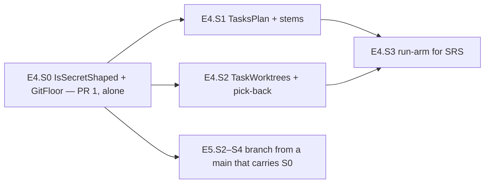

# PLAN — E4 stories: the task pipeline of the model-arms module

> Status: **stories written 2026-10-31, nothing implemented yet.** Epic E4 of [PLAN_model_arms.md](PLAN_model_arms.md) (§3 D14, D16,
> D17 (d), D19, D21, D22, D23, D25, D26; §4.6, §4.11, §4.12; §6 step 4; §7's E4 tests; §9; §10), written at `ecc890c` on
> `feat/model-arms-e4` (E1–E3 on `main`) by the judge role (Opus), as the epic starts — `common.plan-change-control` § *What counts as a
> change*: writing them is not a change. **The parent's epoch 3 has ONE entry since, 3.1** (2026-10-31, `contract`: a task whose session
> resumes keeps its worktree and `tmp/<id>` when they validate, an inconsistent one is refused with exit 4, only a task whose session never
> started is recreated — D14 and §4.6's table amended in the parent; built by E4.S2's spec item 11, §8 item 20): epoch 3's first change,
> recorded in the parent's ledger, no stop. It came from the ordered coai risk consultation for story 4.2 and this document's Opus review. A
> second entry stops the plan for re-review — which is why §8 item 22's removal of the patch-id skip is proposed, not taken. **Taken in:** the
> plan round (`review_plan` at `2713004`, verdict `proceed`, 1 of 2 reviewers answered; finding 2 accepted → §8 item 19, the warm build's log
> capped; finding 1 rejected), the two ordered risk consultations (stories 4.0 and 4.2) and this document's Opus review (§8 items 20–26; in
> E4.S3 a `.before` only for a task not done, the interrupted test counted per batch over the kept worktree, the changed-list comparison
> before the fix round; §7's counts; §9's coder streams and transcripts). **No cornerstone** (the parent's ledger is `3 of 3`, spent).
> **E4.S0 and E4.S2 are security judgements: their scenarios and briefs are Fable's, written 2026-10-31** — each section lists the questions
> its spec must settle; E4.S1 and E4.S3 are specified here in full. **Two pull requests:** E4.S0 alone (wave 0), merged to `main` before
> E4.S1–E4.S3 and before every E5 story that launches a process; then E4.S1–E4.S3.
>
> Scope: the arm's own claude session gets the target's secret rule (`IsSecretShaped`, D19) and no verb runs git in an arm below the floor
> its guards need (`GitFloor`, D23) — E4.S0; the SRS scheme — the split checked by a pure port of `tasks-plan.mjs` (E4.S1), batches run in
> parallel git worktrees of the arm's clone and carried back crash-safely through `ArmGit`'s hardened road (E4.S2), and `run-arm` for a
> scheme with a `tasks` block, with `stepsOnDeadline` and `status` naming the task coders (E4.S3). Tests under
> `tests/Bench.Tests/ModelArms/`, fixtures under `tests/Bench.Tests/Fixtures/model-arms/tasks/`, `research/module_model_arms.md`, the
> `run-arm` row of `research/module_tests.md`.

## 1. Goal, before any solution

E3 left two exposures and one missing scheme.

- **The model under test sees secrets the target's tools do not.** `ArmChildEnvironment` strips `CoaiEnvironment.IsSecretName` only
  (`ArmChildEnvironment.cs:48-49`), while `TargetEnvironment` strips a wider list of its own (`TargetEnvironment.cs:26`, `:29`, `:40-43`):
  the arm's session — the one process that runs arbitrary commands by design — receives `PGPASSWORD`, `DATABASE_URL`, `*_PAT`,
  `*_CREDENTIALS` and npm auth tokens whenever the operator's shell holds them (E3 §8 item 50; parent ledger 2.2).
- **Every git guard is an environment variable an older git ignores in silence** (`GIT_NO_LAZY_FETCH`, `GIT_ALLOW_PROTOCOL`,
  `GIT_CONFIG_COUNT`; `ArmGit.cs:18` says *no git floor is enforced*), so a harness on an old git claims measures it never had (E3 §8
  item 51; ledger 2.3).
- **An SRS arm is refused** (`ArmChoices.cs:25-26`, *story E4.S3*): part 6 ran three of them with the shell's task pipeline
  (`/home/jinx/git/coai-exp2/t-lib.sh`, `tasks-plan.mjs`, pinned by sha256 in the parent's §2), which split the plan into 4–7 tasks, ran
  each batch's tasks at once in git worktrees and cherry-picked their commits back — and had three defects this port must not copy: a
  crash between the cherry-pick and the marker picked the same commits twice (`t-lib.sh:24-38`, D22), a stale worktree was reused
  whatever it held (`t-lib.sh:10`, D14), and every git it ran over the arm's clone ran whatever program the clone's config named (E3 §8
  item 40).

What must survive unchanged: the files an SRS arm leaves (D5 — `out/task-<id>.before`, `task-<id>-coder.head|.diff` (the one rename),
`picked-<id>`, `batch-<i>.done`, `work/tasks.json`, `work/batches.json` in the shell's shape, the step stems `1-split`, `1b-split-fix`,
`2-<id>-code`), the checker's every problem sentence, and the batches it computes.

## 2. What exists — verified at `ecc890c`, 2026-10-31

Every line below was opened in this worktree; the shell by exact path the same day (read-only; `t-lib.sh` and `tasks-plan.mjs` match the
parent's §2 sums: `6ee808d1…`, `b5f0bcfb…`).

| Fact | Where |
|---|---|
| A scheme with a `tasks` entry is refused for `run-arm` naming E4.S3; `checks` allows it | `ModelArms/Verbs/ArmChoices.cs:25-26`; `RunArmAdmission.cs:42` (`allowTasks: false`); pinned by `RunArmSchemeTests.cs:143` |
| `run-arm`'s admission: PATH and config folders judged, then `claude` and `git` resolved to real paths; `ArmTools(Claude, Git)` | `ModelArms/Verbs/RunArmAdmission.cs:63-71`, `:16`; `LaunchAdmission.cs:13-16` (`FirstRefusal`), `:19-26` (`Resolve`) |
| `make` and `checks` resolve git the same way, without `HostChecks`; `checks --parse-only` still resolves git | `ModelArms/Verbs/Make.cs:45-58`; `ChecksAdmission.cs:57-65`, `:100-101` |
| The walk: one entry after the other; each step's `StepContext` carries `TaskFacts.None` and no problems | `ModelArms/Verbs/RunArmWalk.cs:62-75`, `:89-104` (`:103`) |
| `StepContext.Step` THROWS for a position that is a `tasks` entry; the stem every file is named by is `context.Step.Name` | `ModelArms/Adapters/StepRunner.cs:31-33`; `StepRun.cs:31-34`; `StepAttempt.cs:29`; `StepRunner.Recover` `StepRunner.cs:83` |
| The brief's task fields (`TASK`, `TASK_BRIEF`, `TASK_FILES`, `BEFORE`) for a `taskCode` kind, `PROBLEMS` for the split fix; a coder's `NOTES` is `notes/<id>-code.md` | `ModelArms.Core/Briefs/BriefFields.cs:8-11`, `:68-77`, `:82-85` |
| What a brief at a `tasks` position may see: the split's, the split fix's and the coder's outputs up to the step | `ModelArms.Core/Experiment/SchemePositions.cs:26-30`, `:60-65`, `:74` |
| The rehearsal fills the coder's brief with `paths.TaskBrief("t1")`, `src/Example.cs`, `paths.TaskBefore("t1")` | `ModelArms.Core/Briefs/BriefRehearsal.cs:83` |
| A `taskCode` step's derived outputs are `CoderHead`, `CoderDiff`; their writer refuses them today (*E4.S3*) | `ModelArms.Core/Steps/StepOutputs.cs:43-46`, `:65-71`; `ModelArms/Adapters/DerivedOutputs.cs:16`, `:23`, `:48`, `:78-84` |
| Recovery: `Skip` (`.done`), `RecoveredDone` (a finished or deadline-ended last stream without `.done`), `Fresh`, `Resume` | `ModelArms.Core/Steps/StepRecovery.cs:47-51`, `:60-64` |
| `stepsOnDeadline` lists step entries only; `checks` calls it; `status` prints one placeholder line for a `tasks` entry | `ModelArms.Core/Checks/DeadlineSteps.cs:8-13`; `ModelArms/Verbs/ChecksReport.cs:96-97`; `ArmReport.cs:36-39` (`:38`); `Status.cs:23` |
| Every task path is spelled already: `Worktree(id)`, `TasksPlanLog`, `BatchDone(i)`, `TaskBefore`, `CoderHead`, `CoderDiff`, `Picked`, `PickRecord`, `PickLog`, `WorktreeBuildLog`, `TaskNotes`, `TasksJson`, `TaskBrief`, `BatchesJson` | `ModelArms.Core/Experiment/ArmPaths.cs:125-127`, `:176-191`, `:199`, `:205-211` |
| `TaskLimits(Min, Max, MaxParallel, Split, SplitFix, TaskCode, Outputs)`; a task id is `^t[0-9]+\z` | `ModelArms.Core/Experiment/ExperimentFacts.cs:49-51`; `TaskIds.cs:10-12` |
| `ArmGit`: the pins `-c core.fsmonitor=false -c core.hooksPath= -c submodule.recurse=false`; `GIT_ALLOW_PROTOCOL=` on every question but `clone` and `submodule update`; filters neutralised through `GIT_CONFIG_COUNT` on every question but `clone`, `checkout --detach`, `submodule update` (`smudges: true`); the diff pins | `ModelArms/Adapters/ArmGit.cs:58-65`, `:69`, `:80-83`, `:86-87`, `:99-100`, `:142-145`, `:170-195`, `:199-226`; the test seam `ArmGitSeams.cs` |
| The two environments and the shared name test | `ModelArms.Core/Experiment/ArmChildEnvironment.cs:32-49`; `ModelArms.Core/Launch/TargetEnvironment.cs:22-45` (its doc `:13` says the session is not covered); `src/Bench.Domain/Gate/CoaiEnvironment.cs:286-291` |
| `HostFacts` (every member `required`), `GitEnvironment.Of`, `HostChecks.Decide`; the reader asks the source with `GitEnvironment.Of(parent)` | `ModelArms.Core/Experiment/HostChecks.cs:53-66`, `:71-76`, `:110-120`; `ModelArms/Adapters/HostFactsReader.cs:24-43`, `:61` |
| A timing line is appended by a fresh `FileStream(FileMode.Append)` with no lock; a log line by the verb's writer with no lock | `ModelArms/Adapters/ArmFiles.cs:161-167`; `StepLog.cs:11-15` |
| The pure list's last marker | `tests/Bench.Tests/ModelArms/ModelArmsArchitectureTests.cs:88` (`// E3.S5`) |
| Test kit: the host's git from the TEST PROCESS's PATH; an arm made by hand with every step's model the fake's; a root that copies the process environment; a made arm over the scratch target; the deadline seam | `ExperimentRoot.cs:35-37`, `:101-131` (`:110-117`), `:305-316`; `MakeKit.cs:43`; `TargetBench.cs:72`; `StepBench.cs:166`, `:170`, `:287` (`SpendWall`) |
| The fake: a replay per prompt substring, a pause per line, a hold, transcripts; its call record has no time stamp; its per-model call number can race for two calls at one instant (parent, *State after E3*) | `tests/FakeCli/Program.cs:124`, `:136-137`, `:140`, `:144`; `tests/Bench.Tests/Probes/Driver/FakeCli.cs:82` |

**The shell, the behaviour to port** (read 2026-10-31):

- `tasks-plan.mjs:16` tasks.json missing or not JSON is the ONE problem; `:18-41` the problems in this order — the count against the
  brief's bounds, each duplicate id, then per task the id's shape, no files, each file owned twice, each missing dependency, the brief's
  existence in `WORK`; then each task in a cycle, the plan's owner, the owner's missing dependencies, the undelivered scenarios; `:42` each
  as `- <sentence>`, exit 1; `:44-49` the batches: the ready tasks in input order, at most `MAX_PARALLEL`; `:50` `batches.json` =
  `JSON.stringify({batches, tasks: {<id>: {files, brief: "<WORK>/<brief>", depends, scenarios}}}, null, 2)`; `:51` the `ok:` line.
- `t-lib.sh:78-89` `1-split` → check → on refusal `1b-split-fix` with `PROBLEMS` = the checker's output → check again or stop; `:88` a
  warning when the split left changes in the clone; `:57-76` per batch without `batch-<i>.done`: a batch of ONE runs in the clone itself
  (`:64-65`, no worktree, no pick), a batch of many makes a worktree per task (`:8-22`), runs them at once, waits for all, stops "run me
  again" if any was interrupted (`:69-70`), picks each back in task order (`:24-38`), drops the worktrees (`:40`), touches
  `batch-<i>.done`; `:47-55` a task: `task-<id>.before` once (the HEAD of its folder), the step `2-<id>-code`, then `task-<id>-haiku.head`
  and `.diff` once; `:42-44` a list field as `` `a`, `b` ``; `:52` `BEFORE` is the SHA the `.before` holds, not its path.

**Measured while writing these stories** (2026-10-31, scratch folders outside every checkout, a planted program writing a sentinel; git
2.53.0 is the host's, 2.45.0 and 2.39.4 built from kernel.org's tarballs as E4.S0's pilot builds them):

| # | Observation | git |
|---|---|---|
| M-a | `submodule update --init` in a task worktree from the arm's own checkout: `GIT_ALLOW_PROTOCOL=` (empty) → `transport 'file' not allowed`, exit 1; `GIT_ALLOW_PROTOCOL=file` → the submodule cloned, exit 0, **without** `-c protocol.file.allow=always`; `GIT_ALLOW_PROTOCOL=ext` → refused | 2.53.0, 2.45.0, 2.39.4 |
| M-b | `submodule.<name>.update = !<program>` in the arm clone's config **ran** on `submodule update --init` of a new worktree; `--checkout` on the command line stopped it, and so did a `GIT_CONFIG_COUNT` pair setting the key to `checkout` (2.53.0) | 2.53.0, 2.45.0, 2.39.4 |
| M-c | a stale `.git/index.lock` in the clone: `cherry-pick --no-edit <sha>` exit 128, *Unable to create '…/.git/index.lock': File exists … a git process may have crashed in this repository earlier: remove the file manually to continue*; `status --porcelain` under it exit 0 | 2.53.0 |
| M-d | a stale `.git/worktrees/<id>/index.lock`: `worktree remove --force` exit 0, the folder and the admin folder gone | 2.53.0 |
| M-e | `branch -D` of a branch a registered worktree whose folder is gone still names: exit 1 *cannot delete branch … used by worktree*; after `worktree prune` exit 0; `worktree add -b` over an existing branch: exit 255 *a branch named … already exists* (the parent's §4.6 measurement, repeated) | 2.53.0 |
| M-f | a conflicting ONE-commit `cherry-pick`: exit 1, `.git/CHERRY_PICK_HEAD` present, **no** `.git/sequencer/`; `cherry-pick --abort` under `GIT_ALLOW_PROTOCOL=` exit 0, `CHERRY_PICK_HEAD` gone | 2.53.0 |
| M-g | git v2.39.4's tarball does NOT build with this host's GCC 15 (`reflog.c:263`: C23's `unreachable()` macro); `CFLAGS="-g -O2 -std=gnu17"` builds 2.39.4 and 2.45.0; the host has no zlib headers, so zlib 1.3.1 is built static into the same prefix; the tarballs' sha256 equal kernel.org's `sha256sums.asc`; `GIT_TRACE2_EVENT` names the running version (`"exe":"2.39.4"`) | build host |

## 3. Conventions every story follows

E1 §3, E2 §3 and E3 §3 hold unchanged (namespaces; pure means pure; refusals as values; red first on an ASSERTION; docs per story;
time through `TimeProvider`; no tokens in this repository; the commands). For E4:

- **The pure list and the module doc.** E4.S0 adds four markers after `// E3.S5` (`ModelArmsArchitectureTests.cs:88`), `// E4.S0` …
  `// E4.S3`, one per line with a blank line between, and four empty headings at the end of `research/module_model_arms.md`: *The
  secret-shaped names and the git floor (E4.S0)*, *The task plan (E4.S1)*, *The task worktrees and the pick-back (E4.S2)*, *run-arm for
  the task pipeline (E4.S3)*. Every later story writes only under its own.
- **One git.** Every git the pipeline starts is a question on `ArmGit` (`common.reuse-first`; E3 §8 item 16): `TaskWorktrees`
  orchestrates and never launches git itself; no story adds a second git helper.
- **A model-written file is read through `BoundedFile`** (C16): `work/tasks.json` (limit 1 MiB), `work/batches.json` (1 MiB), the pick
  record (E4.S2), every marker; a brief is never read by the harness — its presence is asked BY NAME (`KernelFacts.Present`).
- **A file the harness writes** is created exclusively or staged and renamed (`ArmFiles.WriteOnce` / `Replace`); `batches.json` is
  written ONCE (§8 item 8).
- **Parallel writers.** The tasks of a batch are parallel `Task`s in one process (D14): every timing line and every log line goes
  through one lock (§8 item 6). A test that runs tasks at once tells the fake's calls apart by PROMPT and pid, never by the fake's call
  number (§2's race).
- **Exit codes (D16) for the pipeline:** 0 done; 3 the host (git cannot answer, a stale `index.lock` (§8 item 4), a worktree's warm
  build failed, still limited after every wait); 4 configuration (the task list invalid after its one fix round, a cherry-pick conflict,
  a done task whose branch is gone, a pick record unreadable before its last line, `tasks.json` changed after the batches were fixed); 5
  stopped, resumable (an interrupted or errored task, the operator's stop). A batch whose tasks stop differently ends with 4 before 3
  before 5, after every sibling ended (§8 item 7).
- **D26 per adapter.** The reviews of E4.S2 (`TaskWorktrees`, the widened `ArmGit`) and E4.S3 (`TaskPipeline`) name which of (a)–(f) they
  checked (the parent's DoD).
- **Commands.** `node .agents/conventions/tools/low-priority.mjs dotnet build dew_flow_benchmark.slnx -c Release -m:4`, then
  `node .agents/conventions/tools/low-priority.mjs ./tests/Bench.Tests/bin/Release/net10.0/Bench.Tests --filter-class "*<Class>"` per
  class named in the story, the namespace `Bench.Tests.ModelArms`, and the whole suite once per story; `node
  .agents/conventions/tools/plan-lifecycle.mjs`.

## 4. Shared contracts (fixed here so stories can run in parallel)

**C19 — the task plan** (E4.S1; read by E4.S2 and E4.S3). `ModelArms.Core.Tasks`, pure:

```csharp
public sealed record PlannedTask(string Id, IReadOnlyList<string> Files, string Brief, IReadOnlyList<string> Depends, IReadOnlyList<string> Scenarios); // Brief: a file NAME in work/
public sealed record TaskBatches(IReadOnlyList<IReadOnlyList<string>> Batches, IReadOnlyList<PlannedTask> Tasks)
{
    public PlannedTask Task(string id);              // a caller's bug when absent
    public IReadOnlyList<string> TaskIds { get; }    // in batch order
}
public static class TasksPlan
{
    public static IReadOnlyList<string> BriefNames(string tasksJson);   // the string `brief` values that are ONE file name (the caller probes work/<name> by name); [] when not JSON
    public static Outcome<TaskBatches> Validate(string tasksJson, string planPath, IReadOnlyList<string> scenarioIds, TaskLimits limits, IReadOnlySet<string> workFiles, string workFolder);
    public static string Ok(TaskBatches batches);                       // "ok: 5 tasks in 2 batches: [t1 t2 t3 t4] → [t5]" (tasks-plan.mjs:51)
}
public static class BatchesFile
{
    public static string Write(TaskBatches batches, string workFolder);          // tasks-plan.mjs:50's bytes; brief = workFolder + "/" + name
    public static Outcome<TaskBatches> Read(string json, string workFolder);     // the inverse; refuses what Write cannot produce
}
public static class TaskBriefFields { public static string Files(PlannedTask task); }  // "`a`, `b`" (t-lib.sh:42-44)
public static class TaskStems
{
    public const string Split = "1-split";            // t-lib.sh:80
    public const string SplitFix = "1b-split-fix";    // t-lib.sh:84
    public static string Coder(string id);            // "2-" + id + "-code" (t-lib.sh:53); an id TaskIds refuses is a caller's bug
    public static bool IsPipelineStem(string name);   // one of the three shapes, without regard to case
}
```

`Validate`'s failure is every problem, one `- <sentence>` line each, joined by `\n`, in the shell's order — the text `out/tasks-plan.log`
holds and the split fix's `PROBLEMS` is filled with. `workFiles` is the set of brief names `BriefNames` gave whose `work/<name>` exists.

**C20 — the worktrees seam** (E4.S2 implements it; E4.S3 calls exactly these members — the Fable spec may add members, never change
these without changing E4.S3's section). `ModelArms.Adapters`:

```csharp
internal sealed record TaskTools(string Git, ToolPaths Build, IReadOnlyDictionary<string, string> Environment);   // the REAL paths run-arm resolved (D17 d)
internal abstract record BatchPlace { public sealed record Run(string Id, string Folder); public sealed record Picked(string Id); }   // closed
internal abstract record BatchEntry { public sealed record Ready(IReadOnlyList<BatchPlace> Places); public sealed record Stopped(int ExitCode, string Why); }  // closed
internal sealed class TaskWorktrees(ArmPaths paths, TargetFacts target, TaskTools tools, StepLog log)
{
    // parent §4.6 re-entry steps 1–3 for a batch without batch-<i>.done (a stale index.lock first — §8 item 4); recovery(id) is
    // StepRunner.Recover of the task's coder context (E4.S3 builds it); a batch of ONE gets Run(id, clone) with no worktree.
    public Task<BatchEntry> EnterAsync(IReadOnlyList<string> batch, Func<string, StepEntry> recovery, CancellationToken ct);
    public Task<StepOutcome.Stopped?> PickBackAsync(string id, CancellationToken ct);   // D22; null = carried
    public Task<StepOutcome.Stopped?> DropAsync(string id, CancellationToken ct);       // remove --force → prune → branch -D
}
```

A task E4.S2 RECREATES has no `out/task-<id>.before` afterwards (§8 item 9): E4.S3 writes a `.before` before a task's first attempt
for a task whose step is not done and whenever none exists (a done task without one is E4.S2's exit 4), and E4.S2's pick range reads it.

## 5. Stories

### E4.S0 — Wave 0: the secret-shaped names of the arm's session and the git floor (SECURITY JUDGEMENT — spec by Fable)

- **Coder:** sonnet · **Spec:** Fable (security judgement, outside the cornerstone quota — the parent's `## Epics` E4) · **Review:**
  Opus, naming D26 (a)–(f) for `LaunchAdmission`'s floor and `HostFactsReader`'s new fact. **Depends on:** E1–E3 (on `main`). **Parallel
  with:** nothing — **wave 0, its own pull request, merged before E4.S1–E4.S3 and before E5.S2–E5.S4** (parent §6 step 0). **Size:** ≈ 600
  lines (≈ 200 code, 350 tests, the docs).
- **Owns:** D19 and D23 as the re-review for epoch 3 rewrote them (ledger 2.2, 2.3); E3 §8 items 50 and 51; the module doc's threat text
  and the class docs that say the session is uncovered (`TargetEnvironment.cs:13`) and that no floor is enforced (`ArmGit.cs:18`,
  `research/module_model_arms.md:1699`); the four markers and four headings of §3.

**Files** (verified; *new* marked). Core: `tools/model-arms/ModelArms.Core/Experiment/SecretShaped.cs` (*new*), `ArmChildEnvironment.cs`,
`ModelArms.Core/Launch/TargetEnvironment.cs`, `ModelArms.Core/Experiment/GitFloor.cs` (*new*), `HostChecks.cs` (`HostFacts` gains the
version fact); console: `ModelArms/Adapters/HostFactsReader.cs`, `ArmGit.cs` (doc), `ModelArms/Verbs/LaunchAdmission.cs`,
`RunArmAdmission.cs`, `Make.cs`, `ChecksAdmission.cs`; tests: `SecretShapedTests.cs` (*new*), `GitFloorTests.cs` (*new*), `Sentinel.cs` (*new* — the recording shim, moved from `ArmGitWideningTests.cs:287`), `ExperimentRoot.cs` (`ReplaceGit`),
`ArmChildEnvironmentTests.cs`, `StepRunnerTests.cs`, `ValidateVerbTests.cs`, `RunArmSchemeTests.cs`, `MakeVerbTests.cs`,
`ChecksVerbTests.cs`, every test that constructs a `HostFacts`, `ModelArmsArchitectureTests.cs` (the markers; `typeof(SecretShaped),
typeof(GitFloor)` under `// E4.S0`); `research/module_model_arms.md` (its heading, the threat text, the pilot's log).

**Scenarios and brief — spec by Fable (2026-10-31).** Written against `ecc890c` on `feat/model-arms-e4`, every line below opened in this
worktree the same day (read-only; the rules `csharp.doctrine`, `common.testing`, `common.security`, `common.scenario-tests` read in full). The
names are fixed by the parent's §7 (E4.S0 block) and are used verbatim. Two findings about the code as it stands shape the spec: (i)
`TargetEnvironment.Stripped` (`TargetEnvironment.cs:36-37`) ALREADY asks `CoaiEnvironment.IsSecretName` AND its private `IsSecretShaped`
(`:40-43`) — the union exists, privately, on the target's side; the story MOVES it to one public predicate both classes call, it does not
invent it; (ii) every git the module starts is a question on `ArmGit` (`ArmGit.cs`, E3 C14), and `checks`' test
`Every_git_of_checks_is_the_resolved_one_hardened_with_no_GIT_or_secret_variable` (`ChecksVerbTests.cs:446-478`) asserts that EVERY recorded
git call carries the six pins — so `git --version` is a new `ArmGit` question, pinned like the rest, not a second launcher.

**The eleven questions, settled.**

1. **The union — one source, moved.** New `public static class SecretShaped` in `ModelArms.Core.Experiment`
   (`tools/model-arms/ModelArms.Core/Experiment/SecretShaped.cs`). The three private members of `TargetEnvironment` (`SecretNames :26`,
   `SecretSuffixes :29`, the `npm_config_`/`_auth` pair `:32-34`) MOVE there and become public read-only lists; `TargetEnvironment`'s private
   `IsSecretShaped` (`:40-43`) is deleted and `Stripped` (`:36-37`) calls `SecretShaped.IsSecretShaped(name)` **instead of**
   `CoaiEnvironment.IsSecretName(name) || IsSecretShaped(name)` — the shared call is dropped there because the union holds it; keeping it beside
   would be the decision written twice (`common.reuse-first`). `TargetEnvironmentTests` run unedited and green over the moved rule: that is the
   proof the target lost no name. `CoaiEnvironment.IsSecretName` itself is untouched (three consumers, D19).
2. **The exception under the union.** `ArmChildEnvironment.IsSecretNotClaudes` (`:48-49`) becomes
   `SecretShaped.IsSecretShaped(name) && !ClaudesOwnPrefixes.Any(...)`. Confirmed: `CLAUDE_X_PAT` and `ANTHROPIC_CREDENTIALS` PASS to the arm's
   session — names only the union catches are under the same exception, by D19's design (claude's login travels in those prefixes and the
   module cannot tell a login name from a secret one). The class doc says so in one sentence, and states the Vertex/Bedrock residual there:
   *`GOOGLE_APPLICATION_CREDENTIALS` (the `_CREDENTIALS` ending), `AWS_SECRET_ACCESS_KEY` and `AWS_SESSION_TOKEN` (`*_KEY`, `*_TOKEN`) are
   stripped — arms that log in through Vertex or Bedrock are not supported (D19, parent §9)*. The module doc's E4.S0 heading repeats it.
3. **The layer of the proof.** Two assertions go red when the union call is deleted from `ArmChildEnvironment` (reverted to
   `IsSecretName`): the pure theory `A_secret_shaped_name_never_reaches_the_arms_session` (`Expected child not to contain key "PGPASSWORD"`)
   AND `StepRunnerTests.Every_launch_carries_the_arms_environment_and_no_scout_flag`, which plants `PGPASSWORD` in the bench's parent map
   (`bench.Parent["PGPASSWORD"] = "hunter2"` — `StepBench.Parent` is a mutable `Dictionary`, `StepBench.cs:114`) before `Context` and asserts the
   fake's logged `EnvironmentNames` (`FakeCliCall.EnvironmentNames`, `FakeCli.cs:82`) do not hold it (`Expected call.EnvironmentNames not to
   contain "PGPASSWORD"`). The second is the wiring's test: `StepRunner` → `StepLaunch` → `ArmChildEnvironment.Of` → the launcher's replacing
   overload → the fake's environment, observed. A pure test alone would stay green with the wiring gone (`common.testing` § *Revert the line
   the observable BEHAVIOUR depends on*).
4. **`SSH_AUTH_SOCK` and inherited `GIT_*`.** E4.S0 LEAVES both in the arm's session, as D19 is written; parent §9 names them the owner's open
   question and this spec does not decide it. No test pins them (a green assertion of an open question is a red to explain when the owner
   answers). The `ArmChildEnvironment` class doc gets one sentence: *`SSH_AUTH_SOCK` and every inherited `GIT_*` pass — not secret-shaped, the
   owner's open question (parent §9); until it is answered, start the arms from a shell without an ssh agent*; the module doc's E4.S0 heading
   the same sentence under *Not proven*.
5. **The version grammar** (`GitVersion.Parse`, every row a test). The text is stdout cut to its FIRST line (everything up to the first `\n`,
   or the whole text when there is none) and THEN trimmed of spaces, CR and LF — one statement in `ArmGit.VersionAsync`
   (`FirstLine(stdout).Trim()`; a wrapper that prints more than git is cut to the line git prints, and `"  git version 2.44.1  \n"` reads as 2.44.1). It must start
   with `git version ` (ordinal — that prefix is git's own on every vendor build); the word after it, up to the first space, is split on `.`;
   the first three pieces must each be decimal digits (`NumberStyles.None`, invariant, `int`), and they are Major, Minor, Patch; everything
   after the third piece is the SUFFIX, kept as text. A suffix whose first piece starts with `rc` (ignoring case) marks a pre-release. Rows:

   | text | reads as | floor |
   |---|---|---|
   | `git version 2.45.0`, `git version 2.53.0` | 2.45.0 / 2.53.0 | admitted |
   | `git version 2.39.5 (Apple Git-154)` | 2.39.5, the rest after the space ignored | admitted (2.39 line, ≥ 2.39.4) |
   | `git version 2.45.1.windows.1` | 2.45.1, suffix `windows.1` tolerated | admitted |
   | `git version 2.46.0.GIT`, `git version 2.46.0.12.gabcdef0` | 2.46.0, a describe suffix tolerated (a build past the tag) | admitted |
   | `git version 2.44.2` | 2.44.2 | admitted (a later patch on a patched line) |
   | `git version 3.0.0` | 3.0.0 | admitted (any later major) |
   | `git version 2.45.0.rc1`, `git version 2.46.0.rc0` | a pre-release | **refused**: *is a release candidate, not a release* — the safe direction, whatever its number |
   | `git version 2.45.0-rc0` | the third piece `0-rc0` is not digits | refused, unparseable |
   | `git version 2.45` | two numbers — git prints three; this is not git's text | refused, unparseable |
   | `git version 2.44.0\r\n`, `  git version 2.44.1  ` | trimmed, then as above | 2.44.0 refused (below), 2.44.1 admitted |
   | ``, `git version`, `git version two`, `fatal: not a git repository`, `v2.45.0` | unparseable | refused naming the text read (through `ExecutableRule.Printable`, cut by `ExecutableRule.Cut` at 200 characters; the empty text is named as *printed nothing*) |

   The floor itself (`GitFloor.Admit`): admitted when `Major > 2`, or `Major == 2 && Minor >= 45`, or `Major == 2` and `Minor` is one of the
   patched lines with `Patch >= its patch` — `39→4`, `40→2`, `41→1`, `42→2`, `43→4`, `44→1`; everything else refused (`2.44.0`, `2.43.3`,
   `2.42.1`, `2.41.0`, `2.40.1`, `2.39.3`, `2.38.5`, `2.31.0`, `1.9.0`). The refusal sentence is one constant: `git <v> is below the floor —
   2.45.0, or 2.39.4 / 2.40.2 / 2.41.1 / 2.42.2 / 2.43.4 / 2.44.1 on its own maintenance line (D23: GIT_NO_LAZY_FETCH is read from these; an
   older git ignores the harness's guards in silence) — install a newer git`.
6. **Where `--version` is asked.** ONE reader: `ArmGit.VersionAsync(ct)` — the resolved real path, the pins, the SEALED environment
   (`GitEnvironment.Of(TargetEnvironment.Of(parent))` built inside the class, `GIT_NO_LAZY_FETCH=1`, `GIT_ALLOW_PROTOCOL=`), the 60 s wall
   (`TargetWalls.Git`), NO filter enumeration (the question opens no repository — one launch, not two), the cwd the `ArmGit` is built over.
   **The cwd is the experiment root (`input.Root.Root`) for every verb**: it exists for every verb once the gate let it in, it is the
   operator's own, and `--version` reads no repository there — one rule for four verbs. Who asks: (a) `HostFactsReader.FactsAsync` for
   `validate` (and so `prep-base` through `ValidateVerb.CheckedAsync`, `PrepBase.cs:39`): asked under the SAME guard as the source
   (`HostFactsReader.cs:55-64` — not while PATH or a config folder is refused, only of a git `Resolve` FOUND), and **before** `SourceFacts`:
   the source is asked only of a git whose version was read and passes `GitFloor.Admit`; otherwise `Source` is
   `SourceAnswer.NotAsked("the source was not checked: git's version is below the floor")` (or `…: git's version could not be read`), so a
   git whose guards are unknown is never run over the operator's checkout and every refusal is still printed at once — concretely,
   `SourceFacts.ReadAsync` and its `GitRun` (`SourceFacts.cs:40`, `:64`) are never constructed for a refused git: the gate is in
   `HostFactsReader.SourceAsync`'s switch (`:55-64`), one arm before the `Found` arm, not inside `SourceFacts`. (b)
   `LaunchAdmission.FloorAsync(verb, git, environment, cwd, ct)` for `make`, `run-arm`, `checks` — one helper, called right after
   `LaunchAdmission.Resolve("git", …)` returns the real path and BEFORE anything else: in `RunArmAdmission` a new async step between `Equip`
   and `CountedAsync` (so before `scenarios.json` is counted and before the gate lock, which `RunArm.WalkAsync` takes only after admission,
   `RunArm.cs:44-47`); in `Make` a new async step between `Admitted` and `Announced` (nothing is printed before a refusal — the verb's
   contract, `Make.cs:39`); in `ChecksAdmission.Equip` between `Resolve` and `Printed` (same reason) — **`--parse-only` INCLUDED**:
   `ChecksAdmission.Needed(:100-101)` resolves git for parse-only too and `ChecksVerb.MeasureAsync` (`Checks.cs:43-45`) builds the `ArmGit`
   over the clone for both roads, so parse-only runs git in the arm and the floor follows the resolution wherever git is resolved. The class
   docs of the three admissions say: *the one launch admission itself makes is `git --version` of the resolved git, from the experiment root,
   under the hardened environment*.
7. **Exits.** Below the floor: 3, the sentence of item 5. Unparseable: 3, *`git --version` at `<real path>` printed `"<text>"` — not a
   version this harness can read*. Git that does not start, exits non-zero or times out on `--version`: 3, *`git --version` at `<real path>`
   could not be read: `<ArmGit's Said>`* (`exit 128: <first stderr line>`, `timed out after 60s`, `'<path>' is not on PATH`). In `validate`
   each is a `HostProblem(…, Environment: true)` among the others; in the three admissions a `Passage.Stop(ExitCodes.Environment, …)`
   prefixed `model-arms <verb>: `.
8. **`HostFacts`' new member.** `public required GitVersionAnswer Version { get; init; }` — a closed record beside `SourceAnswer` in
   `HostChecks.cs`: `Read(string Text)` (the first line, trimmed), `Unanswered(string Reason)` (git ran or was started and did not answer:
   exit 3) and `NotAsked(string Reason)` (git absent or refused, PATH or a config folder refused — a finding whose cause is already printed,
   mirrored on `SourceAnswer.NotAsked`, `Environment: true`). `HostChecks.Decide` gains `GitFloorProblems(facts)` between
   `EnvironmentRefusals` and `SourceProblems`: `Read` → `GitFloor.Admit(text)`'s failure, if any, as `Environment: true`; `Unanswered` and
   `NotAsked` → their reason, `Environment: true`. The only test that builds a `HostFacts` is `ValidateVerbTests.Good` (`:804-815`) — it gains
   `Version = new GitVersionAnswer.Read("git version 2.45.0")` (the floor itself, so a floor off by one is seen there too); no other builder
   exists (searched `new HostFacts(` under `tests/` and `tools/`).
9. **The portable road.** The floor is a fact about an EXECUTABLE and takes no road: `LaunchAdmission` and `HostFactsReader` read it the same
   way on every host. The scenario drives `validate` through the gate with the Mac's seams exactly as
   `ModelArmsProgramTests.MacSeams` does (`:491-492`: `GateSeams.Real with { Road = PlatformKit.MacRoad, ReadFacts = … }`) over a shim git
   printing `2.44.0`, and asserts BOTH the floor's exit 3 and the road's *NOT verified* line — the positive that proves the portable road was
   the one taken (`common.testing` § *A fixture the code REJECTS proves nothing*). `MacSeams` moves to `PlatformKit` so two classes share it.
10. **The docs.** `TargetEnvironment.cs:13`: the sentence *The arm's own claude session is not covered by this rule … E3 §8 item 50* becomes
    *The arm's own claude session strips the same names through the same predicate (`SecretShaped.IsSecretShaped`, E4.S0, D19 ledger 2.2),
    with the `CLAUDE_*` / `ANTHROPIC_*` exception alone; the lists live in `SecretShaped` and this class holds none of its own*. `ArmGit.cs:18`:
    *No git floor is enforced …* becomes *A git floor is enforced at every verb's admission and by `validate` (D23, E4.S0, `GitFloor`): 2.45.0,
    or 2.39.4 / 2.40.2 / 2.41.1 / 2.42.2 / 2.43.4 / 2.44.1 on their lines — a NUMBER read from `--version` (`VersionAsync`), not an
    observation: a vendor build carrying the number without the fix would pass (parent §9); `GIT_ALLOW_PROTOCOL` (2.6.1) and the
    `GIT_CONFIG_COUNT` neutralisation (2.31) are implied by it*. `research/module_model_arms.md:341` (the *IsSecretName ALONE* parenthesis)
    and `:1699` (the residual *the arm's own claude session is NOT covered …* and the clause *no git floor is enforced …*) are rewritten to
    say what is built and to point at the E4.S0 heading; the floor's residual there is the version-number sentence of parent §9, verbatim.
    `research/module_tests.md` rows `validate` (`:104`) and `run-arm` (`:112`) gain one clause each: *a git below the floor is refused with
    exit 3 before any repository operation*.
11. **The pilot's reds — who decides.** A red on 2.39.4 or 2.45.0 whose cause is the floor's own arithmetic, grammar or a fixture (a shim, a
    PATH, `GIT_TRACE2_EVENT`) is the coder's: fixed in the story, both observations in the summary. A red that shows a GUARD not holding on an
    admitted version (a sentinel ran in `ArmGitWideningTests` on 2.39.4) means D23's table is wrong: the coder STOPS, logs the observation under
    the heading, and the judge raises a ledger entry for the owner (`## Plan changes`); the story is not merged with a lowered expectation or
    a widened floor. `2.44.0` is the optional control and its red is expected.

**Type shapes** (Core pure unless marked; every public static class is named in `PureDeciders` under `// E4.S0`).

```csharp
// ModelArms.Core/Experiment/SecretShaped.cs (new) — the one predicate, D19
public static class SecretShaped
{
    public static IReadOnlyList<string> WholeNames { get; }   // ["PGPASSWORD", "DATABASE_URL", "DOCKER_AUTH_CONFIG"]  (moved from TargetEnvironment.cs:26)
    public static IReadOnlyList<string> Endings { get; }      // the seventeen of TargetEnvironment.cs:29, moved verbatim
    public const string NpmConfig = "npm_config_";            // TargetEnvironment.cs:32
    public const string NpmAuth = "_auth";                    // :34
    public static bool IsSecretShaped(string name);           // CoaiEnvironment.IsSecretName(name) || WholeNames (ignore case) || Endings.Any(EndsWith, ignore case) || (StartsWith NpmConfig && Contains NpmAuth, ignore case)
}

// ModelArms.Core/Experiment/GitFloor.cs (new) — D23
public sealed record GitVersion(int Major, int Minor, int Patch, string Suffix)
{
    public bool IsPreRelease { get; }                         // Suffix's first '.'-piece starts with "rc", ignoring case
    public static Outcome<GitVersion> Parse(string text);     // item 5's grammar; the failure names the text (Printable, Cut 200; "printed nothing" for the empty text)
    public override string ToString();                        // "2.39.5" — the three numbers, the suffix omitted
}
public static class GitFloor
{
    public static Outcome<GitVersion> Admit(string text);     // Parse → pre-release refused → below the floor refused (item 5's sentence) → Ok(version)
    public const string Sentence = "2.45.0, or 2.39.4 / 2.40.2 / 2.41.1 / 2.42.2 / 2.43.4 / 2.44.1 on its own maintenance line";
}

// ModelArms.Core/Experiment/HostChecks.cs — beside SourceAnswer
public abstract record GitVersionAnswer { Read(string Text); Unanswered(string Reason); NotAsked(string Reason); }   // closed, private ctor
public sealed record HostFacts(...) { … public required GitVersionAnswer Version { get; init; } }

// ModelArms/Adapters/ArmGit.cs — the new question (adapter)
public async Task<Outcome<string>> VersionAsync(CancellationToken ct) =>
    (await AskAsync([.. Pinned, "--version"], ct, Budget, smudges: true)).Map(stdout => FirstLine(stdout).Trim());   // smudges: true = no filter enumeration: this question opens no repository; the doc says so — the flag's name is the three write questions' and this read shares it
// FirstLine: the text up to the first '\n' (the whole text without one); THEN Trim — the first line is cut before trimming, in this one statement (item 5)

// ModelArms/Verbs/LaunchAdmission.cs — the one helper the three admissions call (adapter)
public static async Task<Passage<GitVersion>> FloorAsync(string verb, string git, IReadOnlyDictionary<string, string> environment, string cwd, CancellationToken ct) =>
    (await new ArmGit(git, cwd, environment).VersionAsync(ct)).Match(
        text => GitFloor.Admit(text).Match(version => new Passage<GitVersion>.Through(version), reason => Passage<GitVersion>.Stop(ExitCodes.Environment, $"model-arms {verb}: {reason}")),
        reason => Passage<GitVersion>.Stop(ExitCodes.Environment, $"model-arms {verb}: git --version at {git} could not be read: {reason}"));
```

`RunArmAdmission.AdmitAsync` becomes `Choose → Place → Equip → FlooredAsync → CountedAsync` (`FlooredAsync(plan)` =
`LaunchAdmission.FloorAsync(Verb, plan.Tools.Git, plan.Input.Verb.Environment, plan.Input.Root.Root, plan.Input.Verb.Stopping).Map(_ => plan)`);
`MakeVerb.RunAsync` becomes `Admitted → FlooredAsync → Announced → Pending → MadeAsync`; `ChecksAdmission.Equip` becomes async:
`Resolve → FloorAsync(…, resolved["git"], …) → Printed`. `HostFactsReader.FactsAsync` reads `Version` with the source's guard, then `Source`
only when `Version is Read read && GitFloor.Admit(read.Text) is Ok`.

**Scenarios** (Given / When / Then; the red is the assertion seen first against today's code, or against the named stub with the final
signature — a type that does not compile is not a red, E4 §3).

| Test | Given / When / Then | Red |
|---|---|---|
| `SecretShapedTests.The_predicate_is_the_shared_list_or_the_targets_own_rules_whatever_the_case` | `[Theory]`, rows DERIVED: each of `SecretShaped.WholeNames`, each `"X" + ending` of `SecretShaped.Endings`, plus the fixed rows `MY_KEY`, `MY_TOKEN`, `MY_SECRET`, `MY_PASSWORD`, `COAI_CREDS_KEY` (the shared rule), `npm_config__authToken`, `npm_config_//registry/:_authToken`; each row as given, lower and MiXeD → `IsSecretShaped` true | stub `IsSecretShaped => CoaiEnvironment.IsSecretName(name)`: `Expected IsSecretShaped("PGPASSWORD") to be true, but found False` |
| `SecretShapedTests.A_name_that_only_looks_like_one_of_them_is_not_secret_shaped` | rows `npm_config_cache`, `npm_config_registry`, `NODE_PATH`, `PATHEXT`, `MY_PATH`, `PWD`, `OLDPWD`, `BYPASS`, `COMPASS`, `PASS`, `KEYS`, `AUTHOR`, `OAUTH_ENABLED`, `DATABASE_HOST`, `HTTP_PROXY`, `KEEP_ME` → false | stub `IsSecretShaped => true`: `Expected IsSecretShaped("PWD") to be false, but found True` (the file's one positive-direction test) |
| `ArmChildEnvironmentTests.A_secret_shaped_name_never_reaches_the_arms_session` | `[Theory]`, the parent's sixteen names, each as given, lower and mixed case, with `HOME` beside → `Of(parent, Arm)` holds `HOME` and `TMPDIR` only; the test header says which rows today's `IsSecretName` already strips (`GITHUB_TOKEN`, `DB_PASSWORD`, `AWS_SECRET_ACCESS_KEY`, `AWS_SESSION_TOKEN`) | TODAY'S code: red on the twelve rows `IsSecretName` misses — `Expected child.Keys to be equal to {"HOME", "TMPDIR"}, but found {"HOME", "PGPASSWORD", "TMPDIR"}` (first row) |
| `ArmChildEnvironmentTests.Claudes_own_names_pass_even_when_secret_shaped` | `CLAUDE_CODE_OAUTH_TOKEN`, `ANTHROPIC_API_KEY`, `ANTHROPIC_AUTH_TOKEN`, and the union-only `CLAUDE_X_PAT`, `ANTHROPIC_CREDENTIALS` → all present with their values; `CLAUDE_CODE_DISABLE_BACKGROUND_TASKS` still absent (a scout flag, not a secret) | GREEN on today's code (the exception already exists) — its red is break-it B2 below, and the test says so in its header |
| `StepRunnerTests.Every_launch_carries_the_arms_environment_and_no_scout_flag` | gains `bench.Parent["PGPASSWORD"] = "hunter2"` before `Context`; the fake's `EnvironmentNames` contain `TMPDIR`, `HOME`, `PATH`, `FAKE_CLI_HOME`, `PWD` and NOT `BENCH_DB`, `PGPASSWORD`, the two scout flags, `OLDPWD` | TODAY'S code: `Expected call.EnvironmentNames not to contain "PGPASSWORD"` |
| `GitFloorTests.The_floor_admits_2_45_and_the_patched_maintenance_lines_and_refuses_the_rest` | `[Theory]` over `GitFloor.Admit("git version " + row)`: admitted `2.45.0`, `2.53.0`, `2.44.1`, `2.44.2`, `2.43.4`, `2.42.2`, `2.41.1`, `2.40.2`, `2.39.4`, `2.39.5 (Apple Git-154)`, `2.45.1.windows.1`, `2.46.0.GIT`, `3.0.0`, `2.44.1\r\n` → `Ok` whose `ToString()` is the three numbers; refused `2.44.0`, `2.43.3`, `2.42.1`, `2.41.0`, `2.40.1`, `2.39.3`, `2.38.5`, `2.31.0`, `1.9.0` → `Fail` naming the version read and `GitFloor.Sentence`; `2.45.0.rc1`, `2.46.0.rc0` → `Fail` naming *release candidate* | stub `Admit => Parse(text).Map(identity)` (admits whatever parses): `Expected Admit("git version 2.44.0") to be Fail, but found Ok` |
| `GitFloorTests.An_unparseable_version_is_refused_naming_the_text_read` | rows ``, `git version`, `git version two`, `git version 2.45`, `git version 2.45.0-rc0`, `v2.45.0`, `fatal: not a git repository`, `git version 2.45.0.windows.1` with a NUL inside → `Fail` whose reason holds the text through `Printable` (the NUL as `\0`; the empty text as *printed nothing*) and never the word *floor*; a 1 000-character line → the reason holds at most 200 of it | stub `Parse` that returns `Ok(new GitVersion(99, 0, 0, ""))` on failure: `Expected outcome to be Fail` |
| `ValidateVerbTests.A_git_below_the_floor_is_refused_at_validate_and_at_run_arm_admission` | `[Theory]` over `(printed, exit)`: `2.44.0`→3, `2.44.1`→0, `2.45.0`→0, `2.39.5 (Apple Git-154)`→0, `2.39.3`→3, `nonsense`→3. `Posix()`; `WithTargetAsync`; `<temp>/bin/git` replaced by `File.Delete(git)` THEN `root.ShimScript(git, "for a; do :; done\nif [ \"$a\" = --version ]; then echo 'git version <printed>'; exit 0; fi\necho \"$*\" >> '<MarkerFile("git")>'\nexec '<RealGit>' \"$@\"\n")` — the delete first, always: `<temp>/bin/git` is a LINK to the host's git (`ExperimentRoot.cs:85`, `:124`), and `ShimFiles.Write` through the link would overwrite the operator's git itself; `ValidateVerbTests.cs:463` is the pattern (`File.Delete(git); root.ShimScript(git, …)`), and the kit gains `root.ReplaceGit(body)` doing exactly those two steps so no test writes through the link → exit as the row; a refused row's stderr holds the version read and `GitFloor.Sentence` (the nonsense row: *not a version this harness can read* and the text), the marker file ABSENT (no source question was asked of a refused git: the shim logs every call but `--version`), and *the source was not checked: git's version is below the floor*; an admitted row's output holds `  git → <shim>` and the marker holds the four `rev-parse` lines | TODAY'S code: `Expected code to be 3, but found 0` (row `2.44.0`) |
| `RunArmSchemeTests.A_git_below_the_floor_is_refused_at_validate_and_at_run_arm_admission` | `[Theory]` rows `2.44.0`→3, `2.44.1`→0, `not a version`→3; `MakeArmAsync("C1", fake)` (NO `validate` ever ran on this root — that IS *without a prior validate*), `Replay(fake, "result-success.jsonl")`, `<temp>/bin/git` replaced by the shim above through `root.ReplaceGit` (the link deleted first, never written through; marker `git`) → exit as the row; for 3: `fake.Calls()` empty, the marker file absent (the shim logs every git but `--version`; so no repository operation ran), `root.PathsOf("C1").Timing` absent, the stderr names the version and the floor; for 0: the four steps ran and `Run_arm_prints_the_resolved_claude_and_git_before_the_first_launch` stays unedited and green | TODAY'S code: `Expected run.Code to be 3, but found 0` |
| `MakeVerbTests.Make_and_checks_refuse_a_git_below_the_floor_before_any_repository_operation` | `MakeKit.CreateAsync("C1")`; `kit.Bench.Say("git.version", "git version 2.44.0\n")` (the `TargetBench` git shim gains: after its recording prelude, `if [ -f "$CANNED/git.version" ]; then for a; do :; done; if [ "$a" = --version ]; then show git.version; exit 0; fi; fi`) → `kit.MakeAsync()` exit 3; the recorded calls (`kit.Bench.Recorded()`) hold exactly ONE call, tool `git`, whose last argument is `--version`, whose `Executable` is the shim's path and whose `Cwd` is `kit.Root.Root`; `kit.Layout.ArmMapFile` absent, `kit.Layout.Arms` absent; `run.Output` does NOT hold `resolved executables:` (refused before printing). A second half with `2.44.1` → exit 0 and `Every_tool_of_make_is_launched_by_its_resolved_path_under_a_built_environment` unedited and green (its `HarnessGit()` now also sees the pinned `--version` call: `Executable == printed["git"]` holds) | TODAY'S code: `Expected run.Code to be 3, but found 0` |
| `ChecksVerbTests.Make_and_checks_refuse_a_git_below_the_floor_before_any_repository_operation` | `ChecksKit.CreateAsync()`; `kit.Bench.Say("git.version", "git version 2.43.3\n")` → `kit.RunAsync()` exit 3 AND `kit.RunAsync(parseOnly: true)` exit 3; after both, the recorded git calls are exactly two `--version` calls and no `dotnet` call; `out/objective` under the arm absent; no `resolved executables:` printed. `Every_git_of_checks_is_the_resolved_one_hardened_…` is edited in two places only: its `Cwd` assertion excludes the `--version` call and gains the positive `git.Should().ContainSingle(call => call.Arguments[^1] == "--version").Which.Cwd.Should().Be(kit.Root.Root)` | TODAY'S code: `Expected run.Code to be 3, but found 0` |
| `ValidateVerbTests.On_the_portable_road_the_floor_is_checked_too` | `Posix()`; `WithTargetAsync`; `Close(root, "700")`-equivalent modes (as `ModelArmsProgramTests:495-502`); the shim git printing `2.44.0`; `validate` through the gate with `PlatformKit.MacSeams()` → exit 3; stderr holds the floor's sentence AND one line containing *NOT verified* (the road's line, FIRST) — the positive that the Mac road was taken | TODAY'S code: `Expected code to be 3, but found 0` |
| `ArmGitWideningTests.The_version_question_is_pinned_sealed_and_reads_no_repository` (added; E4.S2 adds rows to this class too) | an `ArmGit` over a folder that is NOT a repository (a fresh `TempFolder`), built with the kit's recording shim (`Sentinel.RecordingShim`, below) → `VersionAsync` equals the host's `git --version` first line; the recording holds exactly ONE call (no `config --get-regexp` enumeration), starting with the six pins and ending `--version`, its `CWD` the folder, with `GIT_ALLOW_PROTOCOL` and `GIT_NO_LAZY_FETCH` in its names and no `GIT_DIR` of the parent | stub `VersionAsync` through the plain `AskAsync` (enumerating): `Expected calls to contain a single item, but found 2` |
| **The recording shim moves to the kit** — `tests/Bench.Tests/ModelArms/Sentinel.cs` (*new* here; E4.S2 adds its four plant helpers to the same file) | `ArmGitWideningTests.RecordingShim` (private, `ArmGitWideningTests.cs:287`) and `Blocks` (`:295`) become `Sentinel.RecordingShim(TempFolder temp, string marker)` and `Sentinel.Blocks(marker)`, behaviour unchanged but for two additions: each block gains a `CWD <pwd>` line (`echo "CWD $PWD"` — `$PWD` is the folder the launcher started the shim in, what every "from the experiment root" assertion below reads) and the `ENV` filter gains `PGPASSWORD=*` — without it E4.S2's test 15 asserts the absence of a name the shim never records, which is green over any code (`common.testing` § *A fixture the code REJECTS proves nothing*). The block shape is `CALL <argv>` · `CWD <pwd>` · `ENV name=value`…; `Blocks` returns `(Call, Cwd, Env)`. `ArmGitWideningTests` green before and after the move (its rows call the kit's) | a plant: `PGPASSWORD` planted in the parent map of `The_version_question_…` and a `VersionAsync` that hands the parent map through unsealed → `Expected env not to contain "PGPASSWORD="` — red ONLY once the shim records the name (the proof the recording has teeth) |
| **The consultant's check — every admission asks git exactly ONCE and stops there** (`ValidateVerbTests.Every_admission_asks_git_its_version_exactly_once_from_the_experiment_root_and_a_refused_git_runs_nothing_else`, a `[Theory]` over the six roads: `validate`, `prep-base` (through `ValidateVerb.CheckedAsync`, `PrepBase.cs:39`), `make` (`MakeKit`), `run-arm` (`MakeArmAsync`), `checks`, `checks --parse-only` (`ChecksKit`)) | each road with `<temp>/bin/git` replaced through `ReplaceGit` by `Sentinel.RecordingShim` answering `--version` with `git version 2.44.0` (recorded like every call) → exit 3; `Sentinel.Blocks(marker)` holds EXACTLY one block, its `CALL` the six pins then `--version` and nothing else, its `CWD` the experiment root (`root.Root` / `kit.Root.Root`) — exactly one, not "no other call": a count of zero and a count of two both fail. Then the same six roads with the shim answering `git version 2.44.1` → the first block is that `--version` call from the root and the SECOND block exists and is a repository question (`rev-parse` for `validate`/`prep-base`; `worktree`/`clone`/`rev-parse` for the others as each verb's own tests already name) — the positive that an admitted version reaches the later operations; the exit code is each road's own (the existing tests assert it, this one asserts the sequence only) | TODAY'S code: `Expected blocks to contain a single item, but found 5` (validate: the four `rev-parse` of the source ran with no `--version` before them) |
| `ValidateVerbTests` existing tests, edited (listed so nothing is re-discovered) | `The_source_is_asked_through_the_git_that_resolved_without_the_parents_GIT_variables` (`:434-454`): the marker's first line is now the pinned version question — expect `["-c", "rev-parse", "rev-parse", "rev-parse", "rev-parse"]`, and the env dump's `GIT_` check excludes `GIT_NO_LAZY_FETCH`, `GIT_ALLOW_PROTOCOL` and `^GIT_CONFIG_(COUNT|KEY_\d+|VALUE_\d+)$` as `MakeVerbTests:472-473` does; `A_git_that_cannot_answer_is_the_environment_naming_its_words` (`:457-468`): its shim answers `--version` with the real git first (`for a; do :; done; [ "$a" = --version ] && exec '<RealGit>' "$@"`) so the test keeps asking what it asks; `A_target_config_that_names_programs_is_read_but_none_of_them_runs` (`:373-431`): unedited — `--version` runs no configured program, and the shim markers stay empty, observed | each would otherwise go red for the version call, not for its subject |
| `ModelArmsArchitectureTests` | `// E4` replaced by `// E4.S0` (`typeof(SecretShaped), typeof(GitFloor)`), then `// E4.S1`, `// E4.S2`, `// E4.S3` empty, a blank line between each; `Every_core_decider_is_named_in_the_pure_list` is the built-in red for a forgotten name | `unnamed … ModelArms.Core.Experiment.SecretShaped` until listed |

`TargetEnvironmentTests` run unedited and green (every one of its 41 cases, the proof of item 1).

**Break-its — one per security property, each observed and recorded in the summary.**

| # | Property | Plant | Red (test → message) |
|---|---|---|---|
| B1 | the arm's session strips the union | `IsSecretNotClaudes` back to `CoaiEnvironment.IsSecretName(name) && …` | `A_secret_shaped_name_never_reaches_the_arms_session` (twelve rows, `…found {"HOME", "PGPASSWORD", "TMPDIR"}`) AND `Every_launch_carries_the_arms_environment_and_no_scout_flag` (`not to contain "PGPASSWORD"`) — both layers |
| B2 | the union does not widen the exception away (claude still logs in) | delete the `ClaudesOwnPrefixes` clause | `Claudes_own_names_pass_even_when_secret_shaped` (`Expected child to contain key "CLAUDE_CODE_OAUTH_TOKEN"`) and `Home_path_locale_and_claudes_own_variables_pass_through_untouched` |
| B3 | one source serves both classes (a name lost is lost for both and seen) | remove `"_PAT"` from `SecretShaped.Endings` | `TargetEnvironmentTests.A_secret_shaped_name_the_shared_suffix_list_misses_is_stripped_whatever_its_case` (rows `GITHUB_PAT`, `AZURE_DEVOPS_PAT`, `my_pat`) AND `SecretShapedTests.The_predicate_…` (the derived row disappears — so ALSO add the fixed row `GITHUB_PAT` to that theory, or the plant hides from it) |
| B4 | the floor's arithmetic (2.44.0 is below) | the `44 → 1` entry set to `44 → 0` | `GitFloorTests.The_floor_admits_…` (`Expected Admit("git version 2.44.0") to be Fail`) AND `ValidateVerbTests.A_git_below_the_floor_…` row `2.44.0` (`Expected code to be 3, but found 0`) |
| B5 | the floor stands at the VERB's admission, not only in `validate` | delete `FlooredAsync` from `RunArmAdmission.AdmitAsync` | `RunArmSchemeTests.A_git_below_the_floor_…` (`Expected run.Code to be 3, but found 0`) while `GitFloorTests` and `ValidateVerbTests` stay GREEN — that is the layer the parent's name demands |
| B6 | an unreadable version is refused, never admitted | `Admit` returns `Ok(new GitVersion(99,0,0,""))` when `Parse` fails | `An_unparseable_version_is_refused_naming_the_text_read` and the `nonsense` rows of both verb theories |
| B7 | the source is never asked of a git below the floor | `HostFactsReader` asks `SourceFacts` whatever `Version` says | `ValidateVerbTests.A_git_below_the_floor_…` row `2.44.0`: `Expected file <markers/git> not to exist` (the shim logged `rev-parse`) |
| B8 | the version is read from the RESOLVED path under the built environment | (covered structurally) `The_module_launches_nothing_by_a_bare_name` with `VersionAsync` present; the widening test's `GIT_DIR` absence | no plant: the scan and the widening row are the control; say so |

**Brief — files and changes, in order** (Sonnet coder; build after each numbered group, run the class named, watch the red first).

1. `tests/Bench.Tests/ModelArms/SecretShapedTests.cs` (new), `GitFloorTests.cs` (new) against stubs with the final signatures
   (`SecretShaped.IsSecretShaped => CoaiEnvironment.IsSecretName(name)`; `GitFloor.Admit => GitVersion.Parse(text)` with a `Parse` that
   admits `99.0.0` on failure) — see the reds; then `ArmChildEnvironmentTests` (two new tests) and `StepRunnerTests` (the `PGPASSWORD` line)
   against TODAY'S `ArmChildEnvironment` — see the reds. Run `--filter-class "*SecretShapedTests"`, `"*GitFloorTests"`,
   `"*ArmChildEnvironmentTests"`, `"*StepRunnerTests"`.
2. `ModelArms.Core/Experiment/SecretShaped.cs` — the real predicate (the lists moved from `TargetEnvironment.cs:26-34` VERBATIM, no name
   added or dropped). `TargetEnvironment.cs`: delete `:26-34` and `:40-43`, `Stripped` calls `SecretShaped.IsSecretShaped`; class doc `:6-15`
   rewritten per item 10 (the lists are named in `SecretShaped`'s doc now; this doc points there and keeps its residual paragraph).
   `ArmChildEnvironment.cs:48-49` → `SecretShaped.IsSecretShaped(name) && …`; class doc gains items 2 and 4's sentences. Run
   `"*TargetEnvironmentTests"` (unedited, green), the four classes of step 1 (green).
3. `ModelArms.Core/Experiment/GitFloor.cs` — `GitVersion`, `GitFloor` as shaped above (no `throw` for a malformed text: `Outcome` failures;
   cyclomatic complexity ≤ 4 per method — `Parse` splits into `Prefix`, `Numbers`, `Suffix` helpers). `GitFloorTests` green.
4. `tests/Bench.Tests/ModelArms/Sentinel.cs` (*new*): `RecordingShim` and `Blocks` moved from `ArmGitWideningTests.cs:287`, `:295`, with the
   `CWD` line and `PGPASSWORD` added (the table's row); `ExperimentRoot.ReplaceGit(body)` (`File.Delete` of the `bin/git` link, THEN `ShimScript` —
   never a write through the link, `ExperimentRoot.cs:85`, `:124`). `ArmGitWideningTests` green after the move. Then
   `ModelArms/Adapters/ArmGit.cs` — `VersionAsync`; the class doc's *No git floor is enforced* sentence (`:18`) rewritten per item 10, and a
   line in the E3-questions paragraph: *`--version`, the floor's question (E4.S0): pinned, sealed, one launch, no repository read*.
   `tests/Bench.Tests/ModelArms/ArmGitWideningTests.cs` gains `The_version_question_is_pinned_sealed_and_reads_no_repository`. Run
   `"*ArmGitWideningTests"`.
5. `ModelArms.Core/Experiment/HostChecks.cs` — `GitVersionAnswer`, `HostFacts.Version`, `GitFloorProblems` in `Decide` (between `:113` and
   `:114`). `ValidateVerbTests.Good` gains `Version`. Build: every other `HostFacts` builder is a compile error by design (`required`); there is
   none. `ModelArms/Adapters/HostFactsReader.cs` — `VersionAsync` under the source's guard (`:55-64`), then `SourceAsync` only when admitted
   (`NotAsked` otherwise, item 6); class doc `:8-16` gains the sentence. `tests/Bench.Tests/ModelArms/PlatformKit.cs` gains `MacSeams(GateSeams?
   from = null)` moved from `ModelArmsProgramTests.cs:491-492` (that class calls the kit's). `ValidateVerbTests`: the two edits of the table's
   penultimate row, then the two new tests. Run `"*ValidateVerbTests"`, `"*PrepBaseTests"` (unedited: its `HarnessGit()` count is `>= 5`,
   one more pinned call is fine), `"*ModelArmsProgramTests"`, `"*ModelArmsScenarioTests"` (the binary over a real git: green, the host's
   2.53.0 is above the floor).
6. `ModelArms/Verbs/LaunchAdmission.cs` — `FloorAsync`; class doc gains the *one launch admission makes* sentence. `RunArmAdmission.cs` —
   `FlooredAsync` step and doc (`:21-23`); `Make.cs` — the step between `Admitted` and `Announced`, doc (`:13`); `ChecksAdmission.cs` — `Equip`
   async with the floor between `Resolve` and `Printed`, doc (`:25-27`, parse-only named). `tests/Bench.Tests/ModelArms/TargetBench.cs` — the
   git shim's `git.version` canned answer (after the prelude, before `exec`), `Say`'s doc lists it. Then `RunArmSchemeTests`, `MakeVerbTests`,
   `ChecksVerbTests`: the new tests and the two-line edit of `Every_git_of_checks_…`. Run the three classes.
7. `tests/Bench.Tests/ModelArms/ModelArmsArchitectureTests.cs:85-88` — the four markers, `typeof(SecretShaped), typeof(GitFloor)`. Run
   `"*ModelArmsArchitectureTests"`.
8. The break-its B1–B7, each planted, its red message copied into the summary, the plant reverted, green confirmed.
9. Docs: `research/module_model_arms.md` — the four empty headings at the end (E4 §3), E4.S0's filled: the predicate (the lists, the
   exception, the Vertex/Bedrock residual, the owner's open question of item 4), the floor table of item 5, where `--version` is asked (item 6)
   and the cwd rule, the exits, the tests (names and counts), *The trust boundary — D26 (a)–(f)* for `LaunchAdmission`'s floor and
   `HostFactsReader`'s fact ((a) no path judged; (b) the real path, `ArmGit`'s environment, the root as cwd; (c) the same guard as the source;
   (d)–(f) unchanged), *Not proven* (a vendor build with the number and without the fix; Windows: the shims are POSIX; macOS: the seam, not a
   Mac), and the pilot's log once run; `:341` and `:1699` rewritten (item 10); `research/module_tests.md:104`, `:112` one clause each.
10. The pilot (the story's commands above), logged under the heading; `node .agents/conventions/tools/plan-lifecycle.mjs`.

**What NOT to change.** `CoaiEnvironment.IsSecretName` (`src/Bench.Domain/Gate/CoaiEnvironment.cs:286-291`) — not a line; the
`CLAUDE_*` / `ANTHROPIC_*` exception — kept exactly, now over the union; `SSH_AUTH_SOCK` and `GIT_*` in the arm's session — kept (item 4);
`ArmGit`'s other questions, pins and environments; `SourceFacts` (its `GitRun` stays unpinned — validate's source questions are E1's and
measured); `GitEnvironment.Of`; `TargetEnvironmentTests.cs` — not a character; the task pipeline (E4.S1–E4.S3); the parent's D19/D23 text.

**Commands.** `node .agents/conventions/tools/low-priority.mjs dotnet build dew_flow_benchmark.slnx -c Release -m:4` (0 warnings); per class
`node .agents/conventions/tools/low-priority.mjs ./tests/Bench.Tests/bin/Release/net10.0/Bench.Tests --filter-class "*<Class>"` for
`SecretShapedTests`, `GitFloorTests`, `ArmChildEnvironmentTests`, `TargetEnvironmentTests`, `StepRunnerTests`, `ArmGitWideningTests`,
`ValidateVerbTests`, `PrepBaseTests`, `ModelArmsProgramTests`, `ModelArmsScenarioTests`, `RunArmSchemeTests`, `MakeVerbTests`,
`ChecksVerbTests`, `ModelArmsArchitectureTests`; the module `--filter-namespace "*ModelArms*"`; the whole suite once (`./tests/Bench.Tests/bin/Release/net10.0/Bench.Tests`,
the database and service tests aside as E3 §11 records); `dotnet format --verify-no-changes`; the pilot; `plan-lifecycle.mjs`.

**Done when** (this spec's additions to the section's own *Done when*): every row's red copied into the summary with its message; B1–B7
observed; the version question has exactly one launch; `checks --parse-only` refused like `checks`; the `Cwd` of the `--version` call is the
experiment root in `make`, `checks`, `run-arm` and `validate`, and the consultant's six-road check holds (exactly ONE block for a refused git,
a repository question as the second block for an admitted one); no test writes through the `bin/git` link; the review names D26 (a)–(f) for `LaunchAdmission.FloorAsync` and
`HostFactsReader`'s `Version`.

**The real-git pilot — a story step, by hand, not a CI test** (a consultant's suggestion: the floor was read from git's source, the
behaviour on those versions is unobserved). Run once the story's tests are green, on Linux, and log the result under the story's heading
in `research/module_model_arms.md` (the versions, the tarball sums, every class's `passed/failed/skipped`, the trace2 version set). The
commands are the ones measured while writing these stories (§2 M-g):

```bash
REPO=$(git rev-parse --show-toplevel)                                   # this story's worktree
P="${XDG_CACHE_HOME:-$HOME/.cache}/model-arms-git-pilot"                # outside every checkout
mkdir -p "$P/src" && cd "$P/src"
curl -sSfLO https://zlib.net/fossils/zlib-1.3.1.tar.gz
curl -sSfLO https://mirrors.edge.kernel.org/pub/software/scm/git/git-2.39.4.tar.xz
curl -sSfLO https://mirrors.edge.kernel.org/pub/software/scm/git/git-2.45.0.tar.xz
sha256sum -c - <<'EOF'
9a93b2b7dfdac77ceba5a558a580e74667dd6fede4585b91eefb60f03b72df23  zlib-1.3.1.tar.gz
ff2972e002c1bdf9f053243c934a2a1bc8248f8d419aaee8f6d5a4ed205c6633  git-2.39.4.tar.xz
0aac200bd06476e7df1ff026eb123c6827bc10fe69d2823b4bf2ebebe5953429  git-2.45.0.tar.xz
EOF
for v in 2.39.4 2.45.0; do
  rm -rf zlib-1.3.1 "git-$v" && tar xzf zlib-1.3.1.tar.gz && tar xJf "git-$v.tar.xz"
  (cd zlib-1.3.1 && ./configure --static --prefix="$P/git-$v/zlib" && nice -n 19 make -j4 && make install)
  OPTS=(prefix="$P/git-$v" ZLIB_PATH="$P/git-$v/zlib" NO_CURL=1 NO_EXPAT=1 NO_GETTEXT=1 NO_TCLTK=1 NO_PERL=1 NO_PYTHON=1 NO_OPENSSL=1 CFLAGS="-g -O2 -std=gnu17")
  (cd "git-$v" && nice -n 19 make -j4 "${OPTS[@]}" all && make "${OPTS[@]}" install)
  "$P/git-$v/bin/git" --version                                         # must print: git version $v
done
cd "$REPO"
node .agents/conventions/tools/low-priority.mjs dotnet build dew_flow_benchmark.slnx -c Release -m:4
for v in 2.39.4 2.45.0; do
  T="$P/trace2-$v.json"; rm -f "$T"
  for class in ArmGitWideningTests GitFloorTests ValidateVerbTests RunArmSchemeTests MakeVerbTests ChecksVerbTests StepGitTests PrepBaseTests; do
    PATH="$P/git-$v/bin:$PATH" GIT_TRACE2_EVENT="$T" node .agents/conventions/tools/low-priority.mjs \
      ./tests/Bench.Tests/bin/Release/net10.0/Bench.Tests --filter-class "*$class"
  done
  grep -o '"exe":"[^"]*"' "$T" | sort -u                                # must print exactly "exe":"<v>": the fixtures ran THIS git
done
rm -rf "$P"                                                             # once the log is written
```

The tests take the host's git from the test process's PATH (`ExperimentRoot.cs:35-37`), so the built git is the one every fixture and
every `ArmGit` question runs; `ArmGit` strips `GIT_*` from its own children, so the trace file is written by the fixtures' git alone (a
red that names `GIT_TRACE2_EVENT` is the pilot's own variable: rerun that class without it and record both). Expected: every class green
on both versions. **Optional control, expected RED:** the same loop with `v=2.44.0` (sha256 from kernel.org's `sha256sums.asc`) —
`GitFloorTests` green, the verb classes red with the floor's exit 3: the floor refuses a real binary's own `--version` text.

**Done when.** The parent's E4.S0 tests exist under their names and are green, each red seen first on an assertion (the rows
`IsSecretName` misses red on today's `ArmChildEnvironment`); `TargetEnvironmentTests` unedited and green; `2.44.0` refused and `2.44.1`
admitted; `run-arm` without `validate` refused before any repository operation; the docs of item 10 corrected; the pilot logged; the
review names D26 (a)–(f); merged to `main` alone.

**Out of bounds.** The task pipeline (E4.S1–E4.S3); widening `CoaiEnvironment.IsSecretName` itself (three consumers, parent D19);
`SSH_AUTH_SOCK` / `GIT_*` in the session (item 4: the owner's).

### E4.S1 — The task plan: `tasks-plan.mjs` as a pure checker, the shell's own script as the oracle

- **Coder:** sonnet · **Spec:** Opus (this section) · **Review:** Opus. **Depends on:** E4.S0 merged (the markers). **Parallel with:**
  E4.S2. **Size:** ≈ 700 lines (≈ 250 code, 450 tests).
- **Owns:** §4.6's checker and batches; C19; the task stems (D5's names for the pipeline's steps); the shell's problem sentences.

**Files.** Core (*new* folder `ModelArms.Core/Tasks/`): `TasksPlan.cs`, `BatchesFile.cs`, `TaskStems.cs`, `TaskBriefFields.cs`,
`JsText.cs` (internal: JavaScript's text of a JSON value) — all *new*; `ModelArms.Core/Experiment/SchemeChecks.cs` (a scheme entry named
like a pipeline stem refused); tests `TasksPlanTests.cs` (*new*), `BatchesFileTests.cs` (*new*), one test in `StepContractTests.cs`;
fixture `tests/Bench.Tests/Fixtures/model-arms/tasks/tasks-plan.mjs` (*new*: `/home/jinx/git/coai-exp2/tasks-plan.mjs` copied VERBATIM —
its sha256 is the parent's §2 `b5f0bcfb8e2b78668286d1ce24d348689f1d49575efe73101a0f553bdef382c8`, asserted by the oracle test); under
`// E4.S1` `typeof(TasksPlan), typeof(BatchesFile), typeof(TaskStems), typeof(TaskBriefFields)`; the module doc's *The task plan (E4.S1)*.

**Contracts.** C19 exactly. `Validate` ports `tasks-plan.mjs:16-49` line by line, with `limits.Min`, `limits.Max` and
`limits.MaxParallel` for the shell's constants (its sentence says `the brief asks for <Min> to <Max>`), `planPath` for `PLAN`,
`scenarioIds` for `SCENARIOS`, and `workFolder` (the caller passes the absolute `paths.Work`) for `WORK` in sentence 8. The sentences,
verbatim:

| # | Sentence (`tasks-plan.mjs`) | Line |
|---|---|---|
| 1 | `tasks.json is missing or not JSON: <reason>` — the ONLY problem when the text does not parse (the reason is the .NET reader's; the oracle compares the prefix) | `:16` |
| 2 | `there are <n> tasks; the brief asks for <Min> to <Max>` (`tasks` not an array reads as `[]`) | `:17-18` |
| 3 | `task id <id> is used twice` — once per later occurrence | `:20` |
| 4 | `a task id must look like t1, t2…: <JSON of the id>` (`TaskIds.IsTaskId`; absent → `undefined`) | `:23` |
| 5 | `<id> lists no files` | `:24` |
| 6 | `<file> belongs to both <first owner> and <id>` | `:26` |
| 7 | `<id> depends on <d>, which does not exist` | `:29` |
| 8 | `<id>'s brief <JSON of the brief> does not exist in <work>` | `:30` |
| 9 | `<id> depends on itself through a cycle` | `:34` |
| 10 | `no task owns <plan> (the last task must)` | `:36` |
| 11 | `<owner> owns the plan but does not depend on <ids joined by ", ">` | `:37-38` |
| 12 | `no task delivers <ids joined by ", ">` | `:39-41` |

Values print as JavaScript's template literal prints them (`JsText`): absent `undefined`, a string itself, a number or a boolean its JSON
text, `null`, an array its elements' texts joined by `,`, an object `[object Object]`; two ids are equal when both are JSON strings with
the same value, or both the same non-string primitive (`===`); an object or array id equals nothing. **Three deviations, each a test
(§8 item 10):** a `files` or `depends` member that is not an array reads as `[]` and adds one sentence `<id>'s <member> is not
a list` (the shell iterated a string's CHARACTERS, `:25`, `:29`, `:32`); a `scenarios` that is a value and not an array is ONE scenario, as
`flatMap` keeps it (`:39`: `"scenarios": "S1"` delivers S1 and the shell accepts), and a non-text one is `<id>'s scenarios holds <JSON>,
which is not a text`; a `brief` that is not ONE file name (empty, `.`, `..`, a separator,
rooted) is sentence 8 and is never probed (`BriefNames` leaves it out); and nothing else differs.

`Ok` is `:51`'s line. `BatchesFile.Write` is `:50`'s bytes: the object `{"batches": [[…]…], "tasks": {"<id>": {"files": […], "brief":
"<work>/<name>", "depends": […], "scenarios": […]}}}` in input order, written by `Utf8JsonWriter` with `Indented`, `IndentSize = 2`,
`NewLine = "\n"`, the relaxed encoder `ObjectiveReport` uses (`JSON.stringify`'s bytes for printable BMP text; the residual is
`McpConfig`'s), no trailing newline. `Read` parses that shape and refuses anything else (a member missing, a batch naming an unknown task,
a task in no batch, a brief outside `workFolder`). `TaskBriefFields.Files` is `` `<f>` `` joined by `, `. `TaskStems` is C19's;
`SchemeChecks` refuses a scheme entry whose file name `IsPipelineStem` (`schemes.<S>[<i>] — <name> is the task pipeline's own step name`).

**Scenarios** (`TasksPlanTests` unless named; each fixture is built in the test from a small JSON writer, with real brief files in a
`TempFolder` work folder; `limits` = the example's 4, 7, 4 unless the row says).

| Test | Given / When / Then | Red (against a stub that returns `Success` with one batch of every task) |
|---|---|---|
| `Fewer_than_four_or_more_than_seven_tasks_are_refused` | theory: 3 and 8 valid tasks → `- there are 3 tasks; the brief asks for 4 to 7` (and 8) | `Expected outcome to be Fail` |
| `A_task_id_used_twice_is_refused` | `t1` twice → `- task id t1 is used twice`, once | same |
| `An_id_not_shaped_t_n_is_refused` | theory: `"T1"`, `"t1\n"`, `"x"`, `1`, absent → sentence 4 with `"T1"`, `"t1\n"`, `"x"`, `1`, `undefined` | same |
| `A_task_with_no_files_is_refused` | `files: []` and absent → `- t2 lists no files` | same |
| `A_file_owned_by_two_tasks_is_refused_naming_both` | `src/A.cs` in t1 and t3 → `- src/A.cs belongs to both t1 and t3` | same |
| `A_dependency_that_does_not_exist_is_refused` | t2 depends on `t9` → `- t2 depends on t9, which does not exist` | same |
| `A_cycle_is_refused` | t1→t2→t1 → both `- t1 depends on itself through a cycle` and `t2`'s | same |
| `No_task_owning_the_plan_is_refused` | no task lists `todo/PLAN_x.md` → sentence 10 | same |
| `The_plan_owner_must_depend_on_every_other_task` | t5 owns the plan, depends on t1 t2 only → `- t5 owns the plan but does not depend on t3, t4` | same |
| `A_scenario_nobody_delivers_is_refused` | scenarios `S1 S2 S3`, tasks deliver `S1 S3` → `- no task delivers S2` | same |
| `A_missing_brief_file_is_refused` | t3's `t3.md` absent from `workFiles` → sentence 8 naming `"t3.md"` and the work folder | same |
| `A_brief_that_is_not_one_file_name_is_refused_and_never_probed` | theory: `"../x.md"`, `"/etc/passwd"`, `"a/b.md"`, `""` → sentence 8; `BriefNames` omits each | stub `BriefNames` returns every brief: `Expected names not to contain "../x.md"` |
| `A_member_that_is_not_a_list_is_one_problem_not_one_per_character` | `files: "ab"` → `- t1 lists no files` and `- t1's files is not a list`, no `a belongs…` | stub iterates characters: `Expected problems not to contain "- a belongs to both …"` |
| `A_tasks_json_that_is_not_json_is_the_only_problem` | `{"tasks": [` → exactly one line, starting `- tasks.json is missing or not JSON: ` | `Expected lines to contain a single item` |
| `Every_problem_is_reported_at_once_not_the_first` | a list with sentences 2, 3, 5, 7, 12 → all five, in the shell's order | stub returns the first: `Expected lines to have 5 items, but found 1` |
| `Batches_are_ready_tasks_in_order_at_most_four_at_a_time` | t1..t6 independent, t7 owns the plan and depends on all → `[[t1 t2 t3 t4] [t5 t6] [t7]]`; `maxParallel` 2 → `[[t1 t2] [t3 t4] [t5 t6] [t7]]` | stub one batch: `Expected batches to have 3 items` |
| `The_limits_come_from_the_tasks_block` | `Max` 5 → 6 tasks refused with `the brief asks for 4 to 5` | stub uses 4..7: `Expected outcome to be Fail` |
| `The_shells_own_checker_says_the_same_on_every_list` | **the oracle**: for each list of the rows above but the three deviations, `node <fixture tasks-plan.mjs> <work>` (node by `PinnedConsumer.NodePath`, `COAI_EXP_ROOT` = a temp folder holding `exp.env` with `PLAN=<plan>` and `scenarios.json`) → its stdout lines equal `Validate`'s failure lines (sentence 1: the prefix only), or its `ok:` line equals `Ok`, and the `batches.json` it wrote equals `BatchesFile.Write` **byte for byte**; the fixture's sha256 is asserted first | stub: `Expected lines to be equal to {"- there are 3 tasks; …"}` |
| `BatchesFileTests.Batches_json_reads_back_what_it_writes_and_refuses_anything_else` | `Read(Write(b))` equals `b`; a batch naming `t9`, a task in no batch, a brief outside the work folder, a missing `tasks` → Fail naming each | stub `Read` returns Fail: `Expected outcome to be Ok` |
| `BatchesFileTests.The_files_field_is_each_file_in_backquotes_joined_by_a_comma` | `[src/A.cs, src/B.cs]` → `` `src/A.cs`, `src/B.cs` `` | stub joins raw |
| `StepContractTests.A_scheme_entry_may_not_take_a_name_the_task_pipeline_owns` | theory: `1-split:code`, `1b-split-fix:code`, `2-t3-code:code` refused naming the entry; `2-code:code` accepted | `Expected outcome to be Fail` |

**Break-its.** Batches taken from the END of the ready list → *ready tasks in order*; the problems sorted → *at once* and the oracle;
the indent at 1 → the oracle (byte 2 differs); `IsPipelineStem` case-sensitive → the stem theory with `1-SPLIT`.

**Done when.** The twenty-one green, every red seen; the oracle's sha asserted and its rows equal; the four break-its observed;
`PureDeciders` names the four.

**Out of bounds.** Reading a file (E4.S3 reads `tasks.json` and probes the briefs); worktrees and git (E4.S2).

### E4.S2 — `TaskWorktrees`: the worktrees, the crash-safe pick-back and the re-entry, through `ArmGit`'s hardened road (SECURITY JUDGEMENT — spec by Fable)

- **Coder:** sonnet · **Spec:** Fable (security judgement, outside the quota — the parent's `## Epics` E4) · **Review:** Opus, naming D26
  (a)–(f) for `TaskWorktrees` and the widened `ArmGit`; a finding on the git road gets its fix spec from Fable. **Depends on:** E4.S0
  merged; C19's `TaskStems` (E4.S1 — the coder stem only; a stub with C19's signature lets S2 start). **Parallel with:** E4.S1.
  **Size:** ≈ 1300 lines (≈ 450 code, 850 tests).
- **Owns:** D14's re-entry (the order, `TaskRecovery.Decide`'s table), D22 (the sequencer abort, one commit per `cherry-pick`, the pick
  record as JSON Lines, the patch-id under the diff pins, the marker last), §4.6's recreation and drop, E3 §8 item 40 (every write of the
  arm's clone through the neutralised road; neutralised `DetachAsync`/`SubmoduleUpdateAsync` forms), C20, D26 for both adapters.

**Files** (verified; *new* marked). `tools/model-arms/ModelArms/Adapters/TaskWorktrees.cs` (*new*), `ArmGit.cs` (the new questions),
`ModelArms.Core/Tasks/TaskRecovery.cs` (*new*), `PickRecord.cs` (*new*), `PickBackOrder.cs` (*new*); `ArmFiles.cs` (an append of one
record line, if the spec puts it there); tests `TaskWorktreesTests.cs` (*new*), `TaskRecoveryTests.cs` (*new*),
`ArmGitWideningTests.cs`; under `// E4.S2` the pure deciders; the module doc's *The task worktrees and the pick-back (E4.S2)*.

**Scenarios and brief — spec by Fable (2026-10-31).** The names are fixed by the parent's §7: every `TaskWorktreesTests` name of the E4 block
(seventeen), `TaskRecoveryTests.Every_task_is_read_before_any_cleanup_and_each_state_takes_its_one_action`, the `ArmGitWideningTests` rows the new
questions need, and from these stories' points `A_stale_index_lock_stops_the_pipeline_with_exit_3_and_is_never_removed` (§8 item 4) and
`A_recreated_task_leaves_no_before_behind` (§8 item 9). This spec adds seventeen `TaskWorktreesTests` and one pure class, `PickBackTests` (§7's count
grows by eighteen — §7's line is the E4.S3 judge's to update; the module doc's test paragraph says so). Amended 2026-10-31 for the parent's ledger entry 3.1 (a resumed
task keeps its worktree), the reattach's prune (M-t), the pre-pick intent, the invented-name rows, the link's parent and the test kit's facts. Every red below is an assertion against the C20 skeleton the coder writes FIRST —
`TaskWorktrees` with C20's four members, each answering `Stopped(4, "E4.S2")` — unless the row names a plant.

**Measured while writing this spec** (2026-10-31, the host's git 2.53.0, scratch folders under the session's scratchpad, deleted after; a planted
program appends a line to a sentinel file; the letters continue §2's table). The pilot (item 13) repeats every row on 2.39.4 and 2.45.0.

| # | Observation |
|---|---|
| M-h | `worktree add -q <wt> -b tmp/t1 HEAD` over a committed `.gitattributes` `*.txt filter=x` with `filter.x.smudge=<program>` in the clone's config RAN the program; under `GIT_CONFIG_COUNT=4` with `filter.x.{clean,smudge,process}=` and `required=false` it did not, exit 0, the file's content the blob's. A `post-checkout` hook in `.git/hooks` ran on `worktree add`; under `-c core.hooksPath=` it did not. |
| M-i | `cherry-pick --no-edit <sha>` with `commit.gpgsign=true` and `gpg.program=<program>` RAN it (`--status-fd=2 -bsau …`), exit 128; with `gpg.format=ssh` + `gpg.ssh.program` and with `gpg.format=x509` + `gpg.x509.program` the same; under `-c commit.gpgsign=false` none ran, exit 0. `post-commit` and `prepare-commit-msg` hooks ran on a plain cherry-pick; under `-c core.hooksPath=` they did not. |
| M-j | `core.editor=<program>`: `cherry-pick --edit <sha>` RAN it (`COMMIT_EDITMSG`); a plain `cherry-pick <sha>`, `cherry-pick --no-edit <sha>` (with `EDITOR` and `VISUAL` set too), a conflicting one and `cherry-pick --abort` did not. `sequence.editor=<program>`: `rebase -i` RAN it (`git-rebase-todo`); no cherry-pick form did. The editor pins are observed to be requests a non-interactive one-commit pick never needs: their break-it is the argv (below), not a sentinel. |
| M-k | `merge.m.driver=<program>` with `*.txt merge=m` committed, both sides changed `a.txt`: a plain cherry-pick RAN it (`%O %A %B`); under `GIT_CONFIG_COUNT` setting `merge.m.driver=` (empty) git printed `error: cannot run : No such file or directory`, `CONFLICT (content)`, exit 1, left `CHERRY_PICK_HEAD`, no sentinel. `merge.default=m` with NO attribute RAN it too; emptied the same way, the same conflict. `config --name-only -z --get-regexp ^merge\.` lists both keys. A driver is only consulted when both sides touched one file — a task that violated its file list — so the emptied driver turns a program launch into the conflict stop (exit 4). |
| M-l | `diff-tree -p <sha>` (plumbing) ran neither `diff.d.textconv` nor `diff.external` by default; porcelain `diff <sha>^ <sha>` ran both. `-c diff.external= diff-tree -p --no-ext-diff --no-textconv --submodule=short` is therefore belt and braces on 2.53 and is kept (D22 names the pins; a `--textconv` default a later git might grow is the residual). A `textconv` printing a constant made the porcelain patch-ids of two different commits EQUAL — the silent-skip attack D22 describes; the plumbing's differed. |
| M-m | `patch-id --stable` ignores the `index` line of a text diff (two hand-written diffs differing only there: one id) but tells two `Binary files … differ` patches apart by their blobs: two different changes to a `*.bin -diff` file gave two ids, the same change made twice (same blobs) one id — the semantics the skip needs; a `diff.<d>.binary=true` driver the same. `diff.noprefix`, `diff.mnemonicPrefix`, `diff.algorithm` did not change an id. |
| M-n | `diff-tree --stdin -p …` fed several shas, piped into one `patch-id --stable`, printed one `<patch-id> <sha>` line per commit WITH a patch and NO line for an empty commit or a merge commit (no `-m`): a commit without a patch has no id. |
| M-o | A plain cherry-pick of an EMPTY commit fails exit 1 (*The previous cherry-pick is now empty*) and leaves `CHERRY_PICK_HEAD`; of a REDUNDANT commit (its content already on the branch) the same. `--allow-empty` carries the first, `--keep-redundant-commits` the second (an empty commit each), exit 0; both flags together accepted (`--empty=keep` works too but is 2.45+). A merge commit: `error: commit … is a merge but no -m option was given`, exit 128, NO `CHERRY_PICK_HEAD`. |
| M-p | `GIT_COMMITTER_NAME`/`GIT_COMMITTER_EMAIL` in the environment pin the committer over `committer.*` and `user.*` config; the AUTHOR stays the source commit's; on a host with no identity in any scope (`GIT_CONFIG_NOSYSTEM=1`, empty HOME) the pinned pick succeeds, the unpinned fails exit 128 *Committer identity unknown*. |
| M-q | `submodule.<name>.update=!<program>` in the clone's config: `submodule update --init -q -- <path>` in a new worktree RAN it (M-b again); with `--checkout` on the command line it did not and the submodule was checked out. `GIT_ALLOW_PROTOCOL=` (empty) refuses the update (*transport 'file' not allowed*), `GIT_ALLOW_PROTOCOL=file` admits it. The worktree's submodule is a FRESH clone whose gitdir is `.git/worktrees/<wt>/modules/<name>` (not the clone's `.git/modules/<name>`). The `GIT_CONFIG_COUNT` filter neutralisation and `-c core.hooksPath=` REACH that clone's checkout (a global `filter.g.*` named by the submodule's own `.gitattributes` ran plain and not under the pairs). An arm-written `init.templateDir` with a `post-checkout` hook was NOT honoured by the submodule's clone (default samples only) — not a hole on 2.53, recorded. `git config 'submodule.a=b.url' <v>` (positional key) accepts a name with `=`. |
| M-r | A stale `<clone>/.git/index.lock` blocks `cherry-pick` (M-c) and `cherry-pick --abort` (exit 128, *Unable to create … index.lock: File exists*) and NOTHING else the pipeline runs: `worktree add`, `worktree prune`, `worktree remove --force`, `branch -D`, `rev-list` all exit 0 under it. |
| M-s | `cherry-pick --abort` with nothing in progress: exit 128 *no cherry-pick or revert in progress*. With a lone `REVERT_HEAD`: exit 0 and the REVERT is aborted — so the abort is run only when `CHERRY_PICK_HEAD` or `sequencer/` is present. A planted `MERGE_HEAD`, `REVERT_HEAD`, `rebase-merge/` or `rebase-apply/` did not stop a cherry-pick. A REAL two-commit conflict leaves `sequencer/{abort-safety,head,opts,todo}` and `CHERRY_PICK_HEAD`; `--abort` clears both and restores HEAD. A planted `sequencer/` WITHOUT `abort-safety` makes `--abort` warn *You seem to have moved HEAD* and leave `CHERRY_PICK_HEAD` behind (exit 0!): a fixture is made by a real conflict, never by hand, and the pipeline re-checks by name after the abort. |
| M-t | `worktree remove --force` of a registered worktree whose folder is gone: exit 0 (the registration goes with it, and `branch -D` then succeeds); of an unregistered path: exit 128 *is not a working tree*; of a worktree the model LOCKED (`worktree lock`): exit 128 *cannot remove a locked working tree*, and `--force --force` removes it. `worktree add` into an existing EMPTY folder: exit 0; non-empty: 128 *already exists*; `-b` over an existing branch: 255 (M-e). `worktree add -q <wt> tmp/t3` (no `-b`) attaches a folder to the EXISTING branch, HEAD on `tmp/t3` — but ONLY once the registration is clean: after `rm -rf` of a registered worktree's folder, `worktree add -q <wt> tmp/<id>` is exit 128 *'<wt>' is a missing but already registered worktree; use 'add -f' to override, or 'prune' or 'remove' to clear* (a reviewer's measurement, repeated 2026-10-31 on 2.53.0); `worktree list --porcelain` shows the entry with `prunable gitdir file points to non-existent location` and STILL its `branch refs/heads/tmp/<id>` line (read from the admin folder's HEAD, so the branch is known without the folder); after `worktree prune` the add is exit 0 and `symbolic-ref` in the folder says `tmp/<id>`. `-f` is never used: a prune removes dead registrations and nothing else, `-f` overrides a live one too. A worktree the model detached (`checkout --detach`) lists `detached` and no `branch` line; `symbolic-ref` in it exits 1. |
| M-u | `rev-parse --verify -q refs/heads/tmp/x^{commit}`: exit 1 silent when absent, the sha when present. `symbolic-ref -q --short HEAD`: the branch, or exit 1 silent when detached. `status --porcelain --untracked-files=all --ignore-submodules=dirty -- . ':(exclude)src_vs_code/node_modules'` lists an untracked file and not the excluded link. `merge-base --is-ancestor <unknown sha> HEAD` is 128 (not 1): membership in `rev-list` is the reachability test (item 8 below); `--is-ancestor <known before> refs/heads/tmp/<id>` is 0 when the tip descends from it and 1 when it does not (item 11). |
| M-v | A merge driver under an INVENTED name holding `=`: `git config 'merge.a=b.driver' <program>` is accepted (positional key), `config --name-only -z --get-regexp ^merge\.` lists `merge.a=b.driver`, a committed `*.txt merge=a=b` makes `check-attr` answer `merge: a=b`; a plain cherry-pick with both sides changed RAN the program; under `GIT_CONFIG_COUNT=1 GIT_CONFIG_KEY_0=merge.a=b.driver GIT_CONFIG_VALUE_0=` (the `=` splits nothing: the key is its own variable) git printed `error: cannot run : No such file or directory`, `CONFLICT (content)`, the program did not run. A cherry-pick of an EMPTY source under `--allow-empty --keep-redundant-commits`, and of a REDUNDANT one, each advanced HEAD by exactly ONE commit whose parent is the HEAD before (`rev-list --count <before>..HEAD` = 1, `rev-parse HEAD^` = before; `diff-tree -p` of the empty source prints nothing — no patch-id, M-n). |
| M-w | `filter.zz.process=<program>` in the clone's config with a committed `*.md filter=zz`: a plain `cherry-pick --no-edit` of a commit adding a `.md` RAN the program (git: *fatal: the remote end hung up unexpectedly* — the plant speaks no filter protocol; exit 1, HEAD unmoved); under the four `GIT_CONFIG_COUNT` pairs (`process`, `smudge`, `clean` empty, `required=false`) it did not run. A link made through a model-controlled parent: with `src_vs_code → <outside>` a symbolic link in the worktree, `ln -s <target> <wt>/src_vs_code/node_modules` created `<outside>/node_modules` — `symlink(2)` resolves the parent path through links; `test -L <wt>/src_vs_code` (lstat) sees the parent as a link. |

**The decisions — the section's thirteen questions, settled.**

1. **The questions** are the table under *Contracts*; each is one member of `ArmGit`, started with `Pinned`, its two flags and its transport named per row. Every write of the arm's clone is neutralised (`smudges: false`, the default) — `worktree add`, the attach, the arm's submodule update, the cherry-pick and its abort; the cherry-pick alone also carries the MERGE neutralisation (`merges: true`, new) and the committer pin. Refs are spelled in full where a read could be fooled by a tag of the same name (`refs/heads/tmp/<id>` in `rev-parse --verify` and `rev-list`); `-b tmp/<id>` and `branch -D tmp/<id>` take branch names by construction.
2. **The arm's submodule update** is a NEW question, `ArmSubmoduleUpdateAsync(path)`: `submodule update --init --checkout -q -- <path>` under `GIT_ALLOW_PROTOCOL=file` (`Transport.File`), neutralised. `--checkout` on the command line stops `submodule.<n>.update=!cmd` whatever the name holds (M-q; a `-c submodule.<n>.update=checkout` would split at the name's first `=`, as the filters taught, E3 §8 item 40). The base's `SubmoduleUpdateAsync` and `DetachAsync` keep their argv and flags and are documented as the BASE's forms (`prep-base` only); no neutralised `DetachAsync` is added — nothing in E4 moves the arm clone's HEAD by a checkout (YAGNI; `common.reuse-first`) — and a folder-keyed opt-out is rejected: the class is handed a folder by every caller and cannot tell the base's from an arm's except by being told, so the question's NAME is what tells it. The guard is structural plus behavioural (test 17).
3. **Merge drivers**: `EnvironmentForAsync` gains `merges`: when set, a second enumeration `config --name-only -z --get-regexp ^merge\.` (fail closed like the filters') and, for every key `merge.<n>.driver` (the key verbatim — the name may hold dots or `=`) and the key `merge.default`, one `GIT_CONFIG_KEY_n`/`VALUE_n` pair with the empty value, numbered after the filter pairs, `GIT_CONFIG_COUNT` the total. M-k: an emptied driver is `cannot run` → `CONFLICT` → the pipeline's conflict stop, exit 4, which is the right answer for a both-sides file. `core.attributesFile` needs no pin: an attribute can only NAME a driver, and every filter, merge and diff driver is neutralised or switched off (`--no-ext-diff --no-textconv -c diff.external=`); `merge=union`/`binary`/`text` are git's built-ins and run no program. An INVENTED name is covered by construction — the regexp enumerates whatever the config holds, a name with `=` included (M-v: set with the positional key, listed by `--get-regexp`, emptied by a `GIT_CONFIG_KEY_n` whose value is its own variable, so the `=` splits nothing) — and is PROVEN, not assumed, by test 16's `a=b` row and its `filter.<new>.process` row. **An enumeration that cannot run is exit 3**, never a question asked with fewer pairs (`EnvironmentForAsync` fails closed: `config --name-only` exit ≠ 0, killed or not started → the question is not asked): at batch entry it is the batch's stop (`Stopped(3, "batch <i>: the clone's config cannot be enumerated: <git's line>")`, no `worktree add`); inside a pick it is the task's (`Stopped(3, "<id>: …")`, no `cherry-pick`) — test 36.
4. **Editors and signing**: `-c commit.gpgsign=false` alone stops `gpg.program`, `gpg.ssh.program` and `gpg.x509.program` (M-i: nothing signs, so no signer runs) and is pinned on the cherry-pick only; `--no-edit` is pinned on the cherry-pick as D22 says, and M-j records that git 2.53 would not have opened an editor without it — the theory's two editor rows prove the sentinel live with `cherry-pick --edit` and `rebase -i` and the question clean; their break-it is the argv pin in test 15, said in the test's text, never claimed as a neutralisation (`common.security` § *a measure you have not observed working*). `GIT_EDITOR`/`GIT_SEQUENCE_EDITOR` are inherited `GIT_*` and never reach git; `EDITOR`/`VISUAL` pass and are inert under M-j.
5. **The committer** of a picked commit is pinned by the environment of the cherry-pick question alone: `GIT_COMMITTER_NAME=model-arms`, `GIT_COMMITTER_EMAIL=model-arms@model-arms.invalid` (RFC 2606). M-p: it beats `committer.*`/`user.*` the model may have written into the clone's config, keeps the source commit's author, and a host with no identity never fails a pick — so item 5's "which exit" is NONE. A deviation from the shell (the operator's identity, through `HOME`), said in the module doc: the committer names who made the commit, and the harness did.
6. **An LFS target**: `filter.lfs.*` is neutralised like every driver, so a worktree's LFS files are POINTER files and a warm build that needs their content fails → exit 3 with the log (item 7). No refusal (git-lfs is absent here and D16 has no row for it): one WARNING line at `EnterAsync` when the enumeration names a driver `lfs` — `ArmGit.FilterDriversAsync()` exposes the list the enumeration already reads — and the module doc says the worktrees of an LFS target are unobserved.
7. **The links and the warm build.** For each entry of `target.NodeModules` (relative, forward slashes; an entry that is rooted or climbs — a `..` segment — is exit 4 naming it): when `<clone>/<entry>` is a folder, `File.CreateSymbolicLink(<wt>/<entry>, <clone>/<entry>)` — the runtime refuses an existing name (exclusive); its parent folder must exist in the worktree (the rules submodule's entries after the submodule update, which is why the order is add → submodule → links → build) — and EVERY existing component of `<wt>/<entry>`'s parent, from `<wt>` down, is read with lstat semantics (`new DirectoryInfo(component).LinkTarget`, which is the link's own text and never follows it — `RootFacts.LinkTargetOf`'s shape, `RootFacts.cs:132`): a component that is a link is `Stopped(4, "<id>: <component> in wt/<id> is a symbolic link (→ <target>) — a node_modules link is made only through real folders of the worktree")`, the worktree left for inspection. Why (D26 (a)): `symlink(2)` resolves the parent path THROUGH links (M-w: a committed `src_vs_code → <outside>` made the `node_modules` link land in `<outside>/`), and the worktree's tree is the arm branch's HEAD — written by the model's earlier steps and picked-back tasks — so every folder in it is the model's; the harness must not write at a path the model can redirect. The clone's side needs no check: `<clone>/<entry>` through a model link resolves inside what the model already owns, and the harness writes nothing there (the link's TEXT is `<clone>/<entry>`, test 29). When it is not, one line `no <entry> in the clone — not linked` (the shell's `[ -d ]`). The warm build is `TargetArgv.Build(target, tools.Build, wt)` through `new TargetTools(TargetEnvironment.Of(tools.Environment), clock)` (the two-argument constructor, `TargetTools.cs:14`; the one-argument overload reads the system clock behind the `BenchClock` the tests inject) into `WorktreeBuildLog(id)` — on recreation and on a resumed task's reattach the old log is deleted by name first, then the log is created exclusively (`FileMode.CreateNew`, as `ObjectiveRun` opens its four) before the child starts (E3.S5's rule); a non-zero exit, a kill at the wall or a start failure is `Stopped(3, "the warm build of <id>'s worktree failed (see out/wt-build-<id>.log)")`, the worktree left for inspection (re-entry recreates it, D14).
8. **The pick record** is appended by `ArmFiles.AppendLine(path, line)` (new; `AppendTiming` becomes one call of it — `FileMode.Append`, `FileShare.Read`, `Flush(flushToDisk: true)`; the lock of §8 item 6 is E4.S3's and wraps `AppendTiming` there — the record has ONE writer, the pick in task order). Read through `BoundedFile.Read(path, 64 KiB, PlatformFactsReader.CurrentRoad)` (≤ 20 lines × ≤ 200 bytes, §9); `PickRecord.Parse` answers the lines and whether the tail is torn (no final `\n`, or the last segment not one record): a torn tail is reported in one line and the file is REWRITTEN as its valid lines (`ArmFiles.Replace`, staged and renamed) before the first append — else the next entry would read the garbage as *a line before the last* and stop; an unreadable line before the last is `Stopped(4, "<file> line <n> cannot be read: <why> — appending cannot repair it; restore the file or start the arm again from a new clone")`. A line is BELIEVED when its `picked` is in `rev-list <before>..HEAD` of the clone — by construction every commit the pipeline picked for this task lands after the task's `.before`, so membership is reachability (M-u: `merge-base --is-ancestor` answers 128 for an unknown sha and would need a second question to tell "not a commit" from "git failed"); a line not believed is reported and its source picked again (a second pair of lines for that source follows). **Two kinds of line** (D22's record, widened): BEFORE each `cherry-pick` an INTENT `{"source":"<40hex>","headBefore":"<40hex>"}` (`headBefore` = `rev-parse HEAD` of the clone just read), AFTER it the COMPLETION `{"source","picked","patchId"}`. A crash between the two leaves a record saying a pick was STARTED from a known HEAD, so re-entry tells "it happened" (HEAD is exactly one commit past `headBefore`) from "it did not" (HEAD == `headBefore`) without a patch-id — which an EMPTY commit does not have (M-n) and a redundant one shares with nothing, so the earlier record-plus-patch-id scheme picked such a source TWICE after a crash (test 33's red). **The patch-id skip is kept as D22 writes it but NARROWED** to a source with no record line at all (neither intent nor completion): with the intent recorded, every commit this pipeline picked is explained by the record, so the only commit the skip can still match is one that reached the branch by another hand with the same patch — a sibling task's identical change, or the model's own commit in the clone — and THAT is the residual: such a source is carried "by patch-id" and gets no commit of its own (author, message), where `--keep-redundant-commits` would have made an empty one. Removing the skip is the honest shape now (the record makes it unnecessary) and is proposed to the owner as a ledger candidate, not taken: it changes D22 (the parent's §3, a contract), epoch 3 already carries entry 3.1, and a second entry stops the plan (`common.plan-change-control`). M-l's textconv residual stands while the skip stands. Patch-ids: ONE `diff-tree --stdin -p` fed every sha of both sides (the task's range and the branch's range) and ONE `patch-id --stable` fed its stdout (M-n) — 2 launches (+ 2 enumerations) whatever the commit count; an empty or merge commit has NO id and an empty id never matches. Launches per pick-back: `symbolic-ref`, `status`, 2 × `rev-list`, `diff-tree`, `patch-id` (each with its filter enumeration: 12), at most one `rev-parse HEAD` + one `rev-list` for an open intent (4), then per commit picked one `rev-parse HEAD` before (the intent's `headBefore`), one `cherry-pick` (two enumerations, filters and merges) and one `rev-parse HEAD` after (two each): ≤ 16 + 7n, n ≤ 20 (§9), every one under `TargetWalls.Git`; the diff-tree's stdout is held in memory (E3 §8 item 18's residual, MB per task).
9. **What a crash leaves in the clone besides a cherry-pick**: `MERGE_HEAD`, `REVERT_HEAD`, `rebase-merge/`, `rebase-apply/` are each asked by name at batch entry and REPORTED in one line (`the clone has .git/<name> — left as the model left it`), never aborted (M-s: `cherry-pick --abort` would undo a revert too, and these are the model's own operations at a step boundary) and never a stop (M-s: they did not block a pick). The abort runs only for `CHERRY_PICK_HEAD` or `sequencer/` (D22) — a `sequencer/` of the model's own multi-commit revert is aborted with it, said as a residual — and after it both are asked again: either still present → `Stopped(3, "<path> is still there after cherry-pick --abort — clear the clone's state by hand, then run me again")` (M-s's inconsistent sequencer). The clone's `.git` is the folder `make`'s copy made: `<clone>/.git/HEAD` absent by name → `Stopped(3, "<clone> is not a repository rooted at <clone>/.git")`.
10. **The stale `index.lock`** (`KernelFacts.Present(<clone>/.git/index.lock)`) is checked at exactly two places, because M-r shows those are the only two writers of the clone's index: at batch entry BEFORE the sequencer abort (and before the model-left-state lines), and inside `PickBackAsync` before EVERY `cherry-pick`. `worktree add/remove/prune`, `branch -D`, the reads and the arm's submodule update are unaffected and unguarded. A worktree's own lock (`.git/worktrees/<n>/index.lock`) is never looked at: `remove --force --force` succeeds over it (M-d). The words are §8 item 4's; the file is never removed.
11. **Recreation, and the resumed session that KEEPS its worktree** (the parent's ledger entry 3.1, 2026-10-31 — D14 and §4.6's table as amended). Only a task whose session never started (`StepRecovery` answers `Fresh`) is recreated from the current HEAD (the branch and worktree removed, the `.before` deleted by name with them, §8 item 9). A task whose step RESUMES (`Resume` — a session exists and is not done) keeps its worktree and `tmp/<id>` when they VALIDATE, read before anything is touched: (i) `worktree list --porcelain` has an entry whose path is `wt/<id>` with `branch refs/heads/tmp/<id>` (one question for the whole batch); (ii) `refs/heads/tmp/<id>` exists; (iii) `out/task-<id>.before` exists, names a commit the clone knows (`rev-parse --verify <sha>^{commit}`) and `merge-base --is-ancestor <before> refs/heads/tmp/<id>` is 0 — the tip descends from the task's own start, so the pick range is the task's commits and nothing else; (iv) `<wt>/.git` is present by name (the folder). All four → `Keep`: nothing touched, the uncommitted edits, the index and the commits survive, and E4.S3 resumes the SAME session (`Resume.Session`) in the same folder with the same `.before`. (i)–(iii) hold and the folder is gone (the entry is `prunable`) → `Reattach(Build: true)`: `worktree prune` FIRST (M-t: a dead registration refuses the add with 128), then `worktree add -q wt/<id> tmp/<id>` (no `-b`), the submodule, the links, and the warm build AGAIN (the folder is a fresh checkout: the links are rebuilt from the clone and the build state cannot be rebuilt without building; the resumed session expects a built tree, as `t-lib.sh:19` built before the first step, and a cold build inside the model's paid minutes is the alternative); the uncommitted edits are GONE with the folder, said in the log line and in the `why` of the step's next timing line (E4.S3 passes the entry line through), never silently. Anything else — the branch gone; the entry detached or on another branch (M-t); `wt/<id>` present but not a registration (a stray); the `.before` missing, unknown to the clone or not an ancestor of the tip — → `Refuse`, exit 4, naming the task, that its session resumes, and what is inconsistent: recreating would lose paid work and resume a session over files that are not there; the line says how to start the task again by hand (remove `wt/<id>`, `tmp/<id>` and `notes/<id>-code.md`) or to restore what is missing. `TaskRecovery.Decide` holds all of this as rows of one table (below), so the rule is one line to change. Item 11's earlier text built D14 as approved for epoch 3 and recorded this keep as a proposal; the ordered coai risk consultation for story 4.2 (codex, 2026-10-31) made it entry 3.1 and this spec builds it.
12. **Model-made refs**: `tmp/<id>` is read ONLY by `rev-parse --verify -q refs/heads/tmp/<id>^{commit}`; a branch the model itself created under that name before the pipeline did is indistinguishable from the pipeline's and is treated by the table (a Fresh task: deleted and recreated; `worktree add -b` over it would be 255, so the delete comes first). A tag `tmp/<id>` is never read (full refs). The branch name is built from an id `TaskIds.IsTaskId` accepted — anything else is a caller's bug (`ArmPaths.Segment` throws for it already).
13. **Live proof on the pilot's gits**: every sentinel row is proven live with the host's git inside the test (the `ProveLiveAsync` pattern), and the class list of E4.S0's pilot loop gains `TaskWorktreesTests`, `TaskRecoveryTests`, `PickBackTests`; the module doc logs both versions' `passed/failed/skipped`; Windows: every test that plants a program or links a folder skips with `Assert.SkipWhen(OperatingSystem.IsWindows(), …)` — the allow-list, `--force --force` over a lock and the links are unobserved there, said in the doc.

**Contracts** (C20 unchanged; `TaskTools.Environment` is the verb's parent map — `TaskWorktrees` hands it to `ArmGit` as is and derives `TargetEnvironment.Of` for the build).

*Core, pure* (`ModelArms.Core/Tasks/`; under `// E4.S2` in `PureDeciders`: `typeof(PickRecord), typeof(PickBackOrder), typeof(TaskRecovery)`):

```csharp
public abstract record PickEntry                                                                  // closed: private constructor — one line of the record
{
    public sealed record Intent(string Source, string HeadBefore) : PickEntry;                    // `{"source":"<40hex>","headBefore":"<40hex>"}` — appended BEFORE the cherry-pick (item 8)
    public sealed record Picked(string Source, string PickedSha, string PatchId) : PickEntry;     // `{"source":"<40hex>","picked":"<40hex>","patchId":"<40hex or empty>"}` — appended AFTER it; PatchId "" for a commit without a patch
}
public abstract record PickRecordRead                                                             // closed: private constructor
{
    public sealed record Lines(IReadOnlyList<PickEntry> Valid, bool TornTail) : PickRecordRead;   // every line parsed; TornTail: the text's last segment was not one line
    public sealed record Unreadable(int LineNumber, string Why) : PickRecordRead;                 // a line BEFORE the last that is not one record, or an Intent before the last entry with no Picked for its source after it
}
public static class PickRecord
{
    public static PickRecordRead Parse(string text);        // "" → Lines([], false); a line is exactly one of the two shapes above (StrictJson: no other member, strings only; the member set tells the kinds apart)
    public static PickEntry.Intent? Open(IReadOnlyList<PickEntry> valid);   // the LAST entry when it is an Intent whose source has no Picked after it; else null (item 8's open intent)
    public static string Line(PickEntry entry);             // the JSON above, no newline — what is appended with "\n"
    public static string Write(IReadOnlyList<PickEntry> entries);   // Line(e) + "\n" each: the repaired record and the marker's text
}

public sealed record PickSource(string Sha, string PatchId);                                       // PatchId "" = none
public abstract record PickStep                                                                   // closed
{
    public sealed record Carried(string Source, string Picked, string By) : PickStep;             // By: "the record" or "patch-id of <sha>"
    public sealed record Pick(string Source, string PatchId) : PickStep;
}
public sealed record PickPlan(IReadOnlyList<PickStep> Steps, IReadOnlyList<PickEntry.Picked> NotBelieved);
public static class PickBackOrder
{
    // sources: rev-list --reverse <before>..refs/heads/tmp/<id> with ids; record: the valid entries, an open Intent already settled by the caller
    // (item 8); onBranch: rev-list <before>..HEAD with ids. A Picked entry is believed iff its PickedSha is a sha of onBranch; a source with a
    // believed entry is Carried by the record; else a source with NO entry at all (no intent, no completion) whose PatchId is non-empty and
    // equals an onBranch id is Carried by that sha (the narrowed skip, item 8); else Pick. Decided ONCE before the first pick (two identical
    // commits inside one task are both picked; the second becomes an empty commit under --keep-redundant-commits, M-o).
    public static PickPlan Decide(IReadOnlyList<PickSource> sources, IReadOnlyList<PickEntry> record, IReadOnlyList<PickSource> onBranch);
}

public enum TaskStep { Fresh, Resume, Done }                                                      // TaskRecovery.StepOf(StepEntry): Fresh → Fresh; Resume → Resume; Skip, RecoveredDone → Done
public abstract record WorktreeState                                                              // closed — what `worktree list --porcelain` and the folder say about wt/<id>
{
    public sealed record Gone : WorktreeState;                                                    // no registration for wt/<id>, no folder
    public sealed record Registered(bool FolderPresent, bool OnBranch) : WorktreeState;           // an entry whose path is wt/<id>; OnBranch: its `branch` line is refs/heads/tmp/<id> (false: `detached` or another branch, M-t); FolderPresent: <wt>/.git by name (false: the entry is `prunable`)
    public sealed record Stray : WorktreeState;                                                   // a folder at wt/<id> with no registration for it
}
public sealed record TaskState(string Id, TaskStep Step, bool BranchPresent, bool Picked, WorktreeState Worktree, bool BeforePresent, bool Descends);
                                                                                                  // Descends: the .before names a commit the clone knows AND merge-base --is-ancestor <before> refs/heads/tmp/<id> is 0; read for a Resume task with its branch and its .before, false otherwise
public abstract record TaskAction                                                                 // closed
{
    public sealed record Recreate(string Id) : TaskAction;                   // Fresh: remove --force --force (if the folder is there) → prune → branch -D (if the branch is there) → add -b; the .before deleted
    public sealed record Keep(string Id) : TaskAction;                       // Resume, everything validates: nothing touched, one line (ledger 3.1)
    public sealed record Reattach(string Id, bool Build) : TaskAction;       // the folder is gone, registration and branch intact: prune → worktree add <wt> tmp/<id> (no -b) → the submodule → the links → the warm build only when Build (a Resume task; a Done task is not built)
    public sealed record PickBack(string Id) : TaskAction;                   // Done, not picked, the folder present: nothing at entry; PickBackAsync later
    public sealed record Refuse(string Id, string Why) : TaskAction;         // exit 4: a done task whose branch is gone; a Resume task whose worktree, branch or .before is inconsistent (the recovery named)
    public sealed record Drop(string Id) : TaskAction;                       // picked, and the worktree or the branch is still there
    public sealed record Nothing(string Id) : TaskAction;                    // picked, both gone
}
public static class TaskRecovery
{
    public static TaskStep StepOf(StepEntry entry);                          // Skip, RecoveredDone → Done; Resume → Resume; Fresh → Fresh
    public static bool IsDone(StepEntry entry) => StepOf(entry) == TaskStep.Done;
    public static TaskAction Decide(TaskState state);
}
```

`Decide`'s table (one `[Theory]` row each, `TaskRecoveryTests`; the tuple is `(Step, Picked, Branch, Worktree, Before, Descends)`, `*` = any): `(Fresh, false, *, *, *, *)` → `Recreate`; `(Resume, false, true, Registered(Folder: true, OnBranch: true), true, true)` → `Keep`; `(Resume, false, true, Registered(false, true), true, true)` → `Reattach(Build: true)`; every other `Resume` not picked — `Branch: false`; `Registered(*, OnBranch: false)`; `Stray`; `Gone`; `Before: false`; `Descends: false` — → `Refuse(id, "its session resumes but <clause> — recreating it would lose the task's work and resume a session over files that are not there; remove wt/<id>, tmp/<id> and notes/<id>-code.md to start the task again, or restore what is missing, then run me again")` with the clause one of `tmp/<id> is gone` · `its worktree is on <branch or a detached HEAD>, not tmp/<id>` · `wt/<id> is not a registered worktree` · `its worktree and its registration are both gone` · `out/task-<id>.before is missing` · `tmp/<id> does not descend from its .before <sha>`; `(Done, false, true, Registered(true, *), *, *)` → `PickBack`; `(Done, false, true, Registered(false, *) | Gone | Stray, *, *)` → `Reattach(Build: false)` (a `Stray` meets git's 128 *already exists* on the add → exit 3 naming the folder, as `DropAsync`'s note says); `(Done, false, false, *, *, *)` → `Refuse(id, "its step is done but tmp/<id> is gone — its commits exist nowhere else, and a task is never paid for again silently")`; `(*, true, *, Registered(*, *) | Stray, *, *)` and `(*, true, true, Gone, *, *)` → `Drop`; `(*, true, false, Gone, *, *)` → `Nothing`. `StepOf`: `Skip`, `RecoveredDone` → `Done`; `Resume` → `Resume`; `Fresh` → `Fresh` — the rows the earlier rule (`Skip` alone as done) fails (test 6's red) and the rows D14-as-approved (every `Resume` recreated) fails (tests 30 and 32's reds).

*The adapter* (`ModelArms/Adapters/TaskWorktrees.cs`; C20's members verbatim, plus an internal constructor taking a `TaskProbe` — `TaskProbe.None` in production, the `StepProbe` pattern — with `TaskPoint { Entered, Aborted, Read, Acted, Added, SubmoduleUpdated, Linked, Built, Intended, Picked, Recorded, Marked, Dropped }` and `Reached(TaskPoint point, string id)`; a probe that throws is the crash a test stands in for):

- `EnterAsync(batch, recovery, ct)`: (0) `batch.Count == 1` → `Ready([Run(id, paths.CloneFolder)])` with nothing asked (the clone itself, no worktree, no pick — `t-lib.sh:64-65`). Else, in order: (1) `<clone>/.git/HEAD` by name (item 9); the stale lock (item 10); the model-left names (item 9); `CHERRY_PICK_HEAD`/`sequencer/` by name → `Clone.CherryPickAbortAsync()` → one line → both by name again (item 9); `Aborted`. (2) For EVERY id of the batch, touching nothing: `recovery(id)` → `TaskRecovery.StepOf`; `Clone.BranchTipAsync("tmp/" + id)`; `KernelFacts.Present(paths.Picked(id))`; `KernelFacts.Present(paths.TaskBefore(id))`; ONE `Clone.WorktreeListAsync()` for the whole batch (`worktree list --porcelain` → entries `(Path, Branch, Detached, Prunable)`; the entry whose path is `paths.Worktree(id)` — compared as real paths through `RootFacts.RealPathOf` — is the task's registration) together with `KernelFacts.Present(Path.Combine(paths.Worktree(id), ".git"))` for the folder → the `WorktreeState`; for a `Resume` task whose branch and `.before` are present: the `.before`'s sha (`BoundedFile`, `CommitId()`), `Clone.CommitPresentAsync(sha)` and, when known, `Clone.IsAncestorAsync(sha, "tmp/" + id)` → `Descends` (two questions so that an unknown sha is a `false`, never git's 128 read as the host, M-u); and for a done, unpicked task the record through `BoundedFile` + `PickRecord.Parse` — `Unreadable` → `Stopped(4, …)` here, before anything is removed; `Read`. (3) `TaskRecovery.Decide` for EVERY task first; any `Refuse` → `Stopped(4, …)` naming the task before ANY action (nothing of any task removed); else the actions in batch order: `Recreate` → `DropAsync`'s three commands then `WorktreeAddAsync(wt, "tmp/" + id)`, `File.Delete(paths.TaskBefore(id))` by name, the submodule (`Clone.SubmodulePathsAsync` → `GitModules.NameOf(…, target.RulesSubmodule)` → `Clone.SetSubmoduleUrlAsync(name, Path.Combine(paths.CloneFolder, target.RulesSubmodule))` → `In(wt).ArmSubmoduleUpdateAsync(target.RulesSubmodule)`), the links, the build, the line `worktree for <id> ready`; `Keep` → nothing touched, the line `<id>: kept — its session resumes in its worktree (<n> commit(s) on tmp/<id> past its .before)`; `Reattach(build)` → `Clone.WorktreePruneAsync()` FIRST (M-t), then `WorktreeAttachAsync(wt, "tmp/" + id)`, the submodule and the links, and when `build` the warm build (the old `wt-build-<id>.log` deleted by name first, item 7); the line `<id>: reattached to tmp/<id> (its worktree folder was gone — its uncommitted edits are lost; its <n> commit(s) are on the branch)` for a resumed task, `<id>: reattached to tmp/<id> (its worktree was gone)` for a done one; `PickBack` → nothing at entry; `Drop` → `DropAsync(id)`; `Nothing` → nothing. `Acted`. (4) `Ready` with `Run(id, paths.Worktree(id))` for every task not picked (done or not — E4.S3's runner skips a done one and derives its head and diff from the folder, which is why a gone folder is reattached) and `Picked(id)` for every picked one. Every git failure not named above is `Stopped(3, "<id>: <git's line>")`. A `Stopped` that NAMES a task (a `Refuse`, a recreation's or reattach's git failure, its build, a pick's conflict or lock) also writes `log.Stop(TaskStems.Coder(id), exit, why)` — the one place a TASK's timing line and log line come from. A `Stopped` of the BATCH — `<clone>/.git/HEAD` absent, the stale lock at entry, an abort that cannot clear the clone, an enumeration that cannot run (item 3) — has no task: it writes ONE log line `batch <i>: <why>` through `log.Line` and NO timing line (a timing line names a step and these name none; a stem that is no step would be read by `StepRecovery` as one), and E4.S3's batch loop ends the arm with its code. Said here once: no stop line is written twice, and `TaskStems.Coder(id)` never carries a cause that is not the task's.
- `PickBackAsync(id, ct)` → `null` carried, else `Stopped`: (1) `paths.Picked(id)` present → `null` with no question (`t-lib.sh:26`). `.before` absent → `Stopped(4, "<id>: out/task-<id>.before is missing — the pick has no range")`. The worktree, when present: `In(wt).CurrentBranchAsync()` ≠ `tmp/<id>` → `WARNING: <id>'s worktree is on <branch or "a detached HEAD">, not tmp/<id> — only tmp/<id> is carried`; `In(wt).LeftBehindAsync(target.NodeModules)` count > 0 → the shell's `WARNING: <id> left <n> uncommitted change(s) in its worktree — not carried over`. (2) The record (item 8): torn → the line and `files.Replace(record, PickRecord.Write(valid))`; `Unreadable` → `Stopped(4)`; **an open intent** (`PickRecord.Open(valid)` non-null): `Clone.HeadAsync()` and `Clone.RevListAsync(headBefore, HEAD)` — HEAD == `headBefore` → the pick did not happen (nothing appended; the source stays a `Pick` step and a fresh intent precedes its retry); the range is exactly one sha and it is HEAD → that commit IS the pick (the one writer of the clone between the intent and now is the pipeline's single cherry-pick, which makes exactly one commit for an empty and for a redundant source too, M-v; a one-commit range whose commit is HEAD has `headBefore` as its parent): `files.AppendLine(record, PickRecord.Line(new PickEntry.Picked(source, head, patchIdOf(source))))` and the line `pick-<id>.json: <source> was picked as <head> before the crash — recorded`; anything else — two or more commits past `headBefore`, or HEAD not descending from it → `Stopped(4, "<id>: pick-<id>.json intends to pick <source> from <headBefore> but HEAD is <head>, <n> commit(s) past it — the arm branch moved under the pick; restore it to <headBefore> or start the arm again from a new clone")`. (3) `Clone.RevListAsync(before, "refs/heads/tmp/" + id)` and `Clone.RevListAsync(before, "HEAD")`, then `Clone.PatchIdsAsync(both lists)`, then `PickBackOrder.Decide`; each `NotBelieved` line → `pick-<id>.json line <n>: <picked> is not on the arm branch — not believed`. (4) For each step in order: `Carried` → nothing; `Pick` → the stale lock by name (item 10) → `Clone.HeadAsync()` → `files.AppendLine(record, PickRecord.Line(new PickEntry.Intent(sha, head)))` → `Intended` probe → `Picked` probe → `Clone.CherryPickAsync(sha)`; a failure → `files.Replace(paths.PickLog(id), git's output)`; `CHERRY_PICK_HEAD` or `sequencer/` present → `Clone.CherryPickAbortAsync()` (its failure: exit 3); → `Stopped(4, "<id>: its commits conflict with the arm branch — stopping (see pick-<id>.log)")` (the shell's line; a merge commit's 128 takes the same road and git's line is in the log); success → `Clone.HeadAsync()` → `files.AppendLine(record, PickRecord.Line(new PickEntry.Picked(sha, head, patchId)))` → `Recorded`. (5) `files.WriteOnce(paths.Picked(id), PickRecord.Write(every valid line now in the record))` → `Marked`; the line `<id>: <n> commit(s) carried over (<r> already carried by the record, <p> by patch-id)`.
- `DropAsync(id, ct)`: `<wt>/.git` present by name → `Clone.WorktreeRemoveAsync(wt)`; always `Clone.WorktreePruneAsync()`; `Clone.BranchTipAsync` non-empty → `Clone.DeleteBranchAsync("tmp/" + id)`; `Dropped`. Each a no-op by READING, never by parsing git's words; any failure `Stopped(3, "<id>: <git's line>")` (a stray non-worktree folder at `wt/<id>` is git's 128 *is not a working tree* → exit 3 naming the folder).

*`ArmGit`'s new questions* (every argv begins with `Pinned`; "env" lists what the question ADDS to the class's environment — every question has no inherited `GIT_*`, no secret-shaped name, `GIT_NO_LAZY_FETCH=1`, and the filter neutralisation unless `smudges`; `transports: bool` becomes `enum Transport { None, Any, File }` — `None` = `GIT_ALLOW_PROTOCOL=` (set, empty: every question below but one), `Any` = no variable (`CloneAsync`, the base's `SubmoduleUpdateAsync`, unchanged), `File` = `GIT_ALLOW_PROTOCOL=file`):

| Member | argv after `Pinned` | wall | notes |
|---|---|---|---|
| `WorktreeAddAsync(string path, string branch)` | `worktree add -q <path> -b <branch> HEAD` | `TargetWalls.Clone` | `Refusal(branch)`; a path starting with `-` refused the same way |
| `WorktreeAttachAsync(string path, string branch)` | `worktree add -q <path> <branch>` | `Clone` | the existing branch, HEAD on it (M-t) |
| `WorktreeRemoveAsync(string path)` | `worktree remove --force --force <path>` | `Git` | the second `--force` for a lock the model set (M-t); one more than the parent's text, a story-level pin |
| `WorktreePruneAsync()` | `worktree prune` | `Git` | |
| `DeleteBranchAsync(string branch)` | `branch -D <branch>` | `Git` | `Refusal(branch)` |
| `BranchTipAsync(string branch)` → `Outcome<string>` | `rev-parse --verify -q refs/heads/<branch>^{commit}` | `Git` | `noAnswer: 1` → `""` = absent (M-u) |
| `CurrentBranchAsync()` → `Outcome<string>` | `symbolic-ref -q --short HEAD` | `Git` | `noAnswer: 1` → `""` = detached |
| `RevListAsync(string fromSha, string toRef)` → `Outcome<IReadOnlyList<string>>` | `rev-list --reverse <from>..<toRef>` | `Git` | `from` by `CommitId()`; `toRef` is `HEAD` or `refs/heads/<branch>` built by the class (an enum or two members, never a caller's text) |
| `PatchIdsAsync(IReadOnlyList<string> shas)` → `Outcome<IReadOnlyList<PickSource>>` | `-c diff.external= diff-tree --stdin -p --no-ext-diff --no-textconv --submodule=short` with stdin = the shas, one per line; then `patch-id --stable` with stdin = that stdout | `Git` each | every sha by `CommitId()`; a sha without a line → `PatchId ""`; the stdin is `ProcessRunner.RunAsync`'s `input` (the class's first use of it) |
| `CherryPickAsync(string sha)` | `-c commit.gpgsign=false cherry-pick --no-edit --allow-empty --keep-redundant-commits <sha>` | `Git` | `merges: true`; env `GIT_COMMITTER_NAME=model-arms`, `GIT_COMMITTER_EMAIL=model-arms@model-arms.invalid`; answers `Outcome<string>` — stdout on success, and on failure the reason is git's WHOLE stderr (the one question whose reason is not the first line alone: `PickBackAsync` writes it to `pick-<id>.log`), said in its doc |
| `CherryPickAbortAsync()` | `cherry-pick --abort` | `Git` | |
| `LeftBehindAsync(IReadOnlyList<string> excluded)` → `Outcome<int>` | `status --porcelain --untracked-files=all --ignore-submodules=dirty -- . :(exclude)<e>…` | `Git` | each `excluded` a relative path (`t-lib.sh:29` grepped `node_modules` out) |
| `ArmSubmoduleUpdateAsync(string path)` | `submodule update --init --checkout -q -- <path>` | `Clone` | `Transport.File`; neutralised (`smudges: false`) |
| `FilterDriversAsync()` → `Outcome<IReadOnlyList<string>>` | the enumeration `EnvironmentForAsync` already runs | `Git` | the driver names; for the LFS warning |
| `WorktreeListAsync()` → `Outcome<IReadOnlyList<WorktreeEntry>>` | `worktree list --porcelain` | `Git` | `WorktreeEntry(string Path, string Branch, bool Detached, bool Prunable)` from the `worktree` / `branch` / `detached` / `prunable` lines of each block (M-t); `Branch` is the full ref or `""` |
| `CommitPresentAsync(string sha)` → `Outcome<string>` | `rev-parse --verify -q <sha>^{commit}` | `Git` | `CommitId()`; `noAnswer: 1` → `""` = the clone does not know it |
| `IsAncestorAsync(string sha, string branch)` → `Outcome<bool>` | `merge-base --is-ancestor <sha> refs/heads/<branch>` | `Git` | `CommitId()`, `Refusal(branch)`; `noAnswer: 1` → false; asked only of a sha `CommitPresentAsync` knew (128 otherwise, M-u) |

`Pinned` and the first pair are unchanged; `DetachAsync`, `SubmoduleUpdateAsync`, `CloneAsync` keep their argv and flags (`SubmoduleUpdateAsync` keeps `-c protocol.file.allow=always` and `Transport.Any`). `GitVariablesShould` in `ArmGitWideningTests` derives the expected `GIT_*` per call as today (E3 §8 item 49 (j)) plus: `GIT_ALLOW_PROTOCOL=file` on the arm's submodule update, the two committer names and the host's `merge.*` pairs (derived the same way from the host's git) on the cherry-pick.

**Scenarios** (`TaskWorktreesTests` over a new kit `WorktreeKit` — `TargetBench.CreateAsync()`'s scratch target (its rules repository holds `tools/low-priority.mjs`, which records argv, cwd and environment names, then starts its argument; its `dotnet`/`npm` shims; `Recorded()`), cloned by the host's git (`TargetBench.GitAsync`) into `ArmPaths(root, token).CloneFolder` with `-c protocol.file.allow=always submodule update --init`, branch `arm`, `user.name=test`/`user.email=test@example.invalid` in the clone's config (a real arm's clone carries the model's identity — the pin must beat it), one `node_modules` folder made for each `Experiment.Target.NodeModules` entry; `TaskTools(ExperimentRoot.RealGit or the recording shim, ToolPaths.Of(target, name => the bench's shim path), root.Environment)` (`ExperimentRoot.cs:64` — the kit has no `Variables` member); a `StepLog` over a `StringWriter`, `ArmMap.Empty`, a `BenchClock`; `Recovery[id]` the lambda's answers (default `Fresh(1, 60)`); `CommitIn(id, file, text)` by the host's git with `-c user.name=test -c user.email=test@example.invalid -c commit.gpgsign=false`; `Before(id)` writes `task-<id>.before` from the worktree's HEAD; the sentinel helpers `PlantProgram`, `Ran`, `ProveLiveAsync`, `HostGitAsync` MOVED from `ArmGitWideningTests` into the kit's `tests/Bench.Tests/ModelArms/Sentinel.cs` (E4.S0 created it with `RecordingShim` and `Blocks`) and called from both (behaviour unchanged; the editor, hook, signer and `!cmd` plants take the body `exit 0` — a `cat` body would wait on an inherited stdin — and the signer's `exit 1`); the recording git shim is `Sentinel.RecordingShim` (`CALL <argv>` · `CWD` · `ENV` blocks, `PGPASSWORD` among the recorded names — E4.S0's row; a test that replaces `<temp>/bin/git` goes through `ExperimentRoot.ReplaceGit`, never a write through the link). Linux only; each root a `TempFolder` (`testsToDelete-modelarms-…`); nothing is made outside it).

| Test | Given / When / Then | Red |
|---|---|---|
| 1 `A_worktree_is_added_on_a_tmp_branch_from_head_with_the_submodule_from_the_arms_own_checkout` | t1, t2 `Fresh` → `EnterAsync([t1,t2])` → `Ready([Run(t1, wt/t1), Run(t2, wt/t2)])`; each `wt/<id>/.git` is a file, `symbolic-ref` says `tmp/<id>`, its HEAD = the clone's; `<wt>/.agents/conventions/tools/low-priority.mjs` exists and the submodule's `.git` file points under `<clone>/.git/worktrees/`; the clone's `config submodule.<name>.url` = `<clone>/.agents/conventions`; `Recorded()` has one build per task, cwd the worktree, by the shim's real path; `out/wt-build-t1.log` holds the shim's output; the log says `worktree for t1 ready` | skeleton: `Expected entry to be of type Ready, but found Stopped` |
| 2 `Pick_back_cherry_picks_each_tasks_commits_in_task_order` | two commits per task in each worktree, `.before` written, `PickBackAsync(t1)` then `(t2)` both null → `rev-list --reverse <before>..HEAD` subjects are t1's two then t2's two; each author `test`, each committer `model-arms`; `pick-t1.json` four lines — intent, completion, intent, completion — whose completions' `picked` are the first two new shas and whose `patchId` equals the host's `diff-tree -p <source> \| patch-id --stable`, and whose intents' `headBefore` are the clone's HEAD before each pick; `picked-t1` text == `pick-t1.json` text | skeleton: `Expected stopped to be null` |
| 3 `A_conflict_aborts_the_pick_and_stops_with_exit_4` | t1 changed `a.txt` line 1; the clone's branch changed the same line → `Stopped(4, contains "t1: its commits conflict" and "pick-t1.log")`; `pick-t1.log` holds git's `CONFLICT` line; no `CHERRY_PICK_HEAD`; HEAD unchanged; no `picked-t1`; the record empty | skeleton |
| 4 `Uncommitted_changes_left_in_a_worktree_are_warned_and_not_carried` | one commit, then `left.txt` untracked and `a.txt` edited in wt/t1 (the links present) → null; log `WARNING: t1 left 2 uncommitted change(s) in its worktree — not carried over`; the branch gained one commit; the worktree's edits still there | skeleton; then a plant without the exclude pathspec: `Expected log to contain "left 2 uncommitted"` (3 with the link) |
| 5 `A_stranded_worktree_of_a_task_neither_done_nor_picked_is_removed_and_recreated_on_reentry` | `EnterAsync` once; a commit and `stray.txt` in wt/t1; `Recovery[t1]` stays `Fresh` → `EnterAsync` again → `Ready`; wt/t1 fresh (no `stray.txt`), `tmp/t1` == the clone's HEAD (the commit gone), ONE `worktree list` entry for it; the shim's calls hold `worktree remove --force --force`, `worktree prune`, `branch -D tmp/t1`, `worktree add -q … -b tmp/t1 HEAD` in that order; log `t1: recreated — its worktree and branch were removed (not done, not picked)` | skeleton |
| 6 `A_task_whose_step_is_recovered_done_is_picked_back_from_its_branch_never_recreated` | wt/t1 with a commit, `Recovery[t1] = RecoveredDone(Finished, 1)`; wt/t2 stranded, `Fresh` → `EnterAsync([t1,t2])` → `Run(t1, wt/t1)`, `Run(t2, wt/t2)`; `tmp/t1` still at the commit, wt/t1 untouched, t2 recreated; in the shim's calls every `rev-parse --verify` (both ids) comes before the first `worktree remove` (D14: read before clean); then `PickBackAsync(t1)` carries the commit | **the earlier rule**: `IsDone` written as `Skip` alone first → `Expected tmp/t1 to be <sha>, but found <HEAD>` (watched red, then fixed) |
| 7 `A_cherry_pick_left_in_progress_is_aborted_on_entry_before_the_record_is_read_and_is_never_a_conflict` | `[Theory]`: (a) a one-commit conflict made REAL by the host's git in the clone (`CHERRY_PICK_HEAD`, no `sequencer/`, M-f); (b) a two-commit one (`sequencer/` too, M-s); t1 done-unpicked with a pickable commit → `EnterAsync` → `Ready`; the log's first line `the clone had a cherry-pick in progress (…) — aborted; not a conflict`; both names gone; HEAD at the pre-conflict sha; the shim's calls show `cherry-pick --abort` before any `rev-list`/`diff-tree`; `PickBackAsync(t1)` null, exit code nowhere 4 | skeleton: `Expected entry to be Ready` |
| 8 `Recreation_removes_by_force_prunes_and_deletes_the_branch_before_adding_it_again` | `[Theory]`: (a) a worktree with its submodule initialised AND locked by `git worktree lock` from inside (the model's hand); (b) a worktree whose folder was deleted but is still registered; (c) a branch `tmp/t1` with no worktree → `Fresh` → `EnterAsync` → `Ready`, a fresh worktree, one registration, `tmp/t1` at HEAD; the calls in the order of test 5, `remove` absent in (b) and (c), `branch -D` present in all three | skeleton; (a) red with one `--force` (*cannot remove a locked working tree*, exit 3) |
| 9 `A_torn_last_line_of_the_pick_record_is_ignored_and_reported` | t1 with c1, c2; `PickBackAsync` with a probe throwing at `Recorded` once (c1's intent and completion, one commit on the branch, no marker); the test appends `{"source":"` (no newline) → `PickBackAsync` → null; log `pick-t1.json: the last line is torn — ignored and removed`; the record is four WHOLE lines (c1's pair, c2's pair); ONE `cherry-pick` in the calls; marker == record. **Then** a record of `{"source":"x"}\n` + a valid line → `Stopped(4, contains "pick-t1.json line 1")`, NO `cherry-pick` in the calls | skeleton; plant without the repair: part one's record keeps the torn text as a line in its middle and `PickRecord.Parse(record)` answers `Unreadable(3, …)` → `Expected the record to be two whole lines equal to the marker` red |
| 10 `A_record_line_whose_picked_commit_is_not_on_the_arm_branch_is_not_believed` | a completion line `{source: c1, picked: c1, patchId: id(c1)}` (c1 is not on the branch) → `PickBackAsync` null; log `pick-t1.json line 1: <c1> is not on the arm branch — not believed`; the branch gained c1's subject; the record has three lines for c1 (the one not believed, then its intent and its completion); marker == record | plant believing every line: `Expected the branch to contain "c1"` |
| 11 `The_patch_id_input_carries_the_diff_pins_so_an_arm_written_textconv_cannot_make_commits_equal` | clone config `diff.d.textconv=<plant printing CONST>`, committed `.gitattributes` `*.txt diff=d`; t1's c1, c2 each change a `.txt`; **live**: the host's `diff c^ c \| patch-id --stable` for both → `Ran` and the two ids EQUAL (the attack), sentinel deleted → `PickBackAsync` → both picked (branch +2), `Ran` false, the shim's call `-c diff.external= diff-tree --stdin -p --no-ext-diff --no-textconv --submodule=short` | plant computing ids from porcelain `diff <sha>^ <sha>` (the shell's shape): `Expected 2 new commits, but found 1` and `Ran` true |
| 12 `Pick_back_records_the_source_and_picked_shas_after_each_cherry_pick_and_the_marker_last` | three commits; a probe that snapshots the record's lines and the marker's existence at every point → after the k-th `Intended` the record has 2k−1 lines, the last an intent whose `headBefore` is the clone's HEAD at that moment, and no marker; after the k-th `Recorded` 2k lines; at `Marked` the marker exists and equals the record; each completion k: `source` = k-th sha, `picked` = the branch's k-th new sha, `patchId` = the host's id | plant writing the marker before the loop: `Expected marker to be absent at Recorded 1` |
| 13 `A_crash_after_a_pick_and_before_the_marker_skips_the_carried_commits_on_reentry` | three commits; a probe throws at the second `Recorded` (three lines — c1's pair and c2's OPEN intent — two picked, no marker) → `PickBackAsync` again → null; the open intent is closed by the record (log `pick-t1.json: <c2> was picked as <sha> before the crash — recorded`); exactly ONE `cherry-pick` in the calls; the branch has 3 new commits, not 5; log `t1: 1 commit(s) carried over (2 already carried by the record, 0 by patch-id)`; marker present, six lines | plant ignoring the record: `Expected 1 cherry-pick, but found 3` — **watched red first** (DoD) |
| 14 `A_commit_already_in_the_arm_history_by_patch_id_is_skipped_without_a_record` | t1's c1 applied to the branch by the host's cherry-pick beforehand (no record) → `PickBackAsync` null; NO `cherry-pick` in the calls; log `… (0 already carried by the record, 1 by patch-id)`; the record EMPTY; marker written (empty text) | plant skipping only by the record: `Expected 0 cherry-picks, but found 1` |
| 15 `Every_git_of_the_task_pipeline_is_the_resolved_one_hardened_with_no_inherited_GIT_variable_but_the_harness_guards` | `tools.Git` = the recording shim; parent env with `GIT_DIR=/nowhere`, `GITHUB_TOKEN`, `PGPASSWORD`, `SSH_AUTH_SOCK`; full `Enter → PickBack → Drop` → the recorded `CALL`s are asserted as the SEQUENCE the pipeline makes, in order (`worktree list`, `rev-parse --verify` ×2, `worktree add -q … -b tmp/t1 HEAD`, `submodule update --init --checkout`, …, `rev-parse HEAD`, `cherry-pick`, `rev-parse HEAD`, `worktree remove --force --force`, `worktree prune`, `branch -D tmp/t1` — `Should().ContainInConsecutiveOrder` over the argv tails after the pins, and `calls.Should().HaveCountGreaterThan(12)` FIRST: an `AllSatisfy` alone is green over an empty recording); then over that sequence every `CALL` starts with the shim's path + `-c core.fsmonitor=false -c core.hooksPath= -c submodule.recurse=false`; every call's `GIT_*` is `{GIT_ALLOW_PROTOCOL=, GIT_NO_LAZY_FETCH=1}` + the host-derived filter neutralisation — except the arm's submodule update (`GIT_ALLOW_PROTOCOL=file`) and the cherry-pick (+ `GIT_COMMITTER_NAME=model-arms`, `GIT_COMMITTER_EMAIL=…`, the host's `merge.*` pairs, `-c commit.gpgsign=false … --no-edit --allow-empty --keep-redundant-commits`); the enumerations carry no `GIT_CONFIG_*`; no call carries `GIT_DIR`, `GITHUB_TOKEN`, `PGPASSWORD` or `SSH_AUTH_SOCK` (the shim records `PGPASSWORD`, E4.S0's row — else this clause is vacuous) | skeleton: `Expected calls to have more than 12 items, but found 0`; plants: `Transport.Any` on the submodule update → `Expected GIT_ALLOW_PROTOCOL=file`; `--no-edit` removed → the argv line (the editor rows' only break-it, M-j) |
| 16 `Worktree_add_checkout_and_cherry_pick_of_the_arms_clone_run_no_program_the_clone_names` | `[Theory]`, each row: plant → `ProveLiveAsync` (the host's git, the same kind of question) → sentinel deleted → the question under test → `Ran` false and the stated result. Rows: **smudge** (`filter.x.smudge`, committed attr; live `worktree add`; under test `EnterAsync`, the file's content the blob's); **post-checkout hook** (`.git/hooks`; `EnterAsync`); **merge driver** (`merge.m.driver`, both sides changed; live cherry-pick; under test `PickBackAsync` → `Stopped(4)` — the emptied driver is the conflict, M-k); **merge.default** (no attribute, the same); **core.editor** (live `cherry-pick --edit`; under test `PickBackAsync` null); **sequence.editor** (live `rebase -i` with `GIT_SEQUENCE_EDITOR` unset; under test the same); **gpg.program**, **gpg.ssh.program** (`gpg.format=ssh`), **gpg.x509.program** (`gpg.format=x509`), each with `commit.gpgsign=true` (live cherry-pick ran the signer; under test null and the picked commit unsigned); **submodule.<n>.update=!cmd** (live `submodule update --init` in a worktree; under test `EnterAsync`, the submodule's files present); **post-commit hook** (live cherry-pick; under test null); **a merge driver under a NEW name holding `=`** (`merge.a=b.driver`, `*.txt merge=a=b` committed, both sides changed; live cherry-pick RAN it (M-v); under test `PickBackAsync` → `Stopped(4)` as the conflict, `Ran` false — nothing in the harness knows the name `a=b`; a stop of the enumeration (the shim failing `config --name-only`) is exit 3, test 36); **a `filter.<new>.process` on the pick** (`filter.zz.process`, `*.md filter=zz` committed, t1's commit adds a `.md`; live cherry-pick RAN it — *the remote end hung up unexpectedly*, exit 1, HEAD unmoved (M-w); under test `PickBackAsync` null, the picked `.md`'s content the blob's, `Ran` false); **the submodule's smudge in the worktree** (`filter.g.smudge=<plant>` in the scratch `HOME/.gitconfig` that the kit's `TaskTools.Environment` names, `*.md filter=g` committed in the scratch rules repository; live `submodule update --init` in a worktree RAN it (M-q); under test `EnterAsync`, the submodule's `.md` content the blob's, `Ran` false — the one neutralisation that reaches a SECOND repository's checkout, observed here rather than claimed from the argv) | each row red by its break-it (B1–B6 below); the editor rows cannot go red by a pin's removal on 2.53 (M-j) — said in the row's text |
| 17 `The_arms_clone_never_reaches_the_base_forms_of_detach_and_submodule_update` | (a) the text of `TaskWorktrees.cs` contains neither `DetachAsync(` nor `SubmoduleUpdateAsync(`; companion: `BaseCheckout.cs` contains both (the scan is alive); (b) over test 15's recorded sequence: the ` submodule update ` calls are exactly TWO (`Should().HaveCount(2)`, one per worktree — the count first, so the clause cannot pass over none) and each carries ` --checkout ` and `GIT_ALLOW_PROTOCOL=file`; no call contains ` --detach ` | a plant calling `SubmoduleUpdateAsync` → (a) red, (b) red (`-c protocol.file.allow=always`, no allow-list) |
| 18 `A_stale_index_lock_stops_the_pipeline_with_exit_3_and_is_never_removed` | `[Theory]`: (a) `<clone>/.git/index.lock` planted and a real `CHERRY_PICK_HEAD` → `EnterAsync` → `Stopped(3, the lock's path, "remove it once none does")`, NO call at all; (b) the lock planted before `PickBackAsync` of a done task → `Stopped(3)`, no `cherry-pick` in the calls; in both the lock file still exists; (c) `.git/worktrees/<n>/index.lock` planted in a stranded worktree → `EnterAsync` recreates it, exit nowhere (M-d) | plant without the check: (a) `Expected no git call, but found "cherry-pick --abort"` (the abort then fails on the lock, exit 3 for the wrong reason); (b) `Expected exit 3, but found 4` (git's 128 read as a conflict) |
| 19 `A_recreated_task_leaves_no_before_behind` | `task-t1.before` and `task-t2.before` exist; t1 `Fresh` stranded, t2 `Skip` with its branch → `EnterAsync` → t1's `.before` gone, t2's intact | skeleton |
| 20 `A_done_task_whose_branch_is_gone_is_refused_with_exit_4_naming_it` | t1 `Skip`, no `tmp/t1`, no marker; t2 `Fresh` stranded → `Stopped(4, "t1: its step is done but tmp/t1 is gone — its commits exist nowhere else")`; t2's stranded worktree UNTOUCHED (read before clean) | skeleton |
| 21 `A_done_task_whose_worktree_is_gone_is_reattached_to_its_branch_without_a_build` | t1 `Skip`, `tmp/t1` at a commit, wt/t1 deleted (`rm -rf`: the registration stays, `prunable`) → `Ready([Run(t1, wt/t1)])`; wt/t1 is a worktree on `tmp/t1` at the commit with the submodule and the links; `Recorded()` has no build; the shim's calls hold `worktree prune` BEFORE `worktree add -q <wt> tmp/t1` (no `-b`) and no `branch -D`, no `worktree remove`; log `t1: reattached to tmp/t1 (its worktree was gone)`; `PickBackAsync(t1)` carries | skeleton; a plant without the prune: `Stopped(3, "… is a missing but already registered worktree …")` (M-t) |
| 22 `A_picked_task_whose_worktree_or_branch_is_still_there_is_dropped_on_reentry_and_nothing_else_is_touched` | `[Theory]`: marker present and (a) worktree + branch, (b) branch alone → `Ready([Picked(t1)])`; both gone after; (c) both already gone → no git call for t1 but the reads | skeleton |
| 23 `A_merge_commit_in_a_task_branch_stops_the_pick_with_exit_4_and_leaves_no_cherry_pick_in_progress` | wt/t1: a side branch merged into `tmp/t1` (two linear commits + the merge) → `Stopped(4)`; `pick-t1.log` holds *is a merge but no -m*; the record has five lines (two pairs and the merge's open intent — HEAD == its `headBefore`, so on re-entry the pick is redone); no `CHERRY_PICK_HEAD`; no marker; a second `PickBackAsync` skips two by the record and stops the same way with ONE `cherry-pick` | skeleton |
| 24 `An_empty_or_redundant_commit_is_carried_as_one_empty_commit_so_the_record_stays_one_line_per_source` | t1: an `--allow-empty` commit and a commit whose change the branch already holds in two commits of its own (different patch-id, same end content) → null; the branch gained two EMPTY commits; the record four lines (each completion's `patchId` empty); marker == record | plant without the two flags: `Expected stopped to be null, but found Stopped(4, …now empty…)` |
| 25 `An_abort_that_cannot_clear_the_clone_stops_with_exit_3_naming_what_remains` | a `sequencer/` planted WITHOUT `abort-safety` + `CHERRY_PICK_HEAD` (M-s) → `Stopped(3, contains "CHERRY_PICK_HEAD is still there after cherry-pick --abort")`; no `rev-parse --verify` in the calls (nothing read, nothing removed) | skeleton |
| 26 `The_clones_own_unfinished_merge_or_revert_is_reported_and_left` | `[Theory]`: `MERGE_HEAD`, `REVERT_HEAD`, `rebase-merge/`, `rebase-apply/` planted → `EnterAsync` → `Ready`; one log line `the clone has .git/<name> — left as the model left it`; the file still there; no `cherry-pick --abort` in the calls | skeleton |
| 27 `A_warm_build_that_fails_stops_with_exit_3_and_names_the_log` | `bench.Say("build.rc", "1\n")` → `Stopped(3, contains "wt-build-t1.log")`; the log holds the shim's output; wt/t1 still there; a second `EnterAsync` with the shim fixed replaces the log and succeeds | skeleton |
| 28 `A_worktree_not_on_its_tmp_branch_is_warned_and_only_the_branch_is_carried` | t1 committed on `tmp/t1`, then `checkout -b other` and committed there → null; log `WARNING: t1's worktree is on other, not tmp/t1 — only tmp/t1 is carried`; the branch gained the first commit only | skeleton |
| 29 `A_node_modules_link_is_made_only_for_a_folder_the_clone_has_and_points_inside_the_clone` | one `nodeModules` entry's folder present in the clone, one absent → one link whose `LinkTarget` is `<clone>/<entry>` (compared as text), one log line `no <entry> in the clone — not linked`; an entry `../x` → `Stopped(4)` naming it | skeleton |
| 30 `A_task_whose_session_resumes_keeps_its_worktree_branch_and_uncommitted_edits_on_reentry` (ledger 3.1) | `EnterAsync([t1,t2])` once, `Before(t1)`; in wt/t1 one commit, one STAGED edit (`a.txt` edited and `git add`), one untracked `new.txt`; `Recovery[t1] = Resume(session, 2, 60)` → `EnterAsync` again → `Ready([Run(t1, wt/t1), Run(t2, wt/t2)])`; `tmp/t1`'s tip is the commit; `status --porcelain` in wt/t1 lists `M  a.txt` and `?? new.txt`; `task-t1.before` byte-equal to what `Before` wrote; the shim's calls for t1 are reads only — `worktree list`, `rev-parse --verify` (the branch; the `.before`'s sha), `merge-base --is-ancestor` — and no `worktree remove`, `worktree prune`, `branch -D` or `worktree add` names t1; log `t1: kept — its session resumes in its worktree (1 commit(s) on tmp/t1 past its .before)`; the same `Resume` is what E4.S3 launches (`RunArmSrsTests.Every_task_coder_is_launched_without_the_agent_tool_fresh_and_resumed` asserts the session id) | **D14 as approved** (`Resume` recreated, item 11's earlier rule): `Expected tmp/t1 to be <commit>, but found <HEAD>` — watched red first, then the table's `Keep` row |
| 31 `A_resuming_task_whose_worktree_folder_is_gone_is_pruned_reattached_and_rebuilt_and_the_lost_edits_are_said` | t1 `Resume`, one commit on `tmp/t1`, `Before(t1)`, then `rm -rf wt/t1` → `Ready`; wt/t1 is a worktree on `tmp/t1` at the commit with the submodule and the links; `Recorded()` has ONE build for t1 (the resumed session will build there); the calls hold `worktree prune` before `worktree add -q <wt> tmp/t1` (no `-b`), no `branch -D`; `task-t1.before` intact; log `t1: reattached to tmp/t1 (its worktree folder was gone — its uncommitted edits are lost; its 1 commit(s) are on the branch)` | skeleton; a plant without the prune: `Stopped(3, "… missing but already registered …")` |
| 32 `A_resuming_task_whose_worktree_branch_or_before_is_inconsistent_is_refused_with_exit_4_naming_the_recovery` | `[Theory]`, t1 `Resume` after `EnterAsync` and `Before(t1)`: (a) `checkout --detach` in wt/t1; (b) `checkout -b other` in wt/t1; (c) `Before(t1)` rewritten to t1's own commit c1, then `reset --hard c1^` in wt/t1 (the tip no longer descends from the `.before`); (d) `task-t1.before` deleted; (e) `rm -rf wt/t1`, `worktree prune`, `branch -D tmp/t1` by the host's git (both gone); (f) `.git/worktrees/t1` removed and pruned while the folder stays (a stray) — each with t2 `Fresh` stranded → `Stopped(4, contains "t1: its session resumes but" and the row's clause)`; t2's stranded worktree UNTOUCHED (read before act); no `worktree remove`, `branch -D` or `worktree add` in the calls | skeleton; **D14 as approved** recreates every row: `Expected Stopped(4), but found Ready` |
| 33 `An_empty_source_picked_before_a_crash_is_not_picked_twice_on_reentry` | `[Theory]`: (a) an `--allow-empty` commit in wt/t1; (b) a commit whose change the arm branch already holds (redundant on pick); `Before(t1)`; `PickBackAsync` with a probe throwing at `Recorded` (after the cherry-pick, before the completion) → `PickBackAsync` again → null; `rev-list <before>..HEAD` of the clone has exactly ONE commit (empty) for the source; the record = intent, completion (the completion written on re-entry, `patchId` ""), marker == record; log `pick-t1.json: <source> was picked as <head> before the crash — recorded`; ONE `cherry-pick` across both runs | **plant: no intent line** (the completion alone, the earlier scheme): `Expected 1 commit past before, but found 2` — an empty commit has no patch-id (M-n), so the skip cannot see it and the source is picked again — watched red first (§11) |
| 34 `An_open_intent_is_redone_when_head_did_not_move_and_stops_with_exit_4_when_it_moved_by_more_than_one` | (a) a probe throwing at `Picked` (after the intent, before the cherry-pick) → re-entry: HEAD == `headBefore` → null, ONE `cherry-pick` across both runs, the record = intent, intent, completion (the first intent left as history); (b) after an open intent two commits made on the arm branch by the host's git → `PickBackAsync` → `Stopped(4, contains "intends to pick", "2 commit(s) past it")`, no `cherry-pick`, no marker | skeleton |
| 35 `A_node_modules_link_is_refused_when_a_component_of_its_parent_in_the_worktree_is_a_link` | entry `src_vs_code/node_modules`; the arm's HEAD commits `src_vs_code` as a SYMBOLIC LINK to `<temp>/outside` (by the host's git; `<temp>/outside` empty), while the clone's working tree holds a REAL `src_vs_code/node_modules` folder (the model's uncommitted hand) → `EnterAsync([t1,t2])` → `Stopped(4, contains "t1: src_vs_code in wt/t1 is a symbolic link")`; `<temp>/outside` still EMPTY (no `node_modules` link landed there); wt/t1 left for inspection | skeleton; the plant without the component check: `Expected <temp>/outside to be empty, but found node_modules` — the link made outside the worktree (M-w) |
| 36 `An_enumeration_that_cannot_run_stops_with_exit_3_before_any_write_of_the_clone` | `tools.Git` = a shim exiting 128 on `config --name-only` (*fatal: planted*) and passing every other argv to the host's git → `EnterAsync([t1,t2])` → `Stopped(3, contains "batch", "cannot be enumerated")`, no `worktree add` in the calls, no timing line; and with t1 done-unpicked, `PickBackAsync(t1)` → `Stopped(3, contains "t1:")`, no `cherry-pick` | a plant admitting the question with no pairs: `Expected Stopped(3), but found Ready` |
| 37 `A_worktree_registered_but_never_populated_is_populated_on_reentry_never_kept_empty` (§8 item 27 b) | `[Theory]`: (a) t1 `Resume` after `EnterAsync` + `Before(t1)` + one commit; then the host's git `rm -rf wt/t1 && worktree prune && worktree add -q --no-checkout wt/t1 tmp/t1` (what a crash between the add and the populate leaves, M-aa) → `EnterAsync([t1,t2])` → `Ready`; `wt/t1/a.txt` present, `status --porcelain` in wt/t1 empty; `Recorded()` has ONE build for t1; the calls hold `rev-parse --git-path index` and `reset -q --hard` (cwd wt/t1) for t1 and no `worktree add`, `worktree remove` or `branch -D` naming it; log `t1: its worktree was registered but never populated (a crash before its checkout) — populated from tmp/t1`; (b) the same leftover for t1 `Skip` → no build; `PickBackAsync(t1)` carries with NO `WARNING: t1 left … uncommitted` line | (a) `Expected wt/t1/a.txt to exist` (the task was `Keep` over an empty tree); (b) `Expected log not to contain "uncommitted"` (an unpopulated index lists every file `D `, M-aa) |
| 38 `A_task_whose_session_cannot_be_resumed_keeps_its_commits_and_is_refused_with_exit_4_naming_the_attempt` (§8 item 29) | `EnterAsync([t1,t2])`, `Before(t1)`, one commit in wt/t1, `Recovery[t1] = Fresh(2, 60)`, t2 `Fresh(1, 60)` stranded → `Stopped(4, contains "t1: its session cannot be resumed", "attempt 2", "1 commit(s)")`; `tmp/t1` still at the commit; wt/t1 untouched; `task-t1.before` intact; t2's stranded worktree UNTOUCHED (read before act); no `worktree remove`, `branch -D` or `worktree add` in the calls | `Expected Stopped(4), but found Ready` — and `tmp/t1` at the clone's HEAD, the commit deleted |
| 39 `A_task_whose_session_cannot_be_resumed_and_left_no_commit_is_recreated_and_the_reason_said` (§8 item 29) | `EnterAsync`, `Before(t1)`, no commit, one untracked file in wt/t1, `Recovery[t1] = Fresh(2, 60)` → `Ready`; recreated with test 5's calls in test 5's order; log `t1: recreated — attempt 1 left no commit on tmp/t1 (1 uncommitted change(s) in its worktree discarded)` | `Expected log to contain "attempt 1 left no commit"` (today's line says *not done, not picked*) |

Rows widened by the addendum (§8 items 27–31; the coder edits the test, the row's text above stands as the base): 8 (d), 15 (the `--no-checkout` add, the `reset -q --hard`, the submodule question's two `GIT_CONFIG_*` names), 16 (the four `includeIf` rows, the two global submodule rows), 21 (b), 22 (d), 31 (b), 34 (c)–(e).

`TaskRecoveryTests.Every_task_is_read_before_any_cleanup_and_each_state_takes_its_one_action`: the eight rows of `Decide`'s table above and the four `IsDone` rows; red against a stub answering `Recreate` always (`Expected action to be PickBack`). `PickBackTests` (pure): `Parse` of `""`, one intent, one completion, a torn tail (`TornTail` true, the valid lines kept), a bad line before the last (`Unreadable(1, …)`), a line with a fourth member, a mixed member set or a non-hex sha (`Unreadable`), an intent before the last entry with no completion for its source (`Unreadable`), `Write(Parse(x).Valid) == x` for a whole file; `Open`: null for an empty record, null when the last entry is a completion, the intent when it is open; `Decide`: carried by the record only when believed, by patch-id only for a source with NO entry and a non-empty id (a source with an unbelieved completion and a matching patch-id is picked, not skipped), the order kept, `NotBelieved` listed; red against stubs (`Lines([], false)` for everything; `Pick` for everything). §8 item 31 adds to `Parse`: intent(c, H0), intent(c, H1), completion(c) → `Unreadable(1)`; intent(c1, H0), completion(c2), completion(c1) → `Unreadable(1)`; intent(c1, H0), intent(c2, H0), completion(c2), completion(c1) → `Unreadable(1)`; kept readable: intent, intent with the same `headBefore`, completion; intent, completion; a completion with no intent before it. `TaskRecoveryTests` gains §8 item 27 (b)'s two `Populate` rows and item 29's six `Unresumable` rows and two `StepOf` rows (`Fresh(1)` → `Fresh`, `Fresh(2)` → `Unresumable`).

`ArmGitWideningTests` rows (real git, the class's `In(folder)`): `Worktree_add_attach_remove_prune_and_branch_delete_answer_against_real_git_and_a_dash_name_is_refused`; `Branch_tip_is_empty_for_a_missing_branch_the_sha_for_a_present_one_and_a_tag_of_the_same_name_is_not_read`; `Rev_list_lists_the_range_oldest_first_and_refuses_a_from_that_is_not_hex`; `Patch_ids_come_from_one_diff_tree_and_one_patch_id_launch_and_an_empty_or_merge_commit_has_none` (the recording shim counts the launches); `Cherry_pick_makes_one_commit_per_source_keeps_the_author_and_pins_the_committer_on_a_host_without_an_identity` (scratch HOME, no `user.*` anywhere); `Cherry_pick_abort_clears_a_real_conflict_and_fails_when_nothing_is_in_progress`; `The_merge_keys_the_clone_names_are_emptied_on_the_cherry_pick_only_and_merge_default_among_them` (count test, with a companion that plants `merge.a=b.driver` and sees the key verbatim); `The_arms_submodule_update_allows_the_file_transport_alone_and_an_insteadOf_to_ext_is_refused` (live: the host's git ran the `ext::` sentinel; the question refuses with *not allowed*); `Left_behind_counts_untracked_files_but_not_the_excluded_links`; `Current_branch_is_empty_when_detached`; `Filter_drivers_names_what_the_enumeration_neutralises`; `Worktree_list_names_each_registration_its_branch_and_whether_it_is_prunable` (a live worktree, a detached one, one whose folder was removed — M-t's three shapes); `Commit_present_is_empty_for_a_sha_the_clone_does_not_know_and_is_ancestor_answers_descent` (0 and 1 against real commits; the unknown sha never reaches `merge-base`); `The_merge_enumeration_lists_an_invented_name_holding_an_equals_sign_verbatim` (`merge.a=b.driver` set by the positional key → one pair whose key is the name verbatim, M-v); `Every_question_is_started_hardened_…` gains one row per new question (the two walls, the flags). From §8 items 27, 28 and 30: `Worktree_add_and_attach_check_nothing_out_and_populate_fills_the_tree`; `Index_path_is_gits_answer_for_a_linked_worktree`; `The_arms_submodule_update_reads_no_global_and_no_system_config`; `Commit_facts_name_the_parents_the_author_the_committer_and_the_whole_message`; `Commit_facts_run_no_signer_the_clone_names`.

**Break-its** (each put back; one per security property, with its sentinel row): **B1** smudge — `WorktreeAddAsync` with `smudges: true` → row 16·smudge red (`Ran` true, the file's content `CONST`); **B2** hooks — `core.hooksPath=` out of `Pinned` → rows 16·post-checkout and 16·post-commit red, and every existing hardened-argv pin (`StepGitTests`, `ChecksVerbTests`, `ArmGitWideningTests`); **B3** merge drivers — `merges: true` off the cherry-pick → rows 16·merge and 16·merge.default red (`Ran` true, the pick SUCCEEDS with the driver's output); **B4** signing — `-c commit.gpgsign=false` out → the three gpg rows red (`Ran` true, exit 128 → `Stopped(4)`); **B5** the submodule's `!cmd` — `--checkout` out → row 16·update red; **B6** the transport — `Transport.File` → `Transport.Any` on `ArmSubmoduleUpdateAsync` → test 15 and the `insteadOf ext::` row red (the host's program ran); **B7** the textconv — porcelain `diff` for the ids → test 11 red; **B8** the record believed blind → test 10 red; **B9** the marker first → test 12 red; **B10** the lock check out → test 18 red (exit 4 for 3; the abort called); **B11** `Skip` alone as done → test 6 red; **B12** a removal before the reads → test 6's and test 20's order assertions red; **B13** one `--force` → test 8 (a) red; **B14** the torn-tail repair out → test 9's second part red; **B15** the two cherry-pick flags out → test 24 red; **B16** the committer env out → the identity row red on the scratch HOME (*Committer identity unknown*, exit 128 → `Stopped(4)`). **B17** the intent — the intent line out (the completion alone) → test 33 red (two commits for one source); **B18** the link's parent — the component check out → test 35 red (a link made outside the worktree); **B19** the kept worktree — every `Resume` recreated (D14 as approved) → tests 30 and 32 red; **B20** the prune before the attach — `WorktreePruneAsync` out of `Reattach` → tests 21 and 31 red (`Stopped(3, …missing but already registered…)`); **B21** the enumeration's failure admitted — `EnvironmentForAsync` answering no pairs when `config` fails → test 36 red; **B22** the invented names — the merge enumeration narrowed to `merge\.[a-z]+\.driver` → row 16·`a=b` red (`Ran` true), the filter pairs narrowed to `smudge` alone → row 16·`process` red. The editor pins have no sentinel break-it (M-j): the argv assertion of test 15 is theirs.

**Brief — in this order, each step built, red seen, green, then the next.**

1. `ModelArms.Core/Tasks/PickRecord.cs` (`PickEntry`, `Open`), `PickBackOrder.cs`, `TaskRecovery.cs` (*new*, pure, the shapes above — `TaskStep`, `WorktreeState`, the seven actions; `StrictJson` for the line) with `PickBackTests.cs` and `TaskRecoveryTests.cs` (*new*); `ModelArmsArchitectureTests` `// E4.S2` → the three types. A `TaskStems` stub with C19's signature if E4.S1 has not landed (the coder stem only; deleted when it lands).
2. `ArmGit.cs`: `Transport` for `transports`; `merges` in `EnvironmentForAsync`/`Neutralised` (the merge pairs after the filter pairs); `FilterDriversAsync`; the thirteen questions of the table; the class doc gains *what E4 adds* (M-h…M-u in two sentences each) and says `DetachAsync`/`SubmoduleUpdateAsync`/`CloneAsync` are the base's forms. `ArmGitWideningTests` rows; `Sentinel.cs` extracted (the four helpers; `ArmGitWideningTests` green before and after the move, 34 → 34 + the new rows).
3. `ArmFiles.AppendLine` (`AppendTiming` routed through it; `ArmFilesTests` unedited and green).
4. `TaskWorktrees.cs` (*new*): C20's members, the internal probe constructor, `TaskPoint`/`TaskProbe` in the same file; the orchestration above, every git through `ArmGit`, every file by name.
5. `WorktreeKit.cs` and `TaskWorktreesTests.cs` (*new*), tests 1–36 in the table's order (1, 5, 6, 8, 19–22, 26, 30–32 are entry tests; 2–4, 9–14, 23, 24, 28, 33, 34 pick tests; 7, 18, 25, 36 the clone's state; 15–17 the road; 27, 29, 35 the worktree's dressing). Tests 30 and 32 are watched red against D14 as approved (the `Resume` → `Recreate` row written first, then replaced by the table's rows), test 33 against the completion-only record.
6. `research/module_model_arms.md` under *The task worktrees and the pick-back (E4.S2)*: the pipeline as built, the thirteen decisions, M-h…M-u, D26 (a)–(f) for `TaskWorktrees` and the widened `ArmGit` ((a) every presence is `KernelFacts.Present`, never a textual join; (b) every launch by `tools.Git` or `tools.Build`'s real paths; (c) `HOME` passes as judged by the verb; (d) no placeholder reaches a path; (e) the links are created exclusively, the logs created new; (f) n/a — no trust file), the residuals (the editor pins unobserved as neutralisations; LFS worktrees unobserved; a `sequencer/` of the model's own revert aborted; a later git's `--textconv` default; Windows), entry 3.1 as built (item 11: what validates, what is refused, what a reattach rebuilds and what is lost), the pick record's two kinds of line and the narrowed patch-id skip with its residual and the removal proposed to the owner (item 8), the batch-level stop (no timing line), the link's parent check, and the pilot's log.

**What not to change.** C20's four members and three records; `Pinned` and its first pair; `CloneAsync`, `DetachAsync`, `SubmoduleUpdateAsync` (argv, flags, walls — `PrepBaseTests`, `MakeVerbTests` unedited and green); `StepRunner`, `StepRecovery`, `StepOutputs`, `ArmPaths` (every path exists); `AppendTiming`'s lock (E4.S3's); `TaskStems` beyond a stub; nothing in `Verbs/`; `research/module_tests.md` (E4.S3's row).

**Commands.** `node .agents/conventions/tools/low-priority.mjs dotnet build dew_flow_benchmark.slnx -c Release -m:4`; then `node .agents/conventions/tools/low-priority.mjs ./tests/Bench.Tests/bin/Release/net10.0/Bench.Tests --filter-class "*<Class>"` for `TaskWorktreesTests`, `TaskRecoveryTests`, `PickBackTests`, `ArmGitWideningTests`, `StepGitTests`, `PrepBaseTests`, `MakeVerbTests`, `ChecksVerbTests`, `ArmFilesTests`, `ModelArmsArchitectureTests`; `--filter-namespace Bench.Tests.ModelArms`; the whole suite; `dotnet format dew_flow_benchmark.slnx --verify-no-changes`; `node .agents/conventions/tools/plan-lifecycle.mjs`; E4.S0's pilot loop with the three new classes in its list, on 2.39.4 and 2.45.0 (`--keep-redundant-commits`, `--allow-empty`, `-q` on `worktree add`, `:(exclude)` and `--force --force` are older than 2.39; a red there is a finding for the owner, as E4.S0's item 11 says).

**Done when.** The parent's E4.S2 row: `TaskWorktreesTests` and `TaskRecoveryTests` green against real git, the crash-between-pick-and-
marker and the recovered-done tests red first, every sentinel row red without its neutralisation; `The_module_launches_nothing_by_a_bare_name`
green with `TaskWorktrees.cs` present; C20 as written; tests 30 and 32 watched red against D14 as approved and test 33 against the
completion-only record; the review names D26 (a)–(f).

**Out of bounds.** Running a task's step, the batches loop and the split (E4.S3); the task plan (E4.S1).

### E4.S3 — `run-arm` for a scheme with a `tasks` block: the split, one fix round, the batches; the coders in `stepsOnDeadline` and `status`

- **Coder:** sonnet · **Spec:** Opus (this section) · **Review:** Opus, naming D26 (a)–(f) for `TaskPipeline`. **Depends on:** E4.S1 and
  E4.S2 (landed). **Parallel with:** — (wave B alone). **Size:** ≈ 1100 lines (≈ 400 code, 700 tests).
- **Owns:** D14's walk (parallel tasks in one process, a batch stopped after every sibling ended), D25's three step ids of the `tasks`
  block, D21 for the coder's head and diff, D8 for the coders (E3 §8 item 20), the brief's task fields, §8 items 5–8 here, the `.before`
  of a task not done (C20's sentence, narrowed: never for a done task); the `run-arm` row of `research/module_tests.md`.

**Files.** `tools/model-arms/ModelArms/Verbs/TaskPipeline.cs` (*new*), `RunArmWalk.cs` (a `tasks` entry → `TaskPipeline`; the log writer
synchronized), `RunArmAdmission.cs` (`allowTasks: true` at `:42`; `ArmTools` gains `ToolPaths Build` — `node` (`lowPriority[0]`) and
`build[0]` resolved by `LaunchAdmission.Resolve` ONLY when the scheme has a `tasks` entry, printed under `resolved executables:`),
`ArmChoices.cs` (doc), `RunArm.cs` (class doc: `:16`, `:25`, `:28` name E4/E5 for what is E4.S3, E5.S3 and E3.S5),
`ModelArms/Adapters/StepRunner.cs` (`StepContext` gains `SchemeEntry.Step? Placed = null`; `Step => Placed ?? <as today>`),
`DerivedOutputs.cs` (the coder's head and diff), `ArmFiles.cs` (one process-wide lock around `AppendTiming`),
`ModelArms.Core/Checks/DeadlineSteps.cs`, `ModelArms/Verbs/ChecksReport.cs` (`:96-97`), `ArmReport.cs` (`:38`), `Status.cs` (doc `:23`);
tests `RunArmSrsTests.cs` (*new*), `SrsKit.cs` (*new*), `RunArmSchemeTests.cs`, `DeadlineStepsTests.cs`, `StatusVerbTests.cs`,
`ArmFilesTests.cs`, `StepRestartTests.cs`; under `// E4.S3` nothing new unless a public static class is added; the module doc's *run-arm
for the task pipeline (E4.S3)*; `research/module_tests.md` (the `run-arm` row: SRS covered, `RunArmSrsTests`).

**`TaskPipeline.RunAsync(int position, CancellationToken)` → `StepOutcome.Stopped?`** (null: the walk goes on to the next entry):

1. **The split.** A `StepContext` at `position` with `Placed = new SchemeEntry.Step(TaskStems.Split, tasks.Split)` through the walk's
   `StepRunner`; a stop ends the pipeline.
2. **The check.** `work/tasks.json` through `BoundedFile` (1 MiB; absent → the text `""`, which `Validate` answers with sentence 1);
   `TasksPlan.BriefNames` → each `work/<name>` asked by name (`KernelFacts.Present`) → `workFiles`; `TasksPlan.Validate(text,
   target.Plan, scenario ids, experiment.Tasks, workFiles, paths.Work)`; `out/tasks-plan.log` replaced with the failure's lines or the
   `Ok` line; one log line (`the task list has problems — one fix round: …` / the `ok:` line).
3. **Batches fixed earlier come first — before any fix round.** `work/batches.json` present → read through `BoundedFile` and compared, as
   text, with `BatchesFile.Write` of the list just checked: a list the check REFUSED, or one whose text differs → stop, exit 4,
   *work/tasks.json changed after the batches were fixed in work/batches.json — restore it, or start the arm again from a new clone* (§8
   item 8), with NO launch; equal → those batches, on to step 6. A refused list counts as changed because `batches.json` is written only
   from a list the check passed (step 5); and the comparison stands before the fix round because a fix round here would rewrite
   `work/tasks.json` under existing `batch-<i>.done` markers — the silent skip or redo §8 item 8 forbids.
4. **One fix round** (only while `batches.json` is absent). Refused → the split fix: `Placed = (TaskStems.SplitFix, tasks.SplitFix)`,
   `Problems` = the failure's text; then the check again; refused → stop, exit 4, *the task list is still invalid: <the problems on one
   line>*. A re-entry whose split and split fix are both done (`Skip`) and whose list is still invalid stops the same way with NO launch:
   the round is spent.
5. **The batches, fixed once.** `BatchesFile.Write(batches, paths.Work)` written once (`ArmFiles.WriteOnce`).
6. **The clone.** `ArmGit(clone).UncommittedCountAsync` > 0 → one warning line (`t-lib.sh:88`); nothing else.
7. **Each batch `i`**, in order: `BatchDone(i)` present → *batch i already done — skipped*. Else `TaskWorktrees.EnterAsync(batch, id =>
   _runner.Recover(Coder(id, FolderOf(id))))` — `FolderOf` is `paths.Worktree(id)` for a batch of many, the clone for a batch of one;
   the `StepEntry` the lambda answers is KEPT by id (the step is read once, D14), and for a batch of one — which `EnterAsync` answers
   without asking — `_runner.Recover` is called once here; `Stopped` ends the pipeline. For every `Run(id, folder)` whose step is NOT done
   (`TaskRecovery.IsDone` of the kept entry is false): `out/task-<id>.before` written once when absent (`ArmGit(folder).HeadAsync`,
   `+ "\n"`). **A done task never gets one**: its folder's HEAD is the tip of `tmp/<id>`, so a `.before` written there would make the pick
   range empty, `picked-<id>` would be written over nothing and `DropAsync` would delete the branch — the task's commits lost in silence; a
   done task without its `.before` stays E4.S2's `Stopped(4, "<id>: out/task-<id>.before is missing — the pick has no range")`
   (`PickBackAsync` step 1), its branch kept. (A resumed task always has one: E4.S2 refuses a `Resume` without it, its spec item 11; so in
   practice the write is for a `Fresh` task, whose old `.before` E4.S2 deleted with its worktree, §8 item 9.) Then ALL of them at once —
   `Task.WhenAll` of `_runner.RunAsync(Coder(id, folder), stopping)`, each its own context (a done one is skipped by the runner), no
   sibling ever cancelled because another stopped. Any `Stopped` → after every task ended, stop with the most severe exit (4, then 3, then
   5), every stopped task named in the log, the line for 5 being *a task of batch i was interrupted — run me again to resume it*. A batch of
   many then: `PickBackAsync(id)` for each `Run` task in task order (a stop ends the pipeline), `DropAsync(id)` for every task of the
   batch; finally `BatchDone(i)` written (`ArmFiles.Replace`, empty).
8. Null.

`Coder(id, folder)`: `StepContext` at `position` with `Placed = new SchemeEntry.Step(TaskStems.Coder(id), tasks.TaskCode)`,
`WorkingDirectory = folder`, `Task = new TaskFacts(id, <the task's brief: paths.Work + "/" + name, from BatchesFile>,
TaskBriefFields.Files(task), <the trimmed text of task-<id>.before, or "" before it exists>)` — the shell's values (`t-lib.sh:51-52`), the
`BEFORE` field the SHA, not its path.

**The coder's head and diff** (`DerivedOutputs`): `CoderHead` = `ArmGit(context.WorkingDirectory).HeadAsync` + `"\n"` into
`CoderHead(id)`, `CoderDiff` = `DiffAsync(<.before's sha>)` of the same folder into `CoderDiff(id)` (the diff pins `ArmGit.cs:76-77`;
the shell's plain `git diff` — the pins are E2's, §8 item 11); `IsPresent` by name for both; written by `WriteOnce` from any DONE step —
`Finished` or `HardDeadline` (D8, D21; §8 item 11) — and regenerated on re-entry by the same function (D21). `context.Task.Id` is the id.

**`stepsOnDeadline` and `status`** (E3 §8 item 20). `DeadlineSteps.Of(Scheme scheme, IReadOnlyList<string> taskIds, Func<string,
Read<DoneMarker>> done)`: at a `tasks` entry, `1-split`, `1b-split-fix`, then `TaskStems.Coder(id)` for each id in `taskIds` order; the
existing two-argument form is replaced and `DeadlineStepsTests`' two tests pass `[]`. `ChecksReport.StepsOnDeadline` reads
`work/batches.json` through the bounded road (absent or refused → `[]` and one `plan.Warn` line) and passes `TaskIds`. `ArmReport`
(`:38`): a `tasks` entry prints the `1-split` line, the `1b-split-fix` line only when that stem has a session file, a stream or a marker
(asked by name), then one `StepStatuses.Line` per task of `batches.json` (read by name through `StatusReads`; absent → `  tasks: no
batches yet`; refused → `  tasks: unreadable — <why>`) — never a listing.

**The lock.** `ArmFiles.AppendTiming` holds one `static readonly Lock` for the open-write-flush; the walk wraps the verb's output in
`TextWriter.Synchronized` before it builds the `StepLog`s and the runner (`RunArmWalk.cs:25-38`).

**`SrsKit`** (test kit, *new*): a `MakeKit` of `SRS1` (the scratch target of `TargetBench`, `prep-base` run, `make` run — a real clone with
the rules submodule and the target's wrapper; `TargetBench`'s `dotnet`/`npm` shims and `node`), the fake linked as `claude` in the bench's
PATH folder, every step's model the fake's and minutes 1 (as `ExperimentRoot.MakeArmAsync` does, `ExperimentRoot.cs:110-117`), the
script's `transcripts: true`; `Plan(params TaskSpec[])` writes `work/tasks.json` and each `work/t<n>.md` before the run (the fake writes
no file); `claude` is a shell WRAPPER around the fake (`ExperimentRoot.ShimScript`): it saves stdin, and on a FRESH call only — its argv
carries `--session-id`, never `--resume` (D9) — when its cwd is under the arm's `wt/` (id = the folder's name) or the prompt holds `ONE
task, **t<n>**` (a batch of one, in the clone) it writes `<id>.txt` and commits it with the host's git by its real path (`-c
user.name=test -c user.email=test@example.invalid -c commit.gpgsign=false`); a RESUMED call commits nothing — the task's commit is already
on its kept `tmp/<id>` (entry 3.1), and committing again would fail on an unchanged file or double it. Every call appends one line to
`<temp>/wrapper.log` — `fresh` or `resume`, the cwd, `git rev-parse HEAD` of the cwd and whether `<id>.txt` is there (`-` when the call
names no task) — what a test reads to see the folder a resume ran in; when the prompt
holds `was checked by a script and has these problems` and a staged `fix.json` exists, it copies it over `work/tasks.json`; then it execs
the fake with the saved stdin. Replays per task through `stdoutByPromptContaining` (`ONE task, **t2**`); a resume's prompt is the resume
notice, so a resume falls through to `stdoutFile`.

**Scenarios** (`RunArmSrsTests` over `SrsKit` unless named; Linux only, skipped with the reason elsewhere).

| Test | Given / When / Then | Red (the assertion seen first, against today's code or the stub named) |
|---|---|---|
| `A_refused_split_gets_one_fix_round_then_stops_with_exit_4` | a list of 3 tasks; every call answers success → exit 4, the error says `still invalid` and `there are 3 tasks`; calls: `x-split` fresh, `x-split-fix` fresh whose prompt holds `- there are 3 tasks; the brief asks for 4 to 7`; no coder; `out/tasks-plan.log` holds the line; a second `run-arm` → exit 4 and NO new call | today: exit 4 naming E4.S3 with no call: `Expected calls to have 2 items, but found 0` |
| `A_split_fix_that_repairs_the_list_lets_the_batches_run` | 3 tasks, `fix.json` = 5 valid → the fix round, then the batches; exit 0 | a stub stopping after the fix: `Expected exit 0, but found 4` |
| `A_batch_of_many_runs_its_tasks_at_once_each_in_its_worktree` | t1–t4 independent, t5 owns the plan and depends on all; the coders' replay `lineDelayMs` 1000 → batches `[[t1..t4],[t5]]`; t1–t4's calls' cwd is `wt/t<n>`, t5's the clone; in `timing.jsonl` every `start` of `2-t1-code`…`2-t4-code` stands before the first of their `end` lines; the arm branch holds `t1.txt`…`t5.txt` in task order; `picked-t1`…`picked-t4` present, no `picked-t5`; `wt/` empty of t1–t4; no `tmp/t*` branch; `batch-0.done`, `batch-1.done` | a stub running tasks one after another: `Expected start index of 2-t4-code to be less than end index of 2-t1-code` |
| `The_task_coders_brief_carries_its_task_its_brief_its_files_and_its_notes` | t1's prompt holds `**t1**`, `<work>/t1.md` (absolute), `` `src/A.cs`, `src/ATests.cs` ``, `<notes>/t1-code.md`; `task-t1.before` = the HEAD the batch started from | a stub with raw files: `Expected prompt to contain "`src/A.cs`, `src/ATests.cs`"` |
| `An_interrupted_task_stops_the_arm_and_reentry_resumes_only_it` | t2's coder replays `stream-no-result.jsonl` → run 1: exit 5, the line `a task of batch 0 was interrupted`, t1/t3/t4 `.done`, no `picked-*`, no `batch-0.done`; between the runs the test reads `refs/heads/tmp/t2`'s tip in the clone (it holds `t2.txt`, the wrapper's fresh commit) and `out/2-t2-code.session`; run 2: **batch 0's** coder calls — those whose cwd is under `wt/` — are exactly ONE: argv `--resume <the session file's id>` (= run 1's `--session-id` for t2), cwd `wt/t2`, and its `wrapper.log` line says `resume`, HEAD = the tip read between the runs, `t2.txt` present — entry 3.1's kept worktree, its commit and files there and its session the same; batch 1 runs too (t5 depends on every other task): ONE fresh call in the clone whose prompt holds `ONE task, **t5**`; all four of batch 0 picked; the arm branch holds ONE commit adding `t2.txt`; exit 0 | a stub that cancels siblings: `Expected t3's .done to exist` (run 1); a stub that relaunches all: `Expected batch 0's calls to have 1 item, but found 4` (run 2); E4.S2's B19 planted (every `Resume` recreated): `Expected the resume's HEAD to be <the tip>` — the worktree recreated from the clone's HEAD, `t2.txt` gone |
| `Every_task_coder_is_launched_without_the_agent_tool_fresh_and_resumed` | over the previous test's calls: every coder launch, fresh and the resume, has `Agent` and `Task` leading its `--disallowedTools` group and neither in `--allowedTools` (ledger 1.3) | a plant with `subagents: true` on `taskCode`: `Expected group to start with "Agent"` |
| `The_task_pipelines_steps_are_the_three_the_tasks_block_names` | the experiment's ids renamed (`split`→`cut`, `splitFix`→`cutFix`, `taskCode`→`coder`, the `tasks` block too) with minutes 2, 3, 4 → the three stems' `start` lines carry `budget_s` 120, 180, 240 and their briefs (`BriefOf`) are the configured ones | a stub keyed on the default ids: `KeyNotFoundException` → red |
| `A_batch_whose_tasks_stop_differently_ends_with_the_most_severe_code_after_every_sibling_ended` | `limits.tries` 0; t1 replays `result-429-usage-limit-reached.jsonl`, t2 `stream-no-result.jsonl`, t3, t4 success → exit 3; t3 and t4 `.done`; both stops named in the log | a stub taking the first stop: `Expected exit 3, but found 5` |
| `Tasks_json_changed_after_the_batches_were_fixed_stops_the_arm_with_exit_4` | `[Theory]`: run 1 interrupted (as above; `batches.json` = `[[t1 t2 t3 t4],[t5]]`), then `work/tasks.json` edited — (a) t4 gains `"depends": ["t1"]`: still VALID (t5 still depends on every task, sentence 11) but its batches are `[[t1 t2 t3],[t4],[t5]]`; (b) t5 drops its dependency on t4: INVALID (sentence 11, `t5 owns the plan but does not depend on t4`) → run 2: exit 4, the error names `work/tasks.json` and `work/batches.json`; NO call — in (b) no split-fix launch, the comparison standing before the fix round (step 3); `batches.json` byte-equal to run 1's; `out/tasks-plan.log` holds (a) the new list's `ok:` line, (b) its problem | a stub that rewrites `batches.json`: (a) `Expected exit 4, but found 0` (t4, alone in batch 1, runs in the clone: its done step is skipped and `tmp/t4` is never picked); the fix round before the comparison: (b) `Expected calls to be empty, but found 1` (the split fix) |
| `A_done_task_without_its_before_is_refused_with_exit_4_and_its_branch_is_kept` | run 1 interrupted (as above: t1, t3, t4 done, none picked); between the runs the test reads `tmp/t3`'s tip and deletes `out/task-t3.before` → run 2: exit 4, the error holds `t3: out/task-t3.before is missing — the pick has no range`; NO `task-t3.before` written; `tmp/t3` still at the tip read, `t3.txt` in it; no `picked-t3`; `picked-t1`, `picked-t2` present (the pick-back runs in task order and stops at t3); the arm branch lacks `t3.txt`; no `batch-0.done`; no call for t5 | this section's earlier text (`.before` written for every `Run` when absent): `Expected exit 4, but found 0` — the `.before` = the tip, an empty range, `picked-t3` written, `tmp/t3` deleted by the drop, `t3.txt` nowhere — watched red first |
| `A_task_coder_that_ended_on_its_deadline_is_in_stepsOnDeadline_and_in_status` | `limits.killGraceSeconds` 1, `minimumRemainingSeconds` 1, one unlimited `end` line of 59 s for `2-t1-code` appended first (the line `StepBench.SpendWall`, `StepBench.cs:287`, appends — written through the kit's `ArmFiles`), t1's replay `holdAfterLine` 1 → the arm completes; `checks SRS1` → `objective.json`'s `stepsOnDeadline` is `["2-t1-code"]`; `status`'s line for `2-t1-code` says `done — ended on its deadline`; `task-t1-coder.head` and `.diff` exist | today's `DeadlineSteps`: `Expected stepsOnDeadline to equal {"2-t1-code"}, but found empty` |
| `RunArmSchemeTests.An_srs_arm_runs_its_split_its_batches_and_the_steps_after_them` | replaces `An_srs_arm_is_refused_until_the_task_pipeline_exists`: the example's SRS scheme to `arm-done` — `1-split`, the batches, `3-hreview`, `4-review`, `5-fix`, `6-gate` done; `3-hreview`'s prompt holds the `CODE_NOTES` and `SPLIT_NOTES` paths (D25) | today: exit 4 (E4.S3) |
| `RunArmSchemeTests.An_srs_arm_resolves_node_and_the_build_and_prints_them_before_the_first_launch` | the SRS arm's `resolved executables:` lists `node` and `dotnet` before `[SRS1] 1-split`; `Run_arm_prints_the_resolved_claude_and_git_before_the_first_launch` unedited and green | `Expected output to contain "  node → "` |
| `RunArmSchemeTests.An_srs_arm_without_its_build_on_PATH_is_refused_with_exit_3_before_any_launch` | the `dotnet` shim removed → exit 3 naming `dotnet`; no call | `Expected exit 3, but found 0` |
| `StepRestartTests.A_task_coder_whose_head_and_diff_are_missing_writes_them_on_the_next_entry_from_its_folder` | a `StepBench` coder context (`Placed = 2-t1-code`, `TaskFacts` with a `.before`) whose stream finished, head and diff absent → one entry writes both, equal to `rev-parse HEAD` and `diff <before> HEAD` of its folder; no launch | today: `task outputs are written by the task pipeline (E4.S3)` → `Expected outcome to be Done` |
| `DeadlineStepsTests.The_task_pipelines_stems_are_listed_at_the_tasks_entry_in_batch_order` | an SRS scheme, ids `[t2, t1]`, `2-t1-code` and `1b-split-fix` hard-deadline → `["1b-split-fix", "2-t1-code"]` placed where the entry is | stub `[]` |
| `StatusVerbTests.An_srs_arm_lists_its_split_its_fix_and_every_task_coder_by_name` | a recording `StatusReads`: the lines `1-split`, then one per task of `batches.json`; `1b-split-fix` absent when it never ran; every name asked is one `ArmPaths` spells; nothing listed | today: `Expected lines to contain "  2-t1-code: …"` |
| `ArmFilesTests.Timing_lines_appended_from_many_threads_at_once_are_each_whole` | 8 threads × 200 `AppendTiming` through 8 `ArmFiles` → 1600 lines, each parses | without the lock: red if the runtime's append interleaves (if green, the test records the observation and the lock stays — §8 item 6) |

**Break-its.** Siblings cancelled when one stops → *interrupted* (run 1) and *most severe*; `batches.json` rewritten on every entry →
*changed after*; the coder stem `task-<id>-coder` → *deadline* and the status test; `TASK_FILES` joined raw → *brief carries*; the
`.before` written after the coder's launch → *brief carries* (the HEAD differs once the wrapper committed); the `.before` written for a
done task too → *done task without its before* (exit 0, `tmp/t3` gone); the comparison moved after the fix round → *changed after* row
(b).

**Commands.** `--filter-class "*RunArmSrsTests"`, `"*RunArmSchemeTests"`, `"*DeadlineStepsTests"`, `"*StatusVerbTests"`,
`"*ArmFilesTests"`, `"*StepRestartTests"`, `"*ChecksVerbTests"`, `"*ModelArmsArchitectureTests"`; the whole suite.

**Done when.** The eighteen green, every red seen, the seven break-its observed; `RunArmSchemeTests`' other tests and `ChecksVerbTests`
unedited and green; the `run-arm` row says SRS is covered; the review names D26 (a)–(f) for `TaskPipeline`.

**Out of bounds.** The worktrees' internals and the git road (E4.S2); the consumer check over an SRS arm (E6.S1, D28); `run-all` and
`chain` (E5).

## 6. Order and parallel groups



| Wave | Stories, in parallel | Shared files (each story writes only its own lines) |
|---|---|---|
| 0 | **E4.S0** — alone, its own pull request, merged to `main` first | `ModelArmsArchitectureTests.cs` (the four markers); the module doc (the four headings); `RunArmAdmission.cs`, `Make.cs`, `ChecksAdmission.cs`, `LaunchAdmission.cs`, `HostChecks.cs` |
| A | **E4.S1**, **E4.S2** — on a branch from the `main` that carries E4.S0 | `ModelArmsArchitectureTests.cs` (own marker); the module doc (own heading); `ModelArms.Core/Tasks/` (own files; S2 reads `TaskStems` — C19 — and may start against a stub of it) |
| B | **E4.S3** | `RunArmAdmission.cs`, `RunArmWalk.cs`, `StepRunner.cs`, `DerivedOutputs.cs`, `ArmFiles.cs`, `ArmReport.cs`, `ChecksReport.cs`; `research/module_tests.md` |

The second pull request carries E4.S1–E4.S3 and their plan round; its coders work in worktrees branched from it and land one at a time
(rebase).

## 7. Test plan (maps to the parent's §7, E4)

Every class and method of the parent's E4 block is here under its exact name. Counted from the stories as now written — NEW test
methods per class, a `[Theory]` one method:

- **E4.S0 (Fable's spec) — 13:** `SecretShapedTests` 2, `ArmChildEnvironmentTests` 2, `GitFloorTests` 2, `ValidateVerbTests` 3 (the floor,
  the portable road, the consultant's six-road check `Every_admission_asks_git_its_version_exactly_once_…`), `RunArmSchemeTests` 1,
  `MakeVerbTests` 1, `ChecksVerbTests` 1, `ArmGitWideningTests` 1 (`The_version_question_is_pinned_sealed_and_reads_no_repository`) — the
  parent's nine names are eleven of these (two names stand in two classes each). Edited, not new: `StepRunnerTests.Every_launch_carries_…`,
  two existing `ValidateVerbTests`, `ChecksVerbTests.Every_git_of_checks_…`, `ModelArmsArchitectureTests` (the markers).
- **E4.S1 — 21:** `TasksPlanTests` 18 (13 of the parent's + 5), `BatchesFileTests` 2, `StepContractTests` 1.
- **E4.S2 (Fable's spec) — 52 and one pure class:** `TaskWorktreesTests` 37 — the parent's 17 (tests 1–17), 2 from §8 items 4 and 9 (tests
  18, 19), 17 of the spec's own (tests 20–36), and §8 item 19's `A_warm_build_that_prints_past_the_cap_keeps_one_mebibyte_and_says_how_much_was_dropped`
  (over `WorktreeKit`'s build shim); `TaskRecoveryTests` 1 (the parent's, one `[Theory]` over `Decide`'s rows and the four `IsDone` rows);
  `ArmGitWideningTests` 14 (the spec's rows), and one row per new question in the existing `Every_question_is_started_hardened_…`;
  `PickBackTests` (pure, new — its cases are the spec's, over `Parse`, `Open` and `Decide`; the method names are the coder's, so the class
  is counted, not its methods).
- **E4.S3 — 18:** `RunArmSrsTests` 11 (6 of the parent's + 5), `RunArmSchemeTests` 3
  (`An_srs_arm_is_refused_until_the_task_pipeline_exists` replaced by `An_srs_arm_runs_its_split_its_batches_and_the_steps_after_them`, two
  added), one each in `StepRestartTests`, `DeadlineStepsTests`, `StatusVerbTests`, `ArmFilesTests`.

The red of every test is an assertion against today's code or a stub with the final signature; the break-its are per story. The oracle
of E4.S1 is the shell's own checker run by node over the same lists.

What E4's suite does not prove, said in `research/module_tests.md`: a real claude splitting a real plan and coding a real task (the fake
replays and the wrapper commits one file); a cherry-pick of a real multi-hour task; an LFS target's worktree (git-lfs absent); Windows
(the shims and the wrapper are POSIX); a git outside 2.39.4, 2.45.0 and the host's 2.53.0 (E4.S0's pilot and the measurements of §2).

## 8. Points settled here

Deviations from the parent, decisions it left open and contradictions found — each with its evidence. None changes a decision of the
parent; the claims of the parent found wrong or incomplete against the code are items 12–14 (item 15 is the code's own docs), listed for the parent's next change and NOT edited there.

1. **No cornerstone.** The ledger is `3 of 3` (parent `## Epics`); E4.S0 and E4.S2 are security judgements, Fable outside the quota. Ledger
   effect: none.
2. **`setsid` is E5's.** E4 starts no detached process: a batch's tasks are parallel `Task`s of the one `run-arm` process, each a child under
   `ProcessRunner` (D14, `PLAN_model_arms.md:306`); whether `setsid` forks is the detached launcher's question (D13, `:305`; E5.S3).
3. **The arm clone's allow-list for its submodule update is `GIT_ALLOW_PROTOCOL=file`** — the narrowest value git honours: measured M-a on
   2.53.0, 2.45.0 and 2.39.4 (empty refuses the local clone; `file` admits it without `-c protocol.file.allow=always`; `ext` refuses). And
   `submodule.<name>.update=!cmd` RUNS on that update unless stopped (M-b, all three versions) — E4.S2's spec item 2 chooses how; the
   base's road (`ArmGit.cs:99-100`, no allow-list) is never used in an arm.
4. **A stale `.git/index.lock` in the arm's clone stops the pipeline with exit 3 and is never removed.** Git's own text says a crashed git
   leaves it and only a person may remove it once no git runs (M-c); a killed step's tree can leave it (the wall kills the tree, D8), and
   the model's own background process may still hold it (E3 §8 item 17). Removing a live lock corrupts the index; reading it as a
   cherry-pick conflict (the shell's `cherry-pick` failure → *its commits conflict*, exit 4, `t-lib.sh:32-34`) names the wrong cause. So:
   checked by NAME (`KernelFacts.Present` of `<clone>/.git/index.lock`) before the sequencer abort and before every write question in the
   clone, refused with *`<path>` exists — a git was killed while writing, or one still runs in `<clone>`; remove it once none does, then run
   me again*; reads (`status`, `rev-parse`) are unaffected (M-c). A task worktree's own lock blocks nothing the pipeline does: `worktree
   remove --force` succeeds over it (M-d). Where the check stands is E4.S2's spec item 10.
5. **The pipeline's stems are the shell's**: `1-split`, `1b-split-fix`, `2-<id>-code` (`t-lib.sh:80`, `:84`, `:53`); D5's one rename is
   the coder's head and diff (`task-<id>-haiku.*` → `task-<id>-coder.*`, `ArmPaths.cs:183-185`), not the stem. A scheme entry named like one
   is refused (E4.S1), since the stems are not configuration.
6. **Parallel writers take one lock.** Today a timing line is a fresh `FileStream(FileMode.Append)` per call and a log line a bare
   `WriteLine` (`ArmFiles.cs:161-167`, `StepLog.cs:11-15`), safe while one step ran at a time. Whether two such appenders interleave on
   Linux under this runtime is NOT measured here — the lock removes the question, and `ArmFilesTests` records what the runtime did.
7. **A batch ends after every task ended, with 4 before 3 before 5.** Cancelling healthy siblings costs paid attempts (the reasoning of
   parent §4.7); the shell also waited for all (`t-lib.sh:69`). The precedence puts the codes that need the operator (D16) before
   "run me again".
8. **`batches.json` is fixed once and compared on re-entry.** The shell rewrote it on every entry (`tasks-plan.mjs:50`, called each
   entry, `t-lib.sh:81`); but the coders may write `work/` (`--add-dir notes work`, parent §4.4), and a re-computed batch list under
   existing `batch-<i>.done` markers would skip or redo tasks in silence. Written once; a re-entry compares the text and stops with exit 4
   when they differ. Fills a gap; changes no sentence of the parent.
9. **A recreated task has no `.before`.** Recreation (parent §4.6) is from the current HEAD, which may already carry a sibling's picked
   commits; the old `task-<id>.before` would widen the pick range (`task-<id>.before..tmp/<id>`, D22) to commits already on the branch. E4.S2
   removes it with the worktree; E4.S3 writes a fresh one before the task's first attempt (C20).
10. **E4.S1's three deviations from `tasks-plan.mjs`**, each a test: a non-list `files`/`depends` is one problem, not one per
    character (`:25`, `:29` iterated a string; `scenarios` is NOT one of them — `flatMap` at `:39` keeps a string as one item, so the
    port reads it as one scenario, as the shell does); a brief that is not one file name is refused and never probed (`:30` joined the
    model's text into a path); the bounds and the batch width come from the `tasks` block (`:13`, `:18`). Everything else is byte for
    byte, by the oracle, except two named differences: sentence 1 carries the `- ` prefix the other sentences carry (the shell printed it
    bare; C19 and the test row ask for it), and its reason is the .NET reader's text, not node's (the oracle compares the prefix); and the
    review's additions (accepted by the planner): an id, or a `files`/`depends`/`scenarios` item, that is not a text is refused, since
    C19's `PlannedTask` holds texts.
11. **The coder's head and diff are derived from any DONE step**, `Finished` or `HardDeadline` (D8; `StepOutputs.cs:43-46` asks for them on
    every done `taskCode` step; the shell wrote them after the step whatever it ended on, `t-lib.sh:54`); the diff carries E2's pins
    (`--no-ext-diff --no-textconv --submodule=short`, `ArmGit.cs:76-77`) where the shell ran a plain `git diff` — the E2 deviation, kept.
12. **Parent claim found wrong — §4.6: "`task-<id>-coder.head|.diff` written once from a `Finished` step".** The built contract derives them
    from every done step (item 11). Proposed for the parent's next change: *from a done step*.
13. **Parent claim found wrong — the E4.S3 row's files.** `status`'s step lines are printed by `ModelArms/Verbs/ArmReport.cs:38`, not
    `Status.cs` (which only calls it, `Status.cs:75-76`); the `tasks` refusal's sentence is in `ArmChoices.cs:25-26` (`RunArmAdmission.cs:42`
    passes the flag); the row also misses `ChecksReport.cs:96-97` (the `DeadlineSteps` caller), `DerivedOutputs.cs:16`, `:48` (the coder's
    outputs refused today), `StepRunner.cs:31-33` (`StepContext.Step` throws at a `tasks` position) and `ArmFiles.cs:161-167` (item 6).
14. **Parent claim found incomplete — D23's "`make`, `run-arm` and `checks`" admissions.** `checks --parse-only` still resolves git
    (`ChecksAdmission.cs:100-101`), so whether the floor applies to it is open; E4.S0's spec item 6 settles it.
15. **Parent claim found wrong in the code's own docs, for E4.S3 to fix:** `RunArm.cs:16` says a `tasks` scheme waits for E4, `:25` names a
    heartbeat and `run-all` as E4's, `:28` says detaching is E4's and the checks E5's — pre-re-split ids (`run-all` is E5.S3, the checks are
    built, E3.S5). Not a parent sentence; listed so the class doc is corrected in E4.S3.
16. **D16's "a worktree's warm build failed → 3" departs from the shell**, which logged a warning and went on (`t-lib.sh:19-20`); the stories
    follow D16. Said here so the deviation is visible.
17. **The pilot's build needs two things the parent did not foresee** (M-g): GCC 15 cannot compile v2.39.4 without `-std=gnu17`, and the
    host lacks zlib headers (zlib built static into the prefix, no `sudo`). The commands in E4.S0 carry both.
18. **A coder's `BEFORE` is the SHA** (`t-lib.sh:52`), though the shipped `t2-coder` template does not use it; the rehearsal's stand-in
    (`BriefRehearsal.cs:83`, the `.before`'s path) stays — a rehearsal only checks that the field is filled.

19. **The warm build's log is capped where it is written, not only in this table** (the E4 plan gate, 2026-10-31, codex, accepted): `out/wt-build-<id>.log` is written through a byte-counting writer that keeps the first 1 MiB (1 048 576 bytes) of the build's output and then writes ONE line `[model-arms: the build's output past 1 MiB was not kept — <n> bytes dropped]` when the build ends; the build is not stopped by the cap (its wall stops it), and the exit code still decides. The launcher's in-memory copy of every line (E3 §8 item 18) is a separate residual this cap does not touch. Test (E4.S2, red first against an uncapped writer): `A_warm_build_that_prints_past_the_cap_keeps_one_mebibyte_and_says_how_much_was_dropped` — the build shim prints 3 MiB, exits 0 → the log is 1 MiB plus the one line, `n` = the dropped count, the task proceeds.
20. **A resumed task keeps its worktree (the parent's ledger entry 3.1, built in E4.S2 spec item 11).** D14 as approved recreated every task that was not done, `Resume` included — deleting commits and uncommitted edits a session had paid for and resuming it over files that were gone. Now only `Fresh` recreates; `Resume` keeps a worktree that validates (registered at `wt/<id>`, on `tmp/<id>`, the tip descending from the `.before`, the folder present), is pruned and re-attached when only the folder is gone (the lost edits said), and is refused with exit 4 naming the recovery otherwise. The parent's D14 row and §4.6's table say the same (amended with the entry).
21. **A reattach needs a `worktree prune` first** (M-t, a reviewer's measurement repeated on 2.53.0): `worktree add <wt> tmp/<id>` over a registration whose folder is gone is exit 128 *missing but already registered*; `-f` is not used (it overrides live registrations too). The parent's §4.6 table names the prune in its reattach rows.
22. **A pre-pick intent line** (`{source, headBefore}`) before every `cherry-pick`, the completion after it (E4.S2 spec item 8): an empty or redundant source has no patch-id, so a crash between the pick and the record line picked it TWICE under D22's record-plus-patch-id scheme (test 33's red). The patch-id skip is kept as D22 writes it but narrowed to a source with no record line; its residual — a sibling task's identical change carried "by patch-id" without a commit of its own — is stated, and its removal (the record makes it unnecessary) is proposed to the owner as a ledger candidate, not taken here: a second entry of epoch 3 stops the plan.
23. **A batch-level stop writes no timing line.** The clone's `.git/HEAD` absent, the stale lock at entry, an abort that cannot clear the clone and an enumeration that cannot run name no task: one log line `batch <i>: <why>`, the code to E4.S3's loop, and `log.Stop(TaskStems.Coder(id), …)` only for a stop that is a task's (spec item 11's orchestration).
24. **A `node_modules` link is refused through a linked parent** (D26 (a); M-w): `symlink(2)` resolves the parent path through links and the worktree's folders are the arm branch's — the model's; each existing component of the link's parent is read with `LinkTarget` (lstat) and a link among them is exit 4 naming it. The clone's side is the model's own and gets no check.
25. **Invented names are proven, not assumed** (test 16's `merge.a=b.driver`, `filter.<new>.process` on the pick and the submodule's smudge rows; M-v, M-w, M-q), and an enumeration that cannot run is exit 3 before any write of the clone (test 36) — never a question asked with fewer pairs.
26. **Test-kit facts the specs now carry** (found against the code on 2026-10-31): `<temp>/bin/git` is a LINK to the host's git (`ExperimentRoot.cs:85`, `:124`) — a shim is written only after `File.Delete` of the link (`ExperimentRoot.ReplaceGit`; `ValidateVerbTests.cs:463` is the pattern), else the operator's git is overwritten; the recording shim is `ArmGitWideningTests.RecordingShim` (private, `:287`), moved to `Sentinel.cs` with a `CWD` line and `PGPASSWORD` among its recorded names so an absence assertion can fail; the kit's map is `root.Environment` (`:64`), not `Variables`; `TargetTools` takes the clock (`TargetTools.cs:14`); tests 15 and 17(b) assert the call SEQUENCE and counts before any `AllSatisfy`; `VersionAsync` cuts the first line THEN trims, in one statement; the consultant's six-road check (exactly one `--version` call from the experiment root for a refused git, a repository question next for an admitted one) is E4.S0's new theory.

**Addendum — the Opus review of the BUILT E4.S2 (`c1013c7`, `47b6d9e` on `feat/model-arms-e4s2`), 2026-10-31: five defects, their fix spec (Fable, security judgement — items 27–31; item 32 the parent's claims).** Measured on the host's git 2.53.0 in scratch folders under the session's scratchpad (deleted after), with `ArmGit`'s exact argv pins (`-c core.fsmonitor=false -c core.hooksPath= -c submodule.recurse=false`) and environment shape (`env -i`, `HOME` a scratch folder, `GIT_NO_LAZY_FETCH=1`, `GIT_ALLOW_PROTOCOL=` or `=file`, the four `GIT_CONFIG_COUNT` pairs as `EnvironmentForAsync` derives them); a planted program appends a line to a sentinel. The letters continue the spec's table; the pilot (spec item 13) repeats every row on 2.39.4 and 2.45.0. Every change stays inside D14, D22, §4.6 and ledger entry 3.1 as written; where a parent sentence is found imprecise it is listed in item 32 for the parent's next change, never edited. Each item names its red test(s) against `47b6d9e` and its break-it; the new rows are 37–39 of the E4.S2 table and the sentences added to its two test paragraphs; §7's counts are the E4.S3 judge's (the spec's rule). Every new `ArmGit` question is started with `Pinned`, sealed, under `TargetWalls.Git` unless named, with `CommitId()` on every sha and `BranchRefusal`/`PathRefusal` on every name, and gains its row in `Every_question_is_started_hardened_…` and in `GitVariablesShould`.

| # | Observation |
|---|---|
| M-x | The clone's `.git/config` holds `includeIf.onbranch:tmp/**.path=<file>`, the file sets `filter.y.smudge=<plant>`, a committed `*.txt filter=y`: the enumeration IN THE CLONE (HEAD `arm`, gitdir `.git`) printed nothing (exit 1); `worktree add -q wt -b tmp/t1 HEAD` under the pins and no pairs: exit 0, the plant RAN (the reviewer's measurement, repeated). `includeIf.gitdir:**/worktrees/**` the same; the ATTACH (`worktree add -q wt tmp/t1`, no `-b`) the same under both. `worktree add -q --no-checkout …` (`-b` and the attach alike): exit 0, the folder holds `.git` alone, the plant did not run; the enumeration IN THE WORKTREE (HEAD `tmp/t1`, gitdir `.git/worktrees/<n>`) printed `filter.y.smudge` under both conditions; `reset -q --hard` in the worktree under the four pairs: exit 0, `a.txt` the blob's, the plant did not run (without the pairs it ran: the control). |
| M-y | `includeIf.onbranch:arm` in the clone's config: the enumeration in the clone printed `filter.y.smudge`, a plain pinned `cherry-pick` ran the plant, under the pairs it did not — the cherry-pick's enumeration and its operation share one context (HEAD `arm`, gitdir `.git`). |
| M-z | A GLOBAL `includeIf.gitdir:**/modules/**` (`HOME/.gitconfig` — the model's HOME, D19) whose file sets `filter.g.smudge=<plant>`, `*.md filter=g` committed in the rules repository: the enumeration in the worktree printed nothing (exit 1); in the clone's own submodule checkout (gitdir `.git/modules/<name>`) it printed `filter.g.smudge`; `submodule update --init --checkout -q -- <path>` in the worktree under `GIT_ALLOW_PROTOCOL=file`, the pins and no pairs: exit 0, the submodule's `.git` file → `…/.git/worktrees/<n>/modules/<name>`, the plant RAN. A global `includeIf.onbranch:release` (the rules repository's default branch): the plant RAN too and the submodule's HEAD was detached afterwards — the fresh clone's HEAD names the default branch while it checks out. The same question under `GIT_CONFIG_GLOBAL=/dev/null GIT_CONFIG_SYSTEM=/dev/null`: exit 0, `README.md` the blob's, `tools/low-priority.mjs` present, the plant did not run. |
| M-aa | After `worktree add --no-checkout`: `.git/worktrees/<n>/` holds `HEAD commondir gitdir logs refs` and NO `index`; `rev-parse --git-path index` in the worktree prints the ABSOLUTE `…/.git/worktrees/<n>/index`; `status --porcelain` there lists every tracked file as `D ` (exit 0); `worktree list --porcelain` shows the entry with its `branch` line and nothing that tells it apart. After `reset -q --hard`: `index` present, `status` empty; a second `reset -q --hard` keeps an untracked file. |
| M-ab | The pinned cherry-pick (`GIT_COMMITTER_NAME/EMAIL`, `-c commit.gpgsign=false … --no-edit --allow-empty --keep-redundant-commits`) of a source authored `Task Author <author@…>` with an explicit author date and a three-paragraph message (a quote, trailing spaces): the pick's `%P` is the HEAD before; `%an`, `%ae`, `%ad` (`--date=raw`) and `%B` byte-equal to the source's; `%cn`/`%ce` = `model-arms` / `model-arms@model-arms.invalid` (the clone's `committer.name=evil` beaten); an EMPTY source the same. One commit another hand makes on the arm branch (`-c user.name=op … commit --allow-empty`): `rev-list --count` 1 and `HEAD^` = the head before — the count and the parent cannot tell it from a pick. `log.showSignature=true` + `gpg.program=<plant>` in the clone's config and a source carrying a `gpgsig` header (made with the plant as the signer): `log -1 --format=%an <sha>` RAN the plant (`--verify`); `log -1 --no-show-signature …`, `rev-list --max-count=1 --format=…` and `cat-file commit` did not. |
| M-ac | A worktree the model LOCKED (`worktree lock`) whose folder is `rm -rf`'d: `worktree list --porcelain` shows `branch refs/heads/tmp/t1` and `locked`, NO `prunable` line; `worktree prune` exit 0 and the entry stays; `branch -D tmp/t1` exit 1 *cannot delete branch … used by worktree*; `worktree add -q wt tmp/t1` exit 128 *is a missing but locked worktree; use 'add -f -f' to override, or 'unlock' and 'prune' or 'remove' to clear*; `worktree remove --force --force wt` exit 0, the entry gone, the branch kept, the attach then exit 0 on `tmp/t1`. One `--force` on it: 128 *cannot remove a locked working tree*. `remove --force --force` of an unlocked missing one: exit 0 (M-t); of an unregistered path: 128 *is not a working tree*. |

27. **CRITICAL — the filter enumeration ran in the clone, the checkout in the worktree** (`TaskWorktrees.cs:397`, `:434` → `ArmGit.WorktreeAddAsync` / `WorktreeAttachAsync`, `ArmGit.cs:173-182`). A `GIT_CONFIG_COUNT` pair can only empty a key the enumeration SAW, and git evaluates `includeIf` at read time against the repository the command runs in — `onbranch:` against HEAD's branch (`arm` in the clone, `tmp/<id>` in the worktree), `gitdir:` against the gitdir (`.git` there, `.git/worktrees/<n>` here). A filter the clone's config names only under a condition the worktree meets was enumerated as absent and ran on the worktree's checkout (M-x): a program of the model's choice run by the harness — the hole E3 §8 item 40 closed for the clone, open for every worktree. **The change, three parts.** (a) *The add and the attach check nothing out; the checkout is a question asked IN the worktree.* `WorktreeAddAsync` → `worktree add -q --no-checkout <path> -b <branch> HEAD`; `WorktreeAttachAsync` → `worktree add -q --no-checkout <path> <branch>` (the add registers and writes HEAD; nothing is smudged: M-x). New question `PopulateAsync()` → `reset -q --hard`, `TargetWalls.Clone`, neutralised (`smudges: false`), asked `In(wt)` — the class enumerates in its own `_workingDirectory`, so the pairs come from the worktree's context by construction (M-x: listed there under both conditions, the plant silent under the pairs). `RecreateAsync` and `ReattachAsync`: the add/attach → `In(wt).PopulateAsync()` → the `Added` probe → `DressAsync` as today. `reset --hard` over `checkout -f HEAD`: it fills index and tree from HEAD in one step (M-aa), keeps an untracked file (idempotent), moves no ref of the clone (spec item 2's "nothing in E4 moves the arm clone's HEAD" holds — the reset is the worktree's) and runs no hook `core.hooksPath=` does not already stop. (b) *The crash window the split opens is READ, never assumed.* A crash between the add and the populate leaves a registered worktree on `tmp/<id>` whose index was never written (M-aa): to the table as built it is `Registered(FolderPresent: true, OnBranch: true)`, so a `Resume` task would be `Keep` and its session resumed over an EMPTY tree — what 3.1 forbids — and a Done task's `LeftBehindAsync` would warn of every file as left behind. `WorktreeState.Registered` gains `Populated: bool`, read only when `FolderPresent`: new question `IndexPathAsync()` → `rev-parse --git-path index` asked `In(wt)` (M-aa: git's own answer, absolute; a relative answer is `Path.GetFullPath(Path.Combine(wt, answer))` — never a textual join of the `.git` file's text) → `KernelFacts.Present` of it. New action `TaskAction.Populate(Id, Build)`; rows: `(Resume, false, true, Registered(true, true, Populated: false), true, true)` → `Populate(id, Build: true)`; `(Done, false, true, Registered(true, *, false), *, *)` → `Populate(id, Build: false)`; every `Registered(false, …)` row keeps today's `Reattach`; `Populated` is never consulted for a `Fresh` or a picked task. `Populate` runs `In(wt).PopulateAsync()` → `DressAsync(id, build)` → the line `<id>: its worktree was registered but never populated (a crash before its checkout) — populated from tmp/<id>`; `Reattach` is today's prune → attach → the same populate road. (c) *The arm's submodule update* (`ArmSubmoduleUpdateAsync`, `ArmGit.cs:281-282`): its enumeration stands in the worktree; its checkout runs in the SUBMODULE'S FRESH CLONE (gitdir `.git/worktrees/<n>/modules/<name>`, HEAD the rules repository's default branch while it checks out, detached after — M-z), a context no enumeration can stand in before the clone exists, whose scopes are system, global and the config git itself writes for the clone. Global is the model's (HOME passes through, D19; the session runs with the operator's rights, D17), so a global `includeIf.gitdir:**/modules/**` or `onbranch:<default>` is a model-written hole, not an operator residual (M-z: the plant ran under both while the worktree's enumeration printed nothing). It cannot be closed by the split (`submodule update` has no `--no-checkout`; its clone and checkout are one command) and is closed by removing the two scopes: the question adds `GIT_CONFIG_GLOBAL=/dev/null` and `GIT_CONFIG_SYSTEM=/dev/null` to its environment (git 2.32, inside the floor) — M-z: the checkout complete, the plant silent. What the fresh clone then reads: its own config (written by `clone` — `core.*`, `remote.origin.*`, `branch.*`; a clone copies no config from its source), the `-c` pins and the pairs (which reach it, M-q). Stated deviation: a worktree's submodule checkout reads none of the operator's global config (`core.autocrlf` and the like); the base's form (`prep-base`) is untouched. The question's own enumeration still runs in the worktree through `_sealed` (global included): pairs for keys the fresh clone cannot read are harmless. *Where the enumeration's context equals the operation's, nothing changes:* the cherry-pick and its abort (M-y — `onbranch:arm` listed and emptied), `LeftBehindAsync`, `CurrentBranchAsync`, `PopulateAsync`, `IndexPathAsync` (all `In(wt)`), every read. **Tests** (red first against `47b6d9e`): test 16 gains four rows — `includeIf.onbranch:tmp/**` and `includeIf.gitdir:**/worktrees/**` in the clone's config, each with a file setting `filter.y.smudge=<plant>` and a committed `*.txt filter=y`: live `worktree add -q … -b tmp/t1 HEAD` by the host's git RAN it (M-x); sentinel deleted; under test `EnterAsync([t1,t2])` → `Ran` false, `wt/t1/a.txt` the blob's — red: `Expected Ran to be false, but found true`; the same two conditions on the ATTACH (t1 `Skip`, `tmp/t1` at a commit, `rm -rf wt/t1`) → `EnterAsync` → `Ran` false — red the same; and `includeIf.onbranch:arm` on the pick (live cherry-pick RAN it; under test `PickBackAsync` null, `Ran` false — green today, M-y; kept: its live half proves the plant, its red is B23). Test 16's submodule row gains two siblings: a GLOBAL `includeIf.gitdir:**/modules/**` in the scratch `HOME/.gitconfig` (the file `filter.g.smudge=<plant>`, `*.md filter=g` committed in the scratch rules repository): live `submodule update --init` in a worktree RAN it (M-z); under test `EnterAsync` → the submodule's `.md` the blob's, `low-priority.mjs` present, `Ran` false — red: `Expected Ran to be false`; and `includeIf.onbranch:<the scratch rules repository's default branch>` the same. Test 15's sequence gains `worktree add -q --no-checkout … -b tmp/t1 HEAD` then `reset -q --hard` (CWD the worktree) then `rev-parse --git-path index` on re-entry, before `submodule update`; the arm's submodule update's recorded `ENV` carries `GIT_CONFIG_GLOBAL=/dev/null` and `GIT_CONFIG_SYSTEM=/dev/null` and no other call does. Test 37 (the table). `ArmGitWideningTests`: `Worktree_add_and_attach_check_nothing_out_and_populate_fills_the_tree` (after each add the folder holds `.git` alone and `IndexPathAsync`'s path is absent by name; after `PopulateAsync` the files are there, the index present, and a second `PopulateAsync` keeps an untracked file); `Index_path_is_gits_answer_for_a_linked_worktree`; `The_arms_submodule_update_reads_no_global_and_no_system_config` (`GitVariablesShould`: the two names on that question alone). **Break-its:** B23 `--no-checkout` out of either add → the four `includeIf` rows of test 16 red (`Ran` true); B24 `PopulateAsync` asked on `Clone` instead of `In(wt)` → the same rows red (the pairs come from the clone's context); B25 the two `GIT_CONFIG_*` names out of the submodule question → its two global rows red; B26 `Populated` read out (always true) → test 37 red. **Residuals, in the module doc:** a condition kind a later git adds that two commands in ONE folder with ONE HEAD evaluate differently (none on 2.53); `uploadpack.packObjectsHook` (protected scopes) is nulled with global and system on the submodule question, but whether a plain-path local clone runs `upload-pack` at all was NOT measured; the attributes a tree names (`.gitattributes`) can only name drivers, and a driver with no config runs nothing.

28. **MAJOR — an open intent was closed by ANY single commit** (`TaskWorktrees.cs:816`, `SettleOpenIntentAsync`). The code believed "HEAD is exactly one commit past `headBefore`" to be the pipeline's own cherry-pick; a commit by another hand — the operator's resolution after the exit-4 conflict stop, a process the model left running (E3 §8 item 17) — has the same count and the same parent (M-ab) and was recorded as the source's completion: the source then skipped as "carried" and its change lost in silence, the loss D22 exists to prevent. **The change:** new question `CommitFactsAsync(sha)` → `log -1 --no-show-signature --date=raw --format=%P%x00%an%x00%ae%x00%ad%x00%cn%x00%ce%x00%B <sha>` (`CommitId()`; `Git`) → `CommitFacts(IReadOnlyList<string> Parents, string AuthorName, string AuthorEmail, string AuthorDate, string CommitterName, string CommitterEmail, string Message)` — NUL-split, the message the LAST field read whole (it may hold anything). `--no-show-signature` is a pin with a sentinel: `log.showSignature=true` + `gpg.program` in the clone's config RUN the signer for a source the model signed (M-ab); the plumbing alternatives do not but `rev-list --format` prefixes a `commit <sha>` line and `cat-file` needs a header parser — one pinned `log` is the one-launch answer. `SettleOpenIntentAsync`: HEAD == `headBefore` → unchanged (the pick did not happen); else the range `headBefore..HEAD` must be exactly `[HEAD]` AND — `CommitFactsAsync(HEAD)` against `CommitFactsAsync(open.Source)` — HEAD's `Parents` == `[headBefore]` (one parent), its author name, email and raw date and its message byte-equal to the source's (a cherry-pick keeps all four, an empty source included: M-ab), its committer name and email the pin's (`ArmGit.Committer`'s two values, made `internal const`: the pipeline is the one writer that commits under them). All hold → the completion as today. Any does not → `Stopped(4, "<id>: pick-<id>.json intends to pick <source> (<author>, \"<subject>\") from <headBefore>, but HEAD <head> (<author>, \"<subject>\") is not that pick — the arm branch moved under the pick; restore it to <headBefore>, or start the arm again from a new clone")`, the subject the message's first line cut at 72 characters; no completion is written for a commit the pipeline did not make. Stated in the module doc: a commit the operator makes with `git cherry-pick <source>` and `--continue` under the two pinned committer names would pass every check — it IS a conflict-resolved pick of the source and is the one hand-made commit the rule accepts; without the pinned committer it is refused by the line above, its committer named. **Tests** (red first): test 34 gains (c) a SIBLING commit — a probe throwing at `Picked` (the open intent, HEAD == `headBefore`), then the host's git makes ONE commit on the arm branch (`-c user.name=op`, its own message) → `PickBackAsync` → `Stopped(4, contains "intends to pick", "is not that pick", the source's sha, HEAD's sha)`; the record's last line is still the open intent; no `cherry-pick`; no marker — red: `Expected Stopped(4), but found null` (the branch's commit recorded as the source's completion, the marker written); (d) the operator's resolution — test 3's conflict → `Stopped(4)`; the operator resolves by hand with the host's git (`checkout <source> -- a.txt`, ONE `commit -m "resolve t1"`, the operator's author and message) → `PickBackAsync` → `Stopped(4)` as (c), naming both commits, no completion — red the same way; (e) the pipeline's own interrupted pick (test 13's shape) still closes — the completion appended, its `picked` HEAD — green, kept as the guard against an over-tight (d). `ArmGitWideningTests.Commit_facts_name_the_parents_the_author_the_committer_and_the_whole_message` (a three-paragraph message with a quote and a trailing space; a raw date; a root commit's `Parents` empty; a merge commit's two) and `Commit_facts_run_no_signer_the_clone_names` (`log.showSignature=true`, `gpg.program=<plant>`, a source carrying a `gpgsig` header made with the plant as signer — live: the host's `log -1 --format=%an` RAN it; under test `CommitFactsAsync` → `Ran` false, the facts right). **Break-its:** B27 the facts check out, count and parent alone → test 34 (c) and (d) red; B28 `--no-show-signature` out → the signer row red (`Ran` true).

29. **MAJOR — `Fresh(n > 1)` recreated and deleted paid commits** (`TaskRecovery.cs:79`; `TaskWorktrees.cs:393`). `StepRecovery.Launch` (`StepRecovery.cs:70-73`) answers `Fresh(LastAttempt + 1)` for a step whose last attempt RAN but whose session file is unreadable or whose transcript is gone — a session that started and cannot be resumed; `StepOf` folded it into `Fresh`, and the `(Fresh, *)` row recreated it: `tmp/<id>` removed with every commit the attempt paid for, the `.before` deleted. 3.1 and D14 recreate only a task whose session NEVER started: `Fresh(1)` (`LastAttempt` 0 — no stream) is that task; `Fresh(n > 1)` is not. **The change:** `TaskStep` gains `Unresumable`; `StepOf`: `Fresh { Attempt: <= 1 }` → `Fresh`, `Fresh { Attempt: > 1 }` → `Unresumable`, the rest as today. `TaskState` gains `Attempt: int` (the entry's; 0 for Done) and `CommitsPastBefore: int` (−1 unknown), read in `ReadAsync` for an `Unresumable` task whose branch and `.before` are present and known (`Descends` read as for `Resume`, then `Clone.RevListAsync(before, "tmp/" + id)`'s count); `KeepAsync`'s and `ReattachAsync`'s count read moves there for `Resume` too (one read, before any action). Rows: `(Unresumable, false, true, *, true, Descends: true, Count > 0)` → `Refuse(id, "its session cannot be resumed (attempt <n>: the session file or claude's transcript is unreadable) and tmp/<id> holds <k> commit(s) past its .before — recreating would delete them; pick them back by hand, or remove wt/<id>, tmp/<id> and notes/<id>-code.md to start the task again, then run me again")`; `(Unresumable, false, true, *, true, true, 0)` → `Recreate`, the line `<id>: recreated — attempt <n−1> left no commit on tmp/<id> (<m> uncommitted change(s) in its worktree discarded)` with m from `In(wt).LeftBehindAsync(target.NodeModules)` when the folder is present and populated, else `; its worktree folder was gone`; `(Unresumable, false, false, *, *, *, *)` → `Recreate`, the line `<id>: recreated — its earlier attempt(s) left no tmp/<id>`; `(Unresumable, false, true, *, Before: false, *, *)` and `(…, Descends: false, …)` → `Refuse(id, "its session cannot be resumed and <clause> — the task's commits cannot be told from the branch's; remove wt/<id>, tmp/<id> and notes/<id>-code.md to start the task again, or restore what is missing, then run me again")` with spec item 11's two `.before` clauses. `(Fresh, false, *, *, *, *, *)` → `Recreate` unchanged, its line unchanged. **Tests** (red first): `TaskRecoveryTests`' theory gains the six rows and two `StepOf` rows; tests 38 and 39 (the table). **Break-it:** B29 `StepOf` folding `Fresh(n > 1)` into `Fresh` → test 38 and the theory's `Unresumable` rows red. **The parent:** D14's parenthetical "(`StepRecovery` answers `Fresh`)" and §4.6's row "the session never started (`Fresh`)" equate the two; the sentence they qualify, and 3.1, say "never started". This item builds the sentence and lists the parenthetical in item 32. If the owner reads the parenthetical as the contract, the `Refuse` row is a parent change and the second entry of epoch 3 — the owner's decision, not this spec's.

30. **Minor — a locked registration whose folder is gone** (`TaskWorktrees.cs:615`, `:388`, `:429-434`). `RemoveAsync` removed only when `<wt>/.git` existed and `DropAsync` read the same name; a worktree the model locked and whose folder is gone is neither prunable nor removable by that road (M-ac: `prune` leaves it, `branch -D` is *used by worktree*, the attach is 128 *missing but locked*) — exit 3 on every re-entry, for a `Fresh` recreation, a `Reattach` and a drop alike. **The change:** `WorktreeRemoveAsync` (`worktree remove --force --force <path>`, unchanged) is asked whenever the worktree is REGISTERED (any `FolderPresent`) or a `Stray` folder is there (git's 128 → exit 3 naming it, as today): `RemoveAsync`'s `folderIsThere` becomes `registered`, from the entry's `WorktreeState` in `RecreateAsync` and `Drop`; the public `DropAsync` (after a pick) reads `Clone.WorktreeListAsync()` for `wt/<id>`'s entry (`SamePath`, as today) OR `<wt>/.git` by name — never git's words. `ReattachAsync`: `WorktreeRemoveAsync(wt)` FIRST when the state is `Registered(FolderPresent: false, …)` (M-ac: exit 0 on a locked missing one, M-t on an unlocked one — the registration goes, the branch stays), then `WorktreePruneAsync()` as §4.6 names it (a no-op then), then the attach. The second `--force` is what reaches a lock (M-ac: one is 128). **Tests** (red first): test 8 gains (d) a worktree locked from inside then `rm -rf`'d, `Fresh` → `Ready`, a fresh worktree, the calls hold `worktree remove --force --force` before `worktree prune` before `branch -D` — red: `Stopped(3, "cannot delete branch … used by worktree")`; tests 21 and 31 each gain (b): the folder locked before it is removed → `Ready`, the calls hold `worktree remove --force --force` before `worktree prune` before `worktree add -q --no-checkout <wt> tmp/t1` — red: `Stopped(3, "… missing but locked worktree …")`; test 22 gains (d): marker present, the worktree locked and its folder gone → `Ready([Picked(t1)])`, the registration and the branch gone — red: `Stopped(3, "… used by worktree")`. **Break-it:** B30 the remove conditioned on `<wt>/.git` again → the four rows red.

31. **Minor — a superseded intent accepted on ANY later line for its source** (`PickRecord.cs:111`, `Unsettled`). An intent before the last entry was readable when any later line named its source — an intent with another `headBefore` (the branch moved between two intents for one source with no completion between: nothing the pipeline writes, and item 28 now refuses that re-entry), or a completion lines later with other sources' lines between (the pipeline settles an open intent before any other pick). Each is a hand-made or mended record read as whole. **The change:** an intent that is not the last entry is readable only when the IMMEDIATELY following line is for the same source and is a completion, or an intent with the same `headBefore` (the retry after a crash before the pick, test 34 (a)); otherwise `Unreadable(<its line>, "an intent to pick that was never completed — the next line is not its completion or its retry")` — the rule "the next line for its source" read strictly, since in a record this pipeline wrote the next line for a source IS the next line. `Open` unchanged. **Tests** (`PickBackTests`, red first — the three cases in the pure-tests paragraph; today each answers `Lines`); the readable shapes kept: tests 2, 9, 12, 13, 23, 33 and 34 (a), and test 10's planted completion with no intent before it. **Break-it:** B31 `Unsettled` as today → the three cases red.

32. **Parent claims found imprecise by this addendum**, for the parent's next change with items 12–14, not edited there: D14's "(`StepRecovery` answers `Fresh`)" and §4.6's "(`Fresh`)" → *`Fresh` with `Attempt` 1* (item 29); §4.6's "every question that writes the arm's worktree … is neutralised" holds only when the enumeration stands in the folder the write happens in — the sentence should name the context (item 27); §4.6's reattach rows "`worktree prune` → `worktree add`" miss a locked registration — the remove comes first (item 30); §4.6's "D22 … a commit already carried — by the record" should say the record's completion is believed for the pipeline's own pick only (item 28). §7's E4.S2 counts (`TaskWorktreesTests` 37 → 40 methods, `TaskRecoveryTests`' rows, `ArmGitWideningTests` 14 → 19, `PickBackTests`' cases) are the E4.S3 judge's.

## 9. Growth

| what grows | at 3 SRS arms × ≤ 7 tasks | who retires it | interrupted |
|---|---|---|---|
| `wt/<id>` worktrees, `tmp/<id>` branches, `.git/worktrees/<id>` | the parent's §4.11 rows: ≤ 6 GB transient, ≤ 21 refs and admin folders | the drop after the pick-back (E4.S2) | the parent's §4.6 table |
| `out/pick-<id>.json`, `picked-<id>`, `pick-<id>.log` | ≤ 4 KB each, ≤ 21 of each | kept with the clone (the record of what was carried) | D22 (a torn last line ignored and reported) |
| `out/wt-build-<id>.log` | ≤ 1 MiB per task, enforced by the writer (§8 item 19), ≤ 21 MiB | kept with the clone | E4.S2's spec item 7 |
| `work/tasks.json`, `work/t<n>.md`, `work/batches.json`, `out/tasks-plan.log` | KB each per arm | kept with the clone | `batches.json` written once (§8 item 8); the log replaced per entry |
| `out/task-<id>.before`, `task-<id>-coder.head|.diff` | a SHA; a diff (KB–MB) per task | kept with the clone (the analysis reads them, D5) | written once; regenerated by D21 when missing |
| E4.S0's pilot prefix | ≈ 0.7 GB (two builds ≈ 80 MB each, the sources ≈ 530 MB) | removed by the pilot's last command, once its log is written | a crashed build is redone whole (`rm -rf` first, in the loop) |
| the task coders' streams and timing lines — `out/2-<id>-code.a<N>.jsonl`, `.err`, `.prompt.md`, `.session`, `.done`, two `timing.jsonl` lines per attempt; an SRS arm has up to 13 steps (`1-split`, `1b-split-fix`, ≤ 7 coders, the four after the block) where the parent's §4.11 counts ~6 | measured on part 6's three SRS arms (`research/local-model-coding/data/raw/raw-part6-results-round{1,2,3}.tar.xz`, listed 2026-10-31): 24 coder streams of 0.08–9.7 MB each, 11–17 MB of coder streams and 18.5–31.5 MB of all streams per arm, `timing.jsonl` 5.8–9.1 KB per arm; at the bound (7 tasks × 3 attempts × 9.7 MB) ≤ 0.21 GB of coder streams per arm, ≤ 0.61 GB for 3 — inside the parent's streams row | retired with the clone: kept with it, as the parent's §4.11 row says (the analysis reads them) | the parent's row: a stream is whole to its last flushed line; a timing line is whole (one lock, §8 item 6) |
| claude's transcripts of the task coders — `~/.claude/projects/<slug of r/<token>/wt/<id>>/<session>.jsonl` (`$CLAUDE_CONFIG_DIR/projects/…` when that is set; `SessionTranscripts.PathOf`, `ModelArms.Core/Steps/SessionTranscripts.cs`), one folder per worktree PATH, under the operator's `HOME` (the arm's session gets it, D19) — outside the root | measured: the 39 task-worktree folders in part 5's transcript archives (`research/local-model-coding/data/raw/raw*-transcripts.tar.xz`, listed 2026-10-31) hold 0.9–2.1 MB each (median 1.2 MB, one or two sessions): ≤ 2.1 MB per task, ≤ 21 folders and ≤ ~45 MB for 3 SRS arms | **the operator** — nothing in the module removes them (`SessionTranscripts` only names the file a resume probes), and E5's isolation does not: it makes `~/.claude/projects` unlisted for a run and restores its mode (the parent's §4.2 example), removing nothing; keep them until the analysis has read them (`metrics.mjs` reads `~/.claude/projects/*/<session>.jsonl`, the parent's §5) | a re-run reuses the same path: a kept or re-attached worktree is `wt/<id>` again (entry 3.1), so the resumed session's transcript is found where D7 probes it and the session appends to its own file; a task of a batch of one runs in the clone, and its transcript is in the clone's folder |

No table, no database, no process that outlives `run-arm`; the transcripts are the one thing E4 grows outside the root. The parent's
§4.11 has no row for claude's transcripts at all (the clone's folder, every arm's other steps) — named here for its next change, not
edited there. Tests: every root, clone and worktree is under a `TempFolder` (`testsToDelete-modelarms-…`) removed on dispose.

## 10. Risk items for the coai gate

1. **E4.S2 — the pick-back**: a commit skipped as "already carried" that was not (a `textconv` making patch-ids equal, a record line off the
   branch) is a task's work lost in silence; a sequencer or a stale lock read as a conflict stops a healthy arm; a program the clone names
   run by `worktree add`, `cherry-pick` or the submodule update runs on the harness's behalf.
2. **E4.S3 — re-entry of a batch**: a done task recreated (its commits deleted and paid again), a batch layout re-computed under existing
   markers, a sibling cancelled because another stopped, two timing lines interleaved.
3. **E4.S0 — the floor and the predicate**: a version text that parses wrong admits an old git; a predicate wired one layer below its test;
   the `CLAUDE_*`/`ANTHROPIC_*` exception widened by the union.
4. **E4.S1 — the checker**: a sentence or a batch that differs from the shell's changes what the split fix is told and in which order tasks
   run; the oracle is the defence.

## 11. Definition of Done — epic E4

- [ ] E4.S0 specified by Fable, built, its tests watched red first, its pilot logged, merged to `main` in its own pull request before
      E4.S1–E4.S3 and before E5.S2–E5.S4.
- [ ] E4.S2 specified by Fable; E4.S1–E4.S3 built on the second branch, each test watched red on an assertion first (the messages in the
      story's summary) and each break-it observed.
- [ ] Every test of the parent's §7 E4 block exists under its exact name and is green; the added ones of §7 here too;
      `RunArmSchemeTests.An_srs_arm_is_refused_until_the_task_pipeline_exists` replaced as §7 says.
- [ ] `TasksPlanTests.The_shells_own_checker_says_the_same_on_every_list` green against the pinned `tasks-plan.mjs`, byte for byte.
- [ ] `TaskWorktreesTests.A_task_whose_step_is_recovered_done_is_picked_back_from_its_branch_never_recreated` and
      `A_crash_after_a_pick_and_before_the_marker_skips_the_carried_commits_on_reentry` watched red first; every sentinel row red without its
      neutralisation; `The_module_launches_nothing_by_a_bare_name` green with `TaskWorktrees.cs` and `TaskPipeline.cs` present.
- [ ] `RunArmSrsTests` green, including `A_batch_of_many_runs_its_tasks_at_once_each_in_its_worktree`,
      `Every_task_coder_is_launched_without_the_agent_tool_fresh_and_resumed` and
      `A_task_coder_that_ended_on_its_deadline_is_in_stepsOnDeadline_and_in_status`; `An_interrupted_task_stops_the_arm_and_reentry_resumes_only_it`
      counting batch 0's calls and seeing the resume run in the kept worktree (ledger 3.1, end to end); both rows of
      `Tasks_json_changed_after_the_batches_were_fixed_stops_the_arm_with_exit_4` with no call; and
      `A_done_task_without_its_before_is_refused_with_exit_4_and_its_branch_is_kept` watched red against a `.before` written for every task.
- [ ] Every review names D26 (a)–(f) per adapter (`TaskWorktrees`, the widened `ArmGit`, `TaskPipeline`, the floor's admission).
- [ ] `research/module_model_arms.md` describes E4 as built under its four headings (the threat text corrected by E4.S0, the residuals);
      `research/module_tests.md`'s `run-arm` row covers SRS.
- [ ] `dotnet build dew_flow_benchmark.slnx -c Release` 0 warnings; `dotnet format --verify-no-changes` clean; the whole suite green (the
      database and service tests aside, as E3 §11 records for this host); `ModelArmsArchitectureTests` green with the four markers.
- [ ] The parent's claims of §8 items 12–14 taken into its next change, or answered.
- [ ] `TaskWorktreesTests.A_task_whose_session_resumes_keeps_its_worktree_branch_and_uncommitted_edits_on_reentry` and
      `A_resuming_task_whose_worktree_branch_or_before_is_inconsistent_is_refused_with_exit_4_naming_the_recovery` watched red against D14 as
      approved, then green (ledger 3.1); `An_empty_source_picked_before_a_crash_is_not_picked_twice_on_reentry` watched red without the intent
      line; E4.S0's six-road check green; no test writes through the `bin/git` link.
- [ ] `node .agents/conventions/tools/plan-lifecycle.mjs` green.
