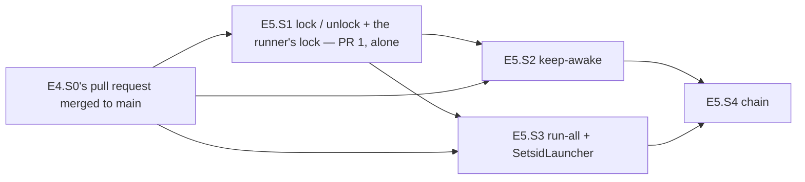

# PLAN — E5 stories: isolation, keep-awake, the detached arms and the chain of the model-arms module

> Status: **BUILT 2026-11-01 on `feat/model-arms-e5` (E5.S1–E5.S4, each through an Opus review and the coai code gate; ModelArms suite 1787, 0 failed); pull requests not opened (the repository's three-open cap — the owner's); Windows, macOS and FreeBSD unobserved.** Stories written 2026-10-31. Epic E5 of [PLAN_model_arms.md](PLAN_model_arms.md) (§3 D10–D13,
> D16, D17 (c)/(d), D26, D27; §4.7, §4.8, §4.11; §6 step 5; §7's E5 tests; §9; §10), written at `f0d6868` on `feat/model-arms-e5`
> (E1–E3 on `main`, E4 not built) by the judge role (Opus), as the epic starts — `common.plan-change-control` § *What counts as a
> change*: writing them is not a change. The parent's epoch 3 holds ONE entry (3.1); a second accepted change stops the plan, so every
> claim of the parent found wrong or incomplete against the code is LISTED in §8 (items 24–32; the E5.S1 amendment's items 33–44 and the E5.S4 amendment's items 45–54 settle inside the parent's words) for the parent's next change and not
> edited there. **No cornerstone** (the parent's ledger is `3 of 3`, spent). **E5.S1 is a security judgement (D11): its scenarios and
> brief are Fable's, written 2026-10-31** — its section lists the questions that spec must settle; E5.S2–E5.S4 are specified here in full.
> **Two pull requests** (parent §6 step 5): E5.S1 alone, merged to `main` first — opened after E4.S0's pull request has merged, because
> this branch was based on E4's and carries E4.S0 (`aa1347c`, §8 item 52); then E5.S2–E5.S4, branched from a `main` that carries E5.S1
> and E4.S0. **E5.S4 amended 2026-10-31** (the plan gate, an Opus review, consultation 5.4; by the judge, Opus): the run's own lock, a
> just-started arm awaited under a 60 s startup ceiling, the bounded exit wait before every `Start`, bounded waits that sleep what remains,
> a ceiling on `WaitFor`, and line references re-opened at `232c7f1`.
>
> Scope: `lock <run>` / `unlock [--force]` over E3.S4's read side, the runner's own lock and pid (E5.S1); the host kept awake for a
> scope (E5.S2); `run-all`, the arms started detached by the operating system's redirection, the gate lock's queue refusal (E5.S3);
> `chain <run>` with the per-run markers, the reconciliation of `locked` with the snapshot and the failure path that leaves the isolation
> applied (E5.S4). Tests under `tests/Bench.Tests/ModelArms/`, `research/module_model_arms.md`, the `lock`, `unlock`, `run-all` and
> `chain` rows of `research/module_tests.md`.

## 1. Goal, before any solution

E3 left the unattended half of the shell harness unported. Four things are missing, each named by `Program.cs:86-90` as *not built yet*:

- **No folder is closed while the arms run.** The shell closed the old experiment (000) and made the arm folders, `pids/` and Claude
  Code's own folders unlistable (300) for the whole run (`/home/jinx/git/coai-exp2/lock.sh:12-19`); part 7 also closed every part-6
  result an arm could learn from (`after7.sh:41-43`). The module reads the snapshot (E3.S4, `LockSnapshot.cs`, `IsolationFiles.cs`)
  and nothing writes it. The shell's own `lock` had three defects the port must not copy: a second `lock` over a standing snapshot
  failed instead of answering for the run (`lock.sh:6`), a path that did not exist left a half-written snapshot and the unlisted
  folders open (`lock.sh:10-11`, `stat` then `chmod … &&`), and nothing checked that a mode did anything (measured §2 M-8: on the
  Windows drive a `chmod 300` is ignored and the folder stays listable).
- **Nothing knows whether an arm is running.** The shell wrote the LAUNCHER's pid (`run-all.sh:7-8`); a launcher's pid is `setsid`'s,
  which forks when its caller leads a process group (measured, M-2), and a kill between the spawn and the pid write left a live runner
  nobody saw — a second `run-all` started a second runner of the same arm on the same clone (parent D13). `status` and `checks` already
  read `pids/<arm>.pid` as a decimal pid (`RunnerPid.cs:9-10`, `ArmReport.cs:52-61`, `ChecksAdmission.cs:106-121`) and nothing writes it.
- **The host sleeps and the arms die with the session.** The shell held a Windows keep-awake from WSL and relaunched it every two
  minutes (`after6.sh:14-23`), and detached every runner with `setsid nohup … >> pids/<arm>.log 2>&1 < /dev/null &`
  (`run-all.sh:7`) — three crashes taught it (`research/local-model-coding/harness.md` §4).
- **No chain.** `after6.sh` / `after7.sh` made, locked, ran the rounds, unlocked and checked, with markers per stage; the port makes
  the run a configured name (D27) and must never unlock beside a live arm or run an arm without its isolation (parent §4.7).

What must survive unchanged: the files the analysis and the operator read — `pids/<arm>.pid` in the format `RunnerPid.Parse` reads,
`pids/<arm>.log`, `chain/<run>/locked|unlocked|arms-done`, `chain/made-<arm>`, `chain/objective-<arm>`, `.locked-modes` in the shape
`LockSnapshots.State` parses — and the shell's order of stages.

## 2. What exists — verified at `f0d6868`, 2026-10-31

Every line below was opened in this worktree; the shell by exact path the same day (read-only; `after6.sh`, `after7.sh`, `run-all.sh` and
`lock.sh` match the parent's §2 sums: `097b5592…`, `12199719…`, `dacc74d2…`, `531be3e8…`).

| Fact | Where |
|---|---|
| `lock`, `unlock`, `run-all`, `chain` print *not built yet* with E5.S1, E5.S1, E5.S3, E5.S4; the helper and its test | `ModelArms/Program.cs:86-90`, `:100-104`; `tests/Bench.Tests/ModelArms/ModelArmsProgramTests.cs:47-54` |
| The positional table: `lock` 0, `unlock` 0 (flags `--experiment` only), `run-all` 1..n (with an unspecified `--seconds`), `chain` 0 | `ModelArms.Core/Experiment/ModelArmsCommandLine.cs:26-32`; `ModelArmsCommandLineTests.cs:18-25`, `:109`, `:123-138` |
| The root's spellings: `PidFile`, `PidLog`, `Made`, `ObjectiveMarker`, `Executables`, `GateLock`, `LockedModes`, `LockedModesApplied`, `RunMarker(run, RunStage)`, `LockLog`, `LockedModesRestored(stamp)`, `KeepAwakeLog`; the root-level `Locked`, `Unlocked`, `ArmsDone` (E1's, before D27) | `ModelArms.Core/Experiment/ArmPaths.cs:26-62`; `:36-42` the three to remove; `:105` `RunStage`; pinned by `ArmPathsTests.cs:37-40`, `:45` |
| No `IsolationLock`, `RunnerLock`, applied-restored name, `IFolderIsolation`, `IHostAwake`, `IDetachedLauncher`, `IsolationPlan`, `ChainPlan` | `ModelArms.Core/Ports/` holds `IGateLock.cs`, `ISessionTranscripts.cs`, `ITargetTools.cs` only; `ModelArms.Core/Isolation/` holds `LockSnapshot.cs` only |
| The snapshot's state from its two files: `None`, `Applying(Run, Since)`, `Applied(Run, Since)`, `Inconsistent(Reason)`; the digest is parsed privately and compared, never exposed | `ModelArms.Core/Isolation/LockSnapshot.cs:8-21`, `:32-34`, `:53-56`; the line every other verb prints `:77-86` |
| Both files read by name through the bounded road (1 MiB), non-UTF-8 refused | `ModelArms/Adapters/IsolationFiles.cs:10-43`; printed by `Status.cs:68`, `Make.cs:78`, `ChecksAdmission.cs:94` |
| The reader's fixture shape: `{"run","digest","since","modes":[{"path","mode"}]}` and `{"run","digest","verifiedAt"}` | `tests/Bench.Tests/ModelArms/LockSnapshotTests.cs:16-17` |
| The pid file read as digits only, then `WorkerLiveness` (refused counts as alive); 64-byte limit; *nothing writes a pid file until E5.S3* (the doc) | `ModelArms/Verbs/RunnerPid.cs:5-10`; `ArmReport.cs:15`, `:49-61`; `ChecksAdmission.cs:32`, `:106-121`; `src/Bench.Infrastructure/Process/WorkerLiveness.cs:25-45` |
| The file lock: `Take(path, create, note)` → `Held · Busy · Absent · Refused · Unread`; `TryAcquire` = `Take(create: true, note: true)`; close-on-exec; the honoured-lock check; `gate-lock status` probes with `Take(create: false, note: false)` and releases | `ModelArms/Adapters/FileGateLock.cs:123-142`, `:35-38`, `:249-273`; `GateLockAnswer.cs:6-21`; `Verbs/GateLock.cs:38-56` |
| A holder's note `<lock>.holder` (pid, kernel start ticks, start second, since) written after the lock, removed before release; believed only for a live pid with the recorded start | `ModelArms/Adapters/GateHolderNote.cs:9-23`, `:73-91`, `:148-160` |
| The gate lock's ceiling per arm from the largest round of the run naming it (map count when none) | `ModelArms.Core/Steps/GateLockCeiling.cs:23-37`; `Verbs/RunArmWalk.cs:41-49` |
| An arm is in at most one round of one run; `closedArms` are earlier runs' arms | `ModelArms.Core/Experiment/RunSection.cs:79-104` |
| `run-arm`'s admission: scheme (`allowTasks: false`), map, PATH/HOME, `claude`, `git`, scenarios; the walk; `arm-done` once | `Verbs/RunArmAdmission.cs:30-42`, `:63-71`; `RunArm.cs:36-61`; `RunArmWalk.cs:79-87`; `ArmChoices.cs:10-28` (reads `Positionals[0]` at `:13`) |
| `make` makes the arms of EVERY run without a marker and writes `chain/made-<arm>` itself; `checks` writes `chain/objective-<arm>` itself | `Verbs/Make.cs:84-99` (`RunArms.Of(input.Experiment.Runs)` at `:87`); `Adapters/ArmMaker.cs:214`; `Verbs/ChecksReport.cs:110` |
| Whether an arm finished: an `arm-done` line after the last `start` or `gate-wait` | `ModelArms.Core/Steps/TimingLine.cs:67-68` |
| The requirements: `lock`/`unlock` need the root and `experiment.json`; `chain` needs `make`'s; positionals count as arms only for `run-arm`, `run-all`, `checks` | `ModelArms.Core/Experiment/RootRequirements.cs:39-41`; `ExperimentGate.cs:136-137`; `RootRequirementsTests.cs:26-32`, `:63` |
| The isolation facts: `closed`, `unlisted`, `<root>` and `~` expanded; `awake` `auto · windows · wsl · none`; host kinds `Windows · Wsl · OtherPosix`; validate's awake sentences; `pwsh.exe` needed when the awake keeper uses it | `ExperimentFacts.cs:11`, `:61`, `:74-79`; `ExperimentFile.cs:168-188`; `HostChecks.cs:8`, `:14-17`, `:85`, `:102`, `:124-125`, `:176-189`; `Adapters/HostFactsReader.cs:28`, `:81-91` |
| The worked example: `unlisted` = `<root>`, `<root>/r`, `<root>/pids`, four `~/.claude/*`; part 7 closes part 6's nine arms and `<root>/chain/part6`; limits | `tools/model-arms/examples/part6.experiment.json:60-65`, `:78-79` |
| Staged-then-renamed writes by name (`Replace`, private 0600 variant); `WriteFileOnce` lists the folder on its failure path | `Adapters/ArmFiles.cs:91-128`; `:67-88` (`Directory.EnumerateFiles` at `:84`) |
| Commit once, never overwrite | `src/Bench.Infrastructure/Gate/ArtifactCommit.cs:24-49` |
| The held child: stdin, stdout and stderr redirected (stdin kept open), stderr to a file created `CreateNew`, stop = close stdin, 5 s, tree kill | `src/Bench.Infrastructure/Process/ProcessSession.cs:85-129` (`:115`), `:153-200` |
| The module's P/Invokes name `libc` / `kernel32.dll` through `DllImport` | `Adapters/RealPath.cs:105-115`; `KernelFacts.cs:247-256` |
| The bare-name scan matches `GitCommand.`, a literal to `ProcessRunner`, `Process.Start(`, `new ProcessStartInfo`; the pure list's `// E5` marker | `tests/Bench.Tests/ModelArms/ModelArmsArchitectureTests.cs:186-191`, `:203-206`, `:93` |
| `status`' no-listing scan reads `Status.cs`, `ArmReport.cs`, `IsolationFiles.cs` | `StatusVerbTests.cs:180-182` |
| Content beside the binary: briefs and examples by glob; `ModuleFiles` names the example and the briefs | `ModelArms/ModelArms.csproj` (`<Content Include="..\briefs\*.template.md" …>`); `VerbInput.cs:6-10` |
| Test kit: the root with `HOME` under the temp folder; an arm by hand with the fake as `claude`; the console binary beside the test assembly; a second process; a non-runner lock holder; the temp folder restores owner access before deleting | `ExperimentRoot.cs:42-55`, `:101-129`, `:181`; `ModelArmsBinary.cs:14-55`; `tests/GateHolder/Program.cs:1-26`; `TempFolder.cs:5-7` |
| The fake: script from `FAKE_CLI_SCRIPT` (else `<temp>/bench-fake-cli/<model>/`), a call without `--model` is `nomodel`; it reads stdin to its end BEFORE it records the call; `hang` sleeps forever | `tests/FakeCli/Program.cs:20-31`, `:165-172`, `:232-236`, `:677-705` |
| The keep-awake scripts (the shell's, parts 1–5) | `research/local-model-coding/harness/windows/keep-awake.ps1:1-6` (holds `0x80000003` for 14400 s, releases in `finally`), `check-keep-awake.ps1`, `stop-keep-awake.ps1` |
| The rows waiting for E5 | `research/module_tests.md:110-111`, `:113-114`; `:117` (*invisible to the catalogue test until E5.S3*) |

**The shell, the behaviour to port** (read 2026-10-31): `after6.sh:26-37` makes every arm before the lock; `:38` `lock.sh lock >>
lock.log` or exit 4, then `chain/locked`; `:39-46` per round: start each arm not done and not alive, then wait 60 s per tick until
each is done, an arm not alive and not done → *arm <a> stopped without finishing — resume it (run-all.sh <a>), then start me again*, exit
2; `:47` `lock.sh unlock >> lock.log`, then `chain/unlocked`; `:48-52` `objective-checks.sh` per arm, the marker whatever it printed;
`:53-55` the keep-awake stopped and `chain/arms-done` LAST. `after7.sh` is the same for one round under `chain7/` with `EXTRA_CLOSED`
(`:39-43`). `run-all.sh:5-8`: alive = `kill -0` of the pid file; `setsid nohup run-arm.sh <a> >> pids/<a>.log 2>&1 < /dev/null &`, then
`$!` into the pid file. `lock.sh:12-19`: closed then unlisted, `stat -c '%a\t%n'` into `.locked-modes`, `chmod 000` / `chmod 300`;
unlock restores in reverse (`tac`) and renames `.locked-modes.restored-<utc>`.

**Measured while writing these stories** (2026-10-31, this host: WSL2 kernel 6.18.54.1, x86_64, glibc 2.43, util-linux 2.41.3, .NET
10.0.14, uid 1000 with `CapEff 0`; scratch folders outside every checkout, removed after):

| # | Observation |
|---|---|
| M-1 | `setsid` started by a .NET `Process.Start` (`dotnet run probe.cs`): the child does not lead a group, **setsid does not fork** — child pid 3152743, the inner shell's `$$` 3152743, its pgid then 3152743 |
| M-2 | `setsid` started as the leader of its own group (Python `Popen(process_group=0)`): **setsid forks** — launcher child 3152296, inner 3152297, the inner's parent pid 825 (`/init`); setsid exits 0 at once |
| M-3 | libc `posix_spawn` of `/usr/bin/setsid` with file actions `open(0, /dev/null, O_RDONLY)`, `open(1, <log>, O_WRONLY\|O_APPEND\|O_CREAT\|O_NOFOLLOW, 0600)`, `dup2(1, 2)`: in the child fd 0 → `/dev/null`, fds 1 and 2 → the log, `sid` = its pid, the log created at mode 600. **Without** `POSIX_SPAWN_SETSIGDEF`/`SETSIGMASK` the child's `SigIgn` is `0x1001000` (SIGPIPE and SIGXFSZ ignored, inherited from the launcher across `exec`); with every catchable signal 1–31 defaulted and an empty mask, `SigIgn 0`, `SigBlk 0` |
| M-4 | the same with `POSIX_SPAWN_SETPGROUP` (group 0): `waitpid` reaps setsid after 0.002 s with status 0, and the program it ran has parent pid 825 — **not a child of the launcher** |
| M-5 | `sizeof(sigset_t)` 128, `posix_spawnattr_t` 336, `posix_spawn_file_actions_t` 80 (gcc on this host); `/usr/include/spawn.h:54-63`: `SETPGROUP 0x02`, `SETSIGDEF 0x04`, `SETSIGMASK 0x08`, `SETSID 0x80`; `posix_spawn_file_actions_addchdir_np` declared (`:206`); `O_WRONLY 0x1`, `O_CREAT 0x40`, `O_APPEND 0x400`, `O_NOFOLLOW 0x20000`, `O_CLOEXEC 0x80000`; `SIGKILL 9`, `SIGSTOP 19`, `SIGPIPE 13` |
| M-6 | `/proc/<pid>/cmdline` of a .NET app is the argv its `exec` was given: by the apphost's absolute path `…/cmd \| run-arm \| C1 \| --experiment \| /x` (`Environment.ProcessPath` = that path); through a link `./cmdlink \| run-arm \| C1` (`ProcessPath` = the REAL apphost); through `dotnet cmd.dll` → `dotnet \| …/cmd.dll \| run-arm \| C1` (`ProcessPath` = `/usr/lib/dotnet/dotnet`) |
| M-7 | as uid 1000 on tmpfs (`/tmp`; `/home` is ext4): a folder at 300 — `ls` *Permission denied*, a file opened by name reads, a file created by name is created; at 000 — a child cannot be read, `stat`-ed or `chmod`-ed (*Permission denied*) |
| M-8 | on the Windows drive (`/mnt/c`, `9p`, `aname=drvfs`, no `metadata`): `chmod 300` of a folder is silently ignored — its mode reads 777 and `ls` lists it |
| M-9 | `pwsh.exe` = `/mnt/c/Users/strug/AppData/Local/Microsoft/WindowsApps/pwsh.exe`, `realpath` itself, a regular file of 2 bytes, mode 555; `pwsh.exe -NoProfile -ExecutionPolicy Bypass -File \\wsl.localhost\Ubuntu\<path>\probe.ps1` prints and exits 0; started under `env -i` (no variable at all) it runs; `WSL_DISTRO_NAME=Ubuntu`, `WSL_INTEROP=/run/WSL/825_interop` |
| M-10 | SIGTERM and SIGKILL of the WSL-side process of a `pwsh.exe` that sleeps 90 s (as a direct child, and under `setsid`) end the WINDOWS process within 4 s (`tasklist /FI "PID eq …"`: 1 → 0). In one earlier probe that signalled several pids at once the WSL side ended and the Windows `pwsh` kept running past its own 90 s sleep until `taskkill` — a Windows keep-awake can outlive its relay; `keep-awake.ps1` bounds itself at 14400 s (`:6`) |

## 3. Conventions every story follows

E1 §3–E4 §3 hold unchanged (namespaces; pure means pure; refusals as values; red first on an ASSERTION; docs per story; time through
`TimeProvider`; no tokens in output; the commands). For E5:

- **The pure list and the module doc.** E5.S1 replaces the `// E5` marker (`ModelArmsArchitectureTests.cs:100` at `232c7f1`, §8 item 53) by four, `// E5.S1` …
  `// E5.S4`, one per line with a blank line between, and adds four empty headings at the end of `research/module_model_arms.md`:
  *Isolation, lock and unlock, the runner's lock (E5.S1)*, *Keep-awake (E5.S2)*, *run-all and the detached arms (E5.S3)*, *chain (E5.S4)*.
  Every later story writes only under its own (E4 already split `// E4` into `// E4.S0`…`// E4.S3`, `:91-98`; the two never touch each other's lines).
- **By name, never a listing.** Every new verb and adapter opens and creates by NAME; while the isolation stands the root, `r/` and
  `pids/` are at 300 (F0). Each story adds its new files to the list of
  `StatusVerbTests.The_verbs_source_holds_no_way_to_list_a_folder_and_the_scan_still_finds_one_where_one_lives` (`:182`). A write of
  the root's or `pids/`' files goes through `ArmFiles.ReplaceFile` (E5.S1's static; `Replace` is an instance member) / `ReplacePrivate` (stage, rename, by name) or `ArtifactCommit`, never
  `ArmFiles.WriteFileOnce`, whose failure path lists the folder (`ArmFiles.cs:84`, §8 item 22).
- **Liveness is the runner's lock.** Every new code that asks whether an arm runs asks `RunnerLiveness` (C21), never a pid;
  `status` and `checks` keep E3's pid reading unedited (parent §9).
- **The isolation is left as it stands on every exit but the chain's `Unlock`.** No E5 code outside `lock`/`unlock` changes a mode or
  renames a snapshot file; no E5 code stops a runner.
- **D26 per adapter.** The reviews of `PosixFolderIsolation` (S1), `WslHostAwake` (S2) and `SetsidLauncher` (S3) name which of (a)–(f)
  they checked (the parent's DoD).
- **Exit codes (D16) for E5:** 0 done (also *already locked for <run>*, *no isolation configured*, *nothing locked*, *already
  running*); 3 the host (a lock or a mode the host could not set or verify, `setsid`/`pwsh.exe` absent, a detached start that failed, a
  host whose launch constants were not measured); 4 configuration (an unknown run or arm, another run's snapshot, an inconsistent one, a
  held runner lock, the queue refusal, a marker over a snapshot it does not match, a link where a file must be); 5 stopped, resumable (an
  arm died, an arm still alive at the end of the wait, an arm of another run alive, `unlock` refused at the chain's stage, the operator's stop).
- **Commands.** `node .agents/conventions/tools/low-priority.mjs dotnet build dew_flow_benchmark.slnx -c Release -m:4`, then
  `node .agents/conventions/tools/low-priority.mjs ./tests/Bench.Tests/bin/Release/net10.0/Bench.Tests --filter-class "*<Class>"` per
  class named in the story, `--filter-namespace "Bench.Tests.ModelArms"`, and the whole suite once per story; `node
  .agents/conventions/tools/plan-lifecycle.mjs`. The live tests are Linux only (E5.S3's x86-64 only), skipped elsewhere with the reason.

## 4. Shared contracts (fixed here so the second pull request can be specified against the first)

E5.S1's Fable spec may ADD members to C21 and C22; it changes none of these without changing E5.S3's and E5.S4's sections.

**C21 — the runner's lock and liveness** (E5.S1 implements; E5.S3 and E5.S4 call exactly these):

```csharp
// ModelArms.Core.Experiment, ArmPaths.cs
public string RunnerLock(string arm);                     // RootPaths: <root>/pids/<arm>.lock — never deleted (§4.11)
// ModelArms.Verbs, RunnerLiveness.cs
internal abstract record RunnerState                      // closed
{
    public sealed record Alive(string Holder, int? BelievedPid) : RunnerState;   // the lock is held; Holder = the words after "running": "pid N" when believed, else why not; BelievedPid = N when believed (the spec, E5.S1 question 14)
    public sealed record Gone : RunnerState;                   // the lock is free, or its file absent (nothing created)
    public sealed record Refused(string Reason) : RunnerState; // the lock's path is not a regular file of the root's (D17) → exit 4
    public sealed record Unread(string Reason) : RunnerState;  // the host could not say → exit 3
}
internal static class RunnerLiveness
{
    public static RunnerState Of(RootPaths root, string arm);  // a probe: a lock it gets is released before it returns; writes no file
    public static RunnerState Of(RootPaths root, string arm, PlatformRoad road, FileGateLock gate);   // the same with the road and the lock handed in (the spec)
    public static string PortableLine(PlatformRoad road);      // "" on Linux; else ledger 2.1's one line, printed once by every verb that asks liveness (the spec, question 15)
}
```

**C22 — the isolation's two verbs** (E5.S1 implements; E5.S4 calls):

```csharp
// ModelArms.Core.Isolation
public sealed record Applied(string Run, string Since, string Digest) : LockState;   // LockState.Applied widened (§8 item 24)
public sealed record IsolationPlan(string Run, string Digest /* lower-case hex */, IReadOnlyList<IsolationEntry> Entries);
// ModelArms.Verbs
internal abstract record LockOutcome    { Applied; AlreadyLocked; NoIsolation; Stopped(int ExitCode, string Why) }        // closed
internal abstract record UnlockOutcome  { Restored(int Count); NothingLocked; NoIsolation; RefusedAlive(string Arm); Stopped(int ExitCode, string Why) }
internal static class LockVerb
{
    public static Task<int> RunAsync(ExperimentInput input);                                        // `lock <run>`
    internal static Task<LockOutcome> LockAsync(ExperimentInput input, string run, CancellationToken stopping);
    internal static Passage<IsolationPlan?> PlanOf(ExperimentInput input, string run);              // null = NoIsolation (no block, or Windows)
}
internal static class UnlockVerb
{
    public static Task<int> RunAsync(ExperimentInput input);                                        // `unlock [--force]`
    internal static Task<UnlockOutcome> UnlockAsync(ExperimentInput input, bool force, CancellationToken stopping);
}
```

Neither verb writes a chain marker (D11, gate finding 1). `RunAsync` maps the outcome to its exit code and its one printed line.

**C23 — keep-awake** (E5.S2 implements; E5.S4 calls):

```csharp
// ModelArms.Core.Ports
public interface IHostAwake : IAsyncDisposable { string Describe { get; } }     // started by its factory; disposing ends the scope
// ModelArms.Core.Isolation
public enum AwakeKind { Windows, Wsl, None }
public static class HostAwakeSelection { public static Outcome<AwakeKind> For(AwakeChoice choice, HostKind host); }
// ModelArms.Adapters
internal static class HostAwakes { public static Task<Passage<IHostAwake>> StartAsync(ExperimentInput input, HostKind host, CancellationToken stopping); }
internal static class HostFactsReader { internal static Task<HostKind> HostKindAsync(ExperimentInput input); }   // extracted from :28
```

**C24 — starting arms** (E5.S3 implements; E5.S4 calls):

```csharp
// ModelArms.Core.Ports
public abstract record DetachedStart { public sealed record Started : DetachedStart; public sealed record Failed(int ExitCode, string Why) : DetachedStart; }  // closed
public interface IDetachedLauncher
{
    // executable: a REAL absolute path (D17 d); arguments: argv[1..]; log: appended, created 0600, never through a link;
    // environment: replaced; workingDirectory: chosen. No pid is returned: the runner names itself (D13).
    DetachedStart Start(string executable, IReadOnlyList<string> arguments, string log, IReadOnlyDictionary<string, string> environment, string workingDirectory);
}
// ModelArms.Verbs, RunAll.cs
internal static class RunAllVerb
{
    public static Task<int> RunAsync(ExperimentInput input);                                        // `run-all <arm>…`
    internal static Task<int> StartAsync(ExperimentInput input, IReadOnlyList<string> arms, RunAllSeams seams);   // the verb's body after its own parse
}
```

**C25 — the chain's decision** (E5.S4, pure, `ModelArms.Core.Chain`): the records of E5.S4's section, used by nobody else.

## 5. Stories

### E5.S1 — Isolation: `lock <run>` / `unlock [--force]`, the two-file snapshot, and the runner's own lock and pid (SECURITY JUDGEMENT — spec by Fable, 2026-10-31)

- **Coder:** sonnet · **Spec:** Fable (security judgement, D11 — outside the cornerstone quota, the parent's `## Epics` E5) · **Review:**
  Opus, naming D26 (a)–(f) for `PosixFolderIsolation`, `RuntimeFolderIsolation` and `RunnerLiveness`. **`model:`** fable (scenarios and brief), sonnet (code and
  tests), opus (review). **Depends on:** E1–E3 (on `main`). **Parallel with:** nothing — **the first pull request, alone**; it may land
  before or after E4.S0 (§6). **Size:** ≈ 3100 lines (≈ 1150 code, 1950 tests) — moved by the spec and its amendment of 2026-10-31 (the plan gate, two risk consultations and an Opus review): D11's table and the plan are pure records with their own theories, a second adapter for the portable road, the runner's identity takes nine process tests, and a real process death takes a helper project.
- **Owns:** D11 as rewritten (both writers, the exclusive `.isolation.lock` and the runners' SHARED hold of it, the two-file state, `unlock`'s liveness refusal, the
  inconsistent snapshot never read as none, no restore on entry), D27's lock half (`closedArms` through the map, `closed`), D13's runner
  identity (the runner's `pids/<arm>.lock`, its pid in `RunnerPid`'s format, `RunnerLiveness`), F0 and F5 for the writers, E3 §8 item
  32's writer, C21, C22, `<root>/pids` made by name (the one helper `run-all` and `chain` call too), the `lock` and `unlock` rows of `research/module_tests.md`.

**Goal.** Only `lock` and `unlock` ever change a mode; a half-applied lock is recovered by the next `lock` — in a NEW process, whose predecessor's descriptors died with it; a
failed restore never loses the original modes; a run never executes under another run's isolation; the isolation is observed working before it is recorded as applied,
and observed again when a `lock` finds it already applied; `unlock` never restores beside a live arm — ATOMICALLY, so no runner can start between the probe and the
restore; and every verb can tell, from a lock the runner holds for its life, whether an arm is running.

**Scenarios and brief — spec by Fable (2026-10-31; amended the same day after the plan gate, two coai risk consultations and an Opus review — the twelve accepted findings are
written in below, each with its test and its break-it).** Written against `0a1a434` on `feat/model-arms-e5`, every file named below opened in this
worktree the same day (read-only; the rules `common.plan-change-control`, `common.security`, `common.reliability`, `common.platform-limits`,
`common.testing`, `csharp.doctrine` read in full). The parent's §7 names are used verbatim. Three facts about the code shape the spec: (i) the
isolation's READ side is built and is the one reader (`LockSnapshots.State`, `IsolationFiles.State`, `IsolationLine.Of`; `LockSnapshot.cs:36-73`)
— the writer's parser of the saved modes is that reader widened, never a second one; (ii) `FileGateLock.Take(path, create, note)`
(`FileGateLock.cs:123-131`) already answers the five facts a probe and a holder need, with the kernel-fact path check and the honoured-lock
check — both locks of this story consume it, and it is widened by ONE member, the shared take (question 8); (iii) `RunArmSchemeTests.cs:507`, `:567` hand a `BusyGateLock` as `RunArmSeams.Lock`,
so the runner's own lock cannot go through that seam (it is the GATE lock's) or every such test would refuse its runner. Measured for this spec
(2026-10-31, the same host as §2's table, uid 1000, tmpfs, a scratch folder removed after):

| # | Observation |
|---|---|
| S1-1 | `fchmod(2)` on an `O_PATH` descriptor is `EBADF`; `chmod(2)` of `/proc/self/fd/<fd>` (the magic link to the pinned inode) sets the mode of a folder at 300 and at 000 and restores it; `fchmodat2(fd, "", mode, AT_EMPTY_PATH)` (syscall 452, kernel ≥ 6.6) works too, but glibc 2.43 exports no wrapper (`nm -D libc.so.6`: none) |
| S1-2 | `open(O_PATH\|O_DIRECTORY\|O_NOFOLLOW)` of a symbolic link to a folder is `ENOTDIR`; `O_PATH\|O_NOFOLLOW` WITHOUT `O_DIRECTORY` opens the link itself (`S_ISLNK` on the descriptor) — the kind must be read from the descriptor (`statx` with `AT_EMPTY_PATH`, `KernelFacts.ReadOpen`) and a link refused there |
| S1-3 | at 300: `open(O_RDONLY\|O_DIRECTORY)` is `EACCES` (the open `readdir` needs), a child is read, `stat`-ed, created and renamed by name, and a child's mode is set; `O_PATH` opens it and `fstat` reports 300 |
| S1-4 | at 000: `open(O_RDONLY\|O_DIRECTORY)` `EACCES`, a child cannot be `stat`-ed or `chmod`-ed (`EACCES`), `faccessat(X_OK, AT_EACCESS)` `EACCES`; `O_PATH` opens it; a FILE at 000 refuses `open(O_RDONLY)` with `EACCES` and opens `O_PATH` |
| S1-5 | `O_PATH 0x200000`, `O_DIRECTORY 0x10000`, `O_NOFOLLOW 0x20000`, `O_CLOEXEC 0x80000`, `AT_EACCESS 0x200`, `X_OK 1` (x86-64; `KernelFacts.cs:19-24` holds `O_NOFOLLOW`/`O_CLOEXEC` and says aarch64 differs); `sizeof(mode_t)` 4; `/mnt/c` is `9p … aname=drvfs` on this host (M-8's file system) |
| S1-6 | **.NET's share mode → `flock` on Linux** (SDK 10.0.114, the amendment's probe): a `FileStream` opened `FileAccess.Read`, `FileShare.Read` holds `FLOCK ADVISORY READ` in `/proc/locks` — `LOCK_SH`; a second open of the file with `FileShare.None` (the runtime's `LOCK_EX \| LOCK_NB`) then throws `IOException` with `HResult 0xb` (`EWOULDBLOCK`, the code `FileGateLock`'s probe measures), and a second `FileShare.Read` open succeeds beside the first. `flock` locks belong to the open file description, so the in-process second open answers the cross-process question too (the class doc's `flock(1)` pairs). Read-only access matters: the runtime skips `LOCK_SH` for a WRITE handle on a network file system (`nfs`, `smb`, `cifs` — its source), never for a read handle |

**The twenty questions, settled.**

1. **The plan.** `IsolationPlans.From(config, run, map, root, neverClosed)` (Core, pure, `Outcome<IsolationPlan>`). Entries in this order —
   the shell's (`lock.sh:12-14`) with the run's set between the configured closed and the unlisted: (i) `isolation.closed[i]` as Closed; (ii)
   `runs.<run>.closedArms[i]` as Closed, each resolved through the map to `RootPaths.Arm(token).Folder` — an arm the map lacks is REFUSED
   (`runs.part7.closedArms[0] names 'C1', which arms.map.json does not hold — it was never made; make it, or remove it from closedArms`), never
   skipped: a closure the operator wrote and the module ignored would be a silent lie; (iii) `runs.<run>.closed[i]` as Closed; (iv)
   `isolation.unlisted[i]` as Unlisted. Every path is fully qualified already (`ExperimentFile.Expand` refuses the rest, `:186-194`) and is
   normalised by `Path.GetFullPath` with a trailing separator trimmed; a NUL is refused. Then, the first problem ending `From`, each naming its
   entry: a path named twice (ordinal after normalisation); an entry INSIDE a Closed entry, whichever is written first (S1-4: a child of a 000
   folder cannot have its mode set, so the pair's second `chmod` fails half-way and `unlock` could not restore it either) — a child of an
   UNLISTED entry is fine (`<root>`, `<root>/r`, `<root>/pids` is the shell's own set, S1-3); a Closed entry that IS or CONTAINS one of
   `neverClosed` — the root, the home folder (`ExperimentGate.Home`), `target.source` and every arm of THIS run the map holds: closing them would
   stop the run itself. Kinds: Closed may be a file or a folder (part 7 closed `coai-findings.json` and `PROTOCOL.md`, `after7.sh:41-42`);
   Unlisted must be a folder (300 on a file means nothing). Kinds, existence and links are the ADAPTER's facts (question 3), read before
   anything is written: an absent entry is a refusal (`<path> does not exist — named by isolation.unlisted[3]`), never a partial snapshot (the
   shell's defect, §1) — with ONE exception, the module's own folder: an absent `<root>/pids` is MADE by name before the pin, through the same
   helper the runner uses (question 12: `RootFolders.Pids`), because nothing before the first `run-arm` creates it and a lock before the first
   run is the chain's order; a `<root>/pids` that is a link or a regular file is still a refusal (4). The plan is EMPTY (→ `NoIsolation`) when it has no entry at all: no `isolation` block AND the run has neither
   `closedArms` nor `closed`; a run with closures but no block is locked (§8 item 33).
2. **The digest.** `IsolationPlans.DigestOf(entries)`: SHA-256 over the UTF-8 bytes of one line per entry in plan order, `<kind>\t<path>\n`,
   kind `closed` or `unlisted`, the normalised path; written as 64 lower-case hex characters (`Convert.ToHexStringLower`). The snapshot and the
   applied file carry it; `LockState.Applied.Digest` is the applied file's (equal to the snapshot's by `LockSnapshots.Joined`); E5.S4 and the
   runner (question 20) compare with `string.Equals(a, b, StringComparison.Ordinal)`.
3. **The path facts and the window (D26 a) — the kernel road.** The adapter PINS every entry before the snapshot is written: `open(path, O_PATH|O_NOFOLLOW|O_CLOEXEC
   [| O_DIRECTORY for Unlisted])` through its own P/Invoke (S1-5's constants; `DllImport("libc")` as `KernelFacts.cs:247-256`), then
   `KernelFacts.ReadOpen(fd, path)` for the kind, the 12 permission bits, the device and the inode — a link (S1-2), a FIFO, a device, a file where
   a folder is needed, `ENOENT`, `ELOOP`, `ENOTDIR` are refusals (4) naming the path and its configuration entry; `RealPath.Of(path)` must equal
   the path, else `<path> is reached through a link (its real path is <real>) — name the real path` (4): the leaf is pinned by the descriptor,
   the ancestors by that comparison. The descriptors stay open from the pin through the apply and every mode is set THROUGH its descriptor —
   `chmod("/proc/self/fd/<fd>", mode)` (S1-1: `fchmod` is `EBADF` on `O_PATH`; one road, measured, the one systemd's `fchmod_opath` takes) — so
   no path is resolved a second time between the check and the change: a link planted at the leaf after the pin changes nothing it points at
   (break-it 3). The residuals, in the class doc: an ancestor swapped between `RealPath.Of` and the open is followed by the open — only the
   operator can write the root or `$HOME` (D17); `/proc` absent (a container) makes every chmod `ENOENT` → exit 3 naming `/proc/self/fd`; and the
   same-user residuals of question 7 (the root at 300 still lets this user create, rename and unlink by NAME under it — a forged or replaced
   `.locked-modes`, a renamed entry — the class the parent's §9 names: an access constraint, not a boundary against a same-user process).
   **The roads.** `ReadOpen` is `statx` and the open flags are x86-64's, so `PosixFolderIsolation` is constructed only on `PlatformRoad { Trust: Kernel,
   Bounded: Kernel }` (Linux x86-64 with `statx`, `PlatformRoads.cs:52`). **Every other POSIX road takes the runtime road** — `RuntimeFolderIsolation`,
   question 19 (ledger 2.1: the parent's §10 forbids a verb exiting 3 on a POSIX host for want of a kernel reader; the earlier reading of this
   spec, exit 3 with a platform's name, is withdrawn — §8 item 34). Windows: `NoIsolation`, exit 0 (D11's words).
4. **The snapshot's shape and durability.** `.locked-modes` = `{"run":"part7","digest":"<64 hex>","since":"2026-10-31T10:00:00Z","modes":[{"path":"/x","kind":"closed","mode":"755","dev":64769,"ino":1234567}, …]}`
   + `\n` (`SnapshotFiles.Snapshot`, Core): `mode` is the 12 permission bits as octal text without a leading zero — `stat -c %a`'s spelling:
   `755`, `2755`, `0`; `dev` is `FileIdentity.Device` (`major << 32 | minor`, `KernelFacts.Decode`) and `ino` the inode, both to tell a folder
   replaced before `unlock` (question 7) — **both ABSENT on the runtime road** (question 19: `SavedMode.Identity` is `null` there and the two members are not written; the
   reader tolerates their absence and refuses one without the other). `.locked-modes.applied` = `{"run","digest","verifiedAt"}` + `\n`. Times are
   `yyyy-MM-dd'T'HH:mm:ss'Z'` to the second (the reader's fixture `LockSnapshotTests.cs:16-17`, `GateHolderNote.Utc`). The reader is the built
   one, widened: `LockSnapshots.Saved(string json) → Outcome<SavedSnapshot>` parses `modes` too and `Parsed` (`LockSnapshot.cs:60-63`) is
   rewritten over it — ONE reader (parent §4.8); `JsonRow` tolerates the members it is not asked for (the E3 fixture already carries `modes`).
   Written through `ArtifactCommit.Stage` (stage, `Flush(flushToDisk: true)`, `File.Move(overwrite: false)`): durable against the DEATH OF THE
   PROCESS before the first mode changes — the threat D11 names (a `lock` killed half-way); a power loss between the rename and the journal
   commit is the file system's ordering, not claimed and said in the class doc (no directory `fsync`: nothing in the repository does one and
   the design names no such threat). **A standing `.locked-modes` is never written over** (finding 2): every road that writes a snapshot first decided
   the state was `None` under the exclusive lock, and `overwrite: false` is the second guard, not the decision.
5. **The verification — EVERY entry (§8 item 29).** After the apply, each entry by its PATH (what an arm would do): an Unlisted or a Closed
   folder → `open(path, O_RDONLY|O_DIRECTORY|O_NOFOLLOW|O_CLOEXEC)` must fail with `EACCES` — the open a `readdir` needs, so "cannot list" is
   exactly this and no name is enumerated even when the probe succeeds (a descriptor that comes back is closed at once); a Closed folder also
   `faccessat(AT_FDCWD, path, X_OK, AT_EACCESS)` must fail `EACCES`; a Closed file → `open(path, O_RDONLY|O_NOFOLLOW|O_CLOEXEC)` must fail
   `EACCES`. Any other answer — a descriptor (root, `CAP_DAC_OVERRIDE`, a file system that ignores modes, M-8), `ENOENT`, `ELOOP` — is one
   sentence per entry (`<path> is still listable by this user` / `… is still readable by this user` / `… vanished during the lock: <errno
   words>`). Any sentence → every entry rolled back in reverse through the HELD descriptors (question 6's partial-restore rule applies: a roll-back
   that fails for any entry KEEPS `.locked-modes`), `.locked-modes` moved aside only when the roll-back restored every entry,
   exit **3**: `the lock could not be verified — <sentences, "; "-joined> — the modes were restored (running as root, or a file system that
   ignores modes, such as a Windows drive under WSL?)`. `geteuid() == 0` (`KernelFacts.EffectiveUid`; `Environment.IsPrivilegedProcess` on the runtime road) is refused BEFORE anything: exit 3
   `running as root (uid 0): isolation by file modes does nothing for root — run as the operator`; the verification stays the observation for
   every other cause. **The live test's listable 300 folder:** the adapter's `SetMode` seam — `(fd, path, mode) → 0 or an errno` (finding 9: the path rides along so a hand can
   single out `<root>/pids` by NAME; the production chmod ignores it) — a stand-in that returns 0 and changes nothing, drvfs's behaviour — on ONE entry of a set the rest of which is real,
   so the refusal names that one entry and proves every entry is checked; the drvfs folder itself is an opt-in row skipped unless `MODEL_ARMS_DRVFS_SCRATCH` names a writable folder on a `9p` mount (no test writes
   the operator's Windows drive on its own — `common.test-leftovers`).
6. **`lock` over each state** (`LockDecision.Of(state, plan, snapshotText)`, Core, a theory). `None` → `Fresh`. `Applying`, for ANY run →
   `Recover(saved)`: the saved modes restored in reverse — **pinned ANEW in this process** (finding 1: the killed `lock`'s descriptors died with it; `Restore`,
   question 7, re-pins each saved path, judges kind and identity, and skips what is gone, replaced or a link, saying so) — then, ONLY when every entry was restored or
   harmlessly already at its saved mode, the old snapshot moved aside and `Fresh`; a restore with ANY failed or unresolved entry (question 7's words) ends the verb at exit 3 with the
   old `.locked-modes` KEPT and no fresh snapshot written (finding 2: `a lock was interrupted (snapshot of <run'> since <since>) — restored <k> of <n> — <sentences> — the snapshot is
   kept; restore by hand, or run lock <run> again`); an `Applying` whose `modes` do not parse → `RefuseInconsistent`. `Applied` of the same run and
   digest → `AlreadyLocked(since)` — **re-verified, never claimed** (finding 4): `Verify(plan)` by path as question 5; no sentence → exit 0, `already locked for part6 since
   <verifiedAt>`, nothing pinned or written; sentences → the open entries are re-pinned (kind and identity must equal the saved entry's, else exit 4 naming the replaced entry
   and asking for `unlock`), the LOCKED mode re-applied through the descriptors to those entries alone (the standing snapshot stays the authority: no new snapshot, no new
   applied file), verified again — clean → exit 0, `already locked for part6 since <verifiedAt> — re-applied <k> entries that were open (<paths>)`; still open → exit 3,
   `already locked for part6 since <verifiedAt>, but <sentences> — re-applied and still not verified`, the modes left as re-applied (the operator's state was already "locked").
   `Applied` of another run OR another digest → exit 4, `locked for <run'> with a different closed set — unlock first` (D11's words for both). `Inconsistent` → exit 4,
   `isolation snapshot inconsistent — <reason> — run unlock (when .locked-modes does not parse, restore the modes by hand and move it aside)`, no
   mode touched. `Fresh` prints `locked — closed <n>, unlisted <m>, verified at <utc>`; `Recover` prints first `a lock was interrupted (snapshot of
   <run'> since <since>) — restored <k> of <n>, now locking afresh`.
7. **`unlock`** (`UnlockDecision.Of(state, snapshotText, appliedText)`). `None` → `Nothing`: exit 0, `nothing locked`. `Applying`/`Applied`, or an
   `Inconsistent` whose `.locked-modes` `Saved` parses (two runs, two digests) → `Restore(saved, appliedPresent)`. `Inconsistent` with no
   `.locked-modes` and an applied file (present or refused) → `RenameAppliedAlone`: no mode call, exit 0, `nothing to restore —
   .locked-modes.applied stood alone, moved aside`. A `.locked-modes` present but not parsing, or refused (a link, too big, not UTF-8) →
   `Refuse(reason)`: exit 4 naming the file, both files kept, `--force` or not (the operator restores by hand). The order of work: the exclusive
   lock (question 8 — a runner alive holds it shared, so the refusal is immediate) unless `--force`; the decision; the liveness probe of every map arm (question 11) unless `--force`, UNDER the
   exclusive lock, so no runner can start between the probe and the restore (finding 5); the restore in reverse (`IsolationRestoreOrder.Of`) — **`Restore(saved)`, the one road
   the three callers share** (`unlock`, `lock`'s `Recover`, and `lock`'s own roll-back through held descriptors, question 5): each entry pinned anew
   (`O_PATH|O_NOFOLLOW|O_CLOEXEC`, `ReadOpen`), and judged in this order — `ENOENT` → skipped, `<path>: not found by this name — if it was renamed, it may still stand at
   <locked mode> elsewhere; the record is kept in .locked-modes.restored-<utc>` (finding 1: a missing entry means "cannot recover by this name", never "nothing to do");
   a link or another kind → skipped `<path>: a link now — not restored`; another device or inode (kernel road only) → skipped `<path>: replaced since the lock (inode <old> → <new>)
   — its mode is left as it is`; **outside the bound** (finding 11 — a forged `.locked-modes` must not steer this user's `chmod`: an entry is restored only when its path is the root,
   under the root, under `<ExperimentGate.Home>/.claude`, or one of today's `experiment.json` entries for ANY run — `isolation.closed`, `isolation.unlisted`, every run's `closed`,
   every arm folder of the map) → FAILED, `<path>: not under any folder this experiment names — not restored (by hand: chmod <saved> <path>)`; **the operator's own change** (finding 3:
   the current mode is neither the SAVED mode nor the LOCKED mode — 0 for Closed, 300 for Unlisted) → UNRESOLVED, left as it is, `<path>: mode <cur> is neither the saved <saved>
   nor the locked <locked> — changed by hand since the lock; left as it is`; already at the saved mode → restored without a call (a harmless retry, counted);
   else the saved mode through the descriptor, a failure → FAILED `<path>: <errno words>` — and the walk GOES ON to the last entry. `RestoreReport(Restored, Skipped, Unresolved, Failed)`.
   Then: **`Failed` empty** → the renames in D11's order:
   `.locked-modes` → `.locked-modes.restored-<utc>`, then `.locked-modes.applied` → `.locked-modes.applied.restored-<utc>` (a crash between leaves
   the applied file alone — §4.11's shape, renamed aside by the next `unlock`); `<utc>` is `yyyyMMdd'T'HHmmss'Z'` (`RootPaths.LockedModesRestored`'s
   doc) and a name already taken (two cycles in one second) gets `-2`, `-3`, … `-9` through `File.Move(overwrite: false)`;
   `RootPaths.LockedModesAppliedRestored(stamp)` is the new sibling; exit 0, `unlocked — restored <k> of <n>` with ` (skipped: <sentences>)` and ` (unresolved: <sentences>)` when
   not empty — an unresolved entry is the operator's and is REPORTED, not retried. **`Failed` not empty — on all three paths alike (finding 2):** the applied file is moved aside
   (when present), `.locked-modes` is KEPT (the snapshot is the one authority for modes; a kept one is retried; the state reads `applying`, which `lock`
   recovers and `chain` refuses), no fresh snapshot is ever written over it, exit 3: `restored <k> of <n> — <failures> — the applied file was moved aside; run unlock again, or lock <run>`.
   **`--force` (D11's meaning kept — the coordinator's ruling 1, 2026-10-31):** it skips BOTH the exclusive take of `.isolation.lock` and the liveness probe, restores, and prints
   ONE loud line first, on stderr and in `lock.log`: `WARNING: --force skipped the isolation lock and the liveness check — an arm may still be running and lose its
   isolation mid-run; this race is your choice`. Without `--force`, the exclusive non-blocking take IS the refusal (question 8). Nothing else changes under `--force`: the
   decision, the bound, the judgement per entry and the partial-restore rule stand.
8. **`.isolation.lock` — exclusive for the writers, SHARED for every runner (finding 5).** Through `FileGateLock` (`Create(TimeProvider.System, 250 ms)`; locking off or inert → exit 3 with its words).
   **The writers:** `Take(root.IsolationLock, create: true, note: true)` — `FileShare.None`, the holder's note written (`.isolation.lock.holder`, so a refusal names the other writer) —
   ONE try, non-blocking: `Busy` → the map's arms are probed (`RunnerLiveness`, question 11; no map → no arms) — any `Alive` → exit **4**, `.isolation.lock is held shared by a
   running arm (<arm> is alive: <holder>[, …]) — no mode changes while an arm runs; wait for it, or stop it`; none alive → another `lock`/`unlock` has it (its note names it) →
   wait — **the verb's own loop, not `AcquireAnswerAsync`** (finding 9: that method never answers `Busy`, `FileGateLock.cs:156-169`, and its ceiling would arrive as the same
   `OperationCanceledException` as the operator's stop): `Take` once per 250 ms (`seams.Clock`) up to `IsolationSeams.ExclusiveWait` = **60 s** (the parent's test says the first
   WAITS), `stopping.IsCancellationRequested` checked before every try → exit 5 (the stop, said as such), the arms probed again every 5 s of waiting (a runner that started meanwhile
   is 4 at once), the ceiling → exit 3, `.isolation.lock is held <Describe> — another lock or unlock is running; it was not free within 60 s`; `Refused` → 4; `Unread` → 3.
   Released in `finally` before the verb prints its last line.
   **The runners:** `FileGateLock.TakeShared(path)` — the ONE widening of `FileGateLock` this story makes (S1-6 is the measurement it rests on; the alternative, `flock(2)` through a
   new P/Invoke, would be a second lock road beside the runtime's and is not built): the same `GateLockPath.Of` judgement, `FileMode.OpenOrCreate` ⟶ the same
   `CreateNew`-then-`Open` dance as `Take`, `FileAccess.Read`, `FileShare.Read` (S1-6: `LOCK_SH`; read access so a network file system does not silently skip the lock), NO holder
   note (several holders; the note is the exclusive holder's), and the honoured-lock check in the same shape as `Take`'s — a second open of the held file with `FileShare.None`
   must throw the measured conflict code, else both are dropped and the answer is `Unread` (3). Answers: `Held` (the handle), `Busy` (an exclusive holder — a `lock` or `unlock`
   is changing the modes), `Refused`, `Unread`. The runner takes it in admission (question 12) under a 2 s ceiling (`AcquireAnswerAsync`'s loop made generic over the take —
   `AcquireAnswerAsync(path, token, take)`, the existing overload calling it with `Take(create: true, note: true)`) and holds it for its life. On Windows `FileShare.Read` against a
   `FileShare.None` open is the file system's share check — the same answer, documented, NOT observed.
   **Why this closes consultation 5.4's race:** a runner cannot pass admission while a writer holds the exclusive lock, and a writer cannot take it while any runner holds the
   shared one; `unlock`'s probe and restore both happen under the exclusive lock, so "no arm is alive" is true for the whole restore, not for the instant of the probe.
9. **`NoIsolation` and the adapter.** `FolderIsolations.For(road, seams)` chooses by the PLATFORM ROAD ALONE (finding 7): Windows → `NoIsolation("isolation by file modes is POSIX
   only — nothing to lock on Windows")` (D11: `validate` refuses the block there, `lock` says the same without running validate); `Kernel`/`Kernel` → `PosixFolderIsolation`;
   any other POSIX road → `RuntimeFolderIsolation` (question 19). The PLAN decides nothing about the adapter: `lock` answers `NoIsolation("no isolation configured — nothing to lock")`
   itself when the plan is empty, before the adapter is asked anything; `unlock` never computes a plan — a standing snapshot is restored whatever `experiment.json` says now
   (a block removed after a lock must not strand the modes), bounded by question 7; no snapshot → `no isolation configured — nothing to unlock` only when no run has an entry,
   else `nothing locked`, 0. `NoIsolation.Restore` is unreachable with a standing snapshot on a POSIX host (the test `Unlock_restores_a_standing_snapshot_after_the_block_was_removed`).
   Logged once: the verb's one stdout line and one `lock.log` line.
10. **`lock.log`.** Appended by `lock` and `unlock` alone, one line per verb run: `<utc> lock <run>: <the printed line without its "model-arms lock
    <run>: " prefix>` / `<utc> unlock: …`, a refusal as `refused (exit <n>) — <words>`. Opened by name, `FileMode.Append`, only when `new
    FileInfo(path).LinkTarget is null` (a link there: one stderr line, nothing appended; the window between the check and the open is the
    residual, in `LockLog`'s doc — the road E5.S2's keep-awake log takes). A failed append never fails the verb (one stderr line).
11. **`RunnerLiveness.Of(root, arm)`** = `Of(root, arm, PlatformFactsReader.CurrentRoad, FileGateLock.Create(TimeProvider.System, 250 ms))`, a
    `Create` failure being `Unread(reason)`. `Take(root.RunnerLock(arm), create: false, note: false)`: `Busy` → `Alive(holder, believedPid)` (question 14); `Refused` → `Refused` (4);
    `Unread` → `Unread` (3); **`Absent`, or `Held` (the handle disposed at once) → the pid file decides** (finding 11: an unlinked or replaced `pids/<arm>.lock` must not read a
    live runner as gone — the runner holds the OLD inode): a pid file naming a pid BELIEVED by question 14 (Linux: its command line is this arm's runner; the portable road: a live
    pid, the reuse residual printed) → `Alive("pid N — its lock file is gone or replaced (unlinked since it started); believed by its command line", N)`; else → `Gone`.
    It creates nothing and writes nothing (`note: false`). **The race:** a runner starting while a probe momentarily holds its lock would read
    `Busy`, so the runner's acquisition is `AcquireAnswerAsync` under a 2 s ceiling (`RunnerLiveness.RunnerLockWaitMilliseconds`, poll 250 ms;
    `RunArmSeams` gains nothing) — a real holder holds for hours, a probe for microseconds; the ceiling is D13's refusal (4) — it arrives as `OperationCanceledException`
    (finding 9: `AcquireAnswerAsync` never answers `Busy`), and the runner tells it from the operator's stop by `input.Verb.Stopping.IsCancellationRequested`: true → exit 5, else 4.
    `RunnerLiveness.PortableLine(road)`: `""` on `HolderRoad.ProcTicks`, else `runner liveness on <platform>: the lock decides — a pid is NOT
    checked against its command line here, so a pid reused after a reboot can read as a runner's (D13; ledger 2.1)`, printed once by every verb
    that asks liveness (`unlock` here; `run-all` and `chain` when built).
12. **The runner's admission — in this order (findings 5, 6, 10; D13).** `RunArmAdmission`, after `Choose` (a malformed or unknown arm makes no file) and before `Place`, `Equip`
    (PATH, HOME, `claude`, `git`), E4.S0's `git --version` and `CountedAsync` — before any read of the map, any resolution, any git and any write: (a) **`<root>/pids` made by
    name** — `RootFolders.Pids(root)` (`Adapters/RootFolders.cs`, new; the one helper `lock` (question 1), `run-all` (E5.S3 step 4) and `chain` (E5.S4) call): `Directory.CreateDirectory(path,
    UnixFileMode 0700)` then `File.SetUnixFileMode(path, 0700)` as `Init.MakeSubfolder` does (the root's other folders — `Init.cs:37`; off Windows), then `new DirectoryInfo(path).LinkTarget
    is not null` → exit 4 `<root>/pids is a symbolic link — refused (D17)` (`CreateDirectory` succeeds silently through a link to a folder, so the kind is judged AFTER); a regular file
    there → the `IOException` → exit 4 `<root>/pids is a regular file, not a directory`; S1-3: a folder is made by name under a 300 root. (b) **The SHARED `.isolation.lock`**
    (question 8) under the 2 s ceiling (question 11's distinction of the ceiling from the stop): the ceiling → exit 4, `model-arms run-arm <arm>: the isolation is being changed
    (.isolation.lock is held <Describe>) — start the arm once lock or unlock has returned`; `Refused` → 4; `Unread` or a `Create` failure → 3. (c) **`pids/<arm>.lock`** — ALWAYS the real `FileGateLock`, never `RunArmSeams.Lock` (the gate lock's seam —
    `RunArmSchemeTests.cs:507`, `:567` hand a `BusyGateLock`, and a runner asking it would refuse itself) — `Take(path, create: true, note: true)` through `AcquireAnswerAsync` under
    question 11's ceiling: the ceiling → exit 4, `model-arms run-arm <arm>: another runner holds <root>/pids/<arm>.lock — <IGateLock.Describe>` (`by pid N since <utc>` or `(holder
    unknown)`); `Refused` → 4 with its reason; `Unread` or a `Create` failure → 3. (d) The pid file (question 13). (e) `Place` (the map). (f) **The isolation warning** (question 20 — one line, never a refusal).
    Then `Equip`, the floor, the count. **Both handles ride in `ArmPlan`** (new members `IDisposable IsolationHold`, `IDisposable RunnerLock`); `RunArmVerb.RunAsync` disposes both in
    `finally` after the walk (the kernel closes them when the process dies — "for its life"); **and every refusal after (b) releases both before the stop is returned** (finding 10:
    `AdmitAsync` runs (c)–(f), `Equip`, the floor and the count inside one `try` whose refusal path disposes what was taken — a `Passage.Stop` with a lock still held would block the
    operator's retry for the life of a process that is about to exit — tested per refusal, `RunnerIdentityTests`).
13. **The pid file.** Written right after the two locks are held, before `Place`: `ArmFiles.ReplaceFile(root.PidFile(arm),
    Environment.ProcessId.ToString(CultureInfo.InvariantCulture) + "\n")` — a new `public static void ReplaceFile(string path, string text)` =
    `Commit(path, bytes, createMode: null, betweenStagingAndRename: null)`, the instance `Replace` calling it (staged beside, flushed, renamed over;
    never `WriteFileOnce`, §8 item 22). Exactly ASCII digits and one `\n`. KEPT at the end: `status` prints `pid N gone` for a finished arm
    (§4.11's row), `checks` refuses only a live one, and a reused pid reads alive there — the safe direction (parent §9). A failed write is exit 3 (both locks released).
14. **The command-line belief (Linux, `HolderRoad.ProcTicks`).** The pid file through `BoundedFile.Read(root.PidFile(arm), 64, road)` and
    `RunnerPid.Parse`; then `/proc/<pid>/cmdline` read as bytes by name (`FileStream`, at most 64 KiB), split on NUL: believed when some i ≥ 1 has
    `argv[i] == "run-arm"`, `argv[i+1] == <arm>` and `Path.GetFileName(argv[i-1])` is `model-arms`, `model-arms.dll` or `model-arms.exe` (M-6:
    argv[0] is the exec'd spelling — E5.S3's real path, a link's name from the operator's shell, or `dotnet` with the dll at argv[1]; the file
    NAME is what all three share; `/proc/<pid>/exe` is not compared, because under `dotnet model-arms.dll` and in an in-process test it is not
    this binary). `Alive(Holder, BelievedPid)`: believed → `"pid N"`, `N`; a command line that is not the runner's → `"pid N is not this arm's
    runner (its command line is <argv[0..2], Printable, Cut 60>) — read as gone"`, `null`; `/proc/<pid>/cmdline` unreadable (another user, gone) →
    `"pid N not believed — /proc/<pid>/cmdline could not be read: <why>"`, `null`; no pid file → `"no pid file yet — the lock is held
    <Describe>"`, `null`; a pid file refused or holding no pid → `"pid file unreadable — <why>"`, `null`. On the other roads: `"pid N (not checked
    against its command line on <platform>)"`, `N`. **The fixture with teeth (§8 item 27):** `tests/GateHolder` holding `pids/C1.lock` with the fake
    (`hang`) as its child and the FAKE's pid in the pid file: `Alive` with `BelievedPid == null` and the words naming the fake's command line — a
    stub believing any live pid answers the fake's pid.
15. **The portable line** (ledger 2.1): question 11's sentence, printed once on stdout by `unlock` before its first liveness answer, and by
    `run-all` and `chain` when they are built (E5.S3 step 5 and E5.S4 step 2 say so); empty on Linux. The runtime road's own line is question 19's, printed by `lock` and `unlock`.
16. **No other verb changes a mode — two tests**, both in `IsolationRecoveryTests`. `No_verb_but_lock_and_unlock_changes_a_mode_or_restores_a_snapshot`:
    a theory over the verbs × the four states, the verbs DERIVED from `ModelArmsCommandLine.Verbs` minus `init`, `version`, `help`, `gate-lock`,
    `lock`, `unlock` (`validate`, `prep-base`, `make`, `run-arm`, `run-all`, `checks`, `status`, `chain` — the two unbuilt ones prove the same
    thing through their *not built yet* row and join for real when built); each run IN PROCESS through `Program.RunAsync` over an `ExperimentRoot`
    whose two files are written by hand in the reader's shape, their `modes` naming a real temp folder the test set to 300, with an EMPTY
    `PATH` folder so every verb stops at its admission (3 or 4) — **the assertions, UNCONDITIONAL for every row** (finding 12): the exit code is 3 or 4; the folder's mode is 300
    after; both files' bytes are equal before and after; none of the six `.restored-` names exists; and the verb's stdout, when it holds `isolation`, holds `IsolationLine.Of(state)` —
    asserted as `Assert.True(!stdout.Contains("isolation") || stdout.Contains(line))`, a single boolean, never an `if` around an assertion. **Its break-it (finding 12):** a
    `File.SetUnixFileMode(root.Pids, 0755)` planted at `Status.cs`'s entry (before its admission) → the `status` rows red, `Expected 300, but found 755` — red against a planted
    chmod in another verb, so the theory is a control and not a mirror. The companion,
    `The_only_sites_that_set_a_mode_or_move_a_snapshot_are_the_isolation_adapters_and_the_named_builders`: a scan of `tools/model-arms/**/*.cs`
    for `SetUnixFileMode`, `UnixFileMode |=`, `UnixFileMode =`, `"chmod"`, `/proc/self/fd`, `LockedModesRestored(`, `LockedModesAppliedRestored(`
    whose files must equal exactly `PosixFolderIsolation.cs`, `RuntimeFolderIsolation.cs`, `SnapshotAside.cs` (the verbs' one aside helper, question 7's renames) plus the legitimate sites — **today's hits, enumerated by the scan
    before the story (finding 9; `grep -rlE` over the seven spellings on 2026-10-31): `ArmPaths.cs`, `ArmMaker.cs`, `BaseCopy.cs`, `Init.cs`** — and this story's `RootFolders.cs` (question 12's `SetUnixFileMode`);
    and asserts the scan finds `PosixFolderIsolation.cs` (a scan that matches nothing passes forever). `Lock_then_run_arm_leaves_the_experiment_locked` is the behavioural proof for the verb that
    matters.
17. **The command line.** `Fixed("lock", 1, "lock <run>", "exactly one argument, the run", ExperimentFlag)`; `Fixed("unlock", 0, "unlock
    [--force]", "no positional argument", ExperimentFlag, "--force")`. The run is checked by `LockVerb.PlanOf` against `experiment.Runs` → 4,
    `model-arms lock: there is no run <run> — the runs are part6, part7` (the prefix is `input.Verb.Verb`'s, so the chain's call says `chain`).
    `RootRequirements` and `ExperimentGate.ArmsOf` unchanged (§8 item 26: a run is not an arm).
18. **Merging with E4.S0.** E4.S0 adds `FloorAsync` between `Equip` and `CountedAsync`; this story's locks sit between `Choose` and `Place`.
    Whichever lands second rebases and keeps that order; `RunArmAdmission`'s class doc says it: *the runner's two locks are the first thing after the
    arm's name is known; nothing — the map, PATH, git — is read before them, and every refusal after them releases them*.
19. **The runtime road — `RuntimeFolderIsolation` (finding 8; ledger 2.1).** On a POSIX road that is not `Kernel`/`Kernel` (macOS, FreeBSD, Linux arm64, a Linux without `statx`),
    the same `IFolderIsolation` over the runtime's facts, no P/Invoke: **kind** by `new FileInfo(path).LinkTarget` / `new DirectoryInfo(path).LinkTarget` (a link is refused without following)
    then `Directory.Exists` / `File.Exists` (a FIFO or a device reads as a file here — said in the line); **the ancestors** by `RealPath.Of` as the kernel road; **modes** read by
    `File.GetUnixFileMode(path)` and set by `File.SetUnixFileMode(path, mode)` — BY PATH, so the window between the check and the chmod is open (the line says it); **the snapshot
    carries no `dev`/`ino`** (question 4), so at `unlock` a replaced entry is not told apart (the line says it) — kind and the mode rule of question 7 are still judged; **the
    verification, every entry by path**: a folder → `Directory.EnumerateFileSystemEntries(path).GetEnumerator().MoveNext()` must throw `UnauthorizedAccessException` (the runtime's
    `opendir` fails before a name is enumerated); a Closed folder's traversal is judged by `new FileInfo(Path.Combine(path, ".model-arms-probe")).Length` throwing
    `UnauthorizedAccessException` (a `stat` of a child under a 000 folder is `EACCES` — S1-4 in the runtime's words; a missing child under an open folder would throw
    `FileNotFoundException`, which is the "still traversable" answer); a Closed file →
    `File.OpenRead(path)` must throw `UnauthorizedAccessException`; any other answer is question 5's sentence per entry, the roll-back and exit 3; **root** by
    `Environment.IsPrivilegedProcess` (refused before anything, question 5's words). **ONE line** on stdout by `lock` and `unlock` on this road, before their first mode call:
    `isolation on <platform>: modes are set by path — a link planted between the check and the chmod is followed; a replaced entry is not told apart at unlock; a FIFO or a device
    reads as a file (ledger 2.1)`. It refuses only an actual inability to apply, verify or recover — never a platform's name. Tested on THIS host through the seam
    (`IsolationSeams.Road = PlatformKit.MacRoad` selects the runtime adapter, which runs on Linux too), so the composition is observed here and the Mac itself stays unobserved
    (parent §9's words). It joins question 16's allowed set and the `StatusVerbTests` scan list.
20. **The runner's isolation WARNING (finding 5, the second half — the coordinator's ruling 3: a refusal would change `run-arm`'s contract; the refusal of the unattended path
    is the chain's marker reconciliation, epoch 3 H, E5.S4).** Under its shared hold, after `Place` (the map is needed for the digest), the runner reads
    `IsolationFiles.Read(root, road).State` and the plan of ITS run — `RunSection`'s rule: an arm is in one round of one run (`RunSection.cs:79-104`); an arm no run names, a run
    whose plan is empty, or a plan `From` refuses (its words on stderr, the arm still runs) → no line; else, when the state is not `Applied` with that run and that digest (ordinal),
    ONE line on stderr, before `Equip`: `model-arms run-arm <arm>: run <run> has an isolation block and its isolation is not applied (<IsolationLine.Of(state)>) — the arms can
    list each other's sessions; run \`model-arms lock <run>\``. The arm runs on; exit codes unchanged. Consequence for the kit: `ExperimentRoot.MakeArmAsync(arm, fake,
    keepIsolation: false)` REMOVES the example's `isolation` block by default, so the line never enters the scheme tests' stderr (`RunArmSchemeTests` and E5.S3's kit run as
    today, UNEDITED); `IsolationKit` passes `keepIsolation: true`. Break-it 14 is this line's.

**Type shapes** (Core pure unless marked; every new public static class of Core is named in `PureDeciders` under `// E5.S1`).

```csharp
// ModelArms.Core/Isolation/IsolationPlan.cs (new)
public enum IsolationKind { Closed, Unlisted }
public sealed record IsolationEntry(string Path, IsolationKind Kind);                 // Path: fully qualified, normalised, no trailing separator
public sealed record IsolationPlan(string Run, string Digest, IReadOnlyList<IsolationEntry> Entries) { public bool IsEmpty { get; } }
public static class IsolationPlans
{
    public static Outcome<IsolationPlan> From(IsolationFacts config, RunSpec run, ArmMap map, string root, IReadOnlyList<string> neverClosed);  // question 1
    public static string DigestOf(IReadOnlyList<IsolationEntry> entries);                                                                      // question 2
    public static int LockedMode(IsolationKind kind);                                                                                          // 0 for Closed, 0o300 for Unlisted (question 7)
    public static bool InBound(string path, string root, string home, IReadOnlyList<string> configured);                                       // question 7's bound, pure
}

// ModelArms.Core/Isolation/SnapshotFiles.cs (new) — the bytes of D11's two files, and the saved modes
public sealed record FileIdentity(ulong Device, ulong Inode);                                                             // kernel road only
public sealed record SavedMode(string Path, IsolationKind Kind, string Mode /* octal text, %a */, FileIdentity? Identity);   // Identity null on the runtime road
public sealed record SavedSnapshot(string Run, string Digest, string Since, IReadOnlyList<SavedMode> Modes);
public static class SnapshotFiles
{
    public const string Utc = "yyyy-MM-dd'T'HH:mm:ss'Z'";
    public static string Snapshot(SavedSnapshot saved);                                   // {"run","digest","since","modes":[{"path","kind","mode"[,"dev","ino"]}]}\n
    public static string Applied(string run, string digest, string verifiedAt);           // {"run","digest","verifiedAt"}\n
    public static string ModeText(int permissionBits);                                    // 0o755 → "755", 0 → "0", 0o2755 → "2755"
    public static Outcome<int> ModeBits(string text);                                     // the inverse: 1–4 octal digits, else a failure naming the text
}

// ModelArms.Core/Isolation/IsolationRestoreOrder.cs (new)
public static class IsolationRestoreOrder { public static IReadOnlyList<SavedMode> Of(IReadOnlyList<SavedMode> lockOrder); }   // reversed

// ModelArms.Core/Isolation/RestoreJudgement.cs (new) — question 7's per-entry rule, pure: what a re-pinned entry's facts mean against its saved record
public abstract record EntryVerdict   // closed
{
    public sealed record Restore : EntryVerdict;                      // set the saved mode
    public sealed record AlreadyRestored : EntryVerdict;              // at the saved mode: counted, no call
    public sealed record Unresolved(string Sentence) : EntryVerdict;  // the operator's mode: left, reported
    public sealed record Skip(string Sentence) : EntryVerdict;        // gone, a link, replaced
    public sealed record Fail(string Sentence) : EntryVerdict;        // outside the bound (and, in the adapter, an errno)
}
public static class RestoreJudgement
{
    public static EntryVerdict Of(SavedMode saved, PinnedFacts? now /* null = ENOENT */, bool inBound);   // a theory
}
public sealed record PinnedFacts(bool IsLink, bool IsFolder, bool IsFile, int Mode, FileIdentity? Identity);

// ModelArms.Core/Isolation/LockSnapshot.cs (widened)
public sealed record Applied(string Run, string Since, string Digest) : LockState;         // C22; IsolationLine.Of prints Run and Since as today
public static Outcome<SavedSnapshot> Saved(string json);                                   // LockSnapshots: the one reader, now of the modes too; Parsed is built over it

// ModelArms.Core/Isolation/IsolationDecisions.cs (new) — D11's table as values
public abstract record LockStep   // closed
{
    public sealed record Fresh : LockStep;
    public sealed record Recover(SavedSnapshot Old) : LockStep;                 // applying, any run: restore Old (pinned anew); every entry restored → aside, then Fresh; else keep it, exit 3
    public sealed record AlreadyLocked(string Since) : LockStep;                // re-verify; 0, or re-apply the open entries
    public sealed record RefuseOtherSet(string LockedRun) : LockStep;           // 4
    public sealed record RefuseInconsistent(string Reason) : LockStep;          // 4
}
public static class LockDecision { public static LockStep Of(LockState state, IsolationPlan plan, Read<string> snapshotText); }
public abstract record UnlockStep // closed
{
    public sealed record Nothing : UnlockStep;
    public sealed record Restore(SavedSnapshot Saved, bool AppliedPresent) : UnlockStep;
    public sealed record RenameAppliedAlone : UnlockStep;
    public sealed record Refuse(string Reason) : UnlockStep;                    // 4
}
public static class UnlockDecision { public static UnlockStep Of(LockState state, Read<string> snapshotText, Read<string> appliedText); }

// ModelArms.Core/Ports/IFolderIsolation.cs (new) — the file system's side of D11, mechanical; the VERB decides
public sealed record RestoreReport(IReadOnlyList<string> Restored, IReadOnlyList<string> Skipped, IReadOnlyList<string> Unresolved, IReadOnlyList<string> Failed);   // paths; sentences ×3
public sealed record Pinned(IReadOnlyList<SavedMode> Modes);                   // plan order; the adapter keeps the descriptors (kernel road) until Dispose
public interface IFolderIsolation : IDisposable
{
    string Describe { get; }                                                    // "POSIX file modes (Linux x86-64, kernel road)" · "POSIX file modes (<platform>, runtime road)" · "none — <why>"
    bool Applies { get; }                                                       // false for NoIsolation
    string NotVerifiedLine { get; }                                             // "" on the kernel road; question 19's line on the runtime road
    Outcome<Pinned> Pin(IsolationPlan plan);                                    // step 0: every entry opened O_PATH (or judged by the runtime) — a refusal names the entry (exit 4's words)
    Outcome<string> Apply(Pinned pinned, IsolationPlan plan);                   // step 2: each mode through its descriptor (or path), plan order; the first failure's sentence (the caller rolls back)
    IReadOnlyList<string> Verify(IsolationPlan plan);                           // step 3: question 5; empty = verified
    RestoreReport RollBack(Pinned pinned);                                      // the saved modes in reverse through the HELD descriptors — lock's own apply/verify failure, same process
    RestoreReport Restore(IReadOnlyList<SavedMode> reverse, RestoreBound bound);   // pinned ANEW: unlock, lock's Recover — question 7's judgement per entry
    Outcome<string> ReApply(IReadOnlyList<SavedMode> open, IsolationPlan plan);    // AlreadyLocked's open entries: re-pinned (identity must match), the locked mode set
}
public sealed record RestoreBound(string Root, string Home, IReadOnlyList<string> Configured);   // question 7's bound, computed by the verb from experiment.json and the map
```

```csharp
// ModelArms/Adapters/PosixFolderIsolation.cs (new, internal sealed class) : IFolderIsolation — Linux x86-64, the kernel road (question 3); DllImport("libc"): open, close, chmod, faccessat, SetLastError = true
// ModelArms/Adapters/RuntimeFolderIsolation.cs (new, internal sealed class) : IFolderIsolation — every other POSIX road (question 19); no P/Invoke
internal sealed record IsolationHands(                       // the test's hands, handed to EITHER adapter by FolderIsolations.For; production passes null
    Func<int, string, int, int>? SetMode,                    // (fd — -1 on the runtime road, path, mode) → 0 or an errno, replacing the chmod; the path lets a hand single out one entry by NAME (finding 9)
    Func<bool>? IsRoot,                                      // replacing KernelFacts.EffectiveUid == 0 / Environment.IsPrivilegedProcess
    Action<int, string>? AfterEachMode,                      // (index, path) after each mode is applied — the killed-half-way seam throws
    Action? BeforeApply);                                    // between the snapshot write and the first mode — the late-snapshot witness
// Events live on IsolationSeams (below), not on the adapter: "snapshot" and "aside <name>" are the VERB's doings (finding 9); the adapter appends "pin", "apply <path>", "verify", "restore <path>", "rollback <path>", "reapply <path>" to the same list
// ModelArms/Adapters/NoIsolation.cs (new): Describe "none — <why>", Applies false; every other member throws InvalidOperationException (never reached: lock short-circuits on an empty plan or Windows; unlock reaches it on Windows only, where no snapshot can stand — and a standing one there is Refuse(4), said)
// ModelArms/Adapters/FolderIsolations.cs (new): internal static IFolderIsolation For(PlatformRoad road, IsolationSeams seams)   // by the ROAD alone (question 9)
// ModelArms/Adapters/RootFolders.cs (new): internal static Outcome<string> Pids(RootPaths root)   // question 12 (a); run-all and chain call it
// ModelArms/Adapters/FileGateLock.cs (widened by ONE member): public GateLockAnswer TakeShared(string path)   // question 8; and AcquireAnswerAsync(path, token, Func<GateLockAnswer> take)
// ModelArms/Adapters/IsolationFiles.cs (widened)
internal sealed record IsolationRead(LockState State, Read<string> Snapshot, Read<string> Applied);
public static IsolationRead Read(RootPaths root, PlatformRoad road);           // State(root) stays for status, make, checks
// ModelArms/Adapters/ArmFiles.cs (widened): public static void ReplaceFile(string path, string text)
// ModelArms/Adapters/LockLog.cs (new): internal static void Append(RootPaths root, TimeProvider clock, string line, TextWriter error)   // question 10
// ModelArms.Core/Experiment/ArmPaths.cs (widened): RootPaths.IsolationLock (".isolation.lock"), RootPaths.RunnerLock(arm) ("pids/<arm>.lock"), RootPaths.LockedModesAppliedRestored(stamp) (".locked-modes.applied.restored-<stamp>")

// ModelArms/Verbs/Lock.cs, Unlock.cs, SnapshotAside.cs, RunnerLiveness.cs (new) — C21 and C22 exactly, plus:
internal sealed record IsolationSeams(TimeProvider Clock, PlatformRoad Road, TimeSpan ExclusiveWait, IsolationHands? Hands, List<string>? Events, Func<RootPaths, string, PlatformRoad, RunnerState> Liveness)
{ public static IsolationSeams Real { get; } }                 // (TimeProvider.System, PlatformFactsReader.CurrentRoad, 60 s, null, null, (root, arm, road) => RunnerLiveness.Of(root, arm, road, <one FileGateLock>))
internal static Task<LockOutcome> LockAsync(ExperimentInput input, string run, CancellationToken stopping, IsolationSeams seams);
internal static Task<UnlockOutcome> UnlockAsync(ExperimentInput input, bool force, CancellationToken stopping, IsolationSeams seams);
internal static class SnapshotAside { public static Outcome<string> Snapshot(RootPaths root, TimeProvider clock); public static Outcome<string> Applied(RootPaths root, TimeProvider clock); }   // question 7's renames, the one site (question 16's scan)
public sealed record Alive(string Holder, int? BelievedPid) : RunnerState;                       // C21's Alive, widened (question 14)
public static RunnerState Of(RootPaths root, string arm, PlatformRoad road, FileGateLock gate);   // C21's Of, the road and the lock handed in
public static string PortableLine(PlatformRoad road);                                            // question 15
public const int RunnerLockWaitMilliseconds = 2000;                                              // questions 11, 12
// ModelArms/Verbs/RunArmAdmission.cs: ArmPlan gains IDisposable IsolationHold, IDisposable RunnerLock (question 12); RunArmAdmission.IsolationWarning(plan, error) (question 20)
```

`LockVerb.LockAsync`, in order: `PlanOf` (4 on an unknown run or a plan refusal; null → `NoIsolation`, 0) → `RootFolders.Pids` when the plan names `<root>/pids` (4 on a link or a
file) → `FolderIsolations.For(road, seams)` → `!Applies` (Windows) → the `NoIsolation` outcome (0) → `IsRoot()` → `Stopped(3)` → the exclusive lock (question 8: a runner alive →
4 at once; another writer → the 60 s wait) → `IsolationFiles.Read` → `LockDecision.Of` → `RefuseOtherSet` / `RefuseInconsistent` → `Stopped(4)`; `AlreadyLocked` → `Verify`, and
on sentences `ReApply` + `Verify` (question 6); `Recover` → `Restore(reverse(old), bound)` — `Failed` or `Unresolved` not empty → `Stopped(3)`, the old snapshot KEPT; else `SnapshotAside.Snapshot`
(the applied file, if any, aside too) and on to `Fresh`; `Fresh`: `NotVerifiedLine` printed when not empty → `Pin` (4 on a refusal) → `SnapshotFiles.Snapshot` through
`ArtifactCommit.Stage(root.LockedModes, …)` (an `IOException` — a snapshot appeared meanwhile — is 4 naming it; the decision above, not this guard, is what keeps a standing one) → `Apply` (a failure →
`RollBack`, then aside ONLY when `Failed` is empty, 3) → `Verify` (sentences → the same) → `SnapshotFiles.Applied` through `ArtifactCommit.Stage(root.LockedModesApplied, …)` → `Applied`.
`stopping` is checked at entry and while waiting for the exclusive lock, not between the snapshot and the applied file (the window is milliseconds; a half state is what `applying` is
for). `RunAsync` prints one line, stdout on 0 and stderr on 3 or 4, prefixed `model-arms lock <run>: ` (`model-arms unlock: `), and appends it
to `lock.log`. `UnlockVerb.UnlockAsync`: `FolderIsolations.For(road, seams)` (Windows: `!Applies` → `NoIsolation`, 0 — or 4 naming a snapshot that stands there, never a restore) → the exclusive lock (question 8) →
`IsolationFiles.Read` → `UnlockDecision.Of` → `Nothing` / `Refuse` / `RenameAppliedAlone` (aside, 0), or `Restore`: unless `force`, the map through `BoundedFile` (1 MiB; a refused map is 4; no map → no arms) and
`seams.Liveness` of every arm in map order, UNDER the exclusive lock — the first `Alive` → `RefusedAlive(arm)` (4: `refused — <arm> is alive (<holder>); unlock once no
arm is alive, or --force`), `Refused` → 4, `Unread` → 3; `PortableLine` and `NotVerifiedLine` printed once each when not empty; the bound from today's `experiment.json` and the map
(question 7); then `isolation.Restore(IsolationRestoreOrder.Of(saved.Modes), bound)` → `Failed` empty: aside both, `Restored(count)` (the skipped and unresolved sentences in the line);
else aside the applied file alone, `Stopped(3, …)`.

**Scenarios.** Every test is red FIRST on an assertion against today's code (the verbs print *not built yet*, exit 4) or against the stub
named; the live classes are Linux only (`Assert.SkipWhen(!OperatingSystem.IsLinux(), "file modes, /proc and O_PATH are measured on Linux")`)
and the kernel-road rows skip on a road that is not `Kernel`/`Kernel` with the road's line (the runtime-road rows run everywhere Linux runs, through the seam). The kit — `IsolationKit` (new, `tests/Bench.Tests/ModelArms/IsolationKit.cs`):
an `ExperimentRoot` whose example paths EXIST — `<temp>/example/old-experiment` (a folder, 755), the four `~/.claude/*` folders under
`<temp>/example/home/.claude/`, `<root>/r`, `<root>/pids` (the root is 700 from the fixture, the rest 755; one row removes `pids/` to see it made) — and whose `isolation` block is KEPT (`MakeArmAsync(arm, fake, keepIsolation: true)`, question 20); `Modes()` = `File.GetUnixFileMode` of
every plan entry as `%a` text, in plan order; `Files()` = which of the six spellings are present, by NAME (`.locked-modes`, `.locked-modes.applied`,
the two `.restored-<stamp>` and `-2` names for the kit's frozen stamp) — never a listing: the root may be at 300; `LockAsync(run, hands?, road?)` /
`UnlockAsync(force, hands?, road?)` in process through `ExperimentGate.RunAsync(input, …, GateSeams.Real)` with `IsolationSeams.Real with {
ExclusiveWait = 10 s, Hands = hands, Events = the kit's list, Road = road ?? CurrentRoad }`, returning `(Code, Output, Error)`; `Snapshot()` = `IsolationFiles.Read(root, CurrentRoad)`; `SavedOf()` =
`LockSnapshots.Saved(text).Ok()`; `StartRunner(arm)` = `ModelArmsBinary.Start(root, "run-arm", arm)` over a made arm whose first step is in `hang`. The part-7 rows edit `runs.part7` to `closedArms: ["C1"]`, `closed: ["<root>/chain/part6"]` over ONE made arm
(`MakeArmAsync("C1", fake, keepIsolation: true)`) — nine arms would be slow for no extra proof.

`IsolationPlanTests` (pure):

| Test | Given / When / Then | Red |
|---|---|---|
| `The_closed_and_unlisted_folders_are_the_shells_in_the_shells_order` | the example's facts (`ExperimentRoot.ExperimentOf()`), run `part6`, an empty map → eight entries: `old-experiment` Closed, then `<root>`, `<root>/r`, `<root>/pids`, the four `~/.claude/*` Unlisted, in file order | a stub listing unlisted first: `Expected Entries[0].Kind to be Closed` |
| `A_runs_closed_arms_are_resolved_through_the_map_and_closed_after_the_configured_paths` | `part7`, a map of the nine part-6 arms → `old-experiment`, then `r/<tok C1>` … `r/<tok SRS3>` (the run's order) Closed, then `judge-abs`, `judge-coai`, `chain/part6` Closed, then the unlisted; `C1` missing from the map → a failure naming `runs.part7.closedArms[0]` and `C1` | a stub skipping an unknown arm: `Expected a failure` |
| `Restore_order_is_the_reverse_of_lock_order` | `IsolationRestoreOrder.Of([a, b, c])` is `[c, b, a]`; `[]` is `[]` | the missing type |
| `The_digest_is_the_sha256_of_the_kind_and_path_lines_in_plan_order` | two entries → the hex of `SHA256("closed\t/a\nunlisted\t/b\n")` computed in the test; swapping them changes it; 64 lower-case hex characters; `From` twice over one input gives one digest | a stub hashing paths only: `Expected "<hex>"` |
| `A_plan_refuses_a_duplicate_a_nested_closed_entry_a_forbidden_closure_and_a_nul_naming_the_entry` | theory: `closed ["/a", "/a/"]` → `isolation.closed[1] … is named twice`; `closed ["/a"]`, `unlisted ["/a/b"]` → `isolation.unlisted[0] … is inside closed /a`; `closed ["/a", "/a/b"]` → inside; `closed ["<root>"]` → `is, or contains, the experiment root — it cannot be closed`; `closed [home]`, `[source]`, `["/x"]` with `neverClosed` `/x/arm` → the same shape; a `\0` → refused; the positives: `unlisted ["/a"]`, `closed ["/a/b"]` ALLOWED; `unlisted ["/a", "/a/b"]` allowed | a stub refusing nothing: `Expected a failure` |
| `Lock_decision_follows_d11_over_every_state` | theory: `None` → `Fresh`; `Applying(part7)` with a parsing snapshot, plan `part6` → `Recover`; `Applying` whose modes do not parse → `RefuseInconsistent`; `Applied(part6, d1)` plan `part6`/`d1` → `AlreadyLocked`; plan `part6`/`d2` → `RefuseOtherSet("part6")`; `Applied(part7, d1)` plan `part6` → `RefuseOtherSet("part7")`; every `Inconsistent` row of `LockSnapshotTests.Pairs` → `RefuseInconsistent` | a stub reading inconsistent as none: `Expected RefuseInconsistent, but found Fresh` |
| `Unlock_decision_restores_from_a_parsing_snapshot_renames_an_applied_file_alone_and_refuses_one_that_does_not_parse` | theory over the same rows: `None` → `Nothing`; `Applying`/`Applied` → `Restore(saved, applied present?)`; two runs or two digests → `Restore` (the snapshot parses); the applied file alone, present or refused → `RenameAppliedAlone`; `.locked-modes` refused (a link) or not JSON → `Refuse` | a stub renaming without restoring: `Expected Restore` |
| `The_snapshot_and_applied_texts_round_trip_through_the_one_reader` | `SnapshotFiles.Snapshot(saved)` → `LockSnapshots.Saved` equals `saved`, with and without `Identity` (no `dev`/`ino` written when null; `dev` without `ino` refused); with `Applied(run, digest, at)` → `LockSnapshots.State` is `Applied(run, at, digest)`; `ModeText`/`ModeBits` over `0`, `300`, `755`, `2755`, `1777`, `4755`; `"8"`, `"77777"`, `""` refused | a writer omitting `kind`: `Expected Modes[0].Kind` |
| `A_restored_entry_is_judged_by_its_kind_identity_and_mode_against_the_record` | theory over `RestoreJudgement.Of` (finding 3, 11): saved `755` closed, now a folder at `0`, same identity → `Restore`; at `755` → `AlreadyRestored`; at `700` → `Unresolved` naming `700`, `755` and `0`; saved unlisted `755`, now `300` → `Restore`, now `500` → `Unresolved`; now a link → `Skip("a link now")`; another identity → `Skip("replaced …")`; `null` → `Skip("not found by this name …")` holding `may still stand at 0 elsewhere`; `inBound: false` → `Fail("not under any folder …")` before every other verdict; identity `null` on both sides (the runtime road) → compared as equal; `InBound`: the root, `<root>/pids`, `<home>/.claude/projects`, a configured `/x/y` and `/x/y/z` → true; `/x`, `/etc/passwd`, `<home>/.ssh` → false | a judgement restoring whatever the mode is: `Expected Unresolved, but found Restore` (break-it 12) |

`LockSnapshotTests` (edited): `The_applying_state_names_the_snapshots_time_and_the_applied_state_the_verification_time` asserts
`Applied("part7", "2026-10-30T10:00:05Z", "d1")` (red today: two members).

`PosixFolderIsolationTests` (live, Linux x86-64, `IsolationKit`; the kernel road):

| Test | Given / When / Then | Red |
|---|---|---|
| `Modes_are_saved_before_the_first_change_and_restored_in_reverse` | `lock part6` → 0; `SavedOf()` holds the eight entries with their `%a` texts (`755`, `700`, …), `kind`, `dev`, `ino`; `Modes()` are `0` and `300`; `unlock` → 0; `Modes()` as before; `Events` show `restore <path>` in REVERSE plan order; `.locked-modes.restored-<stamp>` and `.locked-modes.applied.restored-<stamp>` present; `Snapshot().State` `None` | a stub restoring in plan order: `Expected the restore events to equal [the reverse]` |
| `The_snapshot_is_durable_before_the_first_mode_changes` | `BeforeApply` reads the root: `.locked-modes` exists and `LockSnapshots.State` is `Applying(part6)`, `Modes()` unchanged; then throws `TestCrash` → the verb lets it travel (the test catches it) → `Modes()` unchanged, state `Applying` | the write moved after the apply: `Expected .locked-modes to exist` (the parent's DoD: watched red against an adapter that wrote its snapshot late) |
| `A_lock_killed_half_way_is_restored_and_applied_afresh_by_the_next_lock` | `AfterEachMode` throws after index 1 → `Modes()`: entries 0–1 changed, 2–7 original, state `Applying`; a second `lock part6` (no hands) → 0, stdout `a lock was interrupted … restored 8 of 8, now locking afresh` then `locked — closed 1, unlisted 7`; `Modes()` all applied; one `.locked-modes.restored-*`; state `Applied` with the plan's digest | a lock refusing `applying`: `Expected 0, but found 4`; one applying without restoring: no `restore` event |
| `A_lock_killed_in_another_process_is_recovered_by_a_new_process_without_its_descriptors` | **finding 1, a REAL death.** `tests/LockCrasher` (new helper project beside `tests/GateHolder`, the same shape: references `ModelArms`, launched from its own output folder, no hidden mode in production code): it runs `LockVerb.LockAsync` over the root it is handed with `AfterEachMode = (i, _) => { if (i == 1) Process.GetCurrentProcess().Kill(); }` — `SIGKILL` to itself right after the SECOND chmod, every descriptor dying with it. After it exits by signal: `Modes()` entries 0–1 changed (`old-experiment` `0`, `<root>` `300`), 2–7 original, state `Applying`. Two halves, each from that state: **(a)** `ModelArmsBinary.RunAsync(root, "lock", "part6")` — a SEPARATE process, the real binary — → 0, stdout `a lock was interrupted (snapshot of part6 since …) — restored 2 of 8, now locking afresh` then `locked — closed 1, unlisted 7`; the archived `.locked-modes.restored-<stamp>` holds the EXACT original modes and the new `.locked-modes` records the same eight `%a` texts (the modes were original again before the fresh apply); `Snapshot().State` `Applied`; `unlock` → `Modes()` original. **(b)** before the retry, `<root>/r` (index 2, untouched by the crash) is replaced by a link to `<temp>/elsewhere` (755) and `~/.claude/projects` (index 4) deleted and made again (a new inode, 755) → the retry: the recovery restores 0–1 and skips the two (`<root>/r: a link now — not restored`; `~/.claude/projects: replaced since the lock (inode A → B) — its mode is left as it is`), archives the old snapshot, then `Pin` refuses the link → exit 4 `<root>/r is a symbolic link`; `.locked-modes` absent, the archived record present; `elsewhere` 755 throughout, `<root>` back at `700`, the new `~/.claude/projects` still 755 | a recovery through the held descriptors: in the new process there are none — `Expected 0, but found 3` with `/proc/self/fd/-1: Bad file descriptor` (break-it 11) |
| `A_lock_on_an_applied_snapshot_of_the_same_run_and_set_re_verifies_and_re_applies_what_was_opened` | `lock part6` twice → the second 0, stdout `already locked for part6 since <the first's verifiedAt>`, `Events` = `verify` alone, both files' bytes unchanged; then `File.SetUnixFileMode(<root>/pids, 755)` by the test (the operator's `chmod`) and `lock part6` → 0, stdout `already locked for part6 since <t> — re-applied 1 entries that were open (<root>/pids)`, `<root>/pids` at 300 again, `Events` = `verify, reapply <root>/pids, verify`, both files' bytes STILL unchanged (no new snapshot, no new applied file); then `pids/` deleted and made again (a new inode) at 755 and `lock part6` → 4 naming `<root>/pids` as replaced, asking for `unlock`, `pids/` left 755 (**finding 4**) | a lock claiming success: `Expected 300, but found 755` (break-it 13) |
| `A_lock_for_another_run_or_closed_set_over_an_applied_snapshot_is_refused_asking_for_unlock` | `lock part6`, then `lock part7` → 4, `locked for part6 with a different closed set — unlock first`, `Modes()` unchanged, `Events` empty; then `part6`'s `closed` gains a path (a new digest) and `lock part6` → 4, the same sentence | the digest comparison dropped: `Expected 4, but found 0` (break-it 4) |
| `The_applied_state_is_a_second_immutable_file_and_a_crash_before_it_reads_as_applying` | `AfterEachMode` throws after the LAST index (every mode applied, no applied file) → `Snapshot().State` `Applying`, `IsolationLine.Of` says `a lock was interrupted — run \`lock part6\` or \`unlock\``, `.locked-modes.applied` absent; then `lock part6` → `Applied`, both files parse | a writer that wrote one file: `Expected Applying, but found Applied` |
| `Without_an_isolation_block_lock_and_unlock_are_logged_no_ops` | `Edit` removes `isolation`: `lock part6` → 0, stdout `no isolation configured — nothing to lock`, no `.locked-modes`, `lock.log`'s last line holds it; `unlock` → 0, `no isolation configured — nothing to unlock`; the positive: `lock part7` (closedArms, closed) → 0, `locked — closed 2, unlisted 0` (§8 item 33) | a lock refusing the missing block: `Expected 0` |
| `Unlock_restores_a_standing_snapshot_after_the_block_was_removed` | **finding 7:** `lock part6` → 0; `Edit` removes `isolation`; `unlock` → the seven root-and-home entries restored (`<root>`, `<root>/r`, `<root>/pids`, the four `~/.claude/*` — in the bound by place), `old-experiment` FAILED by the bound (`not under any folder this experiment names — not restored (by hand: chmod 755 <path>)`), exit 3, `.locked-modes` KEPT, the applied file aside, state `Applying`, `Modes()` = the seven original and `old-experiment` still `0`; no `InvalidOperationException` anywhere (`NoIsolation.Restore` never reached); then `chmod 755` by the test and `unlock` → 0, `restored 8 of 8` (the eighth a harmless retry), both files aside, state `None` | an adapter chosen by the plan: `InvalidOperationException` from `NoIsolation.Restore` (break-it 15) |
| `A_verification_failure_restores_before_refusing` | `SetMode` applies NOTHING → `lock part6` 3; stderr holds `could not be verified`, `<root> is still listable by this user`, `the modes were restored`; `Events` = `pin, snapshot, apply ×8, verify, rollback ×8 (reverse), aside .locked-modes.restored-…`; state `None`; `Modes()` unchanged | a refusal before the restore: `Expected "rollback …" to precede "aside …"` |
| `A_roll_back_that_fails_keeps_the_snapshot_and_the_retry_restores_the_originals` | **finding 2 on the lock's own path:** `SetMode` answering `EPERM` for `<root>/r` on its SECOND call (the apply's succeeds, the roll-back's fails) and applying nothing for `<root>/pids` (so `Verify` fails) → `lock part6` 3, stderr `could not be verified … <root>/pids is still listable … restored 7 of 8 — <root>/r: Operation not permitted — the snapshot is kept`; `.locked-modes` PRESENT (state `Applying`), no `.restored-` name, `<root>/r` still `300`; then `unlock` (no hands) → 0, `Modes()` all original, both files aside | a roll-back that moves the snapshot aside whatever happened: `Expected .locked-modes to exist` (break-it 16) |
| `A_locked_folder_cannot_be_listed_by_this_user_and_is_still_traversed_by_name` | after `lock part6`: `Directory.EnumerateFileSystemEntries(<root>/pids)` throws `UnauthorizedAccessException`; `File.WriteAllText(<root>/pids/by-name, "x")` succeeds and reads back; `File.GetUnixFileMode(<root>/pids)` is 300; `old-experiment`: `Directory.Exists` true, a child `File.Exists` false and `new FileInfo(child).Length` throws (S1-4) | `lock` leaving 755: `Expected an exception` |
| `Verification_refuses_when_the_user_can_still_list_it` | `SetMode` applies every entry but `<root>/pids` — singled out by the PATH the hand receives (one drvfs member among honouring ones, M-8) → 3, stderr names `<root>/pids` and no other entry, `Modes()` restored, state `None`; a second `[Fact]`, `Verification_refuses_a_listable_folder_on_the_windows_drive_when_one_is_named`, skipped unless `MODEL_ARMS_DRVFS_SCRATCH` names a writable folder whose `/proc/mounts` line says `9p`: `unlisted` edited to that folder alone → 3 naming it | the verification probing one folder: `Expected 3, but found 0` (break-it 2) |
| `Unlock_is_idempotent_and_says_so_without_a_snapshot` | `unlock` on a fresh root → 0, `nothing locked`; `lock part6`, `unlock`, `unlock` → the third 0, `nothing locked`; exactly one `.restored-` pair | *not built yet* |
| `Lock_and_unlock_run_under_an_exclusive_file_lock` | `ModelArmsBinary.StartHolder(root, root.IsolationLock, FakeCli.Executable)` (the fake in `hang`; an EXCLUSIVE holder with a note, as today), `held` seen → `lock part6` with `ExclusiveWait` 2 s → 3, `.isolation.lock is held by pid <holder> since … — another lock or unlock is running; it was not free within 2 s`, nothing written, `Modes()` unchanged; then with `ExclusiveWait` 20 s: `lock part6` started, the holder killed after 1 s → 0 and `verified at` is after the kill (the first WAITED); `unlock` the same against the holder | the exclusive lock dropped: `Expected 3, but found 0` (break-it 8) |
| `A_runner_holds_the_isolation_lock_shared_and_a_writer_is_refused_at_once_naming_it` | **finding 5:** `MakeArmAsync(C1, fake, keepIsolation: true)`; `lock part6` → 0; `StartRunner(C1)` (the real binary, its first step in `hang`), `pids/C1.pid` seen; `FileGateLock.Take(.isolation.lock, false, false)` is `Busy` and `/proc/locks` holds a `FLOCK ADVISORY READ` line for the runner's pid (S1-6, the effect observed — never only the share mode sent); `unlock` with `ExclusiveWait` 20 s → 4 **within 2 s** (no wait: a runner is alive), `.isolation.lock is held shared by a running arm (C1 is alive: pid <N>)`; `lock part7` → 4, the same; `Modes()` locked throughout; then `unlock --force` → 0 WHILE the runner lives: stderr and `lock.log` hold `WARNING: --force skipped the isolation lock and the liveness check`, `Modes()` original, the runner still `Alive` (D11's `--force`, the operator's choice); the runner killed | the runner's shared hold dropped: `unlock` without `--force` `Expected 4, but found 0` (break-it 17) |
| `No_runner_starts_between_the_last_liveness_probe_and_the_restore` | **consultation 5.4's race, both orders:** (a) `unlock` in process with `IsolationSeams.Liveness` a hand that, on its LAST probe (the last arm of the map), starts `StartRunner(C1)` and waits up to 5 s for the runner to exit, then returns `Gone` — the restore is paused exactly after the last probe → the runner EXITS 4 (`the isolation is being changed (.isolation.lock is held by pid <test> …)`), no `pids/C1.pid`, the fake has no call, and `unlock` → 0 restores; (b) the runner first (`StartRunner`, the pid file seen) → `unlock` 4 at once (the row above); never both: in (a) the runner's exit code is 4 and the modes are restored, in (b) the modes stay and the runner lives | the runner taking its shared hold AFTER `Place`: (a) `Expected the fake to have 0 calls, but found 1` (break-it 18) |
| `An_inconsistent_snapshot_is_never_read_as_none_by_a_writer` | theory, the files by hand: `.locked-modes` `not json`; an applied file alone; two runs; two digests; a non-UTF-8 `.locked-modes` (`FF FE` + text); a `.locked-modes` that is a link to a parsing file — `lock part6` → 4 holding `inconsistent` and the reason, `Events` empty, `Modes()` and both files untouched; `unlock` → two runs / two digests: the parsing snapshot's modes restored, both moved aside, 0; applied alone: moved aside, no `restore` event, 0 `nothing to restore — .locked-modes.applied stood alone, moved aside`; not JSON / not UTF-8 / a link: 4 naming `.locked-modes`, both kept | inconsistent read as none: `Expected 4, but found 0` (break-it 10) |
| `The_writers_files_are_the_shapes_the_built_reader_parses` | after `lock part6`: `IsolationFiles.State(root)` (E3's reader, the real road) is `Applied("part6", <verifiedAt>, <digest>)`; `StatusVerb` in process prints `isolation: isolation applied for part6 since <verifiedAt>`; `verifiedAt` parses with `SnapshotFiles.Utc` | a writer spelling `verified_at`: `Expected Applied, but found Inconsistent` |
| `An_entry_that_is_absent_a_link_a_file_where_a_folder_is_needed_or_reached_through_a_link_is_refused_before_anything_is_written` | theory: `old-experiment` removed → 4 `does not exist — named by isolation.closed[0]`; `<root>/pids` a link to a folder → 4 `is a symbolic link`; `<root>/pids` a regular file → 4 `is a regular file, not a directory`; `~/.claude/projects` reached through a link at `<home>/.claude` → 4 `reached through a link`; the positives: `old-experiment` a regular FILE → 0 (closed may be a file, and the file is 000 after); **`<root>/pids` ABSENT → 0, made at 700 by name (finding 6)**, `SavedOf()` records it `700`; in every refusal `.locked-modes` absent, `Modes()` unchanged | a check after the snapshot: `Expected .locked-modes not to exist`; a lock refusing the absent `pids/`: `Expected 0, but found 4` |
| `A_link_planted_after_the_check_never_has_its_target_closed` | `BeforeApply` moves `<root>/pids` to `<temp>/pids-moved` and plants a link `<root>/pids` → `<temp>/elsewhere` (755) → the modes go through the pinned descriptors: `pids-moved` is 300, `elsewhere` stays 755; the verification then fails on `<root>/pids` (`vanished`/a link) and rolls back through the HELD descriptors → 3; `elsewhere` 755 throughout, `pids-moved` back to 755 | a chmod by path: `Expected elsewhere to be 755, but found 300` (break-it 3) |
| `Unlock_skips_an_entry_gone_or_replaced_since_the_lock_and_says_so` | `lock part6`; `old-experiment` deleted; `<root>/pids` deleted and made again (a new inode, 755) → `unlock` 0, `unlocked — restored 6 of 8 (skipped: <old-experiment>: not found by this name — if it was renamed, it may still stand at 0 elsewhere; the record is kept in .locked-modes.restored-<stamp>; <root>/pids: replaced since the lock (inode A → B) — its mode is left as it is)`; `<root>/pids` stays 755; both files moved aside and the archived record still names `old-experiment` | an unlock restoring onto the new inode: `Expected 755` |
| `An_operators_own_mode_change_survives_unlock_and_is_reported` | **finding 3:** `lock part6` (`<root>/r` saved `755`, locked `300`); `File.SetUnixFileMode(<root>/r, 700)` by the test → `unlock` 0, `unlocked — restored 7 of 8 (unresolved: <root>/r: mode 700 is neither the saved 755 nor the locked 300 — changed by hand since the lock; left as it is)`; `<root>/r` is `700` after; both files aside; the positive: `<root>/pids` set to `755` (= its saved mode) by the test before `unlock` → counted restored without a `restore <root>/pids` event (a harmless retry) | an unlock restoring over the operator's mode: `Expected 700, but found 755` (break-it 12's live half) |
| `A_restore_that_fails_half_way_keeps_the_snapshot_moves_the_applied_file_aside_and_exits_3` | `lock part6`; `unlock` with `SetMode` answering `EPERM` for `<root>/r` → 3, `restored 7 of 8 — <root>/r: Operation not permitted — the applied file was moved aside; run unlock again, or lock part6`; `.locked-modes` KEPT, `.locked-modes.applied.restored-*` present, `Snapshot().State` `Applying`; then `unlock` (no hands) → 0 and `Modes()` restored; **and the same through `lock`'s `Recover`** (`AfterEachMode` throws after index 1, then `lock part6` with `SetMode` `EPERM` for entry 0) → 3, `restored 1 of 8 — … — the snapshot is kept`, `.locked-modes` the OLD bytes, no fresh snapshot, state `Applying`; `lock part6` (no hands) → 0, `restored 2 of 8, now locking afresh` (finding 2: the same handling on all three paths) | a verb renaming both: `Expected .locked-modes to exist`; a `Recover` writing a fresh snapshot over a failed restore: `Expected the old bytes` |
| `Two_cycles_in_one_second_keep_both_records` | `IsolationSeams.Clock` a `BenchClock` frozen at one instant: `lock`, `unlock`, `lock`, `unlock` → `.locked-modes.restored-<stamp>`, `…-<stamp>-2` and the applied pair likewise, four files, none overwritten | `File.Move(overwrite: true)`: `Expected 4 files, but found 2` |
| `Running_as_root_is_refused_before_any_mode` | `IsRoot = () => true` → `lock part6` 3, `running as root (uid 0)…`, `Events` empty, nothing written | a euid check after the snapshot: `Expected .locked-modes not to exist` |

`RuntimeFolderIsolationTests` (live, Linux — any architecture; the runtime road through the seam, finding 8):

| Test | Given / When / Then | Red |
|---|---|---|
| `On_a_road_without_the_kernel_reader_lock_and_unlock_run_by_path_and_say_what_is_not_verified` | `road: PlatformKit.MacRoad` → `lock part6` 0, stdout's first line `isolation on <platform>: modes are set by path — a link planted between the check and the chmod is followed; a replaced entry is not told apart at unlock; a FIFO or a device reads as a file (ledger 2.1)`, then `locked — closed 1, unlisted 7, verified at …`; `Modes()` `0` and `300`; `SavedOf()` has eight entries with `Identity == null` and the bytes hold no `dev`; `Directory.EnumerateFileSystemEntries(<root>/pids)` throws; `unlock` (the same road) → 0, the line once, `Modes()` original; the kernel road's `IsolationFiles.State` reads both files as `Applied` in between (one reader, two writers) | a road refusing with the platform's name: `Expected 0, but found 3` (break-it 19) |
| `The_runtime_road_verifies_every_entry_and_rolls_back_on_a_listable_one` | `road: MacRoad`, `SetMode` applying nothing for `<root>/pids` (by path) → 3 naming `<root>/pids` alone, `Modes()` original, state `None` | the verification by `GetUnixFileMode` instead of a listing attempt: `Expected 3, but found 0` |
| `The_runtime_road_refuses_a_link_a_wrong_kind_and_root_before_anything_is_written` | theory on `MacRoad`: `<root>/pids` a link → 4 `is a symbolic link`; a regular file → 4; `old-experiment` absent → 4; `IsRoot = () => true` → 3; `.locked-modes` absent in each | a `Directory.Exists` that follows the link: `Expected 4, but found 0` |
| `The_runtime_road_skips_a_link_and_reports_an_operators_mode_at_unlock` | `lock` on `MacRoad`; `<root>/pids` replaced by a link to `<temp>/elsewhere` (755); `<root>/r` set to `700` by the test → `unlock` 0: `<root>/pids: a link now — not restored`, `<root>/r … left as it is`; `elsewhere` 755, `<root>/r` 700; the replaced-inode case is NOT told apart here: `old-experiment` deleted and made again at 755 → restored to 755 as a harmless retry (the line said so) | a runtime restore following the link: `Expected elsewhere to be 755, but found 300` |

`IsolationRecoveryTests`:

| Test | Given / When / Then | Red |
|---|---|---|
| `No_verb_but_lock_and_unlock_changes_a_mode_or_restores_a_snapshot` | question 16's theory: the derived verbs × {none, applying, applied, inconsistent}; `pids` at 300 named in `modes`; `Program.RunAsync([verb, (C1 for run-arm/run-all/checks), "--experiment", root])` with `PATH` = an empty folder; after, UNCONDITIONALLY: exit 3 or 4; `File.GetUnixFileMode(pids)` 300; the two files' bytes equal; none of the six `.restored-` names present; stdout without `isolation` or with `IsolationLine.Of(state)` | green on today's code (nothing restores); **its break-it (finding 12): a `SetUnixFileMode(root.Pids, 0755)` planted at `Status.cs`'s entry → the four `status` rows `Expected 300, but found 755`** (break-it 20) |
| `The_only_sites_that_set_a_mode_or_move_a_snapshot_are_the_isolation_adapters_and_the_named_builders` | question 16's scan: the files found equal the allowed set exactly (`PosixFolderIsolation.cs`, `RuntimeFolderIsolation.cs`, `SnapshotAside.cs`, `RootFolders.cs`, `ArmPaths.cs`, `ArmMaker.cs`, `BaseCopy.cs`, `Init.cs`), `PosixFolderIsolation.cs` among them | before the adapter: `Expected the found files to contain PosixFolderIsolation.cs`; and TODAY, with the allowed set as written: green on the four existing hits — the test's own red is the missing adapter |
| `Unlock_is_refused_while_an_arm_of_the_map_is_alive_unless_forced` | `MakeArmAsync(C1, fake, keepIsolation: true)`; `lock part6`; `StartHolder(root, root.RunnerLock("C1"), FakeCli.Executable)` (a NON-runner holder: no shared `.isolation.lock`) holding → `unlock` 4, `refused — C1 is alive (no pid file yet — the lock is held by pid <holder> since …); unlock once no arm is alive, or --force`, `Modes()` locked, files kept; a stale `pids/C1.pid` naming a DEAD pid beside a FREE lock (the holder killed) → `unlock` 0 (a stale pid is not alive); `lock` again, the holder again, `unlock --force` → 0 and restored — **what `--force` still overrides** (question 7); a RUNNER is the shared-lock row above, which `--force` does not override | the liveness dropped: `Expected 4, but found 0` (break-it 5) |
| `Lock_then_run_arm_leaves_the_experiment_locked` | `MakeArmAsync(C1, fake, keepIsolation: true)` (every step one call); `lock part6` → `Applied`; `run-arm C1` in process (as `RunArmSchemeTests.cs:463-467`) → 0, the `arm-done` line present; after: `Snapshot().State` `Applied` with the SAME digest and `verifiedAt`, `Modes()` unchanged (`0`, `300`), `pids/C1.pid` holds the test process's pid, `pids/C1.lock` and `.isolation.lock` free; and (F0) the fake's transcript exists by name under the 300 `~/.claude/projects` | the re-review's defect, a `run-arm` restoring on entry: `Expected Applied, but found None` |
| `A_runner_warns_once_when_its_runs_isolation_is_not_applied_and_still_runs` | **finding 5, question 20 (ruling 3):** `MakeArmAsync(C1, fake, keepIsolation: true)`, no lock → `run-arm C1` in process → **0**, the `arm-done` line present, stderr holds exactly one line `run part6 has an isolation block and its isolation is not applied (no isolation applied) — the arms can list each other's sessions; run \`model-arms lock part6\``; then `runs.part7` edited to `closedArms: []`, `closed: ["<root>/chain/part6"]` and `lock part7` → `run-arm C1` (an arm of `part6`) → 0 with the line (`locked for part7 …` inside the parenthesis); `unlock`, `lock part6` → `run-arm C1` → 0 and stderr EMPTY; the positive without a block: `MakeArmAsync(C1, fake)` and no lock → `run-arm C1` → 0, stderr empty | a runner that does not look: `Expected stderr to contain "is not applied"` (break-it 14) |

`RunnerIdentityTests` (Linux; the console binary as a process — `ModelArmsBinary.Start(root, "run-arm", "C1")` over `MakeArmAsync(C1, fake)`
with the fake's first step in `hang`, so the runner lives until the test kills it):

| Test | Given / When / Then | Red |
|---|---|---|
| `The_runner_holds_its_arm_lock_for_its_life_and_writes_its_own_pid` | start; poll ≤ 10 s until `pids/C1.pid` exists and the fake has one call → the file matches `^[1-9][0-9]*\n\z`; `RunnerPid.Parse` of it equals field 4 of `/proc/<fake pid>/stat` (the fake's parent) and is not the test process; `FileGateLock.Take(pids/C1.lock, false, false)` is `Busy`; `RunnerLiveness.Of(root, "C1")` is `Alive("pid N", N)`; the child killed (`DisposeAsync`) → within 5 s `Take` is `Held` (released at once) and `RunnerLiveness` is `Gone` while the pid file still names N | a runner writing no pid: `Expected pids/C1.pid to exist`; a launcher's pid: `Expected N to be the fake's parent` |
| `A_second_runner_of_the_same_arm_refuses_with_exit_4_naming_the_holder_before_any_step` | the first alive; `<temp>/bin/git` replaced by `Shim(…, "git-second")` → `ModelArmsBinary.RunAsync(root, "run-arm", "C1")` → 4, stderr `another runner holds <root>/pids/C1.lock — by pid N since`; the fake's calls still ONE; `Markers()` empty (no git ran); `Stream(step, 2)` absent by name | the lock after admission: `Expected Markers to be empty` (break-it 6) |
| `Every_refusal_after_the_locks_releases_them_so_the_next_runner_can_take_them_at_once` | **finding 10, a theory over three refusals**, each over `MakeArmAsync(C1, fake)` in process: `Place` — `arms.map.json` rewritten without `C1` → 4; `Equip` — `PATH` set to a folder under the experiment root (D26 c) → 4; the floor — `<temp>/bin/git` a shim printing `git version 2.39.3` → 3 (E4.S0's `FloorAsync`; the row is `[Fact]`-skipped with the reason until E4.S0 is on the branch — §6, wave A); after each: `FileGateLock.Take(pids/C1.lock, create: false, note: false)` is `Held` and `Take(.isolation.lock, false, false)` is `Held` IMMEDIATELY (both released at once by the test), and a second in-process `run-arm C1` over the repaired root → 0 | the handles dropped only in `RunAsync`'s `finally`: in process the `Passage.Stop` returns with both held — `Expected Held, but found Busy` (break-it 21) |
| `An_arm_whose_lock_is_held_is_alive_with_or_without_a_pid_file` | `StartHolder(root, pids/C1.lock, FakeCli.Executable)`, no pid file → `Alive("no pid file yet — the lock is held by pid <holder> since …", null)`; then `pids/C1.pid` = the HOLDER's pid → `Alive("pid <holder> is not this arm's runner (its command line is gate-holder …) — read as gone", null)`; killed → `Gone` | a liveness reading the pid file first: `Expected Alive, but found Gone` |
| `A_live_pid_whose_command_line_is_not_this_arms_runner_reads_as_gone` | the holder with the fake as its child (`child <pid>` printed), `pids/C1.pid` = the FAKE's pid → `Alive(holder, BelievedPid: null)`, `Holder` holds `is not this arm's runner` and the fake's file name; the positive is the first row's `BelievedPid == N` | a liveness believing any live pid: `Expected BelievedPid to be <null>, but found <fake pid>` (break-it 7) |
| `A_runner_whose_lock_file_was_unlinked_is_still_alive_by_its_believed_pid` | **finding 11:** the runner alive (`pids/C1.pid` seen); `File.Delete(pids/C1.lock)` by the test (the root is the test's, 700) → `RunnerLiveness.Of` is `Alive("pid N — its lock file is gone or replaced (unlinked since it started); believed by its command line", N)`; `unlock` in process (over a locked root) → 4 naming C1; a second `run-arm C1` would take a NEW `pids/C1.lock` and nothing refuses it — the residual this row RECORDS, not fixes (`pids/<arm>.lock` unlinked by this user, parent §9's class; §9 here), so it asserts only the liveness answer and `unlock`'s refusal; the runner killed → `Gone` (the pid dead) | a liveness reading an absent lock as gone: `Expected Alive, but found Gone` (break-it 22) |
| `On_the_portable_road_the_pid_reuse_residual_is_printed` | the holder with the fake's pid in the pid file; `RunnerLiveness.Of(root, "C1", PlatformKit.MacRoad, gate)` → `Alive("pid <fake> (not checked against its command line on <platform>)", <fake>)`; `PortableLine(MacRoad)` holds `NOT checked against its command line`; `unlock` in process with `IsolationSeams.Real with { Road = MacRoad }` over a locked root prints it once on stdout before its refusal; `PortableLine(CurrentRoad)` is `""` here | a road-blind liveness: `Expected Holder to contain "not checked"` |
| `RunnerLiveness_creates_nothing_and_releases_a_lock_it_gets` | a root without `pids/` → `Gone` and `pids/` still absent; a free lock file and no pid file → `Gone`, and a `Take(create: false)` right after is `Held`; `pids/C1.lock` a link → `Refused`; a `FileGateLock` whose `SecondOpen` returns a stream (the honour check fails) → `Unread` | `create: true`: `Expected pids/ not to exist` (break-it 9) |
| `The_runner_waits_a_moment_for_a_probes_momentary_hold_then_refuses` | a `FileGateLock` in the test holds `pids/C1.lock` for 500 ms, then releases → `run-arm C1` in process → 0; held for 5 s → 4 within 3 s; the same two timings for an EXCLUSIVE `.isolation.lock` held by the test → 0, then 4 within 3 s naming `the isolation is being changed` | a `TryAcquire` without the wait: `Expected 0, but found 4` |
| `The_runner_makes_pids_by_name_and_refuses_a_link_there` | **finding 6:** `MakeArmAsync(C1, fake)`, `pids/` removed → `run-arm C1` in process → 0 and `pids/` exists at `700` with `pids/C1.pid` and `pids/C1.lock` in it; `pids/` a link to `<temp>/elsewhere` → 4 `<root>/pids is a symbolic link — refused (D17)`, `elsewhere` empty, no lock file anywhere; `pids/` a regular file → 4 `is a regular file` | `Directory.CreateDirectory` alone: the link row `Expected 4, but found 0` and `elsewhere` holding `C1.lock` (break-it 23) |

`FileGateLockTests` (edited, +2): `A_shared_take_is_held_beside_another_shared_take_and_refuses_an_exclusive_one` — `TakeShared(path)` twice in process → both `Held`; `Take(path, true, true)`
beside them → `Busy`; both disposed → `Take` is `Held`; `/proc/locks` holds `FLOCK ADVISORY READ` for this pid while held (S1-6: the EFFECT, not the flag); `A_shared_take_that_is_not_honoured_is_unread`
— the `SecondOpen` seam returning a stream → `Unread`, nothing held.

Edited classes. `ModelArmsCommandLineTests`: `LegalLines` gains `["lock", "part6", "--experiment", "/r"]` and `["unlock", "--force",
"--experiment", "/r"]`; `Every_verb_that_reads_an_experiment_takes_the_experiment_flag` gains `"lock" => [verb, "part6", "--experiment",
"/r"]`; a new theory `Lock_takes_exactly_a_run_and_unlock_takes_no_run`: `lock` → `lock takes exactly one argument, the run: model-arms lock
<run>`; `lock a b` the same; `unlock part6` → `unlock takes no positional argument: model-arms unlock [--force]`; `lock part6 --force` →
`'--force' is not a flag of lock`. `ArmPathsTests`: `IsolationLock` = `<root>/.isolation.lock`; `RunnerLock("C1")` = `<root>/pids/C1.lock` and
`RunnerLock("../x")` throws; `LockedModesAppliedRestored("20261031T101500Z")` = `<root>/.locked-modes.applied.restored-20261031T101500Z`.
`StatusVerbTests`' scan list gains `ModelArms/Verbs/Lock.cs`, `Unlock.cs`, `SnapshotAside.cs`, `RunnerLiveness.cs`, `ModelArms/Adapters/PosixFolderIsolation.cs`,
`RuntimeFolderIsolation.cs`, `NoIsolation.cs`, `FolderIsolations.cs`, `RootFolders.cs`, `LockLog.cs`. `ModelArmsArchitectureTests`: the four markers (§3) and `typeof(IsolationPlans),
typeof(SnapshotFiles), typeof(IsolationRestoreOrder), typeof(RestoreJudgement), typeof(LockDecision), typeof(UnlockDecision)` under `// E5.S1`.
`ModelArmsProgramTests.A_verb_not_built_yet_is_refused_naming_its_epic_with_exit_4` (`:47-54`): its `lock` and `unlock` rows go; `run-all` and
`chain` stay (E5.S4 removes the helper). `ExperimentRoot.MakeArmAsync` gains `keepIsolation` (default `false`, question 20); `RunArmSchemeTests` UNEDITED.

**Break-its** (each planted in the finished code, the named test watched red with the real symptom, then restored; the summary quotes each
message): (1) the snapshot written after the apply → `The_snapshot_is_durable_before_the_first_mode_changes`; (2) `Verify` probing the first
unlisted folder only → `Verification_refuses_when_the_user_can_still_list_it`; (3) the mode set by `File.SetUnixFileMode(path)` instead of the
pinned descriptor on the kernel road → `A_link_planted_after_the_check_never_has_its_target_closed`; (4) the digest comparison dropped from `LockDecision` →
`A_lock_for_another_run_or_closed_set_over_an_applied_snapshot_is_refused_asking_for_unlock`; (5) `unlock`'s liveness dropped →
`Unlock_is_refused_while_an_arm_of_the_map_is_alive_unless_forced`; (6) the runner's lock taken after `Equip` →
`A_second_runner_of_the_same_arm_refuses_with_exit_4_naming_the_holder_before_any_step`; (7) the command-line check dropped →
`A_live_pid_whose_command_line_is_not_this_arms_runner_reads_as_gone`; (8) the exclusive lock dropped →
`Lock_and_unlock_run_under_an_exclusive_file_lock`; (9) `RunnerLiveness` probing with `create: true` →
`RunnerLiveness_creates_nothing_and_releases_a_lock_it_gets`; (10) `Inconsistent` decided as `Fresh` →
`An_inconsistent_snapshot_is_never_read_as_none_by_a_writer`; **(11)** `Recover` restoring through the (dead) held descriptors →
`A_lock_killed_in_another_process_is_recovered_by_a_new_process_without_its_descriptors`; **(12)** `RestoreJudgement` answering `Restore` whatever the current mode →
`A_restored_entry_is_judged_by_its_kind_identity_and_mode_against_the_record` and `An_operators_own_mode_change_survives_unlock_and_is_reported`; **(13)** `AlreadyLocked` answering 0
without `Verify` → `A_lock_on_an_applied_snapshot_of_the_same_run_and_set_re_verifies_and_re_applies_what_was_opened`; **(14)** the runner's isolation warning dropped →
`A_runner_warns_once_when_its_runs_isolation_is_not_applied_and_still_runs`; **(15)** `FolderIsolations.For` handed the plan and answering `NoIsolation` on an empty one →
`Unlock_restores_a_standing_snapshot_after_the_block_was_removed`; **(16)** the roll-back moving `.locked-modes` aside whatever its report →
`A_roll_back_that_fails_keeps_the_snapshot_and_the_retry_restores_the_originals`; **(17)** the runner's shared hold dropped →
`A_runner_holds_the_isolation_lock_shared_and_a_writer_is_refused_at_once_naming_it`; **(18)** the shared hold taken after `Place` →
`No_runner_starts_between_the_last_liveness_probe_and_the_restore`; **(19)** the runtime road refusing with the platform's name →
`On_a_road_without_the_kernel_reader_lock_and_unlock_run_by_path_and_say_what_is_not_verified`; **(20)** a `SetUnixFileMode(root.Pids, 0755)` planted at `Status.cs`'s entry →
`No_verb_but_lock_and_unlock_changes_a_mode_or_restores_a_snapshot`; **(21)** the handles disposed in `RunAsync`'s `finally` alone →
`Every_refusal_after_the_locks_releases_them_so_the_next_runner_can_take_them_at_once`; **(22)** an absent lock file read as `Gone` without the pid →
`A_runner_whose_lock_file_was_unlinked_is_still_alive_by_its_believed_pid`; **(23)** `Directory.CreateDirectory(root.Pids)` alone →
`The_runner_makes_pids_by_name_and_refuses_a_link_there`.

**The brief, in order** (a Sonnet coder; nothing below is re-discovered).

1. Read: this section; parent D11, D13, D16, D17 (d), D26, §4.7, §4.8, §9, §10 (the ledger 2.1 line); `LockSnapshot.cs`, `IsolationFiles.cs`, `FileGateLock.cs` (its class
   doc whole), `GateHolderNote.cs`, `KernelFacts.cs`, `RealPath.cs`, `PlatformRoads.cs`, `ArmFiles.cs:90-129`, `ArtifactCommit.cs:69-80`, `RunArm.cs`,
   `RunArmAdmission.cs`, `RunnerPid.cs`, `Status.cs`, `Init.cs:170-215` (the folder modes), `RunSection.cs:79-104`, `ModelArmsCommandLine.cs`, `Program.cs`; the tests `LockSnapshotTests.cs`,
   `FileGateLockTests.cs`, `StatusVerbTests.cs:168-195`, `RunArmSchemeTests.cs:455-520`, `ExperimentRoot.cs`, `ModelArmsBinary.cs`,
   `tests/GateHolder/Program.cs` and its `.csproj` (the shape `tests/LockCrasher` copies), `tests/FakeCli/Program.cs:200-240` (`hang`), `PlatformKit` (`MacRoad`).
2. Core first, red first: `IsolationPlan.cs`, `SnapshotFiles.cs`, `IsolationRestoreOrder.cs`, `RestoreJudgement.cs`, `IsolationDecisions.cs`, `IFolderIsolation.cs`;
   `LockSnapshot.cs` (`Applied` widened, `Saved`, `Parsed` over it); `ArmPaths.cs` (three members); `ModelArmsCommandLine.cs` (two rows) —
   `IsolationPlanTests`, `LockSnapshotTests`, `ArmPathsTests`, `ModelArmsCommandLineTests`, the architecture markers and the pure list.
3. Adapters: `FileGateLock.cs` (`TakeShared`, the generic `AcquireAnswerAsync`; `FileGateLockTests` +2); `RootFolders.cs`; `PosixFolderIsolation.cs` — the P/Invokes `open`, `close`, `chmod`, `faccessat` spelled as `KernelFacts.cs:247-256` spells its own,
   S1-5's constants as `private const` with `KernelFacts.cs:19`'s x86-64 note; the class doc states the atomic operations it rests on (the
   `O_PATH` pin and the `/proc/self/fd` chmod; `ArtifactCommit`'s create-new rename), the residuals (an ancestor swapped between `RealPath.Of`
   and the open; a power loss after the rename; **the same-user class — a process with `chmod`, a root at 300 that still allows create, rename and unlink by name, a forged or
   replaced `.locked-modes` bounded by question 7, an unlinked `pids/<arm>.lock`, an inode reused by a new object after a deletion read as the same entry** — parent §9) and what
   it does not do (Windows; the other POSIX roads are `RuntimeFolderIsolation`'s); `RuntimeFolderIsolation.cs` (question 19; its doc names each thing it does not verify, the
   same words as its printed line); `NoIsolation.cs`; `FolderIsolations.cs`; `IsolationFiles.cs` (`Read`); `ArmFiles.cs` (`ReplaceFile`); `LockLog.cs`.
4. Verbs: `RunnerLiveness.cs`; `SnapshotAside.cs`; `Lock.cs`, `Unlock.cs` (C22's shapes, `IsolationSeams`); `Program.cs` (`"lock" => ExperimentGate.RunAsync(input,
   LockVerb.RunAsync)`, `"unlock" => ExperimentGate.RunAsync(input, UnlockVerb.RunAsync)`); `RunArmAdmission.cs` (question 12's six steps, the release on every refusal,
   question 20's warning line, question 18's class doc); `RunArm.cs` (`finally` disposing both handles; its doc lines `:16`, `:25`, `:28` corrected — §8 item 32);
   `RunnerPid.cs:5` (*written by the runner, E5.S1*); `tests/LockCrasher` (the helper project, in the solution file beside `GateHolder`). Then `PosixFolderIsolationTests`,
   `RuntimeFolderIsolationTests`, `IsolationRecoveryTests`, `RunnerIdentityTests`, `StatusVerbTests` (the list), `ModelArmsProgramTests` (two rows gone), `ExperimentRoot` (`keepIsolation`).
5. What NOT to change: `IsolationLine.Of` and what `status`, `make`, `checks` print; `RunnerPid.Parse`; `ArmReport`'s and `ChecksAdmission`'s
   pid reading (parent §9: E3's reading stays); `FileGateLock` beyond the one member and the one generic overload (`Take`, `Describe`, the probe, the honour check as they are);
   `IGateLock`; `RootRequirements`; `ExperimentGate`; `RunArmSeams` (the gate lock's seam is not the runner's); `RunArmSchemeTests`; `KernelFacts` (the adapter's
   P/Invokes are its own, so `KernelFactsTests` stands); `tests/FakeCli`, `tests/GateHolder`; no chain marker and no write under `chain/`
   anywhere in this story; no listing of a folder in a verb or an adapter (the `StatusVerbTests` scan says where).
6. Docs. `research/module_model_arms.md` under *Isolation, lock and unlock, the runner's lock (E5.S1)*: what is built (the plan's order and
   refusals, the two files' bytes, the two roads and why — S1-1, S1-6, the verification per entry, the exit codes, the runner's admission order with its two locks and the
   isolation warning, `--force`'s meaning — D11's, with its loud line); *The
   trust boundary — D26 (a)–(f)* for `PosixFolderIsolation` (a: `statx` on the pinned descriptor, `RealPath.Of` for the ancestors; b: no launch;
   c: a closed `$HOME` refused; d, e: not applicable — the lock file through `FileGateLock`'s `CreateNew`; f: the snapshot's device and inode
   compared at `unlock`), `RuntimeFolderIsolation` (a: the runtime's `LinkTarget` and `RealPath.Of`, the rest declared in its line; f: not performed, said) and `RunnerLiveness` (a: the lock's path through `GateLockPath`; the pid's command line from `/proc`); *Tests*; *Not
   proven*: root (refused, not observed), a real drvfs member (M-8 is the probe; the test uses a stand-in unless `MODEL_ARMS_DRVFS_SCRATCH`),
   macOS/FreeBSD themselves (the runtime road is observed on Linux through the seam), a same-user `chmod` beside the module, a power loss between the rename and the journal, a pid
   reused by a process whose argv happens to read `… model-arms run-arm C1`, the share mode on Windows (documented, not observed), an inode reused after a deletion. `research/module_tests.md:110-111`: `lock`, `unlock` → `covered`,
   `PosixFolderIsolationTests` / `RuntimeFolderIsolationTests` / `IsolationRecoveryTests` / `RunnerIdentityTests`, one clause per guarantee above. The four §3 headings and markers.
   Growth this story adds (for the reader of §9): `.isolation.lock.holder` (the exclusive holder's; `pids/<arm>.lock.holder` the runner's, each with its `.tmp`) — holder notes,
   under 200 bytes, removed by their holders; `lock.log` lines, one per `lock`/`unlock`; the `.restored-<utc>[-n]` pairs as §4.11 projects; the shared holds of `.isolation.lock` are
   open descriptors, not files.
7. Commands: `node .agents/conventions/tools/low-priority.mjs dotnet build dew_flow_benchmark.slnx -c Release -m:4`; then
   `node .agents/conventions/tools/low-priority.mjs ./tests/Bench.Tests/bin/Release/net10.0/Bench.Tests --filter-class "*IsolationPlanTests"`,
   `"*PosixFolderIsolationTests"`, `"*RuntimeFolderIsolationTests"`, `"*IsolationRecoveryTests"`, `"*RunnerIdentityTests"`, `"*LockSnapshotTests"`, `"*ModelArmsCommandLineTests"`,
   `"*ArmPathsTests"`, `"*StatusVerbTests"`, `"*ModelArmsArchitectureTests"`, `"*ModelArmsProgramTests"`, `"*RunArmSchemeTests"` (unedited and
   green — the runner's locks change nothing they see, and the kit's default drops the block), `"*FileGateLockTests"`; `--filter-namespace "*ModelArms*"`; the whole suite; `dotnet
   format --verify-no-changes`; `node .agents/conventions/tools/plan-lifecycle.mjs`. The summary carries every red's message, the twenty-three break-its'
   messages, the D26 letters per adapter, the `/proc/locks` line observed for a runner, and the observation that `TempFolder`'s dispose restored every closed folder (a test leaving a 000
   folder behind fails the leftovers sweep).

**Done when.** Every scenario above green and seen red first (the message in the summary); the twenty-three break-its observed;
`PosixFolderIsolationTests.A_lock_killed_half_way_is_restored_and_applied_afresh_by_the_next_lock` and
`The_snapshot_is_durable_before_the_first_mode_changes` red against the late snapshot (the parent's DoD); the recovery observed after a REAL process death
(`A_lock_killed_in_another_process_…`); the race observed closed in both orders (`No_runner_starts_between_…`); the verification's refusal observed
on a listable folder; another run's lock refused; `Lock_then_run_arm_leaves_the_experiment_locked` green under a real 300 root; the runtime road green on this host through the seam;
`RunArmSchemeTests`, `StatusVerbTests`' four-state rows and `ChecksVerbTests`' pid tests unedited and green; no chain marker written;
`RunnerIdentityTests` green; the review names D26 (a)–(f) for `PosixFolderIsolation`, `RuntimeFolderIsolation` and `RunnerLiveness`; the module doc and the two
catalogue rows written; merged to `main` alone.

**Out of bounds.** Keep-awake (E5.S2), `run-all` and the detached launch (E5.S3), the chain and its markers (E5.S4); a directory `fsync`; a
heartbeat on either lock (a file lock dies with its holder — `FileGateLock`'s doc); a `flock(2)` P/Invoke (the runtime's share mode is the one lock road, S1-6); a `fchmodat2` road.

### E5.S2 — Keep-awake: `HostAwakeSelection` and the three adapters

- **Coder:** sonnet · **Spec:** Opus (this section) · **Review:** Opus, naming D26 (a)–(f) for `WslHostAwake`. **`model:`** opus
  (scenarios, brief, review), sonnet (code and tests). **Depends on:** E5.S1 and E4.S0 on `main` (the second pull request; it launches a
  process). **Parallel with:** E5.S3. **Size:** ≈ 750 lines (≈ 300 code, 450 tests).
- **Owns:** D12; C23; `keep-awake.log` and the per-launch stderr files (§9); the three shipped `.ps1` files.

**Files.** Core: `ModelArms.Core/Isolation/HostAwakeSelection.cs` (*new*: `AwakeKind`, `HostAwakeSelection`), `WslPaths.cs` (*new*),
`ModelArms.Core/Ports/IHostAwake.cs` (*new*), `ModelArms.Core/Experiment/HostChecks.cs` (extract the awake sentence, below),
`ArmPaths.cs` (`RootPaths.KeepAwakeErr(string stamp, int n)` — *new*); console: `ModelArms/Adapters/WindowsAwake.cs`, `WslHostAwake.cs`,
`NoAwake.cs`, `HostAwakes.cs` (*new*), `HostFactsReader.cs` (`HostKindAsync` extracted from `:28`), `VerbInput.cs` (`ModuleFiles`
gains `KeepAwakeScript` = `<base>/windows/keep-awake.ps1`), `ModelArms/ModelArms.csproj` (one `<Content Include="windows\*.ps1"
Link="windows\%(Filename)%(Extension)" CopyToOutputDirectory="PreserveNewest" />`), `tools/model-arms/ModelArms/windows/keep-awake.ps1`,
`check-keep-awake.ps1`, `stop-keep-awake.ps1` (*new*: byte for byte the three of `research/local-model-coding/harness/windows/`); tests
`WslHostAwakeTests.cs`, `HostAwakesTests.cs`, `WindowsAwakeTests.cs` (*new*), `IsolationPlanTests.cs` (one method, E5.S1's class),
`ArmPathsTests.cs` (one row), `ModelArmsArchitectureTests.cs` (`typeof(HostAwakeSelection), typeof(WslPaths)` under `// E5.S2`); the module
doc's *Keep-awake (E5.S2)*.

**Contracts.** C23 exactly, plus:

- **`HostAwakeSelection.For(choice, host)`** — `(Auto, Windows)` → `Windows`; `(Auto, Wsl)` → `Wsl`; `(Auto, OtherPosix)` → `None`;
  `(Windows, Windows)` → `Windows`; `(Wsl, Wsl)` → `Wsl`; `(None, any)` → `None`; `(Windows, not Windows)` and `(Wsl, not Wsl)` →
  `Failure(HostChecks.AwakeProblem(choice, host))`. `HostChecks` gains `internal static string AwakeProblem(AwakeChoice, HostKind)`
  returning `NeedsHost`'s sentence or `""` (`HostChecks.cs:180-189`), and `AwakeProblems` calls it — one sentence, two callers (the
  chain does not run `validate`); `ValidateVerbTests` unedited and green.
- **`WslPaths.Windows(string linuxPath, string distro)` → `Outcome<string>`** — the path must be absolute, without a `..` segment, a
  backslash or a NUL; `/mnt/<letter>` or `/mnt/<letter>/<rest>` (one letter a–z) → `<LETTER>:\` + rest with `\`; anything else →
  `\\wsl.localhost\<distro>\` + the path without its leading `/`, with `\` (the form measured, M-9). `distro` empty →
  `Failure("WSL_DISTRO_NAME is not set — the keep-awake script's Windows path cannot be named")`; a `distro` holding `\` or `/` refused.
- **`NoAwake(string why, TextWriter output)`** — writes `keep-awake: none — <why>` once at construction; `Describe` = `none — <why>`;
  dispose does nothing. `why`: `awake is "none"`, or `this host is neither Windows nor WSL`.
- **`WindowsAwake`** (`[SupportedOSPlatform("windows")]`): a DEDICATED thread (`IsBackground`, named `model-arms keep-awake`) calls
  `SetThreadExecutionState(EsContinuous | EsSystemRequired | EsDisplayRequired)` = `0x80000003` (`keep-awake.ps1:4`), hands the previous
  state to a `TaskCompletionSource<uint>`, waits on a `ManualResetEventSlim` and, released, calls `SetThreadExecutionState(EsContinuous)`
  = `0x80000000` on the SAME thread (`:6`) — the state belongs to the thread that set it (§8 item 15). P/Invoke as `RealPath.cs:111` does:
  `[DllImport("kernel32.dll", EntryPoint = "SetThreadExecutionState")] static extern uint`. A previous state of 0 is the call failing:
  `keep-awake: SetThreadExecutionState failed — the host may sleep`, the thread released, the chain goes on. `DisposeAsync`: set the
  event, `Join` at most 10 s.
- **`WslHostAwake`**:

```csharp
internal sealed class WslHostAwake : IHostAwake
{
    public static readonly TimeSpan CheckEvery = TimeSpan.FromMinutes(2);   // after6.sh:19
    public const int RelaunchesInARow = 3;                                 // then said and left (§8 item 16)
    internal WslHostAwake(string pwsh, string scriptWindowsPath, string workingDirectory, IReadOnlyDictionary<string, string> environment,
        RootPaths root, TimeProvider clock, Func<TimeSpan, CancellationToken, Task> wait, TextWriter output);
    public static IReadOnlyList<string> Arguments(string scriptWindowsPath) => ["-NoProfile", "-ExecutionPolicy", "Bypass", "-File", scriptWindowsPath];  // after6.sh:17
    public static IReadOnlyDictionary<string, string> EnvironmentOf(IReadOnlyDictionary<string, string> parent);  // PATH, WSL_DISTRO_NAME, WSL_INTEROP when present, nothing else (M-9)
    public Outcome<int> Start();                 // the first launch; NotFound → Failure(the reason); then the check loop starts
    internal int? ChildProcessId { get; }        // the held child's pid, for the tests
    public string Describe { get; }              // "pwsh.exe <scriptWindowsPath>, held, checked every 2 min"
    public ValueTask DisposeAsync();             // stop the loop and await it, then the session's DisposeAsync; log "keep-awake: stopped"
}
```

  A launch is `ProcessSession.Start(new SessionLaunch(pwsh, Arguments(script), workingDirectory, environment,
  root.KeepAwakeErr(stamp, n)), Log)` — `stamp` the UTC start of this adapter (`yyyyMMdd'T'HHmmss'Z'`), `n` the launch number from 1 —
  because `ProcessSession` creates its stderr file `CreateNew` (`ProcessSession.cs:115`). `Log(text)` appends `<utc> <text>\n` to
  `root.KeepAwakeLog` under one `static readonly Lock`, opened `FileMode.Append` by name and only when `new FileInfo(path).LinkTarget is
  null` (a link there is one line on `output`, nothing appended; the window between the check and the open is the residual, said in the
  class doc). Every line of the child's stdout goes through `Log`, as the shell's `>> keep-awake.log` did. The check loop is ONE
  `Task.Run` whose whole body is inside `try`, ending in `catch (Exception ex)` that logs `keep-awake: the check loop failed —
  <type>: <message>` (common.reliability, the detached edge): `while (!stop) { await wait(CheckEvery, stop); if (!session.HasExited)
  { inARow = 0; continue; } inARow++; if (inARow > RelaunchesInARow) { Log + output: "keep-awake exited at <n> checks in a row — not
  relaunched again; the host may sleep while the chain runs"; break; } Log($"keep-awake exited (pid {old}) — relaunched"); await
  session.DisposeAsync(); session = launch(n + 1); }` — a `NotFound` relaunch is logged and ends the loop. The loop's token is the
  adapter's own, cancelled by `DisposeAsync`; the operator's stop reaches it through the chain's `await using`.
- **`HostAwakes.StartAsync(input, host, stopping)`** — `HostAwakeSelection.For(input.Experiment.Awake, host)`: a failure is
  `Stop(4, "model-arms chain: <sentence>")`; `None` → `NoAwake`; `Windows` → `WindowsAwake` started (awaits the previous state); `Wsl` →
  `LaunchAdmission.Resolve("chain", "pwsh.exe", env, ExecutableRule.ForbiddenRoots(target.Source, experiment.Root))` (3 or 4 as it answers),
  `input.Verb.Module.KeepAwakeScript` present (else `Stop(3, "model-arms chain: <path> is not beside the binary — the module's keep-awake
  script is missing")`), `WslPaths.Windows(Path.GetFullPath(script), env["WSL_DISTRO_NAME"])` (a failure is exit 3), then `new
  WslHostAwake(pwsh, windowsPath, input.Root.Root, WslHostAwake.EnvironmentOf(env), input.Root, TimeProvider.System, (span, ct) =>
  Task.Delay(span, ct), input.Verb.Output)` and `Start()` (a failure is exit 3). Each adapter prints one line `keep-awake: <Describe>`.
  `HostFactsReader.HostKindAsync(input)` is the extracted `HostKinds.From(OperatingSystem.IsWindows(), WSL_DISTRO_NAME,
  ProcVersionAsync)` of `:28`; `FactsAsync` calls it.

**The fake `pwsh.exe`** (§8 item 7). `<temp>/bin/pwsh.exe` is a LINK to `FakeCli.Executable` (as `ExperimentRoot.MakeArmAsync` links
`claude`, `:123`); the adapter is constructed in the test with the link's path, a script path the test names, and an environment of
`FAKE_CLI_SCRIPT` = `<temp>/pwsh-script.json` (`{"mode":"hang"}`), `FAKE_CLI_EVENTS` = `<temp>/pwsh-events`, `PATH`, and `DOTNET_ROOT` /
`DOTNET_ROOT_X64` when the test process has them (as `ModelArmsBinary.cs:14-26` does — the fake is an apphost); the wait seam is a
`ManualTicks` the test releases one tick at a time (a `SemaphoreSlim`; a test that has not released a tick within 30 s fails). The fake
reads stdin to its end before it records its call (`FakeCli/Program.cs:28-29`) and `ProcessSession` keeps stdin open, so a held fake
records nothing until `DisposeAsync` closes stdin: "held" is read from `ChildProcessId` and `WorkerLiveness.ProcessIsAlive`, the argv from
the call record that appears after the dispose (key `nomodel`, `:682`), and an exit is produced by killing the child's pid.

**Scenarios** (`WslHostAwakeTests` unless named; the process rows Linux only, skipped elsewhere with the reason).

| Test | Given / When / Then | Red (against today's code or the stub named) |
|---|---|---|
| `The_pwsh_child_is_held_for_the_scope_and_killed_on_dispose` | the fake in `hang`; `Start()` → `ChildProcessId` set and alive after 2 s (no tick released); `DisposeAsync()` → within 15 s the pid is gone, one call record exists whose argv equals `Arguments(<the script path>)`, `keep-awake.log` ends with `keep-awake: stopped` | a stub whose dispose returns at once: `Expected process <pid> not to be alive` |
| `A_child_that_exits_is_relaunched_at_the_next_check` | `Start()`; kill pid 1; release one tick → within 10 s `ChildProcessId` is a different, live pid; the log holds `keep-awake exited (pid <pid 1>) — relaunched`; dispose → both gone | a stub that never relaunches: `Expected ChildProcessId to differ from <pid 1>` |
| `A_child_that_keeps_exiting_is_relaunched_three_times_then_said_and_left` | kill the live child and release a tick, four times → pids 1–4 launched, after the fourth kill no fifth after another tick; the log and the output hold `not relaunched again` once each; a child found alive at a check resets the count (a fifth sequence: kill, tick, tick-with-it-alive, kill, tick → relaunched) | the bound removed: `Expected 4 launches, but found 5` |
| `The_keep_awake_script_is_handed_to_pwsh_as_a_windows_path` | theory over `WslPaths.Windows`: `/home/u/x/keep-awake.ps1` + `Ubuntu` → `\\wsl.localhost\Ubuntu\home\u\x\keep-awake.ps1`; `/mnt/c/Users/x/k.ps1` → `C:\Users\x\k.ps1`; `/mnt/d` → `D:\`; `distro ""` → the `WSL_DISTRO_NAME` sentence; `x/k.ps1`, `/a/../k.ps1`, `/a\b` refused; and `Arguments(p)` is exactly the five tokens | a stub keeping `/`: `Expected "\\\\wsl.localhost\\Ubuntu\\home…"` |
| `The_pwsh_child_gets_only_the_interop_variables` | `EnvironmentOf({PATH, WSL_DISTRO_NAME, WSL_INTEROP, HOME, BENCH_DB, ANTHROPIC_API_KEY, COAI_CREDS_KEY})` → exactly `PATH`, `WSL_DISTRO_NAME`, `WSL_INTEROP` | a stub returning the parent: `Expected keys to equal {…3 names}` |
| `The_shipped_scripts_are_the_harness_copies_byte_for_byte` | for each of the three names: the SHA-256 of `tools/model-arms/ModelArms/windows/<name>` equals `research/local-model-coding/harness/windows/<name>`'s, and `<AppContext.BaseDirectory>/windows/<name>` exists with the same bytes | before the files: `Could not find file` |
| `IsolationPlanTests.HostAwakeSelection_picks_windows_wsl_or_none_from_the_facts` | theory over the twelve (choice × host) pairs: the six answers above, the four mismatches failing with exactly `HostChecks.AwakeProblem`'s sentence, which is `validate`'s | a stub answering `None`: `Expected Wsl` |
| `HostAwakesTests.The_factory_refuses_a_mismatch_with_validates_sentence_and_says_none_once` | `awake: "wsl"` on `OtherPosix` → `Stop(4)` holding `needs a Wsl host`; `awake: "none"` → `NoAwake`, the output holds `keep-awake: none — awake is "none"` once; `Wsl` with `WSL_DISTRO_NAME` unset → exit 3 naming it | a stub that starts `NoAwake` for a mismatch: `Expected exit 4` |
| `WindowsAwakeTests.The_execution_state_is_held_on_one_thread_and_released_on_dispose` | Windows only (skipped elsewhere: *SetThreadExecutionState is a Windows call*): the previous state returned is non-zero; the set and the release ran on one managed thread id; dispose returns within 10 s | — (not run on this host: said in the module doc) |

**Break-its.** Relaunch removed → *relaunched at the next check*; the bound removed → *three times*; the session not disposed →
*killed on dispose*; `EnvironmentOf` returning the parent → *only the interop variables*; `/` kept in the UNC → *windows path*; the
release on a thread-pool continuation → the Windows test (on a Windows host only — said).

**Commands.** `--filter-class "*WslHostAwakeTests"`, `"*HostAwakesTests"`, `"*IsolationPlanTests"`, `"*ValidateVerbTests"`,
`"*ArmPathsTests"`, `"*ModelArmsArchitectureTests"`; the whole suite.

**Done when.** The nine green (the Windows one skipped here with its reason), every red seen, the five break-its observed;
`ValidateVerbTests` unedited and green; the module doc says what is not proven — a real `pwsh.exe` holding a real
`SetThreadExecutionState` from this adapter (M-9 and M-10 are probes, not the adapter), a Windows host, a relay lost without a signal
(M-10's last sentence); the review names D26 (a)–(f) for `WslHostAwake` (b: the resolved `pwsh.exe`; d: by `HostChecks`' own sentence).

**Out of bounds.** Using the scope (E5.S4); detecting another chain's keep-awake (`check-keep-awake.ps1` ships for the operator only).

### E5.S3 — `run-all`: the arms started detached by the operating system's redirection, and the gate lock's queue

- **Coder:** sonnet · **Spec:** Opus (this section) · **Review:** Opus, naming D26 (a)–(f) for `SetsidLauncher` and `run-all`'s
  admission. **`model:`** opus (scenarios, brief, review), sonnet (code and tests). **Depends on:** E5.S1 and E4.S0 on `main`.
  **Parallel with:** E5.S2. **Size:** ≈ 1100 lines (≈ 450 code, 650 tests).
- **Owns:** D13's launch half (no pid read back; the runner names itself — E5.S1), D17 (c)/(d) and D26 (b) for the detached launch, E2
  §8 items 56, 59 and 61 (what is left: the integration of two arms at one gate lock, the queue refusal; no exit 5 repeated), E3 §8 items
  18 and 39 for the runner, C24, the `run-all` row of `research/module_tests.md`.

**Files.** Core: `ModelArms.Core/Ports/IDetachedLauncher.cs` (*new*, C24); console: `ModelArms/Adapters/SetsidLauncher.cs`,
`PosixSpawn.cs` (the P/Invokes and the measured constants), `WindowsLauncher.cs`, `DetachedRoads.cs` (*new*), `ModelArms/Verbs/RunAll.cs`
(*new*), `Program.cs` (`"run-all" => ExperimentGate.RunAsync(input, RunAllVerb.RunAsync)`), `VerbInput.cs` (`ModuleFiles` gains
`Executable` = `Path.Combine(baseDirectory, OperatingSystem.IsWindows() ? "model-arms.exe" : "model-arms")`, §8 item 5),
`RunArmAdmission.cs` (`internal const bool AllowsTasks = false;` used at `:43` and by `run-all` — E4.S3 flips the one constant),
`ArmChoices.cs` (an overload taking the arm, `Of(input, verb, arm, allowTasks)`; the existing one calls it with `Positionals[0]`),
`ModelArmsCommandLine.cs` (`run-all` takes `--experiment` only; §8 item 21); tests `DetachedLauncherTests.cs`, `RunAllVerbTests.cs`,
`RunAllKit.cs` (*new*), `ModelArmsCommandLineTests.cs` (`:18-25`, `:109` without `--seconds`; one refusal row),
`ModelArmsArchitectureTests.cs` (the scan, below), `StatusVerbTests.cs` (the scan's list gains `RunAll.cs`); `research/module_tests.md`
(`:113`, and `:117`'s *until E5.S3* sentence dropped); the module doc's *run-all and the detached arms (E5.S3)*.

**`DetachedRoads.Current`** — an explicit table, no catch-all for the launch (common.platform-limits): `OperatingSystem.IsLinux() &&
RuntimeInformation.OSArchitecture == Architecture.X64` → `Setsid` (M-5's constants); `OperatingSystem.IsWindows()` → `Windows`; every
other host → `Unmeasured` (Linux arm64's `O_NOFOLLOW` is `0x8000`, not `0x20000` — the `KernelFacts.ReadSmall` precedent; macOS and
FreeBSD, §8 item 30).

**`SetsidLauncher(string setsid)` : `IDetachedLauncher`** over `PosixSpawn` (`DllImport("libc")`, as `KernelFacts.cs:247-256`):

1. Buffers `Marshal.AllocHGlobal(512)`, zeroed, for the file actions, the attributes and two `sigset_t` (M-5: 80, 336, 128 bytes),
   initialised by `posix_spawn_file_actions_init` / `posix_spawnattr_init`, destroyed and freed in `finally`.
2. File actions, in order: `addopen(0, "/dev/null", O_RDONLY, 0)`; `addopen(1, log, O_WRONLY | O_APPEND | O_CREAT | O_NOFOLLOW, 0600)`
   — no `O_CLOEXEC`, the descriptor IS the child's stdout; `adddup2(1, 2)`; `addchdir_np(workingDirectory)`.
3. Attributes: `setflags(SETPGROUP | SETSIGDEF | SETSIGMASK)` (`0x02 | 0x04 | 0x08`); `setpgroup(0)` — the child leads its group, so
   `setsid` forks and the runner is reparented away from the launcher (M-2, M-4; §8 item 3); `setsigdefault` = every signal 1–31 but 9
   and 19 (`sigemptyset`, `sigaddset`) — the launching .NET process ignores SIGPIPE and that would cross `exec` into the runner and its
   children (M-3); `setsigmask` = the empty set.
4. `argv` = `[setsid, executable, ..arguments, NULL]`, `envp` = `NAME=value` of the map, `NULL`-terminated, each a UTF-8
   `Marshal.StringToCoTaskMemUTF8` freed in `finally`; `posix_spawn(out pid, setsid, actions, attr, argv, envp)` — its RETURN is the
   error number (0 = spawned): `ELOOP` (40) → `Failed(4, "<log> is a link — refused (D17), nothing started")`; any other → `Failed(3,
   "posix_spawn of <setsid>: <Marshal.GetPInvokeErrorMessage(rc)>")`.
5. The intermediate is reaped: `waitpid(pid, out status, WNOHANG)` every 10 ms for at most 10 s; exit status 0 → `Started`; non-zero →
   `Failed(3, "setsid exited <n> — see <log>")`; `-1` with `ECHILD` (the runtime reaped it) → `Started`; still running after 10 s →
   `Started` and one line `setsid did not detach within 10 s — the runner stays a child of this process`. The pid is used for nothing else.

**`WindowsLauncher`** — `Process.Start` of `executable` (a variable, never a literal), `UseShellExecute = false`, `CreateNoWindow = true`,
no redirection, the environment replaced, the working directory set, the `Process` disposed at once; its doc says: *not observed — no
Windows host here; the runner's output is not kept in `pids/<arm>.log` on Windows*, and `run-all` prints that line once on that road.
It is the bare-name scan's ONE named exception (below).

**`RunAllVerb`** — `RunAsync(input)` = `StartAsync(input, input.Verb.Positionals, RunAllSeams.Real)`; `internal sealed record
RunAllSeams(Func<string, IDetachedLauncher> Launcher, Func<RootPaths, string, RunnerState> Liveness, DetachedRoad Road)` with `Real` =
`(setsid => new SetsidLauncher(setsid), RunnerLiveness.Of, DetachedRoads.Current)`. `StartAsync`, each refusal ending the verb before
anything starts:

1. An arm named twice → 4 `model-arms run-all: <arm> is named twice`. Each arm through `ArmChoices.Of(input, "run-all", arm,
   RunArmAdmission.AllowsTasks)` (4).
2. `arms.map.json` through `BoundedFile` (1 MiB; refused or not a map → 4); each arm's `TokenOf` (4).
3. The road: `Unmeasured` → 3 `model-arms run-all: starting a detached arm is measured on Linux x86-64 and built for Windows only — on
   this host start each one by hand: setsid <model-arms> run-arm <arm> --experiment <root> < /dev/null >> <root>/pids/<arm>.log 2>&1 &`.
4. `LaunchAdmission.FirstRefusal` (4); on `Setsid`, `LaunchAdmission.Resolve("run-all", "setsid", …)`; the module:
   `LaunchAdmission.Resolve("run-all", input.Verb.Module.Executable, …)` — an absolute name, judged by D17 (b) and turned into its real
   path; then `RootFolders.Pids(root)` — E5.S1's one helper (question 12 (a)): `<root>/pids` made by name at 700, a link or a file there → 4 naming it, before
   anything starts (the same call `chain` makes, E5.S4). Printed: `resolved executables:`, `  setsid → <real>`, `  model-arms → <real>`, then `IsolationLine.Of(IsolationFiles.State(root))`.
5. `RunnerLiveness.PortableLine(road)` printed once when not empty (ledger 2.1; E5.S1 question 15), then `Liveness` of EVERY arm of the map: `Refused` → 4, `Unread` → 3; `alive` = the map's arms answering `Alive`.
6. **The queue** (parent §4.7): `toStart` = the given arms not alive; `atOnce` = `alive ∪ toStart`; `smallest` = the minimum over
   `atOnce` of `GateLockCeiling.QueueOf(experiment.Runs, arm, map.Entries.Count).Arms`, and `which` the first arm (map order) holding it.
   `atOnce.Count > smallest` → 4 `model-arms run-all: <n> arms would be alive at once (<names>), but <which> was sized for a gate queue of
   <smallest> (its own run's largest round) — its gate lock's wait runs out first; start at most <smallest>, or wait for one to end`.
   An arm that has written `arm-done` but whose runner still holds its lock IS alive here (its runner may still be exiting): `run-all`
   does not judge it; the chain never hands it a round while the last round's runners live (E5.S4 rule 6 (c), §8 item 47).
7. Each given arm in order: `Alive(holder)` → `<arm>: already running (<holder>)`; else
   `launcher.Start(moduleReal, ["run-arm", arm, "--experiment", root.Root], root.PidLog(arm), input.Verb.Environment, root.Root)` (§8
   item 23) → `Started` → `<arm>: started — its runner writes pids/<arm>.pid`, plus ` (it ran before and ended without arm-done: this is
   the resume you asked for)` when the arm's `out/timing.jsonl` (bounded read) has lines and `TimingLines.IsArmDone` is false; `Failed(code,
   why)` → `<arm>: not started — <why>`, the code kept, the next arm still tried (one failed unit never ends the campaign).
8. Exit: the most severe kept code (4 before 3), else 0. `run-all` never waits for a runner and never starts an arm twice (§8 item 13).

**The scan** (`ModelArmsArchitectureTests`): `LaunchByName` gains `posix_spawnp\(` (a PATH look-up) with a row in
`The_bare_name_pattern_still_matches_each_launch_shape`; `The_module_launches_nothing_by_a_bare_name` excludes exactly
`ModelArms/Adapters/WindowsLauncher.cs` by name, with the reason in the test; and a new companion,
`The_detached_launchers_are_in_the_scanned_tree_and_start_by_a_path_they_were_handed`, asserts `SetsidLauncher.cs` holds
`posix_spawn(out` with the path a parameter and `WindowsLauncher.cs` holds `Process.Start(` with no string literal on the line.

**`RunAllKit`** (*new*): an `ExperimentRoot` with `MakeArmAsync` per arm (the fake as `claude`, `:101-129`), the host's `setsid` resolved
from the test process's PATH as `HostGit` is (`ExperimentRoot.cs:35-37`) and LINKED into `<temp>/bin`; `RunAsync(params string[])` =
`ModelArmsBinary.RunAsync(root, ["run-all", ..arms])` (a separate process, so the runners are not children of the test host);
`RunnerPidAsync(arm, within)` polls `RunnerLiveness.Of` until `Alive` and `RunnerPid.Parse` of the pid file; `Dispose` kills every runner
whose lock is still held (its pid's tree) and every fake recorded — no process outlives the test. Refusal rows write the map, the
`chain/made-<arm>` markers and `baseline.json` by hand (as `MakeArmAsync` does, `:104-107`) and run in process with a recording launcher.
**The kit's experiment carries no `isolation` block** (`MakeArmAsync`'s default, E5.S1 question 20): a run with isolation makes the detached runner print its one
warning line into `pids/<arm>.log` until `lock <run>` has been run (it still runs; the refusal of the unattended path is the chain's reconciliation, E5.S4), and `run-all`'s
rows are about the launch, not the lock. `Run_all_prints_its_resolved_executables_and_the_isolation_line_…` keeps its
`.locked-modes*` assertion over a root without a snapshot.

**Scenarios** (`DetachedLauncherTests` and `RunAllVerbTests`; the process rows Linux x86-64 only, skipped elsewhere with the reason).

| Test | Given / When / Then | Red (against today's code or the stub named) |
|---|---|---|
| `DetachedLauncherTests.An_arm_whose_lock_is_held_is_left_alone` | `tests/GateHolder` holds `pids/C1.lock` → `run-all C1` exit 0, stdout `C1: already running`; after 3 s the fake has no call and `pids/C1.log` holds no line | today: exit 4 *not built yet* |
| `DetachedLauncherTests.A_started_arm_survives_its_launchers_exit` | the first step's replay holds after one line → `run-all C1` returns 0 within 10 s; the runner is `Alive` and its pid lives 3 s after `run-all` ended; its parent pid (`/proc/<pid>/stat` field 4) is neither the test process nor `run-all`'s | a launcher through `Process.Start` with inherited pipes: `run-all` does not return — the runner holds its stdout (*the child … was still running after 60 s*) |
| `DetachedLauncherTests.The_detached_arm_is_launched_by_the_modules_own_resolved_path` | the runner's `/proc/<pid>/cmdline` = `[<real path of the console binary>, run-arm, C1, --experiment, <root>]` and `/proc/<pid>/exe` is that real path | a launch of `model-arms` by name: no runner, `pids/C1.log` holds *setsid: failed to execute model-arms* |
| `DetachedLauncherTests.The_pid_file_is_the_decimal_pid_status_and_checks_already_read` | `pids/C1.pid` matches `^[1-9][0-9]*\n\z`; `RunnerPid.Parse` of it is the parent pid of the fake's call; in-process `status` prints `runner pid <pid> alive`; `StatusVerbTests.The_runner_is_reported_alive_gone_or_not_recorded` and `ChecksVerbTests`' live-runner test unedited and green | a runner that writes no pid: `Expected file pids/C1.pid to exist` |
| `DetachedLauncherTests.The_detached_runner_reads_the_null_device_and_writes_its_log_through_the_os_redirection` | `readlink /proc/<pid>/fd/0` = `/dev/null`, fds 1 and 2 = the real `pids/C1.log`, which holds the runner's `resolved executables:` line | inherited stdio: `Expected fd 1 to be "<log>", but found "pipe:[…]"` |
| `DetachedLauncherTests.Every_signal_is_default_and_unblocked_in_the_detached_child` | `new SetsidLauncher(<setsid>).Start("/bin/sh", ["-c", "grep -E 'SigIgn|SigBlk' /proc/$$/status"], <log>, …)` from the test process → the log reads `SigIgn: 0000000000000000` and `SigBlk: 0000000000000000` | `SETSIGDEF` dropped: `SigIgn: 0000000000001000` (M-3) |
| `DetachedLauncherTests.The_detached_child_is_not_a_child_of_its_launcher` | the same with `echo $PPID; sleep 2` → the parent pid in the log is not `Environment.ProcessId` | `SETPGROUP` dropped: setsid does not fork and the parent IS the test process (M-1) |
| `DetachedLauncherTests.A_log_that_is_a_link_is_refused_and_nothing_starts` | `pids/C1.log` a link to `<temp>/elsewhere` → `run-all C1` exit 4 naming the link; `elsewhere` unchanged; no call | `O_NOFOLLOW` dropped: `elsewhere` holds the runner's lines |
| `RunAllVerbTests.A_runner_that_ended_without_arm_done_is_reported_and_never_started_again_by_run_all_or_chain` | the first step replays `stream-no-result.jsonl` → `run-all C1` 0; within 30 s the runner is `Gone`, the fake has ONE call, and still one 5 s later; the operator's second `run-all C1` → stdout `C1: started … this is the resume you asked for`, a second call carrying `--resume <the session file's id>`. **E5.S4 adds the chain half to this test** (§8 item 13) | a `run-all` that waits for its runner and starts it again on exit 5: `Expected 1 call, but found 2` before the second `run-all` |
| `RunAllVerbTests.Two_arms_started_by_run_all_take_the_gate_lock_one_at_a_time` | C1 and CR1 made; every replay success, the gate step's replay with `lineDelayMs` 1500 over its four lines → `run-all C1 CR1`; both reach `arm-done` within 180 s; the two gate steps' `start`…`end` intervals in the two `timing.jsonl` do not overlap; one of the two `pids/<arm>.log` holds `the gate lock is held by pid` | break-it: `.gate.lock` spelt per arm in `RootPaths` → the intervals overlap |
| `RunAllVerbTests.Run_all_refuses_more_live_arms_than_the_smallest_queue_any_of_them_was_sized_from` | theory, in process, a recording launcher and a liveness map: (a) `C1 CR1 C2 CR2`, none alive → 4 naming `4 arms` and `3`, nothing started; (b) the experiment's `part7` edited to `rounds: [["CHH1","CHH2"]]`, CHH1 alive → `run-all C1 CR1` → 4 naming CHH1 and `2` — the smallest queue is an arm already alive; (c) CHH1 alive → `run-all C1` → 0, one start; (d) `C1 CR1 C2`, none alive → 0, three starts | a stub counting only the arms it starts: row (b) `Expected exit 4, but found 0`; a stub taking the largest queue: row (b) |
| `RunAllVerbTests.Run_all_prints_its_resolved_executables_and_the_isolation_line_before_it_starts_anything` | in process with a recording launcher: the `resolved executables:` block (real `setsid`, real module) and the isolation line stand before the first `started` line; the launcher was handed exactly the printed module path; `.locked-modes*` untouched | a stub printing after the start: index order |
| `RunAllVerbTests.An_unknown_an_unmade_or_a_twice_named_arm_is_refused_with_exit_4_and_nothing_started` | theory: `X1` (no scheme X), `C9` (no `chain/made-C9` — the gate's requirement), `C1 C1`, `SRS1` (the task pipeline, `AllowsTasks`) → 4, the recording launcher empty | a stub skipping the duplicate check: `Expected exit 4` |
| `RunAllVerbTests.A_host_without_measured_constants_is_exit_3_naming_the_manual_road` | `Road = Unmeasured` → 3, the error holds `setsid` and `run-arm C1`; nothing started | a catch-all road: `Expected exit 3, but found 0` |
| `ModelArmsArchitectureTests.The_detached_launchers_are_in_the_scanned_tree_and_start_by_a_path_they_were_handed` | as above | the file renamed out of the tree: `Expected a single SetsidLauncher.cs` |

**Break-its.** The probe after the start instead of before → *left alone* (a second runner's exit 4 in the log); `toStart` instead of
`atOnce` → *smallest queue* row (b); `SETPGROUP`, `SETSIGDEF` or `O_NOFOLLOW` dropped → their rows; the module launched by
`Environment.ProcessPath` → *the module's own resolved path* (in process it is the test host).

**Commands.** `--filter-class "*DetachedLauncherTests"`, `"*RunAllVerbTests"`, `"*ModelArmsCommandLineTests"`,
`"*ModelArmsArchitectureTests"`, `"*StatusVerbTests"`, `"*ChecksVerbTests"`, `"*FileGateLockTests"`; the whole suite.

**Done when.** The fifteen green, every red seen, the five break-its observed; `StatusVerbTests` and `ChecksVerbTests` pid tests unedited
and green; the module doc carries the wedged-holder residual (parent §4.7, §9), the Windows launcher's unobserved state and the manual
road; the review names D26 (a)–(f) (a: the log opened `O_NOFOLLOW`; b: `setsid` and the module by their real paths; d: no literal).

**Out of bounds.** The chain (E5.S4); a heartbeat for a wedged gate holder (decided residual, parent §4.7).

### E5.S4 — `chain <run>`: the per-run markers, the reconciliation, the end that never unlocks beside a live arm

- **Coder:** sonnet · **Spec:** Opus (this section) · **Review:** Opus — the failure path is reviewed against D26 by name (the parent's
  `## Epics`: *an Opus-specified story reviewed against D26*). **`model:`** opus (scenarios, brief, review), sonnet (code and tests).
  **Depends on:** E5.S1 (C21, C22), E5.S2 (C23), E5.S3 (C24) landed on the branch. **Parallel with:** — (wave C alone). **Size:** ≈ 1750
  lines (≈ 550 code, 1200 tests) — moved by the amendment of 2026-10-31 (the plan gate, an Opus review, consultation 5.4: §8 items 45–54).
- **Owns:** §4.7's chain (D27's chain half, the markers' one writer — made true by the run's own lock, `chain/<run>/.chain.lock` —
  `AwaitStart`, `AwaitExit`, `StopOtherRunAlive`, `RefuseMarker`, the failure path, the bounded waits and their ceilings), D17 (c)'s
  `chain/executables.txt`, D20's `chain <run>`, the removal of the root-level `Locked`/`Unlocked`/`ArmsDone`, C25, the `chain` row of
  `research/module_tests.md`.

**Files.** Core: `ModelArms.Core/Chain/ChainPlan.cs` (*new*: `ArmFacts`, `ChainFacts`, `ChainAction`, `ChainPlan`),
`ModelArms.Core/Chain/ChainWaitCeiling.cs` (*new*, pure: the startup ceiling and a round's wait ceiling, §8 items 46 and 49),
`ModelArms.Core/Experiment/ArmPaths.cs` (REMOVE `Locked`, `Unlocked`, `ArmsDone`, `:36-42`; ADD `RootPaths.ChainLock(run)` =
`chain/<run>/.chain.lock`), `ModelArmsCommandLine.cs` (`chain <run>`: exactly one positional); console: `ModelArms/Verbs/Chain.cs`,
`ChainSeams.cs` (*new*), `Make.cs` (an internal overload for the run's arms, below), `Program.cs` (`"chain" =>
ExperimentGate.RunAsync(input, ChainVerb.RunAsync)`; `NotBuilt` deleted — no verb is left unbuilt, `:100-104`); tests `ChainPlanTests.cs`,
`ChainVerbTests.cs`, `ChainProcessTests.cs` (*new*), `ArmPathsTests.cs` (the three rows `:37-40` removed, one `ChainLock` row added),
`ModelArmsProgramTests.cs` (`A_verb_not_built_yet_is_refused_naming_its_epic_with_exit_4`, `:47-54`, deleted with the helper),
`ModelArmsCommandLineTests.cs` (`chain` and `lock` rows of `:123-138`; `chain` with 0 and 2 words refused), `RunAllVerbTests.cs` (the
chain half), `StatusVerbTests.cs` (the scan's list gains `Chain.cs`, `ChainSeams.cs`), `ModelArmsArchitectureTests.cs` (`typeof(ChainPlan),
typeof(ChainWaitCeiling)` under `// E5.S4`); `research/module_tests.md` (`:114`); the module doc's *chain (E5.S4)* (the first-run workflow
`init → validate → prep-base → make → chain <run>` with every refusal quoted, the parent's DoD).

**C25 — the decision** (`ModelArms.Core.Chain`, pure; one action at a time):

```csharp
public sealed record ArmFacts(string Arm, bool Made, bool Done, bool Alive, bool Ran, bool Checked);
// Made = chain/made-<arm>; Done = TimingLines.IsArmDone of its timing; Alive = RunnerLiveness Alive; Ran = pids/<arm>.pid present
// (a runner of the arm held its lock and wrote it, E5.S1); Checked = chain/objective-<arm>.
public sealed record ChainFacts(
    RunSpec Run, IReadOnlyList<ArmFacts> Arms /* this run's, in round order */, IReadOnlyList<string> OthersAlive /* the map's other arms whose runner is Alive */,
    bool Locked, bool Unlocked, bool ArmsDone /* chain/<run>/… */, LockState Snapshot, string? Digest /* IsolationPlan.Digest; null = NoIsolation */,
    IReadOnlySet<string> StartedHere /* by this chain process */,
    TimeSpan StartingFor /* since this process's last Start, while an arm of it is neither Alive, Done nor Ran; else zero */,
    TimeSpan AwaitedFor /* how long AwaitExit has stood, else zero */, TimeSpan Grace /* limits.killGraceSeconds */,
    TimeSpan WaitedFor /* since this process's first action in the current round */, TimeSpan WaitCeiling /* ChainWaitCeiling.OfRound for the current round */);
public abstract record ChainAction   // closed; ExitCode is null for an action the chain carries out and goes on from
{
    public sealed record Make(string Arm); Lock; Start(IReadOnlyList<string> Arms); StopArmDied(string Arm) /* 5 */;
    AwaitStart(IReadOnlyList<string> Arms, bool Expired) /* 5 when Expired */; WaitFor(string Arm, bool Expired) /* 5 when Expired */;
    AwaitExit(IReadOnlyList<string> Arms, bool Expired) /* 5 when Expired */; StopOtherRunAlive(string Arm) /* 5 */; RefuseMarker(RunStage Stage, string State) /* 4 */;
    Unlock; Check(string Arm); Finished /* 0 */;
    public int? ExitCode { get; }
}
public static class ChainPlan { public static ChainAction Next(ChainFacts facts); }
public static class ChainWaitCeiling   // §8 items 46 and 49
{
    public static TimeSpan StartupCeiling { get; } = TimeSpan.FromSeconds(60);
    // One arm's longest wall by its own budgets: Σ over SchemePositions.Steps of its scheme of (minutes·60 + killGraceSeconds + tries·(waitSeconds +
    // minimumRemainingSeconds)) — a taskCode step counted tasks.max times — plus, when the scheme has a gate step, gateTries·gateWaitSeconds and
    // GateLockCeiling.For of its queue (RunArmWalk.Ceiling's arithmetic), plus StartupCeiling; long arithmetic, each factor clamped at 0 first,
    // the result at most `maximum` (GateStep.MaxLockCeiling, what a timer carries). A round's = the largest of its arms'.
    public static TimeSpan OfArm(Experiment experiment, string arm, int armsInMap, TimeSpan maximum);
    public static TimeSpan OfRound(Experiment experiment, IReadOnlyList<string> round, int armsInMap, TimeSpan maximum);
}
```

`Next` answers the FIRST rule that holds:

1. `ArmsDone` → `Finished` (the shell's last marker, after the checks, `after6.sh:55`; §8 item 11).
2. `Unlocked` → the first arm (round order) not `Checked` → `Check(arm)`; none → `Finished`. (`unlocked` is not reconciled: the checks
   run under any snapshot and print its line, §8 item 12.)
3. An arm not `Made` → `Make(arm)` (the first, round order).
4. Not `Locked` → `Lock` (also over `applying`: `lock` is the one place it is recovered; over another run's snapshot `lock` refuses).
5. **The reconciliation** (parent §4.7): `Locked` stands only when `Digest is null ? Snapshot is None : Snapshot is Applied a && a.Run ==
   Run.Name && a.Digest == Digest` (ordinal); otherwise `RefuseMarker(RunStage.Locked, state)` — `state` = `IsolationLine.Of(Snapshot)`,
   plus ` with another closed set` for this run's name with another digest.
6. **The rounds, in order**, at the first round with an arm not `Done`, the first of these that holds:
   - (a) an arm of it neither `Done` nor `Alive` that `Ran` → `StopArmDied(arm)` (the first; nothing new is started while an arm waits
     for the operator — §8 item 14);
   - (b) arms of it in `StartedHere` neither `Done`, `Alive` nor `Ran` — started, their runner not yet holding its lock → `AwaitStart(those,
     Expired: StartingFor >= ChainWaitCeiling.StartupCeiling)` (§8 item 46: a runner that has not yet taken `pids/<arm>.lock` is not dead);
   - (c) arms of it neither `Done`, `Alive`, `Ran` nor `StartedHere`, when any: some arm of this run `Done` AND `Alive` (a previous round's
     runner that wrote `arm-done` and is still exiting) → `AwaitExit(those done and alive, Expired: AwaitedFor >= Grace)` — **before every
     `Start`**, because `run-all` counts that runner alive and its queue refusal would trip (§8 item 47); else `Start(those)`;
   - (d) else `WaitFor(the first alive arm not done, Expired: WaitedFor >= WaitCeiling)` (§8 item 49).
7. Every arm `Done`, some arm of this run `Alive` → `AwaitExit(those, Expired: AwaitedFor >= Grace)` (the same bound as 6 (c)).
8. `OthersAlive` not empty → `StopOtherRunAlive(OthersAlive[0])`.
9. `Unlock`.

**Make, scoped.** `MakeVerb` gains `internal static Task<int> RunAsync(ExperimentInput input, IReadOnlyList<string> arms)`: the same
walk with `Pending` filtered to `arms` (`Make.cs:92` iterates `RunArms.Of(input.Experiment.Runs)` — every run's arms; the chain makes
its own, §8 item 10); the public form passes every run's arms. `MakeVerbTests` unedited and green.

**`ChainSeams`** (internal; `Real` calls the verbs in process over the chain's one `ExperimentInput`, D4):

```csharp
internal sealed record ChainSeams(
    Func<ExperimentInput, IReadOnlyList<string>, Task<int>> Make,                                     // MakeVerb.RunAsync(input, arms)
    Func<ExperimentInput, string, CancellationToken, Task<LockOutcome>> Lock,                         // LockVerb.LockAsync
    Func<ExperimentInput, CancellationToken, Task<UnlockOutcome>> Unlock,                             // UnlockVerb.UnlockAsync(input, force: false, …)
    Func<ExperimentInput, IReadOnlyList<string>, Task<int>> Start,                                    // RunAllVerb.StartAsync(input, arms, RunAllSeams.Real)
    Func<ExperimentInput, string, Task<int>> Check,                                                   // ChecksVerb over an input whose Positionals are [arm]
    Func<RootPaths, string, RunnerState> Liveness,                                                    // RunnerLiveness.Of
    Func<ExperimentInput, HostKind, CancellationToken, Task<Passage<IHostAwake>>> Awake,              // HostAwakes.StartAsync
    Func<ExperimentInput, Task<HostKind>> Host,                                                       // HostFactsReader.HostKindAsync
    Func<TimeSpan, CancellationToken, Task> Tick,                                                     // Task.Delay
    TimeProvider Clock);                                                                              // every elapsed span below is Clock.GetUtcNow() − an instant this process recorded
```

The run's lock is NOT a seam: it is always the real `FileGateLock` (as the runner's own lock, §8 item 35), so a test holds it with a real
second process.

**`ChainVerb.RunAsync(input)`** = `RunAsync(input, ChainSeams.Real)`:

1. `run` = `Positionals[0]`, one of `experiment.Runs` → else 4 `model-arms chain: there is no run <run> — the runs are <names>` (no file,
   no folder made).
2. **The run's lock** (§8 item 45) — before any stage side effect, `chain/executables.txt` and `pids/` included: `chain/<run>` made by name
   (`Directory.CreateDirectory`), then `FileGateLock.Create(TimeProvider.System, poll, road)` (a failure → 3) and ONE
   `Take(root.ChainLock(run), create: true, note: true)` — never waited for: `Busy` → 4 `model-arms chain <run>: another chain of <run>
   holds chain/<run>/.chain.lock <Describe> — nothing was started` (`by pid N since <utc>`, or `(holder unknown)`: a holder can die between
   its lock and its note, and a live one may not have written it yet — the note is believed only for a live pid with its recorded start,
   `GateHolderNote.cs:148-160`); `Refused` (the lock's path is not a regular file of the root's, D17) → 4 with its reason; `Unread` → 3.
   `Held` → the handle is disposed in the outermost `finally`, so the lock is held for the WHOLE invocation — every stage, every wait, the
   trailer. The descriptor is the runtime's, opened close-on-exec (`FileGateLock.cs:35-38`), so no runner `Start` launches inherits it and
   a chain killed beside its live runners frees it with its death. The lock FILE is kept (never deleted — a deleted lock file lets two
   holders hold two files, §4.11's rule); the note is removed on release by `FileGateLock`.
3. **`pids/`** — `RootFolders.Pids(root)` (E5.S1 question 12 (a), §8 item 40): `<root>/pids` made by name at 700; a link or a file there →
   4 naming it, nothing started.
4. `LaunchAdmission.FirstRefusal` (4); every `HostChecks.NeededExecutables(experiment, host)` (`host` from `seams.Host`) resolved by
   `LaunchAdmission.Resolve("chain", …)`, then `setsid` (on the `Setsid` road) and the module (as `run-all` resolves them), each once;
   printed `resolved executables:` / `  <name> → <real>`, and the same lines written whole to `root.Executables` through
   `ArmFiles.ReplaceFile` (E5.S1's static, question 13 — `ArmFiles.Replace` is an instance member, `ArmFiles.cs:91`) BEFORE the first
   stage (D17 c); then the isolation line and `RunnerLiveness.PortableLine(road)` when not empty (E5.S1 question 15).
5. `await using var awake` = `seams.Awake(input, host, stopping)` (a stop → its code): the scope spans every stage and ends on every path.
6. The loop, under a `finally` that prints the trailer when the exit is not 0 (below): gather `ChainFacts` (each arm's facts by name —
   `KernelFacts.Present` for the markers and the pid file, the timing through `BoundedFile`; a presence the kernel cannot answer is exit
   3; `Liveness` `Refused` 4, `Unread` 3; `Digest` from `LockVerb.PlanOf(input, run)` — a stop is its code; `Snapshot` from
   `IsolationFiles.State(root)`; `StartingFor`, `AwaitedFor` and `WaitedFor` from the instants below; `WaitCeiling` =
   `ChainWaitCeiling.OfRound(experiment, <the current round>, map.Entries.Count, GateStep.MaxLockCeiling)`), then `ChainPlan.Next`, then:
   - `Make(arm)` → `seams.Make(input, <every unmade arm of the run>)`; non-zero → that code.
   - `Lock` → `Applied`, `AlreadyLocked` or `NoIsolation` → `RunMarker(run, Locked)` written (`ArmFiles.ReplaceFile(path, "")`);
     `Stopped(c, why)` → c.
   - `Start(arms)` → added to `StartedHere`, the start instant recorded, `seams.Start(input, arms)`; non-zero → that code.
   - **Every bounded wait sleeps what REMAINS, never a whole period** (§8 item 48): `AwaitStart(_, false)` →
     `seams.Tick(min(1 s, StartupCeiling − StartingFor))`; `AwaitExit(_, false)` → `AwaitedFor` counted from the first consecutive
     `AwaitExit` (any other action resets it), `seams.Tick(min(60 s, Grace − AwaitedFor))`; `WaitFor(_, false)` → `WaitedFor` counted from
     this process's first action in the round, `seams.Tick(min(60 s, WaitCeiling − WaitedFor))`. So a grace of 90 s is checked at 0, 60 and
     90 s and expires at exactly 90.
   - `AwaitStart(arms, true)` → 5 `model-arms chain <run>: <arm> was started <n> s ago and its runner has not taken pids/<arm>.lock — see
     pids/<arm>.log; resume it (model-arms run-all <arm>), then start me again`.
   - `AwaitExit(arms, true)` → 5 `model-arms chain <run>: <arms> wrote arm-done but the runner has not exited within
     limits.killGraceSeconds (<n> s) — run me again`.
   - `WaitFor(arm, true)` → 5 `model-arms chain <run>: <arm> is still running after <d>, the longest its own step budgets and limit waits
     allow — no runner was stopped; see pids/<arm>.log, then run me again` (§3's *an arm still alive at the end of the wait*; the trailer
     says the isolation is left applied).
   - `StopArmDied(arm)` → 5 `model-arms chain <run>: <arm> stopped without finishing — resume it (model-arms run-all <arm>), then start me
     again` (`after6.sh:43`).
   - `StopOtherRunAlive(arm)` → 5 `model-arms chain <run>: <arm> of another run is alive — run me again once it has ended`.
   - `RefuseMarker(stage, state)` → 4 `model-arms chain <run>: chain/<run>/locked is written but the isolation is <state> — no runner is
     started`, then the recovery: over `none` or `applying` *model-arms lock <run>, then model-arms chain <run> again*; over another run's
     or another set's snapshot, or an inconsistent one, *model-arms unlock once no arm is alive, then model-arms lock <run>*.
   - `Unlock` → `Restored`, `NothingLocked` or `NoIsolation` → `RunMarker(run, Unlocked)` written; `RefusedAlive(arm)` → 5
     `model-arms chain <run>: unlock refused — <arm> is alive; run me again once it has ended`, no marker; `Stopped(c, why)` → c.
   - `Check(arm)` → `seams.Check(input, arm)`; non-zero → that code (`checks` writes `chain/objective-<arm>` itself, `ChecksReport.cs:110`).
   - `Finished` → `RunMarker(run, ArmsDone)` written when absent; `model-arms chain <run>: done`; 0.
7. **The trailer** — on every exit that is not 0 once the run's lock is held, a thrown exception and the operator's stop included (the
   `finally` sees a flag set only on 0; the refusals of steps 1 and 2 print their own line alone): `isolation: <IsolationLine.Of(IsolationFiles.State(root))>`
   (read again) and `model-arms chain <run>: the isolation is left as it stands and no runner was stopped; the arms that outlive this chain
   are not kept awake — to abandon the run, model-arms unlock once no arm is alive`. The exception travels on; the stop travels to
   `Program.Main` (exit 5). The verb holds no member that signals a process.

**The test kit for `ChainVerbTests`.** An `ExperimentRoot` (the example, run `part6`) whose map, `chain/made-<arm>` and arm `out/` folders
are written by hand where a row needs them (an `arm-done` line through an `ArmFiles` instance's `AppendTiming(new TimingLine.ArmDone(arm,
now))`, `ArmFiles.cs:161`); a `RecordingStages` building `ChainSeams` whose every member appends `"<stage> <args>"` to one ordered list and
acts as the real one would on disk (`Make` writes `chain/made-<arm>`, `Check` writes `chain/objective-<arm>`, `Lock` returns the row's
outcome and, for `Applied`, writes the two snapshot files in the reader's shape with `LockVerb.PlanOf`'s digest, `Start` marks the arms
alive in the liveness map **after the row's startup delay** — `StartupTicks` 0 by default (alive at the next gather), k for a runner that
takes its lock k ticks late, `never` for one that never does — and, with `RealRunAll`, hands the arms to the REAL `RunAllVerb.StartAsync`
over a recording launcher and the same liveness map); the clock is `BenchClock` (`StepBench.cs:18-27`) and `Tick` records its span,
advances the clock BY that span, then runs the row's next scripted mutation (an arm done and gone, an arm gone without its line, an arm
done but alive for n more ticks, the clock moved past a ceiling) and fails the test after 200 ticks (the startup poll alone may take 60);
an awake fake recording `start` and `dispose`; every name `HostChecks.NeededExecutables` asks for is on the kit's `PATH` (`<temp>/bin`) because
step 4's resolution is real — `claude` and `git` by `MakeArmAsync`, `setsid` as `RunAllKit` links it, the rest as `ExperimentRoot.Shim`s
(`ExperimentRoot.cs:185`), none of them run by a row. One row of the failure theory holds a REAL non-runner process: `tests/GateHolder` holding
`pids/C1.lock` — still alive after the chain returns; the run-lock row holds `chain/part6/.chain.lock` with the same helper
(`ModelArmsBinary.StartHolder`). **`ChainProcessTests`** (Linux x86-64, as E5.S3's process rows) uses E5.S3's `RunAllKit` with
`runs.part6` edited to `rounds: [["C1"]]`, `awake` edited to `none` (no real keep-awake on this host) and C1's first step in `hang`;
`chain` runs as its own process (`ModelArmsBinary.Start(root, "chain", "part6")`), and `Child.KillAsync` ends the chain's tree only —
the runner, reparented to `/init` by E5.S3's fork (M-4), is not in it; `RunAllKit.Dispose` kills the runner and the fake.

**Scenarios** (`ChainPlanTests` pure over `ChainFacts`; `ChainVerbTests` in process over `RecordingStages`).

| Test | Given / When / Then | Red (a stub `Next` answering `Finished`, or today's code) |
|---|---|---|
| `ChainPlanTests.The_first_action_is_making_every_unmade_arm_of_the_run` | part6, no marker → `Make(C1)`; C1 made → `Make(CR1)`; … to `SRS3` | `Expected Make, but found Finished` |
| `ChainPlanTests.Lock_comes_after_the_last_make_and_before_the_first_start` | every arm made, no `locked` → `Lock`; one unmade → `Make` even with `locked` absent; `locked` and an applied snapshot of part6 with its digest → `Start([C1, CR1, SRS1])` | same |
| `ChainPlanTests.An_arm_whose_runner_died_without_arm_done_stops_the_chain_naming_the_resume_command` | round 1 started here, CR1 `Ran` (its runner held its lock and wrote its pid) and neither done nor alive → `StopArmDied(CR1)`, `ExitCode` 5; the same with CR1 `Ran` and not started here (a chain started again) → the same | a stub restarting it: `Expected StopArmDied, but found Start` |
| `ChainPlanTests.A_just_started_arm_is_awaited_until_its_runner_holds_its_lock_and_exits_5_past_the_startup_ceiling` | §8 item 46: round 1 started here, CR1 neither `Ran`, `Alive` nor `Done`: `StartingFor` 0 → `AwaitStart([CR1], false)`, `ExitCode` null; 59 s → the same; `StartupCeiling` (60 s) → `AwaitStart([CR1], true)`, 5; CR1 `Alive` → `WaitFor(<the first alive arm not done>, false)`; CR1 `Ran` and gone → `StopArmDied(CR1)`; never `Start` of CR1 again | today's rule 6 (died = `Ran` or `StartedHere`): `Expected AwaitStart, but found StopArmDied` |
| `ChainPlanTests.A_finished_round_starts_the_next` | round 1 all done, none alive → `Start([C2, CR2, SRS2])` | `Expected Start` |
| `ChainPlanTests.The_next_round_waits_for_the_last_rounds_done_runners_to_exit_before_it_starts` | §8 item 47: round 1 all done, C1 and CR1 still `Alive` → `AwaitExit([C1, CR1], false)`, never `Start`; `AwaitedFor` = `Grace` → `AwaitExit([C1, CR1], true)`, 5; both gone → `Start([C2, CR2, SRS2])` | a plan awaiting the exit only before `Unlock`: `Expected AwaitExit, but found Start` |
| `ChainPlanTests.A_round_is_waited_for_at_most_its_arms_own_walls_then_exits_5` | §8 item 49, theory: (a) `ChainWaitCeiling.OfArm` of C1 over the example equals the formula computed in the test from its `steps` and `limits`, and SRS1's counts its `taskCode` step `tasks.max` times; (b) a stranger's `minutes` of `int.MaxValue` → `GateStep.MaxLockCeiling`, no overflow; (c) `OfRound` of round 1 = the largest of its three; (d) C1 alive, not done: `WaitedFor` below `WaitCeiling` → `WaitFor(C1, false)`, null; equal → `WaitFor(C1, true)`, 5 | a `WaitFor` without its ceiling: `Expected ExitCode 5, but found null` |
| `ChainPlanTests.Unlock_precedes_every_check` | every arm done, none alive, no `unlocked` → `Unlock` (never `Check`); `unlocked` → `Check(C1)` | `Expected Unlock, but found Check` |
| `ChainPlanTests.Unlock_is_reached_only_when_every_arm_of_the_run_is_done_and_none_of_the_map_is_alive` | theory: one arm not done → not `Unlock`; all done, one of the run alive → `AwaitExit`; all done, an other arm alive → `StopOtherRunAlive`; all done, none alive → `Unlock` | a stub unlocking on the last `Done`: row 2 |
| `ChainPlanTests.A_restarted_chain_skips_every_marked_stage` | `made` all, `locked` over a matching snapshot, every arm done → `Unlock`; plus `unlocked` and two checked → `Check(<the third>)`; plus `arms-done` → `Finished` | a stub ignoring `unlocked`: `Expected Check, but found Unlock` |
| `ChainPlanTests.Two_runs_on_one_root_keep_their_own_stage_markers_and_share_the_per_arm_ones` | facts of part7 while part6's three markers are set: part7's own (none) decide — `Make(CHH1)`; `RootPaths.RunMarker("part6", …)` ≠ `RunMarker("part7", …)` and `Made("C1")` names no run | a stub reading one marker set: `Expected Make(CHH1), but found Finished` |
| `ChainPlanTests.Unlock_waits_for_this_runs_done_runners_to_exit_and_exits_5_when_one_outlives_the_grace` | every arm done, C1 alive: `AwaitedFor` 0 → `AwaitExit([C1], false)`, `ExitCode` null; `AwaitedFor` = `Grace` → `AwaitExit([C1], true)`, `ExitCode` 5; never `Unlock` | a stub unlocking: `Expected AwaitExit, but found Unlock` |
| `ChainPlanTests.Every_arm_of_the_run_done_and_an_arm_of_another_run_alive_exits_5_leaving_the_isolation_applied` | part7 done, none of it alive, C1 (part6) alive → `StopOtherRunAlive(C1)`, `ExitCode` 5 | `Expected StopOtherRunAlive, but found Unlock` |
| `ChainPlanTests.A_locked_marker_whose_runs_snapshot_is_not_applied_is_refused_never_skipped` | theory, `locked` set, every arm made: snapshot `None` (an `unlock` after a runner died); `Applied` of part6 for part7; `Applied` of part7 with another digest; `Applying`; `Inconsistent` → `RefuseMarker(Locked, …)`, `ExitCode` 4, the state named; `Digest` null and `None` → not refused | a stub trusting the marker: `Expected RefuseMarker, but found Start` |
| `ChainPlanTests.Every_action_that_ends_the_chain_names_its_exit_code` | theory over every `ChainAction` case: `ExitCode` is 5 for `StopArmDied`, `StopOtherRunAlive` and an expired `AwaitStart`, `AwaitExit` or `WaitFor`, 4 for `RefuseMarker`, 0 for `Finished`, null for every other case (each of the three not expired included) | a case without a code |
| `ChainVerbTests.A_chain_that_fails_leaves_the_isolation_applied_stops_no_runner_and_prints_the_recovery` | theory over five paths — an arm died (C1 `Ran`, gone, no `arm-done`), the operator's stop (cancelled inside a `Tick`), a stage's refusal (`Lock` → `Stopped(4)` with `locked` absent), a thrown exception (`Check` throws), a round past its wait ceiling (C1 alive and never done, a `Tick` moving the clock past `ChainWaitCeiling.OfRound`): no `unlock` recorded, the `GateHolder` holding `pids/CR1.lock` alive afterwards, the error ending with `isolation:` and the trailer, the awake fake disposed; codes 5, the stop travelling as `OperationCanceledException`, 4, the exception, 5 naming C1 and `pids/C1.log` | a chain that unlocks in `finally`: `Expected no "unlock" in the record` |
| `ChainVerbTests.An_unlock_refused_at_the_unlock_stage_ends_the_chain_with_exit_5_and_writes_no_unlocked_marker` | every arm done; `Unlock` → `RefusedAlive("C2")` → 5, the error names C2, `chain/part6/unlocked` absent | a chain writing the marker anyway: `Expected file not to exist` |
| `ChainVerbTests.The_root_level_chain_markers_are_gone_and_every_stage_marker_is_a_run_marker` | reflection: `RootPaths` has no member `Locked`, `Unlocked`, `ArmsDone`; after a full fake pass every file the pass created under `chain/` is `chain/part6/{locked,unlocked,arms-done,.chain.lock}`, `made-*`, `objective-*` or `executables.txt` (each by name; the holder note `.chain.lock.holder` gone after the release) | today: `RootPaths.Locked` exists |
| `ChainVerbTests.The_awake_scope_spans_the_whole_chain` | a full fake pass (three rounds, each finished at the next tick): the record, its `tick` entries left out, is `awake-start, make…, lock, start(r1), start(r2), start(r3), unlock, check×9, awake-dispose`; the failure row of the theory above also ends with `awake-dispose` | a scope around the rounds only: `awake-dispose` before `unlock` |
| `ChainVerbTests.A_chain_entered_over_an_applying_snapshot_calls_lock_which_recovers_it` | `.locked-modes` alone (applying), no `locked` → the first stage after the makes is `lock part6`, then `chain/part6/locked` is written | a plan refusing `applying` without a marker: `Expected "lock part6"` |
| `ChainVerbTests.The_chain_writes_locked_and_unlocked_after_the_verbs_return_and_the_verbs_write_no_marker` | the recording `Lock` and `Unlock` assert the marker ABSENT when called and the chain writes it after; and the REAL `LockVerb.LockAsync(input, "part6", …)` then `UnlockVerb.UnlockAsync(input, force: false, …)` over E5.S1's `IsolationKit` — its `isolation` block KEPT, every entry a folder of the test's own temp (`old-experiment`, the four `~/.claude/*` under the temp `HOME`, `<root>`, `r/`, `pids/`; an owner sets these modes without root, §8 item 8, M-7) → `Applied`, `Modes()` the locked ones and `.locked-modes` + `.locked-modes.applied` present; then `Restored(n)` for the plan's n entries, `Modes()` the originals; at each point `chain/part6/locked`, `unlocked` and `arms-done` absent BY NAME (Linux only; the kernel-road skip of `IsolationKit`'s rows; §8 item 50) | markers written before the call: the stage's own assertion; a `LockVerb` writing `chain/part6/locked` itself: `Expected file not to exist` |
| `ChainVerbTests.On_windows_or_without_isolation_the_chain_runs_under_no_isolation_and_the_hosts_awake_adapter` | theory: no `isolation` block on `Wsl` → `Lock` → `NoIsolation`, `locked` written over `none`, the awake fake asked for `Wsl`; host `Windows` → asked for `Windows`, `lock` `NoIsolation` | a chain refusing `none` under NoIsolation: `RefuseMarker` |
| `ChainVerbTests.Resolved_executables_are_printed_and_written_before_the_first_launch` | at the first `make`, `chain/executables.txt` exists with one `name → real path` line per resolved executable, the same lines stand in the output before the first stage line | a file written after the makes: the `Make` seam's assertion |
| `ChainVerbTests.A_run_the_experiment_does_not_name_is_refused_with_exit_4` | `chain part9` → 4 naming `part6, part7`; no stage recorded, no `chain/` created (the run is checked before its lock's folder is made) | today: exit 4 *not built* — the message differs |
| `ChainVerbTests.The_chain_makes_only_its_runs_arms` | part7 with part6's arms unmade → `make` is called with `CHH1, CHH2, CHH3` only; `MakeVerb.RunAsync(input, ["CHH1"])` over a `MakeKit` arm makes CHH1 and no part-6 arm (`chain/made-C1` absent by name) | the public `make` called: `Expected arms {CHH1…}` |
| `ChainVerbTests.A_second_chain_of_the_same_run_exits_4_naming_the_holder_and_starts_nothing` | §8 item 45: `tests/GateHolder` holds `chain/part6/.chain.lock` (a real second process) → `chain part6` exit 4 within 5 s, the error names `chain/part6/.chain.lock` and the holder (`by pid <the holder's>` — or `(holder unknown)`, accepted: a holder may not have written its note); the record EMPTY (no `awake-start`, no make, no lock); `chain/executables.txt` absent; `pids/` not made when it was absent; the lock file still there after the holder ends; a chain of `part7` beside it is not refused | today: no lock — the stages are recorded; break-it: the lock taken after the executables write → `Expected file not to exist` |
| `ChainVerbTests.A_started_arm_is_polled_until_its_runner_holds_its_lock_and_is_never_read_as_died` | §8 item 46, theory over the startup delay: `StartupTicks` 3 → no exit, the record `start(r1)` then three `tick 00:00:01` then `tick 00:01:00` (the round's wait), the chain going on; `never` → 5 at exactly 60 s by the clock (sixty 1 s ticks), the error naming the arm, `pids/<arm>.log` and `model-arms run-all <arm>` | today's rule 6: 5 `stopped without finishing` at the first gather |
| `ChainVerbTests.The_next_round_is_started_only_after_the_last_rounds_runners_have_exited` | §8 item 47, `RealRunAll` (the REAL `RunAllVerb.StartAsync` with a recording launcher): round 1's three arms reach `arm-done` and stay alive for two more ticks → no exit 4; the recording launcher receives round 2's arms only after the ticks in which round 1 is gone; its output holds no `would be alive at once` | an `AwaitExit` before `Unlock` only: exit 4, `run-all`'s queue refusal naming 6 arms and `3` |
| `ChainVerbTests.The_bounded_wait_sleeps_what_remains_and_expires_at_exactly_the_grace` | §8 item 48: `killGraceSeconds` 90; every arm done, C1 alive throughout → the recorded tick spans are exactly `[60 s, 30 s]`, the checks at clock +0, +60, +90 s, exit 5 at +90 s exactly; the same for the startup poll (`never`: the last span ends at +60 s) and for the round's wait, the row's `limits` edited to 1 each so its ceiling is a few minutes and not a whole number of them: the spans sum to exactly `ChainWaitCeiling.OfRound`, each at most 60 s, the last one what remained | today's `Tick(min(60 s, Grace))`: spans `[60 s, 60 s]`, expiry at +120 s |
| `ChainVerbTests.The_chain_makes_pids_by_name_before_its_first_stage_and_refuses_a_link_there` | §8 item 40: `pids/` removed → at the first recorded stage `<root>/pids` exists at 700 (the `Make` seam asserts it); `pids` a link to `<temp>/elsewhere` → 4 naming the link, the record empty, `elsewhere` holds no file | a chain that does not call `RootFolders.Pids`: the `Make` seam's assertion |
| `ChainProcessTests.A_killed_chain_frees_its_run_lock_while_its_detached_runner_lives_on` | §8 item 45, the REAL detached launch (Linux x86-64): `chain part6` as a process; once C1 is `Alive` (`RunAllKit.RunnerPidAsync`), the chain is killed (`Child.KillAsync`); 3 s later the runner's pid lives; no `readlink /proc/<runner>/fd/*` (nor its fake's) resolves to the real path of `chain/part6/.chain.lock`; a SECOND `chain part6` process prints its `resolved executables:` block (after its lock) within 30 s and not `holds chain/part6/.chain.lock`; it is then killed | break-it: the lock's descriptor made inheritable (`fcntl(F_SETFD, 0)` on its handle) → the runner's fd list holds it and the second chain exits 4 |
| `RunAllVerbTests.A_runner_that_ended_without_arm_done_…` (the chain half, E5.S3's test extended) | the kit's experiment edited to `awake: none` (no real keep-awake); after the runner ended without `arm-done`, `chain part6` with every other arm of part6 made (markers by hand) and of round 1 done → 5 naming `model-arms run-all C1`; the fake's calls still ONE | a chain restarting it: two calls |

**Break-its.** The reconciliation removed → *a locked marker … refused*; `unlock` in a `finally` → *a chain that fails*; `AwaitExit` without
its bound → *exits 5 when one outlives the grace* (the plan never expires); rule 6's died check after the start → *died … stops*;
`OthersAlive` dropped → *another run alive*; the scope disposed before `Unlock` → *the awake scope*; and, from the amendment: the run's lock
taken after the executables write → *a second chain*; its descriptor inheritable → *a killed chain frees its run lock*; the startup poll
removed (rule 6 (b) dropped) → *a started arm is polled* and *a just-started arm is awaited*; the pre-`Start` `AwaitExit` dropped (rule 6
(c)) → *the next round is started only after* (exit 4 from `run-all`); a tick of the whole period → *sleeps what remains* (expiry at
+120 s); `WaitFor` without its ceiling → the fifth path of *a chain that fails* (the 200-tick guard fails the test); the `RootFolders.Pids`
call dropped → *makes pids by name*; the scoped `Make` overload's filter dropped → *makes only its run's arms* (`chain/made-C1` exists).

**Commands.** `--filter-class "*ChainPlanTests"`, `"*ChainVerbTests"`, `"*ChainProcessTests"`, `"*RunAllVerbTests"`, `"*ArmPathsTests"`,
`"*MakeVerbTests"`, `"*ModelArmsProgramTests"`, `"*ModelArmsCommandLineTests"`, `"*IsolationRecoveryTests"`, `"*StatusVerbTests"`,
`"*FileGateLockTests"`; the whole suite.

**Done when.** The thirty-two green, every red seen, the fourteen break-its observed; `MakeVerbTests` unedited and green;
`IsolationRecoveryTests.No_verb_but_lock_and_unlock_changes_a_mode_or_restores_a_snapshot` green with `chain` among its rows (§8 item 18);
no root-level marker left; the module doc's first-run workflow written; the review names D26 by name for the failure path.

**Out of bounds.** A chain holding SRS arms before E4.S3 (its `Start` stops at `run-all`'s refusal, exit 4 — said in the module doc); the
consumer check (E6); stopping or killing a runner (never).

## 6. Order and parallel groups



| Wave | Stories, in parallel | Shared files (each story writes only its own lines) |
|---|---|---|
| A — PR 1 | **E5.S1** alone, on this branch, which carries E4.S0 (`feat/model-arms-e4` merged at `aa1347c`): its pull request is opened only AFTER E4.S0's has merged to `main` and `main` has been merged into the branch (never a force-push), so its diff is E5.S1's alone; merged before PR 2 starts. E4.S0's `RunArmAdmission.cs` is already here: keep the runner's lock before the floor's `git --version` (S1 question 18) | `ModelArmsArchitectureTests.cs` (the four markers); the module doc (the four headings); `ArmPaths.cs`; `ModelArmsCommandLine.cs`; `Program.cs`; `RunArmAdmission.cs`; `StatusVerbTests.cs` (the scan list) |
| B — PR 2 | **E5.S2**, **E5.S3** — on a branch from the `main` that carries E5.S1 and E4.S0 | `ArmPaths.cs` (S2: `KeepAwakeErr`); `VerbInput.cs` (S2: `KeepAwakeScript`, S3: `Executable`); `HostFactsReader.cs` (S2); `ModelArmsArchitectureTests.cs` (own marker; S3 the scan); `StatusVerbTests.cs` (S3's file); `Program.cs` (S3) |
| C — PR 2 | **E5.S4** | `Program.cs` (the last dispatch, `NotBuilt` removed), `ArmPaths.cs` (the removal), `Make.cs`, `ModelArmsCommandLine.cs`, `RunAllVerbTests.cs` (the chain half), `research/module_tests.md` |

The second pull request carries E5.S2–E5.S4 and their plan round; its coders work in worktrees branched from it and land one at a time
(rebase). The order is the parent's (§6 step 5: E5.S1 first and alone, the second branched from a `main` carrying E5.S1 and E4.S0); what
changed is only that this branch was based on E4's, so E4.S0's pull request must merge first — §8 item 52.

## 7. Test plan (maps to the parent's §7, E5)

Every class and method of the parent's E5 block is here under its exact name. NEW test methods per class, a `[Theory]` one method:

- **E5.S1 (Fable's spec) — the parent's 25 at least:** `IsolationPlanTests` 3, `PosixFolderIsolationTests` 14, `IsolationRecoveryTests` 3,
  `RunnerIdentityTests` 5; the spec adds C21's and C22's own and its break-its; edited: `LockSnapshotTests` (the digest),
  `ModelArmsCommandLineTests`, `ArmPathsTests`, `ModelArmsArchitectureTests` (the markers).
- **E5.S2 — 9:** `WslHostAwakeTests` 6 (the parent's 2 + 4), `IsolationPlanTests` 1 (the parent's), `HostAwakesTests` 1,
  `WindowsAwakeTests` 1 (Windows only).
- **E5.S3 — 15:** `DetachedLauncherTests` 8 (the parent's 5 + 3), `RunAllVerbTests` 6 (the parent's 3 + 3),
  `ModelArmsArchitectureTests` 1 (+ one row of the pattern theory); edited: `ModelArmsCommandLineTests` (`--seconds` gone, a refusal row).
- **E5.S4 — 32:** `ChainPlanTests` 15 (the parent's 11 + 4), `ChainVerbTests` 15 (the parent's 8 + 7), `ChainProcessTests` 1 (the run's
  lock under the real detached launch), `RunAllVerbTests` 1 (the chain half of the parent's test, counted here); edited: `ArmPathsTests`
  (three rows removed, the `ChainLock` row added); removed: `ModelArmsProgramTests.A_verb_not_built_yet_…`. The amendment's nine (§8 items
  45–51) each go red on an assertion first and carry a break-it.

The red of every test is an assertion against today's code or a stub with the final signature; the break-its are per story.

What E5's suite does not prove, said in `research/module_tests.md`: a real `pwsh.exe` held by `WslHostAwake` and a real
`SetThreadExecutionState` (the probes of M-9 and M-10 are not the adapter); Windows at all (`WindowsAwake`, `WindowsLauncher`, `chain`
there); Linux arm64, macOS and FreeBSD for `run-all` (refused with the manual road); the chain on nine real arms (and so whether
`ChainWaitCeiling` is ever reached by a real round — it is a bound computed from the budgets, proven by its arithmetic and a fake clock);
the chain's run lock on any host but Linux x86-64 (`ChainProcessTests`); a wedged gate holder told from a slow one (a decided residual);
an isolation applied by a non-.NET `chmod` beside the module.

## 8. Points settled here

Deviations from the parent, decisions it left open and contradictions found — each with its evidence. None changes a decision of the
parent; items 24–32 are the parent's claims found wrong or incomplete against the code, listed for its next change and NOT edited there
(epoch 3 holds entry 3.1; a second accepted change stops the plan).

1. **No cornerstone.** The ledger is `3 of 3` (parent `## Epics`); E5.S1 is a security judgement, Fable outside the quota. Ledger effect: none.
2. **Does `setsid` fork here — measured.** Started by .NET's `Process.Start`, no (M-1: the child does not lead a group, so util-linux
   2.41.3's `setsid` calls `setsid()` itself and is the runner); started as a group leader, yes (M-2). So a launcher's pid is the runner's
   only by accident of the caller, and D13's "the runner writes its own pid" is the right design either way.
3. **E5.S3 makes `setsid` fork on purpose** (`POSIX_SPAWN_SETPGROUP`): the runner is reparented to `/init` (M-4) instead of staying a
   child of a long-lived `chain`, where every finished runner would be a zombie until reaped — and `status` and `checks` read liveness by
   pid (`WorkerLiveness.cs:25-45`, `ChecksAdmission.cs:106-121`), which asks the runtime about a process entry that a zombie still has
   (not measured for .NET; the fork removes the question). The intermediate `setsid` is reaped by `waitpid` within 10 s (M-4: 2 ms).
4. **The redirection is the kernel's, through `posix_spawn` file actions** — `/dev/null` on fd 0, the log `O_APPEND|O_CREAT|O_NOFOLLOW`
   0600 on fds 1 and 2 (M-3). The alternatives weighed: `Process.Start` cannot hand a file to a child (no handle member in 10.0.14's
   `ProcessStartInfo`, checked by reflection: only `CreateNewProcessGroup`), inherited pipes keep `run-all`'s caller waiting for hours
   (E3 §8 items 18, 39), and a runner that re-opened its own stdio would need a new `run-arm` flag — a D20 contract change. Signals are
   defaulted and unmasked (M-3: without it SIGPIPE stays ignored across `exec`).
5. **The module's own executable is `<AppContext.BaseDirectory>/model-arms`** (`ModuleFiles.Executable`), the path the tests already
   use (`ExperimentRoot.cs:181`) — never `Environment.ProcessPath`, which in an in-process test is the test host and under `dotnet
   model-arms.dll` is `dotnet` (M-6). It is resolved like any executable (D17 b) and launched by its real path.
6. **`/proc/<pid>/cmdline` holds the argv as exec'd** (M-6): a link's spelling, or `dotnet` and the dll. The detached runner is exec'd
   with the real path, so its argv[0] is that path; how the belief compares is E5.S1 question 14.
7. **The fake `pwsh.exe`.** `FakeCli` linked as `pwsh.exe`, scripted through `FAKE_CLI_SCRIPT` (`{"mode":"hang"}`) because its argv names
   no model (`FakeCli/Program.cs:165-172`, key `nomodel`, `:682`); it reads stdin to its end before recording (`:28-29`) and `ProcessSession`
   keeps stdin open (`ProcessSession.cs:85-129`), so "held" is the child's pid alive, the argv is read after the dispose, and an exit is
   made by killing the pid. No change to `tests/FakeCli`.
8. **A POSIX test locks a folder without root** because only ownership is needed to `chmod` (M-7: uid 1000, `CapEff 0`, tmpfs — 300
   unlistable but traversable and creatable by name, 000 closed); the test root's `HOME` is under its temp folder (`ExperimentRoot.cs:44-45`),
   so `~/.claude/*` is never the operator's; `TempFolder` restores access before deleting (`TempFolder.cs:5-7`). A listable 300 folder
   without root exists on WSL's Windows drive (M-8) — the spec's choice (S1 question 5).
9. **`pwsh.exe` from WSL** (M-9, M-10): the script by its `\\wsl.localhost\<distro>\…` path (the Linux path also ran, resolved against the
   UNC working directory — not relied on), an environment of three names (an empty one runs), and the Windows process ends when the
   WSL-side process is signalled — the `ProcessSession` tree kill ends the keep-awake. A relay lost without a signal can leave it running,
   bounded by the script's own 14400 s.
10. **The chain makes its own run's arms**: `make` makes every run's (`Make.cs:92`, re-opened at `232c7f1`), while §4.7's `Make(arm)` and the shell (`after7.sh:27`)
    make the run's; an internal overload, the public verb unchanged. Fills a gap; changes no sentence of the parent.
11. **`chain/<run>/arms-done` is written last, after every check** (`after6.sh:55`, `after7.sh:58`); `Unlock` waits on the arms'
    `arm-done` LINES (`TimingLine.cs:67-68`), not on a marker.
12. **Only `locked` is reconciled.** `unlocked` stands whatever the snapshot: the checks run under any isolation state and print its line
    (`ChecksAdmission.cs:94`); under NoIsolation `locked` stands only over `none` (conservative — a stale snapshot is refused, never run under).
13. **"Never repeats an exit 5", made concrete.** `run-all` starts each arm once and returns; the chain never passes an arm that `Ran`
    or that it started to `Start` again; the operator's own `run-all <arm>` IS the ask and resumes it (parent §4.7). The parent's
    `RunAllVerbTests.A_runner_that_ended_…_by_run_all_or_chain` therefore lands in two halves: run-all's in E5.S3, the chain's in E5.S4.
    The shell restarted a dead arm at every round entry (`after6.sh:40-41`); the port does not.
14. **Died is told from never-started by `Ran` and `StartedHere`.** Without them, an arm that `run-arm` refuses at admission (no lock,
    no pid) would be started again at every tick. Within a round a died arm stops the chain before any other arm of it is started.
    **Amended 2026-10-31 (item 46):** died is `Ran` alone — a runner that wrote its pid held its lock; `StartedHere` without `Ran` is
    *starting*, awaited under the startup ceiling, never restarted, and exit 5 past it.
15. **`WindowsAwake` holds the state on one dedicated thread**: the Win32 documentation scopes `SetThreadExecutionState` to the calling
    thread, and an async release would run on another (not observed — no Windows host). `DllImport`, as the module's other P/Invokes,
    rather than D12's `LibraryImport` (which needs `AllowUnsafeBlocks` the project does not set) — the same call.
16. **The keep-awake relaunch is bounded**: three relaunches without a check finding the child alive, then said and left (common.reliability:
    a retry loop has a bound); each launch's stderr is a new file because `ProcessSession` creates it `CreateNew` (`:115`). The chain is
    never failed by its keep-awake.
17. **The awake mismatch is refused with validate's sentence**, shared from `HostChecks` (`:180-189`), because `chain` does not run `validate`.
18. **`IsolationRecoveryTests`' `run-all` and `chain` rows land with E5.S3 and E5.S4** (PR 2): the parent's §7 lists them in an E5.S1 class,
    whose verbs do not exist yet in PR 1; the rows are derived from the dispatch so they join when built (S1 question 16).
19. **The `HostAwakeSelection` test is E5.S2's**, in E5.S1's class `IsolationPlanTests` by the parent's name.
20. **`run-all` refuses on an unmeasured host** with the manual road (Linux x86-64 measured; Windows built, not observed): the launch
    constants are an ABI fact, and an unmeasured platform fails closed (common.platform-limits). This is not a refusal of the platform's
    trust facts, which ledger 2.1 governs.
21. **`run-all` takes `--experiment` only**: `--seconds` was accepted by no spec (`ModelArmsCommandLine.cs:30-31`, its comment); a flag
    accepted and ignored is a silent lie. Two test lines lose it (`ModelArmsCommandLineTests.cs:18-25`, `:109`).
22. **Every new write of the root's or `pids/`' files is by name**: `ArmFiles.WriteFileOnce` lists the folder on its failure path
    (`ArmFiles.cs:84`) and would fail at mode 300 (F0); the pid file goes through `Replace`'s road (S1 question 13).
23. **The detached runner gets the verb's environment map and the root by flag**: `input.Verb.Environment` (the module's own map, D17 d),
    `--experiment <root>` (the root is otherwise read from `MODEL_ARMS_EXPERIMENT`, which the operator may not have set), the experiment
    root as its working directory (traversable at 300).
24. **Parent claim found wrong — the digest widening is E5.S1's, not E5.S4's.** The parent's E5.S4 row puts `LockState.Applied` gaining
    `Digest` in E5.S4's files (and §4.7 says *E5.S4 widens*), but D11 makes E5.S1's `lock` a no-op over an applied snapshot of the same run
    AND digest and a refusal over another digest — `lock` needs the digest first, and "never a second reader" forbids a private parse
    (`LockSnapshot.cs:32-34` holds it privately). Moved to E5.S1 here (C22); proposed for the parent's next change. **Ruling (Fable, 2026-10-31): not a change.** The contract is the parent's (`Applied` gains `Digest`, compared ordinally); which story of the SAME epic lands it is the stories document's split, and it lands earlier, which E5.S4 needs anyway — no decision, scope, build order or merge condition moves. The parent's §4.7 parenthetical *E5.S4 widens* and its E5.S4 files row are a wording repair for the next pass.
25. **Parent claim found incomplete — D13's argv `[setsid, model-arms, run-arm, <arm>]`** lacks `--experiment <root>` (item 23) and names
    the module by its bare name, which D17 (d) forbids; the built argv is `[setsid, <module real path>, run-arm, <arm>, --experiment, <root>]`. **Ruling: not a change.** D17 (d) already binds E5's launches to the resolved real path and a replaced environment, and `--experiment <root>` is the gate's own requirement for a child whose environment the module built (`ExperimentGate.NamedRoot`: the flag, else `MODEL_ARMS_EXPERIMENT`, which the map need not carry). D13's bracket is an illustration whose literal reading would violate D17 (d); the built argv satisfies both — a wording repair, not a decision.
26. **Parent claim found unnecessary — `RootRequirements.cs` in the E5.S1 (`lock <run>`) and E5.S4 (`chain <run>`) rows.** `For("lock")`
    is `ToRead` and `For("chain")` exists (`RootRequirements.cs:39-41`, pinned by `RootRequirementsTests.cs:26-32`, `:63`); a run is not an
    arm (`ExperimentGate.cs:136-137` passes positionals as arms only for `run-arm`, `run-all`, `checks`) and is checked against
    `experiment.Runs` by the verb. No change. **Ruling: not a change** — a repaired reference (a file the parent's row named that needs no edit).
27. **Parent claim found wrong — `RunnerIdentityTests.A_live_pid_whose_command_line_is_not_this_arms_runner_reads_as_gone` (*a FakeCli
    hold's pid in the pid file beside a free lock*)** cannot go red on the command-line check: beside a free lock the arm is gone by the
    lock alone (D13). The fixture must be a non-runner HOLDING the lock (S1 question 14). **Ruling: not a change.** The test's name and its guarantee stand (a live pid whose command line is not this arm's runner is NOT believed — E5.S1 question 14 asserts it through `Alive.BelievedPid`, a member the spec adds under §4's permission); the parenthetical fixture is a detail the stories own, replaced because it could not go red.
28. **Parent claim found stale — §4.11.** Its last line says the detached arms are owned by `pids/` and `WorkerLiveness` (epoch 3 made it
    `RunnerLiveness`, the lock); its `chain/<run>/` row says a restarted chain *skips every marked stage*, which §4.7's reconciliation
    contradicts for `locked`; it has no row for `pids/<arm>.lock.holder` (if S1 takes the note), `keep-awake.<stamp>.<n>.err` or the
    keep-awake log's bound (§9 here). **Ruling: not a change.** Three wording repairs of one baseline: `WorkerLiveness` → `RunnerLiveness` (§4.7 of the same baseline already says so), the `chain/<run>/` row's *skips every marked stage* → *skips a marked stage whose snapshot reconciles (§4.7)*, and the two missing growth rows (§9 here carries them); none alters a decision.
29. **Parent claim found incomplete — D11's verification lists ONE unlisted folder.** M-8 shows a member of the set can ignore its mode
    while another honours it; one folder's refusal to list proves nothing about the rest. S1 question 5. **Ruling: not a change.** Verifying every entry CONTAINS verifying one and satisfies D11's purpose (the verification is the observation, `common.security`); `lock`'s contract — exit 3 when it cannot verify, restored first — is unchanged, and a detail the parent leaves to the stories. The spec builds *every* (question 5); *one unlisted folder* is a wording repair for the next pass.
30. **Parent claim found incomplete — D13 on macOS and FreeBSD.** `setsid(1)` is a util-linux tool that those systems' base installs do
    not ship (NOT checked on those hosts; no such host here); `run-all` exits 3 there with the manual road (item 20), so ledger 2.1's
    "macOS and FreeBSD run" does not reach `run-all` or `chain` — for the owner, as a residual. **Ruling: not a change.** D13's `setsid` road stands: E5.S3 `posix_spawn`s the RESOLVED `setsid` with D13's argv (completed per item 25). A host without `setsid(1)`, or without measured launch constants, is refused by E5.S3 with ONE sentence naming the manual road (exit 3) — `common.platform-limits` (an unmeasured ABI fails closed) and D23 (a missing executable is refused by name), neither of which ledger 2.1 overturned: 2.1 is about a host refused for want of a kernel READER, and no verb exits 3 for that. The residual — macOS and FreeBSD do not reach `run-all`/`chain` — is one line for the parent's §9 (wording), flagged to the owner; a launcher without `setsid(1)` (`POSIX_SPAWN_SETSID`, M-5) would be an approach change and is NOT built. **Amended 2026-10-31 (the plan gate, both consultants, the Opus
    review):** `lock` and `unlock` DO run on those hosts — the runtime road, E5.S1 question 19 — so the residual for the parent's §9 is `run-all` and `chain` alone, and no
    verb of this epic exits 3 on a POSIX host for want of a kernel reader (the parent's §10 line holds).
31. **Parent claim found incomplete — D12's `-File keep-awake.ps1`.** The script ships beside the binary on the WSL file system; Windows'
    `pwsh` needs it named in Windows' spelling (item 9), and the parent names no relaunch bound (item 16). **Ruling: not a change.** `-File keep-awake.ps1` names the script; handing `pwsh.exe` the Windows spelling of that path is how the adapter obeys it on WSL (M-9), and a bound on the relaunch is `common.reliability`'s requirement for every retry loop — both details the parent leaves to the stories.
32. **Code docs found stale, for the stories to fix:** `RunnerPid.cs:5` (*nothing writes a pid file until E5.S3* — E5.S1 writes it);
    `RunArm.cs:16`, `:25`, `:28` (E4/E5 ids from before the re-split — also E4 §8 item 15; whichever story lands first fixes them);
    `research/module_tests.md:117` (*invisible to the catalogue test until E5.S3* — E6.S2's catalogue, E5.S3 drops the sentence).
33. **(Fable, E5.S1) `NoIsolation` is an EMPTY plan, not a missing block.** D11 says *without an `isolation` block* the adapter is `NoIsolation`; D27 says
    a run's `closedArms` and `closed` paths are closed at lock time. A run with closures and no block is the one case the two sentences do not
    cover together; reading D11 literally would skip closing part 6's arms for part 7 — the exposure D27 exists to prevent. The spec locks them
    (E5.S1 question 1) and says *no isolation configured* only when the plan has no entry. Not a parent change: both decisions are honoured as
    written; a reviewer should confirm the reading.
34. **(Fable, E5.S1) The mode is set through a pinned `O_PATH` descriptor by `chmod("/proc/self/fd/<fd>")`**, not `File.SetUnixFileMode(path)`
    (which follows links and resolves the path a second time) and not `fchmod` (`EBADF` on `O_PATH`, S1-1). One road on every Linux with
    `/proc`; `fchmodat2` (kernel 6.6, no glibc wrapper here) would be a second road and a table. The kernel adapter is constructed on the Linux
    x86-64 kernel road only (its `statx` and open flags are probed there). **Amended 2026-10-31:** every other POSIX road (macOS, FreeBSD, Linux arm64, no `statx`) takes
    `RuntimeFolderIsolation` — kind by `LinkTarget` and the runtime, modes by `File.SetUnixFileMode(path)`, the same per-entry verification by path, root by
    `Environment.IsPrivilegedProcess`, no `dev`/`ino` in the snapshot, ONE printed line naming what is not verified (E5.S1 question 19). The earlier reading of this item — `lock`
    exits 3 with a block configured on those roads — is withdrawn: the parent's §10 forbids a verb exiting 3 for want of a kernel reader, and ledger 2.1 says the facts the runtime
    gives are judged and the rest said. Refused there: only an actual inability to apply, verify or recover.
35. **(Fable, E5.S1) The runner's lock is always the real `FileGateLock`**, taken between `ArmChoices` and the map read — after `<root>/pids` is made by name and after the
    SHARED `.isolation.lock` (item 38) — under a 2 s wait for a probe's momentary hold; `RunArmSeams.Lock` stays the gate lock's seam (`RunArmSchemeTests` hand a `BusyGateLock`
    there). Every refusal after the locks releases them (finding 10 of the amendment). The pid file is
    kept at the runner's end (`status` reads *pid N gone*; a reused pid makes `checks` refuse — the safe direction, parent §9).
36. **(Fable, E5.S1) A failed restore never loses the original modes — on all three paths** (amended 2026-10-31, finding 2): `unlock`, `lock`'s recovery of an interrupted
    lock and `lock`'s own roll-back after an apply or verify failure all keep `.locked-modes` when any entry failed, move only the applied file aside (state `applying`: `lock`
    recovers, `chain` refuses, `unlock` retries), never write a fresh snapshot over it, exit 3; entries gone (said as *cannot recover by this name* — a renamed folder may still
    stand closed elsewhere, the archived record kept), replaced (device and inode recorded in the snapshot, kernel road) or turned into links since the
    lock are skipped and said, never restored onto another object. `unlock` restores a standing snapshot whatever `experiment.json` says now, within the bound of item 42.
37. **(Fable, E5.S1) The pid belief compares the file NAME of the word before `run-arm`** (`model-arms`, `.dll`, `.exe`) and the two words
    after it, never `/proc/<pid>/exe` (under `dotnet model-arms.dll` and in an in-process test that is not this binary — M-6). The residual, said
    in the module doc: a reused pid whose argv happens to spell the same reads as believed; the lock, not the pid, decides liveness — except when the lock FILE is gone or
    replaced under a live runner (item 44).
38. **(Fable, E5.S1, amended 2026-10-31) Every runner holds `.isolation.lock` SHARED for its life; the writers take it exclusive, non-blocking** (consultation 5.4: a runner
    could start between `unlock`'s last liveness probe and the restore). Measured, S1-6: .NET's `FileShare.Read` on a read handle is `flock(LOCK_SH)` on Linux, and a
    `FileShare.None` open against it fails with the code `FileGateLock` already measures — so the shared hold is `FileGateLock.TakeShared`, ONE widening of that class with the
    same path judgement and honoured-lock check, not a `flock(2)` P/Invoke. A busy exclusive take with any map arm alive is exit 4 at once. **`--force` keeps D11's meaning
    (the coordinator's ruling 1):** it skips the exclusive take and the liveness probe both, restores, and prints one loud line that runners may still be live — the race is the
    operator's choice. **Not a parent change (ruling 2):** the runners' shared hold and the waited (2 s) take of `pids/<arm>.lock` (item 35) are an IMPLEMENTATION of D11's
    *under an exclusive lock* and of the epoch-3 runner lock (§4.7 F) — the lock the writers hold is exclusive exactly as D11 says, and a runner's hold is how "no arm is alive"
    is made true for the whole restore rather than for the instant of a probe; no decision, scope or merge condition moves.
39. **(Fable, E5.S1, amended; the coordinator's ruling 3) The runner WARNS, never refuses, when its run has an isolation block whose isolation is not applied** (`RunSection`'s
    rule names the one run; an arm no run names, or a run whose plan is empty, prints nothing) — one stderr line naming the run and `model-arms lock <run>`, the arm running on
    (E5.S1 question 20). A refusal there would change `run-arm`'s contract; the refusal of the unattended path is the chain's marker reconciliation (epoch 3 H, E5.S4), which
    already covers it. Not a parent change. Consequence: the test kit's `MakeArmAsync` drops the example's `isolation` block by default (`keepIsolation: false`), so the line
    never enters `RunArmSchemeTests`' or E5.S3's kit's stderr and they run as today; `IsolationKit` keeps it.
40. **(Fable, E5.S1, amended) `<root>/pids` is made by name by ONE helper** (`RootFolders.Pids`: `Directory.CreateDirectory(path, 0700)` then `SetUnixFileMode` as
    `Init.MakeSubfolder`, a link judged AFTER by `LinkTarget` and refused, a file there refused) — called by `run-arm`'s admission before `pids/<arm>.lock`, by `lock` for an
    absent `<root>/pids` entry (every other absent entry stays a refusal), by `run-all` (E5.S3 step 4) and by `chain` (E5.S4 says so). Nothing before the first `run-arm` created
    it, and a lock before the first run is the chain's order.
41. **(Fable, E5.S1, amended) Recovery re-pins; an applied snapshot is re-verified.** A killed `lock`'s descriptors die with it, so `Recover` (and `unlock`) pin every saved
    path anew in the new process, judge kind and device/inode against the record before any chmod, and skip what is gone, replaced or a link, saying so; the one same-process
    roll-back (an apply or verify failure) goes through the held descriptors. A `lock` over an applied snapshot of the same run and set does not claim success: every entry is
    verified again, open entries are re-pinned (identity must match) and re-applied under the standing snapshot, never a new one. The inode-reuse residual (a new object with
    the old device and inode after a deletion) is stated in the class doc and in §9.
42. **(Fable, E5.S1, amended) `unlock`'s chmods are bounded, and the operator's own change survives.** A same-user process can write `.locked-modes` by name under a root at 300,
    so `unlock` (and `Recover`) restore an entry only when its path is the root, under the root, under `<home>/.claude`, or one of today's `experiment.json` entries for any run
    (the isolation block, every run's `closed`, the map's arm folders); anything else is FAILED by name with the hand command. An entry whose current mode is neither the saved
    nor the locked mode is the operator's — left as it is and reported *unresolved*, exit 0; one already at its saved mode is a harmless retry. **Findings 7 and 11
    reconciled:** after the block is removed, the root-and-home entries are still in the bound and restored; a configured closure outside both (the example's
    `old-experiment`) is refused by name, restored by hand, and the next `unlock` counts it as the harmless retry — the test says exactly that, exit 3 then 0.
43. **(Fable, E5.S1, amended) Seams and the scan, corrected by the Opus review.** `SetMode` receives the path as well as the descriptor (a hand singles out one entry by
    NAME); `Events` live on `IsolationSeams` because `snapshot` and `aside` are the verb's doings; question 16's allowed set is today's hits enumerated by the scan
    (`ArmPaths`, `ArmMaker`, `BaseCopy`, `Init`) plus this story's `PosixFolderIsolation`, `RuntimeFolderIsolation`, `SnapshotAside`, `RootFolders`; the theory
    `No_verb_but_lock_and_unlock_…` asserts unconditionally and has a break-it (a chmod planted in `status`); `AcquireAnswerAsync` never answers `Busy`, so the writers run
    their own non-blocking loop and the runner tells its 2 s ceiling from the operator's stop by the stop token.
44. **(Fable, E5.S1, amended) An unlinked or replaced `pids/<arm>.lock` does not read a live runner as gone:** when the probe finds the lock free or absent, a pid file
    naming a pid believed by its command line (Linux) — or live, on the portable road — is `Alive`, said as such. A second runner would take a new lock file and nothing
    refuses it: the residual, recorded (§9), in the same-user class.

45. **(E5.S4 amendment, the plan gate) The run's own lock, `chain/<run>/.chain.lock`.** Two `chain <run>` at once both pass every check,
    both start the same round (the runner's lock refuses the second runner, but each chain writes the markers and each may `Unlock` while
    the other still waits) — the parent's *the markers' one writer* (§4.7) is true only if one chain runs per run. So `FileGateLock.Take(
    create: true, note: true)` once, before any stage side effect (after the run's name is checked, before `pids/` and
    `chain/executables.txt`), held for the whole invocation, never waited for: busy → 4 naming the holder, and *(holder unknown)* is a
    legal answer — a chain can die between its lock and its note, and the note is believed only for a live pid with its start. The
    descriptor is close-on-exec (`FileGateLock.cs:35-38`), so a detached runner never carries it and a killed chain frees it — tested
    under the REAL launcher through `/proc/<runner>/fd`. The file is kept (§4.11's rule for every lock file). Not a parent change: it is
    how the parent's one-writer rule is made true; exit 4 is §3's configuration class (*a held runner lock*'s twin). A chain of another run
    is not refused by it — two runs' chains on one root are the parent's D27 case and meet at `run-all`'s queue and `StopOtherRunAlive`.
46. **(E5.S4 amendment, the Opus review) A just-started arm is not dead.** After `Start` the chain re-plans at once; the runner has not yet
    taken `pids/<arm>.lock` (its .NET start, `Choose`, `RootFolders.Pids`, the shared `.isolation.lock` under its 2 s ceiling and its own
    lock under 2 s — E5.S1 question 12), so it is neither `Done` nor `Alive`, and the earlier rule 6 read `StartedHere` as died → exit 5 on
    every first round. Now such an arm is `AwaitStart`: polled every 1 s until `Alive` or `Done`, or `ChainWaitCeiling.StartupCeiling`
    = **60 s** → exit 5 naming the arm and `pids/<arm>.log`. Why 60 s: the runner's own waits before its lock are ≤ 4 s plus a process
    start; 60 s covers a cold start of a full round under `nice 19` with room, and it is the shell's own tick (`after6.sh:39-46`), so an
    arm refused at admission is named within the same minute the shell would have taken. The `RecordingStages` fake models the delay
    (`StartupTicks`).
47. **(E5.S4 amendment, the Opus review) The next round would trip `run-all`'s queue refusal.** The last round's runners write `arm-done`
    and then exit (the walk's end, the disposal of two locks, the process exit); `run-all` counts every map arm whose lock is held
    (E5.S3 step 5), so starting round 2 at once gives 3 alive + 3 to start > a queue of 3 → exit 4. The bounded `AwaitExit` (this run's
    `Done`-and-`Alive` runners, `limits.killGraceSeconds`) now stands before EVERY `Start` (rule 6 (c)), not only before `Unlock` (rule 7);
    tested with the REAL `RunAllVerb.StartAsync`.
48. **(E5.S4 amendment, consultation 5.4) A bounded wait sleeps what remains.** `Tick(min(60 s, Grace))` overshoots any bound that is not a
    multiple of the period (a 90 s grace expired at 120 s). Every bounded wait — `AwaitStart`, `AwaitExit`, `WaitFor` — now sleeps
    `min(period, bound − elapsed)`, the elapsed time by `Clock` from an instant this process recorded; a fake-clock test proves 0, 60, 90.
49. **(E5.S4 amendment, common.reliability) `WaitFor` has a named ceiling.** A wait with no bound is a state with no timeout. The bound is
    computed from what the runners themselves obey, so no new experiment member is added (that would change the experiment file's contract):
    `ChainWaitCeiling.OfRound` = the largest, over the round's arms, of Σ per step of (`minutes`·60 + `killGraceSeconds` + `tries`·(`waitSeconds`
    + `minimumRemainingSeconds`)) — a `taskCode` step `tasks.max` times — plus, with a gate step, `gateTries`·`gateWaitSeconds` and the gate
    lock's wait (`GateLockCeiling.For`, `RunArmWalk.cs:41-47`), plus the startup ceiling; clamped as `GateLockCeiling` clamps
    (`GateLockCeiling.cs:30-37`), at most `GateStep.MaxLockCeiling` (`GateStep.cs:50`). It is generous on purpose (the example's limits give
    hours per step): it bounds a wedged runner, it does not judge a slow one. At it: exit 5, no runner stopped, the isolation left applied
    (the trailer) — §3's *an arm still alive at the end of the wait*. A restarted chain counts afresh from its own first action in the round.
50. **(E5.S4 amendment, the Opus review) The real verbs' half of `The_chain_writes_locked…` ran without an isolation block**, so `lock`
    returned `NoIsolation` and proved nothing about a marker written beside a real apply. It now runs over E5.S1's `IsolationKit`, the
    block kept and every entry a folder of the test's own temp (item 8, M-7).
51. **(E5.S4 amendment) Verified, not changed: `pids/` and the scoped `make`.** The chain makes `<root>/pids` by name through
    `RootFolders.Pids` right after its lock (item 40 named the call; step 3 and a test now carry it). The chain builds only its own run's
    arms (item 10): the brief's `MakeVerb.RunAsync(input, arms)` overload and `ChainVerbTests.The_chain_makes_only_its_runs_arms`, now
    with a break-it (the filter dropped → `chain/made-C1` exists).
52. **(E5.S4 amendment) The order with E4.S0.** "E5.S1 alone, from `main`" no longer holds as written: this branch merged
    `feat/model-arms-e4` (`aa1347c`) and carries E4.S0's commits, so a pull request opened now would carry them too. E5's first pull
    request is opened after E4.S0's has merged to `main`, with `main` merged into this branch (no force-push); its diff is then E5.S1's
    alone. The parent's §6 step 5 (E5.S1 first and alone; the second from a `main` carrying E5.S1 and E4.S0) holds unchanged — not a
    parent change.
53. **(E5.S4 amendment) Freshness, re-opened at `232c7f1` (after the E4 merge).** Moved: the `// E5` marker is
    `ModelArmsArchitectureTests.cs:100` (§2 and §3 said `:93`; `// E4.S0`…`// E4.S3` stand at `:91-98`); the bare-name test is `:194`, its
    pattern `:210-211`, its shape theory `:222` (§2 said `:186-191`, `:203-206`); `Make.cs:92` iterates every run's arms (`:87`);
    `RunArmAdmission.cs:43` calls `ArmChoices.Of(…, allowTasks: false)` (`:42`). For E5.S1's coder (Fable's section, not edited here):
    `RunArmSchemeTests.cs:538` and `:598` hand the `BusyGateLock` as `RunArmSeams.Lock` (E5.S1 says `:507`, `:567`), and a third at `:635`.
    `ArmFiles.Replace` is an INSTANCE member (`ArmFiles.cs:91`); the chain writes its markers and `chain/executables.txt` through E5.S1's
    new static `ArmFiles.ReplaceFile` (E5.S1 question 13, `Commit(path, bytes, createMode: null, …)`), and §3 says so. Re-opened and holding:
    `ArmPaths.cs:36-42` and `:105`, `ArmPathsTests.cs:37-40`, `Program.cs:86-90`, `:100-104`, `ModelArmsProgramTests.cs:47-54`,
    `ModelArmsCommandLine.cs:26-32`, `ModelArmsCommandLineTests.cs:18-25`, `:109`, `:123-138`, `ChecksReport.cs:110`, `TimingLine.cs:67-68`,
    `ExperimentRoot.cs:35-37`, `:101-129`, `:104-107`, `:181`, `StatusVerbTests.cs:180-182`, `research/module_tests.md:110-114`, `:117`.
54. **(E5.S4 amendment) What a `-9` leaves, and who sweeps it.** Every E5 write by name stages beside its target as
    `<name>.staging-<32 hex>` and renames (`ArmFiles.Commit`, `ArtifactCommit.Stage`); a thrown failure removes the staged file
    (`ArmFiles.cs:124-127`), a death between the write and the rename does not. So a `SIGKILL` can leave one such file per interrupted
    write: beside `pids/<arm>.pid` (≤ 8 bytes), `chain/executables.txt` (< 2 KB), a `chain/<run>/` marker (0 bytes), and — E5.S1's —
    `.locked-modes` / `.locked-modes.applied` (< 4 KB). **Nobody in the module sweeps them:** the names carry a random part, so finding one
    takes a listing, which §3 forbids every E5 verb and which a 300 root and `pids/` refuse (M-7); nothing reads a staging name as a file
    (`ArtifactCommit.cs:14`). They are kept with the root (§9's row) and the module doc tells the operator they may delete
    `*.staging-*` after `unlock`, when the folders list again. One more for E5.S1's coder (listed, not edited): `ArtifactCommit.Stage`'s
    own `IOException` path does not delete its staged file (`ArtifactCommit.cs:69-80`), and the only remover, `ArmFiles.RemoveStaging`,
    LISTS the folder (`ArmFiles.cs:82-88`) — a refused snapshot write leaves its staging file beside `.locked-modes`.

## 9. Growth

| what grows | projected (9 arms; parts 6 and 7) | who retires it | interrupted |
|---|---|---|---|
| `pids/<arm>.lock`, `.pid`, `.log` | the parent's §4.11 row: ≤ 0.05 GB | with the root; the lock file never deleted | a killed runner: a stale pid beside a free lock — gone (C21) |
| `pids/<arm>.lock.holder` (+ `.tmp`) — only if E5.S1 takes the holder note | < 200 bytes each, ≤ 2 per arm, ≤ 4 KB | removed by the holder before release; a stale one overwritten by the next holder (`GateHolderNote.cs:14-15`) | never believed unless it names the live holder |
| `.locked-modes*`, `.isolation.lock` (+ `.holder`, the exclusive holder's), `lock.log` | the parent's §4.11 rows (≤ 0.1 MB); the runners' shared holds are open descriptors, not files | with the root; the lock file never deleted | D11 (E5.S1's spec); a shared hold dies with its runner |
| `keep-awake.log` | one line per launch, exit and stop, plus `keep-awake.ps1`'s two lines per launch: a launch per 4 h → ~20 lines per day of chain, < 2 KB | with the root | a torn last line |
| `keep-awake.<stamp>.<n>.err` | one per launch, normally empty: ≤ 6 per day of chain, bounded per chain process by the relaunch bound only while the child lives a check or more (item 16) — a child that exits at once makes at most 4 | with the root | an empty file |
| `chain/executables.txt`, `chain/<run>/*` | the parent's rows | with the root | replaced whole at each `chain` start; markers empty |
| `chain/<run>/.chain.lock` (+ `.holder`) — E5.S4's run lock (§8 item 45) | one empty file per run (2 here) and, only while a chain holds it, one note < 200 bytes | with the root; the lock file never deleted, the note removed by its holder before release | a killed chain: the kernel frees the lock; a stale note is overwritten by the next holder and believed only for a live pid with its start |
| `<name>.staging-<32 hex>` beside a write by name (§8 item 54) | one per write interrupted by a death between its write and its rename: ≤ 8 bytes (a pid), < 2 KB (`executables.txt`), 0 (a marker), < 4 KB (E5.S1's snapshot files) — bounded by the number of kills | nobody in the module (finding one needs a listing, §3; a 300 folder refuses it); with the root, or by the operator after `unlock` (the module doc says so) | never read: the name says it is not the file |

No table, no database; the processes that outlive a verb are the detached runners (owned by `pids/`, alive by their lock) and, for a
relay lost without a signal, a Windows keep-awake bounded by its own 14400 s (M-10). Tests: every root and log is under a `TempFolder`;
`RunAllKit` kills every runner and fake it recorded; `tests/LockCrasher` dies by its own `SIGKILL` inside the test that starts it.

**Same-user residuals of the isolation (E5.S1, amended 2026-10-31 — the parent's §9 class: an access constraint, not a boundary against a process with this user's rights),
stated in `PosixFolderIsolation`'s and `RuntimeFolderIsolation`'s class docs and in the module doc:** (a) a root at 300 still lets this user create, rename and unlink by
NAME under it — `experiment.json` and `.locked-modes` included; (b) a forged or replaced `.locked-modes` can steer `unlock`'s chmods only within the bound of §8 item 42 and
only onto entries at their locked or saved mode; (c) an unlinked or replaced `pids/<arm>.lock` lets a second runner of a live arm start (§8 item 44 — liveness still says
`Alive` from the believed pid); (d) an entry deleted and a new object given the same device and inode reads as the same entry at `unlock` (inode reuse); (e) a `chmod` by any
same-user process beside the module (the parent's own line); (f) on the runtime road, a link planted between the check and the chmod is followed and a replaced entry is not
told apart — the printed line; (g) `unlock --force` restores beside a runner that may be live — D11's meaning, the operator's choice, said by its loud line. (h) `<root>/arms.map.json` is readable by its fixed name under a 300 root — every token, so a sibling's `r/<token>` and its session folder — and a sibling runner's `/proc/<pid>/cwd` shows its token: both shared with the shell harness; the example's `tools.deny` denies the Read tool on the map by an absolute path the operator fills in (`tools.deny` is passed to the CLI as written, no `<root>` placeholder), and `Bash(cat *)`/`Bash(ls *)` stay allowed, so neither is closed (review round R1). None is a hole
the module claims to close; each is one sentence where the operator reads.

## 10. Risk items for the coai gate

1. **E5.S1 — the isolation** (Fable's spec): a mode applied through a planted link; a nested set that fails half-way; a verification that
   passes over a member that ignores its mode (M-8); a `lock` that stands on another run's snapshot; an `unlock` beside a live arm; the
   probe's momentary hold read as a held runner lock.
2. **E5.S4 — the chain's end**: an unlock on a failure path; a `locked` marker trusted over a snapshot it does not match; a dead arm
   restarted automatically; the keep-awake scope ending before the unlock.
3. **E5.S3 — the detached launch**: a runner left a child of a long-lived process (zombies read alive by pid); ignored signals inherited
   across `exec`; a log opened through a link; the queue refusal computed over the started arms only.
4. **E5.S2 — keep-awake**: a child never stopped on dispose; an unbounded relaunch; the state released on another thread.

## 11. Definition of Done — epic E5

- [ ] E5.S1 specified by Fable, built, every test watched red first, merged to `main` in its own pull request before E5.S2–E5.S4 — that
      pull request opened only after E4.S0's merged and `main` was merged into this branch, its diff E5.S1's alone (§6, §8 item 52).
- [ ] E5.S2–E5.S4 built on the second branch from a `main` carrying E5.S1 and E4.S0, each test watched red on an assertion first (the
      messages in the story's summary) and each break-it observed.
- [ ] Every test of the parent's §7 E5 block exists under its exact name and is green (the Linux-only and x86-64-only ones skipped
      elsewhere with their reason); the added ones of §7 here too; `ModelArmsProgramTests.A_verb_not_built_yet_…` removed with `NotBuilt`.
- [ ] `PosixFolderIsolationTests.A_lock_killed_half_way_is_restored_and_applied_afresh_by_the_next_lock` watched red against an adapter that
      wrote its snapshot late; `IsolationRecoveryTests.Lock_then_run_arm_leaves_the_experiment_locked` and
      `No_verb_but_lock_and_unlock_changes_a_mode_or_restores_a_snapshot` green with every verb that reads an experiment among its rows — and the latter watched red
      against a chmod planted in another verb (E5.S1 break-it 20).
- [ ] The amendment of 2026-10-31 observed (E5.S1): a `lock` killed by `SIGKILL` in another process recovered by a new process to the exact original modes
      (`A_lock_killed_in_another_process_…`); a failed restore keeping `.locked-modes` on all three paths and the retry restoring the originals; the operator's own mode
      surviving `unlock` and reported; `lock` over an applied snapshot re-verifying and re-applying an opened entry; a runner's shared `.isolation.lock` seen in `/proc/locks`
      and `unlock` refused at once while it holds it (`unlock --force` restoring with its loud line — D11's meaning), the race closed in both orders
      (`No_runner_starts_between_…`); the runner's one warning line under a missing isolation, exit 0; `pids/` made by name and a
      link there refused; `unlock` restoring a standing snapshot after the block was removed, within its bound; the runtime road green on this host through the seam with its
      one line; every refusal after the runner's locks releasing them; an unlinked `pids/<arm>.lock` under a live runner still `Alive`.
- [ ] `ChainVerbTests.A_chain_that_fails_leaves_the_isolation_applied_stops_no_runner_and_prints_the_recovery` and
      `ChainPlanTests.A_locked_marker_whose_runs_snapshot_is_not_applied_is_refused_never_skipped` green; no root-level chain marker left.
- [ ] The E5.S4 amendment of 2026-10-31 observed, each red first and its break-it seen: a second chain of the run exits 4 naming the holder
      with nothing started; a chain killed beside its live runner frees `chain/<run>/.chain.lock` (no descriptor of it in
      `/proc/<runner>/fd`) and a second chain takes it; a just-started arm awaited, exit 5 at exactly the 60 s startup ceiling; the next
      round started only after the last round's runners exited (no `run-all` exit 4); every bounded wait expiring at exactly its bound
      (90 s → 0, 60, 90); `WaitFor` ending at `ChainWaitCeiling` with exit 5 and the isolation left applied; `pids/` made by the chain;
      the real `lock`/`unlock` under an isolation block writing no marker.
- [ ] `pids/<arm>.pid` written by the runner, read by the unchanged `RunnerPid.Parse`; `StatusVerbTests` and `ChecksVerbTests` pid tests
      unedited and green; `unlock`, `run-all` and `chain` ask `RunnerLiveness` alone.
- [ ] `The_module_launches_nothing_by_a_bare_name` green with `SetsidLauncher.cs`, `WindowsLauncher.cs` (its named exception) and
      `WslHostAwake.cs` present; the companion scan green.
- [ ] Every review names D26 (a)–(f) per adapter (`PosixFolderIsolation`, `RuntimeFolderIsolation`, `RunnerLiveness`, `WslHostAwake`, `SetsidLauncher`, the chain's
      failure path).
- [ ] `research/module_model_arms.md` describes E5 as built under its four headings, with the residuals (the wedged gate holder, the
      Windows adapters unobserved, the manual road, a lost relay); `research/module_tests.md`'s `lock`, `unlock`, `run-all`, `chain` rows
      cover them.
- [ ] `dotnet build dew_flow_benchmark.slnx -c Release` 0 warnings; `dotnet format --verify-no-changes` clean; the whole suite green (the
      database and service tests aside, as E3 §11 records for this host); `ModelArmsArchitectureTests` green with the four markers.
- [ ] The parent's claims of §8 items 24–31 taken into its next change, or answered; items 38–39 ruled inside the parent's words (no parent edit).
- [ ] `node .agents/conventions/tools/plan-lifecycle.mjs` green.
