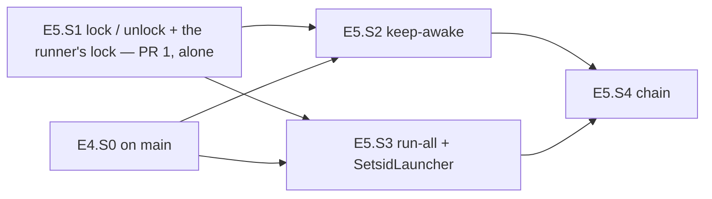

# PLAN — E5 stories: isolation, keep-awake, the detached arms and the chain of the model-arms module

> Status: **stories written 2026-10-31, nothing implemented yet.** Epic E5 of [PLAN_model_arms.md](PLAN_model_arms.md) (§3 D10–D13,
> D16, D17 (c)/(d), D26, D27; §4.7, §4.8, §4.11; §6 step 5; §7's E5 tests; §9; §10), written at `f0d6868` on `feat/model-arms-e5`
> (E1–E3 on `main`, E4 not built) by the judge role (Opus), as the epic starts — `common.plan-change-control` § *What counts as a
> change*: writing them is not a change. The parent's epoch 3 holds ONE entry (3.1); a second accepted change stops the plan, so every
> claim of the parent found wrong or incomplete against the code is LISTED in §8 (items 24–32) for the parent's next change and not
> edited there. **No cornerstone** (the parent's ledger is `3 of 3`, spent). **E5.S1 is a security judgement (D11): its scenarios and
> brief are Fable's, to be written** — its section lists the questions that spec must settle; E5.S2–E5.S4 are specified here in full.
> **Two pull requests** (parent §6 step 5): E5.S1 alone, merged to `main` first (it launches nothing new and may land before E4.S0);
> then E5.S2–E5.S4, branched from a `main` that carries E5.S1 and E4.S0.
>
> Scope: `lock <run>` / `unlock [--force]` over E3.S4's read side, the runner's own lock and pid (E5.S1); the host kept awake for a
> scope (E5.S2); `run-all`, the arms started detached by the operating system's redirection, the gate lock's queue refusal (E5.S3);
> `chain <run>` with the per-run markers, the reconciliation of `locked` with the snapshot and the failure path that leaves the isolation
> applied (E5.S4). Tests under `tests/Bench.Tests/ModelArms/`, `research/module_model_arms.md`, the `lock`, `unlock`, `run-all` and
> `chain` rows of `research/module_tests.md`.

## 1. Goal, before any solution

E3 left the unattended half of the shell harness unported. Four things are missing, each named by `Program.cs:86-90` as *not built yet*:

- **No folder is closed while the arms run.** The shell closed the old experiment (000) and made the arm folders, `pids/` and Claude
  Code's own folders unlistable (300) for the whole run (`/home/jinx/git/coai-exp2/lock.sh:12-19`); part 7 also closed every part-6
  result an arm could learn from (`after7.sh:41-43`). The module reads the snapshot (E3.S4, `LockSnapshot.cs`, `IsolationFiles.cs`)
  and nothing writes it. The shell's own `lock` had three defects the port must not copy: a second `lock` over a standing snapshot
  failed instead of answering for the run (`lock.sh:6`), a path that did not exist left a half-written snapshot and the unlisted
  folders open (`lock.sh:10-11`, `stat` then `chmod … &&`), and nothing checked that a mode did anything (measured §2 M-8: on the
  Windows drive a `chmod 300` is ignored and the folder stays listable).
- **Nothing knows whether an arm is running.** The shell wrote the LAUNCHER's pid (`run-all.sh:7-8`); a launcher's pid is `setsid`'s,
  which forks when its caller leads a process group (measured, M-2), and a kill between the spawn and the pid write left a live runner
  nobody saw — a second `run-all` started a second runner of the same arm on the same clone (parent D13). `status` and `checks` already
  read `pids/<arm>.pid` as a decimal pid (`RunnerPid.cs:9-10`, `ArmReport.cs:52-61`, `ChecksAdmission.cs:106-121`) and nothing writes it.
- **The host sleeps and the arms die with the session.** The shell held a Windows keep-awake from WSL and relaunched it every two
  minutes (`after6.sh:14-23`), and detached every runner with `setsid nohup … >> pids/<arm>.log 2>&1 < /dev/null &`
  (`run-all.sh:7`) — three crashes taught it (`research/local-model-coding/harness.md` §4).
- **No chain.** `after6.sh` / `after7.sh` made, locked, ran the rounds, unlocked and checked, with markers per stage; the port makes
  the run a configured name (D27) and must never unlock beside a live arm or run an arm without its isolation (parent §4.7).

What must survive unchanged: the files the analysis and the operator read — `pids/<arm>.pid` in the format `RunnerPid.Parse` reads,
`pids/<arm>.log`, `chain/<run>/locked|unlocked|arms-done`, `chain/made-<arm>`, `chain/objective-<arm>`, `.locked-modes` in the shape
`LockSnapshots.State` parses — and the shell's order of stages.

## 2. What exists — verified at `f0d6868`, 2026-10-31

Every line below was opened in this worktree; the shell by exact path the same day (read-only; `after6.sh`, `after7.sh`, `run-all.sh` and
`lock.sh` match the parent's §2 sums: `097b5592…`, `12199719…`, `dacc74d2…`, `531be3e8…`).

| Fact | Where |
|---|---|
| `lock`, `unlock`, `run-all`, `chain` print *not built yet* with E5.S1, E5.S1, E5.S3, E5.S4; the helper and its test | `ModelArms/Program.cs:86-90`, `:100-104`; `tests/Bench.Tests/ModelArms/ModelArmsProgramTests.cs:47-54` |
| The positional table: `lock` 0, `unlock` 0 (flags `--experiment` only), `run-all` 1..n (with an unspecified `--seconds`), `chain` 0 | `ModelArms.Core/Experiment/ModelArmsCommandLine.cs:26-32`; `ModelArmsCommandLineTests.cs:18-25`, `:109`, `:123-138` |
| The root's spellings: `PidFile`, `PidLog`, `Made`, `ObjectiveMarker`, `Executables`, `GateLock`, `LockedModes`, `LockedModesApplied`, `RunMarker(run, RunStage)`, `LockLog`, `LockedModesRestored(stamp)`, `KeepAwakeLog`; the root-level `Locked`, `Unlocked`, `ArmsDone` (E1's, before D27) | `ModelArms.Core/Experiment/ArmPaths.cs:26-62`; `:36-42` the three to remove; `:105` `RunStage`; pinned by `ArmPathsTests.cs:37-40`, `:45` |
| No `IsolationLock`, `RunnerLock`, applied-restored name, `IFolderIsolation`, `IHostAwake`, `IDetachedLauncher`, `IsolationPlan`, `ChainPlan` | `ModelArms.Core/Ports/` holds `IGateLock.cs`, `ISessionTranscripts.cs`, `ITargetTools.cs` only; `ModelArms.Core/Isolation/` holds `LockSnapshot.cs` only |
| The snapshot's state from its two files: `None`, `Applying(Run, Since)`, `Applied(Run, Since)`, `Inconsistent(Reason)`; the digest is parsed privately and compared, never exposed | `ModelArms.Core/Isolation/LockSnapshot.cs:8-21`, `:32-34`, `:53-56`; the line every other verb prints `:77-86` |
| Both files read by name through the bounded road (1 MiB), non-UTF-8 refused | `ModelArms/Adapters/IsolationFiles.cs:10-43`; printed by `Status.cs:68`, `Make.cs:78`, `ChecksAdmission.cs:94` |
| The reader's fixture shape: `{"run","digest","since","modes":[{"path","mode"}]}` and `{"run","digest","verifiedAt"}` | `tests/Bench.Tests/ModelArms/LockSnapshotTests.cs:16-17` |
| The pid file read as digits only, then `WorkerLiveness` (refused counts as alive); 64-byte limit; *nothing writes a pid file until E5.S3* (the doc) | `ModelArms/Verbs/RunnerPid.cs:5-10`; `ArmReport.cs:15`, `:49-61`; `ChecksAdmission.cs:32`, `:106-121`; `src/Bench.Infrastructure/Process/WorkerLiveness.cs:25-45` |
| The file lock: `Take(path, create, note)` → `Held · Busy · Absent · Refused · Unread`; `TryAcquire` = `Take(create: true, note: true)`; close-on-exec; the honoured-lock check; `gate-lock status` probes with `Take(create: false, note: false)` and releases | `ModelArms/Adapters/FileGateLock.cs:123-142`, `:35-38`, `:249-273`; `GateLockAnswer.cs:6-21`; `Verbs/GateLock.cs:38-56` |
| A holder's note `<lock>.holder` (pid, kernel start ticks, start second, since) written after the lock, removed before release; believed only for a live pid with the recorded start | `ModelArms/Adapters/GateHolderNote.cs:9-23`, `:73-91`, `:148-160` |
| The gate lock's ceiling per arm from the largest round of the run naming it (map count when none) | `ModelArms.Core/Steps/GateLockCeiling.cs:23-37`; `Verbs/RunArmWalk.cs:41-49` |
| An arm is in at most one round of one run; `closedArms` are earlier runs' arms | `ModelArms.Core/Experiment/RunSection.cs:79-104` |
| `run-arm`'s admission: scheme (`allowTasks: false`), map, PATH/HOME, `claude`, `git`, scenarios; the walk; `arm-done` once | `Verbs/RunArmAdmission.cs:30-42`, `:63-71`; `RunArm.cs:36-61`; `RunArmWalk.cs:79-87`; `ArmChoices.cs:10-28` (reads `Positionals[0]` at `:13`) |
| `make` makes the arms of EVERY run without a marker and writes `chain/made-<arm>` itself; `checks` writes `chain/objective-<arm>` itself | `Verbs/Make.cs:84-99` (`RunArms.Of(input.Experiment.Runs)` at `:87`); `Adapters/ArmMaker.cs:214`; `Verbs/ChecksReport.cs:110` |
| Whether an arm finished: an `arm-done` line after the last `start` or `gate-wait` | `ModelArms.Core/Steps/TimingLine.cs:67-68` |
| The requirements: `lock`/`unlock` need the root and `experiment.json`; `chain` needs `make`'s; positionals count as arms only for `run-arm`, `run-all`, `checks` | `ModelArms.Core/Experiment/RootRequirements.cs:39-41`; `ExperimentGate.cs:136-137`; `RootRequirementsTests.cs:26-32`, `:63` |
| The isolation facts: `closed`, `unlisted`, `<root>` and `~` expanded; `awake` `auto · windows · wsl · none`; host kinds `Windows · Wsl · OtherPosix`; validate's awake sentences; `pwsh.exe` needed when the awake keeper uses it | `ExperimentFacts.cs:11`, `:61`, `:74-79`; `ExperimentFile.cs:168-188`; `HostChecks.cs:8`, `:14-17`, `:85`, `:102`, `:124-125`, `:176-189`; `Adapters/HostFactsReader.cs:28`, `:81-91` |
| The worked example: `unlisted` = `<root>`, `<root>/r`, `<root>/pids`, four `~/.claude/*`; part 7 closes part 6's nine arms and `<root>/chain/part6`; limits | `tools/model-arms/examples/part6.experiment.json:60-65`, `:78-79` |
| Staged-then-renamed writes by name (`Replace`, private 0600 variant); `WriteFileOnce` lists the folder on its failure path | `Adapters/ArmFiles.cs:91-128`; `:67-88` (`Directory.EnumerateFiles` at `:84`) |
| Commit once, never overwrite | `src/Bench.Infrastructure/Gate/ArtifactCommit.cs:24-49` |
| The held child: stdin, stdout and stderr redirected (stdin kept open), stderr to a file created `CreateNew`, stop = close stdin, 5 s, tree kill | `src/Bench.Infrastructure/Process/ProcessSession.cs:85-129` (`:115`), `:153-200` |
| The module's P/Invokes name `libc` / `kernel32.dll` through `DllImport` | `Adapters/RealPath.cs:105-115`; `KernelFacts.cs:247-256` |
| The bare-name scan matches `GitCommand.`, a literal to `ProcessRunner`, `Process.Start(`, `new ProcessStartInfo`; the pure list's `// E5` marker | `tests/Bench.Tests/ModelArms/ModelArmsArchitectureTests.cs:186-191`, `:203-206`, `:93` |
| `status`' no-listing scan reads `Status.cs`, `ArmReport.cs`, `IsolationFiles.cs` | `StatusVerbTests.cs:180-182` |
| Content beside the binary: briefs and examples by glob; `ModuleFiles` names the example and the briefs | `ModelArms/ModelArms.csproj` (`<Content Include="..\briefs\*.template.md" …>`); `VerbInput.cs:6-10` |
| Test kit: the root with `HOME` under the temp folder; an arm by hand with the fake as `claude`; the console binary beside the test assembly; a second process; a non-runner lock holder; the temp folder restores owner access before deleting | `ExperimentRoot.cs:42-55`, `:101-129`, `:181`; `ModelArmsBinary.cs:14-55`; `tests/GateHolder/Program.cs:1-26`; `TempFolder.cs:5-7` |
| The fake: script from `FAKE_CLI_SCRIPT` (else `<temp>/bench-fake-cli/<model>/`), a call without `--model` is `nomodel`; it reads stdin to its end BEFORE it records the call; `hang` sleeps forever | `tests/FakeCli/Program.cs:20-31`, `:165-172`, `:232-236`, `:677-705` |
| The keep-awake scripts (the shell's, parts 1–5) | `research/local-model-coding/harness/windows/keep-awake.ps1:1-6` (holds `0x80000003` for 14400 s, releases in `finally`), `check-keep-awake.ps1`, `stop-keep-awake.ps1` |
| The rows waiting for E5 | `research/module_tests.md:110-111`, `:113-114`; `:117` (*invisible to the catalogue test until E5.S3*) |

**The shell, the behaviour to port** (read 2026-10-31): `after6.sh:26-37` makes every arm before the lock; `:38` `lock.sh lock >>
lock.log` or exit 4, then `chain/locked`; `:39-46` per round: start each arm not done and not alive, then wait 60 s per tick until
each is done, an arm not alive and not done → *arm <a> stopped without finishing — resume it (run-all.sh <a>), then start me again*, exit
2; `:47` `lock.sh unlock >> lock.log`, then `chain/unlocked`; `:48-52` `objective-checks.sh` per arm, the marker whatever it printed;
`:53-55` the keep-awake stopped and `chain/arms-done` LAST. `after7.sh` is the same for one round under `chain7/` with `EXTRA_CLOSED`
(`:39-43`). `run-all.sh:5-8`: alive = `kill -0` of the pid file; `setsid nohup run-arm.sh <a> >> pids/<a>.log 2>&1 < /dev/null &`, then
`$!` into the pid file. `lock.sh:12-19`: closed then unlisted, `stat -c '%a\t%n'` into `.locked-modes`, `chmod 000` / `chmod 300`;
unlock restores in reverse (`tac`) and renames `.locked-modes.restored-<utc>`.

**Measured while writing these stories** (2026-10-31, this host: WSL2 kernel 6.18.54.1, x86_64, glibc 2.43, util-linux 2.41.3, .NET
10.0.14, uid 1000 with `CapEff 0`; scratch folders outside every checkout, removed after):

| # | Observation |
|---|---|
| M-1 | `setsid` started by a .NET `Process.Start` (`dotnet run probe.cs`): the child does not lead a group, **setsid does not fork** — child pid 3152743, the inner shell's `$$` 3152743, its pgid then 3152743 |
| M-2 | `setsid` started as the leader of its own group (Python `Popen(process_group=0)`): **setsid forks** — launcher child 3152296, inner 3152297, the inner's parent pid 825 (`/init`); setsid exits 0 at once |
| M-3 | libc `posix_spawn` of `/usr/bin/setsid` with file actions `open(0, /dev/null, O_RDONLY)`, `open(1, <log>, O_WRONLY\|O_APPEND\|O_CREAT\|O_NOFOLLOW, 0600)`, `dup2(1, 2)`: in the child fd 0 → `/dev/null`, fds 1 and 2 → the log, `sid` = its pid, the log created at mode 600. **Without** `POSIX_SPAWN_SETSIGDEF`/`SETSIGMASK` the child's `SigIgn` is `0x1001000` (SIGPIPE and SIGXFSZ ignored, inherited from the launcher across `exec`); with every catchable signal 1–31 defaulted and an empty mask, `SigIgn 0`, `SigBlk 0` |
| M-4 | the same with `POSIX_SPAWN_SETPGROUP` (group 0): `waitpid` reaps setsid after 0.002 s with status 0, and the program it ran has parent pid 825 — **not a child of the launcher** |
| M-5 | `sizeof(sigset_t)` 128, `posix_spawnattr_t` 336, `posix_spawn_file_actions_t` 80 (gcc on this host); `/usr/include/spawn.h:54-63`: `SETPGROUP 0x02`, `SETSIGDEF 0x04`, `SETSIGMASK 0x08`, `SETSID 0x80`; `posix_spawn_file_actions_addchdir_np` declared (`:206`); `O_WRONLY 0x1`, `O_CREAT 0x40`, `O_APPEND 0x400`, `O_NOFOLLOW 0x20000`, `O_CLOEXEC 0x80000`; `SIGKILL 9`, `SIGSTOP 19`, `SIGPIPE 13` |
| M-6 | `/proc/<pid>/cmdline` of a .NET app is the argv its `exec` was given: by the apphost's absolute path `…/cmd \| run-arm \| C1 \| --experiment \| /x` (`Environment.ProcessPath` = that path); through a link `./cmdlink \| run-arm \| C1` (`ProcessPath` = the REAL apphost); through `dotnet cmd.dll` → `dotnet \| …/cmd.dll \| run-arm \| C1` (`ProcessPath` = `/usr/lib/dotnet/dotnet`) |
| M-7 | as uid 1000 on tmpfs (`/tmp`; `/home` is ext4): a folder at 300 — `ls` *Permission denied*, a file opened by name reads, a file created by name is created; at 000 — a child cannot be read, `stat`-ed or `chmod`-ed (*Permission denied*) |
| M-8 | on the Windows drive (`/mnt/c`, `9p`, `aname=drvfs`, no `metadata`): `chmod 300` of a folder is silently ignored — its mode reads 777 and `ls` lists it |
| M-9 | `pwsh.exe` = `/mnt/c/Users/strug/AppData/Local/Microsoft/WindowsApps/pwsh.exe`, `realpath` itself, a regular file of 2 bytes, mode 555; `pwsh.exe -NoProfile -ExecutionPolicy Bypass -File \\wsl.localhost\Ubuntu\<path>\probe.ps1` prints and exits 0; started under `env -i` (no variable at all) it runs; `WSL_DISTRO_NAME=Ubuntu`, `WSL_INTEROP=/run/WSL/825_interop` |
| M-10 | SIGTERM and SIGKILL of the WSL-side process of a `pwsh.exe` that sleeps 90 s (as a direct child, and under `setsid`) end the WINDOWS process within 4 s (`tasklist /FI "PID eq …"`: 1 → 0). In one earlier probe that signalled several pids at once the WSL side ended and the Windows `pwsh` kept running past its own 90 s sleep until `taskkill` — a Windows keep-awake can outlive its relay; `keep-awake.ps1` bounds itself at 14400 s (`:6`) |

## 3. Conventions every story follows

E1 §3–E4 §3 hold unchanged (namespaces; pure means pure; refusals as values; red first on an ASSERTION; docs per story; time through
`TimeProvider`; no tokens in output; the commands). For E5:

- **The pure list and the module doc.** E5.S1 replaces the `// E5` marker (`ModelArmsArchitectureTests.cs:93`) by four, `// E5.S1` …
  `// E5.S4`, one per line with a blank line between, and adds four empty headings at the end of `research/module_model_arms.md`:
  *Isolation, lock and unlock, the runner's lock (E5.S1)*, *Keep-awake (E5.S2)*, *run-all and the detached arms (E5.S3)*, *chain (E5.S4)*.
  Every later story writes only under its own (E4.S0 does the same for `// E4`; the two never touch each other's lines).
- **By name, never a listing.** Every new verb and adapter opens and creates by NAME; while the isolation stands the root, `r/` and
  `pids/` are at 300 (F0). Each story adds its new files to the list of
  `StatusVerbTests.The_verbs_source_holds_no_way_to_list_a_folder_and_the_scan_still_finds_one_where_one_lives` (`:182`). A write of
  the root's or `pids/`' files goes through `ArmFiles.Replace` / `ReplacePrivate` (stage, rename, by name) or `ArtifactCommit`, never
  `ArmFiles.WriteFileOnce`, whose failure path lists the folder (`ArmFiles.cs:84`, §8 item 22).
- **Liveness is the runner's lock.** Every new code that asks whether an arm runs asks `RunnerLiveness` (C21), never a pid;
  `status` and `checks` keep E3's pid reading unedited (parent §9).
- **The isolation is left as it stands on every exit but the chain's `Unlock`.** No E5 code outside `lock`/`unlock` changes a mode or
  renames a snapshot file; no E5 code stops a runner.
- **D26 per adapter.** The reviews of `PosixFolderIsolation` (S1), `WslHostAwake` (S2) and `SetsidLauncher` (S3) name which of (a)–(f)
  they checked (the parent's DoD).
- **Exit codes (D16) for E5:** 0 done (also *already locked for <run>*, *no isolation configured*, *nothing locked*, *already
  running*); 3 the host (a lock or a mode the host could not set or verify, `setsid`/`pwsh.exe` absent, a detached start that failed, a
  host whose launch constants were not measured); 4 configuration (an unknown run or arm, another run's snapshot, an inconsistent one, a
  held runner lock, the queue refusal, a marker over a snapshot it does not match, a link where a file must be); 5 stopped, resumable (an
  arm died, an arm still alive at the end of the wait, an arm of another run alive, `unlock` refused at the chain's stage, the operator's stop).
- **Commands.** `node .agents/conventions/tools/low-priority.mjs dotnet build dew_flow_benchmark.slnx -c Release -m:4`, then
  `node .agents/conventions/tools/low-priority.mjs ./tests/Bench.Tests/bin/Release/net10.0/Bench.Tests --filter-class "*<Class>"` per
  class named in the story, `--filter-namespace "Bench.Tests.ModelArms"`, and the whole suite once per story; `node
  .agents/conventions/tools/plan-lifecycle.mjs`. The live tests are Linux only (E5.S3's x86-64 only), skipped elsewhere with the reason.

## 4. Shared contracts (fixed here so the second pull request can be specified against the first)

E5.S1's Fable spec may ADD members to C21 and C22; it changes none of these without changing E5.S3's and E5.S4's sections.

**C21 — the runner's lock and liveness** (E5.S1 implements; E5.S3 and E5.S4 call exactly these):

```csharp
// ModelArms.Core.Experiment, ArmPaths.cs
public string RunnerLock(string arm);                     // RootPaths: <root>/pids/<arm>.lock — never deleted (§4.11)
// ModelArms.Verbs, RunnerLiveness.cs
internal abstract record RunnerState                      // closed
{
    public sealed record Alive(string Holder) : RunnerState;   // the lock is held; Holder = the words after "running": "pid N" when believed, else why not
    public sealed record Gone : RunnerState;                   // the lock is free, or its file absent (nothing created)
    public sealed record Refused(string Reason) : RunnerState; // the lock's path is not a regular file of the root's (D17) → exit 4
    public sealed record Unread(string Reason) : RunnerState;  // the host could not say → exit 3
}
internal static class RunnerLiveness
{
    public static RunnerState Of(RootPaths root, string arm);  // a probe: a lock it gets is released before it returns; writes no file
}
```

**C22 — the isolation's two verbs** (E5.S1 implements; E5.S4 calls):

```csharp
// ModelArms.Core.Isolation
public sealed record Applied(string Run, string Since, string Digest) : LockState;   // LockState.Applied widened (§8 item 24)
public sealed record IsolationPlan(string Run, string Digest /* lower-case hex */, IReadOnlyList<IsolationEntry> Entries);
// ModelArms.Verbs
internal abstract record LockOutcome    { Applied; AlreadyLocked; NoIsolation; Stopped(int ExitCode, string Why) }        // closed
internal abstract record UnlockOutcome  { Restored(int Count); NothingLocked; NoIsolation; RefusedAlive(string Arm); Stopped(int ExitCode, string Why) }
internal static class LockVerb
{
    public static Task<int> RunAsync(ExperimentInput input);                                        // `lock <run>`
    internal static Task<LockOutcome> LockAsync(ExperimentInput input, string run, CancellationToken stopping);
    internal static Passage<IsolationPlan?> PlanOf(ExperimentInput input, string run);              // null = NoIsolation (no block, or Windows)
}
internal static class UnlockVerb
{
    public static Task<int> RunAsync(ExperimentInput input);                                        // `unlock [--force]`
    internal static Task<UnlockOutcome> UnlockAsync(ExperimentInput input, bool force, CancellationToken stopping);
}
```

Neither verb writes a chain marker (D11, gate finding 1). `RunAsync` maps the outcome to its exit code and its one printed line.

**C23 — keep-awake** (E5.S2 implements; E5.S4 calls):

```csharp
// ModelArms.Core.Ports
public interface IHostAwake : IAsyncDisposable { string Describe { get; } }     // started by its factory; disposing ends the scope
// ModelArms.Core.Isolation
public enum AwakeKind { Windows, Wsl, None }
public static class HostAwakeSelection { public static Outcome<AwakeKind> For(AwakeChoice choice, HostKind host); }
// ModelArms.Adapters
internal static class HostAwakes { public static Task<Passage<IHostAwake>> StartAsync(ExperimentInput input, HostKind host, CancellationToken stopping); }
internal static class HostFactsReader { internal static Task<HostKind> HostKindAsync(ExperimentInput input); }   // extracted from :28
```

**C24 — starting arms** (E5.S3 implements; E5.S4 calls):

```csharp
// ModelArms.Core.Ports
public abstract record DetachedStart { public sealed record Started : DetachedStart; public sealed record Failed(int ExitCode, string Why) : DetachedStart; }  // closed
public interface IDetachedLauncher
{
    // executable: a REAL absolute path (D17 d); arguments: argv[1..]; log: appended, created 0600, never through a link;
    // environment: replaced; workingDirectory: chosen. No pid is returned: the runner names itself (D13).
    DetachedStart Start(string executable, IReadOnlyList<string> arguments, string log, IReadOnlyDictionary<string, string> environment, string workingDirectory);
}
// ModelArms.Verbs, RunAll.cs
internal static class RunAllVerb
{
    public static Task<int> RunAsync(ExperimentInput input);                                        // `run-all <arm>…`
    internal static Task<int> StartAsync(ExperimentInput input, IReadOnlyList<string> arms, RunAllSeams seams);   // the verb's body after its own parse
}
```

**C25 — the chain's decision** (E5.S4, pure, `ModelArms.Core.Chain`): the records of E5.S4's section, used by nobody else.

## 5. Stories

### E5.S1 — Isolation: `lock <run>` / `unlock [--force]`, the two-file snapshot, and the runner's own lock and pid (SECURITY JUDGEMENT — spec: Fable (to be written))

- **Coder:** sonnet · **Spec:** Fable (security judgement, D11 — outside the cornerstone quota, the parent's `## Epics` E5) · **Review:**
  Opus, naming D26 (a)–(f) for `PosixFolderIsolation` and `RunnerLiveness`. **`model:`** fable (scenarios and brief), sonnet (code and
  tests), opus (review). **Depends on:** E1–E3 (on `main`). **Parallel with:** nothing — **the first pull request, alone**; it may land
  before or after E4.S0 (§6). **Size:** ≈ 1600 lines (≈ 600 code, 1000 tests) — the spec may move it.
- **Owns:** D11 as rewritten (both writers, the exclusive `.isolation.lock`, the two-file state, `unlock`'s liveness refusal, the
  inconsistent snapshot never read as none, no restore on entry), D27's lock half (`closedArms` through the map, `closed`), D13's runner
  identity (the runner's `pids/<arm>.lock`, its pid in `RunnerPid`'s format, `RunnerLiveness`), F0 and F5 for the writers, E3 §8 item
  32's writer, C21, C22, the `lock` and `unlock` rows of `research/module_tests.md`.

**Goal.** Only `lock` and `unlock` ever change a mode; a half-applied lock is recovered by the next `lock`; a run never executes under
another run's isolation; the isolation is observed working before it is recorded as applied; `unlock` never restores beside a live
arm; and every verb can tell, from a lock the runner holds for its life, whether an arm is running.

**Files** (verified; *new* marked; the spec may add). Core: `ModelArms.Core/Isolation/IsolationPlan.cs` (*new*: `IsolationPlan`,
`IsolationEntry`, `IsolationKind`, `From`), `IsolationRestoreOrder.cs` (*new*), `LockSnapshot.cs` (`Applied` gains `Digest`; `IsolationLine`
prints unchanged), `ModelArms.Core/Ports/IFolderIsolation.cs` (*new*), `ModelArms.Core/Experiment/ArmPaths.cs` (`RootPaths.IsolationLock`,
`RootPaths.RunnerLock(arm)`, the applied file's restored name beside `LockedModesRestored` — *new* members), `ModelArmsCommandLine.cs`
(`lock <run>`, `unlock --force`); console: `ModelArms/Adapters/PosixFolderIsolation.cs` (*new*), `NoIsolation.cs` (*new*),
`ModelArms/Verbs/Lock.cs`, `Unlock.cs`, `RunnerLiveness.cs` (*new*), `RunArm.cs` and `RunArmAdmission.cs` (the runner takes its lock
and writes its pid), `RunnerPid.cs` (doc: the runner writes it), `Program.cs` (dispatch `lock`, `unlock`); tests:
`IsolationPlanTests.cs`, `PosixFolderIsolationTests.cs`, `IsolationRecoveryTests.cs`, `RunnerIdentityTests.cs` (*new*),
`LockSnapshotTests.cs` (the digest), `ModelArmsCommandLineTests.cs` (`lock`/`unlock` rows, `:123-138`), `ArmPathsTests.cs` (the new
members), `StatusVerbTests.cs` (the scan's file list), `ModelArmsArchitectureTests.cs` (the markers; the new pure types under
`// E5.S1`); `research/module_tests.md` (`:110-111`), `research/module_model_arms.md` (its heading). **Not** `RootRequirements.cs` (§8 item 26).

**Scenarios (the parent's §7 names, verbatim; the spec writes their Given/When/Then, reds and break-its).** `IsolationPlanTests`:
`The_closed_and_unlisted_folders_are_the_shells_in_the_shells_order`; `A_runs_closed_arms_are_resolved_through_the_map_and_closed_after_the_configured_paths`;
`Restore_order_is_the_reverse_of_lock_order` (its fourth name, `HostAwakeSelection_picks_windows_wsl_or_none_from_the_facts`, is E5.S2's).
`PosixFolderIsolationTests` (Linux only): `Modes_are_saved_before_the_first_change_and_restored_in_reverse`;
`The_snapshot_is_durable_before_the_first_mode_changes`; `A_lock_killed_half_way_is_restored_and_applied_afresh_by_the_next_lock`;
`A_lock_on_an_applied_snapshot_of_the_same_run_and_set_is_a_no_op_that_says_already_locked`;
`A_lock_for_another_run_or_closed_set_over_an_applied_snapshot_is_refused_asking_for_unlock`;
`The_applied_state_is_a_second_immutable_file_and_a_crash_before_it_reads_as_applying`;
`Without_an_isolation_block_lock_and_unlock_are_logged_no_ops`; `A_verification_failure_restores_before_refusing`;
`A_locked_folder_cannot_be_listed_by_this_user_and_is_still_traversed_by_name`; `Verification_refuses_when_the_user_can_still_list_it`;
`Unlock_is_idempotent_and_says_so_without_a_snapshot`; `Lock_and_unlock_run_under_an_exclusive_file_lock`;
`An_inconsistent_snapshot_is_never_read_as_none_by_a_writer`; `The_writers_files_are_the_shapes_the_built_reader_parses`.
`IsolationRecoveryTests`: `No_verb_but_lock_and_unlock_changes_a_mode_or_restores_a_snapshot`;
`Unlock_is_refused_while_an_arm_of_the_map_is_alive_unless_forced`; `Lock_then_run_arm_leaves_the_experiment_locked`.
`RunnerIdentityTests`: `The_runner_holds_its_arm_lock_for_its_life_and_writes_its_own_pid`;
`A_second_runner_of_the_same_arm_refuses_with_exit_4_naming_the_holder_before_any_step`;
`An_arm_whose_lock_is_held_is_alive_with_or_without_a_pid_file`; `A_live_pid_whose_command_line_is_not_this_arms_runner_reads_as_gone`;
`On_the_portable_road_the_pid_reuse_residual_is_printed`. Plus the scenarios C21/C22 need (the outcomes' every case; `RunnerLiveness`
creating nothing), and one break-it per security or reliability property.

**The questions the spec must settle** (each with the evidence that raised it):

1. **The plan's entries and order.** Configured `closed`, then the run's `closedArms` as `r/<token>` through the map, then the run's
   `closed`, then the configured `unlisted` (`lock.sh:12-14`; the example `:62-63`, `:78`)? A `closedArms` arm with no token in the map
   (part 6 never made): refused or skipped? A duplicate path; a path INSIDE a closed path (a child of a 000 folder cannot be
   `chmod`-ed, M-7 — so the second `chmod` of a nested set fails half-way); a path that is, or is above, the root, `pids/`, `r/`, an arm
   of THIS run or the target's source; a relative path; a path that does not exist (the shell wrote a partial snapshot and left the
   unlisted folders open, §1). Which kinds may be closed (part 7 closed FILES: `coai-findings.json`, `PROTOCOL.md`, `after7.sh:41-42`) and
   which must be folders (unlisted).
2. **The digest.** The exact bytes hashed (kind, path, separator, encoding, order) and the text recorded (lower-case hex SHA-256?), so
   E5.S4 compares `IsolationPlan.Digest` with `LockState.Applied.Digest` by ordinal equality.
3. **The path facts (D26 a).** Each entry read with `statx(AT_SYMLINK_NOFOLLOW)` (`KernelFacts`); a link is refused — `File.SetUnixFileMode`
   follows links; a link among an entry's ancestors; the swap between the check and the `chmod` (an `O_PATH|O_NOFOLLOW|O_DIRECTORY` open
   and `fchmod` closes the leaf's window — or the residual is stated); the portable road (ledger 2.1) — which facts are judged there and
   the one printed line.
4. **The snapshot's shape and durability.** `{"run","digest","since","modes":[…]}` — what each mode entry holds (path, the mode as the
   shell's `%a` text, the kind, the device and inode to detect a folder replaced before `unlock`), the time format of `since` and
   `verifiedAt` (UTC to the second like `GateHolderNote`, or finer), whether `ArtifactCommit` (file flushed, `ArtifactCommit.cs:24-49`) is
   "durable BEFORE the first mode changes" without an `fsync` of the root folder after the rename, and `JsonRow`'s tolerance of the members
   the reader does not ask (`LockSnapshotTests.cs:16` carries `modes`).
5. **The verification.** One unlisted folder (D11's text) or EVERY entry — a set that mixes file systems passes a single check while one
   member ignores its mode (M-8: drvfs keeps 777 and lists); what counts as "cannot list" (`EACCES` only) and as "cannot open" for a
   closed entry; whether `geteuid() == 0` is refused before any `chmod`; the exit code of *restored, then refused* (D16: 3, *the lock could
   not be verified*); and how the live test reaches a listable 300 folder without root — the drvfs folder of M-8 on WSL, a seam, or both.
6. **`lock` over each state.** `applying` (restore from the snapshot in reverse, then apply afresh — also when the interrupted lock was
   for ANOTHER run?), `applied` same run and digest (no-op, *already locked for <run>*), `applied` other run or digest (exit 4, `unlock`
   first), `inconsistent` (exit 4, the reason, no mode touched), `none`; what `lock` prints on each.
7. **`unlock` over each state**, and its order of work: restore in reverse; an entry gone or replaced since the lock; a `chmod` that fails
   half-way (go on and report, or stop); the two renames (`.locked-modes.restored-<utc>`, `.locked-modes.applied.restored-<utc>`) — their
   order (a crash between them leaves `applying` or `inconsistent`; D11 says the applied file alone is renamed aside by the next `unlock`),
   two cycles in one second (`ArtifactCommit` and `File.Move(overwrite: false)` never overwrite); `--force` (what it skips, what it still
   checks); a `.locked-modes` that does not parse (exit 4, naming the file, the operator restores by hand).
8. **`.isolation.lock`.** Through `FileGateLock` (with or without the holder note); `TryAcquire` or a bounded wait
   (`Lock_and_unlock_run_under_an_exclusive_file_lock`: *a second process holding it makes the first wait* — for how long, then which exit).
9. **`NoIsolation`.** Exactly when (no `isolation` block; Windows whatever the file says — validate refuses the block there,
   `HostChecks.cs:176`, but `lock` does not run validate); its lines; logged once where.
10. **`lock.log`.** Who appends to it (`RootPaths.LockLog` exists, no writer; §4.11 counts it), which lines, through which road (by name,
    never through a link).
11. **`RunnerLiveness`.** The probe as `gate-lock status` takes it (`Take(create: false, note: false)`, `GateLock.cs:41`), released at
    once; and the race it opens: a runner starting while a probe momentarily holds `pids/<arm>.lock` gets `Busy` and would refuse with
    exit 4 — does the runner retry for a bounded moment, or does the refusal stand? `Refused`/`Unread` per C21.
12. **The runner's lock.** `TryAcquire` WITH the holder note (`pids/<arm>.lock.holder` and `.holder.tmp` — the note already carries the
    pid and the kernel start tick, a pid-reuse defence, `GateHolderNote.cs:9-12`) or without; WHERE in `run-arm` it is taken — "before
    any step, any git and any write" (D13) means before E4.S0's `git --version` at admission, so after `ArmChoices` (no lock file for a
    malformed arm) and before the map read? — and the refusal's words (`IGateLock.Describe`).
13. **The pid file.** Written after the lock is held, by name, staged then renamed (`ArmFiles.Replace`'s road — never `WriteFileOnce`,
    §8 item 22); `pids/` created when absent (by name, under a 300 root); exactly digits and one `\n`; and whether the runner removes or
    keeps it at its end (`status` prints *pid N gone* for a kept one; `checks` refuses an alive one).
14. **The command-line belief (Linux).** What "`run-arm` and `<arm>` after the module's executable" compares (M-6: argv[0] is the
    exec caller's spelling, `/proc/<pid>/exe` the real file, `dotnet <dll>` shifts argv by one): `/proc/<pid>/exe`'s real path against
    this binary's, and argv[1..2]? A command line that cannot be read (another user, gone) → not believed. What is printed when the lock is
    held and the pid is not believed. **The parent's scenario as written has no teeth** (§8 item 27): beside a FREE lock the arm is gone
    whatever the command line says, so the fixture must be a NON-runner holding the lock — `tests/GateHolder` holding `pids/<arm>.lock`,
    its own pid in the pid file.
15. **The portable road's line** (ledger 2.1's honesty rule): its words, and which verbs print it (`unlock`, later `run-all` and `chain`).
16. **The proof that no other verb changes a mode.** `IsolationRecoveryTests.No_verb_but_lock_and_unlock_changes_a_mode_or_restores_a_snapshot`
    over a "recording file port" — `status`, `make` and `checks` never hold `IFolderIsolation`; is the proof a tree of modes and names
    compared before and after each verb plus a scan for `SetUnixFileMode` / a snapshot rename outside `PosixFolderIsolation` (the
    legitimate sites: `BaseCopy`, `ArmFiles`, `KernelFacts`, `Init`, `ExclusiveFolder`)? Its rows derived from the dispatch, so that
    `run-all` (E5.S3) and `chain` outside its stages (E5.S4) join when they are built (§8 item 18).
17. **The command line.** `lock <run>` — the run checked against `experiment.Runs` by the verb (exit 4, naming the runs); `unlock` takes
    `--force` (`CommandLine.Has`) and no positional; the help's usages.
18. **Merging with E4.S0.** Both edit `RunArmAdmission.cs` (E4.S0 adds the git floor at admission); whichever lands second keeps the
    lock before the floor's `git --version`.

**Facts the spec can build on** (verified): the test root's `HOME` is under its temp folder (`ExperimentRoot.cs:44-45`), so every
`~/.claude/*` entry expands there; `TempFolder` restores owner access before deleting (`TempFolder.cs:5-7`); a second process that
holds a lock path is `ModelArmsBinary.StartHolder(root, lockPath, child)` (`ModelArmsBinary.cs:54-55`); the runner's pid is the parent
pid of the fake claude it launched (field 4 of `/proc/<fake pid>/stat`; the fake records its own pid, `FakeCli/Program.cs:686`); the
example's closed path `<temp>/example/old-experiment` must be created by a live test.

**Done when.** The spec is written into this section by Fable; every scenario above green, each red seen on an assertion, each break-it
observed; the verification's refusal observed on a listable folder; the killed-half-way lock recovered; another run's lock refused; no
other verb restores; no chain marker written; `RunnerIdentityTests` green; the review names D26 (a)–(f); merged to `main` alone.

**Out of bounds.** Keep-awake (E5.S2), `run-all` and the detached launch (E5.S3), the chain and its markers (E5.S4).

### E5.S2 — Keep-awake: `HostAwakeSelection` and the three adapters

- **Coder:** sonnet · **Spec:** Opus (this section) · **Review:** Opus, naming D26 (a)–(f) for `WslHostAwake`. **`model:`** opus
  (scenarios, brief, review), sonnet (code and tests). **Depends on:** E5.S1 and E4.S0 on `main` (the second pull request; it launches a
  process). **Parallel with:** E5.S3. **Size:** ≈ 750 lines (≈ 300 code, 450 tests).
- **Owns:** D12; C23; `keep-awake.log` and the per-launch stderr files (§9); the three shipped `.ps1` files.

**Files.** Core: `ModelArms.Core/Isolation/HostAwakeSelection.cs` (*new*: `AwakeKind`, `HostAwakeSelection`), `WslPaths.cs` (*new*),
`ModelArms.Core/Ports/IHostAwake.cs` (*new*), `ModelArms.Core/Experiment/HostChecks.cs` (extract the awake sentence, below),
`ArmPaths.cs` (`RootPaths.KeepAwakeErr(string stamp, int n)` — *new*); console: `ModelArms/Adapters/WindowsAwake.cs`, `WslHostAwake.cs`,
`NoAwake.cs`, `HostAwakes.cs` (*new*), `HostFactsReader.cs` (`HostKindAsync` extracted from `:28`), `VerbInput.cs` (`ModuleFiles`
gains `KeepAwakeScript` = `<base>/windows/keep-awake.ps1`), `ModelArms/ModelArms.csproj` (one `<Content Include="windows\*.ps1"
Link="windows\%(Filename)%(Extension)" CopyToOutputDirectory="PreserveNewest" />`), `tools/model-arms/ModelArms/windows/keep-awake.ps1`,
`check-keep-awake.ps1`, `stop-keep-awake.ps1` (*new*: byte for byte the three of `research/local-model-coding/harness/windows/`); tests
`WslHostAwakeTests.cs`, `HostAwakesTests.cs`, `WindowsAwakeTests.cs` (*new*), `IsolationPlanTests.cs` (one method, E5.S1's class),
`ArmPathsTests.cs` (one row), `ModelArmsArchitectureTests.cs` (`typeof(HostAwakeSelection), typeof(WslPaths)` under `// E5.S2`); the module
doc's *Keep-awake (E5.S2)*.

**Contracts.** C23 exactly, plus:

- **`HostAwakeSelection.For(choice, host)`** — `(Auto, Windows)` → `Windows`; `(Auto, Wsl)` → `Wsl`; `(Auto, OtherPosix)` → `None`;
  `(Windows, Windows)` → `Windows`; `(Wsl, Wsl)` → `Wsl`; `(None, any)` → `None`; `(Windows, not Windows)` and `(Wsl, not Wsl)` →
  `Failure(HostChecks.AwakeProblem(choice, host))`. `HostChecks` gains `internal static string AwakeProblem(AwakeChoice, HostKind)`
  returning `NeedsHost`'s sentence or `""` (`HostChecks.cs:180-189`), and `AwakeProblems` calls it — one sentence, two callers (the
  chain does not run `validate`); `ValidateVerbTests` unedited and green.
- **`WslPaths.Windows(string linuxPath, string distro)` → `Outcome<string>`** — the path must be absolute, without a `..` segment, a
  backslash or a NUL; `/mnt/<letter>` or `/mnt/<letter>/<rest>` (one letter a–z) → `<LETTER>:\` + rest with `\`; anything else →
  `\\wsl.localhost\<distro>\` + the path without its leading `/`, with `\` (the form measured, M-9). `distro` empty →
  `Failure("WSL_DISTRO_NAME is not set — the keep-awake script's Windows path cannot be named")`; a `distro` holding `\` or `/` refused.
- **`NoAwake(string why, TextWriter output)`** — writes `keep-awake: none — <why>` once at construction; `Describe` = `none — <why>`;
  dispose does nothing. `why`: `awake is "none"`, or `this host is neither Windows nor WSL`.
- **`WindowsAwake`** (`[SupportedOSPlatform("windows")]`): a DEDICATED thread (`IsBackground`, named `model-arms keep-awake`) calls
  `SetThreadExecutionState(EsContinuous | EsSystemRequired | EsDisplayRequired)` = `0x80000003` (`keep-awake.ps1:4`), hands the previous
  state to a `TaskCompletionSource<uint>`, waits on a `ManualResetEventSlim` and, released, calls `SetThreadExecutionState(EsContinuous)`
  = `0x80000000` on the SAME thread (`:6`) — the state belongs to the thread that set it (§8 item 15). P/Invoke as `RealPath.cs:111` does:
  `[DllImport("kernel32.dll", EntryPoint = "SetThreadExecutionState")] static extern uint`. A previous state of 0 is the call failing:
  `keep-awake: SetThreadExecutionState failed — the host may sleep`, the thread released, the chain goes on. `DisposeAsync`: set the
  event, `Join` at most 10 s.
- **`WslHostAwake`**:

```csharp
internal sealed class WslHostAwake : IHostAwake
{
    public static readonly TimeSpan CheckEvery = TimeSpan.FromMinutes(2);   // after6.sh:19
    public const int RelaunchesInARow = 3;                                 // then said and left (§8 item 16)
    internal WslHostAwake(string pwsh, string scriptWindowsPath, string workingDirectory, IReadOnlyDictionary<string, string> environment,
        RootPaths root, TimeProvider clock, Func<TimeSpan, CancellationToken, Task> wait, TextWriter output);
    public static IReadOnlyList<string> Arguments(string scriptWindowsPath) => ["-NoProfile", "-ExecutionPolicy", "Bypass", "-File", scriptWindowsPath];  // after6.sh:17
    public static IReadOnlyDictionary<string, string> EnvironmentOf(IReadOnlyDictionary<string, string> parent);  // PATH, WSL_DISTRO_NAME, WSL_INTEROP when present, nothing else (M-9)
    public Outcome<int> Start();                 // the first launch; NotFound → Failure(the reason); then the check loop starts
    internal int? ChildProcessId { get; }        // the held child's pid, for the tests
    public string Describe { get; }              // "pwsh.exe <scriptWindowsPath>, held, checked every 2 min"
    public ValueTask DisposeAsync();             // stop the loop and await it, then the session's DisposeAsync; log "keep-awake: stopped"
}
```

  A launch is `ProcessSession.Start(new SessionLaunch(pwsh, Arguments(script), workingDirectory, environment,
  root.KeepAwakeErr(stamp, n)), Log)` — `stamp` the UTC start of this adapter (`yyyyMMdd'T'HHmmss'Z'`), `n` the launch number from 1 —
  because `ProcessSession` creates its stderr file `CreateNew` (`ProcessSession.cs:115`). `Log(text)` appends `<utc> <text>\n` to
  `root.KeepAwakeLog` under one `static readonly Lock`, opened `FileMode.Append` by name and only when `new FileInfo(path).LinkTarget is
  null` (a link there is one line on `output`, nothing appended; the window between the check and the open is the residual, said in the
  class doc). Every line of the child's stdout goes through `Log`, as the shell's `>> keep-awake.log` did. The check loop is ONE
  `Task.Run` whose whole body is inside `try`, ending in `catch (Exception ex)` that logs `keep-awake: the check loop failed —
  <type>: <message>` (common.reliability, the detached edge): `while (!stop) { await wait(CheckEvery, stop); if (!session.HasExited)
  { inARow = 0; continue; } inARow++; if (inARow > RelaunchesInARow) { Log + output: "keep-awake exited at <n> checks in a row — not
  relaunched again; the host may sleep while the chain runs"; break; } Log($"keep-awake exited (pid {old}) — relaunched"); await
  session.DisposeAsync(); session = launch(n + 1); }` — a `NotFound` relaunch is logged and ends the loop. The loop's token is the
  adapter's own, cancelled by `DisposeAsync`; the operator's stop reaches it through the chain's `await using`.
- **`HostAwakes.StartAsync(input, host, stopping)`** — `HostAwakeSelection.For(input.Experiment.Awake, host)`: a failure is
  `Stop(4, "model-arms chain: <sentence>")`; `None` → `NoAwake`; `Windows` → `WindowsAwake` started (awaits the previous state); `Wsl` →
  `LaunchAdmission.Resolve("chain", "pwsh.exe", env, ExecutableRule.ForbiddenRoots(target.Source, experiment.Root))` (3 or 4 as it answers),
  `input.Verb.Module.KeepAwakeScript` present (else `Stop(3, "model-arms chain: <path> is not beside the binary — the module's keep-awake
  script is missing")`), `WslPaths.Windows(Path.GetFullPath(script), env["WSL_DISTRO_NAME"])` (a failure is exit 3), then `new
  WslHostAwake(pwsh, windowsPath, input.Root.Root, WslHostAwake.EnvironmentOf(env), input.Root, TimeProvider.System, (span, ct) =>
  Task.Delay(span, ct), input.Verb.Output)` and `Start()` (a failure is exit 3). Each adapter prints one line `keep-awake: <Describe>`.
  `HostFactsReader.HostKindAsync(input)` is the extracted `HostKinds.From(OperatingSystem.IsWindows(), WSL_DISTRO_NAME,
  ProcVersionAsync)` of `:28`; `FactsAsync` calls it.

**The fake `pwsh.exe`** (§8 item 7). `<temp>/bin/pwsh.exe` is a LINK to `FakeCli.Executable` (as `ExperimentRoot.MakeArmAsync` links
`claude`, `:123`); the adapter is constructed in the test with the link's path, a script path the test names, and an environment of
`FAKE_CLI_SCRIPT` = `<temp>/pwsh-script.json` (`{"mode":"hang"}`), `FAKE_CLI_EVENTS` = `<temp>/pwsh-events`, `PATH`, and `DOTNET_ROOT` /
`DOTNET_ROOT_X64` when the test process has them (as `ModelArmsBinary.cs:14-26` does — the fake is an apphost); the wait seam is a
`ManualTicks` the test releases one tick at a time (a `SemaphoreSlim`; a test that has not released a tick within 30 s fails). The fake
reads stdin to its end before it records its call (`FakeCli/Program.cs:28-29`) and `ProcessSession` keeps stdin open, so a held fake
records nothing until `DisposeAsync` closes stdin: "held" is read from `ChildProcessId` and `WorkerLiveness.ProcessIsAlive`, the argv from
the call record that appears after the dispose (key `nomodel`, `:682`), and an exit is produced by killing the child's pid.

**Scenarios** (`WslHostAwakeTests` unless named; the process rows Linux only, skipped elsewhere with the reason).

| Test | Given / When / Then | Red (against today's code or the stub named) |
|---|---|---|
| `The_pwsh_child_is_held_for_the_scope_and_killed_on_dispose` | the fake in `hang`; `Start()` → `ChildProcessId` set and alive after 2 s (no tick released); `DisposeAsync()` → within 15 s the pid is gone, one call record exists whose argv equals `Arguments(<the script path>)`, `keep-awake.log` ends with `keep-awake: stopped` | a stub whose dispose returns at once: `Expected process <pid> not to be alive` |
| `A_child_that_exits_is_relaunched_at_the_next_check` | `Start()`; kill pid 1; release one tick → within 10 s `ChildProcessId` is a different, live pid; the log holds `keep-awake exited (pid <pid 1>) — relaunched`; dispose → both gone | a stub that never relaunches: `Expected ChildProcessId to differ from <pid 1>` |
| `A_child_that_keeps_exiting_is_relaunched_three_times_then_said_and_left` | kill the live child and release a tick, four times → pids 1–4 launched, after the fourth kill no fifth after another tick; the log and the output hold `not relaunched again` once each; a child found alive at a check resets the count (a fifth sequence: kill, tick, tick-with-it-alive, kill, tick → relaunched) | the bound removed: `Expected 4 launches, but found 5` |
| `The_keep_awake_script_is_handed_to_pwsh_as_a_windows_path` | theory over `WslPaths.Windows`: `/home/u/x/keep-awake.ps1` + `Ubuntu` → `\\wsl.localhost\Ubuntu\home\u\x\keep-awake.ps1`; `/mnt/c/Users/x/k.ps1` → `C:\Users\x\k.ps1`; `/mnt/d` → `D:\`; `distro ""` → the `WSL_DISTRO_NAME` sentence; `x/k.ps1`, `/a/../k.ps1`, `/a\b` refused; and `Arguments(p)` is exactly the five tokens | a stub keeping `/`: `Expected "\\\\wsl.localhost\\Ubuntu\\home…"` |
| `The_pwsh_child_gets_only_the_interop_variables` | `EnvironmentOf({PATH, WSL_DISTRO_NAME, WSL_INTEROP, HOME, BENCH_DB, ANTHROPIC_API_KEY, COAI_CREDS_KEY})` → exactly `PATH`, `WSL_DISTRO_NAME`, `WSL_INTEROP` | a stub returning the parent: `Expected keys to equal {…3 names}` |
| `The_shipped_scripts_are_the_harness_copies_byte_for_byte` | for each of the three names: the SHA-256 of `tools/model-arms/ModelArms/windows/<name>` equals `research/local-model-coding/harness/windows/<name>`'s, and `<AppContext.BaseDirectory>/windows/<name>` exists with the same bytes | before the files: `Could not find file` |
| `IsolationPlanTests.HostAwakeSelection_picks_windows_wsl_or_none_from_the_facts` | theory over the twelve (choice × host) pairs: the six answers above, the four mismatches failing with exactly `HostChecks.AwakeProblem`'s sentence, which is `validate`'s | a stub answering `None`: `Expected Wsl` |
| `HostAwakesTests.The_factory_refuses_a_mismatch_with_validates_sentence_and_says_none_once` | `awake: "wsl"` on `OtherPosix` → `Stop(4)` holding `needs a Wsl host`; `awake: "none"` → `NoAwake`, the output holds `keep-awake: none — awake is "none"` once; `Wsl` with `WSL_DISTRO_NAME` unset → exit 3 naming it | a stub that starts `NoAwake` for a mismatch: `Expected exit 4` |
| `WindowsAwakeTests.The_execution_state_is_held_on_one_thread_and_released_on_dispose` | Windows only (skipped elsewhere: *SetThreadExecutionState is a Windows call*): the previous state returned is non-zero; the set and the release ran on one managed thread id; dispose returns within 10 s | — (not run on this host: said in the module doc) |

**Break-its.** Relaunch removed → *relaunched at the next check*; the bound removed → *three times*; the session not disposed →
*killed on dispose*; `EnvironmentOf` returning the parent → *only the interop variables*; `/` kept in the UNC → *windows path*; the
release on a thread-pool continuation → the Windows test (on a Windows host only — said).

**Commands.** `--filter-class "*WslHostAwakeTests"`, `"*HostAwakesTests"`, `"*IsolationPlanTests"`, `"*ValidateVerbTests"`,
`"*ArmPathsTests"`, `"*ModelArmsArchitectureTests"`; the whole suite.

**Done when.** The nine green (the Windows one skipped here with its reason), every red seen, the five break-its observed;
`ValidateVerbTests` unedited and green; the module doc says what is not proven — a real `pwsh.exe` holding a real
`SetThreadExecutionState` from this adapter (M-9 and M-10 are probes, not the adapter), a Windows host, a relay lost without a signal
(M-10's last sentence); the review names D26 (a)–(f) for `WslHostAwake` (b: the resolved `pwsh.exe`; d: by `HostChecks`' own sentence).

**Out of bounds.** Using the scope (E5.S4); detecting another chain's keep-awake (`check-keep-awake.ps1` ships for the operator only).

### E5.S3 — `run-all`: the arms started detached by the operating system's redirection, and the gate lock's queue

- **Coder:** sonnet · **Spec:** Opus (this section) · **Review:** Opus, naming D26 (a)–(f) for `SetsidLauncher` and `run-all`'s
  admission. **`model:`** opus (scenarios, brief, review), sonnet (code and tests). **Depends on:** E5.S1 and E4.S0 on `main`.
  **Parallel with:** E5.S2. **Size:** ≈ 1100 lines (≈ 450 code, 650 tests).
- **Owns:** D13's launch half (no pid read back; the runner names itself — E5.S1), D17 (c)/(d) and D26 (b) for the detached launch, E2
  §8 items 56, 59 and 61 (what is left: the integration of two arms at one gate lock, the queue refusal; no exit 5 repeated), E3 §8 items
  18 and 39 for the runner, C24, the `run-all` row of `research/module_tests.md`.

**Files.** Core: `ModelArms.Core/Ports/IDetachedLauncher.cs` (*new*, C24); console: `ModelArms/Adapters/SetsidLauncher.cs`,
`PosixSpawn.cs` (the P/Invokes and the measured constants), `WindowsLauncher.cs`, `DetachedRoads.cs` (*new*), `ModelArms/Verbs/RunAll.cs`
(*new*), `Program.cs` (`"run-all" => ExperimentGate.RunAsync(input, RunAllVerb.RunAsync)`), `VerbInput.cs` (`ModuleFiles` gains
`Executable` = `Path.Combine(baseDirectory, OperatingSystem.IsWindows() ? "model-arms.exe" : "model-arms")`, §8 item 5),
`RunArmAdmission.cs` (`internal const bool AllowsTasks = false;` used at `:42` and by `run-all` — E4.S3 flips the one constant),
`ArmChoices.cs` (an overload taking the arm, `Of(input, verb, arm, allowTasks)`; the existing one calls it with `Positionals[0]`),
`ModelArmsCommandLine.cs` (`run-all` takes `--experiment` only; §8 item 21); tests `DetachedLauncherTests.cs`, `RunAllVerbTests.cs`,
`RunAllKit.cs` (*new*), `ModelArmsCommandLineTests.cs` (`:18-25`, `:109` without `--seconds`; one refusal row),
`ModelArmsArchitectureTests.cs` (the scan, below), `StatusVerbTests.cs` (the scan's list gains `RunAll.cs`); `research/module_tests.md`
(`:113`, and `:117`'s *until E5.S3* sentence dropped); the module doc's *run-all and the detached arms (E5.S3)*.

**`DetachedRoads.Current`** — an explicit table, no catch-all for the launch (common.platform-limits): `OperatingSystem.IsLinux() &&
RuntimeInformation.OSArchitecture == Architecture.X64` → `Setsid` (M-5's constants); `OperatingSystem.IsWindows()` → `Windows`; every
other host → `Unmeasured` (Linux arm64's `O_NOFOLLOW` is `0x8000`, not `0x20000` — the `KernelFacts.ReadSmall` precedent; macOS and
FreeBSD, §8 item 30).

**`SetsidLauncher(string setsid)` : `IDetachedLauncher`** over `PosixSpawn` (`DllImport("libc")`, as `KernelFacts.cs:247-256`):

1. Buffers `Marshal.AllocHGlobal(512)`, zeroed, for the file actions, the attributes and two `sigset_t` (M-5: 80, 336, 128 bytes),
   initialised by `posix_spawn_file_actions_init` / `posix_spawnattr_init`, destroyed and freed in `finally`.
2. File actions, in order: `addopen(0, "/dev/null", O_RDONLY, 0)`; `addopen(1, log, O_WRONLY | O_APPEND | O_CREAT | O_NOFOLLOW, 0600)`
   — no `O_CLOEXEC`, the descriptor IS the child's stdout; `adddup2(1, 2)`; `addchdir_np(workingDirectory)`.
3. Attributes: `setflags(SETPGROUP | SETSIGDEF | SETSIGMASK)` (`0x02 | 0x04 | 0x08`); `setpgroup(0)` — the child leads its group, so
   `setsid` forks and the runner is reparented away from the launcher (M-2, M-4; §8 item 3); `setsigdefault` = every signal 1–31 but 9
   and 19 (`sigemptyset`, `sigaddset`) — the launching .NET process ignores SIGPIPE and that would cross `exec` into the runner and its
   children (M-3); `setsigmask` = the empty set.
4. `argv` = `[setsid, executable, ..arguments, NULL]`, `envp` = `NAME=value` of the map, `NULL`-terminated, each a UTF-8
   `Marshal.StringToCoTaskMemUTF8` freed in `finally`; `posix_spawn(out pid, setsid, actions, attr, argv, envp)` — its RETURN is the
   error number (0 = spawned): `ELOOP` (40) → `Failed(4, "<log> is a link — refused (D17), nothing started")`; any other → `Failed(3,
   "posix_spawn of <setsid>: <Marshal.GetPInvokeErrorMessage(rc)>")`.
5. The intermediate is reaped: `waitpid(pid, out status, WNOHANG)` every 10 ms for at most 10 s; exit status 0 → `Started`; non-zero →
   `Failed(3, "setsid exited <n> — see <log>")`; `-1` with `ECHILD` (the runtime reaped it) → `Started`; still running after 10 s →
   `Started` and one line `setsid did not detach within 10 s — the runner stays a child of this process`. The pid is used for nothing else.

**`WindowsLauncher`** — `Process.Start` of `executable` (a variable, never a literal), `UseShellExecute = false`, `CreateNoWindow = true`,
no redirection, the environment replaced, the working directory set, the `Process` disposed at once; its doc says: *not observed — no
Windows host here; the runner's output is not kept in `pids/<arm>.log` on Windows*, and `run-all` prints that line once on that road.
It is the bare-name scan's ONE named exception (below).

**`RunAllVerb`** — `RunAsync(input)` = `StartAsync(input, input.Verb.Positionals, RunAllSeams.Real)`; `internal sealed record
RunAllSeams(Func<string, IDetachedLauncher> Launcher, Func<RootPaths, string, RunnerState> Liveness, DetachedRoad Road)` with `Real` =
`(setsid => new SetsidLauncher(setsid), RunnerLiveness.Of, DetachedRoads.Current)`. `StartAsync`, each refusal ending the verb before
anything starts:

1. An arm named twice → 4 `model-arms run-all: <arm> is named twice`. Each arm through `ArmChoices.Of(input, "run-all", arm,
   RunArmAdmission.AllowsTasks)` (4).
2. `arms.map.json` through `BoundedFile` (1 MiB; refused or not a map → 4); each arm's `TokenOf` (4).
3. The road: `Unmeasured` → 3 `model-arms run-all: starting a detached arm is measured on Linux x86-64 and built for Windows only — on
   this host start each one by hand: setsid <model-arms> run-arm <arm> --experiment <root> < /dev/null >> <root>/pids/<arm>.log 2>&1 &`.
4. `LaunchAdmission.FirstRefusal` (4); on `Setsid`, `LaunchAdmission.Resolve("run-all", "setsid", …)`; the module:
   `LaunchAdmission.Resolve("run-all", input.Verb.Module.Executable, …)` — an absolute name, judged by D17 (b) and turned into its real
   path. Printed: `resolved executables:`, `  setsid → <real>`, `  model-arms → <real>`, then `IsolationLine.Of(IsolationFiles.State(root))`.
5. `Liveness` of EVERY arm of the map: `Refused` → 4, `Unread` → 3; `alive` = the map's arms answering `Alive`.
6. **The queue** (parent §4.7): `toStart` = the given arms not alive; `atOnce` = `alive ∪ toStart`; `smallest` = the minimum over
   `atOnce` of `GateLockCeiling.QueueOf(experiment.Runs, arm, map.Entries.Count).Arms`, and `which` the first arm (map order) holding it.
   `atOnce.Count > smallest` → 4 `model-arms run-all: <n> arms would be alive at once (<names>), but <which> was sized for a gate queue of
   <smallest> (its own run's largest round) — its gate lock's wait runs out first; start at most <smallest>, or wait for one to end`.
7. Each given arm in order: `Alive(holder)` → `<arm>: already running (<holder>)`; else `Directory.CreateDirectory(root.Pids)` and
   `launcher.Start(moduleReal, ["run-arm", arm, "--experiment", root.Root], root.PidLog(arm), input.Verb.Environment, root.Root)` (§8
   item 23) → `Started` → `<arm>: started — its runner writes pids/<arm>.pid`, plus ` (it ran before and ended without arm-done: this is
   the resume you asked for)` when the arm's `out/timing.jsonl` (bounded read) has lines and `TimingLines.IsArmDone` is false; `Failed(code,
   why)` → `<arm>: not started — <why>`, the code kept, the next arm still tried (one failed unit never ends the campaign).
8. Exit: the most severe kept code (4 before 3), else 0. `run-all` never waits for a runner and never starts an arm twice (§8 item 13).

**The scan** (`ModelArmsArchitectureTests`): `LaunchByName` gains `posix_spawnp\(` (a PATH look-up) with a row in
`The_bare_name_pattern_still_matches_each_launch_shape`; `The_module_launches_nothing_by_a_bare_name` excludes exactly
`ModelArms/Adapters/WindowsLauncher.cs` by name, with the reason in the test; and a new companion,
`The_detached_launchers_are_in_the_scanned_tree_and_start_by_a_path_they_were_handed`, asserts `SetsidLauncher.cs` holds
`posix_spawn(out` with the path a parameter and `WindowsLauncher.cs` holds `Process.Start(` with no string literal on the line.

**`RunAllKit`** (*new*): an `ExperimentRoot` with `MakeArmAsync` per arm (the fake as `claude`, `:101-129`), the host's `setsid` resolved
from the test process's PATH as `HostGit` is (`ExperimentRoot.cs:35-37`) and LINKED into `<temp>/bin`; `RunAsync(params string[])` =
`ModelArmsBinary.RunAsync(root, ["run-all", ..arms])` (a separate process, so the runners are not children of the test host);
`RunnerPidAsync(arm, within)` polls `RunnerLiveness.Of` until `Alive` and `RunnerPid.Parse` of the pid file; `Dispose` kills every runner
whose lock is still held (its pid's tree) and every fake recorded — no process outlives the test. Refusal rows write the map, the
`chain/made-<arm>` markers and `baseline.json` by hand (as `MakeArmAsync` does, `:104-107`) and run in process with a recording launcher.

**Scenarios** (`DetachedLauncherTests` and `RunAllVerbTests`; the process rows Linux x86-64 only, skipped elsewhere with the reason).

| Test | Given / When / Then | Red (against today's code or the stub named) |
|---|---|---|
| `DetachedLauncherTests.An_arm_whose_lock_is_held_is_left_alone` | `tests/GateHolder` holds `pids/C1.lock` → `run-all C1` exit 0, stdout `C1: already running`; after 3 s the fake has no call and `pids/C1.log` holds no line | today: exit 4 *not built yet* |
| `DetachedLauncherTests.A_started_arm_survives_its_launchers_exit` | the first step's replay holds after one line → `run-all C1` returns 0 within 10 s; the runner is `Alive` and its pid lives 3 s after `run-all` ended; its parent pid (`/proc/<pid>/stat` field 4) is neither the test process nor `run-all`'s | a launcher through `Process.Start` with inherited pipes: `run-all` does not return — the runner holds its stdout (*the child … was still running after 60 s*) |
| `DetachedLauncherTests.The_detached_arm_is_launched_by_the_modules_own_resolved_path` | the runner's `/proc/<pid>/cmdline` = `[<real path of the console binary>, run-arm, C1, --experiment, <root>]` and `/proc/<pid>/exe` is that real path | a launch of `model-arms` by name: no runner, `pids/C1.log` holds *setsid: failed to execute model-arms* |
| `DetachedLauncherTests.The_pid_file_is_the_decimal_pid_status_and_checks_already_read` | `pids/C1.pid` matches `^[1-9][0-9]*\n\z`; `RunnerPid.Parse` of it is the parent pid of the fake's call; in-process `status` prints `runner pid <pid> alive`; `StatusVerbTests.The_runner_is_reported_alive_gone_or_not_recorded` and `ChecksVerbTests`' live-runner test unedited and green | a runner that writes no pid: `Expected file pids/C1.pid to exist` |
| `DetachedLauncherTests.The_detached_runner_reads_the_null_device_and_writes_its_log_through_the_os_redirection` | `readlink /proc/<pid>/fd/0` = `/dev/null`, fds 1 and 2 = the real `pids/C1.log`, which holds the runner's `resolved executables:` line | inherited stdio: `Expected fd 1 to be "<log>", but found "pipe:[…]"` |
| `DetachedLauncherTests.Every_signal_is_default_and_unblocked_in_the_detached_child` | `new SetsidLauncher(<setsid>).Start("/bin/sh", ["-c", "grep -E 'SigIgn|SigBlk' /proc/$$/status"], <log>, …)` from the test process → the log reads `SigIgn: 0000000000000000` and `SigBlk: 0000000000000000` | `SETSIGDEF` dropped: `SigIgn: 0000000000001000` (M-3) |
| `DetachedLauncherTests.The_detached_child_is_not_a_child_of_its_launcher` | the same with `echo $PPID; sleep 2` → the parent pid in the log is not `Environment.ProcessId` | `SETPGROUP` dropped: setsid does not fork and the parent IS the test process (M-1) |
| `DetachedLauncherTests.A_log_that_is_a_link_is_refused_and_nothing_starts` | `pids/C1.log` a link to `<temp>/elsewhere` → `run-all C1` exit 4 naming the link; `elsewhere` unchanged; no call | `O_NOFOLLOW` dropped: `elsewhere` holds the runner's lines |
| `RunAllVerbTests.A_runner_that_ended_without_arm_done_is_reported_and_never_started_again_by_run_all_or_chain` | the first step replays `stream-no-result.jsonl` → `run-all C1` 0; within 30 s the runner is `Gone`, the fake has ONE call, and still one 5 s later; the operator's second `run-all C1` → stdout `C1: started … this is the resume you asked for`, a second call carrying `--resume <the session file's id>`. **E5.S4 adds the chain half to this test** (§8 item 13) | a `run-all` that waits for its runner and starts it again on exit 5: `Expected 1 call, but found 2` before the second `run-all` |
| `RunAllVerbTests.Two_arms_started_by_run_all_take_the_gate_lock_one_at_a_time` | C1 and CR1 made; every replay success, the gate step's replay with `lineDelayMs` 1500 over its four lines → `run-all C1 CR1`; both reach `arm-done` within 180 s; the two gate steps' `start`…`end` intervals in the two `timing.jsonl` do not overlap; one of the two `pids/<arm>.log` holds `the gate lock is held by pid` | break-it: `.gate.lock` spelt per arm in `RootPaths` → the intervals overlap |
| `RunAllVerbTests.Run_all_refuses_more_live_arms_than_the_smallest_queue_any_of_them_was_sized_from` | theory, in process, a recording launcher and a liveness map: (a) `C1 CR1 C2 CR2`, none alive → 4 naming `4 arms` and `3`, nothing started; (b) the experiment's `part7` edited to `rounds: [["CHH1","CHH2"]]`, CHH1 alive → `run-all C1 CR1` → 4 naming CHH1 and `2` — the smallest queue is an arm already alive; (c) CHH1 alive → `run-all C1` → 0, one start; (d) `C1 CR1 C2`, none alive → 0, three starts | a stub counting only the arms it starts: row (b) `Expected exit 4, but found 0`; a stub taking the largest queue: row (b) |
| `RunAllVerbTests.Run_all_prints_its_resolved_executables_and_the_isolation_line_before_it_starts_anything` | in process with a recording launcher: the `resolved executables:` block (real `setsid`, real module) and the isolation line stand before the first `started` line; the launcher was handed exactly the printed module path; `.locked-modes*` untouched | a stub printing after the start: index order |
| `RunAllVerbTests.An_unknown_an_unmade_or_a_twice_named_arm_is_refused_with_exit_4_and_nothing_started` | theory: `X1` (no scheme X), `C9` (no `chain/made-C9` — the gate's requirement), `C1 C1`, `SRS1` (the task pipeline, `AllowsTasks`) → 4, the recording launcher empty | a stub skipping the duplicate check: `Expected exit 4` |
| `RunAllVerbTests.A_host_without_measured_constants_is_exit_3_naming_the_manual_road` | `Road = Unmeasured` → 3, the error holds `setsid` and `run-arm C1`; nothing started | a catch-all road: `Expected exit 3, but found 0` |
| `ModelArmsArchitectureTests.The_detached_launchers_are_in_the_scanned_tree_and_start_by_a_path_they_were_handed` | as above | the file renamed out of the tree: `Expected a single SetsidLauncher.cs` |

**Break-its.** The probe after the start instead of before → *left alone* (a second runner's exit 4 in the log); `toStart` instead of
`atOnce` → *smallest queue* row (b); `SETPGROUP`, `SETSIGDEF` or `O_NOFOLLOW` dropped → their rows; the module launched by
`Environment.ProcessPath` → *the module's own resolved path* (in process it is the test host).

**Commands.** `--filter-class "*DetachedLauncherTests"`, `"*RunAllVerbTests"`, `"*ModelArmsCommandLineTests"`,
`"*ModelArmsArchitectureTests"`, `"*StatusVerbTests"`, `"*ChecksVerbTests"`, `"*FileGateLockTests"`; the whole suite.

**Done when.** The fifteen green, every red seen, the five break-its observed; `StatusVerbTests` and `ChecksVerbTests` pid tests unedited
and green; the module doc carries the wedged-holder residual (parent §4.7, §9), the Windows launcher's unobserved state and the manual
road; the review names D26 (a)–(f) (a: the log opened `O_NOFOLLOW`; b: `setsid` and the module by their real paths; d: no literal).

**Out of bounds.** The chain (E5.S4); a heartbeat for a wedged gate holder (decided residual, parent §4.7).

### E5.S4 — `chain <run>`: the per-run markers, the reconciliation, the end that never unlocks beside a live arm

- **Coder:** sonnet · **Spec:** Opus (this section) · **Review:** Opus — the failure path is reviewed against D26 by name (the parent's
  `## Epics`: *an Opus-specified story reviewed against D26*). **`model:`** opus (scenarios, brief, review), sonnet (code and tests).
  **Depends on:** E5.S1 (C21, C22), E5.S2 (C23), E5.S3 (C24) landed on the branch. **Parallel with:** — (wave C alone). **Size:** ≈ 1300
  lines (≈ 450 code, 850 tests).
- **Owns:** §4.7's chain (D27's chain half, the markers' one writer, `AwaitExit`, `StopOtherRunAlive`, `RefuseMarker`, the failure path),
  D17 (c)'s `chain/executables.txt`, D20's `chain <run>`, the removal of the root-level `Locked`/`Unlocked`/`ArmsDone`, C25, the `chain`
  row of `research/module_tests.md`.

**Files.** Core: `ModelArms.Core/Chain/ChainPlan.cs` (*new*: `ArmFacts`, `ChainFacts`, `ChainAction`, `ChainPlan`),
`ModelArms.Core/Experiment/ArmPaths.cs` (REMOVE `Locked`, `Unlocked`, `ArmsDone`, `:36-42`), `ModelArmsCommandLine.cs` (`chain <run>`:
exactly one positional); console: `ModelArms/Verbs/Chain.cs`, `ChainSeams.cs` (*new*), `Make.cs` (an internal overload for the run's
arms, below), `Program.cs` (`"chain" => ExperimentGate.RunAsync(input, ChainVerb.RunAsync)`; `NotBuilt` deleted — no verb is left
unbuilt, `:100-104`); tests `ChainPlanTests.cs`, `ChainVerbTests.cs` (*new*), `ArmPathsTests.cs` (the three rows `:37-40` removed),
`ModelArmsProgramTests.cs` (`A_verb_not_built_yet_is_refused_naming_its_epic_with_exit_4`, `:47-54`, deleted with the helper),
`ModelArmsCommandLineTests.cs` (`chain` and `lock` rows of `:123-138`; `chain` with 0 and 2 words refused), `RunAllVerbTests.cs` (the
chain half), `StatusVerbTests.cs` (the scan's list gains `Chain.cs`, `ChainSeams.cs`), `ModelArmsArchitectureTests.cs` (`typeof(ChainPlan)`
under `// E5.S4`); `research/module_tests.md` (`:114`); the module doc's *chain (E5.S4)* (the first-run workflow `init → validate →
prep-base → make → chain <run>` with every refusal quoted, the parent's DoD).

**C25 — the decision** (`ModelArms.Core.Chain`, pure; one action at a time):

```csharp
public sealed record ArmFacts(string Arm, bool Made, bool Done, bool Alive, bool Ran, bool Checked);
// Made = chain/made-<arm>; Done = TimingLines.IsArmDone of its timing; Alive = RunnerLiveness Alive; Ran = pids/<arm>.pid present
// (a runner of the arm held its lock and wrote it, E5.S1); Checked = chain/objective-<arm>.
public sealed record ChainFacts(
    RunSpec Run, IReadOnlyList<ArmFacts> Arms /* this run's, in round order */, IReadOnlyList<string> OthersAlive /* the map's other arms whose runner is Alive */,
    bool Locked, bool Unlocked, bool ArmsDone /* chain/<run>/… */, LockState Snapshot, string? Digest /* IsolationPlan.Digest; null = NoIsolation */,
    IReadOnlySet<string> StartedHere /* by this chain process */, TimeSpan AwaitedFor /* how long AwaitExit has stood, else zero */, TimeSpan Grace /* limits.killGraceSeconds */);
public abstract record ChainAction   // closed; ExitCode is null for an action the chain carries out and goes on from
{
    public sealed record Make(string Arm); Lock; Start(IReadOnlyList<string> Arms); WaitFor(string Arm); StopArmDied(string Arm) /* 5 */;
    AwaitExit(IReadOnlyList<string> Arms, bool Expired) /* 5 when Expired */; StopOtherRunAlive(string Arm) /* 5 */; RefuseMarker(RunStage Stage, string State) /* 4 */;
    Unlock; Check(string Arm); Finished /* 0 */;
    public int? ExitCode { get; }
}
public static class ChainPlan { public static ChainAction Next(ChainFacts facts); }
```

`Next` answers the FIRST rule that holds:

1. `ArmsDone` → `Finished` (the shell's last marker, after the checks, `after6.sh:55`; §8 item 11).
2. `Unlocked` → the first arm (round order) not `Checked` → `Check(arm)`; none → `Finished`. (`unlocked` is not reconciled: the checks
   run under any snapshot and print its line, §8 item 12.)
3. An arm not `Made` → `Make(arm)` (the first, round order).
4. Not `Locked` → `Lock` (also over `applying`: `lock` is the one place it is recovered; over another run's snapshot `lock` refuses).
5. **The reconciliation** (parent §4.7): `Locked` stands only when `Digest is null ? Snapshot is None : Snapshot is Applied a && a.Run ==
   Run.Name && a.Digest == Digest` (ordinal); otherwise `RefuseMarker(RunStage.Locked, state)` — `state` = `IsolationLine.Of(Snapshot)`,
   plus ` with another closed set` for this run's name with another digest.
6. **The rounds, in order**, at the first round with an arm not `Done`: an arm of it neither `Done` nor `Alive` that `Ran` or is in
   `StartedHere` → `StopArmDied(arm)` (the first; nothing new is started while an arm waits for the operator — §8 item 14); else the arms
   of it neither `Done`, `Alive`, `Ran` nor `StartedHere` → `Start(those)` when any; else `WaitFor(the first alive arm not done)`.
7. Every arm `Done`, some arm of this run `Alive` → `AwaitExit(those, Expired: AwaitedFor >= Grace)`.
8. `OthersAlive` not empty → `StopOtherRunAlive(OthersAlive[0])`.
9. `Unlock`.

**Make, scoped.** `MakeVerb` gains `internal static Task<int> RunAsync(ExperimentInput input, IReadOnlyList<string> arms)`: the same
walk with `Pending` filtered to `arms` (`Make.cs:87` iterates `RunArms.Of(input.Experiment.Runs)` — every run's arms; the chain makes
its own, §8 item 10); the public form passes every run's arms. `MakeVerbTests` unedited and green.

**`ChainSeams`** (internal; `Real` calls the verbs in process over the chain's one `ExperimentInput`, D4):

```csharp
internal sealed record ChainSeams(
    Func<ExperimentInput, IReadOnlyList<string>, Task<int>> Make,                                     // MakeVerb.RunAsync(input, arms)
    Func<ExperimentInput, string, CancellationToken, Task<LockOutcome>> Lock,                         // LockVerb.LockAsync
    Func<ExperimentInput, CancellationToken, Task<UnlockOutcome>> Unlock,                             // UnlockVerb.UnlockAsync(input, force: false, …)
    Func<ExperimentInput, IReadOnlyList<string>, Task<int>> Start,                                    // RunAllVerb.StartAsync(input, arms, RunAllSeams.Real)
    Func<ExperimentInput, string, Task<int>> Check,                                                   // ChecksVerb over an input whose Positionals are [arm]
    Func<RootPaths, string, RunnerState> Liveness,                                                    // RunnerLiveness.Of
    Func<ExperimentInput, HostKind, CancellationToken, Task<Passage<IHostAwake>>> Awake,              // HostAwakes.StartAsync
    Func<ExperimentInput, Task<HostKind>> Host,                                                       // HostFactsReader.HostKindAsync
    Func<TimeSpan, CancellationToken, Task> Tick,                                                     // Task.Delay
    TimeProvider Clock);
```

**`ChainVerb.RunAsync(input)`** = `RunAsync(input, ChainSeams.Real)`:

1. `run` = `Positionals[0]`, one of `experiment.Runs` → else 4 `model-arms chain: there is no run <run> — the runs are <names>`.
2. `LaunchAdmission.FirstRefusal` (4); every `HostChecks.NeededExecutables(experiment, host)` (`host` from `seams.Host`) resolved by
   `LaunchAdmission.Resolve("chain", …)`, then `setsid` (on the `Setsid` road) and the module (as `run-all` resolves them), each once;
   printed `resolved executables:` / `  <name> → <real>`, and the same lines written whole to `root.Executables` through
   `ArmFiles.Replace` BEFORE the first stage (D17 c); then the isolation line.
3. `await using var awake` = `seams.Awake(input, host, stopping)` (a stop → its code): the scope spans every stage and ends on every path.
4. The loop, under a `finally` that prints the trailer when the exit is not 0 (below): gather `ChainFacts` (each arm's facts by name —
   `KernelFacts.Present` for the markers and the pid file, the timing through `BoundedFile`; a presence the kernel cannot answer is exit
   3; `Liveness` `Refused` 4, `Unread` 3; `Digest` from `LockVerb.PlanOf(input, run)` — a stop is its code; `Snapshot` from
   `IsolationFiles.State(root)`), then `ChainPlan.Next`, then:
   - `Make(arm)` → `seams.Make(input, <every unmade arm of the run>)`; non-zero → that code.
   - `Lock` → `Applied`, `AlreadyLocked` or `NoIsolation` → `RunMarker(run, Locked)` written (`ArmFiles.Replace(path, "")`); `Stopped(c, why)` → c.
   - `Start(arms)` → added to `StartedHere`, `seams.Start(input, arms)`; non-zero → that code.
   - `WaitFor` → `seams.Tick(60 s)`. `AwaitExit(_, false)` → `AwaitedFor` counted from the first consecutive `AwaitExit` by `Clock`,
     `seams.Tick(min(60 s, Grace))`; any other action resets it.
   - `AwaitExit(arms, true)` → 5 `model-arms chain <run>: every arm of <run> has its arm-done but the runner of <arms> has not exited within
     limits.killGraceSeconds (<n> s) — run me again`.
   - `StopArmDied(arm)` → 5 `model-arms chain <run>: <arm> stopped without finishing — resume it (model-arms run-all <arm>), then start me
     again` (`after6.sh:43`).
   - `StopOtherRunAlive(arm)` → 5 `model-arms chain <run>: <arm> of another run is alive — run me again once it has ended`.
   - `RefuseMarker(stage, state)` → 4 `model-arms chain <run>: chain/<run>/locked is written but the isolation is <state> — no runner is
     started`, then the recovery: over `none` or `applying` *model-arms lock <run>, then model-arms chain <run> again*; over another run's
     or another set's snapshot, or an inconsistent one, *model-arms unlock once no arm is alive, then model-arms lock <run>*.
   - `Unlock` → `Restored`, `NothingLocked` or `NoIsolation` → `RunMarker(run, Unlocked)` written; `RefusedAlive(arm)` → 5
     `model-arms chain <run>: unlock refused — <arm> is alive; run me again once it has ended`, no marker; `Stopped(c, why)` → c.
   - `Check(arm)` → `seams.Check(input, arm)`; non-zero → that code (`checks` writes `chain/objective-<arm>` itself, `ChecksReport.cs:110`).
   - `Finished` → `RunMarker(run, ArmsDone)` written when absent; `model-arms chain <run>: done`; 0.
5. **The trailer** — on every exit that is not 0, a thrown exception and the operator's stop included (the `finally` sees a flag set only
   on 0): `isolation: <IsolationLine.Of(IsolationFiles.State(root))>` (read again) and `model-arms chain <run>: the isolation is left as it
   stands and no runner was stopped; the arms that outlive this chain are not kept awake — to abandon the run, model-arms unlock once no
   arm is alive`. The exception travels on; the stop travels to `Program.Main` (exit 5). The verb holds no member that signals a process.

**The test kit for `ChainVerbTests`.** An `ExperimentRoot` (the example, run `part6`) whose map, `chain/made-<arm>` and arm `out/` folders
are written by hand where a row needs them (an `arm-done` line through `ArmFiles.AppendTiming(new TimingLine.ArmDone(arm, now))`); a
`RecordingStages` building `ChainSeams` whose every member appends `"<stage> <args>"` to one ordered list and acts as the real one would on
disk (`Make` writes `chain/made-<arm>`, `Check` writes `chain/objective-<arm>`, `Lock` returns the row's outcome and, for `Applied`, writes
the two snapshot files in the reader's shape with `LockVerb.PlanOf`'s digest, `Start` marks the arms alive in the liveness map); a
`Tick` that runs the row's next scripted mutation (an arm done and gone, an arm gone without its line) and fails the test after 50 ticks;
an awake fake recording `start` and `dispose`. One row of the failure theory holds a REAL non-runner process: `tests/GateHolder` holding
`pids/C1.lock` — still alive after the chain returns.

**Scenarios** (`ChainPlanTests` pure over `ChainFacts`; `ChainVerbTests` in process over `RecordingStages`).

| Test | Given / When / Then | Red (a stub `Next` answering `Finished`, or today's code) |
|---|---|---|
| `ChainPlanTests.The_first_action_is_making_every_unmade_arm_of_the_run` | part6, no marker → `Make(C1)`; C1 made → `Make(CR1)`; … to `SRS3` | `Expected Make, but found Finished` |
| `ChainPlanTests.Lock_comes_after_the_last_make_and_before_the_first_start` | every arm made, no `locked` → `Lock`; one unmade → `Make` even with `locked` absent; `locked` and an applied snapshot of part6 with its digest → `Start([C1, CR1, SRS1])` | same |
| `ChainPlanTests.An_arm_whose_runner_died_without_arm_done_stops_the_chain_naming_the_resume_command` | round 1 started here, CR1 neither done nor alive → `StopArmDied(CR1)`, `ExitCode` 5; the same with CR1 `Ran` and not started here (a chain started again) → the same | a stub restarting it: `Expected StopArmDied, but found Start` |
| `ChainPlanTests.A_finished_round_starts_the_next` | round 1 all done → `Start([C2, CR2, SRS2])` | `Expected Start` |
| `ChainPlanTests.Unlock_precedes_every_check` | every arm done, none alive, no `unlocked` → `Unlock` (never `Check`); `unlocked` → `Check(C1)` | `Expected Unlock, but found Check` |
| `ChainPlanTests.Unlock_is_reached_only_when_every_arm_of_the_run_is_done_and_none_of_the_map_is_alive` | theory: one arm not done → not `Unlock`; all done, one of the run alive → `AwaitExit`; all done, an other arm alive → `StopOtherRunAlive`; all done, none alive → `Unlock` | a stub unlocking on the last `Done`: row 2 |
| `ChainPlanTests.A_restarted_chain_skips_every_marked_stage` | `made` all, `locked` over a matching snapshot, every arm done → `Unlock`; plus `unlocked` and two checked → `Check(<the third>)`; plus `arms-done` → `Finished` | a stub ignoring `unlocked`: `Expected Check, but found Unlock` |
| `ChainPlanTests.Two_runs_on_one_root_keep_their_own_stage_markers_and_share_the_per_arm_ones` | facts of part7 while part6's three markers are set: part7's own (none) decide — `Make(CHH1)`; `RootPaths.RunMarker("part6", …)` ≠ `RunMarker("part7", …)` and `Made("C1")` names no run | a stub reading one marker set: `Expected Make(CHH1), but found Finished` |
| `ChainPlanTests.Unlock_waits_for_this_runs_done_runners_to_exit_and_exits_5_when_one_outlives_the_grace` | every arm done, C1 alive: `AwaitedFor` 0 → `AwaitExit([C1], false)`, `ExitCode` null; `AwaitedFor` = `Grace` → `AwaitExit([C1], true)`, `ExitCode` 5; never `Unlock` | a stub unlocking: `Expected AwaitExit, but found Unlock` |
| `ChainPlanTests.Every_arm_of_the_run_done_and_an_arm_of_another_run_alive_exits_5_leaving_the_isolation_applied` | part7 done, none of it alive, C1 (part6) alive → `StopOtherRunAlive(C1)`, `ExitCode` 5 | `Expected StopOtherRunAlive, but found Unlock` |
| `ChainPlanTests.A_locked_marker_whose_runs_snapshot_is_not_applied_is_refused_never_skipped` | theory, `locked` set, every arm made: snapshot `None` (an `unlock` after a runner died); `Applied` of part6 for part7; `Applied` of part7 with another digest; `Applying`; `Inconsistent` → `RefuseMarker(Locked, …)`, `ExitCode` 4, the state named; `Digest` null and `None` → not refused | a stub trusting the marker: `Expected RefuseMarker, but found Start` |
| `ChainPlanTests.Every_action_that_ends_the_chain_names_its_exit_code` | theory over every `ChainAction` case: `ExitCode` is 5 for `StopArmDied`, `StopOtherRunAlive` and an expired `AwaitExit`, 4 for `RefuseMarker`, 0 for `Finished`, null for every other case (an `AwaitExit` not expired included) | a case without a code |
| `ChainVerbTests.A_chain_that_fails_leaves_the_isolation_applied_stops_no_runner_and_prints_the_recovery` | theory over four paths — an arm died (C1 `Ran`, gone, no `arm-done`), the operator's stop (cancelled inside a `Tick`), a stage's refusal (`Lock` → `Stopped(4)` with `locked` absent), a thrown exception (`Check` throws): no `unlock` recorded, the `GateHolder` holding `pids/CR1.lock` alive afterwards, the error ending with `isolation:` and the trailer, the awake fake disposed; codes 5, the stop travelling as `OperationCanceledException`, 4, the exception | a chain that unlocks in `finally`: `Expected no "unlock" in the record` |
| `ChainVerbTests.An_unlock_refused_at_the_unlock_stage_ends_the_chain_with_exit_5_and_writes_no_unlocked_marker` | every arm done; `Unlock` → `RefusedAlive("C2")` → 5, the error names C2, `chain/part6/unlocked` absent | a chain writing the marker anyway: `Expected file not to exist` |
| `ChainVerbTests.The_root_level_chain_markers_are_gone_and_every_stage_marker_is_a_run_marker` | reflection: `RootPaths` has no member `Locked`, `Unlocked`, `ArmsDone`; after a full fake pass every file the pass created under `chain/` is `chain/part6/{locked,unlocked,arms-done}`, `made-*`, `objective-*` or `executables.txt` | today: `RootPaths.Locked` exists |
| `ChainVerbTests.The_awake_scope_spans_the_whole_chain` | a full fake pass (three rounds, each finished at the next tick): the record is `awake-start, make…, lock, start(r1), start(r2), start(r3), unlock, check×9, awake-dispose`; the failure row of the theory above also ends with `awake-dispose` | a scope around the rounds only: `awake-dispose` before `unlock` |
| `ChainVerbTests.A_chain_entered_over_an_applying_snapshot_calls_lock_which_recovers_it` | `.locked-modes` alone (applying), no `locked` → the first stage after the makes is `lock part6`, then `chain/part6/locked` is written | a plan refusing `applying` without a marker: `Expected "lock part6"` |
| `ChainVerbTests.The_chain_writes_locked_and_unlocked_after_the_verbs_return_and_the_verbs_write_no_marker` | the recording `Lock` and `Unlock` assert the marker ABSENT when called and the chain writes it after; and the REAL `LockVerb.LockAsync` / `UnlockVerb.UnlockAsync` over a root without an `isolation` block create nothing under `chain/` | markers written before the call: the stage's own assertion |
| `ChainVerbTests.On_windows_or_without_isolation_the_chain_runs_under_no_isolation_and_the_hosts_awake_adapter` | theory: no `isolation` block on `Wsl` → `Lock` → `NoIsolation`, `locked` written over `none`, the awake fake asked for `Wsl`; host `Windows` → asked for `Windows`, `lock` `NoIsolation` | a chain refusing `none` under NoIsolation: `RefuseMarker` |
| `ChainVerbTests.Resolved_executables_are_printed_and_written_before_the_first_launch` | at the first `make`, `chain/executables.txt` exists with one `name → real path` line per resolved executable, the same lines stand in the output before the first stage line | a file written after the makes: the `Make` seam's assertion |
| `ChainVerbTests.A_run_the_experiment_does_not_name_is_refused_with_exit_4` | `chain part9` → 4 naming `part6, part7`; no stage recorded, no `chain/` created | today: exit 4 *not built* — the message differs |
| `ChainVerbTests.The_chain_makes_only_its_runs_arms` | part7 with part6's arms unmade → `make` is called with `CHH1, CHH2, CHH3` only; `MakeVerb.RunAsync(input, ["CHH1"])` over a `MakeKit` arm makes CHH1 and no part-6 arm | the public `make` called: `Expected arms {CHH1…}` |
| `RunAllVerbTests.A_runner_that_ended_without_arm_done_…` (the chain half, E5.S3's test extended) | after the runner ended without `arm-done`, `chain part6` with every other arm of round 1 done → 5 naming `model-arms run-all C1`; the fake's calls still ONE | a chain restarting it: two calls |

**Break-its.** The reconciliation removed → *a locked marker … refused*; `unlock` in a `finally` → *a chain that fails*; `AwaitExit` without
its bound → *exits 5 when one outlives the grace* (the plan never expires); rule 6's died check after the start → *died … stops*;
`OthersAlive` dropped → *another run alive*; the scope disposed before `Unlock` → *the awake scope*.

**Commands.** `--filter-class "*ChainPlanTests"`, `"*ChainVerbTests"`, `"*RunAllVerbTests"`, `"*ArmPathsTests"`, `"*MakeVerbTests"`,
`"*ModelArmsProgramTests"`, `"*ModelArmsCommandLineTests"`, `"*IsolationRecoveryTests"`, `"*StatusVerbTests"`; the whole suite.

**Done when.** The twenty-three green, every red seen, the six break-its observed; `MakeVerbTests` unedited and green;
`IsolationRecoveryTests.No_verb_but_lock_and_unlock_changes_a_mode_or_restores_a_snapshot` green with `chain` among its rows (§8 item 18);
no root-level marker left; the module doc's first-run workflow written; the review names D26 by name for the failure path.

**Out of bounds.** A chain holding SRS arms before E4.S3 (its `Start` stops at `run-all`'s refusal, exit 4 — said in the module doc); the
consumer check (E6); stopping or killing a runner (never).

## 6. Order and parallel groups



| Wave | Stories, in parallel | Shared files (each story writes only its own lines) |
|---|---|---|
| A — PR 1 | **E5.S1** alone, from `main`; merged before PR 2 starts. If E4.S0 lands first, rebase over its `RunArmAdmission.cs` and keep the runner's lock before the floor's `git --version` (S1 question 18) | `ModelArmsArchitectureTests.cs` (the four markers); the module doc (the four headings); `ArmPaths.cs`; `ModelArmsCommandLine.cs`; `Program.cs`; `RunArmAdmission.cs`; `StatusVerbTests.cs` (the scan list) |
| B — PR 2 | **E5.S2**, **E5.S3** — on a branch from the `main` that carries E5.S1 and E4.S0 | `ArmPaths.cs` (S2: `KeepAwakeErr`); `VerbInput.cs` (S2: `KeepAwakeScript`, S3: `Executable`); `HostFactsReader.cs` (S2); `ModelArmsArchitectureTests.cs` (own marker; S3 the scan); `StatusVerbTests.cs` (S3's file); `Program.cs` (S3) |
| C — PR 2 | **E5.S4** | `Program.cs` (the last dispatch, `NotBuilt` removed), `ArmPaths.cs` (the removal), `Make.cs`, `ModelArmsCommandLine.cs`, `RunAllVerbTests.cs` (the chain half), `research/module_tests.md` |

The second pull request carries E5.S2–E5.S4 and their plan round; its coders work in worktrees branched from it and land one at a time
(rebase).

## 7. Test plan (maps to the parent's §7, E5)

Every class and method of the parent's E5 block is here under its exact name. NEW test methods per class, a `[Theory]` one method:

- **E5.S1 (Fable's spec) — the parent's 25 at least:** `IsolationPlanTests` 3, `PosixFolderIsolationTests` 14, `IsolationRecoveryTests` 3,
  `RunnerIdentityTests` 5; the spec adds C21's and C22's own and its break-its; edited: `LockSnapshotTests` (the digest),
  `ModelArmsCommandLineTests`, `ArmPathsTests`, `ModelArmsArchitectureTests` (the markers).
- **E5.S2 — 9:** `WslHostAwakeTests` 6 (the parent's 2 + 4), `IsolationPlanTests` 1 (the parent's), `HostAwakesTests` 1,
  `WindowsAwakeTests` 1 (Windows only).
- **E5.S3 — 15:** `DetachedLauncherTests` 8 (the parent's 5 + 3), `RunAllVerbTests` 6 (the parent's 3 + 3),
  `ModelArmsArchitectureTests` 1 (+ one row of the pattern theory); edited: `ModelArmsCommandLineTests` (`--seconds` gone, a refusal row).
- **E5.S4 — 23:** `ChainPlanTests` 12 (the parent's 11 + 1), `ChainVerbTests` 10 (the parent's 8 + 2), `RunAllVerbTests` 1 (the chain
  half of the parent's test, counted here); removed: `ModelArmsProgramTests.A_verb_not_built_yet_…` and three `ArmPathsTests` rows.

The red of every test is an assertion against today's code or a stub with the final signature; the break-its are per story.

What E5's suite does not prove, said in `research/module_tests.md`: a real `pwsh.exe` held by `WslHostAwake` and a real
`SetThreadExecutionState` (the probes of M-9 and M-10 are not the adapter); Windows at all (`WindowsAwake`, `WindowsLauncher`, `chain`
there); Linux arm64, macOS and FreeBSD for `run-all` (refused with the manual road); the chain on nine real arms; a wedged gate holder
told from a slow one (a decided residual); an isolation applied by a non-.NET `chmod` beside the module.

## 8. Points settled here

Deviations from the parent, decisions it left open and contradictions found — each with its evidence. None changes a decision of the
parent; items 24–32 are the parent's claims found wrong or incomplete against the code, listed for its next change and NOT edited there
(epoch 3 holds entry 3.1; a second accepted change stops the plan).

1. **No cornerstone.** The ledger is `3 of 3` (parent `## Epics`); E5.S1 is a security judgement, Fable outside the quota. Ledger effect: none.
2. **Does `setsid` fork here — measured.** Started by .NET's `Process.Start`, no (M-1: the child does not lead a group, so util-linux
   2.41.3's `setsid` calls `setsid()` itself and is the runner); started as a group leader, yes (M-2). So a launcher's pid is the runner's
   only by accident of the caller, and D13's "the runner writes its own pid" is the right design either way.
3. **E5.S3 makes `setsid` fork on purpose** (`POSIX_SPAWN_SETPGROUP`): the runner is reparented to `/init` (M-4) instead of staying a
   child of a long-lived `chain`, where every finished runner would be a zombie until reaped — and `status` and `checks` read liveness by
   pid (`WorkerLiveness.cs:25-45`, `ChecksAdmission.cs:106-121`), which asks the runtime about a process entry that a zombie still has
   (not measured for .NET; the fork removes the question). The intermediate `setsid` is reaped by `waitpid` within 10 s (M-4: 2 ms).
4. **The redirection is the kernel's, through `posix_spawn` file actions** — `/dev/null` on fd 0, the log `O_APPEND|O_CREAT|O_NOFOLLOW`
   0600 on fds 1 and 2 (M-3). The alternatives weighed: `Process.Start` cannot hand a file to a child (no handle member in 10.0.14's
   `ProcessStartInfo`, checked by reflection: only `CreateNewProcessGroup`), inherited pipes keep `run-all`'s caller waiting for hours
   (E3 §8 items 18, 39), and a runner that re-opened its own stdio would need a new `run-arm` flag — a D20 contract change. Signals are
   defaulted and unmasked (M-3: without it SIGPIPE stays ignored across `exec`).
5. **The module's own executable is `<AppContext.BaseDirectory>/model-arms`** (`ModuleFiles.Executable`), the path the tests already
   use (`ExperimentRoot.cs:181`) — never `Environment.ProcessPath`, which in an in-process test is the test host and under `dotnet
   model-arms.dll` is `dotnet` (M-6). It is resolved like any executable (D17 b) and launched by its real path.
6. **`/proc/<pid>/cmdline` holds the argv as exec'd** (M-6): a link's spelling, or `dotnet` and the dll. The detached runner is exec'd
   with the real path, so its argv[0] is that path; how the belief compares is E5.S1 question 14.
7. **The fake `pwsh.exe`.** `FakeCli` linked as `pwsh.exe`, scripted through `FAKE_CLI_SCRIPT` (`{"mode":"hang"}`) because its argv names
   no model (`FakeCli/Program.cs:165-172`, key `nomodel`, `:682`); it reads stdin to its end before recording (`:28-29`) and `ProcessSession`
   keeps stdin open (`ProcessSession.cs:85-129`), so "held" is the child's pid alive, the argv is read after the dispose, and an exit is
   made by killing the pid. No change to `tests/FakeCli`.
8. **A POSIX test locks a folder without root** because only ownership is needed to `chmod` (M-7: uid 1000, `CapEff 0`, tmpfs — 300
   unlistable but traversable and creatable by name, 000 closed); the test root's `HOME` is under its temp folder (`ExperimentRoot.cs:44-45`),
   so `~/.claude/*` is never the operator's; `TempFolder` restores access before deleting (`TempFolder.cs:5-7`). A listable 300 folder
   without root exists on WSL's Windows drive (M-8) — the spec's choice (S1 question 5).
9. **`pwsh.exe` from WSL** (M-9, M-10): the script by its `\\wsl.localhost\<distro>\…` path (the Linux path also ran, resolved against the
   UNC working directory — not relied on), an environment of three names (an empty one runs), and the Windows process ends when the
   WSL-side process is signalled — the `ProcessSession` tree kill ends the keep-awake. A relay lost without a signal can leave it running,
   bounded by the script's own 14400 s.
10. **The chain makes its own run's arms**: `make` makes every run's (`Make.cs:87`), while §4.7's `Make(arm)` and the shell (`after7.sh:27`)
    make the run's; an internal overload, the public verb unchanged. Fills a gap; changes no sentence of the parent.
11. **`chain/<run>/arms-done` is written last, after every check** (`after6.sh:55`, `after7.sh:58`); `Unlock` waits on the arms'
    `arm-done` LINES (`TimingLine.cs:67-68`), not on a marker.
12. **Only `locked` is reconciled.** `unlocked` stands whatever the snapshot: the checks run under any isolation state and print its line
    (`ChecksAdmission.cs:94`); under NoIsolation `locked` stands only over `none` (conservative — a stale snapshot is refused, never run under).
13. **"Never repeats an exit 5", made concrete.** `run-all` starts each arm once and returns; the chain never passes an arm that `Ran`
    or that it started to `Start` again; the operator's own `run-all <arm>` IS the ask and resumes it (parent §4.7). The parent's
    `RunAllVerbTests.A_runner_that_ended_…_by_run_all_or_chain` therefore lands in two halves: run-all's in E5.S3, the chain's in E5.S4.
    The shell restarted a dead arm at every round entry (`after6.sh:40-41`); the port does not.
14. **Died is told from never-started by `Ran` and `StartedHere`.** Without them, an arm that `run-arm` refuses at admission (no lock,
    no pid) would be started again at every tick. Within a round a died arm stops the chain before any other arm of it is started.
15. **`WindowsAwake` holds the state on one dedicated thread**: the Win32 documentation scopes `SetThreadExecutionState` to the calling
    thread, and an async release would run on another (not observed — no Windows host). `DllImport`, as the module's other P/Invokes,
    rather than D12's `LibraryImport` (which needs `AllowUnsafeBlocks` the project does not set) — the same call.
16. **The keep-awake relaunch is bounded**: three relaunches without a check finding the child alive, then said and left (common.reliability:
    a retry loop has a bound); each launch's stderr is a new file because `ProcessSession` creates it `CreateNew` (`:115`). The chain is
    never failed by its keep-awake.
17. **The awake mismatch is refused with validate's sentence**, shared from `HostChecks` (`:180-189`), because `chain` does not run `validate`.
18. **`IsolationRecoveryTests`' `run-all` and `chain` rows land with E5.S3 and E5.S4** (PR 2): the parent's §7 lists them in an E5.S1 class,
    whose verbs do not exist yet in PR 1; the rows are derived from the dispatch so they join when built (S1 question 16).
19. **The `HostAwakeSelection` test is E5.S2's**, in E5.S1's class `IsolationPlanTests` by the parent's name.
20. **`run-all` refuses on an unmeasured host** with the manual road (Linux x86-64 measured; Windows built, not observed): the launch
    constants are an ABI fact, and an unmeasured platform fails closed (common.platform-limits). This is not a refusal of the platform's
    trust facts, which ledger 2.1 governs.
21. **`run-all` takes `--experiment` only**: `--seconds` was accepted by no spec (`ModelArmsCommandLine.cs:30-31`, its comment); a flag
    accepted and ignored is a silent lie. Two test lines lose it (`ModelArmsCommandLineTests.cs:18-25`, `:109`).
22. **Every new write of the root's or `pids/`' files is by name**: `ArmFiles.WriteFileOnce` lists the folder on its failure path
    (`ArmFiles.cs:84`) and would fail at mode 300 (F0); the pid file goes through `Replace`'s road (S1 question 13).
23. **The detached runner gets the verb's environment map and the root by flag**: `input.Verb.Environment` (the module's own map, D17 d),
    `--experiment <root>` (the root is otherwise read from `MODEL_ARMS_EXPERIMENT`, which the operator may not have set), the experiment
    root as its working directory (traversable at 300).
24. **Parent claim found wrong — the digest widening is E5.S1's, not E5.S4's.** The parent's E5.S4 row puts `LockState.Applied` gaining
    `Digest` in E5.S4's files (and §4.7 says *E5.S4 widens*), but D11 makes E5.S1's `lock` a no-op over an applied snapshot of the same run
    AND digest and a refusal over another digest — `lock` needs the digest first, and "never a second reader" forbids a private parse
    (`LockSnapshot.cs:32-34` holds it privately). Moved to E5.S1 here (C22); proposed for the parent's next change.
25. **Parent claim found incomplete — D13's argv `[setsid, model-arms, run-arm, <arm>]`** lacks `--experiment <root>` (item 23) and names
    the module by its bare name, which D17 (d) forbids; the built argv is `[setsid, <module real path>, run-arm, <arm>, --experiment, <root>]`.
26. **Parent claim found unnecessary — `RootRequirements.cs` in the E5.S1 (`lock <run>`) and E5.S4 (`chain <run>`) rows.** `For("lock")`
    is `ToRead` and `For("chain")` exists (`RootRequirements.cs:39-41`, pinned by `RootRequirementsTests.cs:26-32`, `:63`); a run is not an
    arm (`ExperimentGate.cs:136-137` passes positionals as arms only for `run-arm`, `run-all`, `checks`) and is checked against
    `experiment.Runs` by the verb. No change.
27. **Parent claim found wrong — `RunnerIdentityTests.A_live_pid_whose_command_line_is_not_this_arms_runner_reads_as_gone` (*a FakeCli
    hold's pid in the pid file beside a free lock*)** cannot go red on the command-line check: beside a free lock the arm is gone by the
    lock alone (D13). The fixture must be a non-runner HOLDING the lock (S1 question 14).
28. **Parent claim found stale — §4.11.** Its last line says the detached arms are owned by `pids/` and `WorkerLiveness` (epoch 3 made it
    `RunnerLiveness`, the lock); its `chain/<run>/` row says a restarted chain *skips every marked stage*, which §4.7's reconciliation
    contradicts for `locked`; it has no row for `pids/<arm>.lock.holder` (if S1 takes the note), `keep-awake.<stamp>.<n>.err` or the
    keep-awake log's bound (§9 here).
29. **Parent claim found incomplete — D11's verification lists ONE unlisted folder.** M-8 shows a member of the set can ignore its mode
    while another honours it; one folder's refusal to list proves nothing about the rest. S1 question 5.
30. **Parent claim found incomplete — D13 on macOS and FreeBSD.** `setsid(1)` is a util-linux tool that those systems' base installs do
    not ship (NOT checked on those hosts; no such host here); `run-all` exits 3 there with the manual road (item 20), so ledger 2.1's
    "macOS and FreeBSD run" does not reach `run-all` or `chain` — for the owner, as a residual.
31. **Parent claim found incomplete — D12's `-File keep-awake.ps1`.** The script ships beside the binary on the WSL file system; Windows'
    `pwsh` needs it named in Windows' spelling (item 9), and the parent names no relaunch bound (item 16).
32. **Code docs found stale, for the stories to fix:** `RunnerPid.cs:5` (*nothing writes a pid file until E5.S3* — E5.S1 writes it);
    `RunArm.cs:16`, `:25`, `:28` (E4/E5 ids from before the re-split — also E4 §8 item 15; whichever story lands first fixes them);
    `research/module_tests.md:117` (*invisible to the catalogue test until E5.S3* — E6.S2's catalogue, E5.S3 drops the sentence).

## 9. Growth

| what grows | projected (9 arms; parts 6 and 7) | who retires it | interrupted |
|---|---|---|---|
| `pids/<arm>.lock`, `.pid`, `.log` | the parent's §4.11 row: ≤ 0.05 GB | with the root; the lock file never deleted | a killed runner: a stale pid beside a free lock — gone (C21) |
| `pids/<arm>.lock.holder` (+ `.tmp`) — only if E5.S1 takes the holder note | < 200 bytes each, ≤ 2 per arm, ≤ 4 KB | removed by the holder before release; a stale one overwritten by the next holder (`GateHolderNote.cs:14-15`) | never believed unless it names the live holder |
| `.locked-modes*`, `.isolation.lock`, `lock.log` | the parent's §4.11 rows (≤ 0.1 MB) | with the root | D11 (E5.S1's spec) |
| `keep-awake.log` | one line per launch, exit and stop, plus `keep-awake.ps1`'s two lines per launch: a launch per 4 h → ~20 lines per day of chain, < 2 KB | with the root | a torn last line |
| `keep-awake.<stamp>.<n>.err` | one per launch, normally empty: ≤ 6 per day of chain, bounded per chain process by the relaunch bound only while the child lives a check or more (item 16) — a child that exits at once makes at most 4 | with the root | an empty file |
| `chain/executables.txt`, `chain/<run>/*` | the parent's rows | with the root | replaced whole at each `chain` start; markers empty |

No table, no database; the processes that outlive a verb are the detached runners (owned by `pids/`, alive by their lock) and, for a
relay lost without a signal, a Windows keep-awake bounded by its own 14400 s (M-10). Tests: every root and log is under a `TempFolder`;
`RunAllKit` kills every runner and fake it recorded.

## 10. Risk items for the coai gate

1. **E5.S1 — the isolation** (Fable's spec): a mode applied through a planted link; a nested set that fails half-way; a verification that
   passes over a member that ignores its mode (M-8); a `lock` that stands on another run's snapshot; an `unlock` beside a live arm; the
   probe's momentary hold read as a held runner lock.
2. **E5.S4 — the chain's end**: an unlock on a failure path; a `locked` marker trusted over a snapshot it does not match; a dead arm
   restarted automatically; the keep-awake scope ending before the unlock.
3. **E5.S3 — the detached launch**: a runner left a child of a long-lived process (zombies read alive by pid); ignored signals inherited
   across `exec`; a log opened through a link; the queue refusal computed over the started arms only.
4. **E5.S2 — keep-awake**: a child never stopped on dispose; an unbounded relaunch; the state released on another thread.

## 11. Definition of Done — epic E5

- [ ] E5.S1 specified by Fable, built, every test watched red first, merged to `main` in its own pull request before E5.S2–E5.S4.
- [ ] E5.S2–E5.S4 built on the second branch from a `main` carrying E5.S1 and E4.S0, each test watched red on an assertion first (the
      messages in the story's summary) and each break-it observed.
- [ ] Every test of the parent's §7 E5 block exists under its exact name and is green (the Linux-only and x86-64-only ones skipped
      elsewhere with their reason); the added ones of §7 here too; `ModelArmsProgramTests.A_verb_not_built_yet_…` removed with `NotBuilt`.
- [ ] `PosixFolderIsolationTests.A_lock_killed_half_way_is_restored_and_applied_afresh_by_the_next_lock` watched red against an adapter that
      wrote its snapshot late; `IsolationRecoveryTests.Lock_then_run_arm_leaves_the_experiment_locked` and
      `No_verb_but_lock_and_unlock_changes_a_mode_or_restores_a_snapshot` green with every verb that reads an experiment among its rows.
- [ ] `ChainVerbTests.A_chain_that_fails_leaves_the_isolation_applied_stops_no_runner_and_prints_the_recovery` and
      `ChainPlanTests.A_locked_marker_whose_runs_snapshot_is_not_applied_is_refused_never_skipped` green; no root-level chain marker left.
- [ ] `pids/<arm>.pid` written by the runner, read by the unchanged `RunnerPid.Parse`; `StatusVerbTests` and `ChecksVerbTests` pid tests
      unedited and green; `unlock`, `run-all` and `chain` ask `RunnerLiveness` alone.
- [ ] `The_module_launches_nothing_by_a_bare_name` green with `SetsidLauncher.cs`, `WindowsLauncher.cs` (its named exception) and
      `WslHostAwake.cs` present; the companion scan green.
- [ ] Every review names D26 (a)–(f) per adapter (`PosixFolderIsolation`, `RunnerLiveness`, `WslHostAwake`, `SetsidLauncher`, the chain's
      failure path).
- [ ] `research/module_model_arms.md` describes E5 as built under its four headings, with the residuals (the wedged gate holder, the
      Windows adapters unobserved, the manual road, a lost relay); `research/module_tests.md`'s `lock`, `unlock`, `run-all`, `chain` rows
      cover them.
- [ ] `dotnet build dew_flow_benchmark.slnx -c Release` 0 warnings; `dotnet format --verify-no-changes` clean; the whole suite green (the
      database and service tests aside, as E3 §11 records for this host); `ModelArmsArchitectureTests` green with the four markers.
- [ ] The parent's claims of §8 items 24–31 taken into its next change, or answered.
- [ ] `node .agents/conventions/tools/plan-lifecycle.mjs` green.
