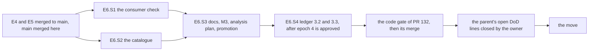

# PLAN — E6 stories: the compatibility contract and the record of the model-arms module

> Status: **E6.S1–E6.S4 BUILT 2026-11-01 except the promotion, and ON `main` via PR #132 (merged 2026-11-01, squash `3a0effcc`), delivered with E4 and E5 (E6.S1, E6.S2 through an Opus review and the coai code gate; E6.S3's docs written and M3 run and logged — step 14, the real-claude delegation re-run, not run); E6.S4 — the parent's entries 3.2 and 3.3, added by the parent's re-review for epoch 4 (2026-11-01) — built and gated on #132's branch before #132 merged; the promotion waits for the owner's open lines (§11).** Stories written 2026-10-31; E6.S4 written 2026-11-01 by the judge (part (b)'s spec; part (a)'s is Fable's, to be written). Epic E6 of [PLAN_model_arms.md](PLAN_model_arms.md) (§3 D5, D28;
> §4.3, §4.12; §5; §6 step 6; §7's E6 tests; §9; §10; `## Epics` E6; plan-gate round 1's F2), written at `cc02d09` on
> `feat/model-arms-e6` (E1–E3 on `main`; E4.S0 built; E4.S1–E4.S3 and E5.S1–E5.S4 being built on their own branches against
> [PLAN_model_arms_E4.md](PLAN_model_arms_E4.md) and [PLAN_model_arms_E5.md](PLAN_model_arms_E5.md)) by the judge role (Opus), as the
> epic starts — `common.plan-change-control` § *What counts as a change*: writing them is not a change. The parent's epoch 3 holds ONE
> entry (3.1); a second accepted change stops the plan, so every claim of the parent found wrong or incomplete is LISTED in §8 and not
> edited here: items 3, 18 and 20 are wording (a stale sentence, a callers list, a status-line reading — `common.plan-change-control`
> § *What counts*: not a change), writable into the parent now; items 6, 11, 19 and 21 wait for the parent's next change or the owner. (Since: epoch 3 holds three entries and is stopped; the
> parent's re-review for epoch 4 took items 3, 6, 11, 18, 20 and 21 into its baseline; item 19 stays the owner's.)
> **No cornerstone** (the parent's ledger is `3 of 3`, spent)
> and **no security judgement in E6.S1–E6.S3** (they add no adapter and no launch to the module); **E6.S4's part (a) IS one** — the
> environment of the arm's own claude session, D19 (ledger 3.2) — so its scenarios and brief are Fable's (§5, §8 item 1). **No code story starts before E4 (both pull requests)
> and E5 (both pull requests) are on `main`** and `main` is merged into this branch (never a force-push). One pull request. (Delivered
> otherwise: E4 and E5 were integrated into this branch and the three epics went to review as ONE pull request, #132 — the parent's §6
> step 0 records the deviation and the remaining path.)
>
> Scope: the consumer check whole — every checked-in reader of the harness run over a fake arm of each scheme the module itself wrote,
> the one rename mapped, the shell's layout compared with the module's in both directions (E6.S1); the flow catalogue derived from the
> module's dispatch (E6.S2); the module documented as it is, M3's attended pilot, the analysis plan written, the promotion prepared and
> — once the parent's two open Definition-of-Done lines (the owner's) are closed — carried out (E6.S3); the parent's entries 3.2 and 3.3 built — the arm's session without `SSH_AUTH_SOCK` and inherited `GIT_*`, the
> pick-back without its patch-id skip (E6.S4, added by the parent's re-review for epoch 4). Tests under `tests/Bench.Tests/ModelArms/` and `tests/Bench.Tests/Cli/`,
> fixtures under `tests/Bench.Tests/Fixtures/model-arms/consumers/`, `research/module_model_arms.md`, `research/module_tests.md`,
> `research/architecture.md`, `README.md`, `todo/PLAN_model_arms_analysis.md` (new).

## 1. Goal, before any solution

The parent made one promise the code cannot keep by itself: **"the same files"** — the analysis half reads what a C# arm leaves exactly
as it read what the shell left (D5), so the shell's readers can run on a C# run while their port is pending (§5). Today that promise
is a list in §4.3 and ONE measurement: `PinnedConsumer` runs `metrics.mjs` over the timing of a sequential arm (E2.S8, M1). Three things
are not known:

- **Whether the other readers read a C# arm at all.** `t-survival.mjs`, `compare.mjs` and `make-tables.mjs` (D28's list), and the three
  part-6 readers checked in by #117 since D28 was written (`metrics6.mjs`, `coai-findings.mjs`, `coai-cost.mjs`) have never been run
  over a file this build wrote. A reader that finds nothing usually says nothing: `t-survival.mjs:15` swallows every git error,
  `compare.mjs:12` drops an arm its list does not hold, `make-tables.mjs:13` reads an absent file as `null`. A green run of a reader
  is evidence only when it reports something the arm did.
- **Whether a resumed step is costed right.** E2 §8 item 62: `metrics.mjs` (`:140`, `:144`) sums every attempt's `total_cost_usd`, and
  a resumed attempt's result carries the session's cumulative cost, so every resumed step is counted once per attempt. The readers are
  pinned and never edited (§5), so the fact must be measured in them and carried to the analysis plan, not fixed here.
- **Whether every verb is in the catalogue.** `ModuleTestsCatalogTests` reads `bench`'s dispatch only; the `model-arms` rows are read by
  a second test from a second source (`ModelArmsCommandLine.Verbs`), and F2 (plan round 1) asked for the dispatch.

Then the record: the module doc still opens *"E1.S2 built … every other section below is an empty heading"*; the architecture's module
map and the README's layout do not name the module; M3 — the attended pilot of the whole thing — has not run; the analysis plan the
parent defers to does not exist; and the plan is promoted only with its deviations, while one line of its Definition of Done (M2's key
check) is the owner's.

**Added by the parent's re-review for epoch 4 (2026-11-01).** The owner decided two questions this document had listed as open (§8
item 26 (a), (b)) — the parent's entries 3.2 and 3.3. The arm's own claude session, the one that runs arbitrary commands by design,
still inherits the operator's ssh agent (`SSH_AUTH_SOCK`) and every ambient `GIT_*`, which the target's tools and the harness's own git
already strip (`ArmChildEnvironment.cs`'s *Residuals*). And the pick-back still carries, WITHOUT a commit of its own, a source with no
record line whose patch-id matches a commit some other hand put on the arm branch (`PickBackOrder.cs:44-48`) — a sibling task's
identical change, the model's own commit — where the intent/completion record already makes every pick idempotent. Both are built here,
as E6.S4, on #132's branch after epoch 4 is approved and before #132 merges.

## 2. What exists — verified at `cc02d09`, 2026-10-31

Every line below was opened in this worktree; the E4.S1/S2 module doc as built was read from `origin/feat/model-arms-e4s2`
(`47b6d9e`).

| Fact | Where |
|---|---|
| `PinnedConsumer`: `metrics.mjs` alone, sha256 `63d668b0…`, the one line starting `const E = ` rewritten in a scratch copy, `results/<listed>/timing.jsonl` linked, `node` by its resolved path under `HOME=<scratch>`; `Listed(arm)` maps `C1→C`, `CR1→CR1`, `CHH1→CH1` | `tests/Bench.Tests/ModelArms/PinnedConsumer.cs:12`, `:21-67` (`:23` the sum, `:24` the prefix, `:40-47` the map, `:50-67` the run) |
| Its callers: `MetricsAsync` from `RunArmSchemeTests.cs:221`, `:306`, `:374` and `StepRestartTests.cs:117`, `:139`; `NodePath` alone from `MakeVerbTests.cs:412`, `ShellObjectiveReader.cs:157`, `:242`, `TargetBench.cs:244` | grep `PinnedConsumer` |
| Stale story ids: *"E2.S8 extends the helper for the four readers"* and *"the four readers are E6's"*; *"E5's compatibility test"* | `PinnedConsumer.cs:14`, `:19`; `TimingLineTests.cs:13`; `research/module_model_arms.md:1014` |
| The readers and what each opens (§8 items 6–10 for the detail): `metrics.mjs` — `${E}/results/<arm>/timing.jsonl`, each start line's `stream`, `~/.claude/projects/*/<session>.jsonl` through `execSync('ls …')`, a fixed arm list | `research/local-model-coding/harness/metrics.mjs:11`, `:12`, `:38`, `:75-83` |
| `t-survival.mjs <arm>` — `COAI_EXP_ROOT` (else a constant), `${E}/arm-<arm>` (git), `results/<arm>/task-<id>-haiku.diff` and `-review.diff`, `vllm/work/<arm>/batches.json`, the base literal `b4e2ea96`; writes `results/<arm>/t-survival.json` | `t-survival.mjs:10-14`, `:15`, `:20`, `:22`, `:24-25`, `:35` |
| `compare.mjs` — `const E = …`, `${E}/metrics.json` (metrics.mjs's `--json`), `results/<arm>/objective.json` and `survival.json`, a fixed list with no `CR*`, `CH*` or `SR*` arm, the classic band from `C`…`C4` | `compare.mjs:8`, `:10`, `:12`, `:13`, `:20-22`, `:38-40`, `:44` |
| `make-tables.mjs` — `ROOT` = its own folder's parent, `data/metrics.json`, `data/arms/<arm>/{objective.json, <arm>-review.json, tasks/batches.json, t-survival.json}`, `part6`/`part7` imported only when `data/part6` or `data/part7` exists; writes `ROOT/tables.md` | `make-tables.mjs:11-12`, `:15`, `:16`, `:88`, `:90` (`o.diff.shortstat`), `:98`, `:130`, `:223-226` |
| `metrics6.mjs <map.json>` — `r/<token>/out` relative to the CWD, every `.a<N>.jsonl`, **the last result per session** (`:20-34`), `arm-done`'s `done_utc`; writes `metrics6.json` into the CWD | `research/local-model-coding/harness/part6/metrics6.mjs:8`, `:17-19`, `:24-39`, `:45`, `:57` |
| `coai-findings.mjs`, `coai-cost.mjs` — `const E = …`, `${E}/exp.env`'s `MAP=` line, `r/<token>/out/*-gate.a<N>.jsonl`, the `mcp__coai__review_*` and `resolve` tool events; write into `${E}` (cost: or `argv[2]`) | `part6/coai-findings.mjs:7-9`, `:13-14`, `:36`; `part6/coai-cost.mjs:7-9`, `:14`, `:26-27` |
| The pinned source's copies: the twenty files of the parent's §2 table under `research/local-model-coding/harness/part6/` (merged by #117, `291f342`), and `PROTOCOL.md` (7354 bytes) | `research/local-model-coding/harness/part6/` |
| `ArmPaths`' task spellings: `CoderHead(id)` / `CoderDiff(id)` = `out/task-<id>-coder.head` and `.diff`, `BatchesJson` = `work/batches.json`, `Continue(step)`, `Objective` = `out/objective.json` | `tools/model-arms/ModelArms.Core/Experiment/ArmPaths.cs:149`, `:159`, `:183`, `:185`, `:211`; pinned by `ArmPathsTests` |
| A blocked gate in a test: `notes/gate.json` pre-written `{"status":"blocked",…}` with `gateTries: 1` | `tests/Bench.Tests/ModelArms/RunArmSchemeTests.cs:481-507` (`:490-491`) |
| The test kits: `ExperimentRoot.MakeArmAsync` (every step's model the fake's, minutes 1, `claude` a link), `MakeKit` (a made arm over `TargetBench`), `ChecksKit` (`checks` through the gate with the bench's recording shims), `RunArmKit.Replay` (`stdoutFile` + `stdoutByCall`) | `ExperimentRoot.cs:101-130`; `MakeKit.cs:22-37`; `ChecksKit.cs:29-86`; `RunArmKit.cs:67` |
| `SrsKit` (E4.S3, being built): a `MakeKit` of `SRS1`, `Plan(params TaskSpec[])` writes `work/tasks.json` and the briefs, `claude` a shell wrapper that commits `<id>.txt` on a task's fresh call | `todo/PLAN_model_arms_E4.md:913-927` |
| The fake: `stdoutByCall.<n>` per model call number; `stdoutByPromptContaining`; `delayMs` read per SCRIPT (the root or `subjects.<model>`), never per call, slept before every call; one script and one call log for every model under `FAKE_CLI_HOME`, numbered per model; it writes no file of the arm's | `tests/FakeCli/Program.cs:116-120`, `:133-137`, `:107`, `:169`, `:190-194`, `:668-669`, `:677-683`; E4 §5 E4.S3 *SrsKit* |
| Every step of a made arm shares the fake's ONE model id; `wall_s` is whole seconds; `ChecksKit.RunAsync` is an instance method over the kit's own `TargetBench` and its one arm `Name` | `ExperimentRoot.cs:113-120`; `ModelArms.Core/Steps/TimingLine.cs:120`; `ChecksKit.cs:33-45`, `:74-85` |
| Which readers launch a process: `t-survival.mjs` runs `git` by name, read-only (`diff --name-only`, `show`), errors swallowed; `metrics.mjs` runs `ls` through `/bin/sh` (`execSync`); `metrics6.mjs`, `compare.mjs`, `make-tables.mjs`, `coai-findings.mjs`, `coai-cost.mjs` launch nothing | `t-survival.mjs:7`, `:15`, `:20-21`; `metrics.mjs:9`, `:38`; grep `child_process` over both folders |
| The flow catalogue: `Verbs()` slices `hosts/Cli/Program.cs` from `private static int Dispatch(` to `\n    }` and matches `"verb" =>`; the row regex admits `bench …` and HTTP rows only; the companion | `tests/Bench.Tests/Cli/ModuleTestsCatalogTests.cs:48`, `:51-58`, `:87-88`, `:99-100`, `:38-46` |
| The module's dispatch: `private static Task<int> Dispatch(VerbInput input)` — fourteen `"verb" =>` arms and `_ =>` | `tools/model-arms/ModelArms/Program.cs:78-98` |
| The module's verb table (the second source) and its own catalogue check | `ModelArms.Core/Experiment/ModelArmsCommandLine.cs:20-38`, `:41`; `tests/Bench.Tests/ModelArms/ModelArmsScenarioTests.cs:140-147` |
| The catalogue's model-arms section, its sentence *"(`ModuleTestsCatalogTests` reads the `bench` rows only; E5.S3 widens it.)"*, and its not-proven paragraph | `research/module_tests.md:97-117` (`:100`), `:259` |
| The module doc: a status line from E1.S2; no state diagram of a step; *The first run: init and validate (E1.S11)*; *The CHH walk*; *M2* and *M2's key check* (the format M3 follows) | `research/module_model_arms.md:1-4`, `:686`, `:190`, `:1949-1990` |
| The architecture's module map (Gate, Probes, Scouts, minigit bench, Tests) and the README's layout table name neither `tools/model-arms` nor `src/Bench.Hosting` | `research/architecture.md:110-121`; `README.md:52-63` |
| `mcp-coai.json` holds the exported key: *"a file the experiment's published record must never carry (E6.S3 excludes `mcp-coai.json` and `coai-data/`)"* | `tools/model-arms/ModelArms.Core/Launch/McpConfig.cs:19`; E2 §8 item 14 |
| The published record: `research/local-model-coding/data/{arms,part6,part7,…}` — no `mcp-*.json`, no `coai-data`, no `settings.json` today | `find research/local-model-coding/data -name 'mcp-*' -o -name coai-data -o -name settings.json` (none) |
| The M2 scaffold the M3 one follows | `tests/Bench.Tests/ModelArms/M2PilotScaffold.cs:21-75` (`[Fact(Explicit = true)]` at `:33`) |
| The delegation measurement M3 re-runs (A–D, haiku, claude 2.1.310) | `todo/PLAN_model_arms_E2.md:682-703` |
| No `todo/PLAN_model_arms_analysis.md`; no `research/PLAN_model_arms*` | `ls` |

## 3. Conventions every story follows

E1 §3–E5 §3 hold unchanged (namespaces; pure means pure; refusals as values; red first on an ASSERTION; docs per story; time through
`TimeProvider`; no tokens in output; the commands). For E6:

- **A reader is never edited.** Every pinned reader runs from a scratch COPY whose source sha256 the helper checks first; a copy differs
  from its source only by the rewrites §8 item 8 names, each matched exactly once (a reshaped script fails the helper by name, never
  reads silently wrong). The repository's file is never written.
- **A reader's green is a value, not an exit code.** Every reader that runs has at least one assertion on a number or a name the fake arm
  produced, read back from the module's own files (`TimingOf`, `BatchesFile.Read`, `notes/review.json`, `objective.json`) — never typed
  (`common.testing`: never guess a value the code computes; a file full of "exit 0" needs one positive).
- **Every link the helper makes is checked to have a target before the reader runs** — a link to an absent file is the reader's
  `existsSync` answering `false`, which reads as "nothing to report".
- **Lists are derived.** The readers from the harness folders, the shell's paths from the pinned scripts, the module's from `RootPaths`
  and `ArmPaths` by reflection and the example's bindings, the verbs from the dispatch; each scan has a companion that finds a known instance.
- **Commands.** `node .agents/conventions/tools/low-priority.mjs dotnet build dew_flow_benchmark.slnx -c Release -m:4`, then
  `node .agents/conventions/tools/low-priority.mjs ./tests/Bench.Tests/bin/Release/net10.0/Bench.Tests --filter-class "*<Class>"` per
  class named in the story, `--filter-namespace "Bench.Tests.ModelArms"`, and the whole suite once per story;
  `node .agents/conventions/tools/plan-lifecycle.mjs`. The reader tests are Linux only (links, `node`, the POSIX shims), skipped
  elsewhere with the reason.

## 4. Shared contracts

**C26 — the pinned readers** (E6.S1; nothing else calls the new members):

```csharp
// tests/Bench.Tests/ModelArms/PinnedConsumer.cs — extended, the two MetricsAsync overloads and NodePath unchanged
internal enum Rewrite { None, RootLine /* the one line starting "const E = " */, BaseLiteral /* t-survival.mjs:20's 'b4e2ea96' */ }
internal sealed record PinnedReader(string Name, string RepositoryPath, string Sha256, IReadOnlyList<Rewrite> Rewrites, TimeSpan Timeout);
internal sealed record ReaderRun(int ExitCode, string Output, string Error, string Scratch);   // Scratch: where its outputs were written
internal static class PinnedReaders
{
    public static IReadOnlyList<PinnedReader> Run { get; }                         // the seven of §8 item 6, each with its measured Timeout (§8 item 12)
    public static IReadOnlyDictionary<string, string> Excluded { get; }            // repository path → why it is not run (§8 item 6)
}
// PinnedConsumer gains: CopyAsync(reader, scratch, replacements) → the copy's path; and RunAsync(reader, scratch, args, environment, cwd, ct)
// ONE name map: the existing PinnedConsumer.Listed(arm) (`PinnedConsumer.cs:40-47`) gains SRS1 → SR1 and serves every reader that lists
// by parts 1–5's names (metrics.mjs, make-tables.mjs, t-survival's argv, compare's metrics.json keys); no second Listed. It refuses an arm
// NAME parts 1–5 have no spelling for (a test error); it never answers whether one reader keeps the row — compare.mjs:12 drops CR1, CH1
// and SR1 by its own list, and that drop is ASSERTED over the names Listed gives (§8 item 7).
```

**C27 — the fake arms** (E6.S1; `ConsumerCompatibilityTests` reads them, never writes):

```csharp
// tests/Bench.Tests/ModelArms/ConsumerArms.cs — an xUnit class fixture (IAsyncLifetime), built once per test class
internal sealed class ConsumerArms : IAsyncLifetime
{
    public static readonly IReadOnlyList<(string Arm, string Scheme)> Arms = [("C1", "C"), ("CR1", "CR"), ("CHH1", "CHH"), ("SRS1", "SRS")];
    public ExperimentRoot Root { get; }       // ONE root holding the four arms, made by `make` over TargetBench's scratch target
    public ArmPaths PathsOf(string arm);
    public string Base { get; }               // target.base, the sha t-survival's literal is rewritten to
    public IReadOnlyList<FakeCliCall> Calls { get; }
}
```

## 5. Stories

### E6.S1 — The consumer check: every checked-in reader over a fake arm of each scheme, the rename mapped, the layout compared

- **Coder:** sonnet · **Spec:** Opus (this section) · **Review:** Opus. **`model:`** opus (scenarios, brief, review), sonnet (code and
  tests). **Depends on:** E2–E5 on `main` (an SRS arm needs E4.S3; the fake arms need `make` and `checks`, E3; E5 adds the files the
  layout comparison must name). **Parallel with:** E6.S2. **Size:** ≈ 1100 lines (≈ 300 helper and builder, 600 tests, 50 fixtures, 150
  docs).
- **Owns:** D28, D5's compatibility, E2 §8 item 62 (as measured, §8 item 5), C26, C27.

**Goal.** A fake arm of each of the four schemes, written by the module's own `make`, `run-arm` and `checks`, is read by every
checked-in reader without an error, and each reader reports what the arm did; the one rename is the only map; every file the shell
wrote is either written by the module or named, and every file the module writes beyond the shell's is named with its decision.

**Files.** `tests/Bench.Tests/ModelArms/PinnedConsumer.cs` (extended: C26; its doc's stale ids, §2), `ConsumerArms.cs` (*new*: C27),
`ShellLayout.cs` (*new*: the scan of item 11), `ConsumerCompatibilityTests.cs` (*new*), `TimingLineTests.cs` (`:13`'s doc only: *E6's*),
`tests/Bench.Tests/Fixtures/model-arms/consumers/result-success-cost-2.jsonl`, `stream-gate-coai-round.jsonl`,
`transcript-interrupted.jsonl` (*new*, §8 item 13), `SrsKit.cs` (E4.S3's — one parameter, the task file's line, only if it lacks one:
§8 item 14), `ChecksKit.cs` (a static `RunAsync(ExperimentRoot root, string arm, bool parseOnly = false, ChecksSeams? seams = null,
CancellationToken? stopping = null)` that the instance method `:74` calls with `Root, Name` — its callers unedited); `research/module_model_arms.md` (*The consumer check (E6.S1)*, a new heading before *M2*); `research/module_tests.md` (the
lines of *What the harness does NOT prove* this story's facts change — §8 items 5, 7).

**The fake arms (C27).** One `TargetBench` root; `prep-base`; an experiment of one run `consumers` whose one round is the four arms;
`make` (as `MakeKit` does) → four made arms; `claude` = `SrsKit`'s wrapper around ONE `FakeCli`; every step's model the fake's and
minutes 1; `limits`: `waitSeconds` and `gateWaitSeconds` the smallest `ExperimentFile` admits (read from its refusal, asserted accepted by
`validate`), `gateTries` 1, `minimumRemainingSeconds` 1. The arms run ONE AT A TIME in the order of `Arms`, through `RunArmKit.RunAsync`;
before each, the builder reads the count of the fake's MAIN model's calls (the log numbers per model, `Program.cs:677-683`) and scripts
that arm's calls by number from it (never a guessed number).

**One slow call per arm, so a wall is not zero.** `wall_s` is whole seconds (`TimingLine.cs:120`), and the fake answers in milliseconds,
so every wall would be 0 and a wall assertion would pass on zeros. `delayMs` is read per script, not per call, and every step shares the
fake's one model (§2) — so the builder gives ONE step per arm (its first: `1-code`, SRS1's `1-split`) a second model id, `<fake.Model>-slow`,
whose `subjects.<fake.Model>-slow.delayMs` is 1500 (`Program.cs:107`, `:169`); the script and the call log stay the one home's
(`FAKE_CLI_HOME`), the slow step is never scripted by number, and the main model's numbering simply excludes it.

| arm | what is scripted | what it leaves |
|---|---|---|
| C1 | `notes/gate.json` written `{"status":"blocked","why":"consumers"}` before the run (`RunArmSchemeTests.cs:490-491`); `2-review`'s call `RunArmKit.SuccessEndingIn(root, "review-changes.jsonl", {"verdict":"changes-requested","findings":[{"severity":"major","title":"consumers"}]})` (`RunArmKit.cs:79-87`) — the one verdict that is not `ready`; `4-gate`'s first call `stream-gate-coai-round.jsonl` (its own result line costs 1.25), its resume `result-success-cost-2.jsonl`; the rest `result-success.jsonl` | `notes/review.json` with `changes-requested`; `4-gate.a1` and `.a2` in ONE session (a blocked gate continued), costs 1.25 then 2.00 cumulative, one coai round with one finding accepted |
| CR1 | `2-hreview`'s first call `result-429-usage-limit-reached.jsonl` (the 2026-10-28 line) | `2-hreview.a1` limited, `.a2` resumed |
| CHH1 | `2-hA`'s first call `stream-no-result.jsonl` → exit 5; the builder runs `run-arm CHH1` again → 0 | `2-hA.a1` interrupted (`complete: false`), `.a2` resumed |
| SRS1 | `SrsKit.Plan` of `t1`…`t4` and `t5` (owns the plan, depends on all) — FIVE tasks, two batches; each task's file one meaningful line `the coder of <id> wrote this line` (`SrsKit` commits `<id>.txt` for every task, t5 in the clone); replays by prompt substring as `SrsKit` does (parallel calls race for a call number) | `work/batches.json`, `out/task-<id>-coder.diff` per task (five), the picks; a final diff that is not empty |

Then `checks <arm>` for each, through the gate with the bench's shims, by the static `ChecksKit.RunAsync(Root, arm)` (the instance method
is a kit over its own `TargetBench` and one arm, so it cannot run on this root as it is) → `out/objective.json`. Every arm ends with
`arm-done`; the fixture asserts it (a builder that leaves an arm unfinished fails at construction, naming the arm).

**The readers (C26), per reader — how it is given the arms and what it must report** (`<s>` = the reader's own scratch folder of the root):

| reader | given | reports — every expected value read back from the arm |
|---|---|---|
| `metrics.mjs` | the new run path over the four arms at once (each `results/<listed>/timing.jsonl` linked, `Listed` names); `HOME` = `<s>` holding `transcript-interrupted.jsonl` at `.claude/projects/consumers/<CHH1's 2-hA a1 session>.jsonl`, its one assistant message stamped with that attempt's `start_utc` (inside the window `metrics.mjs:39-41` reads) | `report.<listed>.steps` keys = the arm's distinct `Start` steps in start order; attempts per step = its `Start` lines; each attempt's `wallSeconds` = its `End.WallSeconds`, and the slow step's > 0; `report.<listed>.wallSeconds` = Σ of them; CR1's `2-hreview` two attempts, the first's `terminal` the 429 line's; CHH1's `2-hA` attempt 1 `complete: false`, `cost: null`, its `byModel` = the TRANSCRIPT's counts (the stream's message carries no usage); C1's `report.C.steps["4-gate"][0].cost` 1.25 and `[1].cost` 2.00; `report.C.models["claude-sonnet-5-5"].cost` 3.25 (`:140` sums every attempt's `costUSD`: item 5); `report.C.cost` null (`:144`: the other attempts' cost is undefined, `?? NaN`, and JSON writes NaN as null); every arm's `vllm` null |
| `metrics6.mjs` | `node <copy> <root>/arms.map.json`, CWD `<s>` holding a link `r` → `<root>/r` | per arm: `attempts` = the arm's `out/*.a<N>.jsonl` count; `steps[<step>].wall_s` = Σ that step's `End.WallSeconds`, the slow step's > 0; `steps[<step>].model` = its start line's; `span_min` not null (read from `arm-done`; minute-rounded, so only its presence is asserted); SRS1's coders under kind `t-code`; C1's `steps["4-gate"].cost` **2.00** — the last result of its session |
| `t-survival.mjs SR1` | `COAI_EXP_ROOT=<s>`; links `arm-SR1` → the clone, `results/SR1/task-<id>-haiku.diff` → `out/task-<id>-coder.diff` (THE map), `vllm/work/SR1/batches.json` → `work/batches.json`; the base literal → `Base` | `tasks[].id` = `BatchesFile.Read(work/batches.json)`'s ids (five); `haikuLines` = the task count, 5; `keptFinal` = 1; `reviewChangedLines` = null and the line *no task review ran* |
| `compare.mjs --json` | root line → `<s>`; `<s>/metrics.json` = metrics.mjs's `--json` stdout over the four arms (so it holds `CR1`, `CH1`, `SR1` — metrics.mjs lists them); `results/<listed>/objective.json` linked | ONE row, `Listed("C1")`: `steps["4-gate"].cost` 3.25 (`compare.mjs:34-35` sums the attempts, null as 0); `cost` null; `objective` not `n/a`; `scenarios` = objective.json's `scenariosPresentCount`; `judge` null, `survival` null; NO row `Listed("CR1")`, `Listed("CHH1")`, `Listed("SRS1")` (`compare.mjs:12`) |
| `make-tables.mjs` | copied unmodified to `<s>/harness/`; `<s>/data/metrics.json`; `data/arms/<listed>/objective.json`, `<listed>-review.json` ← `notes/review.json`, `timing.jsonl` ← `out/timing.jsonl`, `tasks/batches.json` ← `work/batches.json`, `t-survival.json` ← t-survival's output | stdout `tables.md written: 4 arms`; in `<s>/tables.md` §3b each arm's row ends with its `notes/review.json` verdict — C's `changes-requested` with `1 | 0 / 1 / 0`, the others `ready`; §3's last cell = objective.json's `diff.shortstat`, SR1's NOT empty; §4b's SR1 row `5 / 2` from `batches.json`, `5 → 100 %` from `t-survival.json`, its elapsed not `n/a` (from `timing.jsonl`; minute-rounded, presence only) |
| `coai-findings.mjs` | root line → `<s>`; `<s>/exp.env` = `MAP=<root>/arms.map.json\n`; `<s>/r` → `<root>/r` | `<s>/coai-findings.json`: C1 one `code` round with the fixture's verdict and ONE finding whose `decision` is `accept`; CR1, CHH1, SRS1 `[]` |
| `coai-cost.mjs <s>/coai-cost.json` | the same | C1 one round with the fixture's `tokensIn` / `tokensOut`; the others `[]` |

**Every input of every reader is given and asserted, or named and the guarantee narrowed** (each row above holds the assertion):

| reader | inputs given → the assertion that proves it was read | inputs NOT given — why, and what is therefore not proven |
|---|---|---|
| `metrics.mjs` | `timing.jsonl` → steps, attempts, walls; each `.a<N>.jsonl` → `terminal`, `cost`, `complete`; a transcript → `byModel` of the interrupted attempt | `vllm/requests-<arm>.jsonl` — parts 6–7 run no local model and the module writes none: `vllm` null asserted; the fitted prices (`:112-127`, three priced attempts per model needed) — not proven |
| `metrics6.mjs` | the map → its four arm keys; `timing.jsonl` → `wall_s`, `model`; the streams → `attempts`, `cost`; `arm-done` → `span_min` | — |
| `t-survival.mjs` | the clone (git) → `keptFinal`; the coder diffs → `haikuLines`; `batches.json` → `tasks` | `task-<id>-review.diff` — no scheme reviews per task (item 9): `reviewChangedLines` null asserted |
| `compare.mjs` | `metrics.json` → the step cost, the rows; `objective.json` → `objective`, `scenarios` | `judge-abs/scores.json` (the judges, D28) and `survival.json` (Q arms only): `judge` and `survival` null asserted; the classic band over more than one C arm — not proven |
| `make-tables.mjs` | `metrics.json` → the arm count; `objective.json` → §3; the review → §3b; `timing.jsonl`, `batches.json`, `t-survival.json` → §4b | `survival.json`, `fill-*.json`, `filler-requests.jsonl` (Q/H arms), `judges/`, `mutation.json`, `fix-outcomes.json` — no module output: their sections print the *not run* / *not judged* rows, asserted for C; **`data/part6` and `data/part7` are not created, so `make-tables6.mjs` and `make-tables7.mjs` are never imported (`:223-224`) — they are `Excluded` (item 6) and make-tables' part-6 and part-7 sections are NOT proven** |
| `coai-findings.mjs`, `coai-cost.mjs` | `exp.env` → `MAP`; the map → the four arms; the gate streams → rounds, findings, decisions, tokens | — |

**Scenarios** (`ConsumerCompatibilityTests` over `ConsumerArms` unless named; Linux only).

| Test | Given / When / Then | Red (against the stub named) |
|---|---|---|
| `Every_checked_in_reader_reads_a_fake_arm_of_each_scheme_without_an_error` | `[Theory]` over `PinnedReaders.Run`: the copy's source sum equals the pin; every link has a target; it ends inside its own `Timeout` (a timeout fails naming the reader, its timeout and the preserved scratch, §8 item 12); exit 0; stderr empty; the reader's output (stdout JSON or its written file) parses | `RunAsync` stubbed to `ReaderRun(-1, "", "not run", "")`: `Expected exit 0, but found -1` |
| `The_readers_report_what_the_fake_arm_did` | `[Theory]` over the seven rows of the table above, each its assertions | the builder's stub with no arm: `Expected report.C.steps keys to equal {"1-code", …}, but found {empty}` |
| `The_renamed_coder_files_reach_t_survival_through_the_named_map` | with the map: `haikuLines` = the task count; the same run with the links named `task-<id>-coder.diff` (the module's name, no map): `haikuLines` 0 — the map is the whole difference | the map left out of the helper: `Expected haikuLines 5, but found 0` |
| `A_file_the_shell_wrote_that_the_module_does_not_is_listed_by_name_or_the_test_fails` | every path `ShellLayout.Paths()` finds is spelled by the module, or in `ShellLayout.Renamed` (name → the module's name and the decision) or `ShellLayout.ShellOnly` (name → why) | both tables empty: fails naming `out/task-<id>-haiku.diff`, `chain7/locked`, `exp.env`, … |
| `A_file_the_module_writes_that_the_shell_did_not_is_listed_by_name_with_its_decision` | every module spelling (the public members of `RootPaths` and `ArmPaths` rendered with placeholders, and the example's bindings) is found by the scan, or in `ShellLayout.Additions` (name → D-number or story) | `Additions` empty: fails naming `out/<step>.continue`, `chain/<run>/locked`, `.isolation.lock`, … |
| `The_shell_scan_still_finds_known_paths_in_each_pinned_script` | each of the seven scripts' sha256 equals the parent's §2 sum; the scan finds `out/timing.jsonl`, `notes/hA.json`, `out/task-<id>-haiku.diff`, `chain/arms-done` and `.gate.lock`; every variable root it maps (`R=`, `OUT=`, `NOTES=`, `WORK=`, `O=`, `M=`) is assigned in its script as the map says | a scan whose pattern matches nothing: `Expected paths to contain "out/timing.jsonl"` |
| `Every_file_a_fake_arm_holds_is_one_the_module_spells` | every file under the four arms' `out/`, `notes/`, `work/` and the arm folder's top level, and every file at the root's top level, `pids/` and `chain/`, matches a module spelling (the clone `arm/`, `tmp/`, `wt/`, `coai-data/` excluded by name) | a spelling set without `PickRecord`: fails naming `out/pick-t1.json` |
| `A_resumed_steps_cost_is_its_sessions_last_result_in_metrics6_and_every_attempt_in_metrics_mjs` | C1's `4-gate`: one session id in both start lines; `metrics6.mjs`'s `C1.steps["4-gate"].cost` 2.00; `metrics.mjs`'s `report.C.steps["4-gate"][0].cost` 1.25 and `[1].cost` 2.00, their sum read in two fields — `report.C.models["claude-sonnet-5-5"].cost` 3.25 (`metrics.mjs:140`) and compare's `steps["4-gate"].cost` 3.25 (`compare.mjs:34-35`) — while `report.C.cost` is null (`:144`, NaN) — all asserted, the 3.25 as the readers' defect (item 5) | the builder without the cost fixtures: `Expected 2.00, but found 0` |
| `Every_checked_in_script_of_the_harness_is_run_or_excluded_by_name_with_its_reason` | every `*.mjs` and `*.js` of `research/local-model-coding/harness/` and `part6/` is in `PinnedReaders.Run` or `Excluded`, never both; `Excluded`'s reasons are not empty; the scan finds `metrics.mjs` and `part6/metrics6.mjs` | `Excluded` empty: fails naming `make-tables6.mjs`, `mutate.mjs`, … |

**Break-its.** The base literal not rewritten → *report what the fake arm did* (t-survival `keptFinal` 0); a link made to a missing
target with the existence check removed → *without an error* stays green but *report* goes red (the reason for the check); the map
removed → *renamed coder files*; `PickRecord` dropped from the spelling → *every file a fake arm holds*; `CR1` relabelled `C2` for
`compare.mjs` → *report* (a row it must not have, and a classic band that moved); the cost fixtures swapped → *resumed step's cost*.

**Brief.** Extend, never fork, `PinnedConsumer`: `MetricsAsync`'s two overloads and `Listed` keep their behaviour for their callers
(§2; `RunArmSchemeTests`, `StepRestartTests` unedited and green); `Listed` gains `SRS1 → SR1` and stays the ONE name map (C26). The new
run path copies the reader with its rewrites, links what the reader looks for, checks every link's target, and launches `node` by
`NodePath` with `PATH` the test process's, `HOME` = the scratch, and the reader's own `Timeout` (§8 item 12). `ConsumerArms` composes the
existing kits (`MakeKit` for the four makes, `SrsKit`'s wrapper and `Plan`, `RunArmKit.RunAsync`, `RunArmKit.SuccessEndingIn`, the new
static `ChecksKit.RunAsync(Root, arm)`); a kit member it needs and lacks is added to that kit, not copied. `ShellLayout` scans the seven pinned part-6 scripts (`run-arm.sh`, `t-lib.sh`, `objective-checks.sh`, `after6.sh`,
`after7.sh`, `lock.sh`, `run-all.sh`) for `$E/`, `$R/`, `$OUT/`, `$NOTES/`, `$WORK/`, `$O/`, `$M/`, `$S` and `${O}/../` paths, maps
`$name`/`$1` → `<step>`, `$attempt` → `<n>`, `$id` → `<id>`, `$i` → `<i>`, `$a` → `<arm>`, `$(tok "$a")` / `$TOKEN` → `<token>`,
`$(date …)` → `<stamp>`, and keeps per script the root of `$M` (`after6.sh:7` `chain`, `after7.sh:8` `chain7`) and `$S` (`lock.sh:8`).
Each of §8 item 11's three shell-written examples is a row of its companion test. It says in its doc what it cannot see: files the MODEL writes by brief
(`work/tasks.json`, `work/t<n>.md`) and paths built inside inline node other than `${O}/../objective.json`.

**Commands.** `--filter-class "*ConsumerCompatibilityTests"`, `"*RunArmSchemeTests"`, `"*StepRestartTests"`, `"*TimingLineTests"`,
`"*ArmPathsTests"`; the namespace; the whole suite.

**Done when.** The nine green, every red seen, the six break-its observed; the callers of §2 unedited and green; the module doc's
*The consumer check (E6.S1)* holds the readers' table with each reader's measured wall and its timeout (§8 item 12), the inputs table
with what each excluded input leaves unproven, the three tables of `ShellLayout` as they landed, item 5's two numbers and what the check
does NOT prove — a real claude's streams (the fake replays recorded shapes), a real multi-hour task's diff, the judges
(`ObjectiveReportTests`' round trip stands for them, D28), the parts 1–5 Q/H readers (§8 item 6).

**Out of bounds.** Editing any reader; porting any reader (the analysis plan); a `CR*`, `CH*` or `SR*` row in `compare.mjs`.

### E6.S2 — The flow catalogue reads the module's dispatch (F2)

- **Coder:** sonnet · **Spec:** Opus (this section) · **Review:** Opus. **`model:`** opus (scenarios, brief, review), sonnet (code).
  **Depends on:** E5.S4 on `main` (the last `NotBuilt` arm gone; the rows of `lock`, `unlock`, `run-all`, `chain` written by E5).
  **Parallel with:** E6.S1. **Size:** ≈ 120 lines (≈ 80 test, 40 `research/module_tests.md`).
- **Owns:** F2; the catalogue's `model-arms` half.

**Goal.** Every `model-arms` verb is derived from the module's own dispatch, has its row in `research/module_tests.md`, and the row
names a class that exists; the dispatch and the command line's verb table name the same verbs.

**Files.** `tests/Bench.Tests/Cli/ModuleTestsCatalogTests.cs`; `research/module_tests.md` (`:97-117`: the intro sentence of `:99-100`
rewritten — the list is derived from the dispatch by `ModuleTestsCatalogTests` and from the table by `ModelArmsScenarioTests`, and the
two are held equal; the stale `:117` clause if E5.S3 left it). `ModelArmsScenarioTests.cs` unedited.

**Contracts.** `ModelArmsVerbs()` slices `tools/model-arms/ModelArms/Program.cs` from `private static Task<int> Dispatch(` to the first
`\n    }` and applies the existing `Arm()` regex, prefix `model-arms `; `DerivedFlows()` = `[.. Verbs(), .. ScoutVerbs(), .. Routes(),
.. ModelArmsVerbs()]`; `CatalogueRow()`'s flow group admits `model-arms [a-z -]+` beside `bench [a-z -]+`. The two existing tests then
cover the `model-arms` rows too (every derived flow has a row, every row a flow; every `covered` row names a class).

**Scenarios** (`ModuleTestsCatalogTests`).

| Test | Given / When / Then | Red |
|---|---|---|
| `Every_model_arms_verb_is_derived_from_its_dispatch_and_has_its_row` | `ModelArmsVerbs()` is not empty and holds fourteen verbs; each has exactly one row; each `covered` row names a class of this assembly; no row names a verb the dispatch lacks | compile red (no `ModelArmsVerbs`), then — with the scan and the old row regex — `Expected rows to contain "model-arms init"` |
| `The_scans_still_find_known_flows_in_each_source` (edited) | also contains `model-arms run-arm`, `model-arms chain`, `model-arms init`; a row `model-arms run-arm` names `RunArmSchemeTests` | the dispatch slice ending at the wrong brace: `Expected … to contain "model-arms chain"` |
| `The_model_arms_dispatch_and_its_command_line_table_name_the_same_verbs` | the set of `ModelArmsVerbs()` (prefix removed) equals `ModelArmsCommandLine.Verbs` (a guard of two sources: §8 item 15) | `ModelArmsVerbs()` as the first test's compile stub, returning `[]`: `Expected the dispatch's verbs to be equivalent to {"init", …}, but … were missing`; then its break-it below |

**Break-its.** The `model-arms status` row deleted → the first test names it; a `"frob" =>` arm planted in `Program.cs` → the first
and the third name it; `"frob"` added to the table only → the third.

**Commands.** `--filter-class "*ModuleTestsCatalogTests"`, `"*ModelArmsScenarioTests"`; the whole suite.

**Done when.** The three green, each red seen on an assertion, the three break-its observed and restored; `research/module_tests.md`
says where each derivation lives.

**Out of bounds.** Changing a row's coverage (each story owns its verb's row); `bench`'s rows.

### E6.S3 — The record: the module documented as it is, M3, the analysis plan, the promotion

- **Writer:** sonnet (the docs, `PublishedRecordTests`, `M3PilotScaffold`) · **M3:** the main session, by hand · **The analysis plan:**
  the main session (the plan role) · **Review:** Opus (the docs against the code; the deviations against every stories document's §8).
  **`model:`** opus (this spec, the review), sonnet (writing), main session (M3, the analysis plan). **Depends on:** E6.S1 and E6.S2 merged
  into this branch; E2–E5 on `main`. **Size:** ≈ 900 lines (≈ 500 docs, 250 scaffold, 30 test, the analysis plan ≈ 150).
- **Owns:** §6 step 6's docs, M3, §10's documentation lines, the promotion.

**Goal.** A reader of `research/` finds the module as it runs — its verbs, its layout, its state machine, its first run with every
refusal quoted, its consumer check, M1–M3's logs and what is not proven; the analysis half has its plan; the plan is ready to promote
with its deviations and is promoted once the parent's two open Definition-of-Done lines (the owner's) are closed.

**Files.** `research/module_model_arms.md` (the status line and *Purpose* rewritten — parts 6 AND 7, the module as built; a
`stateDiagram-v2` of a step — the six end states of D6, `.done`, `.continue`, D7's decisions; a verbs table — the fourteen verbs, their
positionals, their exits; *The first run* widened from E1.S11's to §4.12's whole order `init → validate → prep-base → make → chain <run>`
with every refusal QUOTED as M3 printed it (F6); the CHH walk-through checked against the example as it landed, with item 4's
`part7.closed` difference; the growth table of §4.11 as built; *The published record* — `mcp-coai.json` and `coai-data/` never copied,
E2 §8 item 14; *M3*; `:1014`'s stale id; every *Not proven* gathered in one closing section, macOS/FreeBSD unobserved said once);
`research/architecture.md` (the module map's row *Model arms*; a node `model-arms` in the container diagram with its references —
`ModelArms.Core` → `Bench.Domain`, `Bench.Application`; `model-arms` → `ModelArms.Core`, `Bench.Infrastructure`, `Bench.Hosting`; nothing
references it, the guard says so); `README.md` (the layout table gains `src/Bench.Hosting` and `tools/model-arms`; a pointer to the
module doc's first run); `research/module_tests.md` (every `model-arms` row covered with its class — E5's rows checked, not rewritten; the
not-proven paragraph `:259` rewritten whole for the module); `research/README.md` (the module doc's row, stale since E1.S2);
`tests/Bench.Tests/ModelArms/PublishedRecordTests.cs` (*new*), `M3PilotScaffold.cs` (*new*); `todo/PLAN_model_arms_analysis.md` (*new*)
and its `todo/README.md` row; at the promotion, the parent, `PLAN_model_arms_E1.md`…`_E6.md`, both READMEs and every inbound referrer.

**Scenarios.**

| Test | Given / When / Then | Red |
|---|---|---|
| `PublishedRecordTests.The_published_record_holds_no_mcp_config_and_no_coai_data` | no file named `mcp-coai.json` or `mcp-none.json` and no folder `coai-data` under `research/local-model-coding/data/`; the scan finds `data/part6/arms/C1/objective.json` (the companion) | a planted `data/part6/arms/C1/mcp-coai.json`: `Expected no file named mcp-coai.json, but found …` |
| `M3PilotScaffold.Writes_the_scratch_target_root_home_and_claude_for_the_pilot` | `[Fact(Explicit = true)]`; creates the manifest exclusively first, then prints what M3's step 1 lists, every created path in the manifest before it exists; validates the pair on a throwaway root (as `M2PilotScaffold` does) | — (a scaffold; its red is `validate`'s refusal of its own pair) |

**M3 — the attended pilot of the whole thing, with the fake CLI (by hand; the main session).** Run from the worktree at E6's head with
E4 and E5 merged, the Release build in place, Docker not needed. The binary is `./tools/model-arms/ModelArms/bin/Release/net10.0/model-arms`,
from the worktree's root (M2's log ran it so, `research/module_model_arms.md:1455`); `model-arms <verb>` below means that path.

*The names.* Every scratch path is `/tmp/testsToDelete-m3-<what>-<id>`, M2's form (`M2PilotScaffold.cs:12-16`) — the LEGACY form of
`common.test-leftovers` §1 (no owner segment): this repository has not reached its producer stage of the test-leftovers rollout (its
epic E6 there), so no owner-form helper exists here yet, and a legacy name is listed by a sweep, never collected by age — M3's own
teardown (step 15) is the only thing that removes it.

*The scaffold* (`M3PilotScaffold`, M2's shape, `M2PilotScaffold.cs:33-75`) draws a fresh `<id>`, creates **first, exclusively**
(`FileMode.CreateNew`; one already there → a new `<id>`) the manifest `testsToDelete-m3-manifest-<id>.json` — the `<id>`, the caller's
uid, and the EXACT path of everything it creates or names, written before each is created — then prints and creates: `<target>`
(`testsToDelete-m3-target-<id>`: M2's tiny .NET solution and `src_vs_code`, with the rules submodule); `<root>` (`…-root-<id>`, NOT created;
`init` creates it); `<home>` (`…-home-<id>`) — a scratch HOME with `.claude/projects`, `file-history`, `session-env`, `shell-snapshots`
made, so the isolation's `~/.claude/*` are the pilot's and **the operator's own `~/.claude` is never touched**; `<old>` (`…-old-<id>`) — a
folder the isolation closes; `<bin>` (`…-bin-<id>`) — `claude` as a wrapper over the fake (`SrsKit`'s shape, below), links to the host's
`git`, `node`, `npm`, `dotnet`; `FAKE_CLI_HOME` (`…-fake-<id>`) and its script; `<d28>` (`…-d28-<id>`, step 13's working folder); `<deleg>`
and `<home14>` (`…-deleg-<id>`, `…-home14-<id>`, step 14's working folder and HOME); `<keep>` (`…-keep-<id>`, step 12's copy); and the two
files to copy. The experiment is the worked example with this target's paths and ONE run `pilot` whose one round is
`["C1","CR1","SRS1","CHH1"]`; `isolation` `closed: [<old>]`, `unlisted` the example's with `~` = `<home>`; `awake: "auto"`; `limits`
`waitSeconds` 30, `tries` 3, `gateWaitSeconds` 30, `gateTries` 2, `minimumRemainingSeconds` 30, `killGraceSeconds` 60 (each lowered only as
far as `validate` accepts); every step's model `m3-fake` and `minutes` 2, but the gate steps' model `m3-fake-gate`, whose
`subjects.m3-fake-gate.delayMs` is 10000 (FakeCli reads `delayMs` per model, `Program.cs:107`, `:169`; one script and one log for both under
`FAKE_CLI_HOME`, `:668-669`) — every gate call lasts ≥ 10 s, the window step 9 reads the lock in; `coai` as M2's (the fake as the stand-in
binary, a key-free settings file). Before step 9 the lock queue's ceiling (E5.S3) is checked against four gates of ≥ 10 s and one gate-wait
of 30 s; if it would refuse, the delay goes and step 9's *held* reading with it, and the log says so.

*What the wrapper plays* (the model's file writes, which the fake cannot do): the split's fresh call writes `work/tasks.json` (`t1`–`t4`,
`t5` owning the plan) and `work/t<n>.md`; a task coder's fresh call writes and commits `<id>.txt`; the FIRST gate call of the pilot
writes `../notes/gate.json` = `{"status":"blocked","why":"pilot"}` and every later gate call `{"status":"proceed"}` (a marker in `<bin>`,
outside the root, says which, and names the arm it blocked); then it execs the fake. *What the fake replays* — **by prompt text, never by
call number** (`stdoutByPromptContaining`, `Program.cs:133-137`; the keys are the opening lines of the shipped briefs up to their first
placeholder, as `RunArmKit.BriefOf` reads them, `RunArmKit.cs:90-106`, which refuses two briefs that open alike): the opening of
`briefs/hr-review-fix.template.md` → the 2026-10-28 429 line, so BOTH `hreview` steps (CR1's `2-hreview`, SRS1's `3-hreview`) take a limit
on their first attempt; the opening of `briefs/hA-trace.template.md` (CHH1's only) → `stream-no-result.jsonl`; everything else, and every
resume (its prompt is the resume notice, which holds no brief's opening), `result-success.jsonl`.

*Every verb runs* under `env -i PATH=<bin>:<node's>:<dotnet's>:/usr/bin:/bin HOME=<home> LANG=C.UTF-8 FAKE_CLI_HOME=<…>` (plus
`WSL_DISTRO_NAME` and `WSL_INTEROP` on WSL, for `pwsh.exe`), `--experiment <root>` where the verb takes it. Each step: the command, the
exit expected, what to look at.

*The recovery sequence* — run, in place of anything else, whenever a step ends otherwise than expected, is aborted (Ctrl-C, a hung step
killed) or the pilot stops early; it is step 15's teardown and the `finally` of every step from 8 on: (T1) `status` — every runner
ended (a live one is waited for; `unlock` refuses while one lives, and `--force` is used only once `status` shows none alive); (T2)
`model-arms unlock` → 0 *restored* or *no snapshot*; a failure is retried twice, then REPORTED with its output and the sequence STOPS —
nothing is removed while a snapshot stands; (T3) the restore verified: `status` prints no applied line, `ls <root>` lists,
`stat -c %a <old>` is its original mode; (T4) the manifest verified: it parses, its uid is the caller's, every path in it is named
`testsToDelete-m3-*-<id>` and is owned by the caller's uid (`stat -c %u`) or absent; (T5) only then `rm -rf` of exactly the manifest's
paths, one by one — never a glob — and the manifest last; the log names what was removed and what was kept.

1. The scaffold (`--explicit only --filter-method "*Writes_the_scratch_target_root_home_and_claude_for_the_pilot"`) → passed; the paths and
   the manifest.
2. `model-arms version` → 0; `model-arms help` → 0, the fourteen verbs; `validate` → 4 naming the missing root and `init` (the first
   refusal of the first run — F6, quoted into the module doc's *The first run*).
3. `init <root>` → 0; `init <root>` again → 4; the two files copied in.
4. `validate` → 0, the resolved executables (git, claude → the wrapper, dotnet, node, npm, `pwsh.exe` on WSL, `coai.binary`).
5. **Each later refusal of the first run, one step early** (F6, after 3–4 and before 6): `make` → 4 naming `baseline.json` and
   `prep-base`; `run-arm C1` → 4 naming `arms.map.json` or `chain/made-C1` and `make`; `chain nosuch` → 4 naming the run.
6. `prep-base` → 0; `make` → 0, four arms made; `status` → four arms `made yes`, every step `not started`, `no isolation snapshot`.
7. `gate-lock status` → free.
8. **A run locked and unlocked by hand:** `lock pilot` → 0, applied; `ls <root>` → *Permission denied*; `stat -c %a <old>` → `0`;
   `lock pilot` again → 0, *already locked for pilot*; `status` prints the applied line; `unlock` → 0, restored; `ls <root>` lists;
   `stat -c %a <old>` its original mode.
9. **`chain pilot`** (its own terminal, attended): the resolved executables printed and written before the first launch; on WSL
   `keep-awake: pwsh.exe …, held` and `tasklist.exe /FI "IMAGENAME eq pwsh.exe"` (another terminal) shows it; the four arms started
   detached (`pids/<arm>.pid`, `.log`); **the limited attempts:** both `hreview` steps' `timing.jsonl` show attempt 1 limited, a wait of
   30 s, attempt 2 `how: resume` with the same session id; **the blocked gate:** the gate the wrapper's marker names — its `gate-wait`
   line, `out/<gate>.continue` present during the wait, attempt 2 a resume, the step done; `gate-lock status` read while a gate's `start`
   line stands without its `end` (inside the ≥ 10 s of its call) → held, naming the holder; **the interruption:** CHH1 stops `2-hA
   INTERRUPTED` (exit 5) and the chain exits 5 printing the resume command (quoted), the isolation LEFT applied (`status` says applied;
   `ls <root>` refused).
10. **The interrupted arm resumed:** `run-all CHH1` → 0, started; `status` until CHH1 shows `arm-done`. (A second `run-all CHH1` "at once"
    is not part of M3: whether the first runner still lives then is a race the fake, answering in milliseconds, decides — the refusal is
    pinned by E5.S3's `DetachedLauncherTests.An_arm_whose_lock_is_held_is_left_alone`.)
11. `chain pilot` again → the `locked` marker reconciled with the applied snapshot, nothing made or locked again, nothing started, the
    exit wait, `Unlock`, `checks` per arm, `arms-done` → 0; on WSL the keep-awake stopped (`tasklist.exe` shows none).
12. `status` → four arms `made yes`, `checked yes`; the isolation restored; `cp <root>/r/<SRS1's token>/out/objective.json
    <keep>/objective.json`, then `checks SRS1 --parse-only` → 0 and `cmp <keep>/objective.json <root>/r/<SRS1's token>/out/objective.json`
    → equal.
13. **D28 by hand on the pilot's root:** from `<d28>` holding a link `r` → `<root>/r`, under `HOME=<home>`: `node
    research/local-model-coding/harness/part6/metrics6.mjs <root>/arms.map.json` (the absolute path of the worktree's file) → four arms; both
    limited `hreview` steps and `2-hA` with two attempts each; `<d28>/metrics6.json` written there and nowhere else.
14. **The delegation re-run** (E2 §8 item 43; `todo/PLAN_model_arms_E2.md:682-703`): the four calls A–D with the REAL `claude` and haiku,
    exactly as measured there, from `<deleg>` under `HOME=<home14>` — logged in by hand inside that HOME (`HOME=<home14> claude`, then
    its login), no credential copied out of the operator's `~/.claude`, the login removed with the folder; `claude --version` recorded
    beside the table; ≤ $0.20. If the first real experiment will use another build, the analysis plan's first line says the re-run must
    be repeated on it.
15. **The log and the teardown** (into the module doc's *M3*, M2's format): the date, the commit, every command with its exit and wall, the
    printed lines (`<root>`, `<target>`, `<home>`, `<token>` substituted), the two limited `hreview` steps and the gate the marker names as
    blocked, the A–D table. Then the recovery sequence T1–T5, whatever came before; the log quotes its outputs.

*The analysis plan* (`todo/PLAN_model_arms_analysis.md`, the main session; status `plan only, nothing implemented yet, <date>`): the goal
(the analysis half of parts 6–7 in C#, §5's deferred list), the boundary table mirrored from the parent's §5 (both sides), and what it
must carry from its first line: the rename map (D5); the last result per session (item 5); compare's arm list (item 7); the delegation
caveat — read tool events and subagent messages, never `modelUsage` alone, and M3's A–D version (E2 §8 item 43); a start line counted
per stream (E2 §8 items 55–56); the published record's exclusions (item 14 of E2 §8); the readers E6 did not run and why (item 6).

*The promotion* (`common.planning-docs` § *Promoting*, the `git mv` LAST): the deviations are written into the parent while it is in
`todo/` — per epic, from each stories document's §8 and the module doc's *Deviations* sections, every "impossible" naming what was checked;
item 3's pinned-source result and item 4's `PROTOCOL.md` reading; the parent's §8 defects of this document — and the status line says
what is still the owner's, with the owner's open questions (§8 item 26) listed there as open. **The move waits for the parent's two open
Definition-of-Done lines — M2's key check and the owner's own `experiment.json` read by `status` — and for nothing beyond them (§11):**
while one is open the plan is not IMPLEMENTED (`common.planning-docs` § *Partially implemented plans* would extract it into a new plan,
which here is a change and the plan's stop — §8 item 19 — so it is the owner's to decide); when the owner closes them (or decides where
they go — a ledger entry), the
parent and `PLAN_model_arms_E1.md`…`_E6.md` move together, the three link cases fixed, `research/README.md` mentions each, `todo/README.md`
loses the rows, and `plan-lifecycle.mjs` is green.

**Commands.** `--filter-class "*PublishedRecordTests"`, `"*ModuleTestsCatalogTests"`; the scaffold with `--explicit only`; the whole
suite; `node .agents/conventions/tools/plan-lifecycle.mjs`; a link walk of `todo/` and `research/` after the move.

**Done when.** The module doc, the architecture, the README and the catalogue describe what runs (the Opus review read each against the
code); M3 logged with all fifteen steps; `PublishedRecordTests` green and its red seen; the analysis plan exists with its status line and
its README row; the deviations written; the promotion done — or, while the parent's open DoD lines stand, the status lines of the parent
and of this document say exactly that.

**Out of bounds.** Running the analysis; the owner's checks themselves (M2's key check, the real-git pilot); a real experiment.

### E6.S4 — The owner's two decisions of 2026-11-01: the arm's session without the ssh agent and ambient git (ledger 3.2), the pick-back without its patch-id skip (ledger 3.3)

- **Coder:** sonnet · **Spec:** part (a) **Fable (to be written)** — a security judgement: the environment of the session the model
  under test runs in is the boundary D19 draws (D26); part (b) Opus (this section) · **Review:** Opus, naming D26 (a)–(f) for part (a).
  **`model:`** fable (part (a)'s scenarios and brief), opus (part (b)'s spec, the review), sonnet (code and tests). **Depends on:** the
  parent's epoch 4 approved (`common.plan-change-control`: no new code during the stop); E6.S1–E6.S3 on #132's branch. **Parallel:** (a)
  and (b) touch disjoint files and may be built in two worktrees, landing one at a time. **Size:** ≈ 250 lines (≈ 30 code, 150 tests, 70
  docs). **Last** of E6's code; #132 merges after it and its code gate.
- **Owns:** ledger 3.2 (D19), ledger 3.3 (D22); §8 item 26 (a) and (b); E4 §5 E4.S0 item 4 and E4 §8 item 22 (superseded).

**Goal.** The arm's own claude session receives neither `SSH_AUTH_SOCK` nor any inherited `GIT_*`, as the target's tools and `ArmGit`
already do not, and keeps claude's own login (`CLAUDE_*` / `ANTHROPIC_*`); the pick-back carries a source only when a completion line
of its record is believed on the arm branch, and picks every other source — a change the branch already holds lands as one empty
commit with the task's author and message, never as nothing.

**Scenarios and brief (a) — spec by Fable (2026-11-01).** A security judgement (`common.subagent-models`: the environment of the session
that runs arbitrary commands by design is the boundary D19 draws), written against `16e7fd20` — equal to `1310360d` for every file named
here (`git diff --stat 16e7fd20 HEAD -- tools tests` is empty). Fixed by the entry and by this document, and kept: the two rules are
`TargetEnvironment`'s (`TargetEnvironment.cs:18`, `:27` — the socket by whole name, `GIT_` as a prefix, both whatever the case); the
`CLAUDE_*` / `ANTHROPIC_*` exception is unchanged; `TMPDIR`, `PWD`/`OLDPWD` (`StepLaunch.cs:63-72`) and the scout flags are unchanged;
`TargetEnvironmentTests`, `SecretShapedTests` and `ModelArmsArchitectureTests` are not edited. The six questions, settled:

1. **One place for the two rules — one predicate, where the two shared ones already live.** `ArmChildEnvironment` (Core, `Experiment`)
   gains `public const string AgentSocket = "SSH_AUTH_SOCK"` (moved from `TargetEnvironment.cs:18`; nothing else referenced it) and
   `internal static bool IsAgentSocketOrGit(string name) => name.Equals(AgentSocket, StringComparison.OrdinalIgnoreCase) || name.StartsWith("GIT_", StringComparison.OrdinalIgnoreCase)`;
   `Stripped` (`:42-43`) gains `|| IsAgentSocketOrGit(name)` as its OWN disjunct beside `IsSecretNotClaudes(name)` — never inside it.
   `TargetEnvironment.Stripped` (`:25`) drops its `IsGit(name)` and its `AgentSocket` equality (`:27` deleted) and asks
   `ArmChildEnvironment.IsAgentSocketOrGit(name)` — the direction `IsThisRepositorys` and `IsScoutFlag` already travel (`Launch` asks
   `Experiment`), so no new public static class and `ModelArmsArchitectureTests.PureDeciders` stays as it is. The scan below (not memory —
   `common.security` § *Enumerate the sites mechanically*) found a THIRD spelling of the prefix: `GitEnvironment.Of` (`HostChecks.cs:86-91`,
   `:89` — the harness's own git for `validate`, and through `ArmGit.cs:52` every arm git) asks the same predicate; the only behaviour
   that moves is `validate`'s four local `rev-parse` questions losing the socket too, which none of them needs (`ValidateVerbTests.cs:444-449`
   unedited). Why not `SecretShaped`: the socket and `GIT_*` are not secret NAMES — a capability and steering — and a rule routed through
   `IsSecretShaped` would fall under `IsSecretNotClaudes`'s exception, where it must not be (item 5). Why not a new class: a third file
   (`PureDeciders`) edited for a predicate whose two siblings already live here. Code changed: ≈ 12 lines.
2. **What stays, and is said.** Outside the two names and NOT stripped here: `SSH_AGENT_PID`, `SSH_ASKPASS`, `SSH_ASKPASS_REQUIRE`,
   `GPG_AGENT_INFO`, `GPG_TTY`, `GNUPGHOME`, `EMAIL` (git's identity fallback), `PAGER`, `EDITOR`/`VISUAL` (git runs them; claude's git
   calls are non-interactive and pass `-m`), `XDG_CONFIG_HOME` (git's config road without the prefix; D26 (c) refuses one under a
   forbidden root and passes an ordinary one); and the FILES under `HOME` — `~/.ssh/id_*`, `~/.ssh/config`, `~/.gitconfig`, `~/.gnupg`:
   the strip closes the agent's road (a signature or a push with no passphrase asked), not the key files', which the owner's trust model
   leaves open (ledger 3.2's note: a model sharing `HOME` can already write `~/.bashrc`). Widening past the entry's two names is a new
   ledger entry, never this story's. Named in the class doc's *Residuals*, parent §9 and the module doc.
3. **The gate step — read 2026-11-01 in `dew_flow_connect_other_ais` · `src_mcp`** (grep over the non-test sources `core`, `runners`,
   `src`, `storage`, `normalizer` for `SSH_AUTH_SOCK`, `GIT_[A-Z_]+`, `ssh` and every `ProcessRequest("git"`): nothing reads
   `SSH_AUTH_SOCK` or a `GIT_*`. Every git launch is a LOCAL question or operation on the repository it is handed (`ContextAssembler`,
   `WorkRangeReader`, `GitHistory`, `SnapshotListing`, `FilesystemInvariant`, `FeatureRefs`, the worktrees of `ReviewTreeRoot` /
   `WorktreeManager`, `SubmodulePopulator` from a LOCAL source url with `protocol.file.allow=always` for that one call) — no fetch, no
   push, no ssh. The vault road is `creds config -` with the key on stdin (`KeyVault.cs`: "An agent is never in this chain"), the key
   arriving through `mcp-coai.json`'s `env` member (`McpConfig.VaultKeyVariable`), never through the arm's inherited environment — M2's
   key-check road is unchanged; `dew_flow_creds_for_devs` · `src_cli` reads neither name either. `coai-mcp`'s `ProcessLauncher` inherits
   its whole environment by default, so the strip reaches ITS git too — the right outcome: an inherited `GIT_DIR` would have steered its
   `rev-parse --show-toplevel` to another repository. A gate round loses nothing. Proven by reading, not by a run: a real gate round
   through `coai-mcp` under a real claude stays unobserved (*Not proven, gathered*), and the module doc says so.
4. **Where the changed condition is said.** The module doc: the `ArmChildEnvironment` paragraph (`:408-416`) gains the two names in its
   minus list; the E4.S0 section's *Residuals, said* (`:2331`) and its *Not proven* line (`:2384`) stop saying "the owner's open question"
   and point at a new section *The arm's session without the ssh agent and ambient git (E6.S4 a)* — purpose, the decision above, the
   tests table, red first, the break-its, *Not proven* — in the shape of the E4.S0 section (§6 wave C: each part its own sections);
   *Not proven, gathered* (`:3302`) drops the residual phrase and gains **Runs after E6.S4 differ from part 6's measured conditions** —
   the arm's session has no ssh agent and no inherited `GIT_*`; part 6 ran with both. `todo/PLAN_model_arms_analysis.md`'s carried list
   gains one clause: a run after E6.S4 (2026-11-01, its commit) ran without the operator's ssh agent and inherited `GIT_*` in the arm's
   session, part 6 with both — a comparison across that line says so. No marker in the arm's files (a layout change D5 governs, a new
   entry); the line is a date and a commit. The parent's D19 and §9: "until it lands … the operator starts the arms from a shell without
   an ssh agent" becomes "built by E6.S4 (a)" — wording (`common.plan-change-control` § *What counts*), no entry. E4 §5 E4.S0 item 4, E4
   §8 item 22 and this document's §8 item 26 already say superseded or decided.
5. **The case rule — confirmed: whatever the case**, and the exception's scope decided with it. (i) One rule for two environments:
   `TargetEnvironment` already strips `git_work_tree` (`TargetEnvironmentTests.cs:26`) and item 1 makes the rule shared, so a
   case-sensitive arm rule would be a second rule. (ii) On Windows, where the module is also built (`WindowsLauncher`, `WindowsAwake`),
   environment names are case-insensitive: `git_dir` IS `GIT_DIR` to git. (iii) On Linux a lower-case `git_dir` or `ssh_auth_sock` is
   read by nothing, so dropping it costs the measured subject nothing it could notice; the class doc says so as the rule's residual.
   **The exception stays the SECRET rule's alone.** The sets are disjoint by construction — a name starting `GIT_` cannot start `CLAUDE_`
   or `ANTHROPIC_`, and `SSH_AUTH_SOCK` starts neither — so the entry's "no name of either rule carries those prefixes" is true of the
   prefixes, and item 1 makes it true of the CODE: `IsAgentSocketOrGit` is asked outside the exception. Hence `GIT_CLAUDE_X` and
   `GIT_ANTHROPIC_DIR` are stripped (git reads every `GIT_*` as its own whatever follows, and no login travels in one), while
   `CLAUDE_GIT_X` and `ANTHROPIC_GIT_DIR` are kept (not `GIT_` names, not secret-shaped; git never reads them). A name that merely
   contains `GIT` (`GITHUB_ACTIONS`, `MY_GIT_DIR`) or resembles the socket (`SSH_AUTH_SOCKET`) is kept: the rule is a prefix and a whole
   name, never a search.
6. **D26 (a)–(f).** No adapter and no launch is added; (b) is the one row that moves — the arm's claude still goes by the real path from
   the chosen cwd under an environment the module built, now narrower by two names; (a), (c)–(f) have nothing new. The review names (b)
   and says so of the rest; the threat text (the class docs of `ArmChildEnvironment`, `TargetEnvironment` and `GitEnvironment`, parent
   §9, the module doc) says what the socket and the prefix ARE — a capability, steering — not what stripping them achieves on a real host
   (`common.security` § *A measure you have not OBSERVED working*).

*Scenarios (a).* Red at `16e7fd20` on an ASSERTION (the message's shape as FluentAssertions prints it); the parent map's names are the
bench's own (`StepBench.cs:145-162`) plus what each test plants.

| Test | Given / When / Then | Red (at `16e7fd20`) |
|---|---|---|
| `ArmChildEnvironmentTests.The_ssh_agent_and_every_inherited_git_variable_never_reach_the_arms_session` (new `[Theory]`, part (a)'s floor) | rows `SSH_AUTH_SOCK`, `ssh_auth_sock`, `Ssh_Auth_Sock`, `GIT_DIR`, `Git_Dir`, `git_work_tree`, `GIT_CONFIG_COUNT`, `GIT_CONFIG_KEY_0`, `GIT_CONFIG_VALUE_0`, `GIT_SSH_COMMAND`, `GIT_ASKPASS`, `GIT_CEILING_DIRECTORIES`, `GIT_CONFIG_GLOBAL`, `GIT_EXEC_PATH`; Given `HOME=/home/op`, `KEEP_ME=yes` and the row with a value; When `Of`; Then `child.Should().NotContainKey(row)` and `child.Keys.Should().Equal(["HOME", "KEEP_ME", ArmChildEnvironment.TmpDir])` | `Expected child not to contain key "SSH_AUTH_SOCK" because …, but found it anyhow` — one per row, 14 |
| `ArmChildEnvironmentTests.A_GIT_name_is_stripped_whatever_follows_and_claudes_own_names_holding_GIT_are_kept` (new) | Given `GIT_CLAUDE_X`, `GIT_ANTHROPIC_DIR`, `CLAUDE_GIT_X`, `ANTHROPIC_GIT_DIR`, `CLAUDE_CODE_OAUTH_TOKEN`, `ANTHROPIC_API_KEY`, `HOME`; Then the two `GIT_*` absent and the four `CLAUDE_*` / `ANTHROPIC_*` present with their values | `Expected child not to contain key "GIT_CLAUDE_X"` (the four kept rows are green before and after: the exception's scope) |
| `ArmChildEnvironmentTests.A_name_that_only_contains_GIT_or_resembles_the_socket_is_kept` (new `[Theory]` — the positive the file needs, `common.testing` § *A file full of negative assertions*) | rows `GITHUB_ACTIONS`, `GITLAB_CI`, `MY_GIT_DIR`, `DIGIT`, `LEGIT_MODE`, `SSH_AUTH_SOCKET`, `SSH_AGENT_PID`, `EMAIL`, `PAGER`, `XDG_CONFIG_HOME`; Then `child.Should().ContainKey(row)` with its value | GREEN at `16e7fd20` by design; its red is B3 |
| `ArmChildEnvironmentTests.The_agent_socket_and_the_git_prefix_are_spelled_in_one_file_of_Core` (new; a scan across lines over every `.cs` under `tools/model-arms/ModelArms.Core`, from `Cli.Repository.Root` as the architecture tests read) | the literals `"SSH_AUTH_SOCK"` and `"GIT_"` (the quoted four characters, so `"GIT_NO_LAZY_FETCH"` is no hit) appear in `Experiment/ArmChildEnvironment.cs` — the companion: the scan still finds the sanctioned site (`common.testing` § *A structural test that matches nothing*) — and in NO other file, each hit named file:line | `Expected sites outside Experiment/ArmChildEnvironment.cs to be empty, but found {"Launch/TargetEnvironment.cs:18", "Launch/TargetEnvironment.cs:27", "Experiment/HostChecks.cs:89"}` — the enumeration item 1 worked from |
| `StepRunnerTests.Every_launch_carries_the_arms_environment_and_no_scout_flag` (edited — the wiring at the REAL launch layer: `StepRunner` → `StepLaunch.Ask` → `ArmChildEnvironment.Of` → `AgentEnvironment.Only` → the fake's logged `EnvironmentNames`, `FakeCli/Program.cs:696`) | gains `bench.Parent["SSH_AUTH_SOCK"] = "/run/user/1000/keyring/ssh"`, `["GIT_DIR"] = "/nowhere"`, `["GIT_CONFIG_COUNT"] = "1"`, `["GIT_SSH_COMMAND"] = "ssh -i /home/op/.ssh/id_ed25519"` (the harness's own git is `GitEnvironment.Of(TargetEnvironment.Of(…))`, so the planted `GIT_DIR` steers nothing — `StepGitTests.cs:48` plants the same); the `NotContain` list gains the four names; `Contain` unchanged | `Expected call.EnvironmentNames {…} to not contain {"SSH_AUTH_SOCK", "GIT_DIR", "GIT_CONFIG_COUNT", "GIT_SSH_COMMAND"}, but found {"GIT_CONFIG_COUNT", "GIT_DIR", "GIT_SSH_COMMAND", "SSH_AUTH_SOCK"}` |
| `StepGitTests.An_ambient_GIT_DIR_in_the_parent_environment_does_not_change_which_head_the_before_snapshot_reads` (edited: `:36` INVERTED — today it pins the opposite, "the arm's claude gets its environment untouched") | real git; the parent's `GIT_DIR` / `GIT_WORK_TREE` name another repository; the `.before` is still the clone's HEAD (unchanged) AND `bench.Fake.Calls().Single().EnvironmentNames.Should().NotContain(["GIT_DIR", "GIT_WORK_TREE"], "since ledger 3.2 the arm's claude is stripped of inherited GIT_* like the harness's git (D19, E6.S4)")`; the class doc's "a `GIT_*`-free environment" names both | `Expected … to not contain {"GIT_DIR", "GIT_WORK_TREE"}, but found {"GIT_DIR", "GIT_WORK_TREE"}` |
| Unedited and green: `Claudes_own_names_pass_even_when_secret_shaped`, `Home_path_locale_and_claudes_own_variables_pass_through_untouched` (`EDITOR` kept — a residual by design), every `TargetEnvironmentTests`, `SecretShapedTests`, `ModelArmsArchitectureTests`, `ValidateVerbTests`, `ArmGitWideningTests` | — | — |

*Break-its (a)*, each planted in the finished code, observed red, restored byte for byte (the module doc's method): **B1** `|| IsAgentSocketOrGit(name)`
deleted from `ArmChildEnvironment.Stripped` → the theory red (14 rows), `A_GIT_name_is_stripped…` red, AND both wiring tests red at the
fake's logged names — the production line whose absence a user would notice, at both layers (`common.testing` § *Revert the line the
observable BEHAVIOUR depends on*); `TargetEnvironmentTests` stays green (it asks a predicate that still exists), which is why the wiring
rows exist. **B2** (as planted, 2026-11-01 — the inside-move alone stays GREEN, since the exception tests the name's prefix and no `GIT_` name starts `CLAUDE_` or `ANTHROPIC_`) the predicate moved INSIDE the exception (`IsSecretNotClaudes` = `(IsSecretShaped(name) || IsAgentSocketOrGit(name)) && !ClaudesOwn…`, the `Stripped` disjunct removed) AND the exception widened from `StartsWith` to `Contains`
→ `GIT_CLAUDE_X` red (`A_GIT_name_is_stripped…`), everything else green: the exception's scope is a tested fact for the two together. **B3** `StartsWith("GIT_")`
→ `Contains("GIT_")` and `Equals(AgentSocket)` → `StartsWith(AgentSocket)` → `MY_GIT_DIR` and `SSH_AUTH_SOCKET` red. **B4**
`TargetEnvironment` given back a private `IsGit` → the scan red naming `Launch/TargetEnvironment.cs:<line>` while every behaviour test
stays green — the drift only the scan catches (§10 item 6). **B5** the companion: `"SSH_AUTH_SOCK"` spelled in `ArmChildEnvironment.cs`
as a concatenation → the companion assertion red (the scan found nothing).

*Brief (a).* Strip, never widen past the two names (item 2); the exception's clause, `TMPDIR`, `PWD`/`OLDPWD`, `SecretShaped` and
`CoaiEnvironment.IsSecretName` untouched. Red first, in this order: the theory and the two edited wiring tests, run, each red on its
message above; the scan, run, red with the three sites; then the code (`ArmChildEnvironment`, `TargetEnvironment`, `GitEnvironment`);
green; the break-its. Docs in the same commit: `ArmChildEnvironment.cs`'s summary — the first paragraph gains the two names and what they
are (a capability; steering), the *Residuals* paragraph (`:23-24`) rewritten to item 2's list and the part-6 sentence;
`TargetEnvironment.cs`'s summary points its `GIT_*` and socket sentences at `ArmChildEnvironment.IsAgentSocketOrGit` and its last
paragraph says the arm's session strips both through the same predicate (ledger 3.2); `GitEnvironment`'s summary names the predicate and
the socket; `StepGitTests`' class doc; the module doc, the analysis plan and the parent's D19 / §9 wording as item 4 says;
`research/module_tests.md`'s `run-arm` row (`:111`) gains "the arm's claude without the operator's ssh agent or inherited `GIT_*`" where
it names the environment. Size of (a): ≈ 12 code, ≈ 95 tests, ≈ 70 docs.

*Commands (a).* The build; `--filter-class "*ArmChildEnvironmentTests"`, `"*TargetEnvironmentTests"`, `"*SecretShapedTests"`,
`"*StepRunnerTests"`, `"*StepGitTests"`, `"*ModelArmsArchitectureTests"`, `"*ValidateVerbTests"` and `"*ArmGitWideningTests"`
(`GitEnvironment`'s callers), `"*RunArmSchemeTests"`, `"*GateStepTests"`; `--filter-namespace "Bench.Tests.ModelArms"`; the whole suite
once; `node .agents/conventions/tools/plan-lifecycle.mjs`. `StepGitTests`' shim row stays Linux only (unchanged).

*Not proven by (a), said in the module doc.* That a real claude under this environment authenticates and runs a gate round through
`coai-mcp` (no test starts one — M3 step 14 and the real gate round stay the owner's); a model's `ssh` reading a key FILE under `HOME`;
a secret under an innocent name; `HOME`'s git config.

**Part (b) — the pick-back without its patch-id skip** (spec: Opus, here).

*Files.* `tools/model-arms/ModelArms.Core/Tasks/PickBackOrder.cs` (the patch-id clause `:44-48` removed; the class doc rewritten);
`tools/model-arms/ModelArms/Adapters/TaskPickBack.cs` (`:82` the call; `:94-100` the patch-ids asked for the task's range only; `:129`
the log line); `tests/Bench.Tests/ModelArms/PickBackTests.cs` (`:158` edited); `TaskWorktreesCrashTests.cs` (`:38`'s log line edited,
`:45` replaced); `TaskWorktreesPickTests.cs` (`:200-236`, test 11: its doc and its message — the pins now keep the RECORDED patch-id
honest, the skip they guarded is gone); `research/module_model_arms.md` (the E4.S2 section's pick paragraph and its table row for test
14, `:2496`; its *Not proven*; *Not proven, gathered*).

*Contract.* `PickBackOrder.Decide(IReadOnlyList<PickSource> sources, IReadOnlyList<PickEntry> record, IReadOnlyCollection<string>
onBranch)` — `onBranch` the shas of `rev-list <before>..HEAD`, no patch-ids; a source with a completion whose `PickedSha` is in
`onBranch` → `Carried(source, picked, "the record")`; every other source → `Pick(source, patchId)`; `NotBelieved` unchanged. The adapter
asks `PatchIdsAsync` for the task's range only (one `diff-tree` and one `patch-id` launch, the pins unchanged), so the completion line's
`patchId` is written as before and the record's shape does not change (a record written before E6.S4 reads the same). The log line
becomes `<id>: <n> commit(s) carried over (<k> already carried by the record)`.

*Scenarios.*

| Test | Given / When / Then | Red (at `16e7fd20`) |
|---|---|---|
| `PickBackTests.A_source_with_no_line_at_all_is_picked_whatever_its_patch_id` (`:158`, edited: the name and the expectation) | sources `a` (patch `same`), `b` (`other`); no record; the branch holds `9` with patch `same` → `Steps` = `Pick(a, "same")`, `Pick(b, "other")`; `NotBelieved` empty | `Expected plan.Steps to be equal to {Pick …}, but {Carried(a, 9, "patch-id of 9"), …} differs at index 0` |
| `TaskWorktreesTests.A_commit_whose_change_the_arm_branch_already_holds_is_picked_as_one_empty_commit_and_a_repeat_entry_adds_nothing` (`TaskWorktreesCrashTests.cs`, replaces `:45`'s `A_commit_already_in_the_arm_history_by_patch_id_is_skipped_without_a_record`) | t1's c1 applied to the arm branch beforehand by the host's cherry-pick (no record — test 14's setup) → `PickBackAsync(t1)` null: ONE `cherry-pick` in the calls; the branch gained ONE commit, EMPTY (`show --stat --format= HEAD` empty), its author and message c1's, its committer the pin's; the record is c1's intent and completion (two lines, the completion's `picked` = HEAD); the marker equals the record; the log `t1: 1 commit(s) carried over (0 already carried by the record)`. Then `PickBackAsync(t1)` again → null, no question asked (the marker); and with the marker deleted (a crash before it) → null, NO `cherry-pick`, the branch and the record unchanged (c1 carried by its believed completion) | `Expected 1 cherry-pick, but found 0` |
| `A_crash_after_a_pick_and_before_the_marker_skips_the_carried_commits_on_reentry` (unchanged scenario; `:38` edited) | the log line is `t1: 1 commit(s) carried over (2 already carried by the record)` | the old line, `… 0 by patch-id)` |

*Break-its.* The patch-id clause restored → both new rows red; a completion believed without the branch check →
`A_source_with_an_unbelieved_completion_and_a_matching_patch_id_is_picked_not_skipped` red (kept as it is); `--keep-redundant-commits`
dropped from `CherryPickAsync` → the new real-git row red (git refuses the redundant pick).

*Brief.* Remove, never weaken: a completion is still believed only on the branch, an open intent is still settled by the commit's facts
(E4 §8 item 28), the record's shape and the marker's place are unchanged. `PickBackOrder`'s class doc says the record alone carries;
the module doc's residual *a sibling task's identical change carried "by patch-id" without a commit of its own* becomes *a change the
branch already holds lands as one empty commit with the task's author and message*.

**Commands.** `--filter-class "*ArmChildEnvironmentTests"`, `"*TargetEnvironmentTests"`, `"*PickBackTests"`, `"*TaskWorktreesTests"`,
`"*RunArmSchemeTests"`, `"*RunArmSrsTests"`; `--filter-namespace "Bench.Tests.ModelArms"`; the whole suite once;
`node .agents/conventions/tools/plan-lifecycle.mjs`. No git argv changes, so the real-git pilot is not repeated (the patch-id launch is
asked with fewer shas).

**Done when.** Each named test red at `16e7fd20` on an assertion, then green; the break-its observed; the parent's §9, D19 and D22, the
class docs and the module doc no longer call either question open, and say that runs after E6.S4 differ from part 6's conditions; E4
§5 E4.S0 item 4, E4 §8 item 22 and this document's §8 item 26 (a) and (b) say superseded (written by the re-review); #132's coai code
gate passed with E6.S4 in it; then #132 merges.

**Out of bounds.** Any other name in the arm's environment (a new entry); the record's shape; `CoaiEnvironment.IsSecretName`;
`TargetEnvironment`'s rules (asked, not changed); the promotion.

## 6. Order and parallel groups



| Wave | Stories, in parallel | Shared files (each story writes only its own lines) |
|---|---|---|
| A | **E6.S1**, **E6.S2** | `research/module_tests.md` (S1: two not-proven lines; S2: the section intro and its rows' check) |
| B | **E6.S3** | the module doc (S1's heading kept), `research/module_tests.md` (the not-proven paragraph), the READMEs |
| C | **E6.S4** (re-review for epoch 4), parts (a) and (b) one at a time | `research/module_model_arms.md` (each part its own sections) |
| D | the move, after the owner | the parent, the six stories documents, both READMEs, inbound referrers |

One pull request for E6 (the parent's §6 step 0) — delivered as #132 with E4 and E5 in it (the parent's §6 records the deviation); its
coders work in worktrees from this branch and land one at a time.

## 7. Test plan (maps to the parent's §7, E6)

Every class and method of the parent's E6 block is here under its exact name. NEW test methods per class, a `[Theory]` one method:

- **E6.S1 — 9:** `ConsumerCompatibilityTests` 9 (the parent's 4 under their exact names + 5: the module's additions, the scan's companion, the fake arms' files,
  the cost of a resumed step, the harness's scripts run or excluded); edited: `TimingLineTests` (a doc comment only).
- **E6.S2 — 2 new, 1 edited:** `ModuleTestsCatalogTests` — the parent's `Every_model_arms_verb_is_derived_from_its_dispatch_and_has_its_row`
  (parent §7, `:963`, the same name), `The_model_arms_dispatch_and_its_command_line_table_name_the_same_verbs` (new here, item 15); edited:
  `The_scans_still_find_known_flows_in_each_source` (the parent's name).
- **E6.S3 — 1 (+ 1 explicit scaffold):** `PublishedRecordTests` 1; `M3PilotScaffold` (explicit, not in the suite's count).
- **E6.S4 — 2 new, 2 edited (+ Fable's part (a) rows):** `ArmChildEnvironmentTests.The_ssh_agent_and_every_inherited_git_variable_never_reach_the_arms_session`
  (new `[Theory]`, part (a)'s floor) and its wiring test (Fable's spec names it); `TaskWorktreesTests.A_commit_whose_change_the_arm_branch_already_holds_is_picked_as_one_empty_commit_and_a_repeat_entry_adds_nothing`
  (new, replacing `A_commit_already_in_the_arm_history_by_patch_id_is_skipped_without_a_record`); edited: `PickBackTests.cs:158`
  (renamed `A_source_with_no_line_at_all_is_picked_whatever_its_patch_id`, `Carried` → `Pick`) and `TaskWorktreesCrashTests.cs:38` (the log line).

The red of every test is an assertion against today's code or a stub with the final signature; the break-its are per story.

What E6's suite does not prove, said in `research/module_tests.md`: a real claude's streams read by the readers (the fake replays
recorded shapes); the readers' arithmetic (they are run, not judged); `compare.mjs` over a CR, CHH or SRS arm (its list holds none);
the judges, the mutation checks and the Q/H survival over a C# arm (§8 item 6); a C# arm of the owner's real experiment.

## 8. Points settled here

Deviations from the parent, decisions it left open and contradictions found — each with its evidence. None changes a decision of the
parent; items 3, 6, 11, 18, 19, 20 and 21 are the parent's claims found wrong or incomplete, NOT edited from this branch (epoch 3 holds
entry 3.1; a second accepted change stops the plan). **Items 3, 18 and 20 are wording** — a stale sentence, a callers list, the reading of a
status line — which `common.plan-change-control` § *What counts* names not a change: writable into the parent now, no ledger entry.
Items 6, 11, 19 and 21 change what the parent claims or decides and wait for its next change or the owner.

1. **No cornerstone, no security judgement** — true of E6.S1–E6.S3; E6.S4, added by the parent's re-review for epoch 4, carries ONE
   security judgement (part (a), the arm's session environment — Fable's spec), still no cornerstone. The ledger is `3 of 3` (parent `## Epics`). E6 adds no adapter and no launch to the module:
   D26 (a)–(f) has nothing new to be checked against; the readers' own launches (`metrics.mjs:38`'s `execSync('ls …')`, `t-survival.mjs:15`'s
   `git` by name) are the pinned readers' behaviour under the helper's environment, not the module's (D26 governs `tools/model-arms`).
2. **This branch's base.** `cc02d09` is the E5 stories branch; the code of E6 starts only after E4 (both pull requests) and E5 (both) are
   on `main` and `main` is merged in — never a rebase onto it, never a force-push.
3. **The pinned source holds — checked, and §2's sentence is stale.** On 2026-10-31 every one of the twenty files of the parent's §2
   table under `research/local-model-coding/harness/part6/` was hashed in full: all twenty equal §2's sha256 (`run-arm.sh 95dead2b…`
   … `briefs/hfix.template.md fb2ecc7c…`). The DoD line *"a copy … by the part-6 write-up matches those sums"* is met. **Parent defect
   (wording — writable now):** §2's *"the part-6 write-up branch `docs/local-model-coding-part6` does not carry one yet"* is stale since #117 (`291f342`).
4. **`PROTOCOL.md` read** (the part6/ copy, 7354 bytes — the size §2 recorded — sha256 `3f2a120c1d289d5e…`): nothing in it changes the
   run half. Checked against the worked example: the four schemes' steps, models and minutes (code 180, review 40, fix 60, gate 150,
   hreview 60, split 40, taskCode 45, hA and hB 40, hfix 60); one arm in the gate at a time; the `unlisted` set; the limits (15 min × 40,
   30 min × 8); read-only steps refusing `Agent`/`Task` (ledger 1.3). E6.S3 records "read, nothing changed" for the DoD's `PROTOCOL.md`
   line. **One difference, of the example, not of the protocol:** the example's `part7.closed` holds three paths (`<root>/judge-abs`,
   `<root>/judge-coai`, `<root>/chain/part6`) of the twelve `after7.sh:41-42` closes beside the nine arms (also `mut6`, `coai-findings.json`,
   `metrics6.json`, three logs, `chain.log`, `chain`, `PROTOCOL.md`, the write-up worktree). Not edited (the example is `init`'s template
   source; the owner's own file, a DoD line, carries the real list); E6.S3's CHH walk-through says so.
5. **E2 §8 item 62 — measured in the readers, carried, not fixed.** The readers are never edited (§5's table), so "the consumers must take
   the last result per session" cannot be made true of them. E6.S1 pins both behaviours on one resumed gate step: `metrics6.mjs` (part 6's
   own reader, `:20-34`, written after the double count was found — `research/local-model-coding/data/part6/metrics6.v1-summed-attempts.json`
   is the first version's output kept beside `metrics6.json`) takes the session's last result; `metrics.mjs` sums the attempts. The
   analysis plan's port of the metrics takes the last result per session (E6.S3 writes it there).
6. **Which readers run — ruled inside §6 step 6's "every checked-in reader".** D28 lists four (parts 1–5's); since #117 three part-6 readers
   are checked in that read an arm's OWN layout through the map: `part6/metrics6.mjs`, `coai-findings.mjs`, `coai-cost.mjs`. E6.S1 runs all
   seven — §6 step 6 and the epic's goal say *every* checked-in reader, and D28's list was written when the branch did not carry the part-6
   copies (§2); running the readers that exist only satisfies the plan as written. **Not run, each by name in `PinnedReaders.Excluded`:**
   `part6/make-tables6.mjs` and `make-tables7.mjs` (they read `data/part6|part7/`, the write-up's assembled folder, whose judge files no run
   writes — their arm inputs are files `compare.mjs` and `make-tables.mjs` read); `survival.mjs` (the Q/H arms' fill files, which the module
   never writes); `mutate.mjs`, `part6/mutate6.mjs` (mutation of the final code — analysis, §5); `tasks-plan.mjs` and `part6/tasks-plan.mjs`
   (a checker, not a reader of the record — E4.S1's oracle); `ask.mjs`, `ask-haiku.mjs`, `fill.mjs`, `gen-q-briefs.js` (parts 1–5's
   Q/H runners); the judges are shell scripts, outside the scan, and read `objective.json` and the findings (D28: `ObjectiveReportTests`
   stands for them). **Parent defect:** D28, §5's table and §10's D28 line name four readers.
7. **Each reader's arm names.** `metrics.mjs:12` and `make-tables.mjs:16` list `C`, `CR1`, `CH1` and `SR1` — `Listed` maps `C1 → C`,
   `CR1 → CR1`, `CHH1 → CH1`, `SRS1 → SR1` (`SR` is parts 1–5's "Sonnet tasks → Haiku codes → a fresh Haiku review + fix → Opus" — the
   SRS shape; its table label says *Haiku fixes*, a label only); `t-survival.mjs` takes its arm on argv; `metrics6.mjs` and the coai
   readers read the map. **`compare.mjs:12` lists no `CR*`, `CH*` or `SR*` arm**: the test asserts their rows absent and NEVER relabels an
   arm to fit — `CR1` as `C2` would enter the classic band (`:13`, `:38-40`) and move every arm's marks. The analysis plan carries it.
   **One map, and what its refusal means.** `PinnedConsumer.Listed(arm)` is the only map (C26). Its refusal — *an arm a reader cannot list
   is a test error* — is about a NAME: an arm parts 1–5 have no spelling for. It is not about one reader's row: compare's input
   `metrics.json` is metrics.mjs's output, which lists `CR1`, `CH1` and `SR1` and so holds them; compare then drops them by its own list,
   and the test asserts that drop over `Listed("CR1")`, `Listed("CHH1")`, `Listed("SRS1")` — no compare-specific map.
8. **The rewrites of a scratch copy, each exactly once:** the line starting `const E = ` in `metrics.mjs` (built), `compare.mjs:8`,
   `coai-findings.mjs:7`, `coai-cost.mjs:7`; `t-survival.mjs` reads `COAI_EXP_ROOT` (`:11`, no rewrite) but its base literal
   `'b4e2ea96'` (`:20`, parts 1–5's base) is replaced by the arm's `target.base` — without it `git diff` fails inside the swallowing
   `:15` and every line reads as dropped; `make-tables.mjs` needs none (`:11-12`: its root is its own folder's parent, so the copy lives in
   `<s>/harness/`); `metrics6.mjs` needs none (argv and CWD). A copy is never the pinned file.
9. **What t-survival is given.** `${E}/arm-<arm>` (a git work tree — linked to the arm's clone), `results/<arm>/task-<id>-haiku.diff`
   (linked to `out/task-<id>-coder.diff`), `vllm/work/<arm>/batches.json` (linked to `work/batches.json`); `task-<id>-review.diff` is not
   linked — no scheme has a per-task review (part 6's `t-lib.sh` had none), so `reviewChangedLines` is `null` and the line says *no task
   review ran*, asserted.
10. **The rename is one map entry** — `task-<id>-haiku.diff` ← `out/task-<id>-coder.diff` (and `.head`, which t-survival does not read) —
    applied as links by the helper and carried by the analysis plan (D5).
11. **D5's "two additions" is incomplete.** Beyond `.continue` and `chain/<run>/`, the module writes, each by a decision of the plan:
    `.isolation.lock` and `.locked-modes.applied` (D11), `pids/<arm>.lock` (D13), `out/pick-<id>.json` (D22), `chain/executables.txt`
    (D17), `out/objective.prev-<stamp>` (E3.S5), `.gate.lock.holder` (E2.S6), `keep-awake.<stamp>.<n>.err` (E5.S2), `chain/<run>/.chain.lock`
    (E5.S4), and staging names that a death leaves (E5 §8 item 54). (`out/objective.out`, `out/tasks-plan.log` and the other seven files
    §4.3 missed are the SHELL's — the module doc's *Paths and the arm map* — and the scan must find them there: `after6.sh:50`'s
    `$E/r/$(tok "$a")/out/objective.out`, `after6.sh:31`'s `$R/out/prep-build.log`, `lock.sh:20`'s `$S.restored-$(date …)`.) The test's `Additions` names each with its
    decision. **Parent defect:** D5, §7's E6 line and §10's D28 line say two.
12. **The helper's environment.** `PATH` the test process's (the readers launch `git` and `/bin/sh` by name), `HOME` the scratch (an
    interrupted attempt finds no transcript and reads as `complete: false` — the built rule, `PinnedConsumer.cs:17`; for metrics.mjs's run
    over the four arms the scratch HOME holds the ONE transcript fixture of item 13, so the transcript input is read and asserted),
    `COAI_EXP_ROOT` for t-survival only. **Git:** of the seven readers only `t-survival.mjs` runs git (§2: `diff --name-only` and `show`,
    read-only, every error swallowed by `:15`); none commits, so none needs an identity — yet a git run under an empty HOME is one more way
    for `:15` to read silently as "nothing", so t-survival's HOME gets a minimal `.gitconfig` (`[user] name = test`, `email =
    test@example.invalid`, as the kits' commits use) and `GIT_AUTHOR_NAME`/`EMAIL`, `GIT_COMMITTER_NAME`/`EMAIL` the same; the other six get
    neither. Nothing else. **The walls, measured, not a flat 60 s:** the coder runs each reader once over the fixture with a 10-minute wall
    and records its wall on this host in the module doc's readers table; each `PinnedReader.Timeout` is then 10× that wall rounded up to
    the second, never under 30 s, a constant beside its sha256. A timeout fails the test naming the reader and its timeout, and the reader's
    scratch `<s>` is PRESERVED: renamed (same file system) out of the fixture's root to a sibling `testsToDelete-modelarms-reader-<name>-<id>`
    that the fixture's dispose does not own, its path in the failure message — its own outputs kept (links into the root dangle once the
    root is gone); a legacy name, removed by hand.
13. **The fixtures (three, each replayed or read).** `result-success.jsonl` has no `total_cost_usd` and no `modelUsage` (E2 §8 item 62:
    every cost `None`, the arm total NaN), so the costs come from two result lines with `total_cost_usd` and `modelUsage`
    (`claude-sonnet-5-5`: `inputTokens`, `outputTokens`, `cacheReadInputTokens`, `cacheCreationInputTokens`, `costUSD` — the names
    `metrics.mjs:31-33` reads), 1.25 and then 2.00 (a resume reports the session's cumulative cost, `metrics6.mjs:20-23`): the 1.25 line is
    the LAST line of `stream-gate-coai-round.jsonl` (C1's `4-gate` a1), the 2.00 line is `result-success-cost-2.jsonl` (its resume, a2) — no
    separate 1.25 file, since no call would replay it. The gate stream holds an `mcp__coai__review_code` `tool_use`, its `tool_result`
    (`verdict`, `gatingCount`, `threshold`, `reviewers`, one finding, `cost.tokensIn`/`tokensOut`), an `mcp__coai__resolve` `tool_use` whose
    `input.decisions` is a JSON **string** (`"[{\"finding\":0,\"action\":\"accept\",\"reason\":\"consumers\"}]"` — `coai-findings.mjs:23`
    parses it with `JSON.parse`), and that resolve's `tool_result` whose text itself parses as JSON (`{"recorded":1}` — `:21` parses every
    result of a known call BEFORE the resolve branch at `:22`, so a plain-text result is skipped and the decision silently lost) — every
    field `coai-findings.mjs:19-31` or `coai-cost.mjs:17-21` reads; the readers' positive assertions are what prove they accepted it.
    `transcript-interrupted.jsonl` is one assistant line (`message.id`, `message.model`, `message.usage` with the four token counts, a
    `timestamp` placeholder the builder fills with CHH1's `2-hA` a1 `start_utc`), read by `metrics.mjs:38-49` for the interrupted attempt.
14. **The fake arms run one at a time** so each scripted call number is read back from the fake's main-model calls before the arm (FakeCli's
    call number is per model, `Program.cs:677-683`, and can race for two calls of one model at one instant — the parent's *State after
    E3*; the slow step's second model id is never scripted by number, §5 E6.S1); SRS's parallel task coders are scripted by prompt
    substring, as `SrsKit` does. If `SrsKit`'s `<id>.txt` holds no line t-survival counts (`t-survival.mjs:16`: trimmed longer than 3, not
    punctuation alone), the line becomes a parameter of `SrsKit` — added there, not copied.
15. **Two sources of one verb list.** `ModelArmsCommandLine.Verbs` (`:41`, read by `ModelArmsScenarioTests:140-147`) and the dispatch
    (`Program.cs:80-97`, F2's). A verb in the table without an arm falls to `Help.Unknown`; one with an arm and no table entry is refused by
    `Split` before the dispatch — each invisible to a catalogue reading only the other. E6.S2 reads the dispatch (F2) AND holds the two equal
    (`common.testing` § *two implementations*); `ModelArmsScenarioTests` stays unedited.
16. **The catalogue's own sentence.** `research/module_tests.md:100` attributes the widening to E5.S3; F2's story is E6.S2 (the parent's
    epics). E6.S2 rewrites it; E5 §8 item 32 already moved `:117`'s clause.
17. **Stale ids for E6 to fix:** `PinnedConsumer.cs:14`, `:19` and `TimingLineTests.cs:13` (E6.S1); `research/module_model_arms.md:1014`
    (*E5's compatibility test*) and its status line `:3` (E6.S3); `research/README.md`'s module row (E6.S3).
18. **Parent defect (wording — writable now) — `PinnedConsumer`'s callers.** §6 step 6, §7's E6 block and the E6 story row say it is used by `RunArmSchemeTests`,
    `MakeVerbTests` and `StepRestartTests`; `MakeVerbTests` (`:412`), `ShellObjectiveReader` (`:157`, `:242`) and `TargetBench` (`:244`)
    use `NodePath` only, `MetricsAsync` is called by the other two (§2). All stay unedited.
19. **Parent defect — the promotion and the owner's open line.** §10 keeps M2's key check OPEN as the owner's and also asks for the
    promotion; a plan with an open Definition-of-Done line is not IMPLEMENTED. `common.planning-docs` § *Partially implemented plans* would
    keep the plan where the majority of its value lives — `research/`, once the module is documented — and extract the unfinished phase into
    a fresh `todo/` plan. That extraction is not free here: it moves a Definition-of-Done line, and the work behind it, to another plan,
    which `common.plan-change-control` § *What counts* names a change (the Definition of Done; stories *"moved to another plan"*) — epoch 3's
    SECOND entry, which stops the whole plan for a re-review. So it is the owner's to decide, not E6's to do. Ruled: E6.S3 does everything
    of the promotion but the move, and the move waits for the parent's two open DoD lines (§11) — nothing beyond them; the owner's answer,
    if it is "carry it elsewhere", is recorded as the entry it is.
20. **Parent defect (wording — writable now) — the analysis plan's timing.** §5 defers `todo/PLAN_model_arms_analysis.md` *"to be written when the run half's first
    arm has run"*; §6 step 6 and §10 have E6 write it (no real arm has run; M1–M3 are fake). E6.S3 writes it (§10, the later and explicit
    text); the E6 story row's *"(status line)"* reads as if the file existed — it does not.
21. **Parent defect — D28's "diff lines".** D28 has the readers report *"its step count, its wall, its diff lines"*; no reader prints a diff
    count from the streams — `make-tables.mjs:90` prints `objective.json`'s `diff.shortstat` and `t-survival.mjs` the task coders' added
    lines. E6.S1 asserts those two.
22. **M3's isolation never touches the operator's `~/.claude`.** The example's `unlisted` names four `~/.claude/*` folders; at 300 a
    running Claude Code session (the main session that runs M3) could not list its own projects. M3's `HOME` is a scratch folder outside the
    target and the root (D26 c refuses one under them), so `~` is the pilot's.
23. **M3's keep-awake is real on WSL.** `awake: "auto"` on this host selects `WslHostAwake` with the real `pwsh.exe` (E5 §2 M-9), which E5's
    suite lists as not proven; M3 observes it end to end at no cost. On another host the scaffold writes `awake: "none"` and the log says the
    keep-awake was not observed.
24. **M3's one paid step.** The A–D delegation re-run (E2 §8 item 43) needs the real `claude`: four haiku calls as E2.S0's measurement made
    them (≤ $0.20). Everything else of M3 is the fake. M2's key check is NOT part of M3 — it stays the owner's.
25. **The published record's exclusion is a test, not only a sentence.** E2 §8 item 14 and `McpConfig.cs:19` give E6.S3 the exclusion of
    `mcp-coai.json` and `coai-data/`; the module writes nothing to `research/`, so the guard is a scan of `research/local-model-coding/data/`
    (none there today, §2) that turns a copied key file red at the commit that adds it.
26. **The owner's questions, accumulated on 2026-10-31 — OPEN, listed, not promotion conditions.** They go into the deviations as open
    and wait for the owner's answer; the promotion waits only for the parent's own Definition-of-Done lines (§11, item 19), never for these:
    (a) *(decided — the parent's ledger 3.2, 2026-11-01: stripped; built by E6.S4; kept as history)* `SSH_AUTH_SOCK` and every inherited `GIT_*` reach the arm's own claude session by D19's design — strip them (which changes part 6's
    conditions) or keep them (parent §9; E4 §5 E4.S0 item 4); until then the arms start from a shell without an ssh agent;
    (b) *(decided — the parent's ledger 3.3, 2026-11-01: removed; built by E6.S4; kept as history)* the removal of the narrowed patch-id skip, which the pick record makes unnecessary and whose residual carries a sibling's identical
    change without its own commit — a D22 change, proposed as a ledger candidate (E4 §8 item 22; the module doc's E4.S2 *Not proven*);
    (c) *(done — ran 2026-11-01 on the owner's go-ahead: every E4.S0 and E4.S2 git class green on 2.39.4 and 2.45.0; kept as history)* the real-git pilot of E4.S0 and E4.S2 on git 2.39.4 and 2.45.0 built from source — not run, because building external code was
    not authorised (the module doc's E4.S0 and E4.S2 sections); a red there means D23's table is wrong;
    (d) *(decided 2026-11-01 without a change — the refusal stays: the spawn road is measured for Linux x86-64 glibc alone (`DetachedRoads`), an unmeasured launcher on an unseen host is worse than an honest refusal; 2.1's "do not forbid" was about kernel-fact readers; the consultants agreed; kept as history)* `run-all` and `chain` on macOS and FreeBSD, which have no `setsid(1)` and are refused with the manual road (exit 3) — against the
    owner's 2.1 ruling "do not forbid" (E5 §8 item 30).

## 9. Growth

| what grows | projected | who retires it | interrupted |
|---|---|---|---|
| `ConsumerArms`' root (one `TargetBench` target, four made arms — small clones of the scratch target, their streams, `objective/`) | < 50 MB per class run | the fixture's `DisposeAsync` (the `TempFolder`, which restores owner access before deleting, `TempFolder.cs:5-7`) | a killed test run leaves one temp folder, as every kit does |
| the readers' scratch folders (copies, links, `metrics.json`, `tables.md`, the readers' own outputs) | < 1 MB per reader | inside the root above | a reader that times out: its scratch preserved as `testsToDelete-modelarms-reader-<name>-<id>` (< 1 MB, named in the failure; a legacy name, removed by hand) |
| three fixture files | < 10 KB | in git | — |
| M3's `/tmp/testsToDelete-m3-<what>-<id>` paths (target, root with four arms, home, old folder, bin, fake home, `<d28>`, `<deleg>`, `<home14>`, `<keep>`) and the manifest | < 300 MB | step 15's teardown removes exactly the manifest's paths (T5), the log says so; a legacy name, so no sweep collects it by age | the recovery sequence T1–T5 for any step that stops: runners ended, `unlock` (retried, a failure reported and nothing removed), the restore and the manifest verified, then the removal |
| `todo/PLAN_model_arms_analysis.md` | one plan | promoted by its own completion | — |

No table, no database, no process that outlives a verb beyond E5's detached runners during M3 (which end with their arms).

## 10. Risk items for the coai gate

1. **E6.S1 — a reader green over nothing:** a link to a missing file, a rewrite that matched nothing, an arm a reader's fixed list drops —
   each read as "nothing to report". The guard is a positive assertion per reader on a value the arm produced, the existence check before
   each run, and the exactly-once rewrite.
2. **E6.S1 — an arm relabelled to fit a reader** (`compare.mjs`): a wrong number by construction. Refused and asserted absent.
3. **E6.S1 — the layout scan that matches nothing** after a reformat: the companion test and the seven scripts' sums.
4. **E6.S2 — a catalogue reading one of two sources of the verb list.**
5. **E6.S3 — a promotion while the owner's line is open; an M3 that chmods the operator's `~/.claude`; a published record carrying
   `mcp-coai.json`.**
6. **E6.S4 — part (a): a rule that strips claude's own login with the agent** (the `CLAUDE_*` / `ANTHROPIC_*` rows must stay green), a
   second list beside `TargetEnvironment`'s that drifts from it, a gate step that needed what was stripped; **part (b): a removal that
   also loosens the belief rule** (a completion believed off the branch), or a redundant pick that git refuses instead of keeping empty.

## 11. Definition of Done — epic E6

- [ ] E4 (both pull requests) and E5 (both) on `main` and merged into this branch before the first E6 code (§8 item 2).
- [ ] E6.S1: the nine tests of `ConsumerCompatibilityTests` green, each watched red on an assertion first (the messages in the story's
      summary), the six break-its observed; the seven readers run over the four fake arms the module wrote; item 5's two numbers in the
      module doc; `RunArmSchemeTests` and `StepRestartTests` unedited and green.
- [ ] E6.S2: `Every_model_arms_verb_is_derived_from_its_dispatch_and_has_its_row` watched red, then green; the two sources held equal;
      the three break-its observed.
- [ ] E6.S3: `research/module_model_arms.md`, `research/architecture.md`, `README.md`, `research/module_tests.md` and `research/README.md`
      describe the module as it runs (the parent's §10 documentation line); `PublishedRecordTests` green and its red seen.
- [ ] M3 ran all fifteen steps — every verb, the four schemes, one run locked and unlocked (by hand and by the chain), two limited attempts
      resumed, one interrupted arm resumed by `run-all`, one blocked gate continued, the A–D re-run with its CLI version — logged in
      `research/module_model_arms.md`, its scratch removed.
- [x] **E6.S4** (the parent's entries 3.2 and 3.3), after epoch 4 was approved and before #132 merged (done, 2026-11-01, `3a0effcc`): part (a) to Fable's spec, its
      theory red at `16e7fd20` then green, the `CLAUDE_*` / `ANTHROPIC_*` rows green; part (b) — the two named tests red then green, the
      log line edited; the docs say runs after it differ from part 6's conditions; #132's code gate passed with it.
- [ ] `todo/PLAN_model_arms_analysis.md` exists with its status line, its boundary table and items 5, 6, 7, 10 of §8, and its
      `todo/README.md` row.
- [ ] The parent's deviations written (every epic; items 3 and 4 here); §8's wording items 3, 18 and 20 written into the parent (not a
      ledger entry); its defects 6, 11, 19 and 21 taken into its next change or answered by the owner.
- [ ] **OPEN — the owner's, by hand: M2's key check** (`research/module_model_arms.md` *M2's key check*; E3 §8 item 47): the real `claude`
      and `coai-mcp`, the owner's key, a FRESH root; the two `providers` answers logged side by side, or the fallback recorded as a deviation.
- [ ] **OPEN — the owner's:** the owner's own part-6 and part-7 `experiment.json` written once into a root outside every checkout and read
      by `model-arms status` without a refusal (the parent's §10 line).
- [ ] The promotion done when the two OPEN lines above — the parent's own Definition-of-Done lines, nothing beyond them — are closed:
      the parent and `PLAN_model_arms_E1.md`…`_E6.md` moved together, the `git mv` last, the three link cases walked; until then the
      parent's and this document's status lines say what waits for the owner. The owner's open questions (§8 item 26) are NOT promotion
      conditions: they are listed, open, in the deviations.
- [ ] `dotnet build dew_flow_benchmark.slnx -c Release` 0 warnings; `dotnet format --verify-no-changes` clean; the whole suite green (the
      database and service tests aside, as E3 §11 records for this host).
- [ ] `node .agents/conventions/tools/plan-lifecycle.mjs` green.
