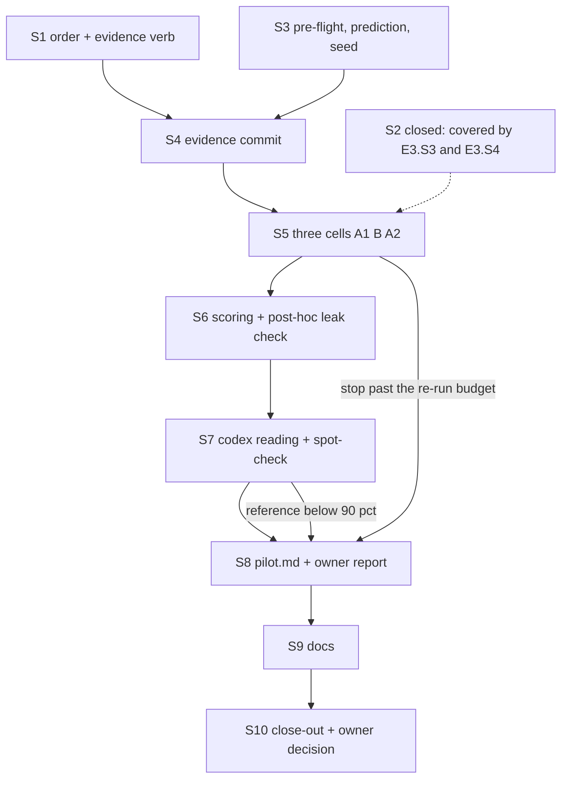

# PLAN — Policy A/B, epic E5: the pilot run and its record

> Status: **plan only, nothing implemented yet, 2026-10-14.** Epic E5 of [PLAN_subagent_policy_ab.md](PLAN_subagent_policy_ab.md).
>
> Scope: §4 steps 6–10 and §8 unit 9 of the parent plan — the evidence commit, the three attended cells (A1, B, A2 in a seeded
> order), mechanical scoring, the codex requirement reading with its ≥ 90 % reference gate and the main session's spot-check,
> `research/policy-ab/pilot.md` with the owner's go/no-go report, and the docs. Mostly OPERATION; two small code stories (S1, S2),
> one judge-drafted record (S8) and one docs story (S9). Not a cornerstone area — E5 marks no cornerstone; the parent's ledger
> reads `Cornerstones: 2 of 3 — E2.S4, E4.S3`. Aligned 2026-10-14 with the parent's decisions D9–D23: §8 below records how each
> defect this document found was settled (D16 order and prediction, D17 pin-changing fixes, D18 post-exit step, D19 edit bound,
> D20 docs).
>
> Related: [module_scouts.md](../research/module_scouts.md), [module_tests.md](../research/module_tests.md),
> [architecture.md](../research/architecture.md), [PLAN_code_lane.md](PLAN_code_lane.md),
> [PLAN_scout_model_calibration.md](PLAN_scout_model_calibration.md), the scouts' pilot record
> [scout-calibration/pilot.md](../research/scout-calibration/pilot.md) (the model this pilot's record follows).

## 1. What this epic delivers, before any step

The owner asked whether the new subagent-model policy delivers a story as well as the old one, faster and cheaper (parent §1).
E1–E4 build an instrument to answer that; **E5 runs it once on one story and reports whether the instrument works** — not which
policy is better. One run per arm cannot estimate variance (parent §4, `MEASURED_LESSONS.md` §1), so every number E5 publishes
carries the label ***instrument check — not a comparison***, and the A/A pair (A1, A2) is reported as *how far two runs of the same
arm land apart on this story — a first look, not a variance estimate*.

E5 is done when the owner holds a `pilot.md` in which each of the parent's nine §4 go rows (parent `:530-538`) has a verdict and
the evidence it rests on, plus a short report in the owner's terms — quality, speed and cost per arm — and has answered go / no-go
on the series (E6).

**Dependencies on E1–E4** are named by story id (linked 2026-10-14).

## 2. Preconditions — what E1–E4 must have left behind

E5 spends money only after every row below is true at the pilot branch's HEAD. S3 ticks them one by one.

| # | Precondition | Owner | Checked by |
|---|---|---|---|
| P1 | `research/policy-ab/stories.json` committed — tree hash, P verified, statement (model lines struck, parent D14) + scope note leak-checked and hashed, R1…Rk, the two-axis hold-out classification with reasons, reference-only tokens, gates at P twice and at S, red-at-P / green-at-S per hold-out file | E1.S13 (`prepare`, E1.S11–S12) | `git log -1 -- research/policy-ab/stories.json` |
| P2 | `research/policy-ab/arms.json` committed — conventions shas `d88e293^` / `ea3252f`, every overlay file's byte SHA-256, both hooks' and the pinned settings' hashes | E1.S13 (E1.S6, E1.S11) | same |
| P3 | `research/policy-ab/prices.json` with the **Fable** row (URL, date) committed before any cell of either arm | E1.S13 | its commit precedes every `cells.jsonl` commit |
| P4 | `rules-probe` passed in BOTH arms (the effort pin's denial included) and the live `xhigh` break-it was caught; `pins.json` committed; streams and audit logs committed as scrubbed fixtures | E3.L1, E3.L2, E3.S9 | the fixtures under `tests/Bench.Tests/Fixtures/` and E3's record |
| P5 | `research/policy-ab/access-check.md` — each read route against every target (parent D23), every status known, no content returned undetected, the OS-boundary row if shell reads were open | E3.L3 | the file |
| P6 | The fairness check: the reference and the hand-made valid alternative scored Success through the mechanical gate; one dry `read` over the reference alone parsed | E4.S6, E4.S9 | E4's record |
| P7 | `bench policy run`, `score`, `sheet`, `read` exist, tested, catalogued in `research/module_tests.md` by their own stories (parent D20) | E3.S3, E4.S5, E4.S8, E4.S9 | `ModuleTestsCatalogTests` green |
| P8 | `run`'s ceiling check (parent §3.9) sums E3's live probe spend too, not only cells (`kind`-tagged lines, parent D23) | E3.S2 | read `run`'s source and its test |
| P9 | A post-exit settle step exists: candidate diff, E2.S7's verdict applied to the cell, the `settled` and `verdict` lines of `cells.jsonl` | E3.S3, E3.S4 (parent D18) | read E3's stories document |

## 3. Ground rules for every attended step

### 3.1 Money

| Item | Cap | Reserved (cap × 1.2) |
|---|---|---|
| E3's live pre-flight (rules-probe × 2, the `xhigh` break-it, access-check) — **already spent before E5** | $13 | $15.60 |
| Cells A1, B, A2 | 3 × $40 | $144.00 |
| One stop-and-re-run generation | $40 | $48.00 |
| **Ceiling** (parent §3.9) | | **$207.60** |

- `--max-budget-usd 40` per cell, wall **120 min** per cell, identical for both arms, frozen in the evidence commit (S4).
- Before each launch `run` refuses when recorded spend + $48 would pass $207.60. Recorded spend = each settled run's
  `total_cost_usd`, or its whole cap × 1.2 when no result survived (unknown cost).
- Codex (the reader) is reported apart — never inside an arm or the ceiling.
- The ceiling funds exactly **one** re-run generation. A second stop of any kind halts the pilot (§3.2). A stop whose fix moves a
  committed pin invalidates the earlier cells: all re-run only if recorded spend + their reservations stay within $207.60, else
  no-go (parent D17).

### 3.2 Stops — what the main session does when one fires

From parent §3.6. A stop leaves the cell unscored and halts the campaign; nothing launches until the row below is
done. Outcomes — the wall reached, the cap exhausted, a failed build, red tests — are **not** stops: they are scored with their
cost and time.

| Stop | Action |
|---|---|
| A leak detected (`CommandAudit`/`PathAudit` stop, the audit log named in a tool input, a strong post-hoc hit) | Pilot halts. **No re-run.** Go row 6 fails; `pilot.md` names the route; the owner decides on a re-pilot. |
| A pin moved — CLI version, resolved `opus`/`sonnet`/`fable` ids, settings, overlay, audit-hook, effort-pin, prompt or tree hash, `system/init` lists | Pilot halts. The earlier cells ran under the old pin: all cells re-run under the new one only if recorded spend + their reservations stay within $207.60 — in practice they do not — else **no-go**, the owner decides on a re-pilot under new pins (parent D17). |
| The arm's rule not loaded (`PolicyRuleReached` false) | **STOP and a no-go** (parent D9): native discovery is mechanical, so a session without its rule is a broken instrument. Pilot halts; `pilot.md` names it; the owner decides on a re-pilot. |
| Tampering — an edit of `.claude/settings.json`, `.claude/hooks/**`, an overlay rule file, or any touch of the audit log (parent D12) | As the leak row: pilot halts, no re-run. |
| `model_refusal_fallback` anywhere | Re-run once as the re-run generation, counted (parent `:380-381`). |
| Any effort other than `high`, or a main session with no effort record | Configuration defect: the cause is fixed **with a RED test first** (testing rule); re-run as the generation if the fix moves no committed pin, else as the pin row (D17). An unobserved child or an effort-pin denial is NOT a stop — counted (parent D10, D15). |
| A backgrounded agent | As the effort row (the cause is the child environment, parent §3.3). |
| A cost-check gap > 2 % | As the effort row (the scouts' precedent: a CLI rate the price table did not carry — `research/scout-calibration/pilot.md` §3). |
| A second stop, or a stop after the re-run generation is spent | Pilot halts; **no-go**, naming both stops. |

**A content flag is not a stop** (parent §3.5 `:321`): the cell is unscored until the **attending operator** reads the flagged
hunk and clears it (reason recorded) or voids it. A voided cell takes the one re-run generation. A later command that runs a
flagged file IS a stop (leak row).

### 3.3 Commits, processes, files

- Work in a task worktree on its own branch (`.claude/rules/shared/common/task-lifecycle.md` §1), branched from `main` after
  E1–E4 merged. Every record lands through that branch's pull request.
- Commit **by path**: `git commit -m "<msg>" -- <paths>`. Never `git add -A` / `git commit -a` in the benchmark worktree.
  (Inside a CELL tree `git add -A` is the parent's own candidate extraction, §3.3 `:276` — a different tree.)
- Before every records commit: stage the paths, then `./hosts/Cli/bin/Release/net10.0/bench.exe scouts hygiene` — a model can
  write a home path or a machine path into its code, and every chosen repository is public. Exit 1 → the hit is read and the
  record redacted before the commit.
- Raw streams, audit logs, the codex batch folder and the artefact root are **never** committed (parent §3.12 `:501-502`).
- A cell is stopped only through its OWN process (the `run` verb's process tree, by PID) — **never by image name**. The main
  session never sets git identity; the cells' `GIT_AUTHOR_*`/`GIT_COMMITTER_*` are the child environment's (parent §3.3).
- Deletion only by exact path, from Windows (`Remove-Item -LiteralPath <exact>`), never from WSL, never by pattern.
- One cell at a time, attended, never alongside a build or a test suite (parent §3.3 `:265-266`, `PLAN_code_lane.md` §4.2).

## 4. Order

S1 is code and may run in parallel with E3/E4's tail; S2 is closed (parent D18). A halt at S5 or a failed reference gate at S7 still goes to S8:
a no-go is written up, never left as an unfinished run.

## 5. Stories

### E5.S1 — The seeded cell order and the evidence manifest

- **Goal.** The three-cell order is drawn reproducibly from a seed that was committed **before** the draw, and `run` launches
  only the next cell of that order, under the cap and wall frozen in one committed manifest.
- **Scope.**
  - New pure `PolicyPilotOrder.Draw(seedText)` beside E1's policy domain types: seed = the first 8 bytes of
    `StableHash.Of(seedText)` (`src/Bench.Domain/StableHash.cs:18`) → `new SeededDraws(seed)` (`src/Bench.Domain/SeededDraws.cs:10`);
    `Below(3)` (`:34`) is B's position (1, 2 or 3); the two A cells take the other positions and are named A1, A2 in run order.
    The parent's D16: `SeededDraws`, because `new Random(seed)`'s sequence is not a documented contract (`SeededDraws.cs:5-8`)
    — the order must replay on any runtime; the seed is committed with the prediction BEFORE the draw.
  - New record `PolicyEvidence` and sub-verb `bench policy order` writing `research/policy-ab/evidence.json`: cap $40, wall
    120 min, ceiling $207.60; the seed text and the drawn order; pins — `claude --version`, the executable's path and SHA-256,
    the resolved `opus`/`sonnet`/`fable` ids from the rules-probe fixtures, and the SHA-256 of `stories.json`, `arms.json`,
    `prices.json`, `prediction.md`, the pinned settings file and every file under `prompts/policy-ab/`.
    `order` refuses (exit 4) when `research/policy-ab/prediction.md` is missing, uncommitted or dirty at HEAD, when it carries
    no seed line, and when `evidence.json` already exists (written once, the `ScoutArtifacts.ExplicitEffort()` rule,
    `src/Bench.Infrastructure/Scouts/ScoutArtifacts.cs:183`).
  - `run` (E3) widened: cap, wall and cell order come from `evidence.json`; a `--cap`/`--wall` flag that disagrees is refused;
    a cell that is not the next unsettled position is refused naming the expected one; any manifest hash that differs from
    the file on disk is refused as a moved pin.
  - The `order` row in `research/module_tests.md`'s policy sub-verb table (the catalogue rule, `research/module_tests.md:156-158`).
- **The brief** (written by the Opus judge before the coder starts; the coder re-discovers nothing): the files above; the seed
  derivation exactly as stated; `Outcome<T>` for every refusal (CLAUDE.md §5); complexity ≤ 4; the verb's exit codes follow
  the scouts' (`0` written · `4` configuration); the scenarios below are the acceptance list.
- **Checks / tests** (test executable, never `dotnet test`):
  - A fixed seed text gives the same order in two processes; the order for three pinned seed texts is a golden value.
  - Over 3 000 seed texts B lands in each position 1/3 ± 2 %.
  - A1 is always the earlier A position; no order repeats an arm id.
  - `order` refuses: no prediction file; prediction modified after its commit; no seed line; `evidence.json` already present.
  - `run` refuses: cell 3 before cell 1; `--cap 50` against a manifest of 40; a prompt file edited after the manifest.
  - Break-its (red with the real symptom, then restored): a draw that ignores the seed (B always at 1) fails the distribution
    test; `run` without the order check lets the third cell launch first.
- **Done when.** The tests above green; the scouts suite unchanged; `ModuleTestsCatalogTests` green with the `order` row.
- **Depends on.** E3.S3 (the `run` verb), E1.S13 (the record files the manifest hashes), E3.S6 / E3.L1 (`pins.json` — the resolved ids).
- **Model.** Judge: opus (scenarios + brief) → Coder: sonnet → Judge: opus (review) → Coder: sonnet (fixes).

### E5.S2 — Settling a finished cell — CLOSED: covered by E3.S3 and E3.S4 (parent D18)

- **Closed 2026-10-14, no code.** The post-exit step is E3's: E3.S3 step 7 extracts the candidate (`PolicyCandidate.Split` drops
  overlay sections), copies the audit log and writes the `settled` spend line; E3.S4 reads E2.S7's `PolicyCellVerdict` and writes
  `verdict.json` and the `verdict` line of `cells.jsonl`, exiting 3 on any stop. What follows is kept as the checklist the main
  session ticks against E3's merged code before S3 — a field missing there goes back to E3.S4, never into a second settle step.
- **Goal (as checked).** After a cell's process exits, one step turns its tree, stream and audit log into the candidate diff and
  complete `cells.jsonl` lines — or a stop — with no hand step in between.
- **Scope.**
  - The candidate: `git add -A` + `git diff --cached --binary <base>` in the cell tree (a commit the session made is included);
    hunks touching overlay paths dropped and listed; a docs-stripped copy (parent §3.7 `:402-404`) for committing.
  - The read-back: `ClaudeSubagents.Read` (`src/Bench.Domain/Probes/ClaudeSubagents.cs:29`) with E2's widened `MainToolCall`;
    E2's `PolicyAudit` (effort, unobserved children, contrast, compliance counts), `PolicyRuleReached`, `CommandAudit` with the
    content scan, the widened `PathAudit` (`src/Bench.Domain/Scouts/PathAudit.cs:49`, `:54-62`); tokens and cost by
    `ScoutTokens.Attribute` (`src/Bench.Domain/Scouts/ScoutCost.cs:83`) and `ScoutCost.Check` (`:208`) against `prices.json`
    with its Fable row; stop semantics as `ScoutReason.IsStop` (`src/Bench.Domain/Scouts/ScoutReason.cs:86`).
  - One `cells.jsonl` row (parent §3.12 `:499-500`): arm, story, position, generation, pins, outcome, wall, `duration_api_ms` and
    `num_turns` as captured-or-not, cost total and per model with cache read/write apart, Agent calls by (type × resolved model),
    effort levels seen, unobserved children, the main session's own edits, the delegation share, guard denials (B), the
    `system/init` lists, `modelUsage`'s internal Haiku calls apart, content flags, the stop reason if any.
- **Where each check lives.** Every rule is E2's (a hole goes back to E2.S4, the cornerstone); the composition and its tests are
  E3.S3's and E3.S4's (`The_candidate_drops_overlay_sections_and_keeps_every_other_byte`, `A_cell_without_an_audit_log_is_never_scored`,
  `A_model_refusal_fallback_in_the_stream_exits_3`, …).
- **Done when.** The main session has read E3.S3/E3.S4's merged tests against the field list above and found every field; a
  missing one is filed against E3.S4.
- **Depends on.** E3.S3, E3.S4; E2.S7.
- **Model.** Main session (a read of merged code; no edit).

### E5.S3 — Pre-flight, the prediction and the seed (attended)

- **Goal.** Before any money: every §2 precondition true on this machine today; a written prediction; the seed fixed — all
  committed **before** the order is drawn, so the seed cannot be chosen after seeing the order.
- **Steps.**
  1. Build and run the whole suite once, before the cells and never during them:
     `node .claude/rules/shared/tools/low-priority.mjs dotnet build dew_flow_benchmark.slnx -c Release -m:4`, then
     `node .claude/rules/shared/tools/low-priority.mjs ./tests/Bench.Tests/bin/Release/net10.0/Bench.Tests.exe`. Green, the
     scouts suite unchanged.
  2. Tick P1–P9 of §2 (`git log -1 -- <path>` per record).
  3. Machine: `claude --version` equals the rules-probe's recorded version; `(Get-Command claude).Source` and its
     `Get-FileHash` noted for S1's manifest; the operator holds CLI auto-updates for the pilot window (their setting, their
     call — the manifest's pin check is the backstop); `codex --version` answers; free space on the trees-root drive ≥ 15 GB
     (`Get-PSDrive`; parent §3.13 projects ~13 GB worst case); the operator confirms nothing else is building or testing —
     asked, never enforced by killing anything.
  4. Money: recorded E3 spend + 3 × $48 + $48 ≤ $207.60 (§3.1). If E3's real spend is lower, the margin is noted, not spent.
  5. Write `research/policy-ab/prediction.md` (parent D16; the measurement rule's §4) — one file, ≤ 50 lines, bounded before
     starting, so inside the main session's edit bound: per cell the expected spend and wall ranges; per arm the expected children by (type × model); whether A launches Fable and on what; whether B shows a
     Sonnet coder, a brief before it and an Opus review; whether each arm reaches Success; the coverage range expected; the go
     rows most at risk, and why. Last line: `seed: policy-ab-pilot-creds-176-<yyyy-mm-dd>`.
  6. Commit it alone: `git commit -m "docs(policy-ab): pilot prediction and seed, before the draw" -- research/policy-ab/prediction.md`
     (hygiene scan first).
- **Done when.** The commit exists; every precondition row ticked with its evidence (kept for `pilot.md` §4).
- **Depends on.** E1.S13, E2.S1–E2.S8, E3.S1–E3.S9 with E3.L1–E3.L3, E4.S1–E4.S9 (E4.S6's fairness record included); E5.S2's
  checklist ticked.
- **Model.** Main session (attended).

### E5.S4 — The evidence commit (attended)

- **Goal.** Caps, wall, every pin and the drawn order frozen in one commit before cell one (parent §4 step 6, DoD `:718-719`).
- **Steps.**
  1. `./hosts/Cli/bin/Release/net10.0/bench.exe policy order` with the prediction file and the artefact root as its inputs
     (flag spellings are S1's) → `research/policy-ab/evidence.json`; read the printed order aloud into the session log.
  2. `git commit -m "docs(policy-ab): evidence — caps, wall, pins, the drawn three-cell order" -- research/policy-ab/evidence.json`
     (hygiene scan first).
  3. From this commit until `pilot.md` lands nothing under `prompts/policy-ab/`, `arms.json`, `stories.json`, `prices.json` or
     the pinned settings changes — a change there is a moved pin (§3.2).
- **Done when.** The commit exists and its order is the one `run` will enforce.
- **Depends on.** E5.S1, E5.S3.
- **Model.** Main session (attended).

### E5.S5 — The three cells (attended)

- **Goal.** A1, B and A2 run back to back in the drawn order, each settled into `cells.jsonl`, each checked by hand for policy
  compliance, each committed before the next starts.
- **Per cell, in order:**
  1. `./hosts/Cli/bin/Release/net10.0/bench.exe policy run` for the next position (cap, wall and order from `evidence.json`).
     Launched in the background so the session can watch; `run` prints its ceiling check — the main session copies the number
     into its log.
  2. **Watch** (the operator attends; parent `:265`): the main session tails `stream.ndjson` and `.git/policy-audit.ndjson`
     under the artefact root at intervals, read-only. It never touches the cell tree. A live sighting of a network verb, a path
     outside the tree, an effort other than `high` or an `async_launched` Agent result → stop the cell through its own process
     (by PID) and treat it as §3.2; the settle step decides formally.
  3. After exit: `run` itself settles the cell (E3.S3/E3.S4, parent D18); read the `verdict` line; a stop → §3.2 before anything
     else.
  4. **Hand-read every Agent prompt** of the cell (parent §3.6) — by an Opus judge agent the main session dispatches, the main
     session verifying (parent D19) — and classify each launch against the arm's rule —
     A: children on Opus; each Fable launch's stated reason checked against A's carve-out (security, cryptography, authn/authz,
     new architecture); a Sonnet child is a deviation. B: every launch named an alias; Sonnet children that wrote code; read-only
     children per model; a brief/scenarios before a coder; an Opus review; whether the main session stayed within one file and
     50 lines; Fable launches and their reason. Write the classification to `research/policy-ab/compliance.md` (one section per
     cell; now in parent §3.12's list).
  5. Content flags: the attending operator reads each flagged hunk and clears or voids it; reason in `compliance.md`.
  6. Commit: `git commit -m "data(policy-ab): cell <position> (<arm>) settled" -- research/policy-ab/cells.jsonl
     research/policy-ab/candidates/<cell id>.diff research/policy-ab/compliance.md` — the docs-stripped candidate only; never the
     stream or the audit log (hygiene scan first).
  7. Only then the next cell.
- **Done when.** Three cells settled and committed — or the pilot halted under §3.2 with its no-go named (then straight to S8).
- **Depends on.** E5.S4; E3.S3 and E3.S4 (`run` with its settle step).
- **Model.** Main session (attended).

### E5.S6 — Mechanical scoring and the post-hoc leak check (attended)

- **Goal.** Every candidate and the reference scored per hold-out FILE; every candidate checked for reference-only tokens.
- **Steps.**
  1. `./hosts/Cli/bin/Release/net10.0/bench.exe policy score` for each settled cell and for the reference — attended (the code it
     builds is model-authored, `PLAN_code_lane.md:114-135`), one at a time, nothing else running.
  2. Read per candidate: Success, *interface mismatch* per hold-out file, own suite, teeth, neighbours against the twice-run
     baseline, beyond-spec green ÷ compiled (parent §3.7).
  3. Post-hoc leak check per candidate (parent §3.5, E2.S8): a hit → reported, reviewed by the operator; a strong hit (one
     reference-only comment phrase, or ≥ 3 distinct reference-only identifiers) → VOID → §3.2 leak row.
  4. Capture row (go row 7): diff present, cost check ≤ 2 % per cell, time and tokens per model present — and the same fields
     present and readable in both A cells.
  5. Commit: `git commit -m "data(policy-ab): mechanical scores and the post-hoc leak check" -- research/policy-ab/cells.jsonl`.
  6. Remove each scoring copy by exact path once its scores are committed (parent §3.13).
- **Done when.** Four score rows (three candidates + reference) committed; every post-hoc hit has a recorded review.
- **Depends on.** E5.S5; E4.S5 (`score`); E2.S8 (the post-hoc check); E1.S9/E1.S13 (the reference-only tokens in `stories.json`).
- **Model.** Main session (attended).

### E5.S7 — The codex reading, the reference gate and the spot-check (attended)

- **Goal.** Another vendor reads the three candidates and the reference, blind, against R1…Rk in ONE batch; the reference must
  read ≥ 90 % met; every *not met* is spot-checked by the main session (owner decision D7).
- **Steps.**
  1. `./hosts/Cli/bin/Release/net10.0/bench.exe policy sheet` → `research/policy-ab/reading-sheet.md` and the assessment tree.
     Read the sheet once for leaked labels — an arm name, a model name, a dollar figure, a duration, a cell id (E4's
     planted-string test covers the code; this is the live check).
  2. `./hosts/Cli/bin/Release/net10.0/bench.exe policy read` → one codex batch. A refused answer is re-asked once by the verb;
     refused twice → coverage *not captured* → go row 8 fails.
  3. **Reference gate**: below 90 % met → **no-go** (the checklist or the reader is broken); no candidate's coverage is read;
     straight to S8.
  4. **Spot-check, before opening the id → arm key** (it is in the batch folder; nobody opens it until `handcheck.md` is
     committed): every *not met* — candidates' and reference's — checked against the candidate's files by an **Opus judge agent**
     the main session dispatches, which writes agree / disagree with the reason into `handcheck.md` under the label *"a model
     checking a model — weaker than a human reading, the owner's choice (D7)"*; the main session only verifies (parent D19, the
     edit bound of `.claude/rules/shared/common/subagent-models.md`). Disagreements are reported; the verdict is not overwritten.
  5. Codex spend recorded apart: the tokens codex reports, or *subscription — dollars not captured*; `codex --version` and the
     model noted.
  6. Commit: `git commit -m "data(policy-ab): codex reading, reference gate, spot-check" -- research/policy-ab/reading-sheet.md
     research/policy-ab/handcheck.md research/policy-ab/cells.jsonl`. Then remove the assessment tree by exact path.
- **Done when.** The reading parsed for all four; the gate's number recorded; every *not met* has a spot-check line.
- **Depends on.** E5.S6; E4.S7, E4.S8, E4.S9 (`PolicyRequirementReading`, `sheet`, `read`); E3.S6's `pins.json` (the model ids
  `sheet` scrubs); codex on this machine.
- **Model.** Main session (attended, runs the verbs and verifies); the spot-check: Judge: opus.

### E5.S8 — `pilot.md` and the owner's report

- **Goal.** `research/policy-ab/pilot.md` with every section of §6 below and the owner's report of §7 — a verdict per go row,
  each citing a committed record, never the session's memory.
- **How.** An Opus judge subagent drafts it **from the committed records only** (`evidence.json`, `prediction.md`,
  `cells.jsonl`, `compliance.md`, `access-check.md`, `reading-sheet.md`, `handcheck.md`, the rules-probe fixtures, E4's
  fairness record) and gives each go row its verdict — verifying rows is a judge's work, and a judge that did not run the cells
  reads the records as the owner will. The main session then checks every number in the owner table against `cells.jsonl` and
  every go verdict against its evidence; every correction goes back to the judge (parent D19 — the main session only verifies).
- **Commit.** `git commit -m "docs(policy-ab): the pilot record and the go/no-go report" -- research/policy-ab/pilot.md`.
- **Done when.** Every §6 section present; every one of the nine go rows has a verdict and an evidence path; every cell carries
  the *instrument check* label; coverage says *codex-read*; a no-go names its row and its fix.
- **Depends on.** E5.S7 (or an earlier halt).
- **Model.** Judge: opus (draft and row verdicts) · Main session (attended) — the check against the records.

### E5.S9 — Docs

- **Goal.** `research/` describes the Policy section as it is after the pilot; both sibling plans carry the parent's §7 boundary
  table (planning-docs: both sides).
- **Scope** (anchors verified 2026-10-14 at `6cd59ad`):
  - `research/module_policy_ab.md` — complete it (the first code story created it and every story grew it, parent D20): purpose; a
    Mermaid flow (prepare → overlay → run → settle → score → sheet → read); core entities (`PolicyOverlay`,
    `PolicyPinnedSettings`, `PolicyAudit`, `PolicyRuleReached`, `CommandAudit`, `PolicyRequirementReading`/`Reader`,
    `PolicyPilotOrder`, `PolicyEvidence`, the records under `research/policy-ab/`); every `bench policy` sub-verb with exit
    codes; external dependencies (the claude CLI version, codex, conventions `d88e293^`/`ea3252f`, the creds mirror); what the
    pilot corrected; what does NOT exist yet (parent §12).
  - `research/architecture.md` — a Policy row in the module map after the Scouts row (`:111`); a section *"The policy A/B — a
    fourth sibling context"* between the scout section (`:1155-1193`) and *Guards that shape the API* (`:1194`), saying what it
    composes and what it adds; a bullet under *What does NOT exist yet* (`:1223`) for the series.
  - `research/module_tests.md` — the policy sub-verb rows were added by E1/E3/E4 as each verb landed (the catalogue rule,
    `:156-158`); here: each row's status and test name re-checked, the status line (`:3-5`) dated, and *What the harness does
    NOT prove* (`:145-154`) gains: that a real claude cell behaves as the replayed streams; that a real codex reads as the fake
    replies; the OS-level boundary.
  - `research/module_scouts.md` — checked, not rewritten: each widening (`KeepProjectSettings`, `Explicit(effort, models)`,
    `PathAudit`'s parameters, `ForPolicyArm`, `MainToolCall`'s fields) is described; a missing one is added.
  - `research/README.md` — a `module_policy_ab.md` row in *Currently here* after `module_scouts.md` (`:20`).
  - `todo/README.md` — the parent's row (`:82`) restated to the pilot's outcome; the E1–E5 stories documents' rows current.
  - `todo/PLAN_code_lane.md` — a new `## 11. Boundaries with other plans` after `## 10. Open questions` (`:293-308`) carrying the
    parent §7 rows that concern it (signals 3–4 built by the policy plan, consumed here; the sandbox §4.2 stays this plan's),
    linking [PLAN_subagent_policy_ab.md](PLAN_subagent_policy_ab.md); its status line (`:3-11`) no longer lists signals 3–4 as
    open if E4 built them.
  - `todo/PLAN_scout_model_calibration.md` — a new `## 9. Boundaries with other plans` after `## 8. Definition of Done`
    (`:631-667`): history-free trees, the confined launch, pins and the explicit-effort file are this plan's; the policy plan
    widens them additively and the scouts suite is the proof; the scout half of the rule stays here.
- **The brief.** Written by the Opus judge from the merged code and the committed records; the coder writes the text. Shortening
  keeps every qualifier (knowledge-base rule); Mermaid must render.
- **Checks.** `node .claude/rules/shared/tools/plan-lifecycle.mjs` exits 0; `ModuleTestsCatalogTests` green; every new relative
  link resolves; both boundary tables link the parent and the parent's §7 already links them.
- **Done when.** The checks pass and the judge's review found no sentence describing something that does not run.
- **Depends on.** E5.S8; E1–E4 merged.
- **Model.** Judge: opus (brief) → Coder: sonnet → Judge: opus (review) → Coder: sonnet (fixes).

### E5.S10 — Close-out and the owner's decision (attended)

- **Goal.** Nothing the pilot created is left behind by accident; the owner has decided; every status line says so.
- **Steps.**
  1. Remove by exact path, each after its records are committed: the cell trees; any scoring copy or assessment tree still
     present; the claude per-project folders of the cell paths (each slug computed from its cell path, listed, then removed one
     by one — nothing else under `~/.claude/projects`). The frozen pilot tree only **after** `pilot.md`'s pull request is
     merged (parent §3.13 `:508`). Streams and audit logs stay local until promotion.
  2. Ask the owner once, with the link to `pilot.md` and §7's report: go / no-go on the series; the OS-level boundary if row 6
     requires it; resized caps and walls if row 9 requires them. Record the answer verbatim in `pilot.md` *The owner's decision*.
  3. Status lines: the parent (`todo/PLAN_subagent_policy_ab.md:3-7`) and E1–E5's documents — the pilot's date, the verdict, the
     owner's decision. **Go**: the plan stays in `todo/` and E6's stories document is written next. **No series**: the parent and
     E1–E5's documents are promoted together (planning-docs), E6 recorded as not built, with the reason.
  4. `node .claude/rules/shared/tools/plan-lifecycle.mjs` exits 0; the pull request merged per the family's PR rules.
- **Done when.** §9's last lines ticked.
- **Depends on.** E5.S9.
- **Model.** Main session (attended).

## 6. `pilot.md` — required sections

Path `research/policy-ab/pilot.md`, modelled on `research/scout-calibration/pilot.md`. Status line:
`> Status: **the pilot ran <dates>; instrument check — not a comparison.** Verdict: GO | NO-GO (<row>).`

| § | Section | Must contain | Go row it carries |
|---|---|---|---|
| 1 | **The owner's report** | §7 below, first, in the owner's terms | all — the summary |
| 2 | What ran | table: step, verb, cell, generation, spent, wall; total against $207.60; codex apart; the pins (CLI version and executable hash, resolved ids, settings / overlay / audit-hook / prompt / tree hashes); the seed text, the draw and the order, with the commits that fixed them | — |
| 3 | Prediction against observed | every line of `prediction.md` beside what happened | — (measurement §4) |
| 4 | The pre-flight | rules-probe per arm: `InstructionsLoaded` of the arm's `subagent-models.md` with its byte hash; B's no-model launch denied with `subagent-models.md:`, A's child on the Opus id; every logged effort `high`, hook and transcripts agreeing; `system/init` identical; the `xhigh` break-it caught naming the level; the fairness check | 1, 2, 5, 8 |
| 5 | The three cells | per cell: outcome, wall, cost (total, per model, cache apart), turns, API time, Agent calls by (type × model), effort levels, unobserved children, main-session edits, delegation share, guard denials, Haiku internals apart, `InstructionsLoaded` with the byte hash; compliance per arm from `compliance.md`; the contrast (A ≥ 1 child; B ≥ 1 Sonnet coder) — or a plain sentence saying what was actually compared | 1, 3, 4, 5 |
| 6 | Scoring | per candidate and the reference: Success, interface mismatch per hold-out file, own suite, teeth, neighbours, beyond-spec; the hold-out red at P / green at S from `stories.json` | 8 |
| 7 | The codex reading | coverage per candidate, labelled *codex-read*; the reference's % against the 90 % gate; spot-check counts agree / disagree with the disagreements listed; refusals and re-asks; codex version, model and spend apart | 8 |
| 8 | The leak boundary | `access-check.md` per route (protected / detected-only / inconclusive); per-cell `CommandAudit` / `PathAudit` results; every content flag with its clearance; post-hoc hits and their review; **the row "the series needs an OS-level boundary"** when shell reads of the original clones or `~/.claude` were open | 6 |
| 9 | A/A | A1 against A2 on every metric of §5–§7; the capture-repeats check (the same fields present and readable in both) | 7 |
| 10 | Caps and walls | each cell against $32 and 96 min; if exceeded, the resized cap and wall (× 1.5 / × 2 of the larger cell) proposed for the owner | 9 |
| 11 | **Go / no-go** | the parent's nine §4 rows, verbatim, each with verdict and the evidence path | 1–9 |
| 12 | What the pilot corrected | each instrument defect found, its RED test and PR — as the scouts' pilot §3 | — |
| 13 | What this does not settle | parent §1 `:39-43` and §6, restated for one run per arm; measurement §3 | — |
| 14 | The owner's decision | filled in S10, verbatim, dated | — |

## 7. The owner's report — the form

The first section of `pilot.md`, short, no jargon a reader must look up.

> **Instrument check — not a comparison.** One run per policy cannot say which policy is better; it says whether the measuring
> works and what one run of each looked like on one story (creds #176, typed stored secrets, 404 changed lines).

| | Old policy, run 1 (A1) | Old policy, run 2 (A2) | New policy (B) | The merged PR (reference) |
|---|---|---|---|---|
| Quality — it builds and the spec's hidden tests pass | yes / no | | | yes |
| Quality — requirements met (read by codex, k items) | m of k | | | m of k (gate ≥ 90 %) |
| Speed — wall time | min | | | — (not comparable) |
| Cost — dollars | $ | | | — (not comparable) |
| Who did the work | e.g. Opus main + n Opus children | | e.g. Opus main + n Sonnet coders + 1 Opus review | — |

Then, each in one or two sentences:

1. **How far apart two runs of the same policy landed** (A1 vs A2: time, cost, quality) — a B − A difference smaller than that is
   not readable.
2. **Did the instrument work?** GO, or NO-GO naming the failing row and its fix.
3. **What the main session recommends**, and why.
4. **What the owner decides**: the series yes / no (18 cells, up to 2 attended hours each, ≈ $300–900 at the pilot-derived cap —
   the ceiling is the owner's number, parent §5); the OS-level boundary, if the leak row requires it; resized caps and walls, if
   the caps row requires them.

## 8. Found while splitting — defects in the parent plan, settled there (2026-10-14)

Line numbers are `todo/PLAN_subagent_policy_ab.md` at `6cd59ad`; each item ends with how the parent settled it.

1. **`Random(seed)`** (`:54`, `:267`, `:846`) contradicts this repository's own rule: `src/Bench.Domain/SeededDraws.cs:5-8` exists
   because `new Random(seed)`'s sequence is not a documented contract. E5.S1 uses `SeededDraws`. → **Parent D16.**
2. **Seed and order committed together** (`:266-269`, `:519-520`, `:845-846`): nothing stops a seed being chosen after its order
   is seen. E5.S3 commits the seed (with the prediction) before S4 draws. → **Parent D16, §3.3, §4.**
3. **No pilot prediction** (`:517-522`, DoD `:718-719`): `.claude/rules/shared/common/measurement.md` §4 is MANDATORY; only the
   series has one (`:548`). E5.S3 writes one. → **Parent D16, §4 step 6, §11.**
4. **The post-exit settle step has no owner** (`:237-240`, `:276-278`, `:622-623`, `:801-802`): candidate extraction, E2's audits
   applied to a finished cell and the per-cell `cells.jsonl` row fall between E2 (pure functions), E3 (`run`: launch, tee, spend)
   and E4 (`score`). → **Parent D18: E3.S3/E3.S4 own it; E5.S2 closed as covered.**
5. **E3's money** (`:798`) said "≈ $14 at cap × 1.2"; the plan's own §3.9 items are $7.20 + $2.40 + $6 = **$15.60** ($13 at cap).
   → **Fixed in the parent's E3 header.**
6. **A stop whose fix moves a committed pin** (`:378-384` vs the ceiling `:459-461`): "re-run as a new generation" puts the earlier
   cells under a different pin, and the ceiling funds one re-run, not three. → **Parent D17: all cells re-run only within the
   ceiling, else no-go (§3.2).**
7. **`module_tests.md` rows deferred to the docs unit** (`:631-632`, `:727`, `:850`): `research/module_tests.md:156-158` requires
   a verb's row in the same task, and `ModuleTestsCatalogTests` reads sub-verbs only from `hosts/Cli/ScoutsCommand.cs`
   (`tests/Bench.Tests/Cli/ModuleTestsCatalogTests.cs:63`) — `bench policy` sub-verbs stay invisible to it until E1/E3/E4 widen
   the derivation as each verb lands. → **Parent D20: E1.S11 widens the catalogue test; every story writes its rows.**
8. **`module_policy_ab.md` created only at the end** (`:631`, `:727`): the knowledge-base rule wants the module doc updated after
   every code change, so E1 should create it and each epic grow it; E5.S9 completes it. → **Parent D20.**
9. **No home for the hand classification of Agent prompts** (`:374-375`, §3.12 `:496-502`): E5.S5 adds
   `research/policy-ab/compliance.md`. → **In the parent's §3.12.**
10. **E5's done-when "§3.13's trees removed"** (`:857`) cannot be met before the merge — §3.13 (`:508`) removes the frozen pilot
    tree only after `pilot.md` is merged. E5.S10 sequences it. → **The parent's E5 done-when now says so.**
11. **The main session's edit bound** (this repository's `subagent-models.md:68-75`) is not reconciled with D7's "the main session
    spot-checks" (`:55`, `:446-447`) and with a main-session-written `pilot.md`. → **Parent D19: an Opus judge writes `pilot.md`,
    `compliance.md` and the spot-check; the main session only verifies (E5.S5, E5.S7, E5.S8).**

## 9. Test plan

- **E5.S1** — the scenarios in the story, from the test executable (never `dotnet test`), each break-it red with the real
  symptom and restored; the scouts suite unchanged; `ModuleTestsCatalogTests` green.
- **The operation stories** have no unit tests; their checks are records: every precondition ticked with its evidence (S3); the
  evidence commit precedes the first `cells.jsonl` commit (S4/S5 — `git log --format=%H -- <file>` order); every cell's row
  complete and its effort audit `high` (S5); four score rows (S6); the reading parsed and the gate recorded (S7); every go row
  with an evidence path (S8); `plan-lifecycle.mjs` exit 0 (S9, S10).
- **Live, once each** (the pilot itself): the drawn order enforced by `run`; the ceiling check printed before every launch.

## 10. Definition of Done

- [ ] E5.S1 built: the order drawn by `SeededDraws` from a seed committed before the draw; `run` enforces order, cap and wall
      from `evidence.json`; tests and break-its green and back.
- [ ] E5.S2 closed as covered by E3.S3/E3.S4 (parent D18), its checklist ticked against E3's merged code.
- [ ] Prediction and seed committed before the draw; `evidence.json` committed before cell one.
- [ ] All three cells (A1, B, A2) settled with `total_cost_usd` (or their unknown charge) within $207.60; the cost check ≤ 2 % per
      cell; every effort record `high`, main session and every observed child; unobserved children counted; no unreviewed content
      flag; a stop handled by §3.2 and counted.
- [ ] Every Agent prompt hand-classified in `compliance.md` by an Opus judge, the main session verifying (parent D19).
- [ ] Four score rows committed; every post-hoc hit reviewed.
- [ ] The codex reading parsed in one batch for three candidates and the reference; the reference ≥ 90 % met (else a named
      no-go); every *not met* spot-checked under the model-checks-model label before the key was opened; codex spend apart.
- [ ] `pilot.md` has every §6 section, the §7 report first, every cell labelled *instrument check*, coverage *codex-read*, the
      A/A spread, the contrast, the caps row and the nine go rows with evidence.
- [ ] Docs per E5.S9: `module_policy_ab.md`, `architecture.md`, `module_tests.md`, `research/README.md`, `todo/README.md`; the §7
      boundary table in `PLAN_code_lane.md` and `PLAN_scout_model_calibration.md`.
- [ ] Cell trees, scoring copies, the assessment tree and the cells' `~/.claude/projects` folders removed by exact path; the frozen
      pilot tree after the merge.
- [ ] The owner's go / no-go recorded in `pilot.md` and the parent's status line; `node .claude/rules/shared/tools/plan-lifecycle.mjs`
      exits 0.
